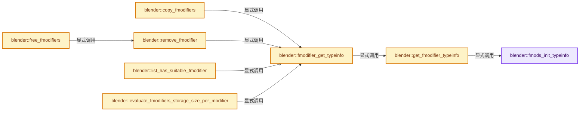
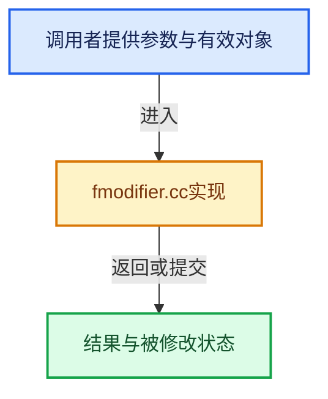

# 实现依赖专题：source/blender/blenkernel/intern/fmodifier.cc

[方向导航](README.md) · [符号索引](../%E7%AC%A6%E5%8F%B7%E4%BE%9D%E8%B5%96%E4%B8%8E%E5%AE%9E%E7%8E%B0%E7%B4%A2%E5%BC%95.md)

本专题从正文实际调用进入，集中保存共享实现。函数有稳定锚点，可从调用处直接跳到对应完整函数；递归与互相调用通过回链组织。

## 本文件的实现关系






## 完整成员与函数实现

<a id="f-1efdf9a1ea101150"></a>

### `blender::fmods_init_typeinfo`

实现位置：[source/blender/blenkernel/intern/fmodifier.cc](../../../../../source/blender/blenkernel/intern/fmodifier.cc) · L1120—L1144。

**教学注释版**

<!-- annotated:b3e7b5af0cece2 -->

```cpp
static void fmods_init_typeinfo()
{
  fmodifiersTypeInfo[FMODIFIER_TYPE_NULL] = nullptr;
  fmodifiersTypeInfo[FMODIFIER_TYPE_GENERATOR] = &FMI_GENERATOR;
  fmodifiersTypeInfo[FMODIFIER_TYPE_FN_GENERATOR] = &FMI_FN_GENERATOR;
  fmodifiersTypeInfo[FMODIFIER_TYPE_ENVELOPE] = &FMI_ENVELOPE;
  fmodifiersTypeInfo[FMODIFIER_TYPE_CYCLES] = &FMI_CYCLES;
  fmodifiersTypeInfo[FMODIFIER_TYPE_NOISE] = &FMI_NOISE;
  fmodifiersTypeInfo[FMODIFIER_TYPE_FILTER] = nullptr;
  fmodifiersTypeInfo[FMODIFIER_TYPE_PYTHON] = nullptr;
  fmodifiersTypeInfo[FMODIFIER_TYPE_LIMITS] = &FMI_LIMITS;
  fmodifiersTypeInfo[FMODIFIER_TYPE_STEPPED] = &FMI_STEPPED;
  fmodifiersTypeInfo[FMODIFIER_TYPE_SMOOTH] = &FMI_SMOOTH;

#ifndef NDEBUG
  /* Check that the array indices are correct. */
  for (int i = 0; i < FMODIFIER_NUM_TYPES; i++) {
    if (!fmodifiersTypeInfo[i]) {
      continue;
    }
    BLI_assert_msg(i == fmodifiersTypeInfo[i]->type,
                   "fmodifiersTypeInfo should be indexed by the modifier type number");
  }
#endif
}
```

<details>
<summary>核对原始源码：source/blender/blenkernel/intern/fmodifier.cc · L1120—L1144</summary>

<!-- original:b3e7b5af0cece2:source/blender/blenkernel/intern/fmodifier.cc:1120:1144 -->

```cpp
static void fmods_init_typeinfo()
{
  fmodifiersTypeInfo[FMODIFIER_TYPE_NULL] = nullptr;
  fmodifiersTypeInfo[FMODIFIER_TYPE_GENERATOR] = &FMI_GENERATOR;
  fmodifiersTypeInfo[FMODIFIER_TYPE_FN_GENERATOR] = &FMI_FN_GENERATOR;
  fmodifiersTypeInfo[FMODIFIER_TYPE_ENVELOPE] = &FMI_ENVELOPE;
  fmodifiersTypeInfo[FMODIFIER_TYPE_CYCLES] = &FMI_CYCLES;
  fmodifiersTypeInfo[FMODIFIER_TYPE_NOISE] = &FMI_NOISE;
  fmodifiersTypeInfo[FMODIFIER_TYPE_FILTER] = nullptr;
  fmodifiersTypeInfo[FMODIFIER_TYPE_PYTHON] = nullptr;
  fmodifiersTypeInfo[FMODIFIER_TYPE_LIMITS] = &FMI_LIMITS;
  fmodifiersTypeInfo[FMODIFIER_TYPE_STEPPED] = &FMI_STEPPED;
  fmodifiersTypeInfo[FMODIFIER_TYPE_SMOOTH] = &FMI_SMOOTH;

#ifndef NDEBUG
  /* Check that the array indices are correct. */
  for (int i = 0; i < FMODIFIER_NUM_TYPES; i++) {
    if (!fmodifiersTypeInfo[i]) {
      continue;
    }
    BLI_assert_msg(i == fmodifiersTypeInfo[i]->type,
                   "fmodifiersTypeInfo should be indexed by the modifier type number");
  }
#endif
}
```

</details>

**沿实际写入检查状态**

- `fmodifiersTypeInfo[FMODIFIER_TYPE_NULL] = nullptr;`
- `fmodifiersTypeInfo[FMODIFIER_TYPE_GENERATOR] = &FMI_GENERATOR;`
- `fmodifiersTypeInfo[FMODIFIER_TYPE_FN_GENERATOR] = &FMI_FN_GENERATOR;`
- `fmodifiersTypeInfo[FMODIFIER_TYPE_ENVELOPE] = &FMI_ENVELOPE;`
- `fmodifiersTypeInfo[FMODIFIER_TYPE_CYCLES] = &FMI_CYCLES;`
- `fmodifiersTypeInfo[FMODIFIER_TYPE_NOISE] = &FMI_NOISE;`
- `fmodifiersTypeInfo[FMODIFIER_TYPE_FILTER] = nullptr;`
- `fmodifiersTypeInfo[FMODIFIER_TYPE_PYTHON] = nullptr;`
- `fmodifiersTypeInfo[FMODIFIER_TYPE_LIMITS] = &FMI_LIMITS;`
- `fmodifiersTypeInfo[FMODIFIER_TYPE_STEPPED] = &FMI_STEPPED;`
- `fmodifiersTypeInfo[FMODIFIER_TYPE_SMOOTH] = &FMI_SMOOTH;`

**继续追踪实现**

- `BLI_assert_msg` → [BLI_assert_msg · L55](../01-%E5%9F%BA%E7%A1%80%E5%AE%B9%E5%99%A8%E4%B8%8E%E7%8E%B0%E4%BB%A3CPP/%E4%BE%9D%E8%B5%96-BLI_assert-cc98e8.md#m-695eed20dceb)；[BLI_assert_msg · L64](../01-%E5%9F%BA%E7%A1%80%E5%AE%B9%E5%99%A8%E4%B8%8E%E7%8E%B0%E4%BB%A3CPP/%E4%BE%9D%E8%B5%96-BLI_assert-cc98e8.md#m-7de5563de4db)。宏定义由构建条件选择。

<a id="f-8a15fdc34a8a2845"></a>

### `blender::get_fmodifier_typeinfo`

实现位置：[source/blender/blenkernel/intern/fmodifier.cc](../../../../../source/blender/blenkernel/intern/fmodifier.cc) · L1146—L1163。

接口参数：

- `const int type`

**教学注释版**

<!-- annotated:ee113fe847bf22 -->

```cpp
const FModifierTypeInfo *get_fmodifier_typeinfo(const int type)
{
  /* initialize the type-info list? */
  if (FMI_INIT) {
    fmods_init_typeinfo();
    FMI_INIT = 0;
  }

  /* only return for valid types */
  if ((type >= FMODIFIER_TYPE_NULL) && (type < FMODIFIER_NUM_TYPES)) {
    /* there shouldn't be any segfaults here... */
    return fmodifiersTypeInfo[type];
  }

  CLOG_ERROR(&LOG, "No valid F-Curve Modifier type-info data available. Type = %i", type);

  return nullptr;
}
```

<details>
<summary>核对原始源码：source/blender/blenkernel/intern/fmodifier.cc · L1146—L1163</summary>

<!-- original:ee113fe847bf22:source/blender/blenkernel/intern/fmodifier.cc:1146:1163 -->

```cpp
const FModifierTypeInfo *get_fmodifier_typeinfo(const int type)
{
  /* initialize the type-info list? */
  if (FMI_INIT) {
    fmods_init_typeinfo();
    FMI_INIT = 0;
  }

  /* only return for valid types */
  if ((type >= FMODIFIER_TYPE_NULL) && (type < FMODIFIER_NUM_TYPES)) {
    /* there shouldn't be any segfaults here... */
    return fmodifiersTypeInfo[type];
  }

  CLOG_ERROR(&LOG, "No valid F-Curve Modifier type-info data available. Type = %i", type);

  return nullptr;
}
```

</details>

**沿实际写入检查状态**

- `FMI_INIT = 0;`

**结果出口**

- `return fmodifiersTypeInfo[type];`
- `return nullptr;`

**继续追踪实现**

- `fmods_init_typeinfo` → [blender::fmods_init_typeinfo · L1120](%E4%BE%9D%E8%B5%96-fmodifier-bf33eb.md#f-1efdf9a1ea101150)。
- `CLOG_ERROR` → [CLOG_ERROR · L188](%E4%BE%9D%E8%B5%96-CLG_log-e9051b.md#m-081575cdc8d0)。宏定义由构建条件选择。

<a id="f-15ca95a876ffc567"></a>

### `blender::fmodifier_get_typeinfo`

实现位置：[source/blender/blenkernel/intern/fmodifier.cc](../../../../../source/blender/blenkernel/intern/fmodifier.cc) · L1165—L1173。

接口参数：

- `const FModifier *fcm`

**教学注释版**

<!-- annotated:67a5932453eca4 -->

```cpp
const FModifierTypeInfo *fmodifier_get_typeinfo(const FModifier *fcm)
{
  /* only return typeinfo for valid modifiers */
  if (fcm) {
    return get_fmodifier_typeinfo(fcm->type);
  }

  return nullptr;
}
```

<details>
<summary>核对原始源码：source/blender/blenkernel/intern/fmodifier.cc · L1165—L1173</summary>

<!-- original:67a5932453eca4:source/blender/blenkernel/intern/fmodifier.cc:1165:1173 -->

```cpp
const FModifierTypeInfo *fmodifier_get_typeinfo(const FModifier *fcm)
{
  /* only return typeinfo for valid modifiers */
  if (fcm) {
    return get_fmodifier_typeinfo(fcm->type);
  }

  return nullptr;
}
```

</details>

**结果出口**

- `return get_fmodifier_typeinfo(fcm->type);`
- `return nullptr;`

**继续追踪实现**

- `get_fmodifier_typeinfo` → [blender::get_fmodifier_typeinfo · L1146](%E4%BE%9D%E8%B5%96-fmodifier-bf33eb.md#f-8a15fdc34a8a2845)。

<a id="f-e43a4f17723ec755"></a>

### `blender::copy_fmodifiers`

实现位置：[source/blender/blenkernel/intern/fmodifier.cc](../../../../../source/blender/blenkernel/intern/fmodifier.cc) · L1253—L1278。

接口参数：

- `ListBaseT<FModifier> *dst`
- `const ListBaseT<FModifier> *src`

**教学注释版**

<!-- annotated:f97e8574c8f05c -->

```cpp
void copy_fmodifiers(ListBaseT<FModifier> *dst, const ListBaseT<FModifier> *src)
{
  FModifier *fcm, *srcfcm;

  if (ELEM(nullptr, dst, src)) {
    return;
  }

  dst->clear_no_delete();
  BLI_duplicatelist(dst, src);

  for (fcm = dst->first(), srcfcm = src->first(); fcm && srcfcm;
       srcfcm = srcfcm->next, fcm = fcm->next)
  {
    const FModifierTypeInfo *fmi = fmodifier_get_typeinfo(fcm);

    /* make a new copy of the F-Modifier's data */
    fcm->data = MEM_dupalloc_void(fcm->data);
    fcm->curve = nullptr;

    /* only do specific constraints if required */
    if (fmi && fmi->copy_data) {
      fmi->copy_data(fcm, srcfcm);
    }
  }
}
```

<details>
<summary>核对原始源码：source/blender/blenkernel/intern/fmodifier.cc · L1253—L1278</summary>

<!-- original:f97e8574c8f05c:source/blender/blenkernel/intern/fmodifier.cc:1253:1278 -->

```cpp
void copy_fmodifiers(ListBaseT<FModifier> *dst, const ListBaseT<FModifier> *src)
{
  FModifier *fcm, *srcfcm;

  if (ELEM(nullptr, dst, src)) {
    return;
  }

  dst->clear_no_delete();
  BLI_duplicatelist(dst, src);

  for (fcm = dst->first(), srcfcm = src->first(); fcm && srcfcm;
       srcfcm = srcfcm->next, fcm = fcm->next)
  {
    const FModifierTypeInfo *fmi = fmodifier_get_typeinfo(fcm);

    /* make a new copy of the F-Modifier's data */
    fcm->data = MEM_dupalloc_void(fcm->data);
    fcm->curve = nullptr;

    /* only do specific constraints if required */
    if (fmi && fmi->copy_data) {
      fmi->copy_data(fcm, srcfcm);
    }
  }
}
```

</details>

**沿实际写入检查状态**

- `srcfcm = srcfcm->next, fcm = fcm->next)`
- `fcm->data = MEM_dupalloc_void(fcm->data);`
- `fcm->curve = nullptr;`

**继续追踪实现**

- `ELEM` → [ELEM · L88](%E4%BE%9D%E8%B5%96-GHOST_utildefines-34b996.md#m-d28724a15928)；[ELEM · L135](../01-%E5%9F%BA%E7%A1%80%E5%AE%B9%E5%99%A8%E4%B8%8E%E7%8E%B0%E4%BB%A3CPP/%E4%BE%9D%E8%B5%96-BLI_utildefines-293a0a.md#m-d6572de7cae0)。宏定义由构建条件选择。
- `dst->clear_no_delete` → [blender::ListBaseT::clear_no_delete · L68](%E4%BE%9D%E8%B5%96-DNA_listBase-48dbc9.md#f-431defdf189ae643)。
- `BLI_duplicatelist` → [blender::BLI_duplicatelist · L834](../01-%E5%9F%BA%E7%A1%80%E5%AE%B9%E5%99%A8%E4%B8%8E%E7%8E%B0%E4%BB%A3CPP/%E4%BE%9D%E8%B5%96-listbase-2816d9.md#f-d840cb64a1b265dc)。
- `dst->first` → [blender::ListBaseT::first · L102](%E4%BE%9D%E8%B5%96-DNA_listBase-48dbc9.md#f-3d12ff35da057c9e)；[blender::ListBaseT::first · L106](%E4%BE%9D%E8%B5%96-DNA_listBase-48dbc9.md#f-0df87c3480e059f9)。同名重载需按实参类型选择。
- `src->first` → [blender::ListBaseT::first · L102](%E4%BE%9D%E8%B5%96-DNA_listBase-48dbc9.md#f-3d12ff35da057c9e)；[blender::ListBaseT::first · L106](%E4%BE%9D%E8%B5%96-DNA_listBase-48dbc9.md#f-0df87c3480e059f9)。同名重载需按实参类型选择。
- `fmodifier_get_typeinfo` → [blender::fmodifier_get_typeinfo · L1165](%E4%BE%9D%E8%B5%96-fmodifier-bf33eb.md#f-15ca95a876ffc567)。
- `MEM_dupalloc_void` → [MEM_dupalloc_void · L139](../03-%E5%86%85%E5%AD%98%E5%88%86%E9%85%8D%E4%B8%8E%E8%BF%90%E8%A1%8C%E6%97%B6%E7%B1%BB%E5%9E%8B/%E4%BE%9D%E8%B5%96-mallocn-afdcd4.md#f-7a16d9233cb67bd0)。
- `fmi->copy_data` → [blender::bNodeTreeInterface::copy_data · L1733](%E4%BE%9D%E8%B5%96-node_tree_interface-893d31.md#f-57f205d914a130e0)。

<a id="f-29586d4c742e7966"></a>

### `blender::remove_fmodifier`

实现位置：[source/blender/blenkernel/intern/fmodifier.cc](../../../../../source/blender/blenkernel/intern/fmodifier.cc) · L1280—L1319。

接口参数：

- `ListBaseT<FModifier> *modifiers`
- `FModifier *fcm`

**教学注释版**

<!-- annotated:2412a0ff651bde -->

```cpp
bool remove_fmodifier(ListBaseT<FModifier> *modifiers, FModifier *fcm)
{
  const FModifierTypeInfo *fmi = fmodifier_get_typeinfo(fcm);

  /* sanity check */
  if (fcm == nullptr) {
    return false;
  }

  /* removing the cycles modifier requires a handle update */
  FCurve *update_fcu = (fcm->type == FMODIFIER_TYPE_CYCLES) ? fcm->curve : nullptr;

  /* free modifier's special data (stored inside fcm->data) */
  if (fcm->data) {
    if (fmi && fmi->free_data) {
      fmi->free_data(fcm);
    }

    /* free modifier's data (fcm->data) */
    // [讲解] MEM_delete_void：以原始存储释放约定调用当前后端。
    MEM_delete_void(fcm->data);
  }

  /* remove modifier from stack */
  if (modifiers) {
    BLI_freelinkN(modifiers, fcm);

    /* update the fcurve if the Cycles modifier is removed */
    if (update_fcu) {
      BKE_fcurve_handles_recalc(*update_fcu);
    }

    BKE_fmodifier_ensure_flag(modifiers);
    return true;
  }

  /* XXX this case can probably be removed some day, as it shouldn't happen... */
  CLOG_STR_ERROR(&LOG, "no modifier stack given");
  MEM_delete(fcm);
  return false;
}
```

<details>
<summary>核对原始源码：source/blender/blenkernel/intern/fmodifier.cc · L1280—L1319</summary>

<!-- original:2412a0ff651bde:source/blender/blenkernel/intern/fmodifier.cc:1280:1319 -->

```cpp
bool remove_fmodifier(ListBaseT<FModifier> *modifiers, FModifier *fcm)
{
  const FModifierTypeInfo *fmi = fmodifier_get_typeinfo(fcm);

  /* sanity check */
  if (fcm == nullptr) {
    return false;
  }

  /* removing the cycles modifier requires a handle update */
  FCurve *update_fcu = (fcm->type == FMODIFIER_TYPE_CYCLES) ? fcm->curve : nullptr;

  /* free modifier's special data (stored inside fcm->data) */
  if (fcm->data) {
    if (fmi && fmi->free_data) {
      fmi->free_data(fcm);
    }

    /* free modifier's data (fcm->data) */
    MEM_delete_void(fcm->data);
  }

  /* remove modifier from stack */
  if (modifiers) {
    BLI_freelinkN(modifiers, fcm);

    /* update the fcurve if the Cycles modifier is removed */
    if (update_fcu) {
      BKE_fcurve_handles_recalc(*update_fcu);
    }

    BKE_fmodifier_ensure_flag(modifiers);
    return true;
  }

  /* XXX this case can probably be removed some day, as it shouldn't happen... */
  CLOG_STR_ERROR(&LOG, "no modifier stack given");
  MEM_delete(fcm);
  return false;
}
```

</details>

**结果出口**

- `return false;`
- `return true;`

**继续追踪实现**

- `fmodifier_get_typeinfo` → [blender::fmodifier_get_typeinfo · L1165](%E4%BE%9D%E8%B5%96-fmodifier-bf33eb.md#f-15ca95a876ffc567)。
- `fmi->free_data` → [blender::bNodeTreeInterface::free_data · L1742](%E4%BE%9D%E8%B5%96-node_tree_interface-893d31.md#f-71f6f7812aa213ee)。
- `MEM_delete_void` → [MEM_delete_void · L647](../03-%E5%86%85%E5%AD%98%E5%88%86%E9%85%8D%E4%B8%8E%E8%BF%90%E8%A1%8C%E6%97%B6%E7%B1%BB%E5%9E%8B/%E4%BE%9D%E8%B5%96-MEM_guardedalloc-b54eca.md#f-642896c7c62ff8b9)；[MEM_delete_void · L109](../03-%E5%86%85%E5%AD%98%E5%88%86%E9%85%8D%E4%B8%8E%E8%BF%90%E8%A1%8C%E6%97%B6%E7%B1%BB%E5%9E%8B/%E4%BE%9D%E8%B5%96-mallocn-afdcd4.md#f-9a07b26421f2bee6)。同名重载需按实参类型选择。
- `BLI_freelinkN` → [blender::BLI_freelinkN · L277](../01-%E5%9F%BA%E7%A1%80%E5%AE%B9%E5%99%A8%E4%B8%8E%E7%8E%B0%E4%BB%A3CPP/%E4%BE%9D%E8%B5%96-listbase-2816d9.md#f-c7719591852af7da)。
- `BKE_fcurve_handles_recalc` → [blender::BKE_fcurve_handles_recalc · L1298](%E4%BE%9D%E8%B5%96-fcurve-593e2e.md#f-0673929c9eae7450)。
- `BKE_fmodifier_ensure_flag` → [blender::BKE_fmodifier_ensure_flag · L219](%E4%BE%9D%E8%B5%96-fcurve-593e2e.md#f-e20962fb75ced2e8)。
- `CLOG_STR_ERROR` → [CLOG_STR_ERROR · L196](%E4%BE%9D%E8%B5%96-CLG_log-e9051b.md#m-dcd74e148724)。宏定义由构建条件选择。
- `MEM_delete` → [MEM_delete · L400](../03-%E5%86%85%E5%AD%98%E5%88%86%E9%85%8D%E4%B8%8E%E8%BF%90%E8%A1%8C%E6%97%B6%E7%B1%BB%E5%9E%8B/%E4%BE%9D%E8%B5%96-MEM_guardedalloc-b54eca.md#f-9049ffdd1682887c)。

<a id="f-70774f004fea93d4"></a>

### `blender::free_fmodifiers`

实现位置：[source/blender/blenkernel/intern/fmodifier.cc](../../../../../source/blender/blenkernel/intern/fmodifier.cc) · L1321—L1335。

接口参数：

- `ListBaseT<FModifier> *modifiers`

**教学注释版**

<!-- annotated:b536d3fdf682c7 -->

```cpp
void free_fmodifiers(ListBaseT<FModifier> *modifiers)
{
  FModifier *fcm, *fmn;

  /* sanity check */
  if (modifiers == nullptr) {
    return;
  }

  /* free each modifier in order - modifier is unlinked from list and freed */
  for (fcm = modifiers->first(); fcm; fcm = fmn) {
    fmn = fcm->next;
    remove_fmodifier(modifiers, fcm);
  }
}
```

<details>
<summary>核对原始源码：source/blender/blenkernel/intern/fmodifier.cc · L1321—L1335</summary>

<!-- original:b536d3fdf682c7:source/blender/blenkernel/intern/fmodifier.cc:1321:1335 -->

```cpp
void free_fmodifiers(ListBaseT<FModifier> *modifiers)
{
  FModifier *fcm, *fmn;

  /* sanity check */
  if (modifiers == nullptr) {
    return;
  }

  /* free each modifier in order - modifier is unlinked from list and freed */
  for (fcm = modifiers->first(); fcm; fcm = fmn) {
    fmn = fcm->next;
    remove_fmodifier(modifiers, fcm);
  }
}
```

</details>

**沿实际写入检查状态**

- `fmn = fcm->next;`

**继续追踪实现**

- `modifiers->first` → [blender::ListBaseT::first · L102](%E4%BE%9D%E8%B5%96-DNA_listBase-48dbc9.md#f-3d12ff35da057c9e)；[blender::ListBaseT::first · L106](%E4%BE%9D%E8%B5%96-DNA_listBase-48dbc9.md#f-0df87c3480e059f9)。同名重载需按实参类型选择。
- `remove_fmodifier` → [blender::remove_fmodifier · L1280](%E4%BE%9D%E8%B5%96-fmodifier-bf33eb.md#f-29586d4c742e7966)。

<a id="f-39117f6d3d680d97"></a>

### `blender::list_has_suitable_fmodifier`

实现位置：[source/blender/blenkernel/intern/fmodifier.cc](../../../../../source/blender/blenkernel/intern/fmodifier.cc) · L1373—L1406。

接口参数：

- `const ListBaseT<FModifier> *modifiers`
- `int mtype`
- `short acttype`

**教学注释版**

<!-- annotated:a694222e418418 -->

```cpp
bool list_has_suitable_fmodifier(const ListBaseT<FModifier> *modifiers, int mtype, short acttype)
{
  /* if there are no specific filtering criteria, just skip */
  if ((mtype == 0) && (acttype == 0)) {
    return (modifiers && modifiers->first());
  }

  /* sanity checks */
  if (ELEM(nullptr, modifiers, modifiers->first())) {
    return false;
  }

  /* Find the first modifier fitting these criteria. */
  for (FModifier &fcm : *modifiers) {
    const FModifierTypeInfo *fmi = fmodifier_get_typeinfo(&fcm);
    short mOk = 1, aOk = 1; /* by default 1, so that when only one test, won't fail */

    /* check if applicable ones are fulfilled */
    if (mtype) {
      mOk = (fcm.type == mtype);
    }
    if (acttype > -1) {
      aOk = (fmi->acttype == acttype);
    }

    /* if both are ok, we've found a hit */
    if (mOk && aOk) {
      return true;
    }
  }

  /* no matches */
  return false;
}
```

<details>
<summary>核对原始源码：source/blender/blenkernel/intern/fmodifier.cc · L1373—L1406</summary>

<!-- original:a694222e418418:source/blender/blenkernel/intern/fmodifier.cc:1373:1406 -->

```cpp
bool list_has_suitable_fmodifier(const ListBaseT<FModifier> *modifiers, int mtype, short acttype)
{
  /* if there are no specific filtering criteria, just skip */
  if ((mtype == 0) && (acttype == 0)) {
    return (modifiers && modifiers->first());
  }

  /* sanity checks */
  if (ELEM(nullptr, modifiers, modifiers->first())) {
    return false;
  }

  /* Find the first modifier fitting these criteria. */
  for (FModifier &fcm : *modifiers) {
    const FModifierTypeInfo *fmi = fmodifier_get_typeinfo(&fcm);
    short mOk = 1, aOk = 1; /* by default 1, so that when only one test, won't fail */

    /* check if applicable ones are fulfilled */
    if (mtype) {
      mOk = (fcm.type == mtype);
    }
    if (acttype > -1) {
      aOk = (fmi->acttype == acttype);
    }

    /* if both are ok, we've found a hit */
    if (mOk && aOk) {
      return true;
    }
  }

  /* no matches */
  return false;
}
```

</details>

**沿实际写入检查状态**

- `mOk = (fcm.type == mtype);`
- `aOk = (fmi->acttype == acttype);`

**结果出口**

- `return (modifiers && modifiers->first());`
- `return false;`
- `return true;`

**继续追踪实现**

- `modifiers->first` → [blender::ListBaseT::first · L102](%E4%BE%9D%E8%B5%96-DNA_listBase-48dbc9.md#f-3d12ff35da057c9e)；[blender::ListBaseT::first · L106](%E4%BE%9D%E8%B5%96-DNA_listBase-48dbc9.md#f-0df87c3480e059f9)。同名重载需按实参类型选择。
- `ELEM` → [ELEM · L88](%E4%BE%9D%E8%B5%96-GHOST_utildefines-34b996.md#m-d28724a15928)；[ELEM · L135](../01-%E5%9F%BA%E7%A1%80%E5%AE%B9%E5%99%A8%E4%B8%8E%E7%8E%B0%E4%BB%A3CPP/%E4%BE%9D%E8%B5%96-BLI_utildefines-293a0a.md#m-d6572de7cae0)。宏定义由构建条件选择。
- `fmodifier_get_typeinfo` → [blender::fmodifier_get_typeinfo · L1165](%E4%BE%9D%E8%B5%96-fmodifier-bf33eb.md#f-15ca95a876ffc567)。

<a id="f-6426d51a11efc623"></a>

### `blender::evaluate_fmodifiers_storage_size_per_modifier`

实现位置：[source/blender/blenkernel/intern/fmodifier.cc](../../../../../source/blender/blenkernel/intern/fmodifier.cc) · L1410—L1430。

接口参数：

- `const ListBaseT<FModifier> *modifiers`

**教学注释版**

<!-- annotated:ac8b6c84309daf -->

```cpp
uint evaluate_fmodifiers_storage_size_per_modifier(const ListBaseT<FModifier> *modifiers)
{
  /* Sanity checks. */
  if (ELEM(nullptr, modifiers, modifiers->first())) {
    return 0;
  }

  uint max_size = 0;

  for (FModifier &fcm : *modifiers) {
    const FModifierTypeInfo *fmi = fmodifier_get_typeinfo(&fcm);

    if (fmi == nullptr) {
      continue;
    }

    // [讲解] std::max：按比较关系选取较大值。本讲解中的增长公式同时满足最低请求和几何增长；若保存返回引用，还需注意实参寿命。
    max_size = std::max(max_size, fmi->storage_size);
  }

  return max_size;
}
```

<details>
<summary>核对原始源码：source/blender/blenkernel/intern/fmodifier.cc · L1410—L1430</summary>

<!-- original:ac8b6c84309daf:source/blender/blenkernel/intern/fmodifier.cc:1410:1430 -->

```cpp
uint evaluate_fmodifiers_storage_size_per_modifier(const ListBaseT<FModifier> *modifiers)
{
  /* Sanity checks. */
  if (ELEM(nullptr, modifiers, modifiers->first())) {
    return 0;
  }

  uint max_size = 0;

  for (FModifier &fcm : *modifiers) {
    const FModifierTypeInfo *fmi = fmodifier_get_typeinfo(&fcm);

    if (fmi == nullptr) {
      continue;
    }

    max_size = std::max(max_size, fmi->storage_size);
  }

  return max_size;
}
```

</details>

**沿实际写入检查状态**

- `max_size = std::max(max_size, fmi->storage_size);`

**结果出口**

- `return 0;`
- `return max_size;`

**继续追踪实现**

- `ELEM` → [ELEM · L88](%E4%BE%9D%E8%B5%96-GHOST_utildefines-34b996.md#m-d28724a15928)；[ELEM · L135](../01-%E5%9F%BA%E7%A1%80%E5%AE%B9%E5%99%A8%E4%B8%8E%E7%8E%B0%E4%BB%A3CPP/%E4%BE%9D%E8%B5%96-BLI_utildefines-293a0a.md#m-d6572de7cae0)。宏定义由构建条件选择。
- `modifiers->first` → [blender::ListBaseT::first · L102](%E4%BE%9D%E8%B5%96-DNA_listBase-48dbc9.md#f-3d12ff35da057c9e)；[blender::ListBaseT::first · L106](%E4%BE%9D%E8%B5%96-DNA_listBase-48dbc9.md#f-0df87c3480e059f9)。同名重载需按实参类型选择。
- `fmodifier_get_typeinfo` → [blender::fmodifier_get_typeinfo · L1165](%E4%BE%9D%E8%B5%96-fmodifier-bf33eb.md#f-15ca95a876ffc567)。
- `std::max` → [外部契约](https://eel.is/c++draft/alg.min.max)：按比较关系选取较大值。本讲解中的增长公式同时满足最低请求和几何增长；若保存返回引用，还需注意实参寿命。

<a id="f-8dcc5fa47dfd3316"></a>

### `blender::eval_fmodifier_influence`

实现位置：[source/blender/blenkernel/intern/fmodifier.cc](../../../../../source/blender/blenkernel/intern/fmodifier.cc) · L1435—L1480。

接口参数：

- `FModifier *fcm`
- `float evaltime`

**教学注释版**

<!-- annotated:af19e06c924643 -->

```cpp
static float eval_fmodifier_influence(FModifier *fcm, float evaltime)
{
  float influence;

  /* sanity check */
  if (fcm == nullptr) {
    return 0.0f;
  }

  /* should we use influence stored in modifier or not
   * NOTE: this is really just a hack so that we don't need to version patch old files ;)
   */
  if (fcm->flag & FMODIFIER_FLAG_USEINFLUENCE) {
    influence = fcm->influence;
  }
  else {
    influence = 1.0f;
  }

  /* restricted range or full range? */
  if (fcm->flag & FMODIFIER_FLAG_RANGERESTRICT) {
    if ((evaltime < fcm->sfra) || (evaltime > fcm->efra)) {
      /* out of range */
      return 0.0f;
    }
    if ((fcm->blendin != 0.0f) && (evaltime >= fcm->sfra) &&
        (evaltime <= fcm->sfra + fcm->blendin))
    {
      /* blend in range */
      float a = fcm->sfra;
      float b = fcm->sfra + fcm->blendin;
      return influence * (evaltime - a) / (b - a);
    }
    if ((fcm->blendout != 0.0f) && (evaltime <= fcm->efra) &&
        (evaltime >= fcm->efra - fcm->blendout))
    {
      /* blend out range */
      float a = fcm->efra;
      float b = fcm->efra - fcm->blendout;
      return influence * (evaltime - a) / (b - a);
    }
  }

  /* just return the influence of the modifier */
  return influence;
}
```

<details>
<summary>核对原始源码：source/blender/blenkernel/intern/fmodifier.cc · L1435—L1480</summary>

<!-- original:af19e06c924643:source/blender/blenkernel/intern/fmodifier.cc:1435:1480 -->

```cpp
static float eval_fmodifier_influence(FModifier *fcm, float evaltime)
{
  float influence;

  /* sanity check */
  if (fcm == nullptr) {
    return 0.0f;
  }

  /* should we use influence stored in modifier or not
   * NOTE: this is really just a hack so that we don't need to version patch old files ;)
   */
  if (fcm->flag & FMODIFIER_FLAG_USEINFLUENCE) {
    influence = fcm->influence;
  }
  else {
    influence = 1.0f;
  }

  /* restricted range or full range? */
  if (fcm->flag & FMODIFIER_FLAG_RANGERESTRICT) {
    if ((evaltime < fcm->sfra) || (evaltime > fcm->efra)) {
      /* out of range */
      return 0.0f;
    }
    if ((fcm->blendin != 0.0f) && (evaltime >= fcm->sfra) &&
        (evaltime <= fcm->sfra + fcm->blendin))
    {
      /* blend in range */
      float a = fcm->sfra;
      float b = fcm->sfra + fcm->blendin;
      return influence * (evaltime - a) / (b - a);
    }
    if ((fcm->blendout != 0.0f) && (evaltime <= fcm->efra) &&
        (evaltime >= fcm->efra - fcm->blendout))
    {
      /* blend out range */
      float a = fcm->efra;
      float b = fcm->efra - fcm->blendout;
      return influence * (evaltime - a) / (b - a);
    }
  }

  /* just return the influence of the modifier */
  return influence;
}
```

</details>

**沿实际写入检查状态**

- `influence = fcm->influence;`
- `influence = 1.0f;`

**结果出口**

- `return 0.0f;`
- `return influence * (evaltime - a) / (b - a);`
- `return influence;`

**继续追踪实现**

本实现没有需要继续展开的显式调用；检查返回表达式、对象转换和调用者前置条件。

<a id="f-25943653f88123ee"></a>

### `blender::evaluate_time_fmodifiers`

实现位置：[source/blender/blenkernel/intern/fmodifier.cc](../../../../../source/blender/blenkernel/intern/fmodifier.cc) · L1482—L1538。

接口参数：

- `FModifiersStackStorage *storage`
- `const ListBaseT<FModifier> *modifiers`
- `const FCurve *fcu`
- `float cvalue`
- `float evaltime`

**教学注释版**

<!-- annotated:0e2a1fab27fa56 -->

```cpp
float evaluate_time_fmodifiers(FModifiersStackStorage *storage,
                               const ListBaseT<FModifier> *modifiers,
                               const FCurve *fcu,
                               float cvalue,
                               float evaltime)
{
  /* sanity checks */
  if (ELEM(nullptr, modifiers, modifiers->last())) {
    return evaltime;
  }

  if (fcu && fcu->flag & FCURVE_MOD_OFF) {
    return evaltime;
  }

  /* Starting from the end of the stack, calculate the time effects of various stacked modifiers
   * on the time the F-Curve should be evaluated at.
   *
   * This is done in reverse order to standard evaluation, as when this is done in standard
   * order, each modifier would cause jumps to other points in the curve, forcing all
   * previous ones to be evaluated again for them to be correct. However, if we did in the
   * reverse order as we have here, we can consider them a macro to micro type of waterfall
   * effect, which should get us the desired effects when using layered time manipulations
   * (such as multiple 'stepped' modifiers in sequence, causing different stepping rates)
   */
  uint fcm_index = storage->modifier_count - 1;
  for (FModifier *fcm = modifiers->last(); fcm; fcm = fcm->prev, fcm_index--) {
    const FModifierTypeInfo *fmi = fmodifier_get_typeinfo(fcm);

    if (fmi == nullptr) {
      continue;
    }

    /* If modifier cannot be applied on this frame
     * (whatever scale it is on, it won't affect the results)
     * hence we shouldn't bother seeing what it would do given the chance. */
    if ((fcm->flag & FMODIFIER_FLAG_RANGERESTRICT) == 0 ||
        ((fcm->sfra <= evaltime) && (fcm->efra >= evaltime)))
    {
      /* only evaluate if there's a callback for this */
      if (fmi->evaluate_modifier_time) {
        if ((fcm->flag & (FMODIFIER_FLAG_DISABLED | FMODIFIER_FLAG_MUTED)) == 0) {
          void *storage_ptr = POINTER_OFFSET(storage->buffer,
                                             fcm_index * storage->size_per_modifier);

          float nval = fmi->evaluate_modifier_time(fcu, fcm, cvalue, evaltime, storage_ptr);

          float influence = eval_fmodifier_influence(fcm, evaltime);
          evaltime = interpf(nval, evaltime, influence);
        }
      }
    }
  }

  /* return the modified evaltime */
  return evaltime;
}
```

<details>
<summary>核对原始源码：source/blender/blenkernel/intern/fmodifier.cc · L1482—L1538</summary>

<!-- original:0e2a1fab27fa56:source/blender/blenkernel/intern/fmodifier.cc:1482:1538 -->

```cpp
float evaluate_time_fmodifiers(FModifiersStackStorage *storage,
                               const ListBaseT<FModifier> *modifiers,
                               const FCurve *fcu,
                               float cvalue,
                               float evaltime)
{
  /* sanity checks */
  if (ELEM(nullptr, modifiers, modifiers->last())) {
    return evaltime;
  }

  if (fcu && fcu->flag & FCURVE_MOD_OFF) {
    return evaltime;
  }

  /* Starting from the end of the stack, calculate the time effects of various stacked modifiers
   * on the time the F-Curve should be evaluated at.
   *
   * This is done in reverse order to standard evaluation, as when this is done in standard
   * order, each modifier would cause jumps to other points in the curve, forcing all
   * previous ones to be evaluated again for them to be correct. However, if we did in the
   * reverse order as we have here, we can consider them a macro to micro type of waterfall
   * effect, which should get us the desired effects when using layered time manipulations
   * (such as multiple 'stepped' modifiers in sequence, causing different stepping rates)
   */
  uint fcm_index = storage->modifier_count - 1;
  for (FModifier *fcm = modifiers->last(); fcm; fcm = fcm->prev, fcm_index--) {
    const FModifierTypeInfo *fmi = fmodifier_get_typeinfo(fcm);

    if (fmi == nullptr) {
      continue;
    }

    /* If modifier cannot be applied on this frame
     * (whatever scale it is on, it won't affect the results)
     * hence we shouldn't bother seeing what it would do given the chance. */
    if ((fcm->flag & FMODIFIER_FLAG_RANGERESTRICT) == 0 ||
        ((fcm->sfra <= evaltime) && (fcm->efra >= evaltime)))
    {
      /* only evaluate if there's a callback for this */
      if (fmi->evaluate_modifier_time) {
        if ((fcm->flag & (FMODIFIER_FLAG_DISABLED | FMODIFIER_FLAG_MUTED)) == 0) {
          void *storage_ptr = POINTER_OFFSET(storage->buffer,
                                             fcm_index * storage->size_per_modifier);

          float nval = fmi->evaluate_modifier_time(fcu, fcm, cvalue, evaltime, storage_ptr);

          float influence = eval_fmodifier_influence(fcm, evaltime);
          evaltime = interpf(nval, evaltime, influence);
        }
      }
    }
  }

  /* return the modified evaltime */
  return evaltime;
}
```

</details>

**沿实际写入检查状态**

- `evaltime = interpf(nval, evaltime, influence);`

**结果出口**

- `return evaltime;`

**继续追踪实现**

- `ELEM` → [ELEM · L88](%E4%BE%9D%E8%B5%96-GHOST_utildefines-34b996.md#m-d28724a15928)；[ELEM · L135](../01-%E5%9F%BA%E7%A1%80%E5%AE%B9%E5%99%A8%E4%B8%8E%E7%8E%B0%E4%BB%A3CPP/%E4%BE%9D%E8%B5%96-BLI_utildefines-293a0a.md#m-d6572de7cae0)。宏定义由构建条件选择。
- `modifiers->last` → [blender::ListBaseT::last · L110](%E4%BE%9D%E8%B5%96-DNA_listBase-48dbc9.md#f-7b7d35c25b6d06a4)；[blender::ListBaseT::last · L114](%E4%BE%9D%E8%B5%96-DNA_listBase-48dbc9.md#f-1376db91ee7f5ddb)。同名重载需按实参类型选择。
- `fmodifier_get_typeinfo` → [blender::fmodifier_get_typeinfo · L1165](%E4%BE%9D%E8%B5%96-fmodifier-bf33eb.md#f-15ca95a876ffc567)。
- `POINTER_OFFSET` → [POINTER_OFFSET · L316](../01-%E5%9F%BA%E7%A1%80%E5%AE%B9%E5%99%A8%E4%B8%8E%E7%8E%B0%E4%BB%A3CPP/%E4%BE%9D%E8%B5%96-BLI_utildefines-293a0a.md#m-c812e199f26c)。宏定义由构建条件选择。
- `fmi->evaluate_modifier_time` → [调用协议](../%E6%A8%A1%E6%9D%BF%E5%AE%8F%E4%B8%8E%E5%8A%A8%E6%80%81%E5%88%86%E6%B4%BE%E5%8D%8F%E8%AE%AE.md)：由接收对象具体类型或运行时策略提供实现。调用位置L1527。
- `eval_fmodifier_influence` → [blender::eval_fmodifier_influence · L1435](%E4%BE%9D%E8%B5%96-fmodifier-bf33eb.md#f-8dcc5fa47dfd3316)。
- `interpf` → [blender::interpf · L78](../12-%E7%A9%BA%E9%97%B4%E6%95%B0%E6%8D%AE%E7%BB%93%E6%9E%84%E4%B8%8E%E5%87%A0%E4%BD%95%E7%AE%97%E6%B3%95/%E4%BE%9D%E8%B5%96-math_base_inline-546b00.md#f-b3f626d354a18194)。

<a id="f-23da5b8798f5d052"></a>

### `blender::evaluate_value_fmodifiers`

实现位置：[source/blender/blenkernel/intern/fmodifier.cc](../../../../../source/blender/blenkernel/intern/fmodifier.cc) · L1540—L1585。

接口参数：

- `FModifiersStackStorage *storage`
- `const ListBaseT<FModifier> *modifiers`
- `const FCurve *fcu`
- `float *cvalue`
- `float evaltime`

**教学注释版**

<!-- annotated:9275dd2ca5c620 -->

```cpp
void evaluate_value_fmodifiers(FModifiersStackStorage *storage,
                               const ListBaseT<FModifier> *modifiers,
                               const FCurve *fcu,
                               float *cvalue,
                               float evaltime)
{
  FModifier *fcm;

  /* sanity checks */
  if (ELEM(nullptr, modifiers, modifiers->first())) {
    return;
  }

  if (fcu->flag & FCURVE_MOD_OFF) {
    return;
  }

  /* evaluate modifiers */
  uint fcm_index = 0;
  for (fcm = modifiers->first(); fcm; fcm = fcm->next, fcm_index++) {
    const FModifierTypeInfo *fmi = fmodifier_get_typeinfo(fcm);

    if (fmi == nullptr) {
      continue;
    }

    /* Only evaluate if there's a callback for this,
     * and if F-Modifier can be evaluated on this frame. */
    if ((fcm->flag & FMODIFIER_FLAG_RANGERESTRICT) == 0 ||
        ((fcm->sfra <= evaltime) && (fcm->efra >= evaltime)))
    {
      if (fmi->evaluate_modifier) {
        if ((fcm->flag & (FMODIFIER_FLAG_DISABLED | FMODIFIER_FLAG_MUTED)) == 0) {
          void *storage_ptr = POINTER_OFFSET(storage->buffer,
                                             fcm_index * storage->size_per_modifier);

          float nval = *cvalue;
          fmi->evaluate_modifier(fcu, fcm, &nval, evaltime, storage_ptr);

          float influence = eval_fmodifier_influence(fcm, evaltime);
          *cvalue = interpf(nval, *cvalue, influence);
        }
      }
    }
  }
}
```

<details>
<summary>核对原始源码：source/blender/blenkernel/intern/fmodifier.cc · L1540—L1585</summary>

<!-- original:9275dd2ca5c620:source/blender/blenkernel/intern/fmodifier.cc:1540:1585 -->

```cpp
void evaluate_value_fmodifiers(FModifiersStackStorage *storage,
                               const ListBaseT<FModifier> *modifiers,
                               const FCurve *fcu,
                               float *cvalue,
                               float evaltime)
{
  FModifier *fcm;

  /* sanity checks */
  if (ELEM(nullptr, modifiers, modifiers->first())) {
    return;
  }

  if (fcu->flag & FCURVE_MOD_OFF) {
    return;
  }

  /* evaluate modifiers */
  uint fcm_index = 0;
  for (fcm = modifiers->first(); fcm; fcm = fcm->next, fcm_index++) {
    const FModifierTypeInfo *fmi = fmodifier_get_typeinfo(fcm);

    if (fmi == nullptr) {
      continue;
    }

    /* Only evaluate if there's a callback for this,
     * and if F-Modifier can be evaluated on this frame. */
    if ((fcm->flag & FMODIFIER_FLAG_RANGERESTRICT) == 0 ||
        ((fcm->sfra <= evaltime) && (fcm->efra >= evaltime)))
    {
      if (fmi->evaluate_modifier) {
        if ((fcm->flag & (FMODIFIER_FLAG_DISABLED | FMODIFIER_FLAG_MUTED)) == 0) {
          void *storage_ptr = POINTER_OFFSET(storage->buffer,
                                             fcm_index * storage->size_per_modifier);

          float nval = *cvalue;
          fmi->evaluate_modifier(fcu, fcm, &nval, evaltime, storage_ptr);

          float influence = eval_fmodifier_influence(fcm, evaltime);
          *cvalue = interpf(nval, *cvalue, influence);
        }
      }
    }
  }
}
```

</details>

**继续追踪实现**

- `ELEM` → [ELEM · L88](%E4%BE%9D%E8%B5%96-GHOST_utildefines-34b996.md#m-d28724a15928)；[ELEM · L135](../01-%E5%9F%BA%E7%A1%80%E5%AE%B9%E5%99%A8%E4%B8%8E%E7%8E%B0%E4%BB%A3CPP/%E4%BE%9D%E8%B5%96-BLI_utildefines-293a0a.md#m-d6572de7cae0)。宏定义由构建条件选择。
- `modifiers->first` → [blender::ListBaseT::first · L102](%E4%BE%9D%E8%B5%96-DNA_listBase-48dbc9.md#f-3d12ff35da057c9e)；[blender::ListBaseT::first · L106](%E4%BE%9D%E8%B5%96-DNA_listBase-48dbc9.md#f-0df87c3480e059f9)。同名重载需按实参类型选择。
- `fmodifier_get_typeinfo` → [blender::fmodifier_get_typeinfo · L1165](%E4%BE%9D%E8%B5%96-fmodifier-bf33eb.md#f-15ca95a876ffc567)。
- `POINTER_OFFSET` → [POINTER_OFFSET · L316](../01-%E5%9F%BA%E7%A1%80%E5%AE%B9%E5%99%A8%E4%B8%8E%E7%8E%B0%E4%BB%A3CPP/%E4%BE%9D%E8%B5%96-BLI_utildefines-293a0a.md#m-c812e199f26c)。宏定义由构建条件选择。
- `fmi->evaluate_modifier` → [调用协议](../%E6%A8%A1%E6%9D%BF%E5%AE%8F%E4%B8%8E%E5%8A%A8%E6%80%81%E5%88%86%E6%B4%BE%E5%8D%8F%E8%AE%AE.md)：由接收对象具体类型或运行时策略提供实现。调用位置L1577。
- `eval_fmodifier_influence` → [blender::eval_fmodifier_influence · L1435](%E4%BE%9D%E8%B5%96-fmodifier-bf33eb.md#f-8dcc5fa47dfd3316)。
- `interpf` → [blender::interpf · L78](../12-%E7%A9%BA%E9%97%B4%E6%95%B0%E6%8D%AE%E7%BB%93%E6%9E%84%E4%B8%8E%E5%87%A0%E4%BD%95%E7%AE%97%E6%B3%95/%E4%BE%9D%E8%B5%96-math_base_inline-546b00.md#f-b3f626d354a18194)。
