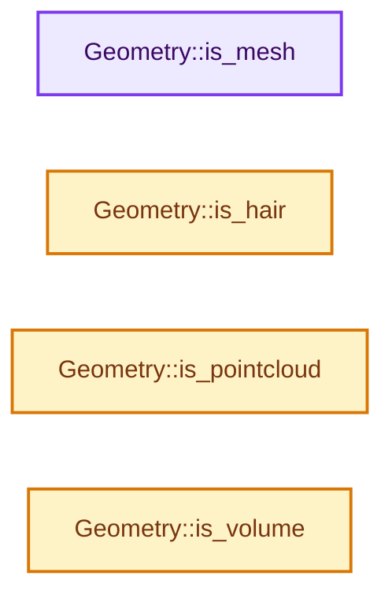
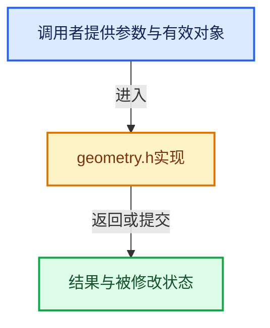

# 实现依赖专题：intern/cycles/scene/geometry.h

[方向导航](README.md) · [符号索引](../%E7%AC%A6%E5%8F%B7%E4%BE%9D%E8%B5%96%E4%B8%8E%E5%AE%9E%E7%8E%B0%E7%B4%A2%E5%BC%95.md)

本专题从正文实际调用进入，集中保存共享实现。函数有稳定锚点，可从调用处直接跳到对应完整函数；递归与互相调用通过回链组织。

## 本文件的实现关系






## 完整成员与函数实现

<a id="f-557fa18e5076dd17"></a>

### `Geometry::is_mesh`

实现位置：[intern/cycles/scene/geometry.h](../../../../../intern/cycles/scene/geometry.h) · L193—L196。

**教学注释版**

<!-- annotated:b6ddf3954d98f1 -->

```cpp
  bool is_mesh() const
  {
    return geometry_type == MESH;
  }
```

<details>
<summary>核对原始源码：intern/cycles/scene/geometry.h · L193—L196</summary>

<!-- original:b6ddf3954d98f1:intern/cycles/scene/geometry.h:193:196 -->

```cpp
  bool is_mesh() const
  {
    return geometry_type == MESH;
  }
```

</details>

**结果出口**

- `return geometry_type == MESH;`

**继续追踪实现**

本实现没有需要继续展开的显式调用；检查返回表达式、对象转换和调用者前置条件。

<a id="f-072a1a935bf3dff3"></a>

### `Geometry::is_hair`

实现位置：[intern/cycles/scene/geometry.h](../../../../../intern/cycles/scene/geometry.h) · L198—L201。

**教学注释版**

<!-- annotated:1b1dfd259077a4 -->

```cpp
  bool is_hair() const
  {
    return geometry_type == HAIR;
  }
```

<details>
<summary>核对原始源码：intern/cycles/scene/geometry.h · L198—L201</summary>

<!-- original:1b1dfd259077a4:intern/cycles/scene/geometry.h:198:201 -->

```cpp
  bool is_hair() const
  {
    return geometry_type == HAIR;
  }
```

</details>

**结果出口**

- `return geometry_type == HAIR;`

**继续追踪实现**

本实现没有需要继续展开的显式调用；检查返回表达式、对象转换和调用者前置条件。

<a id="f-2a0008c1a77ddd16"></a>

### `Geometry::is_pointcloud`

实现位置：[intern/cycles/scene/geometry.h](../../../../../intern/cycles/scene/geometry.h) · L203—L206。

**教学注释版**

<!-- annotated:055de6df8aa001 -->

```cpp
  bool is_pointcloud() const
  {
    return geometry_type == POINTCLOUD;
  }
```

<details>
<summary>核对原始源码：intern/cycles/scene/geometry.h · L203—L206</summary>

<!-- original:055de6df8aa001:intern/cycles/scene/geometry.h:203:206 -->

```cpp
  bool is_pointcloud() const
  {
    return geometry_type == POINTCLOUD;
  }
```

</details>

**结果出口**

- `return geometry_type == POINTCLOUD;`

**继续追踪实现**

本实现没有需要继续展开的显式调用；检查返回表达式、对象转换和调用者前置条件。

<a id="f-dddd66240adf1428"></a>

### `Geometry::is_volume`

实现位置：[intern/cycles/scene/geometry.h](../../../../../intern/cycles/scene/geometry.h) · L208—L211。

**教学注释版**

<!-- annotated:b25441cc198e55 -->

```cpp
  bool is_volume() const
  {
    return geometry_type == VOLUME;
  }
```

<details>
<summary>核对原始源码：intern/cycles/scene/geometry.h · L208—L211</summary>

<!-- original:b25441cc198e55:intern/cycles/scene/geometry.h:208:211 -->

```cpp
  bool is_volume() const
  {
    return geometry_type == VOLUME;
  }
```

</details>

**结果出口**

- `return geometry_type == VOLUME;`

**继续追踪实现**

本实现没有需要继续展开的显式调用；检查返回表达式、对象转换和调用者前置条件。
