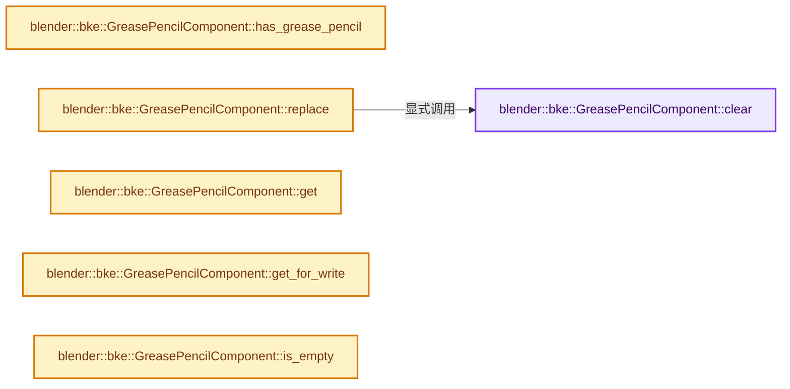
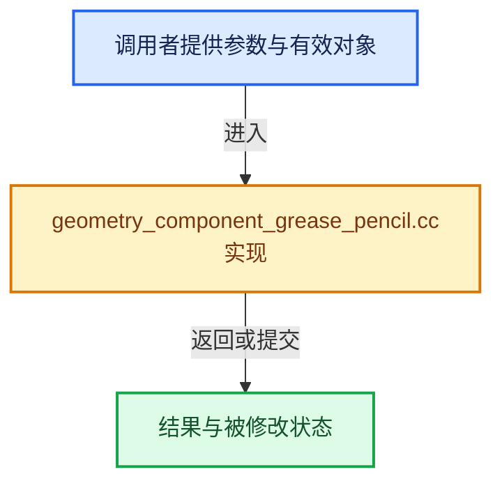

# 实现依赖专题：source/blender/blenkernel/intern/geometry_component_grease_pencil.cc

[方向导航](README.md) · [符号索引](../%E7%AC%A6%E5%8F%B7%E4%BE%9D%E8%B5%96%E4%B8%8E%E5%AE%9E%E7%8E%B0%E7%B4%A2%E5%BC%95.md)

本专题从正文实际调用进入，集中保存共享实现。函数有稳定锚点，可从调用处直接跳到对应完整函数；递归与互相调用通过回链组织。

## 本文件的实现关系






## 完整成员与函数实现

<a id="f-356e8360241d8664"></a>

### `blender::bke::GreasePencilComponent::clear`

实现位置：[source/blender/blenkernel/intern/geometry_component_grease_pencil.cc](../../../../../source/blender/blenkernel/intern/geometry_component_grease_pencil.cc) · L40—L49。

**教学注释版**

<!-- annotated:773a5cbe0697ca -->

```cpp
void GreasePencilComponent::clear()
{
  // [讲解] this->is_mutable：检查相应共享状态是否允许独占修改。
  BLI_assert(this->is_mutable() || this->is_expired());
  if (grease_pencil_ != nullptr) {
    if (ownership_ == GeometryOwnershipType::Owned) {
      BKE_id_free(nullptr, grease_pencil_);
    }
    grease_pencil_ = nullptr;
  }
}
```

<details>
<summary>核对原始源码：source/blender/blenkernel/intern/geometry_component_grease_pencil.cc · L40—L49</summary>

<!-- original:773a5cbe0697ca:source/blender/blenkernel/intern/geometry_component_grease_pencil.cc:40:49 -->

```cpp
void GreasePencilComponent::clear()
{
  BLI_assert(this->is_mutable() || this->is_expired());
  if (grease_pencil_ != nullptr) {
    if (ownership_ == GeometryOwnershipType::Owned) {
      BKE_id_free(nullptr, grease_pencil_);
    }
    grease_pencil_ = nullptr;
  }
}
```

</details>

**沿实际写入检查状态**

- `grease_pencil_ = nullptr;`

**继续追踪实现**

- `BLI_assert` → [BLI_assert · L48](../01-%E5%9F%BA%E7%A1%80%E5%AE%B9%E5%99%A8%E4%B8%8E%E7%8E%B0%E4%BB%A3CPP/%E4%BE%9D%E8%B5%96-BLI_assert-cc98e8.md#m-57a88495704d)；[BLI_assert · L63](../01-%E5%9F%BA%E7%A1%80%E5%AE%B9%E5%99%A8%E4%B8%8E%E7%8E%B0%E4%BB%A3CPP/%E4%BE%9D%E8%B5%96-BLI_assert-cc98e8.md#m-d07050020cb5)。宏定义由构建条件选择。
- `this->is_mutable` → [blender::ImplicitSharingInfo::is_mutable · L76](../06-%E9%9A%90%E5%BC%8F%E5%85%B1%E4%BA%AB%E4%B8%8E%E7%BC%93%E5%AD%98%E7%B3%BB%E7%BB%9F/01-%E6%89%80%E6%9C%89%E6%9D%83%E4%B8%8E%E5%86%99%E6%97%B6%E5%A4%8D%E5%88%B6.md#f-b4d31aba499caecb)。
- `this->is_expired` → [blender::ImplicitSharingInfo::is_expired · L85](../06-%E9%9A%90%E5%BC%8F%E5%85%B1%E4%BA%AB%E4%B8%8E%E7%BC%93%E5%AD%98%E7%B3%BB%E7%BB%9F/01-%E6%89%80%E6%9C%89%E6%9D%83%E4%B8%8E%E5%86%99%E6%97%B6%E5%A4%8D%E5%88%B6.md#f-2dc355bd9568b068)。
- `BKE_id_free` → [blender::BKE_id_free · L224](%E4%BE%9D%E8%B5%96-lib_id_delete-0cb33f.md#f-28ed02c41d0f2d5b)。

<a id="f-1f40b37cc4921df2"></a>

### `blender::bke::GreasePencilComponent::has_grease_pencil`

实现位置：[source/blender/blenkernel/intern/geometry_component_grease_pencil.cc](../../../../../source/blender/blenkernel/intern/geometry_component_grease_pencil.cc) · L51—L54。

**教学注释版**

<!-- annotated:ba78fef7253a64 -->

```cpp
bool GreasePencilComponent::has_grease_pencil() const
{
  return grease_pencil_ != nullptr;
}
```

<details>
<summary>核对原始源码：source/blender/blenkernel/intern/geometry_component_grease_pencil.cc · L51—L54</summary>

<!-- original:ba78fef7253a64:source/blender/blenkernel/intern/geometry_component_grease_pencil.cc:51:54 -->

```cpp
bool GreasePencilComponent::has_grease_pencil() const
{
  return grease_pencil_ != nullptr;
}
```

</details>

**结果出口**

- `return grease_pencil_ != nullptr;`

**继续追踪实现**

本实现没有需要继续展开的显式调用；检查返回表达式、对象转换和调用者前置条件。

<a id="f-7a8bec90d2a1aa61"></a>

### `blender::bke::GreasePencilComponent::replace`

实现位置：[source/blender/blenkernel/intern/geometry_component_grease_pencil.cc](../../../../../source/blender/blenkernel/intern/geometry_component_grease_pencil.cc) · L56—L62。

接口参数：

- `GreasePencil *grease_pencil`
- `GeometryOwnershipType ownership`

**教学注释版**

<!-- annotated:f693ae686ebd8b -->

```cpp
void GreasePencilComponent::replace(GreasePencil *grease_pencil, GeometryOwnershipType ownership)
{
  // [讲解] this->is_mutable：检查相应共享状态是否允许独占修改。
  BLI_assert(this->is_mutable());
  this->clear();
  grease_pencil_ = grease_pencil;
  ownership_ = ownership;
}
```

<details>
<summary>核对原始源码：source/blender/blenkernel/intern/geometry_component_grease_pencil.cc · L56—L62</summary>

<!-- original:f693ae686ebd8b:source/blender/blenkernel/intern/geometry_component_grease_pencil.cc:56:62 -->

```cpp
void GreasePencilComponent::replace(GreasePencil *grease_pencil, GeometryOwnershipType ownership)
{
  BLI_assert(this->is_mutable());
  this->clear();
  grease_pencil_ = grease_pencil;
  ownership_ = ownership;
}
```

</details>

**沿实际写入检查状态**

- `grease_pencil_ = grease_pencil;`
- `ownership_ = ownership;`

**继续追踪实现**

- `BLI_assert` → [BLI_assert · L48](../01-%E5%9F%BA%E7%A1%80%E5%AE%B9%E5%99%A8%E4%B8%8E%E7%8E%B0%E4%BB%A3CPP/%E4%BE%9D%E8%B5%96-BLI_assert-cc98e8.md#m-57a88495704d)；[BLI_assert · L63](../01-%E5%9F%BA%E7%A1%80%E5%AE%B9%E5%99%A8%E4%B8%8E%E7%8E%B0%E4%BB%A3CPP/%E4%BE%9D%E8%B5%96-BLI_assert-cc98e8.md#m-d07050020cb5)。宏定义由构建条件选择。
- `this->is_mutable` → [blender::ImplicitSharingInfo::is_mutable · L76](../06-%E9%9A%90%E5%BC%8F%E5%85%B1%E4%BA%AB%E4%B8%8E%E7%BC%93%E5%AD%98%E7%B3%BB%E7%BB%9F/01-%E6%89%80%E6%9C%89%E6%9D%83%E4%B8%8E%E5%86%99%E6%97%B6%E5%A4%8D%E5%88%B6.md#f-b4d31aba499caecb)。
- `this->clear` → [blender::bke::GreasePencilComponent::clear · L40](%E4%BE%9D%E8%B5%96-geometry_component_grease_pencil-01c648.md#f-356e8360241d8664)。

<a id="f-5a16e7ffc6574319"></a>

### `blender::bke::GreasePencilComponent::get`

实现位置：[source/blender/blenkernel/intern/geometry_component_grease_pencil.cc](../../../../../source/blender/blenkernel/intern/geometry_component_grease_pencil.cc) · L72—L75。

**教学注释版**

<!-- annotated:9a301c2c9ad96f -->

```cpp
const GreasePencil *GreasePencilComponent::get() const
{
  return grease_pencil_;
}
```

<details>
<summary>核对原始源码：source/blender/blenkernel/intern/geometry_component_grease_pencil.cc · L72—L75</summary>

<!-- original:9a301c2c9ad96f:source/blender/blenkernel/intern/geometry_component_grease_pencil.cc:72:75 -->

```cpp
const GreasePencil *GreasePencilComponent::get() const
{
  return grease_pencil_;
}
```

</details>

**结果出口**

- `return grease_pencil_;`

**继续追踪实现**

本实现没有需要继续展开的显式调用；检查返回表达式、对象转换和调用者前置条件。

<a id="f-b399cde6e81f49c4"></a>

### `blender::bke::GreasePencilComponent::get_for_write`

实现位置：[source/blender/blenkernel/intern/geometry_component_grease_pencil.cc](../../../../../source/blender/blenkernel/intern/geometry_component_grease_pencil.cc) · L77—L85。

**教学注释版**

<!-- annotated:4fe57807325719 -->

```cpp
GreasePencil *GreasePencilComponent::get_for_write()
{
  // [讲解] this->is_mutable：检查相应共享状态是否允许独占修改。
  BLI_assert(this->is_mutable());
  if (ownership_ == GeometryOwnershipType::ReadOnly) {
    grease_pencil_ = BKE_grease_pencil_copy_for_eval(grease_pencil_);
    ownership_ = GeometryOwnershipType::Owned;
  }
  return grease_pencil_;
}
```

<details>
<summary>核对原始源码：source/blender/blenkernel/intern/geometry_component_grease_pencil.cc · L77—L85</summary>

<!-- original:4fe57807325719:source/blender/blenkernel/intern/geometry_component_grease_pencil.cc:77:85 -->

```cpp
GreasePencil *GreasePencilComponent::get_for_write()
{
  BLI_assert(this->is_mutable());
  if (ownership_ == GeometryOwnershipType::ReadOnly) {
    grease_pencil_ = BKE_grease_pencil_copy_for_eval(grease_pencil_);
    ownership_ = GeometryOwnershipType::Owned;
  }
  return grease_pencil_;
}
```

</details>

**沿实际写入检查状态**

- `grease_pencil_ = BKE_grease_pencil_copy_for_eval(grease_pencil_);`
- `ownership_ = GeometryOwnershipType::Owned;`

**结果出口**

- `return grease_pencil_;`

**继续追踪实现**

- `BLI_assert` → [BLI_assert · L48](../01-%E5%9F%BA%E7%A1%80%E5%AE%B9%E5%99%A8%E4%B8%8E%E7%8E%B0%E4%BB%A3CPP/%E4%BE%9D%E8%B5%96-BLI_assert-cc98e8.md#m-57a88495704d)；[BLI_assert · L63](../01-%E5%9F%BA%E7%A1%80%E5%AE%B9%E5%99%A8%E4%B8%8E%E7%8E%B0%E4%BB%A3CPP/%E4%BE%9D%E8%B5%96-BLI_assert-cc98e8.md#m-d07050020cb5)。宏定义由构建条件选择。
- `this->is_mutable` → [blender::ImplicitSharingInfo::is_mutable · L76](../06-%E9%9A%90%E5%BC%8F%E5%85%B1%E4%BA%AB%E4%B8%8E%E7%BC%93%E5%AD%98%E7%B3%BB%E7%BB%9F/01-%E6%89%80%E6%9C%89%E6%9D%83%E4%B8%8E%E5%86%99%E6%97%B6%E5%A4%8D%E5%88%B6.md#f-b4d31aba499caecb)。
- `BKE_grease_pencil_copy_for_eval` → [blender::BKE_grease_pencil_copy_for_eval · L2438](%E4%BE%9D%E8%B5%96-grease_pencil-f750d6.md#f-79db5a2e3a2a8e46)。

<a id="f-10b636a364f1ebd9"></a>

### `blender::bke::GreasePencilComponent::is_empty`

实现位置：[source/blender/blenkernel/intern/geometry_component_grease_pencil.cc](../../../../../source/blender/blenkernel/intern/geometry_component_grease_pencil.cc) · L87—L90。

**教学注释版**

<!-- annotated:dc755086faa538 -->

```cpp
bool GreasePencilComponent::is_empty() const
{
  return grease_pencil_ == nullptr;
}
```

<details>
<summary>核对原始源码：source/blender/blenkernel/intern/geometry_component_grease_pencil.cc · L87—L90</summary>

<!-- original:dc755086faa538:source/blender/blenkernel/intern/geometry_component_grease_pencil.cc:87:90 -->

```cpp
bool GreasePencilComponent::is_empty() const
{
  return grease_pencil_ == nullptr;
}
```

</details>

**结果出口**

- `return grease_pencil_ == nullptr;`

**继续追踪实现**

本实现没有需要继续展开的显式调用；检查返回表达式、对象转换和调用者前置条件。
