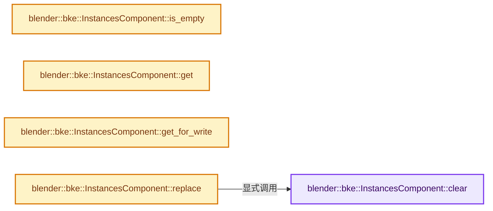
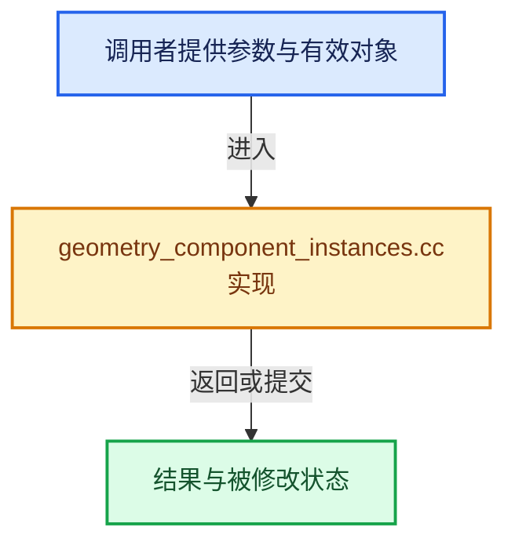

# 实现依赖专题：source/blender/blenkernel/intern/geometry_component_instances.cc

[方向导航](README.md) · [符号索引](../%E7%AC%A6%E5%8F%B7%E4%BE%9D%E8%B5%96%E4%B8%8E%E5%AE%9E%E7%8E%B0%E7%B4%A2%E5%BC%95.md)

本专题从正文实际调用进入，集中保存共享实现。函数有稳定锚点，可从调用处直接跳到对应完整函数；递归与互相调用通过回链组织。

## 本文件的实现关系






## 完整成员与函数实现

<a id="f-e2ce532fe119a52d"></a>

### `blender::bke::InstancesComponent::clear`

实现位置：[source/blender/blenkernel/intern/geometry_component_instances.cc](../../../../../source/blender/blenkernel/intern/geometry_component_instances.cc) · L40—L47。

**教学注释版**

<!-- annotated:97032d4e30ef39 -->

```cpp
void InstancesComponent::clear()
{
  // [讲解] this->is_mutable：检查相应共享状态是否允许独占修改。
  BLI_assert(this->is_mutable() || this->is_expired());
  if (ownership_ == GeometryOwnershipType::Owned) {
    delete instances_;
  }
  instances_ = nullptr;
}
```

<details>
<summary>核对原始源码：source/blender/blenkernel/intern/geometry_component_instances.cc · L40—L47</summary>

<!-- original:97032d4e30ef39:source/blender/blenkernel/intern/geometry_component_instances.cc:40:47 -->

```cpp
void InstancesComponent::clear()
{
  BLI_assert(this->is_mutable() || this->is_expired());
  if (ownership_ == GeometryOwnershipType::Owned) {
    delete instances_;
  }
  instances_ = nullptr;
}
```

</details>

**沿实际写入检查状态**

- `instances_ = nullptr;`

**继续追踪实现**

- `BLI_assert` → [BLI_assert · L48](../01-%E5%9F%BA%E7%A1%80%E5%AE%B9%E5%99%A8%E4%B8%8E%E7%8E%B0%E4%BB%A3CPP/%E4%BE%9D%E8%B5%96-BLI_assert-cc98e8.md#m-57a88495704d)；[BLI_assert · L63](../01-%E5%9F%BA%E7%A1%80%E5%AE%B9%E5%99%A8%E4%B8%8E%E7%8E%B0%E4%BB%A3CPP/%E4%BE%9D%E8%B5%96-BLI_assert-cc98e8.md#m-d07050020cb5)。宏定义由构建条件选择。
- `this->is_mutable` → [blender::ImplicitSharingInfo::is_mutable · L76](../06-%E9%9A%90%E5%BC%8F%E5%85%B1%E4%BA%AB%E4%B8%8E%E7%BC%93%E5%AD%98%E7%B3%BB%E7%BB%9F/01-%E6%89%80%E6%9C%89%E6%9D%83%E4%B8%8E%E5%86%99%E6%97%B6%E5%A4%8D%E5%88%B6.md#f-b4d31aba499caecb)。
- `this->is_expired` → [blender::ImplicitSharingInfo::is_expired · L85](../06-%E9%9A%90%E5%BC%8F%E5%85%B1%E4%BA%AB%E4%B8%8E%E7%BC%93%E5%AD%98%E7%B3%BB%E7%BB%9F/01-%E6%89%80%E6%9C%89%E6%9D%83%E4%B8%8E%E5%86%99%E6%97%B6%E5%A4%8D%E5%88%B6.md#f-2dc355bd9568b068)。

<a id="f-e7b62928c3e1cb2c"></a>

### `blender::bke::InstancesComponent::is_empty`

实现位置：[source/blender/blenkernel/intern/geometry_component_instances.cc](../../../../../source/blender/blenkernel/intern/geometry_component_instances.cc) · L49—L57。

**教学注释版**

<!-- annotated:4f783a7224ff4b -->

```cpp
bool InstancesComponent::is_empty() const
{
  if (instances_ != nullptr) {
    if (instances_->instances_num() > 0) {
      return false;
    }
  }
  return true;
}
```

<details>
<summary>核对原始源码：source/blender/blenkernel/intern/geometry_component_instances.cc · L49—L57</summary>

<!-- original:4f783a7224ff4b:source/blender/blenkernel/intern/geometry_component_instances.cc:49:57 -->

```cpp
bool InstancesComponent::is_empty() const
{
  if (instances_ != nullptr) {
    if (instances_->instances_num() > 0) {
      return false;
    }
  }
  return true;
}
```

</details>

**结果出口**

- `return false;`
- `return true;`

**继续追踪实现**

- `instances_->instances_num` → [调用协议](../%E6%A8%A1%E6%9D%BF%E5%AE%8F%E4%B8%8E%E5%8A%A8%E6%80%81%E5%88%86%E6%B4%BE%E5%8D%8F%E8%AE%AE.md)：接收对象类型依赖auto、返回值或模板实例；不按同名猜测目标。调用位置L52。

<a id="f-4c08d16e1f4a620c"></a>

### `blender::bke::InstancesComponent::get`

实现位置：[source/blender/blenkernel/intern/geometry_component_instances.cc](../../../../../source/blender/blenkernel/intern/geometry_component_instances.cc) · L74—L77。

**教学注释版**

<!-- annotated:f561f378cb53ad -->

```cpp
const Instances *InstancesComponent::get() const
{
  return instances_;
}
```

<details>
<summary>核对原始源码：source/blender/blenkernel/intern/geometry_component_instances.cc · L74—L77</summary>

<!-- original:f561f378cb53ad:source/blender/blenkernel/intern/geometry_component_instances.cc:74:77 -->

```cpp
const Instances *InstancesComponent::get() const
{
  return instances_;
}
```

</details>

**结果出口**

- `return instances_;`

**继续追踪实现**

本实现没有需要继续展开的显式调用；检查返回表达式、对象转换和调用者前置条件。

<a id="f-4489915c6bc73234"></a>

### `blender::bke::InstancesComponent::get_for_write`

实现位置：[source/blender/blenkernel/intern/geometry_component_instances.cc](../../../../../source/blender/blenkernel/intern/geometry_component_instances.cc) · L79—L87。

**教学注释版**

<!-- annotated:54851f5758eb05 -->

```cpp
Instances *InstancesComponent::get_for_write()
{
  // [讲解] this->is_mutable：检查相应共享状态是否允许独占修改。
  BLI_assert(this->is_mutable());
  if (ownership_ == GeometryOwnershipType::ReadOnly) {
    instances_ = new Instances(*instances_);
    ownership_ = GeometryOwnershipType::Owned;
  }
  return instances_;
}
```

<details>
<summary>核对原始源码：source/blender/blenkernel/intern/geometry_component_instances.cc · L79—L87</summary>

<!-- original:54851f5758eb05:source/blender/blenkernel/intern/geometry_component_instances.cc:79:87 -->

```cpp
Instances *InstancesComponent::get_for_write()
{
  BLI_assert(this->is_mutable());
  if (ownership_ == GeometryOwnershipType::ReadOnly) {
    instances_ = new Instances(*instances_);
    ownership_ = GeometryOwnershipType::Owned;
  }
  return instances_;
}
```

</details>

**沿实际写入检查状态**

- `instances_ = new Instances(*instances_);`
- `ownership_ = GeometryOwnershipType::Owned;`

**结果出口**

- `return instances_;`

**继续追踪实现**

- `BLI_assert` → [BLI_assert · L48](../01-%E5%9F%BA%E7%A1%80%E5%AE%B9%E5%99%A8%E4%B8%8E%E7%8E%B0%E4%BB%A3CPP/%E4%BE%9D%E8%B5%96-BLI_assert-cc98e8.md#m-57a88495704d)；[BLI_assert · L63](../01-%E5%9F%BA%E7%A1%80%E5%AE%B9%E5%99%A8%E4%B8%8E%E7%8E%B0%E4%BB%A3CPP/%E4%BE%9D%E8%B5%96-BLI_assert-cc98e8.md#m-d07050020cb5)。宏定义由构建条件选择。
- `this->is_mutable` → [blender::ImplicitSharingInfo::is_mutable · L76](../06-%E9%9A%90%E5%BC%8F%E5%85%B1%E4%BA%AB%E4%B8%8E%E7%BC%93%E5%AD%98%E7%B3%BB%E7%BB%9F/01-%E6%89%80%E6%9C%89%E6%9D%83%E4%B8%8E%E5%86%99%E6%97%B6%E5%A4%8D%E5%88%B6.md#f-b4d31aba499caecb)。

<a id="f-8cc31b6fbb24a242"></a>

### `blender::bke::InstancesComponent::replace`

实现位置：[source/blender/blenkernel/intern/geometry_component_instances.cc](../../../../../source/blender/blenkernel/intern/geometry_component_instances.cc) · L89—L95。

接口参数：

- `Instances *instances`
- `GeometryOwnershipType ownership`

**教学注释版**

<!-- annotated:6b0c9f33b17aa4 -->

```cpp
void InstancesComponent::replace(Instances *instances, GeometryOwnershipType ownership)
{
  // [讲解] this->is_mutable：检查相应共享状态是否允许独占修改。
  BLI_assert(this->is_mutable());
  this->clear();
  instances_ = instances;
  ownership_ = ownership;
}
```

<details>
<summary>核对原始源码：source/blender/blenkernel/intern/geometry_component_instances.cc · L89—L95</summary>

<!-- original:6b0c9f33b17aa4:source/blender/blenkernel/intern/geometry_component_instances.cc:89:95 -->

```cpp
void InstancesComponent::replace(Instances *instances, GeometryOwnershipType ownership)
{
  BLI_assert(this->is_mutable());
  this->clear();
  instances_ = instances;
  ownership_ = ownership;
}
```

</details>

**沿实际写入检查状态**

- `instances_ = instances;`
- `ownership_ = ownership;`

**继续追踪实现**

- `BLI_assert` → [BLI_assert · L48](../01-%E5%9F%BA%E7%A1%80%E5%AE%B9%E5%99%A8%E4%B8%8E%E7%8E%B0%E4%BB%A3CPP/%E4%BE%9D%E8%B5%96-BLI_assert-cc98e8.md#m-57a88495704d)；[BLI_assert · L63](../01-%E5%9F%BA%E7%A1%80%E5%AE%B9%E5%99%A8%E4%B8%8E%E7%8E%B0%E4%BB%A3CPP/%E4%BE%9D%E8%B5%96-BLI_assert-cc98e8.md#m-d07050020cb5)。宏定义由构建条件选择。
- `this->is_mutable` → [blender::ImplicitSharingInfo::is_mutable · L76](../06-%E9%9A%90%E5%BC%8F%E5%85%B1%E4%BA%AB%E4%B8%8E%E7%BC%93%E5%AD%98%E7%B3%BB%E7%BB%9F/01-%E6%89%80%E6%9C%89%E6%9D%83%E4%B8%8E%E5%86%99%E6%97%B6%E5%A4%8D%E5%88%B6.md#f-b4d31aba499caecb)。
- `this->clear` → [blender::bke::InstancesComponent::clear · L40](%E4%BE%9D%E8%B5%96-geometry_component_instances-4b1341.md#f-e2ce532fe119a52d)。
