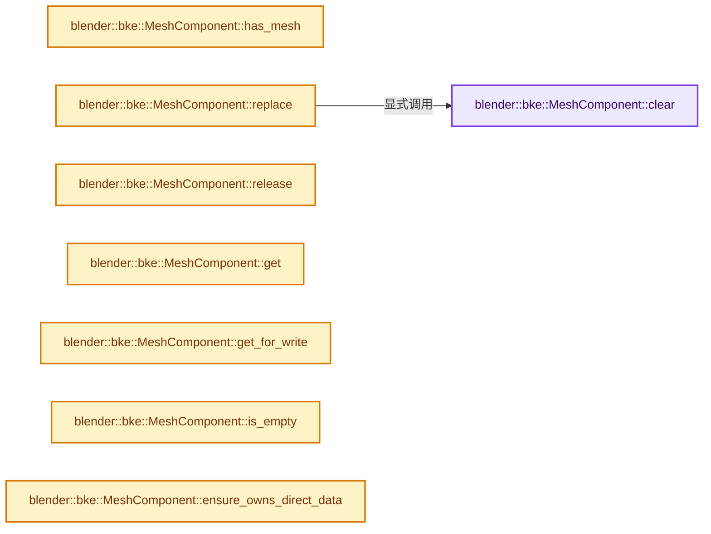
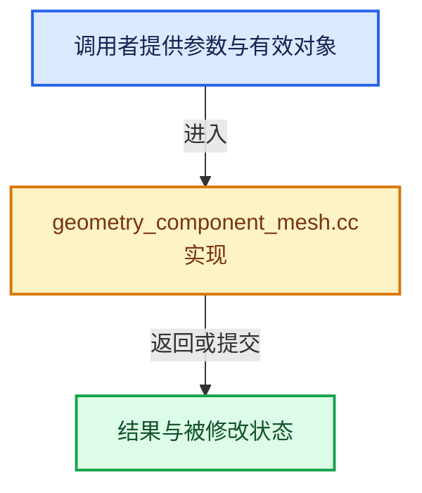

# 实现依赖专题：source/blender/blenkernel/intern/geometry_component_mesh.cc

[方向导航](README.md) · [符号索引](../%E7%AC%A6%E5%8F%B7%E4%BE%9D%E8%B5%96%E4%B8%8E%E5%AE%9E%E7%8E%B0%E7%B4%A2%E5%BC%95.md)

本专题从正文实际调用进入，集中保存共享实现。函数有稳定锚点，可从调用处直接跳到对应完整函数；递归与互相调用通过回链组织。

## 本文件的实现关系






## 完整成员与函数实现

<a id="f-1dfa1770ae02d81f"></a>

### `blender::bke::MeshComponent::clear`

实现位置：[source/blender/blenkernel/intern/geometry_component_mesh.cc](../../../../../source/blender/blenkernel/intern/geometry_component_mesh.cc) · L46—L55。

**教学注释版**

<!-- annotated:c986966f439277 -->

```cpp
void MeshComponent::clear()
{
  // [讲解] this->is_mutable：检查相应共享状态是否允许独占修改。
  BLI_assert(this->is_mutable() || this->is_expired());
  if (mesh_ != nullptr) {
    if (ownership_ == GeometryOwnershipType::Owned) {
      BKE_id_free(nullptr, mesh_);
    }
    mesh_ = nullptr;
  }
}
```

<details>
<summary>核对原始源码：source/blender/blenkernel/intern/geometry_component_mesh.cc · L46—L55</summary>

<!-- original:c986966f439277:source/blender/blenkernel/intern/geometry_component_mesh.cc:46:55 -->

```cpp
void MeshComponent::clear()
{
  BLI_assert(this->is_mutable() || this->is_expired());
  if (mesh_ != nullptr) {
    if (ownership_ == GeometryOwnershipType::Owned) {
      BKE_id_free(nullptr, mesh_);
    }
    mesh_ = nullptr;
  }
}
```

</details>

**沿实际写入检查状态**

- `mesh_ = nullptr;`

**继续追踪实现**

- `BLI_assert` → [BLI_assert · L48](../01-%E5%9F%BA%E7%A1%80%E5%AE%B9%E5%99%A8%E4%B8%8E%E7%8E%B0%E4%BB%A3CPP/%E4%BE%9D%E8%B5%96-BLI_assert-cc98e8.md#m-57a88495704d)；[BLI_assert · L63](../01-%E5%9F%BA%E7%A1%80%E5%AE%B9%E5%99%A8%E4%B8%8E%E7%8E%B0%E4%BB%A3CPP/%E4%BE%9D%E8%B5%96-BLI_assert-cc98e8.md#m-d07050020cb5)。宏定义由构建条件选择。
- `this->is_mutable` → [blender::ImplicitSharingInfo::is_mutable · L76](../06-%E9%9A%90%E5%BC%8F%E5%85%B1%E4%BA%AB%E4%B8%8E%E7%BC%93%E5%AD%98%E7%B3%BB%E7%BB%9F/01-%E6%89%80%E6%9C%89%E6%9D%83%E4%B8%8E%E5%86%99%E6%97%B6%E5%A4%8D%E5%88%B6.md#f-b4d31aba499caecb)。
- `this->is_expired` → [blender::ImplicitSharingInfo::is_expired · L85](../06-%E9%9A%90%E5%BC%8F%E5%85%B1%E4%BA%AB%E4%B8%8E%E7%BC%93%E5%AD%98%E7%B3%BB%E7%BB%9F/01-%E6%89%80%E6%9C%89%E6%9D%83%E4%B8%8E%E5%86%99%E6%97%B6%E5%A4%8D%E5%88%B6.md#f-2dc355bd9568b068)。
- `BKE_id_free` → [blender::BKE_id_free · L224](%E4%BE%9D%E8%B5%96-lib_id_delete-0cb33f.md#f-28ed02c41d0f2d5b)。

<a id="f-21df30703362b529"></a>

### `blender::bke::MeshComponent::has_mesh`

实现位置：[source/blender/blenkernel/intern/geometry_component_mesh.cc](../../../../../source/blender/blenkernel/intern/geometry_component_mesh.cc) · L57—L60。

**教学注释版**

<!-- annotated:015b72ee27264c -->

```cpp
bool MeshComponent::has_mesh() const
{
  return mesh_ != nullptr;
}
```

<details>
<summary>核对原始源码：source/blender/blenkernel/intern/geometry_component_mesh.cc · L57—L60</summary>

<!-- original:015b72ee27264c:source/blender/blenkernel/intern/geometry_component_mesh.cc:57:60 -->

```cpp
bool MeshComponent::has_mesh() const
{
  return mesh_ != nullptr;
}
```

</details>

**结果出口**

- `return mesh_ != nullptr;`

**继续追踪实现**

本实现没有需要继续展开的显式调用；检查返回表达式、对象转换和调用者前置条件。

<a id="f-625ad7d7cc6f2308"></a>

### `blender::bke::MeshComponent::replace`

实现位置：[source/blender/blenkernel/intern/geometry_component_mesh.cc](../../../../../source/blender/blenkernel/intern/geometry_component_mesh.cc) · L62—L68。

接口参数：

- `Mesh *mesh`
- `GeometryOwnershipType ownership`

**教学注释版**

<!-- annotated:3c0095484d7f3f -->

```cpp
void MeshComponent::replace(Mesh *mesh, GeometryOwnershipType ownership)
{
  // [讲解] this->is_mutable：检查相应共享状态是否允许独占修改。
  BLI_assert(this->is_mutable());
  this->clear();
  mesh_ = mesh;
  ownership_ = ownership;
}
```

<details>
<summary>核对原始源码：source/blender/blenkernel/intern/geometry_component_mesh.cc · L62—L68</summary>

<!-- original:3c0095484d7f3f:source/blender/blenkernel/intern/geometry_component_mesh.cc:62:68 -->

```cpp
void MeshComponent::replace(Mesh *mesh, GeometryOwnershipType ownership)
{
  BLI_assert(this->is_mutable());
  this->clear();
  mesh_ = mesh;
  ownership_ = ownership;
}
```

</details>

**沿实际写入检查状态**

- `mesh_ = mesh;`
- `ownership_ = ownership;`

**继续追踪实现**

- `BLI_assert` → [BLI_assert · L48](../01-%E5%9F%BA%E7%A1%80%E5%AE%B9%E5%99%A8%E4%B8%8E%E7%8E%B0%E4%BB%A3CPP/%E4%BE%9D%E8%B5%96-BLI_assert-cc98e8.md#m-57a88495704d)；[BLI_assert · L63](../01-%E5%9F%BA%E7%A1%80%E5%AE%B9%E5%99%A8%E4%B8%8E%E7%8E%B0%E4%BB%A3CPP/%E4%BE%9D%E8%B5%96-BLI_assert-cc98e8.md#m-d07050020cb5)。宏定义由构建条件选择。
- `this->is_mutable` → [blender::ImplicitSharingInfo::is_mutable · L76](../06-%E9%9A%90%E5%BC%8F%E5%85%B1%E4%BA%AB%E4%B8%8E%E7%BC%93%E5%AD%98%E7%B3%BB%E7%BB%9F/01-%E6%89%80%E6%9C%89%E6%9D%83%E4%B8%8E%E5%86%99%E6%97%B6%E5%A4%8D%E5%88%B6.md#f-b4d31aba499caecb)。
- `this->clear` → [blender::bke::MeshComponent::clear · L46](%E4%BE%9D%E8%B5%96-geometry_component_mesh-de716f.md#f-1dfa1770ae02d81f)。

<a id="f-afe81d884ed9e373"></a>

### `blender::bke::MeshComponent::release`

实现位置：[source/blender/blenkernel/intern/geometry_component_mesh.cc](../../../../../source/blender/blenkernel/intern/geometry_component_mesh.cc) · L70—L76。

**教学注释版**

<!-- annotated:b6cc3868ee1acd -->

```cpp
Mesh *MeshComponent::release()
{
  // [讲解] this->is_mutable：检查相应共享状态是否允许独占修改。
  BLI_assert(this->is_mutable());
  Mesh *mesh = mesh_;
  mesh_ = nullptr;
  return mesh;
}
```

<details>
<summary>核对原始源码：source/blender/blenkernel/intern/geometry_component_mesh.cc · L70—L76</summary>

<!-- original:b6cc3868ee1acd:source/blender/blenkernel/intern/geometry_component_mesh.cc:70:76 -->

```cpp
Mesh *MeshComponent::release()
{
  BLI_assert(this->is_mutable());
  Mesh *mesh = mesh_;
  mesh_ = nullptr;
  return mesh;
}
```

</details>

**沿实际写入检查状态**

- `mesh_ = nullptr;`

**结果出口**

- `return mesh;`

**继续追踪实现**

- `BLI_assert` → [BLI_assert · L48](../01-%E5%9F%BA%E7%A1%80%E5%AE%B9%E5%99%A8%E4%B8%8E%E7%8E%B0%E4%BB%A3CPP/%E4%BE%9D%E8%B5%96-BLI_assert-cc98e8.md#m-57a88495704d)；[BLI_assert · L63](../01-%E5%9F%BA%E7%A1%80%E5%AE%B9%E5%99%A8%E4%B8%8E%E7%8E%B0%E4%BB%A3CPP/%E4%BE%9D%E8%B5%96-BLI_assert-cc98e8.md#m-d07050020cb5)。宏定义由构建条件选择。
- `this->is_mutable` → [blender::ImplicitSharingInfo::is_mutable · L76](../06-%E9%9A%90%E5%BC%8F%E5%85%B1%E4%BA%AB%E4%B8%8E%E7%BC%93%E5%AD%98%E7%B3%BB%E7%BB%9F/01-%E6%89%80%E6%9C%89%E6%9D%83%E4%B8%8E%E5%86%99%E6%97%B6%E5%A4%8D%E5%88%B6.md#f-b4d31aba499caecb)。

<a id="f-10a41ea54073cd9c"></a>

### `blender::bke::MeshComponent::get`

实现位置：[source/blender/blenkernel/intern/geometry_component_mesh.cc](../../../../../source/blender/blenkernel/intern/geometry_component_mesh.cc) · L78—L81。

**教学注释版**

<!-- annotated:90ec87744fc421 -->

```cpp
const Mesh *MeshComponent::get() const
{
  return mesh_;
}
```

<details>
<summary>核对原始源码：source/blender/blenkernel/intern/geometry_component_mesh.cc · L78—L81</summary>

<!-- original:90ec87744fc421:source/blender/blenkernel/intern/geometry_component_mesh.cc:78:81 -->

```cpp
const Mesh *MeshComponent::get() const
{
  return mesh_;
}
```

</details>

**结果出口**

- `return mesh_;`

**继续追踪实现**

本实现没有需要继续展开的显式调用；检查返回表达式、对象转换和调用者前置条件。

<a id="f-ef827f2b2d08d953"></a>

### `blender::bke::MeshComponent::get_for_write`

实现位置：[source/blender/blenkernel/intern/geometry_component_mesh.cc](../../../../../source/blender/blenkernel/intern/geometry_component_mesh.cc) · L83—L91。

**教学注释版**

<!-- annotated:58804cafbff2bf -->

```cpp
Mesh *MeshComponent::get_for_write()
{
  // [讲解] this->is_mutable：检查相应共享状态是否允许独占修改。
  BLI_assert(this->is_mutable());
  if (ownership_ == GeometryOwnershipType::ReadOnly) {
    mesh_ = BKE_mesh_copy_for_eval(*mesh_);
    ownership_ = GeometryOwnershipType::Owned;
  }
  return mesh_;
}
```

<details>
<summary>核对原始源码：source/blender/blenkernel/intern/geometry_component_mesh.cc · L83—L91</summary>

<!-- original:58804cafbff2bf:source/blender/blenkernel/intern/geometry_component_mesh.cc:83:91 -->

```cpp
Mesh *MeshComponent::get_for_write()
{
  BLI_assert(this->is_mutable());
  if (ownership_ == GeometryOwnershipType::ReadOnly) {
    mesh_ = BKE_mesh_copy_for_eval(*mesh_);
    ownership_ = GeometryOwnershipType::Owned;
  }
  return mesh_;
}
```

</details>

**沿实际写入检查状态**

- `mesh_ = BKE_mesh_copy_for_eval(*mesh_);`
- `ownership_ = GeometryOwnershipType::Owned;`

**结果出口**

- `return mesh_;`

**继续追踪实现**

- `BLI_assert` → [BLI_assert · L48](../01-%E5%9F%BA%E7%A1%80%E5%AE%B9%E5%99%A8%E4%B8%8E%E7%8E%B0%E4%BB%A3CPP/%E4%BE%9D%E8%B5%96-BLI_assert-cc98e8.md#m-57a88495704d)；[BLI_assert · L63](../01-%E5%9F%BA%E7%A1%80%E5%AE%B9%E5%99%A8%E4%B8%8E%E7%8E%B0%E4%BB%A3CPP/%E4%BE%9D%E8%B5%96-BLI_assert-cc98e8.md#m-d07050020cb5)。宏定义由构建条件选择。
- `this->is_mutable` → [blender::ImplicitSharingInfo::is_mutable · L76](../06-%E9%9A%90%E5%BC%8F%E5%85%B1%E4%BA%AB%E4%B8%8E%E7%BC%93%E5%AD%98%E7%B3%BB%E7%BB%9F/01-%E6%89%80%E6%9C%89%E6%9D%83%E4%B8%8E%E5%86%99%E6%97%B6%E5%A4%8D%E5%88%B6.md#f-b4d31aba499caecb)。
- `BKE_mesh_copy_for_eval` → [BKE_mesh_copy_for_eval · L1577](03-MPoly%E8%BF%81%E7%A7%BB%E4%B8%8E%E5%85%BC%E5%AE%B9.md#f-32e8f0e51faecc10)。

<a id="f-eac7c7f83e51b70f"></a>

### `blender::bke::MeshComponent::is_empty`

实现位置：[source/blender/blenkernel/intern/geometry_component_mesh.cc](../../../../../source/blender/blenkernel/intern/geometry_component_mesh.cc) · L93—L96。

**教学注释版**

<!-- annotated:761e94b47d6d9d -->

```cpp
bool MeshComponent::is_empty() const
{
  return mesh_ == nullptr;
}
```

<details>
<summary>核对原始源码：source/blender/blenkernel/intern/geometry_component_mesh.cc · L93—L96</summary>

<!-- original:761e94b47d6d9d:source/blender/blenkernel/intern/geometry_component_mesh.cc:93:96 -->

```cpp
bool MeshComponent::is_empty() const
{
  return mesh_ == nullptr;
}
```

</details>

**结果出口**

- `return mesh_ == nullptr;`

**继续追踪实现**

本实现没有需要继续展开的显式调用；检查返回表达式、对象转换和调用者前置条件。

<a id="f-60c1f00ee46d3a8a"></a>

### `blender::bke::MeshComponent::ensure_owns_direct_data`

实现位置：[source/blender/blenkernel/intern/geometry_component_mesh.cc](../../../../../source/blender/blenkernel/intern/geometry_component_mesh.cc) · L103—L112。

**教学注释版**

<!-- annotated:1f20c3fc1cfb9c -->

```cpp
void MeshComponent::ensure_owns_direct_data()
{
  // [讲解] this->is_mutable：检查相应共享状态是否允许独占修改。
  BLI_assert(this->is_mutable());
  if (ownership_ != GeometryOwnershipType::Owned) {
    if (mesh_) {
      mesh_ = BKE_mesh_copy_for_eval(*mesh_);
    }
    ownership_ = GeometryOwnershipType::Owned;
  }
}
```

<details>
<summary>核对原始源码：source/blender/blenkernel/intern/geometry_component_mesh.cc · L103—L112</summary>

<!-- original:1f20c3fc1cfb9c:source/blender/blenkernel/intern/geometry_component_mesh.cc:103:112 -->

```cpp
void MeshComponent::ensure_owns_direct_data()
{
  BLI_assert(this->is_mutable());
  if (ownership_ != GeometryOwnershipType::Owned) {
    if (mesh_) {
      mesh_ = BKE_mesh_copy_for_eval(*mesh_);
    }
    ownership_ = GeometryOwnershipType::Owned;
  }
}
```

</details>

**沿实际写入检查状态**

- `mesh_ = BKE_mesh_copy_for_eval(*mesh_);`
- `ownership_ = GeometryOwnershipType::Owned;`

**继续追踪实现**

- `BLI_assert` → [BLI_assert · L48](../01-%E5%9F%BA%E7%A1%80%E5%AE%B9%E5%99%A8%E4%B8%8E%E7%8E%B0%E4%BB%A3CPP/%E4%BE%9D%E8%B5%96-BLI_assert-cc98e8.md#m-57a88495704d)；[BLI_assert · L63](../01-%E5%9F%BA%E7%A1%80%E5%AE%B9%E5%99%A8%E4%B8%8E%E7%8E%B0%E4%BB%A3CPP/%E4%BE%9D%E8%B5%96-BLI_assert-cc98e8.md#m-d07050020cb5)。宏定义由构建条件选择。
- `this->is_mutable` → [blender::ImplicitSharingInfo::is_mutable · L76](../06-%E9%9A%90%E5%BC%8F%E5%85%B1%E4%BA%AB%E4%B8%8E%E7%BC%93%E5%AD%98%E7%B3%BB%E7%BB%9F/01-%E6%89%80%E6%9C%89%E6%9D%83%E4%B8%8E%E5%86%99%E6%97%B6%E5%A4%8D%E5%88%B6.md#f-b4d31aba499caecb)。
- `BKE_mesh_copy_for_eval` → [BKE_mesh_copy_for_eval · L1577](03-MPoly%E8%BF%81%E7%A7%BB%E4%B8%8E%E5%85%BC%E5%AE%B9.md#f-32e8f0e51faecc10)。

<a id="f-fdf5b3dac5310683"></a>

### `blender::bke::mesh_normals_varray`

实现位置：[source/blender/blenkernel/intern/geometry_component_mesh.cc](../../../../../source/blender/blenkernel/intern/geometry_component_mesh.cc) · L127—L171。

接口参数：

- `const Mesh &mesh`
- `const IndexMask &mask`
- `const AttrDomain domain`
- `const bool no_corner_normals`
- `const bool true_normals`

**教学注释版**

<!-- annotated:030fe53807d10b -->

```cpp
VArray<float3> mesh_normals_varray(const Mesh &mesh,
                                   const IndexMask &mask,
                                   const AttrDomain domain,
                                   const bool no_corner_normals,
                                   const bool true_normals)
{
  switch (domain) {
    case AttrDomain::Face: {
      return VArray<float3>::from_span(true_normals ? mesh.face_normals_true() :
                                                      mesh.face_normals());
    }
    case AttrDomain::Point: {
      return VArray<float3>::from_span(true_normals ? mesh.vert_normals_true() :
                                                      mesh.vert_normals());
    }
    case AttrDomain::Edge: {
      /* In this case, start with vertex normals and convert to the edge domain, since the
       * conversion from edges to vertices is very simple. Use "manual" domain interpolation
       * instead of the GeometryComponent API to avoid calculating unnecessary values and to
       * allow normalizing the result more simply. */
      Span<float3> vert_normals = true_normals ? mesh.vert_normals_true() : mesh.vert_normals();
      const Span<int2> edges = mesh.edges();
      Array<float3> edge_normals(mask.min_array_size());
      mask.foreach_index([&](const int i) {
        const int2 &edge = edges[i];
        edge_normals[i] = math::normalize(
            math::interpolate(vert_normals[edge[0]], vert_normals[edge[1]], 0.5f));
      });

      // [讲解] std::move：把表达式转换成可供移动重载选择的值类别；不保证真的移动，不结束源对象寿命，对const值可能选择复制。
      return VArray<float3>::from_container(std::move(edge_normals));
    }
    case AttrDomain::Corner: {
      if (no_corner_normals || true_normals) {
        return mesh.attributes().adapt_domain(
            VArray<float3>::from_span(true_normals ? mesh.face_normals_true() :
                                                     mesh.face_normals()),
            AttrDomain::Face,
            AttrDomain::Corner);
      }
      return VArray<float3>::from_span(mesh.corner_normals());
    }
    default:
      return {};
  }
}
```

<details>
<summary>核对原始源码：source/blender/blenkernel/intern/geometry_component_mesh.cc · L127—L171</summary>

<!-- original:030fe53807d10b:source/blender/blenkernel/intern/geometry_component_mesh.cc:127:171 -->

```cpp
VArray<float3> mesh_normals_varray(const Mesh &mesh,
                                   const IndexMask &mask,
                                   const AttrDomain domain,
                                   const bool no_corner_normals,
                                   const bool true_normals)
{
  switch (domain) {
    case AttrDomain::Face: {
      return VArray<float3>::from_span(true_normals ? mesh.face_normals_true() :
                                                      mesh.face_normals());
    }
    case AttrDomain::Point: {
      return VArray<float3>::from_span(true_normals ? mesh.vert_normals_true() :
                                                      mesh.vert_normals());
    }
    case AttrDomain::Edge: {
      /* In this case, start with vertex normals and convert to the edge domain, since the
       * conversion from edges to vertices is very simple. Use "manual" domain interpolation
       * instead of the GeometryComponent API to avoid calculating unnecessary values and to
       * allow normalizing the result more simply. */
      Span<float3> vert_normals = true_normals ? mesh.vert_normals_true() : mesh.vert_normals();
      const Span<int2> edges = mesh.edges();
      Array<float3> edge_normals(mask.min_array_size());
      mask.foreach_index([&](const int i) {
        const int2 &edge = edges[i];
        edge_normals[i] = math::normalize(
            math::interpolate(vert_normals[edge[0]], vert_normals[edge[1]], 0.5f));
      });

      return VArray<float3>::from_container(std::move(edge_normals));
    }
    case AttrDomain::Corner: {
      if (no_corner_normals || true_normals) {
        return mesh.attributes().adapt_domain(
            VArray<float3>::from_span(true_normals ? mesh.face_normals_true() :
                                                     mesh.face_normals()),
            AttrDomain::Face,
            AttrDomain::Corner);
      }
      return VArray<float3>::from_span(mesh.corner_normals());
    }
    default:
      return {};
  }
}
```

</details>

**沿实际写入检查状态**

- `edge_normals[i] = math::normalize(`

**结果出口**

- `return VArray<float3>::from_span(true_normals ? mesh.face_normals_true() :`
- `return VArray<float3>::from_span(true_normals ? mesh.vert_normals_true() :`
- `return VArray<float3>::from_container(std::move(edge_normals));`
- `return mesh.attributes().adapt_domain(`
- `return VArray<float3>::from_span(mesh.corner_normals());`
- `return {};`

**继续追踪实现**

- `VArray<float3>::from_span` → [blender::GVArray::from_span · L895](../04-%E8%99%9A%E6%8B%9F%E6%95%B0%E7%BB%84%E4%B8%8E%E7%B4%A2%E5%BC%95%E9%80%89%E6%8B%A9/05-GVArray%E8%BF%90%E8%A1%8C%E6%97%B6%E7%B1%BB%E5%9E%8B.md#f-e8b978ca15febb67)；[blender::VArray::from_span · L768](../04-%E8%99%9A%E6%8B%9F%E6%95%B0%E7%BB%84%E4%B8%8E%E7%B4%A2%E5%BC%95%E9%80%89%E6%8B%A9/03-%E5%8D%95%E5%80%BC%E4%B8%8ESpan%E8%A1%A8%E7%A4%BA.md#f-d9cf90c7ec1493b6)。同名重载需按实参类型选择。
- `mesh.face_normals_true` → [blender::Mesh::face_normals_true · L458](../06-%E9%9A%90%E5%BC%8F%E5%85%B1%E4%BA%AB%E4%B8%8E%E7%BC%93%E5%AD%98%E7%B3%BB%E7%BB%9F/08-%E6%B3%95%E7%BA%BF%E7%BC%93%E5%AD%98%E7%9A%84%E7%9C%9F%E5%AE%9E%E4%BE%9D%E8%B5%96.md#f-fe50f8ea920f5198)。
- `mesh.face_normals` → [blender::Mesh::face_normals · L415](../06-%E9%9A%90%E5%BC%8F%E5%85%B1%E4%BA%AB%E4%B8%8E%E7%BC%93%E5%AD%98%E7%B3%BB%E7%BB%9F/08-%E6%B3%95%E7%BA%BF%E7%BC%93%E5%AD%98%E7%9A%84%E7%9C%9F%E5%AE%9E%E4%BE%9D%E8%B5%96.md#f-65ff7730b863cee0)。
- `mesh.vert_normals_true` → [blender::Mesh::vert_normals_true · L400](../06-%E9%9A%90%E5%BC%8F%E5%85%B1%E4%BA%AB%E4%B8%8E%E7%BC%93%E5%AD%98%E7%B3%BB%E7%BB%9F/08-%E6%B3%95%E7%BA%BF%E7%BC%93%E5%AD%98%E7%9A%84%E7%9C%9F%E5%AE%9E%E4%BE%9D%E8%B5%96.md#f-9f843a18ab6ce3ef)。
- `mesh.vert_normals` → [blender::Mesh::vert_normals · L349](../06-%E9%9A%90%E5%BC%8F%E5%85%B1%E4%BA%AB%E4%B8%8E%E7%BC%93%E5%AD%98%E7%B3%BB%E7%BB%9F/08-%E6%B3%95%E7%BA%BF%E7%BC%93%E5%AD%98%E7%9A%84%E7%9C%9F%E5%AE%9E%E4%BE%9D%E8%B5%96.md#f-e9a9d50dc8e15fba)。
- `mesh.edges` → [Mesh::edges · L1205](03-MPoly%E8%BF%81%E7%A7%BB%E4%B8%8E%E5%85%BC%E5%AE%B9.md#f-7232f6756b674d12)。
- `mask.min_array_size` → [blender::index_mask::IndexMask::min_array_size · L782](../04-%E8%99%9A%E6%8B%9F%E6%95%B0%E7%BB%84%E4%B8%8E%E7%B4%A2%E5%BC%95%E9%80%89%E6%8B%A9/09-%E5%88%86%E6%AE%B5%E5%AD%98%E5%82%A8%E4%B8%8E%E9%81%8D%E5%8E%86.md#f-f3a460d74b4fc7d6)。
- `mask.foreach_index` → [blender::index_mask::IndexMask::foreach_index · L855](../04-%E8%99%9A%E6%8B%9F%E6%95%B0%E7%BB%84%E4%B8%8E%E7%B4%A2%E5%BC%95%E9%80%89%E6%8B%A9/09-%E5%88%86%E6%AE%B5%E5%AD%98%E5%82%A8%E4%B8%8E%E9%81%8D%E5%8E%86.md#f-cd6cd317e2e2812c)。
- `math::normalize` → [blender::math::normalize · L542](../12-%E7%A9%BA%E9%97%B4%E6%95%B0%E6%8D%AE%E7%BB%93%E6%9E%84%E4%B8%8E%E5%87%A0%E4%BD%95%E7%AE%97%E6%B3%95/%E4%BE%9D%E8%B5%96-BLI_math_vector-906a87.md#f-5bea914457e11f7f)；[blender::math::normalize · L258](../12-%E7%A9%BA%E9%97%B4%E6%95%B0%E6%8D%AE%E7%BB%93%E6%9E%84%E4%B8%8E%E5%87%A0%E4%BD%95%E7%AE%97%E6%B3%95/%E4%BE%9D%E8%B5%96-BLI_math_quaternion-cf105d.md#f-5bf6b351333e4054)；[blender::math::normalize · L450](../12-%E7%A9%BA%E9%97%B4%E6%95%B0%E6%8D%AE%E7%BB%93%E6%9E%84%E4%B8%8E%E5%87%A0%E4%BD%95%E7%AE%97%E6%B3%95/%E4%BE%9D%E8%B5%96-BLI_math_quaternion-cf105d.md#f-b852cee8f0cc9b6a)；[blender::math::normalize · L745](../12-%E7%A9%BA%E9%97%B4%E6%95%B0%E6%8D%AE%E7%BB%93%E6%9E%84%E4%B8%8E%E5%87%A0%E4%BD%95%E7%AE%97%E6%B3%95/%E4%BE%9D%E8%B5%96-BLI_math_matrix-b7b2b4.md#f-2235cb6f5ec7ff18)；[blender::math::normalize · L783](../12-%E7%A9%BA%E9%97%B4%E6%95%B0%E6%8D%AE%E7%BB%93%E6%9E%84%E4%B8%8E%E5%87%A0%E4%BD%95%E7%AE%97%E6%B3%95/%E4%BE%9D%E8%B5%96-BLI_math_matrix-b7b2b4.md#f-0386bc4ee9ac7425)。同名重载需按实参类型选择。
- `math::interpolate` → [blender::math::interpolate · L335](../12-%E7%A9%BA%E9%97%B4%E6%95%B0%E6%8D%AE%E7%BB%93%E6%9E%84%E4%B8%8E%E5%87%A0%E4%BD%95%E7%AE%97%E6%B3%95/%E4%BE%9D%E8%B5%96-math_matrix-d7d8ee.md#f-91e7f517ebd72fb5)；[blender::math::interpolate · L379](../12-%E7%A9%BA%E9%97%B4%E6%95%B0%E6%8D%AE%E7%BB%93%E6%9E%84%E4%B8%8E%E5%87%A0%E4%BD%95%E7%AE%97%E6%B3%95/%E4%BE%9D%E8%B5%96-math_matrix-d7d8ee.md#f-a1be14e86ce595c2)；[blender::math::interpolate · L636](../12-%E7%A9%BA%E9%97%B4%E6%95%B0%E6%8D%AE%E7%BB%93%E6%9E%84%E4%B8%8E%E5%87%A0%E4%BD%95%E7%AE%97%E6%B3%95/%E4%BE%9D%E8%B5%96-BLI_math_vector-906a87.md#f-d612b6d6ab1b6e7c)；[blender::math::interpolate · L303](../12-%E7%A9%BA%E9%97%B4%E6%95%B0%E6%8D%AE%E7%BB%93%E6%9E%84%E4%B8%8E%E5%87%A0%E4%BD%95%E7%AE%97%E6%B3%95/%E4%BE%9D%E8%B5%96-BLI_math_quaternion-cf105d.md#f-48b9ace2a9c6185c)；[blender::math::interpolate · L17](../12-%E7%A9%BA%E9%97%B4%E6%95%B0%E6%8D%AE%E7%BB%93%E6%9E%84%E4%B8%8E%E5%87%A0%E4%BD%95%E7%AE%97%E6%B3%95/%E4%BE%9D%E8%B5%96-BLI_math_color-f3a6ea.md#f-eb5ef92b0f8c0926)；[blender::math::interpolate · L28](../12-%E7%A9%BA%E9%97%B4%E6%95%B0%E6%8D%AE%E7%BB%93%E6%9E%84%E4%B8%8E%E5%87%A0%E4%BD%95%E7%AE%97%E6%B3%95/%E4%BE%9D%E8%B5%96-BLI_math_color-f3a6ea.md#f-2a9e33ec55979ab6)；[blender::math::interpolate · L278](../12-%E7%A9%BA%E9%97%B4%E6%95%B0%E6%8D%AE%E7%BB%93%E6%9E%84%E4%B8%8E%E5%87%A0%E4%BD%95%E7%AE%97%E6%B3%95/%E4%BE%9D%E8%B5%96-BLI_math_base-0728eb.md#f-2629b871528f6528)。同名重载需按实参类型选择。
- `VArray<float3>::from_container` → [blender::VArray::from_container · L809](../04-%E8%99%9A%E6%8B%9F%E6%95%B0%E7%BB%84%E4%B8%8E%E7%B4%A2%E5%BC%95%E9%80%89%E6%8B%A9/03-%E5%8D%95%E5%80%BC%E4%B8%8ESpan%E8%A1%A8%E7%A4%BA.md#f-0e0990c28b1aac89)。
- `std::move` → [外部契约](https://eel.is/c++draft/utility.forward)：把表达式转换成可供移动重载选择的值类别；不保证真的移动，不结束源对象寿命，对const值可能选择复制。
- `mesh.attributes().adapt_domain` → [调用协议](../%E6%A8%A1%E6%9D%BF%E5%AE%8F%E4%B8%8E%E5%8A%A8%E6%80%81%E5%88%86%E6%B4%BE%E5%8D%8F%E8%AE%AE.md)：接收对象类型依赖auto、返回值或模板实例；不按同名猜测目标。调用位置L160。
- `mesh.attributes` → [Mesh::attributes · L1298](03-MPoly%E8%BF%81%E7%A7%BB%E4%B8%8E%E5%85%BC%E5%AE%B9.md#f-607bbfe3e57cfc7f)。
- `mesh.corner_normals` → [blender::Mesh::corner_normals · L468](../06-%E9%9A%90%E5%BC%8F%E5%85%B1%E4%BA%AB%E4%B8%8E%E7%BC%93%E5%AD%98%E7%B3%BB%E7%BB%9F/08-%E6%B3%95%E7%BA%BF%E7%BC%93%E5%AD%98%E7%9A%84%E7%9C%9F%E5%AE%9E%E4%BE%9D%E8%B5%96.md#f-91d46c2a581e44bc)。
