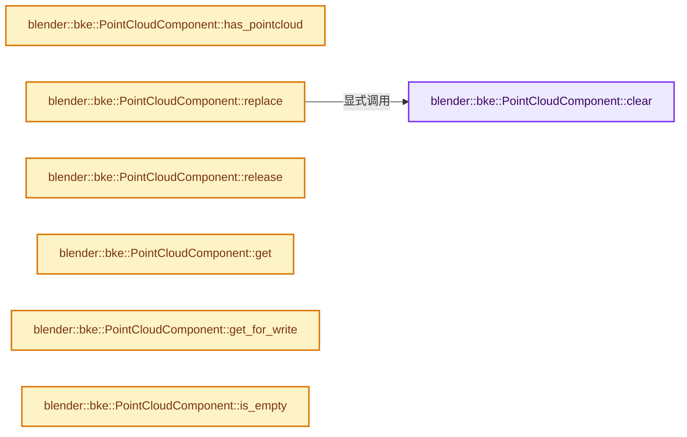
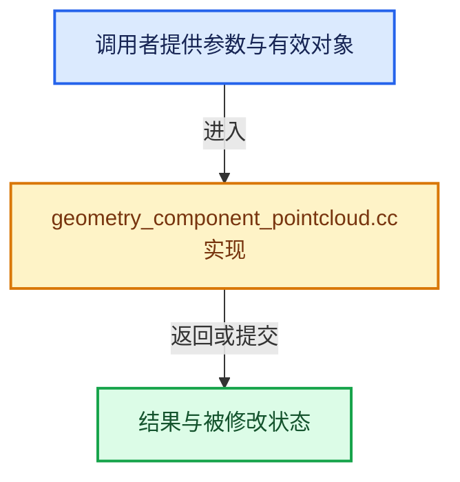

# 实现依赖专题：source/blender/blenkernel/intern/geometry_component_pointcloud.cc

[方向导航](README.md) · [符号索引](../%E7%AC%A6%E5%8F%B7%E4%BE%9D%E8%B5%96%E4%B8%8E%E5%AE%9E%E7%8E%B0%E7%B4%A2%E5%BC%95.md)

本专题从正文实际调用进入，集中保存共享实现。函数有稳定锚点，可从调用处直接跳到对应完整函数；递归与互相调用通过回链组织。

## 本文件的实现关系






## 完整成员与函数实现

<a id="f-42060e2fd4e7e5a3"></a>

### `blender::bke::PointCloudComponent::clear`

实现位置：[source/blender/blenkernel/intern/geometry_component_pointcloud.cc](../../../../../source/blender/blenkernel/intern/geometry_component_pointcloud.cc) · L45—L54。

**教学注释版**

<!-- annotated:8dcd7834327f35 -->

```cpp
void PointCloudComponent::clear()
{
  // [讲解] this->is_mutable：检查相应共享状态是否允许独占修改。
  BLI_assert(this->is_mutable() || this->is_expired());
  if (pointcloud_ != nullptr) {
    if (ownership_ == GeometryOwnershipType::Owned) {
      BKE_id_free(nullptr, pointcloud_);
    }
    pointcloud_ = nullptr;
  }
}
```

<details>
<summary>核对原始源码：source/blender/blenkernel/intern/geometry_component_pointcloud.cc · L45—L54</summary>

<!-- original:8dcd7834327f35:source/blender/blenkernel/intern/geometry_component_pointcloud.cc:45:54 -->

```cpp
void PointCloudComponent::clear()
{
  BLI_assert(this->is_mutable() || this->is_expired());
  if (pointcloud_ != nullptr) {
    if (ownership_ == GeometryOwnershipType::Owned) {
      BKE_id_free(nullptr, pointcloud_);
    }
    pointcloud_ = nullptr;
  }
}
```

</details>

**沿实际写入检查状态**

- `pointcloud_ = nullptr;`

**继续追踪实现**

- `BLI_assert` → [BLI_assert · L48](../01-%E5%9F%BA%E7%A1%80%E5%AE%B9%E5%99%A8%E4%B8%8E%E7%8E%B0%E4%BB%A3CPP/%E4%BE%9D%E8%B5%96-BLI_assert-cc98e8.md#m-57a88495704d)；[BLI_assert · L63](../01-%E5%9F%BA%E7%A1%80%E5%AE%B9%E5%99%A8%E4%B8%8E%E7%8E%B0%E4%BB%A3CPP/%E4%BE%9D%E8%B5%96-BLI_assert-cc98e8.md#m-d07050020cb5)。宏定义由构建条件选择。
- `this->is_mutable` → [blender::ImplicitSharingInfo::is_mutable · L76](../06-%E9%9A%90%E5%BC%8F%E5%85%B1%E4%BA%AB%E4%B8%8E%E7%BC%93%E5%AD%98%E7%B3%BB%E7%BB%9F/01-%E6%89%80%E6%9C%89%E6%9D%83%E4%B8%8E%E5%86%99%E6%97%B6%E5%A4%8D%E5%88%B6.md#f-b4d31aba499caecb)。
- `this->is_expired` → [blender::ImplicitSharingInfo::is_expired · L85](../06-%E9%9A%90%E5%BC%8F%E5%85%B1%E4%BA%AB%E4%B8%8E%E7%BC%93%E5%AD%98%E7%B3%BB%E7%BB%9F/01-%E6%89%80%E6%9C%89%E6%9D%83%E4%B8%8E%E5%86%99%E6%97%B6%E5%A4%8D%E5%88%B6.md#f-2dc355bd9568b068)。
- `BKE_id_free` → [blender::BKE_id_free · L224](%E4%BE%9D%E8%B5%96-lib_id_delete-0cb33f.md#f-28ed02c41d0f2d5b)。

<a id="f-0421dfc034083b44"></a>

### `blender::bke::PointCloudComponent::has_pointcloud`

实现位置：[source/blender/blenkernel/intern/geometry_component_pointcloud.cc](../../../../../source/blender/blenkernel/intern/geometry_component_pointcloud.cc) · L56—L59。

**教学注释版**

<!-- annotated:f8f4d7000c9f15 -->

```cpp
bool PointCloudComponent::has_pointcloud() const
{
  return pointcloud_ != nullptr;
}
```

<details>
<summary>核对原始源码：source/blender/blenkernel/intern/geometry_component_pointcloud.cc · L56—L59</summary>

<!-- original:f8f4d7000c9f15:source/blender/blenkernel/intern/geometry_component_pointcloud.cc:56:59 -->

```cpp
bool PointCloudComponent::has_pointcloud() const
{
  return pointcloud_ != nullptr;
}
```

</details>

**结果出口**

- `return pointcloud_ != nullptr;`

**继续追踪实现**

本实现没有需要继续展开的显式调用；检查返回表达式、对象转换和调用者前置条件。

<a id="f-3ec2070a3f242dfc"></a>

### `blender::bke::PointCloudComponent::replace`

实现位置：[source/blender/blenkernel/intern/geometry_component_pointcloud.cc](../../../../../source/blender/blenkernel/intern/geometry_component_pointcloud.cc) · L61—L67。

接口参数：

- `PointCloud *pointcloud`
- `GeometryOwnershipType ownership`

**教学注释版**

<!-- annotated:d42eba043ab1db -->

```cpp
void PointCloudComponent::replace(PointCloud *pointcloud, GeometryOwnershipType ownership)
{
  // [讲解] this->is_mutable：检查相应共享状态是否允许独占修改。
  BLI_assert(this->is_mutable());
  this->clear();
  pointcloud_ = pointcloud;
  ownership_ = ownership;
}
```

<details>
<summary>核对原始源码：source/blender/blenkernel/intern/geometry_component_pointcloud.cc · L61—L67</summary>

<!-- original:d42eba043ab1db:source/blender/blenkernel/intern/geometry_component_pointcloud.cc:61:67 -->

```cpp
void PointCloudComponent::replace(PointCloud *pointcloud, GeometryOwnershipType ownership)
{
  BLI_assert(this->is_mutable());
  this->clear();
  pointcloud_ = pointcloud;
  ownership_ = ownership;
}
```

</details>

**沿实际写入检查状态**

- `pointcloud_ = pointcloud;`
- `ownership_ = ownership;`

**继续追踪实现**

- `BLI_assert` → [BLI_assert · L48](../01-%E5%9F%BA%E7%A1%80%E5%AE%B9%E5%99%A8%E4%B8%8E%E7%8E%B0%E4%BB%A3CPP/%E4%BE%9D%E8%B5%96-BLI_assert-cc98e8.md#m-57a88495704d)；[BLI_assert · L63](../01-%E5%9F%BA%E7%A1%80%E5%AE%B9%E5%99%A8%E4%B8%8E%E7%8E%B0%E4%BB%A3CPP/%E4%BE%9D%E8%B5%96-BLI_assert-cc98e8.md#m-d07050020cb5)。宏定义由构建条件选择。
- `this->is_mutable` → [blender::ImplicitSharingInfo::is_mutable · L76](../06-%E9%9A%90%E5%BC%8F%E5%85%B1%E4%BA%AB%E4%B8%8E%E7%BC%93%E5%AD%98%E7%B3%BB%E7%BB%9F/01-%E6%89%80%E6%9C%89%E6%9D%83%E4%B8%8E%E5%86%99%E6%97%B6%E5%A4%8D%E5%88%B6.md#f-b4d31aba499caecb)。
- `this->clear` → [blender::bke::PointCloudComponent::clear · L45](%E4%BE%9D%E8%B5%96-geometry_component_pointcloud-0caac6.md#f-42060e2fd4e7e5a3)。

<a id="f-716fd49e11f1a04e"></a>

### `blender::bke::PointCloudComponent::release`

实现位置：[source/blender/blenkernel/intern/geometry_component_pointcloud.cc](../../../../../source/blender/blenkernel/intern/geometry_component_pointcloud.cc) · L69—L75。

**教学注释版**

<!-- annotated:ecd9218609a771 -->

```cpp
PointCloud *PointCloudComponent::release()
{
  // [讲解] this->is_mutable：检查相应共享状态是否允许独占修改。
  BLI_assert(this->is_mutable());
  PointCloud *pointcloud = pointcloud_;
  pointcloud_ = nullptr;
  return pointcloud;
}
```

<details>
<summary>核对原始源码：source/blender/blenkernel/intern/geometry_component_pointcloud.cc · L69—L75</summary>

<!-- original:ecd9218609a771:source/blender/blenkernel/intern/geometry_component_pointcloud.cc:69:75 -->

```cpp
PointCloud *PointCloudComponent::release()
{
  BLI_assert(this->is_mutable());
  PointCloud *pointcloud = pointcloud_;
  pointcloud_ = nullptr;
  return pointcloud;
}
```

</details>

**沿实际写入检查状态**

- `pointcloud_ = nullptr;`

**结果出口**

- `return pointcloud;`

**继续追踪实现**

- `BLI_assert` → [BLI_assert · L48](../01-%E5%9F%BA%E7%A1%80%E5%AE%B9%E5%99%A8%E4%B8%8E%E7%8E%B0%E4%BB%A3CPP/%E4%BE%9D%E8%B5%96-BLI_assert-cc98e8.md#m-57a88495704d)；[BLI_assert · L63](../01-%E5%9F%BA%E7%A1%80%E5%AE%B9%E5%99%A8%E4%B8%8E%E7%8E%B0%E4%BB%A3CPP/%E4%BE%9D%E8%B5%96-BLI_assert-cc98e8.md#m-d07050020cb5)。宏定义由构建条件选择。
- `this->is_mutable` → [blender::ImplicitSharingInfo::is_mutable · L76](../06-%E9%9A%90%E5%BC%8F%E5%85%B1%E4%BA%AB%E4%B8%8E%E7%BC%93%E5%AD%98%E7%B3%BB%E7%BB%9F/01-%E6%89%80%E6%9C%89%E6%9D%83%E4%B8%8E%E5%86%99%E6%97%B6%E5%A4%8D%E5%88%B6.md#f-b4d31aba499caecb)。

<a id="f-fe39c478efa2050c"></a>

### `blender::bke::PointCloudComponent::get`

实现位置：[source/blender/blenkernel/intern/geometry_component_pointcloud.cc](../../../../../source/blender/blenkernel/intern/geometry_component_pointcloud.cc) · L77—L80。

**教学注释版**

<!-- annotated:90625e07725f8c -->

```cpp
const PointCloud *PointCloudComponent::get() const
{
  return pointcloud_;
}
```

<details>
<summary>核对原始源码：source/blender/blenkernel/intern/geometry_component_pointcloud.cc · L77—L80</summary>

<!-- original:90625e07725f8c:source/blender/blenkernel/intern/geometry_component_pointcloud.cc:77:80 -->

```cpp
const PointCloud *PointCloudComponent::get() const
{
  return pointcloud_;
}
```

</details>

**结果出口**

- `return pointcloud_;`

**继续追踪实现**

本实现没有需要继续展开的显式调用；检查返回表达式、对象转换和调用者前置条件。

<a id="f-e5ce259db1290094"></a>

### `blender::bke::PointCloudComponent::get_for_write`

实现位置：[source/blender/blenkernel/intern/geometry_component_pointcloud.cc](../../../../../source/blender/blenkernel/intern/geometry_component_pointcloud.cc) · L82—L90。

**教学注释版**

<!-- annotated:6c1f89d72052e2 -->

```cpp
PointCloud *PointCloudComponent::get_for_write()
{
  // [讲解] this->is_mutable：检查相应共享状态是否允许独占修改。
  BLI_assert(this->is_mutable());
  if (ownership_ == GeometryOwnershipType::ReadOnly) {
    pointcloud_ = BKE_pointcloud_copy_for_eval(pointcloud_);
    ownership_ = GeometryOwnershipType::Owned;
  }
  return pointcloud_;
}
```

<details>
<summary>核对原始源码：source/blender/blenkernel/intern/geometry_component_pointcloud.cc · L82—L90</summary>

<!-- original:6c1f89d72052e2:source/blender/blenkernel/intern/geometry_component_pointcloud.cc:82:90 -->

```cpp
PointCloud *PointCloudComponent::get_for_write()
{
  BLI_assert(this->is_mutable());
  if (ownership_ == GeometryOwnershipType::ReadOnly) {
    pointcloud_ = BKE_pointcloud_copy_for_eval(pointcloud_);
    ownership_ = GeometryOwnershipType::Owned;
  }
  return pointcloud_;
}
```

</details>

**沿实际写入检查状态**

- `pointcloud_ = BKE_pointcloud_copy_for_eval(pointcloud_);`
- `ownership_ = GeometryOwnershipType::Owned;`

**结果出口**

- `return pointcloud_;`

**继续追踪实现**

- `BLI_assert` → [BLI_assert · L48](../01-%E5%9F%BA%E7%A1%80%E5%AE%B9%E5%99%A8%E4%B8%8E%E7%8E%B0%E4%BB%A3CPP/%E4%BE%9D%E8%B5%96-BLI_assert-cc98e8.md#m-57a88495704d)；[BLI_assert · L63](../01-%E5%9F%BA%E7%A1%80%E5%AE%B9%E5%99%A8%E4%B8%8E%E7%8E%B0%E4%BB%A3CPP/%E4%BE%9D%E8%B5%96-BLI_assert-cc98e8.md#m-d07050020cb5)。宏定义由构建条件选择。
- `this->is_mutable` → [blender::ImplicitSharingInfo::is_mutable · L76](../06-%E9%9A%90%E5%BC%8F%E5%85%B1%E4%BA%AB%E4%B8%8E%E7%BC%93%E5%AD%98%E7%B3%BB%E7%BB%9F/01-%E6%89%80%E6%9C%89%E6%9D%83%E4%B8%8E%E5%86%99%E6%97%B6%E5%A4%8D%E5%88%B6.md#f-b4d31aba499caecb)。
- `BKE_pointcloud_copy_for_eval` → [blender::BKE_pointcloud_copy_for_eval · L366](%E4%BE%9D%E8%B5%96-pointcloud-49a366.md#f-3fb53ca0ce1b90a5)。

<a id="f-e0104f6194e87181"></a>

### `blender::bke::PointCloudComponent::is_empty`

实现位置：[source/blender/blenkernel/intern/geometry_component_pointcloud.cc](../../../../../source/blender/blenkernel/intern/geometry_component_pointcloud.cc) · L92—L95。

**教学注释版**

<!-- annotated:de339af36b5aa0 -->

```cpp
bool PointCloudComponent::is_empty() const
{
  return pointcloud_ == nullptr;
}
```

<details>
<summary>核对原始源码：source/blender/blenkernel/intern/geometry_component_pointcloud.cc · L92—L95</summary>

<!-- original:de339af36b5aa0:source/blender/blenkernel/intern/geometry_component_pointcloud.cc:92:95 -->

```cpp
bool PointCloudComponent::is_empty() const
{
  return pointcloud_ == nullptr;
}
```

</details>

**结果出口**

- `return pointcloud_ == nullptr;`

**继续追踪实现**

本实现没有需要继续展开的显式调用；检查返回表达式、对象转换和调用者前置条件。
