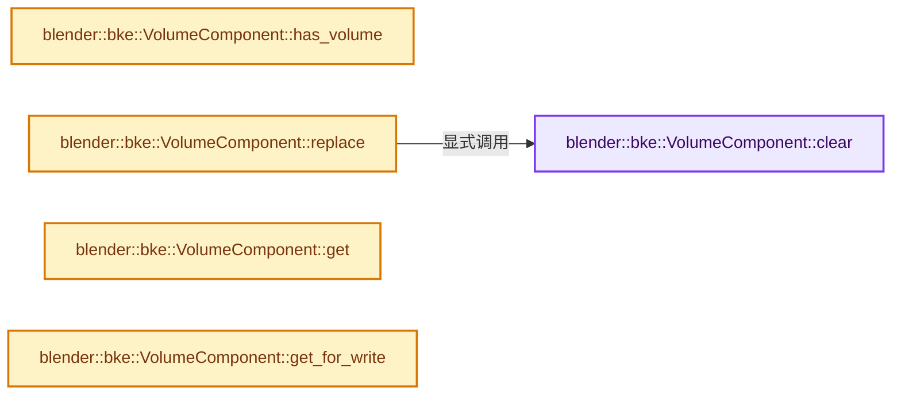
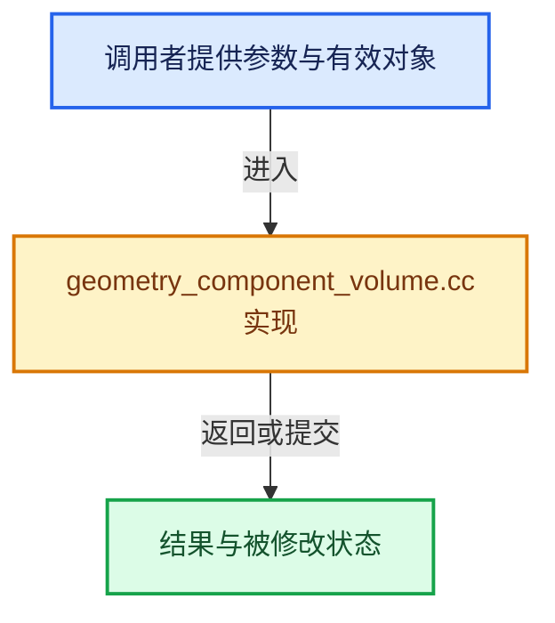

# 实现依赖专题：source/blender/blenkernel/intern/geometry_component_volume.cc

[方向导航](README.md) · [符号索引](../%E7%AC%A6%E5%8F%B7%E4%BE%9D%E8%B5%96%E4%B8%8E%E5%AE%9E%E7%8E%B0%E7%B4%A2%E5%BC%95.md)

本专题从正文实际调用进入，集中保存共享实现。函数有稳定锚点，可从调用处直接跳到对应完整函数；递归与互相调用通过回链组织。

## 本文件的实现关系






## 完整成员与函数实现

<a id="f-e8035cb4387886e7"></a>

### `blender::bke::VolumeComponent::clear`

实现位置：[source/blender/blenkernel/intern/geometry_component_volume.cc](../../../../../source/blender/blenkernel/intern/geometry_component_volume.cc) · L36—L45。

**教学注释版**

<!-- annotated:811a6c34bea813 -->

```cpp
void VolumeComponent::clear()
{
  // [讲解] this->is_mutable：检查相应共享状态是否允许独占修改。
  BLI_assert(this->is_mutable() || this->is_expired());
  if (volume_ != nullptr) {
    if (ownership_ == GeometryOwnershipType::Owned) {
      BKE_id_free(nullptr, volume_);
    }
    volume_ = nullptr;
  }
}
```

<details>
<summary>核对原始源码：source/blender/blenkernel/intern/geometry_component_volume.cc · L36—L45</summary>

<!-- original:811a6c34bea813:source/blender/blenkernel/intern/geometry_component_volume.cc:36:45 -->

```cpp
void VolumeComponent::clear()
{
  BLI_assert(this->is_mutable() || this->is_expired());
  if (volume_ != nullptr) {
    if (ownership_ == GeometryOwnershipType::Owned) {
      BKE_id_free(nullptr, volume_);
    }
    volume_ = nullptr;
  }
}
```

</details>

**沿实际写入检查状态**

- `volume_ = nullptr;`

**继续追踪实现**

- `BLI_assert` → [BLI_assert · L48](../01-%E5%9F%BA%E7%A1%80%E5%AE%B9%E5%99%A8%E4%B8%8E%E7%8E%B0%E4%BB%A3CPP/%E4%BE%9D%E8%B5%96-BLI_assert-cc98e8.md#m-57a88495704d)；[BLI_assert · L63](../01-%E5%9F%BA%E7%A1%80%E5%AE%B9%E5%99%A8%E4%B8%8E%E7%8E%B0%E4%BB%A3CPP/%E4%BE%9D%E8%B5%96-BLI_assert-cc98e8.md#m-d07050020cb5)。宏定义由构建条件选择。
- `this->is_mutable` → [blender::ImplicitSharingInfo::is_mutable · L76](../06-%E9%9A%90%E5%BC%8F%E5%85%B1%E4%BA%AB%E4%B8%8E%E7%BC%93%E5%AD%98%E7%B3%BB%E7%BB%9F/01-%E6%89%80%E6%9C%89%E6%9D%83%E4%B8%8E%E5%86%99%E6%97%B6%E5%A4%8D%E5%88%B6.md#f-b4d31aba499caecb)。
- `this->is_expired` → [blender::ImplicitSharingInfo::is_expired · L85](../06-%E9%9A%90%E5%BC%8F%E5%85%B1%E4%BA%AB%E4%B8%8E%E7%BC%93%E5%AD%98%E7%B3%BB%E7%BB%9F/01-%E6%89%80%E6%9C%89%E6%9D%83%E4%B8%8E%E5%86%99%E6%97%B6%E5%A4%8D%E5%88%B6.md#f-2dc355bd9568b068)。
- `BKE_id_free` → [blender::BKE_id_free · L224](%E4%BE%9D%E8%B5%96-lib_id_delete-0cb33f.md#f-28ed02c41d0f2d5b)。

<a id="f-8c678e4bb96e6d5f"></a>

### `blender::bke::VolumeComponent::has_volume`

实现位置：[source/blender/blenkernel/intern/geometry_component_volume.cc](../../../../../source/blender/blenkernel/intern/geometry_component_volume.cc) · L47—L50。

**教学注释版**

<!-- annotated:6c0d8b8f500495 -->

```cpp
bool VolumeComponent::has_volume() const
{
  return volume_ != nullptr;
}
```

<details>
<summary>核对原始源码：source/blender/blenkernel/intern/geometry_component_volume.cc · L47—L50</summary>

<!-- original:6c0d8b8f500495:source/blender/blenkernel/intern/geometry_component_volume.cc:47:50 -->

```cpp
bool VolumeComponent::has_volume() const
{
  return volume_ != nullptr;
}
```

</details>

**结果出口**

- `return volume_ != nullptr;`

**继续追踪实现**

本实现没有需要继续展开的显式调用；检查返回表达式、对象转换和调用者前置条件。

<a id="f-88828f1924564921"></a>

### `blender::bke::VolumeComponent::replace`

实现位置：[source/blender/blenkernel/intern/geometry_component_volume.cc](../../../../../source/blender/blenkernel/intern/geometry_component_volume.cc) · L52—L58。

接口参数：

- `Volume *volume`
- `GeometryOwnershipType ownership`

**教学注释版**

<!-- annotated:983c5810cb924a -->

```cpp
void VolumeComponent::replace(Volume *volume, GeometryOwnershipType ownership)
{
  // [讲解] this->is_mutable：检查相应共享状态是否允许独占修改。
  BLI_assert(this->is_mutable());
  this->clear();
  volume_ = volume;
  ownership_ = ownership;
}
```

<details>
<summary>核对原始源码：source/blender/blenkernel/intern/geometry_component_volume.cc · L52—L58</summary>

<!-- original:983c5810cb924a:source/blender/blenkernel/intern/geometry_component_volume.cc:52:58 -->

```cpp
void VolumeComponent::replace(Volume *volume, GeometryOwnershipType ownership)
{
  BLI_assert(this->is_mutable());
  this->clear();
  volume_ = volume;
  ownership_ = ownership;
}
```

</details>

**沿实际写入检查状态**

- `volume_ = volume;`
- `ownership_ = ownership;`

**继续追踪实现**

- `BLI_assert` → [BLI_assert · L48](../01-%E5%9F%BA%E7%A1%80%E5%AE%B9%E5%99%A8%E4%B8%8E%E7%8E%B0%E4%BB%A3CPP/%E4%BE%9D%E8%B5%96-BLI_assert-cc98e8.md#m-57a88495704d)；[BLI_assert · L63](../01-%E5%9F%BA%E7%A1%80%E5%AE%B9%E5%99%A8%E4%B8%8E%E7%8E%B0%E4%BB%A3CPP/%E4%BE%9D%E8%B5%96-BLI_assert-cc98e8.md#m-d07050020cb5)。宏定义由构建条件选择。
- `this->is_mutable` → [blender::ImplicitSharingInfo::is_mutable · L76](../06-%E9%9A%90%E5%BC%8F%E5%85%B1%E4%BA%AB%E4%B8%8E%E7%BC%93%E5%AD%98%E7%B3%BB%E7%BB%9F/01-%E6%89%80%E6%9C%89%E6%9D%83%E4%B8%8E%E5%86%99%E6%97%B6%E5%A4%8D%E5%88%B6.md#f-b4d31aba499caecb)。
- `this->clear` → [blender::bke::VolumeComponent::clear · L36](%E4%BE%9D%E8%B5%96-geometry_component_volume-b14dd5.md#f-e8035cb4387886e7)。

<a id="f-f542e2b53c8bf289"></a>

### `blender::bke::VolumeComponent::get`

实现位置：[source/blender/blenkernel/intern/geometry_component_volume.cc](../../../../../source/blender/blenkernel/intern/geometry_component_volume.cc) · L68—L71。

**教学注释版**

<!-- annotated:260ea3024f1651 -->

```cpp
const Volume *VolumeComponent::get() const
{
  return volume_;
}
```

<details>
<summary>核对原始源码：source/blender/blenkernel/intern/geometry_component_volume.cc · L68—L71</summary>

<!-- original:260ea3024f1651:source/blender/blenkernel/intern/geometry_component_volume.cc:68:71 -->

```cpp
const Volume *VolumeComponent::get() const
{
  return volume_;
}
```

</details>

**结果出口**

- `return volume_;`

**继续追踪实现**

本实现没有需要继续展开的显式调用；检查返回表达式、对象转换和调用者前置条件。

<a id="f-7ea19c03e5ff914b"></a>

### `blender::bke::VolumeComponent::get_for_write`

实现位置：[source/blender/blenkernel/intern/geometry_component_volume.cc](../../../../../source/blender/blenkernel/intern/geometry_component_volume.cc) · L73—L81。

**教学注释版**

<!-- annotated:89af86e96e76f5 -->

```cpp
Volume *VolumeComponent::get_for_write()
{
  // [讲解] this->is_mutable：检查相应共享状态是否允许独占修改。
  BLI_assert(this->is_mutable());
  if (ownership_ == GeometryOwnershipType::ReadOnly) {
    volume_ = BKE_volume_copy_for_eval(volume_);
    ownership_ = GeometryOwnershipType::Owned;
  }
  return volume_;
}
```

<details>
<summary>核对原始源码：source/blender/blenkernel/intern/geometry_component_volume.cc · L73—L81</summary>

<!-- original:89af86e96e76f5:source/blender/blenkernel/intern/geometry_component_volume.cc:73:81 -->

```cpp
Volume *VolumeComponent::get_for_write()
{
  BLI_assert(this->is_mutable());
  if (ownership_ == GeometryOwnershipType::ReadOnly) {
    volume_ = BKE_volume_copy_for_eval(volume_);
    ownership_ = GeometryOwnershipType::Owned;
  }
  return volume_;
}
```

</details>

**沿实际写入检查状态**

- `volume_ = BKE_volume_copy_for_eval(volume_);`
- `ownership_ = GeometryOwnershipType::Owned;`

**结果出口**

- `return volume_;`

**继续追踪实现**

- `BLI_assert` → [BLI_assert · L48](../01-%E5%9F%BA%E7%A1%80%E5%AE%B9%E5%99%A8%E4%B8%8E%E7%8E%B0%E4%BB%A3CPP/%E4%BE%9D%E8%B5%96-BLI_assert-cc98e8.md#m-57a88495704d)；[BLI_assert · L63](../01-%E5%9F%BA%E7%A1%80%E5%AE%B9%E5%99%A8%E4%B8%8E%E7%8E%B0%E4%BB%A3CPP/%E4%BE%9D%E8%B5%96-BLI_assert-cc98e8.md#m-d07050020cb5)。宏定义由构建条件选择。
- `this->is_mutable` → [blender::ImplicitSharingInfo::is_mutable · L76](../06-%E9%9A%90%E5%BC%8F%E5%85%B1%E4%BA%AB%E4%B8%8E%E7%BC%93%E5%AD%98%E7%B3%BB%E7%BB%9F/01-%E6%89%80%E6%9C%89%E6%9D%83%E4%B8%8E%E5%86%99%E6%97%B6%E5%A4%8D%E5%88%B6.md#f-b4d31aba499caecb)。
- `BKE_volume_copy_for_eval` → [blender::BKE_volume_copy_for_eval · L972](%E4%BE%9D%E8%B5%96-volume-8dd0eb.md#f-d819b708f745471a)。
