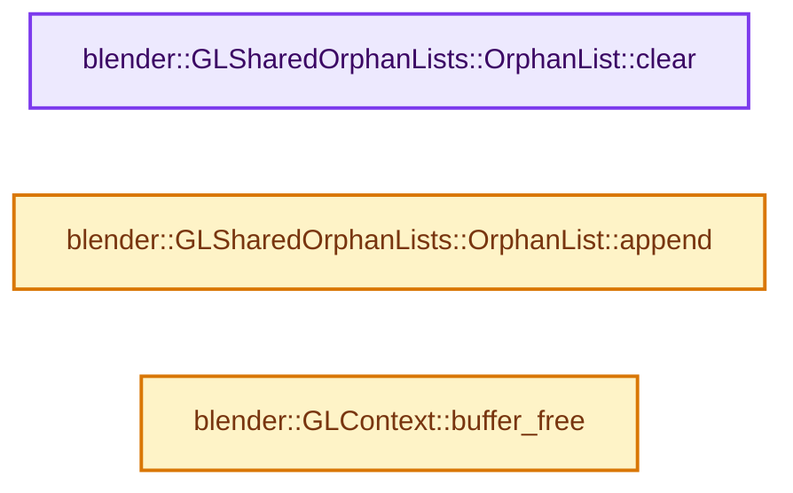
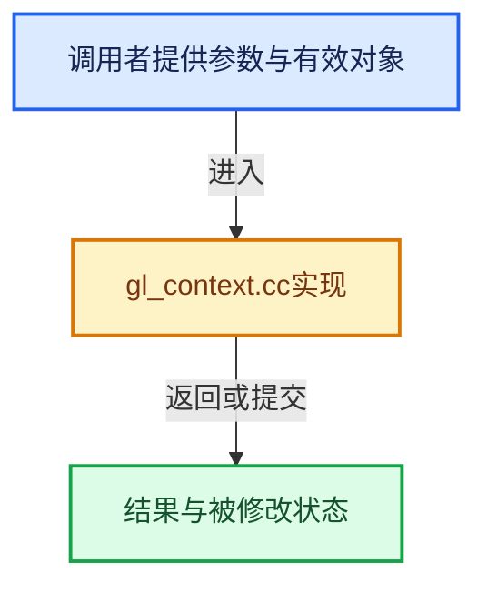

# 实现依赖专题：source/blender/gpu/opengl/gl_context.cc

[方向导航](README.md) · [符号索引](../%E7%AC%A6%E5%8F%B7%E4%BE%9D%E8%B5%96%E4%B8%8E%E5%AE%9E%E7%8E%B0%E7%B4%A2%E5%BC%95.md)

本专题从正文实际调用进入，集中保存共享实现。函数有稳定锚点，可从调用处直接跳到对应完整函数；递归与互相调用通过回链组织。

## 本文件的实现关系






## 完整成员与函数实现

<a id="f-eed15c5c57f2e985"></a>

### `blender::GLSharedOrphanLists::OrphanList::clear`

实现位置：[source/blender/gpu/opengl/gl_context.cc](../../../../../source/blender/gpu/opengl/gl_context.cc) · L204—L211。

接口参数：

- `FunctionRef<void(GLuint, GLuint *)> free_fn`
- `GLuint`
- `GLuint *`

**教学注释版**

<!-- annotated:54e663ea353004 -->

```cpp
void GLSharedOrphanLists::OrphanList::clear(FunctionRef<void(GLuint, GLuint *)> free_fn)
{
  std::scoped_lock lock(mutex_);
  if (!handles_.is_empty()) {
    free_fn(uint(handles_.size()), handles_.data());
    handles_.clear();
  }
};
```

<details>
<summary>核对原始源码：source/blender/gpu/opengl/gl_context.cc · L204—L211</summary>

<!-- original:54e663ea353004:source/blender/gpu/opengl/gl_context.cc:204:211 -->

```cpp
void GLSharedOrphanLists::OrphanList::clear(FunctionRef<void(GLuint, GLuint *)> free_fn)
{
  std::scoped_lock lock(mutex_);
  if (!handles_.is_empty()) {
    free_fn(uint(handles_.size()), handles_.data());
    handles_.clear();
  }
};
```

</details>

**继续追踪实现**

- `handles_.is_empty` → [调用协议](../%E6%A8%A1%E6%9D%BF%E5%AE%8F%E4%B8%8E%E5%8A%A8%E6%80%81%E5%88%86%E6%B4%BE%E5%8D%8F%E8%AE%AE.md)：接收对象类型依赖auto、返回值或模板实例；不按同名猜测目标。调用位置L207。
- `free_fn` → [调用协议](../%E6%A8%A1%E6%9D%BF%E5%AE%8F%E4%B8%8E%E5%8A%A8%E6%80%81%E5%88%86%E6%B4%BE%E5%8D%8F%E8%AE%AE.md)：局部可调用对象，须结合其初始化与捕获环境。调用位置L208。
- `handles_.size` → [调用协议](../%E6%A8%A1%E6%9D%BF%E5%AE%8F%E4%B8%8E%E5%8A%A8%E6%80%81%E5%88%86%E6%B4%BE%E5%8D%8F%E8%AE%AE.md)：接收对象类型依赖auto、返回值或模板实例；不按同名猜测目标。调用位置L208。
- `handles_.data` → [调用协议](../%E6%A8%A1%E6%9D%BF%E5%AE%8F%E4%B8%8E%E5%8A%A8%E6%80%81%E5%88%86%E6%B4%BE%E5%8D%8F%E8%AE%AE.md)：接收对象类型依赖auto、返回值或模板实例；不按同名猜测目标。调用位置L208。
- `handles_.clear` → [调用协议](../%E6%A8%A1%E6%9D%BF%E5%AE%8F%E4%B8%8E%E5%8A%A8%E6%80%81%E5%88%86%E6%B4%BE%E5%8D%8F%E8%AE%AE.md)：接收对象类型依赖auto、返回值或模板实例；不按同名猜测目标。调用位置L209。

<a id="f-38a327ca2ce8ae16"></a>

### `blender::GLSharedOrphanLists::OrphanList::append`

实现位置：[source/blender/gpu/opengl/gl_context.cc](../../../../../source/blender/gpu/opengl/gl_context.cc) · L213—L217。

接口参数：

- `GLuint handle`

**教学注释版**

<!-- annotated:6f36e1f2cc0a62 -->

```cpp
void GLSharedOrphanLists::OrphanList::append(GLuint handle)
{
  std::scoped_lock lock(mutex_);
  handles_.append(handle);
};
```

<details>
<summary>核对原始源码：source/blender/gpu/opengl/gl_context.cc · L213—L217</summary>

<!-- original:6f36e1f2cc0a62:source/blender/gpu/opengl/gl_context.cc:213:217 -->

```cpp
void GLSharedOrphanLists::OrphanList::append(GLuint handle)
{
  std::scoped_lock lock(mutex_);
  handles_.append(handle);
};
```

</details>

**继续追踪实现**

- `handles_.append` → [调用协议](../%E6%A8%A1%E6%9D%BF%E5%AE%8F%E4%B8%8E%E5%8A%A8%E6%80%81%E5%88%86%E6%B4%BE%E5%8D%8F%E8%AE%AE.md)：接收对象类型依赖auto、返回值或模板实例；不按同名猜测目标。调用位置L216。

<a id="f-51f508546ae90e7b"></a>

### `blender::GLContext::buffer_free`

实现位置：[source/blender/gpu/opengl/gl_context.cc](../../../../../source/blender/gpu/opengl/gl_context.cc) · L284—L294。

接口参数：

- `GLuint buf_id`

**教学注释版**

<!-- annotated:ee7a0e9d7aaa52 -->

```cpp
void GLContext::buffer_free(GLuint buf_id)
{
  /* Any context can free. */
  if (GLContext::get()) {
    glDeleteBuffers(1, &buf_id);
  }
  else {
    GLSharedOrphanLists &orphan_list = GLBackend::get()->shared_orphan_list_get();
    orphan_list.buffers.append(buf_id);
  }
}
```

<details>
<summary>核对原始源码：source/blender/gpu/opengl/gl_context.cc · L284—L294</summary>

<!-- original:ee7a0e9d7aaa52:source/blender/gpu/opengl/gl_context.cc:284:294 -->

```cpp
void GLContext::buffer_free(GLuint buf_id)
{
  /* Any context can free. */
  if (GLContext::get()) {
    glDeleteBuffers(1, &buf_id);
  }
  else {
    GLSharedOrphanLists &orphan_list = GLBackend::get()->shared_orphan_list_get();
    orphan_list.buffers.append(buf_id);
  }
}
```

</details>

**继续追踪实现**

- `GLContext::get` → [blender::gpu::GLContext::get · L143](%E4%BE%9D%E8%B5%96-gl_context-965f7e.md#f-2d6c70989abeb59b)。
- `glDeleteBuffers` → [调用协议](../%E6%A8%A1%E6%9D%BF%E5%AE%8F%E4%B8%8E%E5%8A%A8%E6%80%81%E5%88%86%E6%B4%BE%E5%8D%8F%E8%AE%AE.md)：函数指针、局部可调用对象或未展开的宏；必须结合调用者环境。调用位置L288。
- `GLBackend::get()->shared_orphan_list_get` → [调用协议](../%E6%A8%A1%E6%9D%BF%E5%AE%8F%E4%B8%8E%E5%8A%A8%E6%80%81%E5%88%86%E6%B4%BE%E5%8D%8F%E8%AE%AE.md)：接收对象类型依赖auto、返回值或模板实例；不按同名猜测目标。调用位置L291。
- `GLBackend::get` → [blender::gpu::GLBackend::get · L86](%E4%BE%9D%E8%B5%96-gl_backend-c36ff3.md#f-49b7f5dc4543f752)。
- `orphan_list.buffers.append` → [调用协议](../%E6%A8%A1%E6%9D%BF%E5%AE%8F%E4%B8%8E%E5%8A%A8%E6%80%81%E5%88%86%E6%B4%BE%E5%8D%8F%E8%AE%AE.md)：接收对象类型依赖auto、返回值或模板实例；不按同名猜测目标。调用位置L292。
