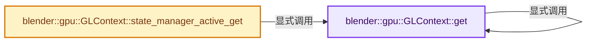
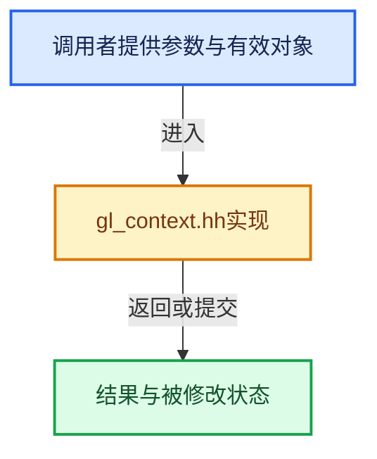

# 实现依赖专题：source/blender/gpu/opengl/gl_context.hh

[方向导航](README.md) · [符号索引](../%E7%AC%A6%E5%8F%B7%E4%BE%9D%E8%B5%96%E4%B8%8E%E5%AE%9E%E7%8E%B0%E7%B4%A2%E5%BC%95.md)

本专题从正文实际调用进入，集中保存共享实现。函数有稳定锚点，可从调用处直接跳到对应完整函数；递归与互相调用通过回链组织。

## 本文件的实现关系






## 完整成员与函数实现

<a id="f-2d6c70989abeb59b"></a>

### `blender::gpu::GLContext::get`

实现位置：[source/blender/gpu/opengl/gl_context.hh](../../../../../source/blender/gpu/opengl/gl_context.hh) · L143—L146。

**教学注释版**

<!-- annotated:6422052f718a8a -->

```cpp
  static GLContext *get()
  {
    return static_cast<GLContext *>(Context::get());
  }
```

<details>
<summary>核对原始源码：source/blender/gpu/opengl/gl_context.hh · L143—L146</summary>

<!-- original:6422052f718a8a:source/blender/gpu/opengl/gl_context.hh:143:146 -->

```cpp
  static GLContext *get()
  {
    return static_cast<GLContext *>(Context::get());
  }
```

</details>

**结果出口**

- `return static_cast<GLContext *>(Context::get());`

**继续追踪实现**

- `Context::get` → [blender::gpu::GLContext::get · L143](%E4%BE%9D%E8%B5%96-gl_context-965f7e.md#f-2d6c70989abeb59b)。

<a id="f-bcf280500593b7e8"></a>

### `blender::gpu::GLContext::state_manager_active_get`

实现位置：[source/blender/gpu/opengl/gl_context.hh](../../../../../source/blender/gpu/opengl/gl_context.hh) · L148—L152。

**教学注释版**

<!-- annotated:33ae71e8c91e4e -->

```cpp
  static GLStateManager *state_manager_active_get()
  {
    GLContext *ctx = GLContext::get();
    return static_cast<GLStateManager *>(ctx->state_manager);
  };
```

<details>
<summary>核对原始源码：source/blender/gpu/opengl/gl_context.hh · L148—L152</summary>

<!-- original:33ae71e8c91e4e:source/blender/gpu/opengl/gl_context.hh:148:152 -->

```cpp
  static GLStateManager *state_manager_active_get()
  {
    GLContext *ctx = GLContext::get();
    return static_cast<GLStateManager *>(ctx->state_manager);
  };
```

</details>

**结果出口**

- `return static_cast<GLStateManager *>(ctx->state_manager);`

**继续追踪实现**

- `GLContext::get` → [blender::gpu::GLContext::get · L143](%E4%BE%9D%E8%B5%96-gl_context-965f7e.md#f-2d6c70989abeb59b)。
