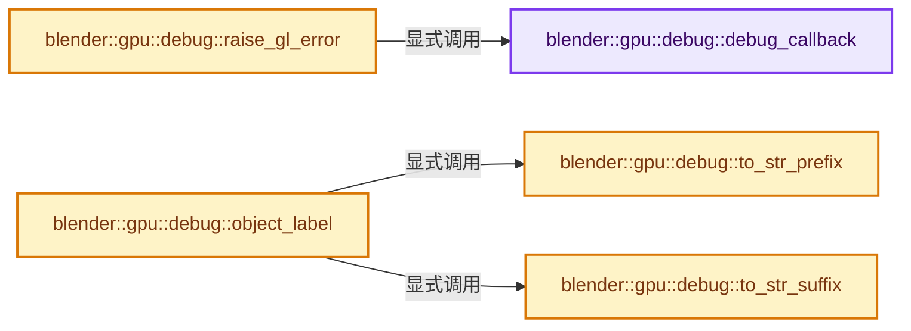
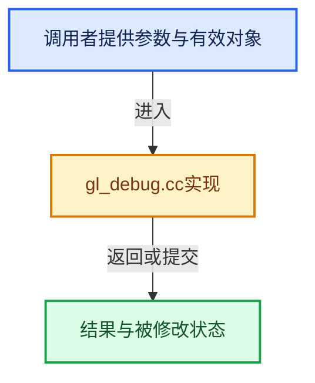

# 实现依赖专题：source/blender/gpu/opengl/gl_debug.cc

[方向导航](README.md) · [符号索引](../%E7%AC%A6%E5%8F%B7%E4%BE%9D%E8%B5%96%E4%B8%8E%E5%AE%9E%E7%8E%B0%E7%B4%A2%E5%BC%95.md)

本专题从正文实际调用进入，集中保存共享实现。函数有稳定锚点，可从调用处直接跳到对应完整函数；递归与互相调用通过回链组织。

## 本文件的实现关系






## 完整成员与函数实现

<a id="f-cd5c543afac02c53"></a>

### `blender::gpu::debug::debug_callback`

实现位置：[source/blender/gpu/opengl/gl_debug.cc](../../../../../source/blender/gpu/opengl/gl_debug.cc) · L55—L134。

接口参数：

- `GLenum`
- `GLenum type`
- `GLuint`
- `GLenum severity`
- `GLsizei`
- `const GLchar *message`
- `const GLvoid *`

**教学注释版**

<!-- annotated:669f217adaf339 -->

```cpp
static void APIENTRY debug_callback(GLenum /*source*/,
                                    GLenum type,
                                    GLuint /*id*/,
                                    GLenum severity,
                                    GLsizei /*length*/,
                                    const GLchar *message,
                                    const GLvoid * /*userParm*/)
{
  if (ELEM(type, GL_DEBUG_TYPE_PUSH_GROUP, GL_DEBUG_TYPE_POP_GROUP)) {
    /* The debug layer will emit a message each time a debug group is pushed or popped.
     * We use that for easy command grouping inside frame analyzer tools. */
    return;
  }

  /* NOTE: callback function can be triggered during before the platform is initialized.
   *       In this case invoking `GPU_type_matches` would fail and
   *       therefore the message is checked before the platform matching. */
  if (TRIM_NVIDIA_BUFFER_INFO && STRPREFIX(message, "Buffer detailed info") &&
      GPU_type_matches(GPU_DEVICE_NVIDIA, GPU_OS_ANY, GPU_DRIVER_OFFICIAL))
  {
    /* Suppress buffer information flooding the output. */
    return;
  }

  if (TRIM_SHADER_STATS_INFO && STRPREFIX(message, "Shader Stats")) {
    /* Suppress buffer information flooding the output. */
    return;
  }

  const bool use_color = CLG_color_support_get(&LOG);

  if (ELEM(severity, GL_DEBUG_SEVERITY_LOW, GL_DEBUG_SEVERITY_NOTIFICATION)) {
    if (CLOG_CHECK(&LOG, CLG_LEVEL_INFO)) {
      const char *format = use_color ? "\033[2m%s\033[0m" : "%s";
      CLG_logf(LOG.type, CLG_LEVEL_INFO, "Notification", "", format, message);
    }
  }
  else {
    char debug_groups[512] = "";
    GPU_debug_get_groups_names(sizeof(debug_groups), debug_groups);
    CLG_Level clog_level;

    if (GPU_debug_group_match(GPU_DEBUG_SHADER_COMPILATION_GROUP) ||
        GPU_debug_group_match(GPU_DEBUG_SHADER_SPECIALIZATION_GROUP))
    {
      /* Do not duplicate shader compilation error/warnings. */
      return;
    }

    switch (type) {
      case GL_DEBUG_TYPE_ERROR:
      case GL_DEBUG_TYPE_DEPRECATED_BEHAVIOR:
      case GL_DEBUG_TYPE_UNDEFINED_BEHAVIOR:
        clog_level = CLG_LEVEL_ERROR;
        break;
      case GL_DEBUG_TYPE_PORTABILITY:
      case GL_DEBUG_TYPE_PERFORMANCE:
      case GL_DEBUG_TYPE_OTHER:
      case GL_DEBUG_TYPE_MARKER: /* KHR has this, ARB does not */
      default:
        clog_level = CLG_LEVEL_WARN;
        break;
    }

    if (CLOG_CHECK(&LOG, clog_level)) {
      CLG_logf(LOG.type, clog_level, debug_groups, "", "%s", message);
      if (severity == GL_DEBUG_SEVERITY_HIGH) {
        /* Focus on error message. */
        if (use_color) {
          fprintf(stderr, "\033[2m");
        }
        BLI_system_backtrace(stderr);
        if (use_color) {
          fprintf(stderr, "\033[0m\n");
        }
        fflush(stderr);
      }
    }
  }
}
```

<details>
<summary>核对原始源码：source/blender/gpu/opengl/gl_debug.cc · L55—L134</summary>

<!-- original:669f217adaf339:source/blender/gpu/opengl/gl_debug.cc:55:134 -->

```cpp
static void APIENTRY debug_callback(GLenum /*source*/,
                                    GLenum type,
                                    GLuint /*id*/,
                                    GLenum severity,
                                    GLsizei /*length*/,
                                    const GLchar *message,
                                    const GLvoid * /*userParm*/)
{
  if (ELEM(type, GL_DEBUG_TYPE_PUSH_GROUP, GL_DEBUG_TYPE_POP_GROUP)) {
    /* The debug layer will emit a message each time a debug group is pushed or popped.
     * We use that for easy command grouping inside frame analyzer tools. */
    return;
  }

  /* NOTE: callback function can be triggered during before the platform is initialized.
   *       In this case invoking `GPU_type_matches` would fail and
   *       therefore the message is checked before the platform matching. */
  if (TRIM_NVIDIA_BUFFER_INFO && STRPREFIX(message, "Buffer detailed info") &&
      GPU_type_matches(GPU_DEVICE_NVIDIA, GPU_OS_ANY, GPU_DRIVER_OFFICIAL))
  {
    /* Suppress buffer information flooding the output. */
    return;
  }

  if (TRIM_SHADER_STATS_INFO && STRPREFIX(message, "Shader Stats")) {
    /* Suppress buffer information flooding the output. */
    return;
  }

  const bool use_color = CLG_color_support_get(&LOG);

  if (ELEM(severity, GL_DEBUG_SEVERITY_LOW, GL_DEBUG_SEVERITY_NOTIFICATION)) {
    if (CLOG_CHECK(&LOG, CLG_LEVEL_INFO)) {
      const char *format = use_color ? "\033[2m%s\033[0m" : "%s";
      CLG_logf(LOG.type, CLG_LEVEL_INFO, "Notification", "", format, message);
    }
  }
  else {
    char debug_groups[512] = "";
    GPU_debug_get_groups_names(sizeof(debug_groups), debug_groups);
    CLG_Level clog_level;

    if (GPU_debug_group_match(GPU_DEBUG_SHADER_COMPILATION_GROUP) ||
        GPU_debug_group_match(GPU_DEBUG_SHADER_SPECIALIZATION_GROUP))
    {
      /* Do not duplicate shader compilation error/warnings. */
      return;
    }

    switch (type) {
      case GL_DEBUG_TYPE_ERROR:
      case GL_DEBUG_TYPE_DEPRECATED_BEHAVIOR:
      case GL_DEBUG_TYPE_UNDEFINED_BEHAVIOR:
        clog_level = CLG_LEVEL_ERROR;
        break;
      case GL_DEBUG_TYPE_PORTABILITY:
      case GL_DEBUG_TYPE_PERFORMANCE:
      case GL_DEBUG_TYPE_OTHER:
      case GL_DEBUG_TYPE_MARKER: /* KHR has this, ARB does not */
      default:
        clog_level = CLG_LEVEL_WARN;
        break;
    }

    if (CLOG_CHECK(&LOG, clog_level)) {
      CLG_logf(LOG.type, clog_level, debug_groups, "", "%s", message);
      if (severity == GL_DEBUG_SEVERITY_HIGH) {
        /* Focus on error message. */
        if (use_color) {
          fprintf(stderr, "\033[2m");
        }
        BLI_system_backtrace(stderr);
        if (use_color) {
          fprintf(stderr, "\033[0m\n");
        }
        fflush(stderr);
      }
    }
  }
}
```

</details>

**沿实际写入检查状态**

- `clog_level = CLG_LEVEL_ERROR;`
- `clog_level = CLG_LEVEL_WARN;`

**继续追踪实现**

- `ELEM` → [ELEM · L88](%E4%BE%9D%E8%B5%96-GHOST_utildefines-34b996.md#m-d28724a15928)；[ELEM · L135](../01-%E5%9F%BA%E7%A1%80%E5%AE%B9%E5%99%A8%E4%B8%8E%E7%8E%B0%E4%BB%A3CPP/%E4%BE%9D%E8%B5%96-BLI_utildefines-293a0a.md#m-d6572de7cae0)。宏定义由构建条件选择。
- `STRPREFIX` → [STRPREFIX · L117](%E4%BE%9D%E8%B5%96-GHOST_utildefines-34b996.md#m-f15302dd736a)；[STRPREFIX · L456](../01-%E5%9F%BA%E7%A1%80%E5%AE%B9%E5%99%A8%E4%B8%8E%E7%8E%B0%E4%BB%A3CPP/%E4%BE%9D%E8%B5%96-BLI_utildefines-293a0a.md#m-afbbeb066fe7)；[STRPREFIX · L18](%E4%BE%9D%E8%B5%96-datatoc-5ae3c3.md#m-cc9a805e5520)。宏定义由构建条件选择。
- `GPU_type_matches` → [blender::GPU_type_matches · L169](%E4%BE%9D%E8%B5%96-gpu_platform-4858e1.md#f-45e7e6875f4b674b)。
- `CLG_color_support_get` → [CLG_color_support_get · L1008](%E4%BE%9D%E8%B5%96-clog-a0bec8.md#f-16f8ad68274ec35b)。
- `CLOG_CHECK` → [CLOG_CHECK · L147](%E4%BE%9D%E8%B5%96-CLG_log-e9051b.md#m-27348fec3943)。宏定义由构建条件选择。
- `CLG_logf` → [CLG_logf · L633](%E4%BE%9D%E8%B5%96-clog-a0bec8.md#f-4db269a18e13b4cf)。
- `GPU_debug_get_groups_names` → [blender::GPU_debug_get_groups_names · L44](%E4%BE%9D%E8%B5%96-gpu_debug-248af2.md#f-2340b84b1ad80b62)；[blender::GPU_debug_get_groups_names · L62](%E4%BE%9D%E8%B5%96-gpu_debug-248af2.md#f-ef6ce710b13aa67f)。同名重载需按实参类型选择。
- `GPU_debug_group_match` → [blender::GPU_debug_group_match · L84](%E4%BE%9D%E8%B5%96-gpu_debug-248af2.md#f-9de0ad763415e280)。
- `fprintf` → [外部契约](https://eel.is/c++draft/)：这个边界按实际表达式及所属类型核对参数、返回值、寿命与失败行为。这里提供接口入口，不声称已解释该第三方版本的内部实现。
- `BLI_system_backtrace` → [blender::BLI_system_backtrace · L112](../01-%E5%9F%BA%E7%A1%80%E5%AE%B9%E5%99%A8%E4%B8%8E%E7%8E%B0%E4%BB%A3CPP/%E4%BE%9D%E8%B5%96-system-b462c0.md#f-684f76d53453b8ff)；[blender::BLI_system_backtrace · L81](%E4%BE%9D%E8%B5%96-makesdna-e966d1.md#f-271abb6037f85c2b)；[blender::BLI_system_backtrace · L54](%E4%BE%9D%E8%B5%96-makesrna-bf7367.md#f-61d5e8002f87d0f0)。同名重载需按实参类型选择。
- `fflush` → [调用协议](../%E6%A8%A1%E6%9D%BF%E5%AE%8F%E4%B8%8E%E5%8A%A8%E6%80%81%E5%88%86%E6%B4%BE%E5%8D%8F%E8%AE%AE.md)：函数指针、局部可调用对象或未展开的宏；必须结合调用者环境。调用位置L130。

<a id="f-3a430e50ffaf4878"></a>

### `blender::gpu::debug::raise_gl_error`

实现位置：[source/blender/gpu/opengl/gl_debug.cc](../../../../../source/blender/gpu/opengl/gl_debug.cc) · L278—L281。

接口参数：

- `const char *info`

**教学注释版**

<!-- annotated:27a9410494b05a -->

```cpp
void raise_gl_error(const char *info)
{
  debug_callback(0, GL_DEBUG_TYPE_ERROR, 0, GL_DEBUG_SEVERITY_HIGH, 0, info, nullptr);
}
```

<details>
<summary>核对原始源码：source/blender/gpu/opengl/gl_debug.cc · L278—L281</summary>

<!-- original:27a9410494b05a:source/blender/gpu/opengl/gl_debug.cc:278:281 -->

```cpp
void raise_gl_error(const char *info)
{
  debug_callback(0, GL_DEBUG_TYPE_ERROR, 0, GL_DEBUG_SEVERITY_HIGH, 0, info, nullptr);
}
```

</details>

**继续追踪实现**

- `debug_callback` → [blender::gpu::debug::debug_callback · L55](%E4%BE%9D%E8%B5%96-gl_debug-e48d2d.md#f-cd5c543afac02c53)。

<a id="f-38b3495a10c20e0d"></a>

### `blender::gpu::debug::to_str_prefix`

实现位置：[source/blender/gpu/opengl/gl_debug.cc](../../../../../source/blender/gpu/opengl/gl_debug.cc) · L292—L316。

接口参数：

- `GLenum type`

**教学注释版**

<!-- annotated:3a0d881a09e18d -->

```cpp
static const char *to_str_prefix(GLenum type)
{
  switch (type) {
    case GL_FRAGMENT_SHADER:
    case GL_GEOMETRY_SHADER:
    case GL_VERTEX_SHADER:
    case GL_SHADER:
    case GL_PROGRAM:
      return "SHD-";
    case GL_SAMPLER:
      return "SAM-";
    case GL_TEXTURE:
      return "TEX-";
    case GL_FRAMEBUFFER:
      return "FBO-";
    case GL_VERTEX_ARRAY:
      return "VAO-";
    case GL_UNIFORM_BUFFER:
      return "UBO-";
    case GL_BUFFER:
      return "BUF-";
    default:
      return "";
  }
}
```

<details>
<summary>核对原始源码：source/blender/gpu/opengl/gl_debug.cc · L292—L316</summary>

<!-- original:3a0d881a09e18d:source/blender/gpu/opengl/gl_debug.cc:292:316 -->

```cpp
static const char *to_str_prefix(GLenum type)
{
  switch (type) {
    case GL_FRAGMENT_SHADER:
    case GL_GEOMETRY_SHADER:
    case GL_VERTEX_SHADER:
    case GL_SHADER:
    case GL_PROGRAM:
      return "SHD-";
    case GL_SAMPLER:
      return "SAM-";
    case GL_TEXTURE:
      return "TEX-";
    case GL_FRAMEBUFFER:
      return "FBO-";
    case GL_VERTEX_ARRAY:
      return "VAO-";
    case GL_UNIFORM_BUFFER:
      return "UBO-";
    case GL_BUFFER:
      return "BUF-";
    default:
      return "";
  }
}
```

</details>

**结果出口**

- `return "SHD-";`
- `return "SAM-";`
- `return "TEX-";`
- `return "FBO-";`
- `return "VAO-";`
- `return "UBO-";`
- `return "BUF-";`
- `return "";`

**继续追踪实现**

本实现没有需要继续展开的显式调用；检查返回表达式、对象转换和调用者前置条件。

<a id="f-4bf1f824a2b351eb"></a>

### `blender::gpu::debug::to_str_suffix`

实现位置：[source/blender/gpu/opengl/gl_debug.cc](../../../../../source/blender/gpu/opengl/gl_debug.cc) · L317—L329。

接口参数：

- `GLenum type`

**教学注释版**

<!-- annotated:3ae975faa2ef6d -->

```cpp
static const char *to_str_suffix(GLenum type)
{
  switch (type) {
    case GL_FRAGMENT_SHADER:
      return "-Frag";
    case GL_GEOMETRY_SHADER:
      return "-Geom";
    case GL_VERTEX_SHADER:
      return "-Vert";
    default:
      return "";
  }
}
```

<details>
<summary>核对原始源码：source/blender/gpu/opengl/gl_debug.cc · L317—L329</summary>

<!-- original:3ae975faa2ef6d:source/blender/gpu/opengl/gl_debug.cc:317:329 -->

```cpp
static const char *to_str_suffix(GLenum type)
{
  switch (type) {
    case GL_FRAGMENT_SHADER:
      return "-Frag";
    case GL_GEOMETRY_SHADER:
      return "-Geom";
    case GL_VERTEX_SHADER:
      return "-Vert";
    default:
      return "";
  }
}
```

</details>

**结果出口**

- `return "-Frag";`
- `return "-Geom";`
- `return "-Vert";`
- `return "";`

**继续追踪实现**

本实现没有需要继续展开的显式调用；检查返回表达式、对象转换和调用者前置条件。

<a id="f-55513c68e8b2a6b5"></a>

### `blender::gpu::debug::object_label`

实现位置：[source/blender/gpu/opengl/gl_debug.cc](../../../../../source/blender/gpu/opengl/gl_debug.cc) · L331—L357。

接口参数：

- `GLenum type`
- `GLuint object`
- `const char *name`

**教学注释版**

<!-- annotated:6a0765d062aad7 -->

```cpp
void object_label(GLenum type, GLuint object, const char *name)
{
  if ((G.debug & G_DEBUG_GPU) &&
      (epoxy_gl_version() >= 43 || epoxy_has_gl_extension("GL_KHR_debug")))
  {
    char label[64];
    SNPRINTF(label, "%s%s%s", to_str_prefix(type), name, to_str_suffix(type));
    /* Small convenience for caller. */
    switch (type) {
      case GL_FRAGMENT_SHADER:
      case GL_GEOMETRY_SHADER:
      case GL_VERTEX_SHADER:
      case GL_COMPUTE_SHADER:
        type = GL_SHADER;
        break;
      case GL_UNIFORM_BUFFER:
      case GL_SHADER_STORAGE_BUFFER:
      case GL_ARRAY_BUFFER:
      case GL_ELEMENT_ARRAY_BUFFER:
        type = GL_BUFFER;
        break;
      default:
        break;
    }
    glObjectLabel(type, object, -1, label);
  }
}
```

<details>
<summary>核对原始源码：source/blender/gpu/opengl/gl_debug.cc · L331—L357</summary>

<!-- original:6a0765d062aad7:source/blender/gpu/opengl/gl_debug.cc:331:357 -->

```cpp
void object_label(GLenum type, GLuint object, const char *name)
{
  if ((G.debug & G_DEBUG_GPU) &&
      (epoxy_gl_version() >= 43 || epoxy_has_gl_extension("GL_KHR_debug")))
  {
    char label[64];
    SNPRINTF(label, "%s%s%s", to_str_prefix(type), name, to_str_suffix(type));
    /* Small convenience for caller. */
    switch (type) {
      case GL_FRAGMENT_SHADER:
      case GL_GEOMETRY_SHADER:
      case GL_VERTEX_SHADER:
      case GL_COMPUTE_SHADER:
        type = GL_SHADER;
        break;
      case GL_UNIFORM_BUFFER:
      case GL_SHADER_STORAGE_BUFFER:
      case GL_ARRAY_BUFFER:
      case GL_ELEMENT_ARRAY_BUFFER:
        type = GL_BUFFER;
        break;
      default:
        break;
    }
    glObjectLabel(type, object, -1, label);
  }
}
```

</details>

**沿实际写入检查状态**

- `type = GL_SHADER;`
- `type = GL_BUFFER;`

**继续追踪实现**

- `epoxy_gl_version` → [调用协议](../%E6%A8%A1%E6%9D%BF%E5%AE%8F%E4%B8%8E%E5%8A%A8%E6%80%81%E5%88%86%E6%B4%BE%E5%8D%8F%E8%AE%AE.md)：函数指针、局部可调用对象或未展开的宏；必须结合调用者环境。调用位置L334。
- `epoxy_has_gl_extension` → [调用协议](../%E6%A8%A1%E6%9D%BF%E5%AE%8F%E4%B8%8E%E5%8A%A8%E6%80%81%E5%88%86%E6%B4%BE%E5%8D%8F%E8%AE%AE.md)：函数指针、局部可调用对象或未展开的宏；必须结合调用者环境。调用位置L334。
- `SNPRINTF` → [SNPRINTF · L601](../01-%E5%9F%BA%E7%A1%80%E5%AE%B9%E5%99%A8%E4%B8%8E%E7%8E%B0%E4%BB%A3CPP/%E4%BE%9D%E8%B5%96-BLI_string-b43058.md#m-6193d55b5ab8)。宏定义由构建条件选择。
- `to_str_prefix` → [blender::gpu::debug::to_str_prefix · L292](%E4%BE%9D%E8%B5%96-gl_debug-e48d2d.md#f-38b3495a10c20e0d)。
- `to_str_suffix` → [blender::gpu::debug::to_str_suffix · L317](%E4%BE%9D%E8%B5%96-gl_debug-e48d2d.md#f-4bf1f824a2b351eb)。
- `glObjectLabel` → [调用协议](../%E6%A8%A1%E6%9D%BF%E5%AE%8F%E4%B8%8E%E5%8A%A8%E6%80%81%E5%88%86%E6%B4%BE%E5%8D%8F%E8%AE%AE.md)：函数指针、局部可调用对象或未展开的宏；必须结合调用者环境。调用位置L355。
