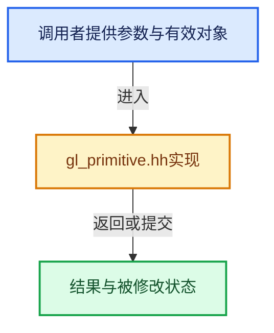

# 实现依赖专题：source/blender/gpu/opengl/gl_primitive.hh

[方向导航](README.md) · [符号索引](../%E7%AC%A6%E5%8F%B7%E4%BE%9D%E8%B5%96%E4%B8%8E%E5%AE%9E%E7%8E%B0%E7%B4%A2%E5%BC%95.md)

本专题从正文实际调用进入，集中保存共享实现。函数有稳定锚点，可从调用处直接跳到对应完整函数；递归与互相调用通过回链组织。

## 本文件的实现关系





## 完整成员与函数实现

<a id="f-880255f821d74df2"></a>

### `blender::gpu::to_gl`

实现位置：[source/blender/gpu/opengl/gl_primitive.hh](../../../../../source/blender/gpu/opengl/gl_primitive.hh) · L19—L46。

接口参数：

- `GPUPrimType prim_type`

**教学注释版**

<!-- annotated:89c0b7998f00c0 -->

```cpp
static inline GLenum to_gl(GPUPrimType prim_type)
{
  BLI_assert(prim_type != GPU_PRIM_NONE);
  switch (prim_type) {
    default:
    case GPU_PRIM_POINTS:
      return GL_POINTS;
    case GPU_PRIM_LINES:
      return GL_LINES;
    case GPU_PRIM_LINE_STRIP:
      return GL_LINE_STRIP;
    case GPU_PRIM_LINE_LOOP:
      return GL_LINE_LOOP;
    case GPU_PRIM_TRIS:
      return GL_TRIANGLES;
    case GPU_PRIM_TRI_STRIP:
      return GL_TRIANGLE_STRIP;
    case GPU_PRIM_TRI_FAN:
      return GL_TRIANGLE_FAN;

    case GPU_PRIM_LINES_ADJ:
      return GL_LINES_ADJACENCY;
    case GPU_PRIM_LINE_STRIP_ADJ:
      return GL_LINE_STRIP_ADJACENCY;
    case GPU_PRIM_TRIS_ADJ:
      return GL_TRIANGLES_ADJACENCY;
  };
}
```

<details>
<summary>核对原始源码：source/blender/gpu/opengl/gl_primitive.hh · L19—L46</summary>

<!-- original:89c0b7998f00c0:source/blender/gpu/opengl/gl_primitive.hh:19:46 -->

```cpp
static inline GLenum to_gl(GPUPrimType prim_type)
{
  BLI_assert(prim_type != GPU_PRIM_NONE);
  switch (prim_type) {
    default:
    case GPU_PRIM_POINTS:
      return GL_POINTS;
    case GPU_PRIM_LINES:
      return GL_LINES;
    case GPU_PRIM_LINE_STRIP:
      return GL_LINE_STRIP;
    case GPU_PRIM_LINE_LOOP:
      return GL_LINE_LOOP;
    case GPU_PRIM_TRIS:
      return GL_TRIANGLES;
    case GPU_PRIM_TRI_STRIP:
      return GL_TRIANGLE_STRIP;
    case GPU_PRIM_TRI_FAN:
      return GL_TRIANGLE_FAN;

    case GPU_PRIM_LINES_ADJ:
      return GL_LINES_ADJACENCY;
    case GPU_PRIM_LINE_STRIP_ADJ:
      return GL_LINE_STRIP_ADJACENCY;
    case GPU_PRIM_TRIS_ADJ:
      return GL_TRIANGLES_ADJACENCY;
  };
}
```

</details>

**结果出口**

- `return GL_POINTS;`
- `return GL_LINES;`
- `return GL_LINE_STRIP;`
- `return GL_LINE_LOOP;`
- `return GL_TRIANGLES;`
- `return GL_TRIANGLE_STRIP;`
- `return GL_TRIANGLE_FAN;`
- `return GL_LINES_ADJACENCY;`
- `return GL_LINE_STRIP_ADJACENCY;`
- `return GL_TRIANGLES_ADJACENCY;`

**继续追踪实现**

- `BLI_assert` → [BLI_assert · L48](../01-%E5%9F%BA%E7%A1%80%E5%AE%B9%E5%99%A8%E4%B8%8E%E7%8E%B0%E4%BB%A3CPP/%E4%BE%9D%E8%B5%96-BLI_assert-cc98e8.md#m-57a88495704d)；[BLI_assert · L63](../01-%E5%9F%BA%E7%A1%80%E5%AE%B9%E5%99%A8%E4%B8%8E%E7%8E%B0%E4%BB%A3CPP/%E4%BE%9D%E8%B5%96-BLI_assert-cc98e8.md#m-d07050020cb5)。宏定义由构建条件选择。
