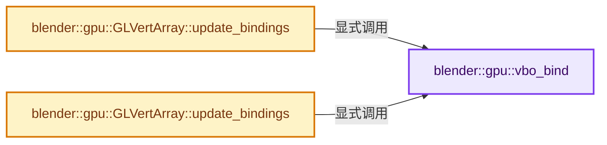
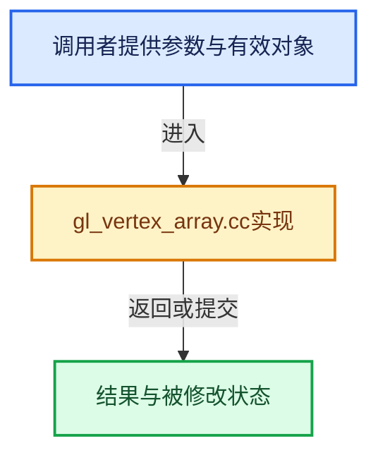

# 实现依赖专题：source/blender/gpu/opengl/gl_vertex_array.cc

[方向导航](README.md) · [符号索引](../%E7%AC%A6%E5%8F%B7%E4%BE%9D%E8%B5%96%E4%B8%8E%E5%AE%9E%E7%8E%B0%E7%B4%A2%E5%BC%95.md)

本专题从正文实际调用进入，集中保存共享实现。函数有稳定锚点，可从调用处直接跳到对应完整函数；递归与互相调用通过回链组织。

## 本文件的实现关系






## 完整成员与函数实现

<a id="f-163eb4223d04b3de"></a>

### `blender::gpu::vbo_bind`

实现位置：[source/blender/gpu/opengl/gl_vertex_array.cc](../../../../../source/blender/gpu/opengl/gl_vertex_array.cc) · L27—L80。

接口参数：

- `const ShaderInterface *interface`
- `const GPUVertFormat *format`
- `uint v_first`
- `uint v_len`
- `const bool use_instancing`

**教学注释版**

<!-- annotated:b3239c7d76231d -->

```cpp
static uint16_t vbo_bind(const ShaderInterface *interface,
                         const GPUVertFormat *format,
                         uint v_first,
                         uint v_len,
                         const bool use_instancing)
{
  uint16_t enabled_attrib = 0;
  const uint attr_len = format->attr_len;
  uint stride = format->stride;
  uint offset = 0;
  GLuint divisor = (use_instancing) ? 1 : 0;

  for (uint a_idx = 0; a_idx < attr_len; a_idx++) {
    const GPUVertAttr *a = &format->attrs[a_idx];

    if (format->deinterleaved) {
      offset += ((a_idx == 0) ? 0 : format->attrs[a_idx - 1].type.size()) * v_len;
      stride = a->type.size();
    }
    else {
      offset = a->offset;
    }

    /* This is in fact an offset in memory. */
    const GLvoid *pointer = reinterpret_cast<const GLubyte *>(intptr_t(offset + v_first * stride));
    const GLenum type = to_gl(a->type.comp_type());

    for (uint n_idx = 0; n_idx < a->name_len; n_idx++) {
      const char *name = GPU_vertformat_attr_name_get(format, a, n_idx);
      const ShaderInput *input = interface->attr_get(name);

      if (input == nullptr || input->location == -1) {
        continue;
      }

      enabled_attrib |= (1 << input->location);

      glEnableVertexAttribArray(input->location);
      glVertexAttribDivisor(input->location, divisor);

      switch (a->type.fetch_mode()) {
        case GPU_FETCH_FLOAT:
        case GPU_FETCH_INT_TO_FLOAT_UNIT:
          glVertexAttribPointer(
              input->location, a->type.comp_len(), type, GL_TRUE, stride, pointer);
          break;
        case GPU_FETCH_INT:
          glVertexAttribIPointer(input->location, a->type.comp_len(), type, stride, pointer);
          break;
      }
    }
  }
  return enabled_attrib;
}
```

<details>
<summary>核对原始源码：source/blender/gpu/opengl/gl_vertex_array.cc · L27—L80</summary>

<!-- original:b3239c7d76231d:source/blender/gpu/opengl/gl_vertex_array.cc:27:80 -->

```cpp
static uint16_t vbo_bind(const ShaderInterface *interface,
                         const GPUVertFormat *format,
                         uint v_first,
                         uint v_len,
                         const bool use_instancing)
{
  uint16_t enabled_attrib = 0;
  const uint attr_len = format->attr_len;
  uint stride = format->stride;
  uint offset = 0;
  GLuint divisor = (use_instancing) ? 1 : 0;

  for (uint a_idx = 0; a_idx < attr_len; a_idx++) {
    const GPUVertAttr *a = &format->attrs[a_idx];

    if (format->deinterleaved) {
      offset += ((a_idx == 0) ? 0 : format->attrs[a_idx - 1].type.size()) * v_len;
      stride = a->type.size();
    }
    else {
      offset = a->offset;
    }

    /* This is in fact an offset in memory. */
    const GLvoid *pointer = reinterpret_cast<const GLubyte *>(intptr_t(offset + v_first * stride));
    const GLenum type = to_gl(a->type.comp_type());

    for (uint n_idx = 0; n_idx < a->name_len; n_idx++) {
      const char *name = GPU_vertformat_attr_name_get(format, a, n_idx);
      const ShaderInput *input = interface->attr_get(name);

      if (input == nullptr || input->location == -1) {
        continue;
      }

      enabled_attrib |= (1 << input->location);

      glEnableVertexAttribArray(input->location);
      glVertexAttribDivisor(input->location, divisor);

      switch (a->type.fetch_mode()) {
        case GPU_FETCH_FLOAT:
        case GPU_FETCH_INT_TO_FLOAT_UNIT:
          glVertexAttribPointer(
              input->location, a->type.comp_len(), type, GL_TRUE, stride, pointer);
          break;
        case GPU_FETCH_INT:
          glVertexAttribIPointer(input->location, a->type.comp_len(), type, stride, pointer);
          break;
      }
    }
  }
  return enabled_attrib;
}
```

</details>

**沿实际写入检查状态**

- `offset += ((a_idx == 0) ? 0 : format->attrs[a_idx - 1].type.size()) * v_len;`
- `stride = a->type.size();`
- `offset = a->offset;`
- `enabled_attrib |= (1 << input->location);`

**结果出口**

- `return enabled_attrib;`

**继续追踪实现**

- `format->attrs[a_idx - 1].type.size` → [调用协议](../%E6%A8%A1%E6%9D%BF%E5%AE%8F%E4%B8%8E%E5%8A%A8%E6%80%81%E5%88%86%E6%B4%BE%E5%8D%8F%E8%AE%AE.md)：接收对象类型依赖auto、返回值或模板实例；不按同名猜测目标。调用位置L43。
- `a->type.size` → [调用协议](../%E6%A8%A1%E6%9D%BF%E5%AE%8F%E4%B8%8E%E5%8A%A8%E6%80%81%E5%88%86%E6%B4%BE%E5%8D%8F%E8%AE%AE.md)：接收对象类型依赖auto、返回值或模板实例；不按同名猜测目标。调用位置L44。
- `to_gl` → [blender::gpu::to_gl · L63](%E4%BE%9D%E8%B5%96-gl_vertex_buffer-ed6af2.md#f-3759e26048aba930)；[blender::gpu::to_gl · L79](%E4%BE%9D%E8%B5%96-gl_vertex_buffer-ed6af2.md#f-564f569c2795e2e0)；[blender::gpu::to_gl · L231](%E4%BE%9D%E8%B5%96-gl_texture-6991a7.md#f-a55d68142cdbbec1)；[blender::gpu::to_gl · L610](%E4%BE%9D%E8%B5%96-gl_texture-196c7f.md#f-d765dcd5ade0fd47)；[blender::gpu::to_gl · L120](%E4%BE%9D%E8%B5%96-gl_state-71a8df.md#f-7d9342a10afa8867)；[blender::gpu::to_gl · L46](%E4%BE%9D%E8%B5%96-gl_query-b55cf1.md#f-462795db7ca2fcc5)；[blender::gpu::to_gl · L19](%E4%BE%9D%E8%B5%96-gl_primitive-6db290.md#f-880255f821d74df2)；[blender::gpu::to_gl · L68](%E4%BE%9D%E8%B5%96-gl_index_buffer-81db26.md#f-64d92f0eefbd7427)；[blender::gpu::to_gl · L131](%E4%BE%9D%E8%B5%96-gl_framebuffer-34c13a.md#f-c2fdb3b51bc2e0c0)；[blender::gpu::to_gl · L157](%E4%BE%9D%E8%B5%96-gl_framebuffer-34c13a.md#f-429e055bc6a7fafe)。同名重载需按实参类型选择。
- `a->type.comp_type` → [调用协议](../%E6%A8%A1%E6%9D%BF%E5%AE%8F%E4%B8%8E%E5%8A%A8%E6%80%81%E5%88%86%E6%B4%BE%E5%8D%8F%E8%AE%AE.md)：接收对象类型依赖auto、返回值或模板实例；不按同名猜测目标。调用位置L52。
- `GPU_vertformat_attr_name_get` → [GPU_vertformat_attr_name_get · L396](%E4%BE%9D%E8%B5%96-GPU_vertex_format-ef1cca.md#f-4e696cf84e31ef7f)。
- `interface->attr_get` → [blender::gpu::ShaderInterface::attr_get · L102](%E4%BE%9D%E8%B5%96-gpu_shader_interface-80a49f.md#f-d7bd732863225c65)；[blender::gpu::ShaderInterface::attr_get · L106](%E4%BE%9D%E8%B5%96-gpu_shader_interface-80a49f.md#f-5bb767b46d34948d)。同名重载需按实参类型选择。
- `glEnableVertexAttribArray` → [调用协议](../%E6%A8%A1%E6%9D%BF%E5%AE%8F%E4%B8%8E%E5%8A%A8%E6%80%81%E5%88%86%E6%B4%BE%E5%8D%8F%E8%AE%AE.md)：函数指针、局部可调用对象或未展开的宏；必须结合调用者环境。调用位置L64。
- `glVertexAttribDivisor` → [调用协议](../%E6%A8%A1%E6%9D%BF%E5%AE%8F%E4%B8%8E%E5%8A%A8%E6%80%81%E5%88%86%E6%B4%BE%E5%8D%8F%E8%AE%AE.md)：函数指针、局部可调用对象或未展开的宏；必须结合调用者环境。调用位置L65。
- `a->type.fetch_mode` → [调用协议](../%E6%A8%A1%E6%9D%BF%E5%AE%8F%E4%B8%8E%E5%8A%A8%E6%80%81%E5%88%86%E6%B4%BE%E5%8D%8F%E8%AE%AE.md)：接收对象类型依赖auto、返回值或模板实例；不按同名猜测目标。调用位置L67。
- `glVertexAttribPointer` → [调用协议](../%E6%A8%A1%E6%9D%BF%E5%AE%8F%E4%B8%8E%E5%8A%A8%E6%80%81%E5%88%86%E6%B4%BE%E5%8D%8F%E8%AE%AE.md)：函数指针、局部可调用对象或未展开的宏；必须结合调用者环境。调用位置L70。
- `a->type.comp_len` → [调用协议](../%E6%A8%A1%E6%9D%BF%E5%AE%8F%E4%B8%8E%E5%8A%A8%E6%80%81%E5%88%86%E6%B4%BE%E5%8D%8F%E8%AE%AE.md)：接收对象类型依赖auto、返回值或模板实例；不按同名猜测目标。调用位置L71。
- `glVertexAttribIPointer` → [调用协议](../%E6%A8%A1%E6%9D%BF%E5%AE%8F%E4%B8%8E%E5%8A%A8%E6%80%81%E5%88%86%E6%B4%BE%E5%8D%8F%E8%AE%AE.md)：函数指针、局部可调用对象或未展开的宏；必须结合调用者环境。调用位置L74。

<a id="f-3f5e62d86577f342"></a>

### `blender::gpu::GLVertArray::update_bindings`

实现位置：[source/blender/gpu/opengl/gl_vertex_array.cc](../../../../../source/blender/gpu/opengl/gl_vertex_array.cc) · L82—L118。

接口参数：

- `const GLuint vao`
- `const Batch *batch_`
- `const ShaderInterface *interface`

**教学注释版**

<!-- annotated:00f447b28ffafc -->

```cpp
void GLVertArray::update_bindings(const GLuint vao,
                                  const Batch *batch_, /* Should be GLBatch. */
                                  const ShaderInterface *interface)
{
  const GLBatch *batch = static_cast<const GLBatch *>(batch_);
  uint16_t attr_mask = interface->enabled_attr_mask_;

  glBindVertexArray(vao);

  /* Reverse order so first VBO'S have more prevalence (in term of attribute override). */
  for (int v = GPU_BATCH_VBO_MAX_LEN - 1; v > -1; v--) {
    GLVertBuf *vbo = batch->verts_(v);
    if (vbo) {
      vbo->bind();
      attr_mask &= ~vbo_bind(interface, &vbo->format, 0, vbo->vertex_len, false);
    }
  }

  if (attr_mask != 0) {
    for (uint16_t mask = 1, a = 0; a < 16; a++, mask <<= 1) {
      if (attr_mask & mask) {
        GLContext *ctx = GLContext::get();
        /* This replaces glVertexAttrib4f(a, 0.0f, 0.0f, 0.0f, 1.0f); with a more modern style.
         * Fix issues for some drivers (see #75069). */
        glBindVertexBuffer(a, ctx->default_attr_vbo_, intptr_t(0), intptr_t(0));
        glEnableVertexAttribArray(a);
        glVertexAttribFormat(a, 4, GL_FLOAT, GL_FALSE, 0);
        glVertexAttribBinding(a, a);
      }
    }
  }

  if (batch->elem) {
    /* Binds the index buffer. This state is also saved in the VAO. */
    static_cast<GLIndexBuf *>(batch->elem)->bind();
  }
}
```

<details>
<summary>核对原始源码：source/blender/gpu/opengl/gl_vertex_array.cc · L82—L118</summary>

<!-- original:00f447b28ffafc:source/blender/gpu/opengl/gl_vertex_array.cc:82:118 -->

```cpp
void GLVertArray::update_bindings(const GLuint vao,
                                  const Batch *batch_, /* Should be GLBatch. */
                                  const ShaderInterface *interface)
{
  const GLBatch *batch = static_cast<const GLBatch *>(batch_);
  uint16_t attr_mask = interface->enabled_attr_mask_;

  glBindVertexArray(vao);

  /* Reverse order so first VBO'S have more prevalence (in term of attribute override). */
  for (int v = GPU_BATCH_VBO_MAX_LEN - 1; v > -1; v--) {
    GLVertBuf *vbo = batch->verts_(v);
    if (vbo) {
      vbo->bind();
      attr_mask &= ~vbo_bind(interface, &vbo->format, 0, vbo->vertex_len, false);
    }
  }

  if (attr_mask != 0) {
    for (uint16_t mask = 1, a = 0; a < 16; a++, mask <<= 1) {
      if (attr_mask & mask) {
        GLContext *ctx = GLContext::get();
        /* This replaces glVertexAttrib4f(a, 0.0f, 0.0f, 0.0f, 1.0f); with a more modern style.
         * Fix issues for some drivers (see #75069). */
        glBindVertexBuffer(a, ctx->default_attr_vbo_, intptr_t(0), intptr_t(0));
        glEnableVertexAttribArray(a);
        glVertexAttribFormat(a, 4, GL_FLOAT, GL_FALSE, 0);
        glVertexAttribBinding(a, a);
      }
    }
  }

  if (batch->elem) {
    /* Binds the index buffer. This state is also saved in the VAO. */
    static_cast<GLIndexBuf *>(batch->elem)->bind();
  }
}
```

</details>

**沿实际写入检查状态**

- `attr_mask &= ~vbo_bind(interface, &vbo->format, 0, vbo->vertex_len, false);`

**继续追踪实现**

- `glBindVertexArray` → [调用协议](../%E6%A8%A1%E6%9D%BF%E5%AE%8F%E4%B8%8E%E5%8A%A8%E6%80%81%E5%88%86%E6%B4%BE%E5%8D%8F%E8%AE%AE.md)：函数指针、局部可调用对象或未展开的宏；必须结合调用者环境。调用位置L89。
- `batch->verts_` → [blender::gpu::GLBatch::verts_ · L106](%E4%BE%9D%E8%B5%96-gl_batch-8bff8d.md#f-0368d5217cd4e190)。
- `vbo->bind` → [blender::gpu::GLVertBuf::bind · L59](%E4%BE%9D%E8%B5%96-gl_vertex_buffer-f91ac8.md#f-86019829ff95240a)。
- `vbo_bind` → [blender::gpu::vbo_bind · L27](%E4%BE%9D%E8%B5%96-gl_vertex_array-44cd19.md#f-163eb4223d04b3de)。
- `GLContext::get` → [blender::gpu::GLContext::get · L143](%E4%BE%9D%E8%B5%96-gl_context-965f7e.md#f-2d6c70989abeb59b)。
- `glBindVertexBuffer` → [调用协议](../%E6%A8%A1%E6%9D%BF%E5%AE%8F%E4%B8%8E%E5%8A%A8%E6%80%81%E5%88%86%E6%B4%BE%E5%8D%8F%E8%AE%AE.md)：函数指针、局部可调用对象或未展开的宏；必须结合调用者环境。调用位置L106。
- `glEnableVertexAttribArray` → [调用协议](../%E6%A8%A1%E6%9D%BF%E5%AE%8F%E4%B8%8E%E5%8A%A8%E6%80%81%E5%88%86%E6%B4%BE%E5%8D%8F%E8%AE%AE.md)：函数指针、局部可调用对象或未展开的宏；必须结合调用者环境。调用位置L107。
- `glVertexAttribFormat` → [调用协议](../%E6%A8%A1%E6%9D%BF%E5%AE%8F%E4%B8%8E%E5%8A%A8%E6%80%81%E5%88%86%E6%B4%BE%E5%8D%8F%E8%AE%AE.md)：函数指针、局部可调用对象或未展开的宏；必须结合调用者环境。调用位置L108。
- `glVertexAttribBinding` → [调用协议](../%E6%A8%A1%E6%9D%BF%E5%AE%8F%E4%B8%8E%E5%8A%A8%E6%80%81%E5%88%86%E6%B4%BE%E5%8D%8F%E8%AE%AE.md)：函数指针、局部可调用对象或未展开的宏；必须结合调用者环境。调用位置L109。
- `static_cast<GLIndexBuf *>(batch->elem)->bind` → [调用协议](../%E6%A8%A1%E6%9D%BF%E5%AE%8F%E4%B8%8E%E5%8A%A8%E6%80%81%E5%88%86%E6%B4%BE%E5%8D%8F%E8%AE%AE.md)：接收对象类型依赖auto、返回值或模板实例；不按同名猜测目标。调用位置L116。

<a id="f-19013653652bc674"></a>

### `blender::gpu::GLVertArray::update_bindings`

实现位置：[source/blender/gpu/opengl/gl_vertex_array.cc](../../../../../source/blender/gpu/opengl/gl_vertex_array.cc) · L120—L128。

接口参数：

- `const GLuint vao`
- `const uint v_first`
- `const GPUVertFormat *format`
- `const ShaderInterface *interface`

**教学注释版**

<!-- annotated:0531718f8fa139 -->

```cpp
void GLVertArray::update_bindings(const GLuint vao,
                                  const uint v_first,
                                  const GPUVertFormat *format,
                                  const ShaderInterface *interface)
{
  glBindVertexArray(vao);

  vbo_bind(interface, format, v_first, 0, false);
}
```

<details>
<summary>核对原始源码：source/blender/gpu/opengl/gl_vertex_array.cc · L120—L128</summary>

<!-- original:0531718f8fa139:source/blender/gpu/opengl/gl_vertex_array.cc:120:128 -->

```cpp
void GLVertArray::update_bindings(const GLuint vao,
                                  const uint v_first,
                                  const GPUVertFormat *format,
                                  const ShaderInterface *interface)
{
  glBindVertexArray(vao);

  vbo_bind(interface, format, v_first, 0, false);
}
```

</details>

**继续追踪实现**

- `glBindVertexArray` → [调用协议](../%E6%A8%A1%E6%9D%BF%E5%AE%8F%E4%B8%8E%E5%8A%A8%E6%80%81%E5%88%86%E6%B4%BE%E5%8D%8F%E8%AE%AE.md)：函数指针、局部可调用对象或未展开的宏；必须结合调用者环境。调用位置L125。
- `vbo_bind` → [blender::gpu::vbo_bind · L27](%E4%BE%9D%E8%B5%96-gl_vertex_array-44cd19.md#f-163eb4223d04b3de)。
