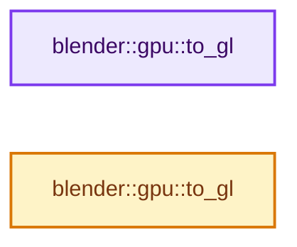
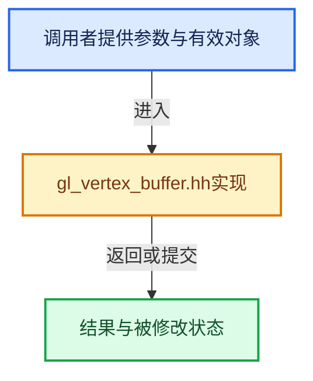

# 实现依赖专题：source/blender/gpu/opengl/gl_vertex_buffer.hh

[方向导航](README.md) · [符号索引](../%E7%AC%A6%E5%8F%B7%E4%BE%9D%E8%B5%96%E4%B8%8E%E5%AE%9E%E7%8E%B0%E7%B4%A2%E5%BC%95.md)

本专题从正文实际调用进入，集中保存共享实现。函数有稳定锚点，可从调用处直接跳到对应完整函数；递归与互相调用通过回链组织。

## 本文件的实现关系






## 完整成员与函数实现

<a id="f-3759e26048aba930"></a>

### `blender::gpu::to_gl`

实现位置：[source/blender/gpu/opengl/gl_vertex_buffer.hh](../../../../../source/blender/gpu/opengl/gl_vertex_buffer.hh) · L63—L77。

接口参数：

- `GPUUsageType type`

**教学注释版**

<!-- annotated:9f8cce0b255938 -->

```cpp
static inline GLenum to_gl(GPUUsageType type)
{
  switch (type) {
    case GPU_USAGE_STREAM:
      return GL_STREAM_DRAW;
    case GPU_USAGE_DYNAMIC:
      return GL_DYNAMIC_DRAW;
    case GPU_USAGE_STATIC:
    case GPU_USAGE_DEVICE_ONLY:
      return GL_STATIC_DRAW;
    default:
      BLI_assert(0);
      return GL_STATIC_DRAW;
  }
}
```

<details>
<summary>核对原始源码：source/blender/gpu/opengl/gl_vertex_buffer.hh · L63—L77</summary>

<!-- original:9f8cce0b255938:source/blender/gpu/opengl/gl_vertex_buffer.hh:63:77 -->

```cpp
static inline GLenum to_gl(GPUUsageType type)
{
  switch (type) {
    case GPU_USAGE_STREAM:
      return GL_STREAM_DRAW;
    case GPU_USAGE_DYNAMIC:
      return GL_DYNAMIC_DRAW;
    case GPU_USAGE_STATIC:
    case GPU_USAGE_DEVICE_ONLY:
      return GL_STATIC_DRAW;
    default:
      BLI_assert(0);
      return GL_STATIC_DRAW;
  }
}
```

</details>

**结果出口**

- `return GL_STREAM_DRAW;`
- `return GL_DYNAMIC_DRAW;`
- `return GL_STATIC_DRAW;`

**继续追踪实现**

- `BLI_assert` → [BLI_assert · L48](../01-%E5%9F%BA%E7%A1%80%E5%AE%B9%E5%99%A8%E4%B8%8E%E7%8E%B0%E4%BB%A3CPP/%E4%BE%9D%E8%B5%96-BLI_assert-cc98e8.md#m-57a88495704d)；[BLI_assert · L63](../01-%E5%9F%BA%E7%A1%80%E5%AE%B9%E5%99%A8%E4%B8%8E%E7%8E%B0%E4%BB%A3CPP/%E4%BE%9D%E8%B5%96-BLI_assert-cc98e8.md#m-d07050020cb5)。宏定义由构建条件选择。

<a id="f-564f569c2795e2e0"></a>

### `blender::gpu::to_gl`

实现位置：[source/blender/gpu/opengl/gl_vertex_buffer.hh](../../../../../source/blender/gpu/opengl/gl_vertex_buffer.hh) · L79—L102。

接口参数：

- `GPUVertCompType type`

**教学注释版**

<!-- annotated:2f8d9127d423d8 -->

```cpp
static inline GLenum to_gl(GPUVertCompType type)
{
  switch (type) {
    case GPU_COMP_I8:
      return GL_BYTE;
    case GPU_COMP_U8:
      return GL_UNSIGNED_BYTE;
    case GPU_COMP_I16:
      return GL_SHORT;
    case GPU_COMP_U16:
      return GL_UNSIGNED_SHORT;
    case GPU_COMP_I32:
      return GL_INT;
    case GPU_COMP_U32:
      return GL_UNSIGNED_INT;
    case GPU_COMP_F32:
      return GL_FLOAT;
    case GPU_COMP_I10:
      return GL_INT_2_10_10_10_REV;
    default:
      BLI_assert(0);
      return GL_FLOAT;
  }
}
```

<details>
<summary>核对原始源码：source/blender/gpu/opengl/gl_vertex_buffer.hh · L79—L102</summary>

<!-- original:2f8d9127d423d8:source/blender/gpu/opengl/gl_vertex_buffer.hh:79:102 -->

```cpp
static inline GLenum to_gl(GPUVertCompType type)
{
  switch (type) {
    case GPU_COMP_I8:
      return GL_BYTE;
    case GPU_COMP_U8:
      return GL_UNSIGNED_BYTE;
    case GPU_COMP_I16:
      return GL_SHORT;
    case GPU_COMP_U16:
      return GL_UNSIGNED_SHORT;
    case GPU_COMP_I32:
      return GL_INT;
    case GPU_COMP_U32:
      return GL_UNSIGNED_INT;
    case GPU_COMP_F32:
      return GL_FLOAT;
    case GPU_COMP_I10:
      return GL_INT_2_10_10_10_REV;
    default:
      BLI_assert(0);
      return GL_FLOAT;
  }
}
```

</details>

**结果出口**

- `return GL_BYTE;`
- `return GL_UNSIGNED_BYTE;`
- `return GL_SHORT;`
- `return GL_UNSIGNED_SHORT;`
- `return GL_INT;`
- `return GL_UNSIGNED_INT;`
- `return GL_FLOAT;`
- `return GL_INT_2_10_10_10_REV;`

**继续追踪实现**

- `BLI_assert` → [BLI_assert · L48](../01-%E5%9F%BA%E7%A1%80%E5%AE%B9%E5%99%A8%E4%B8%8E%E7%8E%B0%E4%BB%A3CPP/%E4%BE%9D%E8%B5%96-BLI_assert-cc98e8.md#m-57a88495704d)；[BLI_assert · L63](../01-%E5%9F%BA%E7%A1%80%E5%AE%B9%E5%99%A8%E4%B8%8E%E7%8E%B0%E4%BB%A3CPP/%E4%BE%9D%E8%B5%96-BLI_assert-cc98e8.md#m-d07050020cb5)。宏定义由构建条件选择。
