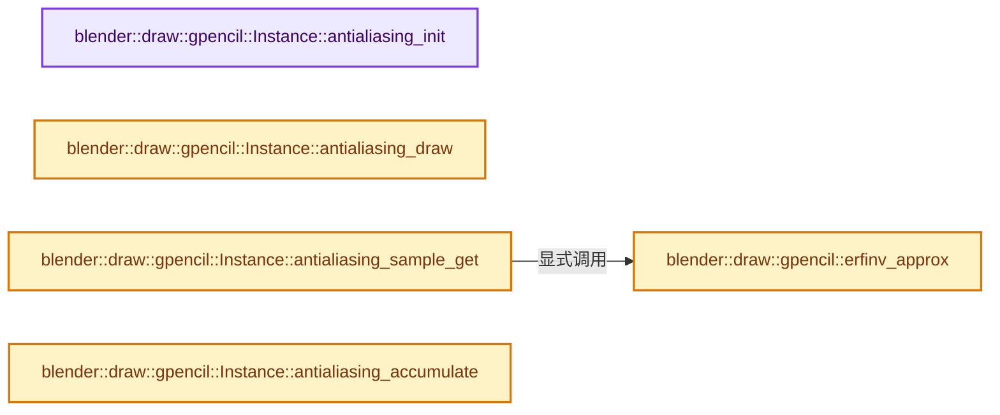
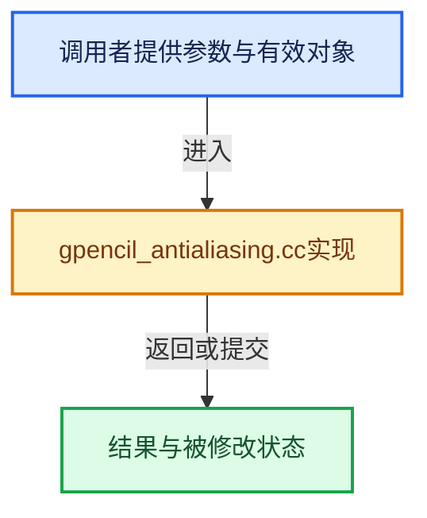

# 实现依赖专题：source/blender/draw/engines/gpencil/gpencil_antialiasing.cc

[方向导航](README.md) · [符号索引](../%E7%AC%A6%E5%8F%B7%E4%BE%9D%E8%B5%96%E4%B8%8E%E5%AE%9E%E7%8E%B0%E7%B4%A2%E5%BC%95.md)

本专题从正文实际调用进入，集中保存共享实现。函数有稳定锚点，可从调用处直接跳到对应完整函数；递归与互相调用通过回链组织。

## 本文件的实现关系






## 完整成员与函数实现

<a id="f-eadda2d01654a22c"></a>

### `blender::draw::gpencil::Instance::antialiasing_init`

实现位置：[source/blender/draw/engines/gpencil/gpencil_antialiasing.cc](../../../../../source/blender/draw/engines/gpencil/gpencil_antialiasing.cc) · L19—L108。

**教学注释版**

<!-- annotated:6bc6cf08ef3676 -->

```cpp
void Instance::antialiasing_init()
{
  const float2 size_f = this->draw_ctx->viewport_size_get();
  const int2 size(size_f[0], size_f[1]);
  const float4 metrics = {1.0f / size[0], 1.0f / size[1], float(size[0]), float(size[1])};

  if (this->simplify_antialias) {
    /* No AA fallback. */
    PassSimple &pass = this->smaa_resolve_ps;
    pass.init();
    pass.state_set(DRW_STATE_WRITE_COLOR | DRW_STATE_BLEND_CUSTOM);
    pass.shader_set(ShaderCache::get().antialiasing[2].get());
    pass.bind_texture("blend_tx", &this->color_tx);
    pass.bind_texture("color_tx", &this->color_tx);
    pass.bind_texture("reveal_tx", &this->reveal_tx);
    pass.push_constant("do_anti_aliasing", false);
    pass.push_constant("only_alpha", this->draw_wireframe);
    pass.push_constant("viewport_metrics", metrics);
    pass.draw_procedural(GPU_PRIM_TRIS, 1, 3);
    return;
  }

  if (!this->smaa_search_tx.is_valid()) {
    eGPUTextureUsage usage = GPU_TEXTURE_USAGE_SHADER_READ;
    this->smaa_search_tx.ensure_2d(
        gpu::TextureFormat::UNORM_8, int2(SEARCHTEX_WIDTH, SEARCHTEX_HEIGHT), usage);
    GPU_texture_update(this->smaa_search_tx, GPU_DATA_UBYTE, searchTexBytes);

    this->smaa_area_tx.ensure_2d(
        gpu::TextureFormat::UNORM_8_8, int2(AREATEX_WIDTH, AREATEX_HEIGHT), usage);
    GPU_texture_update(this->smaa_area_tx, GPU_DATA_UBYTE, areaTexBytes);

    GPU_texture_filter_mode(this->smaa_search_tx, true);
    GPU_texture_filter_mode(this->smaa_area_tx, true);
  }

  {
    eGPUTextureUsage usage = GPU_TEXTURE_USAGE_SHADER_READ | GPU_TEXTURE_USAGE_ATTACHMENT;
    this->smaa_edge_tx.acquire_2d(size, gpu::TextureFormat::UNORM_8_8, usage);
    this->smaa_weight_tx.acquire_2d(size, gpu::TextureFormat::UNORM_8_8_8_8, usage);

    this->smaa_edge_fb.ensure(GPU_ATTACHMENT_NONE, GPU_ATTACHMENT_TEXTURE(this->smaa_edge_tx));
    this->smaa_weight_fb.ensure(GPU_ATTACHMENT_NONE, GPU_ATTACHMENT_TEXTURE(this->smaa_weight_tx));
  }

  SceneGpencil gpencil_settings = this->scene->grease_pencil_settings;
  const float luma_weight = this->is_viewport ? gpencil_settings.smaa_threshold :
                                                gpencil_settings.smaa_threshold_render;

  {
    /* Stage 1: Edge detection. */
    PassSimple &pass = this->smaa_edge_ps;
    pass.init();
    pass.state_set(DRW_STATE_WRITE_COLOR);
    pass.shader_set(ShaderCache::get().antialiasing[0].get());
    pass.bind_texture("color_tx", &this->color_tx);
    pass.bind_texture("reveal_tx", &this->reveal_tx);
    pass.push_constant("viewport_metrics", metrics);
    pass.push_constant("luma_weight", luma_weight);
    pass.clear_color(float4(0.0f));
    pass.draw_procedural(GPU_PRIM_TRIS, 1, 3);
  }
  {
    /* Stage 2: Blend Weight/Coord. */
    PassSimple &pass = this->smaa_weight_ps;
    pass.init();
    pass.state_set(DRW_STATE_WRITE_COLOR);
    pass.shader_set(ShaderCache::get().antialiasing[1].get());
    pass.bind_texture("edges_tx", &this->smaa_edge_tx);
    pass.bind_texture("area_tx", &this->smaa_area_tx);
    pass.bind_texture("search_tx", &this->smaa_search_tx);
    pass.push_constant("viewport_metrics", metrics);
    pass.clear_color(float4(0.0f));
    pass.draw_procedural(GPU_PRIM_TRIS, 1, 3);
  }
  {
    /* Stage 3: Resolve. */
    PassSimple &pass = this->smaa_resolve_ps;
    pass.init();
    pass.state_set(DRW_STATE_WRITE_COLOR | DRW_STATE_BLEND_CUSTOM);
    pass.shader_set(ShaderCache::get().antialiasing[2].get());
    pass.bind_texture("blend_tx", &this->smaa_weight_tx);
    pass.bind_texture("color_tx", &this->color_tx);
    pass.bind_texture("reveal_tx", &this->reveal_tx);
    pass.push_constant("do_anti_aliasing", true);
    pass.push_constant("only_alpha", this->draw_wireframe);
    pass.push_constant("viewport_metrics", metrics);
    pass.draw_procedural(GPU_PRIM_TRIS, 1, 3);
  }
}
```

<details>
<summary>核对原始源码：source/blender/draw/engines/gpencil/gpencil_antialiasing.cc · L19—L108</summary>

<!-- original:6bc6cf08ef3676:source/blender/draw/engines/gpencil/gpencil_antialiasing.cc:19:108 -->

```cpp
void Instance::antialiasing_init()
{
  const float2 size_f = this->draw_ctx->viewport_size_get();
  const int2 size(size_f[0], size_f[1]);
  const float4 metrics = {1.0f / size[0], 1.0f / size[1], float(size[0]), float(size[1])};

  if (this->simplify_antialias) {
    /* No AA fallback. */
    PassSimple &pass = this->smaa_resolve_ps;
    pass.init();
    pass.state_set(DRW_STATE_WRITE_COLOR | DRW_STATE_BLEND_CUSTOM);
    pass.shader_set(ShaderCache::get().antialiasing[2].get());
    pass.bind_texture("blend_tx", &this->color_tx);
    pass.bind_texture("color_tx", &this->color_tx);
    pass.bind_texture("reveal_tx", &this->reveal_tx);
    pass.push_constant("do_anti_aliasing", false);
    pass.push_constant("only_alpha", this->draw_wireframe);
    pass.push_constant("viewport_metrics", metrics);
    pass.draw_procedural(GPU_PRIM_TRIS, 1, 3);
    return;
  }

  if (!this->smaa_search_tx.is_valid()) {
    eGPUTextureUsage usage = GPU_TEXTURE_USAGE_SHADER_READ;
    this->smaa_search_tx.ensure_2d(
        gpu::TextureFormat::UNORM_8, int2(SEARCHTEX_WIDTH, SEARCHTEX_HEIGHT), usage);
    GPU_texture_update(this->smaa_search_tx, GPU_DATA_UBYTE, searchTexBytes);

    this->smaa_area_tx.ensure_2d(
        gpu::TextureFormat::UNORM_8_8, int2(AREATEX_WIDTH, AREATEX_HEIGHT), usage);
    GPU_texture_update(this->smaa_area_tx, GPU_DATA_UBYTE, areaTexBytes);

    GPU_texture_filter_mode(this->smaa_search_tx, true);
    GPU_texture_filter_mode(this->smaa_area_tx, true);
  }

  {
    eGPUTextureUsage usage = GPU_TEXTURE_USAGE_SHADER_READ | GPU_TEXTURE_USAGE_ATTACHMENT;
    this->smaa_edge_tx.acquire_2d(size, gpu::TextureFormat::UNORM_8_8, usage);
    this->smaa_weight_tx.acquire_2d(size, gpu::TextureFormat::UNORM_8_8_8_8, usage);

    this->smaa_edge_fb.ensure(GPU_ATTACHMENT_NONE, GPU_ATTACHMENT_TEXTURE(this->smaa_edge_tx));
    this->smaa_weight_fb.ensure(GPU_ATTACHMENT_NONE, GPU_ATTACHMENT_TEXTURE(this->smaa_weight_tx));
  }

  SceneGpencil gpencil_settings = this->scene->grease_pencil_settings;
  const float luma_weight = this->is_viewport ? gpencil_settings.smaa_threshold :
                                                gpencil_settings.smaa_threshold_render;

  {
    /* Stage 1: Edge detection. */
    PassSimple &pass = this->smaa_edge_ps;
    pass.init();
    pass.state_set(DRW_STATE_WRITE_COLOR);
    pass.shader_set(ShaderCache::get().antialiasing[0].get());
    pass.bind_texture("color_tx", &this->color_tx);
    pass.bind_texture("reveal_tx", &this->reveal_tx);
    pass.push_constant("viewport_metrics", metrics);
    pass.push_constant("luma_weight", luma_weight);
    pass.clear_color(float4(0.0f));
    pass.draw_procedural(GPU_PRIM_TRIS, 1, 3);
  }
  {
    /* Stage 2: Blend Weight/Coord. */
    PassSimple &pass = this->smaa_weight_ps;
    pass.init();
    pass.state_set(DRW_STATE_WRITE_COLOR);
    pass.shader_set(ShaderCache::get().antialiasing[1].get());
    pass.bind_texture("edges_tx", &this->smaa_edge_tx);
    pass.bind_texture("area_tx", &this->smaa_area_tx);
    pass.bind_texture("search_tx", &this->smaa_search_tx);
    pass.push_constant("viewport_metrics", metrics);
    pass.clear_color(float4(0.0f));
    pass.draw_procedural(GPU_PRIM_TRIS, 1, 3);
  }
  {
    /* Stage 3: Resolve. */
    PassSimple &pass = this->smaa_resolve_ps;
    pass.init();
    pass.state_set(DRW_STATE_WRITE_COLOR | DRW_STATE_BLEND_CUSTOM);
    pass.shader_set(ShaderCache::get().antialiasing[2].get());
    pass.bind_texture("blend_tx", &this->smaa_weight_tx);
    pass.bind_texture("color_tx", &this->color_tx);
    pass.bind_texture("reveal_tx", &this->reveal_tx);
    pass.push_constant("do_anti_aliasing", true);
    pass.push_constant("only_alpha", this->draw_wireframe);
    pass.push_constant("viewport_metrics", metrics);
    pass.draw_procedural(GPU_PRIM_TRIS, 1, 3);
  }
}
```

</details>

**继续追踪实现**

- `this->draw_ctx->viewport_size_get` → [调用协议](../%E6%A8%A1%E6%9D%BF%E5%AE%8F%E4%B8%8E%E5%8A%A8%E6%80%81%E5%88%86%E6%B4%BE%E5%8D%8F%E8%AE%AE.md)：接收对象类型依赖auto、返回值或模板实例；不按同名猜测目标。调用位置L21。
- `pass.init` → [blender::draw::gpencil::Instance::init · L54](%E4%BE%9D%E8%B5%96-gpencil_engine_c-86e37c.md#f-f8b5fddb11c4b419)。
- `pass.state_set` → [blender::draw::detail::PassBase<T>::state_set · L1095](%E4%BE%9D%E8%B5%96-draw_pass-5d652c.md#f-97589d4da1cbc8b0)。
- `pass.shader_set` → [blender::draw::detail::PassBase<T>::shader_set · L1112](%E4%BE%9D%E8%B5%96-draw_pass-5d652c.md#f-666f9d02755edac8)。
- `ShaderCache::get().antialiasing[2].get` → [调用协议](../%E6%A8%A1%E6%9D%BF%E5%AE%8F%E4%B8%8E%E5%8A%A8%E6%80%81%E5%88%86%E6%B4%BE%E5%8D%8F%E8%AE%AE.md)：接收对象类型依赖auto、返回值或模板实例；不按同名猜测目标。调用位置L30。
- `ShaderCache::get` → [blender::draw::gpencil::ShaderCache::get · L26](%E4%BE%9D%E8%B5%96-gpencil_shader-68faa1.md#f-89695e85c8cb18ae)。
- `pass.bind_texture` → [调用协议](../%E6%A8%A1%E6%9D%BF%E5%AE%8F%E4%B8%8E%E5%8A%A8%E6%80%81%E5%88%86%E6%B4%BE%E5%8D%8F%E8%AE%AE.md)：由接收对象具体类型或运行时策略提供实现。调用位置L31。
- `pass.push_constant` → [push_constant · L126](%E4%BE%9D%E8%B5%96-gpu_shader_cxx_attribute-d75f56.md#m-5e91abed202c)。宏定义由构建条件选择。
- `pass.draw_procedural` → [blender::draw::detail::PassBase<T>::draw_procedural · L975](%E4%BE%9D%E8%B5%96-draw_pass-5d652c.md#f-e3f268cdbf09d46d)。
- `this->smaa_search_tx.is_valid` → [调用协议](../%E6%A8%A1%E6%9D%BF%E5%AE%8F%E4%B8%8E%E5%8A%A8%E6%80%81%E5%88%86%E6%B4%BE%E5%8D%8F%E8%AE%AE.md)：接收对象类型依赖auto、返回值或模板实例；不按同名猜测目标。调用位置L41。
- `this->smaa_search_tx.ensure_2d` → [调用协议](../%E6%A8%A1%E6%9D%BF%E5%AE%8F%E4%B8%8E%E5%8A%A8%E6%80%81%E5%88%86%E6%B4%BE%E5%8D%8F%E8%AE%AE.md)：接收对象类型依赖auto、返回值或模板实例；不按同名猜测目标。调用位置L43。
- `int2` → [int2 · L643](%E4%BE%9D%E8%B5%96-smaa-b67bc2.md#m-8960c8e6139d)。宏定义由构建条件选择。
- `GPU_texture_update` → [blender::GPU_texture_update · L619](%E4%BE%9D%E8%B5%96-gpu_texture-234bda.md#f-4a6c14a1d8e5e73e)。
- `this->smaa_area_tx.ensure_2d` → [调用协议](../%E6%A8%A1%E6%9D%BF%E5%AE%8F%E4%B8%8E%E5%8A%A8%E6%80%81%E5%88%86%E6%B4%BE%E5%8D%8F%E8%AE%AE.md)：接收对象类型依赖auto、返回值或模板实例；不按同名猜测目标。调用位置L47。
- `GPU_texture_filter_mode` → [blender::GPU_texture_filter_mode · L683](%E4%BE%9D%E8%B5%96-gpu_texture-234bda.md#f-ba1abb2050b81b6b)。
- `this->smaa_edge_tx.acquire_2d` → [调用协议](../%E6%A8%A1%E6%9D%BF%E5%AE%8F%E4%B8%8E%E5%8A%A8%E6%80%81%E5%88%86%E6%B4%BE%E5%8D%8F%E8%AE%AE.md)：接收对象类型依赖auto、返回值或模板实例；不按同名猜测目标。调用位置L57。
- `this->smaa_weight_tx.acquire_2d` → [调用协议](../%E6%A8%A1%E6%9D%BF%E5%AE%8F%E4%B8%8E%E5%8A%A8%E6%80%81%E5%88%86%E6%B4%BE%E5%8D%8F%E8%AE%AE.md)：接收对象类型依赖auto、返回值或模板实例；不按同名猜测目标。调用位置L58。
- `this->smaa_edge_fb.ensure` → [调用协议](../%E6%A8%A1%E6%9D%BF%E5%AE%8F%E4%B8%8E%E5%8A%A8%E6%80%81%E5%88%86%E6%B4%BE%E5%8D%8F%E8%AE%AE.md)：接收对象类型依赖auto、返回值或模板实例；不按同名猜测目标。调用位置L60。
- `GPU_ATTACHMENT_TEXTURE` → [GPU_ATTACHMENT_TEXTURE · L275](%E4%BE%9D%E8%B5%96-GPU_framebuffer-faa4bc.md#m-8822354717b4)。宏定义由构建条件选择。
- `this->smaa_weight_fb.ensure` → [调用协议](../%E6%A8%A1%E6%9D%BF%E5%AE%8F%E4%B8%8E%E5%8A%A8%E6%80%81%E5%88%86%E6%B4%BE%E5%8D%8F%E8%AE%AE.md)：接收对象类型依赖auto、返回值或模板实例；不按同名猜测目标。调用位置L61。
- `ShaderCache::get().antialiasing[0].get` → [调用协议](../%E6%A8%A1%E6%9D%BF%E5%AE%8F%E4%B8%8E%E5%8A%A8%E6%80%81%E5%88%86%E6%B4%BE%E5%8D%8F%E8%AE%AE.md)：接收对象类型依赖auto、返回值或模板实例；不按同名猜测目标。调用位置L73。
- `pass.clear_color` → [调用协议](../%E6%A8%A1%E6%9D%BF%E5%AE%8F%E4%B8%8E%E5%8A%A8%E6%80%81%E5%88%86%E6%B4%BE%E5%8D%8F%E8%AE%AE.md)：由接收对象具体类型或运行时策略提供实现。调用位置L78。
- `float4` → [float4 · L56](%E4%BE%9D%E8%B5%96-radial_tiling_shared-98abf9.md#m-f0908e385c5b)；[float4 · L60](../01-%E5%9F%BA%E7%A1%80%E5%AE%B9%E5%99%A8%E4%B8%8E%E7%8E%B0%E4%BB%A3CPP/%E4%BE%9D%E8%B5%96-radial_tiling_shared-7989a4.md#m-7962dcdc288b)；[float4 · L56](%E4%BE%9D%E8%B5%96-node_radial_tiling_shared-b14bc2.md#m-adb8e9e87775)；[float4 · L642](%E4%BE%9D%E8%B5%96-smaa-b67bc2.md#m-9362daaa821c)。宏定义由构建条件选择。
- `ShaderCache::get().antialiasing[1].get` → [调用协议](../%E6%A8%A1%E6%9D%BF%E5%AE%8F%E4%B8%8E%E5%8A%A8%E6%80%81%E5%88%86%E6%B4%BE%E5%8D%8F%E8%AE%AE.md)：接收对象类型依赖auto、返回值或模板实例；不按同名猜测目标。调用位置L86。

<a id="f-75a8d6708b617ece"></a>

### `blender::draw::gpencil::Instance::antialiasing_draw`

实现位置：[source/blender/draw/engines/gpencil/gpencil_antialiasing.cc](../../../../../source/blender/draw/engines/gpencil/gpencil_antialiasing.cc) · L110—L136。

接口参数：

- `Manager &manager`

**教学注释版**

<!-- annotated:23a9f53c68a873 -->

```cpp
void Instance::antialiasing_draw(Manager &manager)
{
  if (!this->simplify_antialias) {
    GPU_framebuffer_bind(this->smaa_edge_fb);
    manager.submit(this->smaa_edge_ps);

    GPU_framebuffer_bind(this->smaa_weight_fb);
    manager.submit(this->smaa_weight_ps);
  }

  GPU_framebuffer_bind(this->scene_fb);
  manager.submit(this->smaa_resolve_ps);

  if (this->need_grease_pencil_pass) {
    GPU_framebuffer_bind(this->gpencil_pass_fb);
    GPU_framebuffer_clear(this->gpencil_pass_fb, GPU_COLOR_BIT, {0, 0, 0, 0}, 0, 0);
    manager.submit(this->smaa_resolve_ps);
  }

  /* The engine might not support passes, so check if the combined pass actually exists before
   * rendering grease pencil to it. */
  const bool combined_pass_exists = DRW_viewport_pass_texture_exists(RE_PASSNAME_COMBINED);
  if (this->need_combined_pass && combined_pass_exists) {
    GPU_framebuffer_bind(this->combined_pass_fb);
    manager.submit(this->smaa_resolve_ps);
  }
}
```

<details>
<summary>核对原始源码：source/blender/draw/engines/gpencil/gpencil_antialiasing.cc · L110—L136</summary>

<!-- original:23a9f53c68a873:source/blender/draw/engines/gpencil/gpencil_antialiasing.cc:110:136 -->

```cpp
void Instance::antialiasing_draw(Manager &manager)
{
  if (!this->simplify_antialias) {
    GPU_framebuffer_bind(this->smaa_edge_fb);
    manager.submit(this->smaa_edge_ps);

    GPU_framebuffer_bind(this->smaa_weight_fb);
    manager.submit(this->smaa_weight_ps);
  }

  GPU_framebuffer_bind(this->scene_fb);
  manager.submit(this->smaa_resolve_ps);

  if (this->need_grease_pencil_pass) {
    GPU_framebuffer_bind(this->gpencil_pass_fb);
    GPU_framebuffer_clear(this->gpencil_pass_fb, GPU_COLOR_BIT, {0, 0, 0, 0}, 0, 0);
    manager.submit(this->smaa_resolve_ps);
  }

  /* The engine might not support passes, so check if the combined pass actually exists before
   * rendering grease pencil to it. */
  const bool combined_pass_exists = DRW_viewport_pass_texture_exists(RE_PASSNAME_COMBINED);
  if (this->need_combined_pass && combined_pass_exists) {
    GPU_framebuffer_bind(this->combined_pass_fb);
    manager.submit(this->smaa_resolve_ps);
  }
}
```

</details>

**继续追踪实现**

- `GPU_framebuffer_bind` → [blender::GPU_framebuffer_bind · L245](%E4%BE%9D%E8%B5%96-gpu_framebuffer-cfe3fe.md#f-0d0c4adf5c9771fd)。
- `manager.submit` → [blender::draw::Manager::submit · L358](%E4%BE%9D%E8%B5%96-draw_manager-3065ec.md#f-958bd41ad5c7e105)；[blender::draw::Manager::submit · L377](%E4%BE%9D%E8%B5%96-draw_manager-3065ec.md#f-cee9c3109323befa)；[blender::draw::Manager::submit · L388](%E4%BE%9D%E8%B5%96-draw_manager-3065ec.md#f-b3167b29791fe895)；[blender::draw::Manager::submit · L412](%E4%BE%9D%E8%B5%96-draw_manager-3065ec.md#f-9bc48ed8603f6ea9)。同名重载需按实参类型选择。
- `GPU_framebuffer_clear` → [blender::GPU_framebuffer_clear · L449](%E4%BE%9D%E8%B5%96-gpu_framebuffer-cfe3fe.md#f-276170825915c133)。
- `DRW_viewport_pass_texture_exists` → [blender::DRW_viewport_pass_texture_exists · L527](%E4%BE%9D%E8%B5%96-draw_context-58a534.md#f-1f9c9090d2d73dc8)。

<a id="f-f548f772eaed9bd0"></a>

### `blender::draw::gpencil::erfinv_approx`

实现位置：[source/blender/draw/engines/gpencil/gpencil_antialiasing.cc](../../../../../source/blender/draw/engines/gpencil/gpencil_antialiasing.cc) · L138—L170。

接口参数：

- `const float x`

**教学注释版**

<!-- annotated:0021582667a093 -->

```cpp
static float erfinv_approx(const float x)
{
  /* From: Approximating the `erfinv` function by Mike Giles. */
  /* To avoid trouble at the limit, clamp input to 1-epsilon. */
  const float a = math::min(fabsf(x), 0.99999994f);
  float w = -logf((1.0f - a) * (1.0f + a));
  float p;
  if (w < 5.0f) {
    w = w - 2.5f;
    p = 2.81022636e-08f;
    p = p * w + 3.43273939e-07f;
    p = p * w + -3.5233877e-06f;
    p = p * w + -4.39150654e-06f;
    p = p * w + 0.00021858087f;
    p = p * w + -0.00125372503f;
    p = p * w + -0.00417768164f;
    p = p * w + 0.246640727f;
    p = p * w + 1.50140941f;
  }
  else {
    w = sqrtf(w) - 3.0f;
    p = -0.000200214257f;
    p = p * w + 0.000100950558f;
    p = p * w + 0.00134934322f;
    p = p * w + -0.00367342844f;
    p = p * w + 0.00573950773f;
    p = p * w + -0.0076224613f;
    p = p * w + 0.00943887047f;
    p = p * w + 1.00167406f;
    p = p * w + 2.83297682f;
  }
  return p * x;
}
```

<details>
<summary>核对原始源码：source/blender/draw/engines/gpencil/gpencil_antialiasing.cc · L138—L170</summary>

<!-- original:0021582667a093:source/blender/draw/engines/gpencil/gpencil_antialiasing.cc:138:170 -->

```cpp
static float erfinv_approx(const float x)
{
  /* From: Approximating the `erfinv` function by Mike Giles. */
  /* To avoid trouble at the limit, clamp input to 1-epsilon. */
  const float a = math::min(fabsf(x), 0.99999994f);
  float w = -logf((1.0f - a) * (1.0f + a));
  float p;
  if (w < 5.0f) {
    w = w - 2.5f;
    p = 2.81022636e-08f;
    p = p * w + 3.43273939e-07f;
    p = p * w + -3.5233877e-06f;
    p = p * w + -4.39150654e-06f;
    p = p * w + 0.00021858087f;
    p = p * w + -0.00125372503f;
    p = p * w + -0.00417768164f;
    p = p * w + 0.246640727f;
    p = p * w + 1.50140941f;
  }
  else {
    w = sqrtf(w) - 3.0f;
    p = -0.000200214257f;
    p = p * w + 0.000100950558f;
    p = p * w + 0.00134934322f;
    p = p * w + -0.00367342844f;
    p = p * w + 0.00573950773f;
    p = p * w + -0.0076224613f;
    p = p * w + 0.00943887047f;
    p = p * w + 1.00167406f;
    p = p * w + 2.83297682f;
  }
  return p * x;
}
```

</details>

**沿实际写入检查状态**

- `w = w - 2.5f;`
- `p = 2.81022636e-08f;`
- `p = p * w + 3.43273939e-07f;`
- `p = p * w + -3.5233877e-06f;`
- `p = p * w + -4.39150654e-06f;`
- `p = p * w + 0.00021858087f;`
- `p = p * w + -0.00125372503f;`
- `p = p * w + -0.00417768164f;`
- `p = p * w + 0.246640727f;`
- `p = p * w + 1.50140941f;`
- `w = sqrtf(w) - 3.0f;`
- `p = -0.000200214257f;`
- `p = p * w + 0.000100950558f;`
- `p = p * w + 0.00134934322f;`
- `p = p * w + -0.00367342844f;`
- `p = p * w + 0.00573950773f;`
- `p = p * w + -0.0076224613f;`
- `p = p * w + 0.00943887047f;`
- `p = p * w + 1.00167406f;`
- `p = p * w + 2.83297682f;`

**结果出口**

- `return p * x;`

**继续追踪实现**

- `math::min` → [blender::math::min · L56](../12-%E7%A9%BA%E9%97%B4%E6%95%B0%E6%8D%AE%E7%BB%93%E6%9E%84%E4%B8%8E%E5%87%A0%E4%BD%95%E7%AE%97%E6%B3%95/%E4%BE%9D%E8%B5%96-BLI_math_vector-906a87.md#f-ee6ead51e4bb3364)；[blender::math::min · L65](../12-%E7%A9%BA%E9%97%B4%E6%95%B0%E6%8D%AE%E7%BB%93%E6%9E%84%E4%B8%8E%E5%87%A0%E4%BD%95%E7%AE%97%E6%B3%95/%E4%BE%9D%E8%B5%96-BLI_math_vector-906a87.md#f-f65ce48b3051cce3)；[blender::math::min · L81](../12-%E7%A9%BA%E9%97%B4%E6%95%B0%E6%8D%AE%E7%BB%93%E6%9E%84%E4%B8%8E%E5%87%A0%E4%BD%95%E7%AE%97%E6%B3%95/%E4%BE%9D%E8%B5%96-BLI_math_vector-906a87.md#f-9c602d29fab41795)；[blender::math::min · L43](../12-%E7%A9%BA%E9%97%B4%E6%95%B0%E6%8D%AE%E7%BB%93%E6%9E%84%E4%B8%8E%E5%87%A0%E4%BD%95%E7%AE%97%E6%B3%95/%E4%BE%9D%E8%B5%96-BLI_math_base-0728eb.md#f-72ff0c229e6c09b0)。同名重载需按实参类型选择。
- `fabsf` → [fabsf · L21](%E4%BE%9D%E8%B5%96-radial_tiling_shared-98abf9.md#m-02cc4c69cfb3)；[fabsf · L43](%E4%BE%9D%E8%B5%96-radial_tiling_shared-98abf9.md#m-04effe61803b)；[fabsf · L74](%E4%BE%9D%E8%B5%96-radial_tiling_shared-98abf9.md#m-927dd4eba7dc)；[fabsf · L25](../01-%E5%9F%BA%E7%A1%80%E5%AE%B9%E5%99%A8%E4%B8%8E%E7%8E%B0%E4%BB%A3CPP/%E4%BE%9D%E8%B5%96-radial_tiling_shared-7989a4.md#m-8348d6b3d08f)；[fabsf · L47](../01-%E5%9F%BA%E7%A1%80%E5%AE%B9%E5%99%A8%E4%B8%8E%E7%8E%B0%E4%BB%A3CPP/%E4%BE%9D%E8%B5%96-radial_tiling_shared-7989a4.md#m-13b7e0b6d84f)；[fabsf · L78](../01-%E5%9F%BA%E7%A1%80%E5%AE%B9%E5%99%A8%E4%B8%8E%E7%8E%B0%E4%BB%A3CPP/%E4%BE%9D%E8%B5%96-radial_tiling_shared-7989a4.md#m-326c83464a0d)；[fabsf · L21](%E4%BE%9D%E8%B5%96-node_radial_tiling_shared-b14bc2.md#m-7c3ee12fc119)；[fabsf · L43](%E4%BE%9D%E8%B5%96-node_radial_tiling_shared-b14bc2.md#m-9112db0e2dd1)；[fabsf · L74](%E4%BE%9D%E8%B5%96-node_radial_tiling_shared-b14bc2.md#m-ee4e61908a6f)；[fabsf · L167](%E4%BE%9D%E8%B5%96-compat-56205c.md#m-b039ee6c1601)；[fabsf · L265](%E4%BE%9D%E8%B5%96-compat-efe0e9.md#m-6b21869e9f3f)。宏定义由构建条件选择。
- `logf` → [logf · L190](%E4%BE%9D%E8%B5%96-compat-56205c.md#m-f53da009c50d)；[logf · L292](%E4%BE%9D%E8%B5%96-compat-efe0e9.md#m-be890a2167de)；[logf · L97](%E4%BE%9D%E8%B5%96-compat-9e0a25.md#m-f421a8b23778)；[logf · L95](%E4%BE%9D%E8%B5%96-compat-e9eab7.md#m-3a440f80084c)。宏定义由构建条件选择。
- `sqrtf` → [外部契约](https://eel.is/c++draft/)：这个边界按实际表达式及所属类型核对参数、返回值、寿命与失败行为。这里提供接口入口，不声称已解释该第三方版本的内部实现。

<a id="f-8150302aa01f3107"></a>

### `blender::draw::gpencil::Instance::antialiasing_sample_get`

实现位置：[source/blender/draw/engines/gpencil/gpencil_antialiasing.cc](../../../../../source/blender/draw/engines/gpencil/gpencil_antialiasing.cc) · L172—L196。

接口参数：

- `const int sample_index`
- `const int sample_count`

**教学注释版**

<!-- annotated:5b5cc8271613a7 -->

```cpp
float2 Instance::antialiasing_sample_get(const int sample_index, const int sample_count)
{
  if (sample_count < 2) {
    return float2(0.0f);
  }

  double halton[2];
  {
    uint primes[2] = {2, 3};
    double ofs[2] = {0, 0};
    BLI_halton_2d(primes, ofs, sample_index, halton);
  }
  /* Uniform distribution [0..1]. */
  const float2 rand = float2(halton[0], halton[1]);
  /* Uniform distribution [-1..1]. */
  const float2 rand_remap = rand * 2.0f - 1.0f;
  /* Limit sampling region to avoid outliers. */
  const float2 rand_adjusted = rand_remap * 0.93f;
  /* Gaussian distribution [-1..1]. */
  const float2 offset = float2(erfinv_approx(rand_adjusted.x), erfinv_approx(rand_adjusted.y));
  /* Gaussian fitted to Blackman-Harris (follows EEVEE). */
  const float sigma = 0.284f;
  /* NOTE(fclem): Not sure where this sqrt comes from but is needed to match EEVEE. */
  return offset * sqrt(sigma);
}
```

<details>
<summary>核对原始源码：source/blender/draw/engines/gpencil/gpencil_antialiasing.cc · L172—L196</summary>

<!-- original:5b5cc8271613a7:source/blender/draw/engines/gpencil/gpencil_antialiasing.cc:172:196 -->

```cpp
float2 Instance::antialiasing_sample_get(const int sample_index, const int sample_count)
{
  if (sample_count < 2) {
    return float2(0.0f);
  }

  double halton[2];
  {
    uint primes[2] = {2, 3};
    double ofs[2] = {0, 0};
    BLI_halton_2d(primes, ofs, sample_index, halton);
  }
  /* Uniform distribution [0..1]. */
  const float2 rand = float2(halton[0], halton[1]);
  /* Uniform distribution [-1..1]. */
  const float2 rand_remap = rand * 2.0f - 1.0f;
  /* Limit sampling region to avoid outliers. */
  const float2 rand_adjusted = rand_remap * 0.93f;
  /* Gaussian distribution [-1..1]. */
  const float2 offset = float2(erfinv_approx(rand_adjusted.x), erfinv_approx(rand_adjusted.y));
  /* Gaussian fitted to Blackman-Harris (follows EEVEE). */
  const float sigma = 0.284f;
  /* NOTE(fclem): Not sure where this sqrt comes from but is needed to match EEVEE. */
  return offset * sqrt(sigma);
}
```

</details>

**结果出口**

- `return float2(0.0f);`
- `return offset * sqrt(sigma);`

**继续追踪实现**

- `float2` → [float2::float2 · L45](%E4%BE%9D%E8%B5%96-sky_math-8091a6.md#f-04c2783f21f996aa)；[float2::float2 · L47](%E4%BE%9D%E8%B5%96-sky_math-8091a6.md#f-dba79c4c10e5ea46)；[float2::float2 · L49](%E4%BE%9D%E8%B5%96-sky_math-8091a6.md#f-920ca90efa37bf0b)；[float2::float2 · L51](%E4%BE%9D%E8%B5%96-sky_math-8091a6.md#f-4b3fbf848d719a63)；[float2::float2 · L53](%E4%BE%9D%E8%B5%96-sky_math-8091a6.md#f-9b2acd8475cc2843)；[float2::float2 · L55](%E4%BE%9D%E8%B5%96-sky_math-8091a6.md#f-1e9233a9a231be51)。同名重载需按实参类型选择。
- `BLI_halton_2d` → [RNG::BLI_halton_2d · L239](../01-%E5%9F%BA%E7%A1%80%E5%AE%B9%E5%99%A8%E4%B8%8E%E7%8E%B0%E4%BB%A3CPP/%E4%BE%9D%E8%B5%96-rand-171ca2.md#f-3cc86267e8641246)。
- `erfinv_approx` → [blender::draw::gpencil::erfinv_approx · L138](%E4%BE%9D%E8%B5%96-gpencil_antialiasing-1fe25b.md#f-f548f772eaed9bd0)。
- `sqrt` → [外部契约](https://eel.is/c++draft/)：这个边界按实际表达式及所属类型核对参数、返回值、寿命与失败行为。这里提供接口入口，不声称已解释该第三方版本的内部实现。

<a id="f-efe1411ee0d60d08"></a>

### `blender::draw::gpencil::Instance::antialiasing_accumulate`

实现位置：[source/blender/draw/engines/gpencil/gpencil_antialiasing.cc](../../../../../source/blender/draw/engines/gpencil/gpencil_antialiasing.cc) · L198—L223。

接口参数：

- `Manager &manager`
- `const float alpha`

**教学注释版**

<!-- annotated:360ed3f5953a22 -->

```cpp
void Instance::antialiasing_accumulate(Manager &manager, const float alpha)
{
  BLI_assert_msg(this->render_color_tx.gpu_texture() != nullptr,
                 "This should only be called during render");
  const int2 size = this->render_color_tx.size().xy();

  const eGPUTextureUsage usage = GPU_TEXTURE_USAGE_HOST_READ | GPU_TEXTURE_USAGE_SHADER_READ |
                                 GPU_TEXTURE_USAGE_SHADER_WRITE | GPU_TEXTURE_USAGE_ATTACHMENT;
  accumulation_tx.ensure_2d(gpu::TextureFormat::GPENCIL_ACCUM_FORMAT, size, usage);

  {
    PassSimple &pass = this->accumulate_ps;
    pass.init();
    pass.state_set(DRW_STATE_WRITE_DEPTH /* There is no depth, but avoid blank state. */);
    pass.shader_set(ShaderCache::get().accumulation.get());
    pass.bind_image("src_img", &this->render_color_tx);
    pass.bind_image("dst_img", &this->accumulation_tx);
    pass.push_constant("weight_src", alpha);
    pass.push_constant("weight_dst", 1.0f - alpha);
    pass.draw_procedural(GPU_PRIM_TRIS, 1, 3);
  }

  accumulation_fb.ensure(size);
  GPU_framebuffer_bind(this->accumulation_fb);
  manager.submit(this->accumulate_ps);
}
```

<details>
<summary>核对原始源码：source/blender/draw/engines/gpencil/gpencil_antialiasing.cc · L198—L223</summary>

<!-- original:360ed3f5953a22:source/blender/draw/engines/gpencil/gpencil_antialiasing.cc:198:223 -->

```cpp
void Instance::antialiasing_accumulate(Manager &manager, const float alpha)
{
  BLI_assert_msg(this->render_color_tx.gpu_texture() != nullptr,
                 "This should only be called during render");
  const int2 size = this->render_color_tx.size().xy();

  const eGPUTextureUsage usage = GPU_TEXTURE_USAGE_HOST_READ | GPU_TEXTURE_USAGE_SHADER_READ |
                                 GPU_TEXTURE_USAGE_SHADER_WRITE | GPU_TEXTURE_USAGE_ATTACHMENT;
  accumulation_tx.ensure_2d(gpu::TextureFormat::GPENCIL_ACCUM_FORMAT, size, usage);

  {
    PassSimple &pass = this->accumulate_ps;
    pass.init();
    pass.state_set(DRW_STATE_WRITE_DEPTH /* There is no depth, but avoid blank state. */);
    pass.shader_set(ShaderCache::get().accumulation.get());
    pass.bind_image("src_img", &this->render_color_tx);
    pass.bind_image("dst_img", &this->accumulation_tx);
    pass.push_constant("weight_src", alpha);
    pass.push_constant("weight_dst", 1.0f - alpha);
    pass.draw_procedural(GPU_PRIM_TRIS, 1, 3);
  }

  accumulation_fb.ensure(size);
  GPU_framebuffer_bind(this->accumulation_fb);
  manager.submit(this->accumulate_ps);
}
```

</details>

**继续追踪实现**

- `BLI_assert_msg` → [BLI_assert_msg · L55](../01-%E5%9F%BA%E7%A1%80%E5%AE%B9%E5%99%A8%E4%B8%8E%E7%8E%B0%E4%BB%A3CPP/%E4%BE%9D%E8%B5%96-BLI_assert-cc98e8.md#m-695eed20dceb)；[BLI_assert_msg · L64](../01-%E5%9F%BA%E7%A1%80%E5%AE%B9%E5%99%A8%E4%B8%8E%E7%8E%B0%E4%BB%A3CPP/%E4%BE%9D%E8%B5%96-BLI_assert-cc98e8.md#m-7de5563de4db)。宏定义由构建条件选择。
- `this->render_color_tx.gpu_texture` → [调用协议](../%E6%A8%A1%E6%9D%BF%E5%AE%8F%E4%B8%8E%E5%8A%A8%E6%80%81%E5%88%86%E6%B4%BE%E5%8D%8F%E8%AE%AE.md)：接收对象类型依赖auto、返回值或模板实例；不按同名猜测目标。调用位置L200。
- `this->render_color_tx.size().xy` → [调用协议](../%E6%A8%A1%E6%9D%BF%E5%AE%8F%E4%B8%8E%E5%8A%A8%E6%80%81%E5%88%86%E6%B4%BE%E5%8D%8F%E8%AE%AE.md)：接收对象类型依赖auto、返回值或模板实例；不按同名猜测目标。调用位置L202。
- `this->render_color_tx.size` → [调用协议](../%E6%A8%A1%E6%9D%BF%E5%AE%8F%E4%B8%8E%E5%8A%A8%E6%80%81%E5%88%86%E6%B4%BE%E5%8D%8F%E8%AE%AE.md)：接收对象类型依赖auto、返回值或模板实例；不按同名猜测目标。调用位置L202。
- `accumulation_tx.ensure_2d` → [调用协议](../%E6%A8%A1%E6%9D%BF%E5%AE%8F%E4%B8%8E%E5%8A%A8%E6%80%81%E5%88%86%E6%B4%BE%E5%8D%8F%E8%AE%AE.md)：接收对象类型依赖auto、返回值或模板实例；不按同名猜测目标。调用位置L206。
- `pass.init` → [blender::draw::gpencil::Instance::init · L54](%E4%BE%9D%E8%B5%96-gpencil_engine_c-86e37c.md#f-f8b5fddb11c4b419)。
- `pass.state_set` → [blender::draw::detail::PassBase<T>::state_set · L1095](%E4%BE%9D%E8%B5%96-draw_pass-5d652c.md#f-97589d4da1cbc8b0)。
- `pass.shader_set` → [blender::draw::detail::PassBase<T>::shader_set · L1112](%E4%BE%9D%E8%B5%96-draw_pass-5d652c.md#f-666f9d02755edac8)。
- `ShaderCache::get().accumulation.get` → [调用协议](../%E6%A8%A1%E6%9D%BF%E5%AE%8F%E4%B8%8E%E5%8A%A8%E6%80%81%E5%88%86%E6%B4%BE%E5%8D%8F%E8%AE%AE.md)：接收对象类型依赖auto、返回值或模板实例；不按同名猜测目标。调用位置L212。
- `ShaderCache::get` → [blender::draw::gpencil::ShaderCache::get · L26](%E4%BE%9D%E8%B5%96-gpencil_shader-68faa1.md#f-89695e85c8cb18ae)。
- `pass.bind_image` → [调用协议](../%E6%A8%A1%E6%9D%BF%E5%AE%8F%E4%B8%8E%E5%8A%A8%E6%80%81%E5%88%86%E6%B4%BE%E5%8D%8F%E8%AE%AE.md)：由接收对象具体类型或运行时策略提供实现。调用位置L213。
- `pass.push_constant` → [push_constant · L126](%E4%BE%9D%E8%B5%96-gpu_shader_cxx_attribute-d75f56.md#m-5e91abed202c)。宏定义由构建条件选择。
- `pass.draw_procedural` → [blender::draw::detail::PassBase<T>::draw_procedural · L975](%E4%BE%9D%E8%B5%96-draw_pass-5d652c.md#f-e3f268cdbf09d46d)。
- `accumulation_fb.ensure` → [调用协议](../%E6%A8%A1%E6%9D%BF%E5%AE%8F%E4%B8%8E%E5%8A%A8%E6%80%81%E5%88%86%E6%B4%BE%E5%8D%8F%E8%AE%AE.md)：接收对象类型依赖auto、返回值或模板实例；不按同名猜测目标。调用位置L220。
- `GPU_framebuffer_bind` → [blender::GPU_framebuffer_bind · L245](%E4%BE%9D%E8%B5%96-gpu_framebuffer-cfe3fe.md#f-0d0c4adf5c9771fd)。
- `manager.submit` → [blender::draw::Manager::submit · L358](%E4%BE%9D%E8%B5%96-draw_manager-3065ec.md#f-958bd41ad5c7e105)；[blender::draw::Manager::submit · L377](%E4%BE%9D%E8%B5%96-draw_manager-3065ec.md#f-cee9c3109323befa)；[blender::draw::Manager::submit · L388](%E4%BE%9D%E8%B5%96-draw_manager-3065ec.md#f-b3167b29791fe895)；[blender::draw::Manager::submit · L412](%E4%BE%9D%E8%B5%96-draw_manager-3065ec.md#f-9bc48ed8603f6ea9)。同名重载需按实参类型选择。
