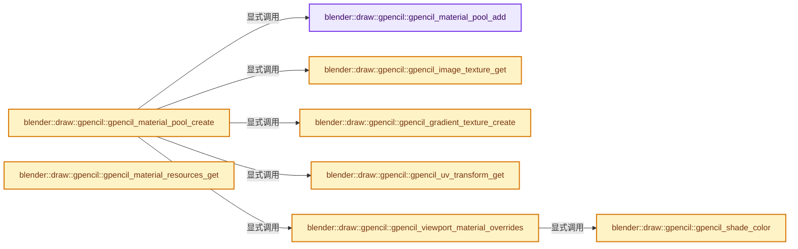

# 实现依赖专题：source/blender/draw/engines/gpencil/gpencil_draw_data.cc

[方向导航](README.md) · [符号索引](../%E7%AC%A6%E5%8F%B7%E4%BE%9D%E8%B5%96%E4%B8%8E%E5%AE%9E%E7%8E%B0%E7%B4%A2%E5%BC%95.md)

本专题从正文实际调用进入，集中保存共享实现。函数有稳定锚点，可从调用处直接跳到对应完整函数；递归与互相调用通过回链组织。

## 本文件的实现关系




## 完整成员与函数实现

<a id="f-77539b1ea1ebd055"></a>

### `blender::draw::gpencil::gpencil_material_pool_add`

实现位置：[source/blender/draw/engines/gpencil/gpencil_draw_data.cc](../../../../../source/blender/draw/engines/gpencil/gpencil_draw_data.cc) · L36—L46。

接口参数：

- `Instance *inst`

**教学注释版**

<!-- annotated:1923c7aae6eed0 -->

```cpp
static MaterialPool *gpencil_material_pool_add(Instance *inst)
{
  MaterialPool *matpool = static_cast<MaterialPool *>(BLI_memblock_alloc(inst->gp_material_pool));
  matpool->next = nullptr;
  matpool->used_count = 0;
  if (matpool->ubo == nullptr) {
    matpool->ubo = GPU_uniformbuf_create(sizeof(matpool->mat_data));
  }
  inst->last_material_pool = matpool;
  return matpool;
}
```

<details>
<summary>核对原始源码：source/blender/draw/engines/gpencil/gpencil_draw_data.cc · L36—L46</summary>

<!-- original:1923c7aae6eed0:source/blender/draw/engines/gpencil/gpencil_draw_data.cc:36:46 -->

```cpp
static MaterialPool *gpencil_material_pool_add(Instance *inst)
{
  MaterialPool *matpool = static_cast<MaterialPool *>(BLI_memblock_alloc(inst->gp_material_pool));
  matpool->next = nullptr;
  matpool->used_count = 0;
  if (matpool->ubo == nullptr) {
    matpool->ubo = GPU_uniformbuf_create(sizeof(matpool->mat_data));
  }
  inst->last_material_pool = matpool;
  return matpool;
}
```

</details>

**沿实际写入检查状态**

- `matpool->next = nullptr;`
- `matpool->used_count = 0;`
- `matpool->ubo = GPU_uniformbuf_create(sizeof(matpool->mat_data));`
- `inst->last_material_pool = matpool;`

**结果出口**

- `return matpool;`

**继续追踪实现**

- `BLI_memblock_alloc` → [blender::BLI_memblock_alloc · L118](../01-%E5%9F%BA%E7%A1%80%E5%AE%B9%E5%99%A8%E4%B8%8E%E7%8E%B0%E4%BB%A3CPP/%E4%BE%9D%E8%B5%96-BLI_memblock-8f646e.md#f-190dab22a7827201)。
- `GPU_uniformbuf_create` → [GPU_uniformbuf_create · L39](%E4%BE%9D%E8%B5%96-GPU_uniform_buffer-988db0.md#m-773637e3b481)。宏定义由构建条件选择。

<a id="f-44b3f944fc994ca2"></a>

### `blender::draw::gpencil::gpencil_image_texture_get`

实现位置：[source/blender/draw/engines/gpencil/gpencil_draw_data.cc](../../../../../source/blender/draw/engines/gpencil/gpencil_draw_data.cc) · L48—L58。

接口参数：

- `blender::Image *image`
- `bool *r_alpha_premult`

**教学注释版**

<!-- annotated:d269e5f4327051 -->

```cpp
static gpu::Texture *gpencil_image_texture_get(blender::Image *image, bool *r_alpha_premult)
{
  ImageUser iuser = {nullptr};
  gpu::Texture *gpu_tex = nullptr;

  gpu_tex = BKE_image_acquire_gpu_texture(image, &iuser);
  DRW_manager_get()->hold_texture(gpu_tex);
  *r_alpha_premult = (gpu_tex) ? (image->alpha_mode == IMA_ALPHA_PREMUL) : false;

  return gpu_tex;
}
```

<details>
<summary>核对原始源码：source/blender/draw/engines/gpencil/gpencil_draw_data.cc · L48—L58</summary>

<!-- original:d269e5f4327051:source/blender/draw/engines/gpencil/gpencil_draw_data.cc:48:58 -->

```cpp
static gpu::Texture *gpencil_image_texture_get(blender::Image *image, bool *r_alpha_premult)
{
  ImageUser iuser = {nullptr};
  gpu::Texture *gpu_tex = nullptr;

  gpu_tex = BKE_image_acquire_gpu_texture(image, &iuser);
  DRW_manager_get()->hold_texture(gpu_tex);
  *r_alpha_premult = (gpu_tex) ? (image->alpha_mode == IMA_ALPHA_PREMUL) : false;

  return gpu_tex;
}
```

</details>

**沿实际写入检查状态**

- `gpu_tex = BKE_image_acquire_gpu_texture(image, &iuser);`

**结果出口**

- `return gpu_tex;`

**继续追踪实现**

- `BKE_image_acquire_gpu_texture` → [blender::BKE_image_acquire_gpu_texture · L732](%E4%BE%9D%E8%B5%96-image_gpu-0d1d94.md#f-41263b2d5d4b728c)。
- `DRW_manager_get()->hold_texture` → [调用协议](../%E6%A8%A1%E6%9D%BF%E5%AE%8F%E4%B8%8E%E5%8A%A8%E6%80%81%E5%88%86%E6%B4%BE%E5%8D%8F%E8%AE%AE.md)：接收对象类型依赖auto、返回值或模板实例；不按同名猜测目标。调用位置L54。
- `DRW_manager_get` → [blender::DRW_manager_get · L132](%E4%BE%9D%E8%B5%96-draw_view_data-a5cb02.md#f-5119622e7911956f)。

<a id="f-86ff7e55933d867d"></a>

### `blender::draw::gpencil::gpencil_gradient_texture_create`

实现位置：[source/blender/draw/engines/gpencil/gpencil_draw_data.cc](../../../../../source/blender/draw/engines/gpencil/gpencil_draw_data.cc) · L60—L85。

接口参数：

- `const ColorBand *coba`

**教学注释版**

<!-- annotated:3ef454a00ecb15 -->

```cpp
static gpu::Texture *gpencil_gradient_texture_create(const ColorBand *coba)
{
  gpu::Texture *gpu_tex = nullptr;

  float *data;
  int size;

  BKE_colorband_evaluate_table_rgba(coba, &data, &size);

  for (const int i : IndexRange(size)) {
    linearrgb_to_srgb_v4(&data[i * 4], &data[i * 4]);
  }

  gpu_tex = GPU_texture_create_2d("color_gradient",
                                  size,
                                  1,
                                  1,
                                  gpu::TextureFormat::SRGBA_8_8_8_8,
                                  GPU_TEXTURE_USAGE_SHADER_READ,
                                  data);

  DRW_manager_get()->hold_texture(gpu_tex);
  MEM_delete(data);

  return gpu_tex;
}
```

<details>
<summary>核对原始源码：source/blender/draw/engines/gpencil/gpencil_draw_data.cc · L60—L85</summary>

<!-- original:3ef454a00ecb15:source/blender/draw/engines/gpencil/gpencil_draw_data.cc:60:85 -->

```cpp
static gpu::Texture *gpencil_gradient_texture_create(const ColorBand *coba)
{
  gpu::Texture *gpu_tex = nullptr;

  float *data;
  int size;

  BKE_colorband_evaluate_table_rgba(coba, &data, &size);

  for (const int i : IndexRange(size)) {
    linearrgb_to_srgb_v4(&data[i * 4], &data[i * 4]);
  }

  gpu_tex = GPU_texture_create_2d("color_gradient",
                                  size,
                                  1,
                                  1,
                                  gpu::TextureFormat::SRGBA_8_8_8_8,
                                  GPU_TEXTURE_USAGE_SHADER_READ,
                                  data);

  DRW_manager_get()->hold_texture(gpu_tex);
  MEM_delete(data);

  return gpu_tex;
}
```

</details>

**沿实际写入检查状态**

- `gpu_tex = GPU_texture_create_2d("color_gradient",`

**结果出口**

- `return gpu_tex;`

**继续追踪实现**

- `BKE_colorband_evaluate_table_rgba` → [blender::BKE_colorband_evaluate_table_rgba · L562](%E4%BE%9D%E8%B5%96-colorband-8196f8.md#f-e8047fa331095f36)。
- `IndexRange` → [blender::IndexRange](../01-%E5%9F%BA%E7%A1%80%E5%AE%B9%E5%99%A8%E4%B8%8E%E7%8E%B0%E4%BB%A3CPP/%E4%BE%9D%E8%B5%96-BLI_index_range-7d7cc5.md#t-caa3466d6776)；[blender::gpu::shader::parser::IndexRange](%E4%BE%9D%E8%B5%96-utils-06433d.md#t-82d2bd4ea71c)；[blender::IndexRange](%E4%BE%9D%E8%B5%96-DNA_node_types-6708b9.md#t-0448cc889d39)。
- `linearrgb_to_srgb_v4` → [blender::linearrgb_to_srgb_v4 · L28](../12-%E7%A9%BA%E9%97%B4%E6%95%B0%E6%8D%AE%E7%BB%93%E6%9E%84%E4%B8%8E%E5%87%A0%E4%BD%95%E7%AE%97%E6%B3%95/%E4%BE%9D%E8%B5%96-math_color_inline-48fb4c.md#f-d3ce6c4f88703091)。
- `GPU_texture_create_2d` → [blender::GPU_texture_create_2d · L308](%E4%BE%9D%E8%B5%96-gpu_texture-234bda.md#f-5aa2a42234aebbda)。
- `DRW_manager_get()->hold_texture` → [调用协议](../%E6%A8%A1%E6%9D%BF%E5%AE%8F%E4%B8%8E%E5%8A%A8%E6%80%81%E5%88%86%E6%B4%BE%E5%8D%8F%E8%AE%AE.md)：接收对象类型依赖auto、返回值或模板实例；不按同名猜测目标。调用位置L81。
- `DRW_manager_get` → [blender::DRW_manager_get · L132](%E4%BE%9D%E8%B5%96-draw_view_data-a5cb02.md#f-5119622e7911956f)。
- `MEM_delete` → [MEM_delete · L400](../03-%E5%86%85%E5%AD%98%E5%88%86%E9%85%8D%E4%B8%8E%E8%BF%90%E8%A1%8C%E6%97%B6%E7%B1%BB%E5%9E%8B/%E4%BE%9D%E8%B5%96-MEM_guardedalloc-b54eca.md#f-9049ffdd1682887c)。

<a id="f-a9e3d62b94a43a2f"></a>

### `blender::draw::gpencil::gpencil_uv_transform_get`

实现位置：[source/blender/draw/engines/gpencil/gpencil_draw_data.cc](../../../../../source/blender/draw/engines/gpencil/gpencil_draw_data.cc) · L87—L106。

接口参数：

- `const float ofs[2]`
- `const float scale[2]`
- `const float rotation`
- `float r_rot_scale[2][2]`
- `float r_offset[2]`

**教学注释版**

<!-- annotated:c94c144e72989f -->

```cpp
static void gpencil_uv_transform_get(const float ofs[2],
                                     const float scale[2],
                                     const float rotation,
                                     float r_rot_scale[2][2],
                                     float r_offset[2])
{
  /* OPTI this could use 3x2 matrices and reduce the number of operations drastically. */
  float mat[4][4];
  unit_m4(mat);
  /* Offset to center. */
  translate_m4(mat, 0.5f, 0.5f, 0.0f);
  /* Reversed order. */
  rescale_m4(mat, float3{1.0f / scale[0], 1.0f / scale[1], 0.0});
  rotate_m4(mat, 'Z', -rotation);
  translate_m4(mat, ofs[0], ofs[1], 0.0f);
  /* Convert to 3x2 */
  copy_v2_v2(r_rot_scale[0], mat[0]);
  copy_v2_v2(r_rot_scale[1], mat[1]);
  copy_v2_v2(r_offset, mat[3]);
}
```

<details>
<summary>核对原始源码：source/blender/draw/engines/gpencil/gpencil_draw_data.cc · L87—L106</summary>

<!-- original:c94c144e72989f:source/blender/draw/engines/gpencil/gpencil_draw_data.cc:87:106 -->

```cpp
static void gpencil_uv_transform_get(const float ofs[2],
                                     const float scale[2],
                                     const float rotation,
                                     float r_rot_scale[2][2],
                                     float r_offset[2])
{
  /* OPTI this could use 3x2 matrices and reduce the number of operations drastically. */
  float mat[4][4];
  unit_m4(mat);
  /* Offset to center. */
  translate_m4(mat, 0.5f, 0.5f, 0.0f);
  /* Reversed order. */
  rescale_m4(mat, float3{1.0f / scale[0], 1.0f / scale[1], 0.0});
  rotate_m4(mat, 'Z', -rotation);
  translate_m4(mat, ofs[0], ofs[1], 0.0f);
  /* Convert to 3x2 */
  copy_v2_v2(r_rot_scale[0], mat[0]);
  copy_v2_v2(r_rot_scale[1], mat[1]);
  copy_v2_v2(r_offset, mat[3]);
}
```

</details>

**继续追踪实现**

- `unit_m4` → [blender::unit_m4 · L55](../12-%E7%A9%BA%E9%97%B4%E6%95%B0%E6%8D%AE%E7%BB%93%E6%9E%84%E4%B8%8E%E5%87%A0%E4%BD%95%E7%AE%97%E6%B3%95/%E4%BE%9D%E8%B5%96-math_matrix_c-004123.md#f-e6cd812aae119176)。
- `translate_m4` → [blender::translate_m4 · L2108](../12-%E7%A9%BA%E9%97%B4%E6%95%B0%E6%8D%AE%E7%BB%93%E6%9E%84%E4%B8%8E%E5%87%A0%E4%BD%95%E7%AE%97%E6%B3%95/%E4%BE%9D%E8%B5%96-math_matrix_c-004123.md#f-e05a7854c4f638e6)。
- `rescale_m4` → [blender::rescale_m4 · L2152](../12-%E7%A9%BA%E9%97%B4%E6%95%B0%E6%8D%AE%E7%BB%93%E6%9E%84%E4%B8%8E%E5%87%A0%E4%BD%95%E7%AE%97%E6%B3%95/%E4%BE%9D%E8%B5%96-math_matrix_c-004123.md#f-9e3942c439579fa1)。
- `rotate_m4` → [blender::rotate_m4 · L2115](../12-%E7%A9%BA%E9%97%B4%E6%95%B0%E6%8D%AE%E7%BB%93%E6%9E%84%E4%B8%8E%E5%87%A0%E4%BD%95%E7%AE%97%E6%B3%95/%E4%BE%9D%E8%B5%96-math_matrix_c-004123.md#f-c255c473f69e9d03)。
- `copy_v2_v2` → [blender::copy_v2_v2 · L41](../12-%E7%A9%BA%E9%97%B4%E6%95%B0%E6%8D%AE%E7%BB%93%E6%9E%84%E4%B8%8E%E5%87%A0%E4%BD%95%E7%AE%97%E6%B3%95/%E4%BE%9D%E8%B5%96-math_vector_inline-0c8541.md#f-e736ee2dd71cd821)。

<a id="f-0bf0fdb939a0a0f0"></a>

### `blender::draw::gpencil::gpencil_shade_color`

实现位置：[source/blender/draw/engines/gpencil/gpencil_draw_data.cc](../../../../../source/blender/draw/engines/gpencil/gpencil_draw_data.cc) · L108—L119。

接口参数：

- `float color[3]`

**教学注释版**

<!-- annotated:4f686af1eacb04 -->

```cpp
static void gpencil_shade_color(float color[3])
{
  /* This is scene refereed color, not gamma corrected and not per perceptual.
   * So we lower the threshold a bit. (1.0 / 3.0) */
  if (color[0] + color[1] + color[2] > 1.1) {
    add_v3_fl(color, -0.25f);
  }
  else {
    add_v3_fl(color, 0.15f);
  }
  clamp_v3(color, 0.0f, 1.0f);
}
```

<details>
<summary>核对原始源码：source/blender/draw/engines/gpencil/gpencil_draw_data.cc · L108—L119</summary>

<!-- original:4f686af1eacb04:source/blender/draw/engines/gpencil/gpencil_draw_data.cc:108:119 -->

```cpp
static void gpencil_shade_color(float color[3])
{
  /* This is scene refereed color, not gamma corrected and not per perceptual.
   * So we lower the threshold a bit. (1.0 / 3.0) */
  if (color[0] + color[1] + color[2] > 1.1) {
    add_v3_fl(color, -0.25f);
  }
  else {
    add_v3_fl(color, 0.15f);
  }
  clamp_v3(color, 0.0f, 1.0f);
}
```

</details>

**继续追踪实现**

- `add_v3_fl` → [blender::add_v3_fl · L267](../12-%E7%A9%BA%E9%97%B4%E6%95%B0%E6%8D%AE%E7%BB%93%E6%9E%84%E4%B8%8E%E5%87%A0%E4%BD%95%E7%AE%97%E6%B3%95/%E4%BE%9D%E8%B5%96-math_vector_inline-0c8541.md#f-ccf32c1ce29b15d8)。
- `clamp_v3` → [blender::clamp_v3 · L1075](../12-%E7%A9%BA%E9%97%B4%E6%95%B0%E6%8D%AE%E7%BB%93%E6%9E%84%E4%B8%8E%E5%87%A0%E4%BD%95%E7%AE%97%E6%B3%95/%E4%BE%9D%E8%B5%96-math_vector_inline-0c8541.md#f-bc39188e63e7b724)。

<a id="f-8a9ab75b0a19433c"></a>

### `blender::draw::gpencil::gpencil_viewport_material_overrides`

实现位置：[source/blender/draw/engines/gpencil/gpencil_draw_data.cc](../../../../../source/blender/draw/engines/gpencil/gpencil_draw_data.cc) · L122—L192。

接口参数：

- `Instance *inst`
- `Object *ob`
- `int color_type`
- `MaterialGPencilStyle *gp_style`
- `const eV3DShadingLightingMode lighting_mode`

**教学注释版**

<!-- annotated:c57ed7fa00b887 -->

```cpp
static MaterialGPencilStyle *gpencil_viewport_material_overrides(
    Instance *inst,
    Object *ob,
    int color_type,
    MaterialGPencilStyle *gp_style,
    const eV3DShadingLightingMode lighting_mode)
{
  static MaterialGPencilStyle gp_style_tmp;

  switch (color_type) {
    case V3D_SHADING_MATERIAL_COLOR:
    case V3D_SHADING_RANDOM_COLOR:
      /* Random uses a random color by layer and this is done using the tint
       * layer. A simple color by object, like meshes, is not practical in
       * grease pencil. */
      copy_v4_v4(gp_style_tmp.stroke_rgba, gp_style->stroke_rgba);
      copy_v4_v4(gp_style_tmp.fill_rgba, gp_style->fill_rgba);
      gp_style = &gp_style_tmp;
      gp_style->stroke_style = GP_MATERIAL_STROKE_STYLE_SOLID;
      gp_style->fill_style = GP_MATERIAL_FILL_STYLE_SOLID;
      break;
    case V3D_SHADING_TEXTURE_COLOR:
      gp_style_tmp = dna::shallow_copy(*gp_style);
      gp_style = &gp_style_tmp;
      if ((gp_style->stroke_style == GP_MATERIAL_STROKE_STYLE_TEXTURE) && (gp_style->sima)) {
        copy_v4_fl(gp_style->stroke_rgba, 1.0f);
        gp_style->mix_stroke_factor = 0.0f;
      }

      if ((gp_style->fill_style == GP_MATERIAL_FILL_STYLE_TEXTURE) && (gp_style->ima)) {
        copy_v4_fl(gp_style->fill_rgba, 1.0f);
        gp_style->mix_factor = 0.0f;
      }
      else if (gp_style->fill_style == GP_MATERIAL_FILL_STYLE_GRADIENT) {
        /* gp_style->fill_rgba is needed for correct gradient. */
        gp_style->mix_factor = 0.0f;
      }
      break;
    case V3D_SHADING_SINGLE_COLOR:
      gp_style = &gp_style_tmp;
      gp_style->stroke_style = GP_MATERIAL_STROKE_STYLE_SOLID;
      gp_style->fill_style = GP_MATERIAL_FILL_STYLE_SOLID;
      copy_v3_v3(gp_style->fill_rgba, inst->v3d_single_color);
      gp_style->fill_rgba[3] = 1.0f;
      copy_v4_v4(gp_style->stroke_rgba, gp_style->fill_rgba);
      if (lighting_mode != V3D_LIGHTING_FLAT) {
        gpencil_shade_color(gp_style->fill_rgba);
      }
      break;
    case V3D_SHADING_OBJECT_COLOR:
      gp_style = &gp_style_tmp;
      gp_style->stroke_style = GP_MATERIAL_STROKE_STYLE_SOLID;
      gp_style->fill_style = GP_MATERIAL_FILL_STYLE_SOLID;
      copy_v4_v4(gp_style->fill_rgba, ob->color);
      copy_v4_v4(gp_style->stroke_rgba, ob->color);
      if (lighting_mode != V3D_LIGHTING_FLAT) {
        gpencil_shade_color(gp_style->fill_rgba);
      }
      break;
    case V3D_SHADING_VERTEX_COLOR:
      gp_style = &gp_style_tmp;
      gp_style->stroke_style = GP_MATERIAL_STROKE_STYLE_SOLID;
      gp_style->fill_style = GP_MATERIAL_FILL_STYLE_SOLID;
      copy_v4_fl(gp_style->fill_rgba, 1.0f);
      copy_v4_fl(gp_style->stroke_rgba, 1.0f);
      break;
    default:
      break;
  }
  return gp_style;
}
```

<details>
<summary>核对原始源码：source/blender/draw/engines/gpencil/gpencil_draw_data.cc · L122—L192</summary>

<!-- original:c57ed7fa00b887:source/blender/draw/engines/gpencil/gpencil_draw_data.cc:122:192 -->

```cpp
static MaterialGPencilStyle *gpencil_viewport_material_overrides(
    Instance *inst,
    Object *ob,
    int color_type,
    MaterialGPencilStyle *gp_style,
    const eV3DShadingLightingMode lighting_mode)
{
  static MaterialGPencilStyle gp_style_tmp;

  switch (color_type) {
    case V3D_SHADING_MATERIAL_COLOR:
    case V3D_SHADING_RANDOM_COLOR:
      /* Random uses a random color by layer and this is done using the tint
       * layer. A simple color by object, like meshes, is not practical in
       * grease pencil. */
      copy_v4_v4(gp_style_tmp.stroke_rgba, gp_style->stroke_rgba);
      copy_v4_v4(gp_style_tmp.fill_rgba, gp_style->fill_rgba);
      gp_style = &gp_style_tmp;
      gp_style->stroke_style = GP_MATERIAL_STROKE_STYLE_SOLID;
      gp_style->fill_style = GP_MATERIAL_FILL_STYLE_SOLID;
      break;
    case V3D_SHADING_TEXTURE_COLOR:
      gp_style_tmp = dna::shallow_copy(*gp_style);
      gp_style = &gp_style_tmp;
      if ((gp_style->stroke_style == GP_MATERIAL_STROKE_STYLE_TEXTURE) && (gp_style->sima)) {
        copy_v4_fl(gp_style->stroke_rgba, 1.0f);
        gp_style->mix_stroke_factor = 0.0f;
      }

      if ((gp_style->fill_style == GP_MATERIAL_FILL_STYLE_TEXTURE) && (gp_style->ima)) {
        copy_v4_fl(gp_style->fill_rgba, 1.0f);
        gp_style->mix_factor = 0.0f;
      }
      else if (gp_style->fill_style == GP_MATERIAL_FILL_STYLE_GRADIENT) {
        /* gp_style->fill_rgba is needed for correct gradient. */
        gp_style->mix_factor = 0.0f;
      }
      break;
    case V3D_SHADING_SINGLE_COLOR:
      gp_style = &gp_style_tmp;
      gp_style->stroke_style = GP_MATERIAL_STROKE_STYLE_SOLID;
      gp_style->fill_style = GP_MATERIAL_FILL_STYLE_SOLID;
      copy_v3_v3(gp_style->fill_rgba, inst->v3d_single_color);
      gp_style->fill_rgba[3] = 1.0f;
      copy_v4_v4(gp_style->stroke_rgba, gp_style->fill_rgba);
      if (lighting_mode != V3D_LIGHTING_FLAT) {
        gpencil_shade_color(gp_style->fill_rgba);
      }
      break;
    case V3D_SHADING_OBJECT_COLOR:
      gp_style = &gp_style_tmp;
      gp_style->stroke_style = GP_MATERIAL_STROKE_STYLE_SOLID;
      gp_style->fill_style = GP_MATERIAL_FILL_STYLE_SOLID;
      copy_v4_v4(gp_style->fill_rgba, ob->color);
      copy_v4_v4(gp_style->stroke_rgba, ob->color);
      if (lighting_mode != V3D_LIGHTING_FLAT) {
        gpencil_shade_color(gp_style->fill_rgba);
      }
      break;
    case V3D_SHADING_VERTEX_COLOR:
      gp_style = &gp_style_tmp;
      gp_style->stroke_style = GP_MATERIAL_STROKE_STYLE_SOLID;
      gp_style->fill_style = GP_MATERIAL_FILL_STYLE_SOLID;
      copy_v4_fl(gp_style->fill_rgba, 1.0f);
      copy_v4_fl(gp_style->stroke_rgba, 1.0f);
      break;
    default:
      break;
  }
  return gp_style;
}
```

</details>

**沿实际写入检查状态**

- `gp_style = &gp_style_tmp;`
- `gp_style->stroke_style = GP_MATERIAL_STROKE_STYLE_SOLID;`
- `gp_style->fill_style = GP_MATERIAL_FILL_STYLE_SOLID;`
- `gp_style_tmp = dna::shallow_copy(*gp_style);`
- `gp_style->mix_stroke_factor = 0.0f;`
- `gp_style->mix_factor = 0.0f;`
- `gp_style->fill_rgba[3] = 1.0f;`

**结果出口**

- `return gp_style;`

**继续追踪实现**

- `copy_v4_v4` → [调用协议](../%E6%A8%A1%E6%9D%BF%E5%AE%8F%E4%B8%8E%E5%8A%A8%E6%80%81%E5%88%86%E6%B4%BE%E5%8D%8F%E8%AE%AE.md)：函数指针、局部可调用对象或未展开的宏；必须结合调用者环境。调用位置L137。
- `dna::shallow_copy` → [blender::dna::shallow_copy · L146](%E4%BE%9D%E8%B5%96-DNA_defs-ed47fd.md#f-84b6eda95a1c994c)。
- `copy_v4_fl` → [blender::copy_v4_fl · L75](../12-%E7%A9%BA%E9%97%B4%E6%95%B0%E6%8D%AE%E7%BB%93%E6%9E%84%E4%B8%8E%E5%87%A0%E4%BD%95%E7%AE%97%E6%B3%95/%E4%BE%9D%E8%B5%96-math_vector_inline-0c8541.md#f-da9251b67269c335)。
- `copy_v3_v3` → [调用协议](../%E6%A8%A1%E6%9D%BF%E5%AE%8F%E4%B8%8E%E5%8A%A8%E6%80%81%E5%88%86%E6%B4%BE%E5%8D%8F%E8%AE%AE.md)：函数指针、局部可调用对象或未展开的宏；必须结合调用者环境。调用位置L164。
- `gpencil_shade_color` → [blender::draw::gpencil::gpencil_shade_color · L108](%E4%BE%9D%E8%B5%96-gpencil_draw_data-d38be3.md#f-0bf0fdb939a0a0f0)。

<a id="f-68fcb04465e0ab7e"></a>

### `blender::draw::gpencil::gpencil_material_pool_create`

实现位置：[source/blender/draw/engines/gpencil/gpencil_draw_data.cc](../../../../../source/blender/draw/engines/gpencil/gpencil_draw_data.cc) · L194—L382。

接口参数：

- `Instance *inst`
- `Object *ob`
- `int *ofs`
- `const bool is_vertex_mode`

**教学注释版**

<!-- annotated:ec5665a43cf5e3 -->

```cpp
MaterialPool *gpencil_material_pool_create(Instance *inst,
                                           Object *ob,
                                           int *ofs,
                                           const bool is_vertex_mode)
{
  MaterialPool *matpool = inst->last_material_pool;

  int mat_len = BKE_object_material_used_with_fallback_eval(*ob);

  bool reuse_matpool = matpool && ((matpool->used_count + mat_len) <= GPENCIL_MATERIAL_BUFFER_LEN);

  if (reuse_matpool) {
    /* Share the matpool with other objects. Return offset to first material. */
    *ofs = matpool->used_count;
  }
  else {
    matpool = gpencil_material_pool_add(inst);
    *ofs = 0;
  }

  /* Force vertex color in solid mode with vertex paint mode. Same behavior as meshes. */
  int color_type = (inst->v3d_color_type != -1 && is_vertex_mode) ? V3D_SHADING_VERTEX_COLOR :
                                                                    inst->v3d_color_type;
  const eV3DShadingLightingMode lighting_mode = eV3DShadingLightingMode(
      (inst->v3d != nullptr) ? eV3DShadingLightingMode(inst->v3d->shading.light) :
                               V3D_LIGHTING_STUDIO);

  MaterialPool *pool = matpool;
  for (int i = 0; i < mat_len; i++) {
    if ((i > 0) && (pool->used_count == GPENCIL_MATERIAL_BUFFER_LEN)) {
      pool->next = gpencil_material_pool_add(inst);
      pool = pool->next;
    }
    int mat_id = pool->used_count++;

    gpMaterial *mat_data = &pool->mat_data[mat_id];
    MaterialGPencilStyle *gp_style = BKE_gpencil_material_settings(ob, i + 1);

    if (gp_style->mode == GP_MATERIAL_MODE_LINE) {
      mat_data->flag = 0;
    }
    else {
      switch (gp_style->alignment_mode) {
        case GP_MATERIAL_FOLLOW_PATH:
          mat_data->flag = GP_STROKE_ALIGNMENT_STROKE;
          break;
        case GP_MATERIAL_FOLLOW_OBJ:
          mat_data->flag = GP_STROKE_ALIGNMENT_OBJECT;
          break;
        case GP_MATERIAL_FOLLOW_FIXED:
        default:
          mat_data->flag = GP_STROKE_ALIGNMENT_FIXED;
          break;
      }

      if (gp_style->mode == GP_MATERIAL_MODE_DOT) {
        mat_data->flag |= GP_STROKE_DOTS;
      }

      switch (gp_style->placement_mode) {
        case GP_MATERIAL_PLACEMENT_RADIUS:
          mat_data->flag |= GP_DOTS_PLACEMENT_MODE_RADIUS;
          break;
        case GP_MATERIAL_PLACEMENT_DENSITY:
          mat_data->flag |= GP_DOTS_PLACEMENT_MODE_DENSITY;
          break;
        default:
        case GP_MATERIAL_PLACEMENT_COUNT:
          mat_data->flag |= GP_DOTS_PLACEMENT_MODE_COUNT;
          break;
      }
    }

    if ((gp_style->mode != GP_MATERIAL_MODE_LINE) ||
        (gp_style->flag & GP_MATERIAL_DISABLE_STENCIL))
    {
      mat_data->flag |= GP_STROKE_OVERLAP;
    }

    /* Material with holdout. */
    if (gp_style->flag & GP_MATERIAL_IS_STROKE_HOLDOUT) {
      mat_data->flag |= GP_STROKE_HOLDOUT;
    }
    if (gp_style->flag & GP_MATERIAL_IS_FILL_HOLDOUT) {
      mat_data->flag |= GP_FILL_HOLDOUT;
    }

    /* Dots or Squares rotation. */
    mat_data->alignment_rot[0] = cosf(gp_style->alignment_rotation);
    mat_data->alignment_rot[1] = sinf(gp_style->alignment_rotation);
    if (gp_style->mode == GP_MATERIAL_MODE_LINE) {
      /* Convert pixel size to stroke u, the factor of `500` is from legacy Grease Pencil. */
      mat_data->stroke_u_scale = 500.0f / gp_style->texture_pixsize;
    }
    else {
      switch (gp_style->placement_mode) {
        case GP_MATERIAL_PLACEMENT_RADIUS:
          /* The radius spacing is a percentage and inverse, so it as a factor of `100` */
          mat_data->stroke_u_scale = 100.0f / gp_style->placement_radius_spacing;
          /* Divide by two, to convert diameter to radius. */
          mat_data->stroke_u_scale *= 0.5f;
          break;
        case GP_MATERIAL_PLACEMENT_DENSITY:
          mat_data->stroke_u_scale = gp_style->placement_density;
          break;
        default:
        case GP_MATERIAL_PLACEMENT_COUNT:
          mat_data->stroke_u_scale = gp_style->placement_count;
          break;
      }
    }

    if (gp_style->flag & GP_MATERIAL_USE_DOTS_RANDOMIZATION) {
      mat_data->flag |= GP_DOTS_USE_RANDOMIZATION;

      mat_data->random_packed.x = (unit_float_to_ushort_clamp(gp_style->random_size_factor));
      mat_data->random_packed.x |= (unit_float_to_ushort_clamp(gp_style->random_strength_factor))
                                   << 16;

      mat_data->random_packed.y = (unit_float_to_ushort_clamp(gp_style->random_rotation_factor));
      mat_data->random_packed.y |= (unit_float_to_ushort_clamp(gp_style->random_hue_factor)) << 16;

      mat_data->random_packed.z = (unit_float_to_ushort_clamp(gp_style->random_saturation_factor));
      mat_data->random_packed.z |= (unit_float_to_ushort_clamp(gp_style->random_value_factor))
                                   << 16;

      mat_data->random_packed.w = float_as_uint(gp_style->random_noise_scale);
    }
    else {
      mat_data->random_packed = uint4(0);
    }

    gp_style = gpencil_viewport_material_overrides(inst, ob, color_type, gp_style, lighting_mode);

    /* Stroke Style */
    if ((gp_style->stroke_style == GP_MATERIAL_STROKE_STYLE_TEXTURE) && (gp_style->sima)) {
      bool premul;
      pool->tex_stroke[mat_id] = gpencil_image_texture_get(gp_style->sima, &premul);
      mat_data->flag |= pool->tex_stroke[mat_id] ? GP_STROKE_TEXTURE_USE : GP_FLAG_NONE;
      mat_data->flag |= premul ? GP_STROKE_TEXTURE_PREMUL : GP_FLAG_NONE;
      copy_v4_v4(mat_data->stroke_color, gp_style->stroke_rgba);
      mat_data->stroke_texture_mix = 1.0f - gp_style->mix_stroke_factor;
    }
    else /* if (gp_style->stroke_style == GP_MATERIAL_STROKE_STYLE_SOLID) */ {
      pool->tex_stroke[mat_id] = nullptr;
      mat_data->flag &= ~GP_STROKE_TEXTURE_USE;
      copy_v4_v4(mat_data->stroke_color, gp_style->stroke_rgba);
      mat_data->stroke_texture_mix = 0.0f;
    }

    /* Fill Style */
    if ((gp_style->fill_style == GP_MATERIAL_FILL_STYLE_TEXTURE) && (gp_style->ima)) {
      bool use_clip = (gp_style->flag & GP_MATERIAL_TEX_CLAMP) != 0;
      bool premul;
      pool->tex_fill[mat_id] = gpencil_image_texture_get(gp_style->ima, &premul);
      mat_data->flag |= pool->tex_fill[mat_id] ? GP_FILL_TEXTURE_USE : GP_FLAG_NONE;
      mat_data->flag |= premul ? GP_FILL_TEXTURE_PREMUL : GP_FLAG_NONE;
      mat_data->flag |= use_clip ? GP_FILL_TEXTURE_CLIP : GP_FLAG_NONE;
      gpencil_uv_transform_get(gp_style->texture_offset,
                               gp_style->texture_scale,
                               gp_style->texture_angle,
                               reinterpret_cast<float (*)[2]>(&mat_data->fill_uv_rot_scale),
                               mat_data->fill_uv_offset);
      copy_v4_v4(mat_data->fill_color, gp_style->fill_rgba);
      mat_data->fill_texture_mix = 1.0f - gp_style->mix_factor;
    }
    else if (gp_style->fill_style == GP_MATERIAL_FILL_STYLE_GRADIENT) {
      bool use_radial = (gp_style->gradient_type == GP_MATERIAL_GRADIENT_RADIAL);
      /* TODO: This creates a new texture even if the gradient has not changed. */
      pool->tex_fill[mat_id] = gpencil_gradient_texture_create(gp_style->gradient);
      mat_data->flag |= GP_FILL_GRADIENT_USE;
      mat_data->flag |= use_radial ? GP_FILL_GRADIENT_RADIAL : GP_FLAG_NONE;
      gpencil_uv_transform_get(gp_style->texture_offset,
                               gp_style->texture_scale,
                               gp_style->texture_angle,
                               reinterpret_cast<float (*)[2]>(&mat_data->fill_uv_rot_scale),
                               mat_data->fill_uv_offset);

      mat_data->fill_texture_mix = 1.0f;
    }
    else /* if (gp_style->fill_style == GP_MATERIAL_FILL_STYLE_SOLID) */ {
      pool->tex_fill[mat_id] = nullptr;
      copy_v4_v4(mat_data->fill_color, gp_style->fill_rgba);
      mat_data->fill_texture_mix = 0.0f;
    }
  }

  return matpool;
}
```

<details>
<summary>核对原始源码：source/blender/draw/engines/gpencil/gpencil_draw_data.cc · L194—L382</summary>

<!-- original:ec5665a43cf5e3:source/blender/draw/engines/gpencil/gpencil_draw_data.cc:194:382 -->

```cpp
MaterialPool *gpencil_material_pool_create(Instance *inst,
                                           Object *ob,
                                           int *ofs,
                                           const bool is_vertex_mode)
{
  MaterialPool *matpool = inst->last_material_pool;

  int mat_len = BKE_object_material_used_with_fallback_eval(*ob);

  bool reuse_matpool = matpool && ((matpool->used_count + mat_len) <= GPENCIL_MATERIAL_BUFFER_LEN);

  if (reuse_matpool) {
    /* Share the matpool with other objects. Return offset to first material. */
    *ofs = matpool->used_count;
  }
  else {
    matpool = gpencil_material_pool_add(inst);
    *ofs = 0;
  }

  /* Force vertex color in solid mode with vertex paint mode. Same behavior as meshes. */
  int color_type = (inst->v3d_color_type != -1 && is_vertex_mode) ? V3D_SHADING_VERTEX_COLOR :
                                                                    inst->v3d_color_type;
  const eV3DShadingLightingMode lighting_mode = eV3DShadingLightingMode(
      (inst->v3d != nullptr) ? eV3DShadingLightingMode(inst->v3d->shading.light) :
                               V3D_LIGHTING_STUDIO);

  MaterialPool *pool = matpool;
  for (int i = 0; i < mat_len; i++) {
    if ((i > 0) && (pool->used_count == GPENCIL_MATERIAL_BUFFER_LEN)) {
      pool->next = gpencil_material_pool_add(inst);
      pool = pool->next;
    }
    int mat_id = pool->used_count++;

    gpMaterial *mat_data = &pool->mat_data[mat_id];
    MaterialGPencilStyle *gp_style = BKE_gpencil_material_settings(ob, i + 1);

    if (gp_style->mode == GP_MATERIAL_MODE_LINE) {
      mat_data->flag = 0;
    }
    else {
      switch (gp_style->alignment_mode) {
        case GP_MATERIAL_FOLLOW_PATH:
          mat_data->flag = GP_STROKE_ALIGNMENT_STROKE;
          break;
        case GP_MATERIAL_FOLLOW_OBJ:
          mat_data->flag = GP_STROKE_ALIGNMENT_OBJECT;
          break;
        case GP_MATERIAL_FOLLOW_FIXED:
        default:
          mat_data->flag = GP_STROKE_ALIGNMENT_FIXED;
          break;
      }

      if (gp_style->mode == GP_MATERIAL_MODE_DOT) {
        mat_data->flag |= GP_STROKE_DOTS;
      }

      switch (gp_style->placement_mode) {
        case GP_MATERIAL_PLACEMENT_RADIUS:
          mat_data->flag |= GP_DOTS_PLACEMENT_MODE_RADIUS;
          break;
        case GP_MATERIAL_PLACEMENT_DENSITY:
          mat_data->flag |= GP_DOTS_PLACEMENT_MODE_DENSITY;
          break;
        default:
        case GP_MATERIAL_PLACEMENT_COUNT:
          mat_data->flag |= GP_DOTS_PLACEMENT_MODE_COUNT;
          break;
      }
    }

    if ((gp_style->mode != GP_MATERIAL_MODE_LINE) ||
        (gp_style->flag & GP_MATERIAL_DISABLE_STENCIL))
    {
      mat_data->flag |= GP_STROKE_OVERLAP;
    }

    /* Material with holdout. */
    if (gp_style->flag & GP_MATERIAL_IS_STROKE_HOLDOUT) {
      mat_data->flag |= GP_STROKE_HOLDOUT;
    }
    if (gp_style->flag & GP_MATERIAL_IS_FILL_HOLDOUT) {
      mat_data->flag |= GP_FILL_HOLDOUT;
    }

    /* Dots or Squares rotation. */
    mat_data->alignment_rot[0] = cosf(gp_style->alignment_rotation);
    mat_data->alignment_rot[1] = sinf(gp_style->alignment_rotation);
    if (gp_style->mode == GP_MATERIAL_MODE_LINE) {
      /* Convert pixel size to stroke u, the factor of `500` is from legacy Grease Pencil. */
      mat_data->stroke_u_scale = 500.0f / gp_style->texture_pixsize;
    }
    else {
      switch (gp_style->placement_mode) {
        case GP_MATERIAL_PLACEMENT_RADIUS:
          /* The radius spacing is a percentage and inverse, so it as a factor of `100` */
          mat_data->stroke_u_scale = 100.0f / gp_style->placement_radius_spacing;
          /* Divide by two, to convert diameter to radius. */
          mat_data->stroke_u_scale *= 0.5f;
          break;
        case GP_MATERIAL_PLACEMENT_DENSITY:
          mat_data->stroke_u_scale = gp_style->placement_density;
          break;
        default:
        case GP_MATERIAL_PLACEMENT_COUNT:
          mat_data->stroke_u_scale = gp_style->placement_count;
          break;
      }
    }

    if (gp_style->flag & GP_MATERIAL_USE_DOTS_RANDOMIZATION) {
      mat_data->flag |= GP_DOTS_USE_RANDOMIZATION;

      mat_data->random_packed.x = (unit_float_to_ushort_clamp(gp_style->random_size_factor));
      mat_data->random_packed.x |= (unit_float_to_ushort_clamp(gp_style->random_strength_factor))
                                   << 16;

      mat_data->random_packed.y = (unit_float_to_ushort_clamp(gp_style->random_rotation_factor));
      mat_data->random_packed.y |= (unit_float_to_ushort_clamp(gp_style->random_hue_factor)) << 16;

      mat_data->random_packed.z = (unit_float_to_ushort_clamp(gp_style->random_saturation_factor));
      mat_data->random_packed.z |= (unit_float_to_ushort_clamp(gp_style->random_value_factor))
                                   << 16;

      mat_data->random_packed.w = float_as_uint(gp_style->random_noise_scale);
    }
    else {
      mat_data->random_packed = uint4(0);
    }

    gp_style = gpencil_viewport_material_overrides(inst, ob, color_type, gp_style, lighting_mode);

    /* Stroke Style */
    if ((gp_style->stroke_style == GP_MATERIAL_STROKE_STYLE_TEXTURE) && (gp_style->sima)) {
      bool premul;
      pool->tex_stroke[mat_id] = gpencil_image_texture_get(gp_style->sima, &premul);
      mat_data->flag |= pool->tex_stroke[mat_id] ? GP_STROKE_TEXTURE_USE : GP_FLAG_NONE;
      mat_data->flag |= premul ? GP_STROKE_TEXTURE_PREMUL : GP_FLAG_NONE;
      copy_v4_v4(mat_data->stroke_color, gp_style->stroke_rgba);
      mat_data->stroke_texture_mix = 1.0f - gp_style->mix_stroke_factor;
    }
    else /* if (gp_style->stroke_style == GP_MATERIAL_STROKE_STYLE_SOLID) */ {
      pool->tex_stroke[mat_id] = nullptr;
      mat_data->flag &= ~GP_STROKE_TEXTURE_USE;
      copy_v4_v4(mat_data->stroke_color, gp_style->stroke_rgba);
      mat_data->stroke_texture_mix = 0.0f;
    }

    /* Fill Style */
    if ((gp_style->fill_style == GP_MATERIAL_FILL_STYLE_TEXTURE) && (gp_style->ima)) {
      bool use_clip = (gp_style->flag & GP_MATERIAL_TEX_CLAMP) != 0;
      bool premul;
      pool->tex_fill[mat_id] = gpencil_image_texture_get(gp_style->ima, &premul);
      mat_data->flag |= pool->tex_fill[mat_id] ? GP_FILL_TEXTURE_USE : GP_FLAG_NONE;
      mat_data->flag |= premul ? GP_FILL_TEXTURE_PREMUL : GP_FLAG_NONE;
      mat_data->flag |= use_clip ? GP_FILL_TEXTURE_CLIP : GP_FLAG_NONE;
      gpencil_uv_transform_get(gp_style->texture_offset,
                               gp_style->texture_scale,
                               gp_style->texture_angle,
                               reinterpret_cast<float (*)[2]>(&mat_data->fill_uv_rot_scale),
                               mat_data->fill_uv_offset);
      copy_v4_v4(mat_data->fill_color, gp_style->fill_rgba);
      mat_data->fill_texture_mix = 1.0f - gp_style->mix_factor;
    }
    else if (gp_style->fill_style == GP_MATERIAL_FILL_STYLE_GRADIENT) {
      bool use_radial = (gp_style->gradient_type == GP_MATERIAL_GRADIENT_RADIAL);
      /* TODO: This creates a new texture even if the gradient has not changed. */
      pool->tex_fill[mat_id] = gpencil_gradient_texture_create(gp_style->gradient);
      mat_data->flag |= GP_FILL_GRADIENT_USE;
      mat_data->flag |= use_radial ? GP_FILL_GRADIENT_RADIAL : GP_FLAG_NONE;
      gpencil_uv_transform_get(gp_style->texture_offset,
                               gp_style->texture_scale,
                               gp_style->texture_angle,
                               reinterpret_cast<float (*)[2]>(&mat_data->fill_uv_rot_scale),
                               mat_data->fill_uv_offset);

      mat_data->fill_texture_mix = 1.0f;
    }
    else /* if (gp_style->fill_style == GP_MATERIAL_FILL_STYLE_SOLID) */ {
      pool->tex_fill[mat_id] = nullptr;
      copy_v4_v4(mat_data->fill_color, gp_style->fill_rgba);
      mat_data->fill_texture_mix = 0.0f;
    }
  }

  return matpool;
}
```

</details>

**沿实际写入检查状态**

- `matpool = gpencil_material_pool_add(inst);`
- `pool->next = gpencil_material_pool_add(inst);`
- `pool = pool->next;`
- `mat_data->flag = 0;`
- `mat_data->flag = GP_STROKE_ALIGNMENT_STROKE;`
- `mat_data->flag = GP_STROKE_ALIGNMENT_OBJECT;`
- `mat_data->flag = GP_STROKE_ALIGNMENT_FIXED;`
- `mat_data->flag |= GP_STROKE_DOTS;`
- `mat_data->flag |= GP_DOTS_PLACEMENT_MODE_RADIUS;`
- `mat_data->flag |= GP_DOTS_PLACEMENT_MODE_DENSITY;`
- `mat_data->flag |= GP_DOTS_PLACEMENT_MODE_COUNT;`
- `mat_data->flag |= GP_STROKE_OVERLAP;`
- `mat_data->flag |= GP_STROKE_HOLDOUT;`
- `mat_data->flag |= GP_FILL_HOLDOUT;`
- `mat_data->alignment_rot[0] = cosf(gp_style->alignment_rotation);`
- `mat_data->alignment_rot[1] = sinf(gp_style->alignment_rotation);`
- `mat_data->stroke_u_scale = 500.0f / gp_style->texture_pixsize;`
- `mat_data->stroke_u_scale = 100.0f / gp_style->placement_radius_spacing;`
- `mat_data->stroke_u_scale *= 0.5f;`
- `mat_data->stroke_u_scale = gp_style->placement_density;`
- `mat_data->stroke_u_scale = gp_style->placement_count;`
- `mat_data->flag |= GP_DOTS_USE_RANDOMIZATION;`
- `mat_data->random_packed.x = (unit_float_to_ushort_clamp(gp_style->random_size_factor));`
- `mat_data->random_packed.x |= (unit_float_to_ushort_clamp(gp_style->random_strength_factor))`
- `mat_data->random_packed.y = (unit_float_to_ushort_clamp(gp_style->random_rotation_factor));`
- `mat_data->random_packed.y |= (unit_float_to_ushort_clamp(gp_style->random_hue_factor)) << 16;`
- `mat_data->random_packed.z = (unit_float_to_ushort_clamp(gp_style->random_saturation_factor));`
- `mat_data->random_packed.z |= (unit_float_to_ushort_clamp(gp_style->random_value_factor))`
- `mat_data->random_packed.w = float_as_uint(gp_style->random_noise_scale);`
- `mat_data->random_packed = uint4(0);`
- `gp_style = gpencil_viewport_material_overrides(inst, ob, color_type, gp_style, lighting_mode);`
- `pool->tex_stroke[mat_id] = gpencil_image_texture_get(gp_style->sima, &premul);`
- `mat_data->flag |= pool->tex_stroke[mat_id] ? GP_STROKE_TEXTURE_USE : GP_FLAG_NONE;`
- `mat_data->flag |= premul ? GP_STROKE_TEXTURE_PREMUL : GP_FLAG_NONE;`
- `mat_data->stroke_texture_mix = 1.0f - gp_style->mix_stroke_factor;`
- `pool->tex_stroke[mat_id] = nullptr;`
- `mat_data->flag &= ~GP_STROKE_TEXTURE_USE;`
- `mat_data->stroke_texture_mix = 0.0f;`
- `pool->tex_fill[mat_id] = gpencil_image_texture_get(gp_style->ima, &premul);`
- `mat_data->flag |= pool->tex_fill[mat_id] ? GP_FILL_TEXTURE_USE : GP_FLAG_NONE;`
- `mat_data->flag |= premul ? GP_FILL_TEXTURE_PREMUL : GP_FLAG_NONE;`
- `mat_data->flag |= use_clip ? GP_FILL_TEXTURE_CLIP : GP_FLAG_NONE;`
- `mat_data->fill_texture_mix = 1.0f - gp_style->mix_factor;`
- `pool->tex_fill[mat_id] = gpencil_gradient_texture_create(gp_style->gradient);`
- `mat_data->flag |= GP_FILL_GRADIENT_USE;`
- `mat_data->flag |= use_radial ? GP_FILL_GRADIENT_RADIAL : GP_FLAG_NONE;`
- `mat_data->fill_texture_mix = 1.0f;`
- `pool->tex_fill[mat_id] = nullptr;`
- `mat_data->fill_texture_mix = 0.0f;`

**结果出口**

- `return matpool;`

**继续追踪实现**

- `BKE_object_material_used_with_fallback_eval` → [blender::BKE_object_material_used_with_fallback_eval · L897](%E4%BE%9D%E8%B5%96-material-aea8ec.md#f-db4360f7b410441f)。
- `gpencil_material_pool_add` → [blender::draw::gpencil::gpencil_material_pool_add · L36](%E4%BE%9D%E8%B5%96-gpencil_draw_data-d38be3.md#f-77539b1ea1ebd055)。
- `eV3DShadingLightingMode` → [blender::eV3DShadingLightingMode](%E4%BE%9D%E8%B5%96-DNA_view3d_enums-106e48.md#t-c524c7b01490)。
- `BKE_gpencil_material_settings` → [blender::BKE_gpencil_material_settings · L991](%E4%BE%9D%E8%B5%96-material-aea8ec.md#f-e93d4158a7af41c3)。
- `cosf` → [cosf · L20](%E4%BE%9D%E8%B5%96-radial_tiling_shared-98abf9.md#m-cee9ebf67d86)；[cosf · L42](%E4%BE%9D%E8%B5%96-radial_tiling_shared-98abf9.md#m-346533627567)；[cosf · L73](%E4%BE%9D%E8%B5%96-radial_tiling_shared-98abf9.md#m-e01b94a43b72)；[cosf · L24](../01-%E5%9F%BA%E7%A1%80%E5%AE%B9%E5%99%A8%E4%B8%8E%E7%8E%B0%E4%BB%A3CPP/%E4%BE%9D%E8%B5%96-radial_tiling_shared-7989a4.md#m-c317cb08dec6)；[cosf · L46](../01-%E5%9F%BA%E7%A1%80%E5%AE%B9%E5%99%A8%E4%B8%8E%E7%8E%B0%E4%BB%A3CPP/%E4%BE%9D%E8%B5%96-radial_tiling_shared-7989a4.md#m-93325b515297)；[cosf · L77](../01-%E5%9F%BA%E7%A1%80%E5%AE%B9%E5%99%A8%E4%B8%8E%E7%8E%B0%E4%BB%A3CPP/%E4%BE%9D%E8%B5%96-radial_tiling_shared-7989a4.md#m-d3058af0b490)；[cosf · L20](%E4%BE%9D%E8%B5%96-node_radial_tiling_shared-b14bc2.md#m-4c6aea22a560)；[cosf · L42](%E4%BE%9D%E8%B5%96-node_radial_tiling_shared-b14bc2.md#m-1fd6a5414477)；[cosf · L73](%E4%BE%9D%E8%B5%96-node_radial_tiling_shared-b14bc2.md#m-de2402f85270)；[cosf · L186](%E4%BE%9D%E8%B5%96-compat-56205c.md#m-7fdbd99009e0)；[cosf · L288](%E4%BE%9D%E8%B5%96-compat-efe0e9.md#m-68fe984e8b68)；[cosf · L93](%E4%BE%9D%E8%B5%96-compat-9e0a25.md#m-21bb557a23f1)；[cosf · L91](%E4%BE%9D%E8%B5%96-compat-e9eab7.md#m-7721be419a49)；[cosf · L43](%E4%BE%9D%E8%B5%96-GPU_shader_shared_utils-0adda3.md#m-25d02fd11b3b)；[cosf · L64](%E4%BE%9D%E8%B5%96-GPU_shader_shared_utils-0adda3.md#m-698fc51ccda3)。宏定义由构建条件选择。
- `sinf` → [sinf · L27](%E4%BE%9D%E8%B5%96-radial_tiling_shared-98abf9.md#m-40547e913688)；[sinf · L49](%E4%BE%9D%E8%B5%96-radial_tiling_shared-98abf9.md#m-8908e5f49833)；[sinf · L80](%E4%BE%9D%E8%B5%96-radial_tiling_shared-98abf9.md#m-71130f6adcc4)；[sinf · L31](../01-%E5%9F%BA%E7%A1%80%E5%AE%B9%E5%99%A8%E4%B8%8E%E7%8E%B0%E4%BB%A3CPP/%E4%BE%9D%E8%B5%96-radial_tiling_shared-7989a4.md#m-a51a6c88deca)；[sinf · L53](../01-%E5%9F%BA%E7%A1%80%E5%AE%B9%E5%99%A8%E4%B8%8E%E7%8E%B0%E4%BB%A3CPP/%E4%BE%9D%E8%B5%96-radial_tiling_shared-7989a4.md#m-9a4db95358ff)；[sinf · L84](../01-%E5%9F%BA%E7%A1%80%E5%AE%B9%E5%99%A8%E4%B8%8E%E7%8E%B0%E4%BB%A3CPP/%E4%BE%9D%E8%B5%96-radial_tiling_shared-7989a4.md#m-d26cdafe5b93)；[sinf · L27](%E4%BE%9D%E8%B5%96-node_radial_tiling_shared-b14bc2.md#m-9f80b4d363af)；[sinf · L49](%E4%BE%9D%E8%B5%96-node_radial_tiling_shared-b14bc2.md#m-f52c29b37ed1)；[sinf · L80](%E4%BE%9D%E8%B5%96-node_radial_tiling_shared-b14bc2.md#m-7f1f234ef9ec)；[sinf · L187](%E4%BE%9D%E8%B5%96-compat-56205c.md#m-aab07e522dda)；[sinf · L287](%E4%BE%9D%E8%B5%96-compat-efe0e9.md#m-7009b99c07ca)；[sinf · L94](%E4%BE%9D%E8%B5%96-compat-9e0a25.md#m-4a1f5d760325)；[sinf · L92](%E4%BE%9D%E8%B5%96-compat-e9eab7.md#m-e63872738f13)；[sinf · L44](%E4%BE%9D%E8%B5%96-GPU_shader_shared_utils-0adda3.md#m-a916f31e38c4)；[sinf · L65](%E4%BE%9D%E8%B5%96-GPU_shader_shared_utils-0adda3.md#m-268edbf6d41e)。宏定义由构建条件选择。
- `unit_float_to_ushort_clamp` → [blender::unit_float_to_ushort_clamp · L585](../12-%E7%A9%BA%E9%97%B4%E6%95%B0%E6%8D%AE%E7%BB%93%E6%9E%84%E4%B8%8E%E5%87%A0%E4%BD%95%E7%AE%97%E6%B3%95/%E4%BE%9D%E8%B5%96-math_base_inline-546b00.md#f-7234941563b134d8)。
- `float_as_uint` → [调用协议](../%E6%A8%A1%E6%9D%BF%E5%AE%8F%E4%B8%8E%E5%8A%A8%E6%80%81%E5%88%86%E6%B4%BE%E5%8D%8F%E8%AE%AE.md)：函数指针、局部可调用对象或未展开的宏；必须结合调用者环境。调用位置L320。
- `uint4` → [uint4](%E4%BE%9D%E8%B5%96-types_uint4-675ccb.md#t-758c723e200c)。
- `gpencil_viewport_material_overrides` → [blender::draw::gpencil::gpencil_viewport_material_overrides · L122](%E4%BE%9D%E8%B5%96-gpencil_draw_data-d38be3.md#f-8a9ab75b0a19433c)。
- `gpencil_image_texture_get` → [blender::draw::gpencil::gpencil_image_texture_get · L48](%E4%BE%9D%E8%B5%96-gpencil_draw_data-d38be3.md#f-44b3f944fc994ca2)。
- `copy_v4_v4` → [调用协议](../%E6%A8%A1%E6%9D%BF%E5%AE%8F%E4%B8%8E%E5%8A%A8%E6%80%81%E5%88%86%E6%B4%BE%E5%8D%8F%E8%AE%AE.md)：函数指针、局部可调用对象或未展开的宏；必须结合调用者环境。调用位置L334。
- `gpencil_uv_transform_get` → [blender::draw::gpencil::gpencil_uv_transform_get · L87](%E4%BE%9D%E8%B5%96-gpencil_draw_data-d38be3.md#f-a9e3d62b94a43a2f)。
- `gpencil_gradient_texture_create` → [blender::draw::gpencil::gpencil_gradient_texture_create · L60](%E4%BE%9D%E8%B5%96-gpencil_draw_data-d38be3.md#f-86ff7e55933d867d)。

<a id="f-c8600745d568f6bc"></a>

### `blender::draw::gpencil::gpencil_material_resources_get`

实现位置：[source/blender/draw/engines/gpencil/gpencil_draw_data.cc](../../../../../source/blender/draw/engines/gpencil/gpencil_draw_data.cc) · L384—L404。

接口参数：

- `MaterialPool *first_pool`
- `int mat_id`
- `gpu::Texture **r_tex_stroke`
- `gpu::Texture **r_tex_fill`
- `gpu::UniformBuf **r_ubo_mat`

**教学注释版**

<!-- annotated:45e0141a5fe6e7 -->

```cpp
void gpencil_material_resources_get(MaterialPool *first_pool,
                                    int mat_id,
                                    gpu::Texture **r_tex_stroke,
                                    gpu::Texture **r_tex_fill,
                                    gpu::UniformBuf **r_ubo_mat)
{
  MaterialPool *matpool = first_pool;
  BLI_assert(mat_id >= 0);
  int pool_id = mat_id / GPENCIL_MATERIAL_BUFFER_LEN;
  for (int i = 0; i < pool_id; i++) {
    matpool = matpool->next;
  }
  mat_id = mat_id % GPENCIL_MATERIAL_BUFFER_LEN;
  *r_ubo_mat = matpool->ubo;
  if (r_tex_fill) {
    *r_tex_fill = matpool->tex_fill[mat_id];
  }
  if (r_tex_stroke) {
    *r_tex_stroke = matpool->tex_stroke[mat_id];
  }
}
```

<details>
<summary>核对原始源码：source/blender/draw/engines/gpencil/gpencil_draw_data.cc · L384—L404</summary>

<!-- original:45e0141a5fe6e7:source/blender/draw/engines/gpencil/gpencil_draw_data.cc:384:404 -->

```cpp
void gpencil_material_resources_get(MaterialPool *first_pool,
                                    int mat_id,
                                    gpu::Texture **r_tex_stroke,
                                    gpu::Texture **r_tex_fill,
                                    gpu::UniformBuf **r_ubo_mat)
{
  MaterialPool *matpool = first_pool;
  BLI_assert(mat_id >= 0);
  int pool_id = mat_id / GPENCIL_MATERIAL_BUFFER_LEN;
  for (int i = 0; i < pool_id; i++) {
    matpool = matpool->next;
  }
  mat_id = mat_id % GPENCIL_MATERIAL_BUFFER_LEN;
  *r_ubo_mat = matpool->ubo;
  if (r_tex_fill) {
    *r_tex_fill = matpool->tex_fill[mat_id];
  }
  if (r_tex_stroke) {
    *r_tex_stroke = matpool->tex_stroke[mat_id];
  }
}
```

</details>

**沿实际写入检查状态**

- `matpool = matpool->next;`
- `mat_id = mat_id % GPENCIL_MATERIAL_BUFFER_LEN;`

**继续追踪实现**

- `BLI_assert` → [BLI_assert · L48](../01-%E5%9F%BA%E7%A1%80%E5%AE%B9%E5%99%A8%E4%B8%8E%E7%8E%B0%E4%BB%A3CPP/%E4%BE%9D%E8%B5%96-BLI_assert-cc98e8.md#m-57a88495704d)；[BLI_assert · L63](../01-%E5%9F%BA%E7%A1%80%E5%AE%B9%E5%99%A8%E4%B8%8E%E7%8E%B0%E4%BB%A3CPP/%E4%BE%9D%E8%B5%96-BLI_assert-cc98e8.md#m-d07050020cb5)。宏定义由构建条件选择。

<a id="f-e41adf2d2b6736a4"></a>

### `blender::draw::gpencil::gpencil_light_pool_add`

实现位置：[source/blender/draw/engines/gpencil/gpencil_draw_data.cc](../../../../../source/blender/draw/engines/gpencil/gpencil_draw_data.cc) · L412—L423。

接口参数：

- `Instance *inst`

**教学注释版**

<!-- annotated:237388a37295b2 -->

```cpp
LightPool *gpencil_light_pool_add(Instance *inst)
{
  LightPool *lightpool = static_cast<LightPool *>(BLI_memblock_alloc(inst->gp_light_pool));
  lightpool->light_used = 0;
  /* Tag light list end. */
  lightpool->light_data[0].light_color[0] = -1.0;
  if (lightpool->ubo == nullptr) {
    lightpool->ubo = GPU_uniformbuf_create(sizeof(lightpool->light_data));
  }
  inst->last_light_pool = lightpool;
  return lightpool;
}
```

<details>
<summary>核对原始源码：source/blender/draw/engines/gpencil/gpencil_draw_data.cc · L412—L423</summary>

<!-- original:237388a37295b2:source/blender/draw/engines/gpencil/gpencil_draw_data.cc:412:423 -->

```cpp
LightPool *gpencil_light_pool_add(Instance *inst)
{
  LightPool *lightpool = static_cast<LightPool *>(BLI_memblock_alloc(inst->gp_light_pool));
  lightpool->light_used = 0;
  /* Tag light list end. */
  lightpool->light_data[0].light_color[0] = -1.0;
  if (lightpool->ubo == nullptr) {
    lightpool->ubo = GPU_uniformbuf_create(sizeof(lightpool->light_data));
  }
  inst->last_light_pool = lightpool;
  return lightpool;
}
```

</details>

**沿实际写入检查状态**

- `lightpool->light_used = 0;`
- `lightpool->light_data[0].light_color[0] = -1.0;`
- `lightpool->ubo = GPU_uniformbuf_create(sizeof(lightpool->light_data));`
- `inst->last_light_pool = lightpool;`

**结果出口**

- `return lightpool;`

**继续追踪实现**

- `BLI_memblock_alloc` → [blender::BLI_memblock_alloc · L118](../01-%E5%9F%BA%E7%A1%80%E5%AE%B9%E5%99%A8%E4%B8%8E%E7%8E%B0%E4%BB%A3CPP/%E4%BE%9D%E8%B5%96-BLI_memblock-8f646e.md#f-190dab22a7827201)。
- `GPU_uniformbuf_create` → [GPU_uniformbuf_create · L39](%E4%BE%9D%E8%B5%96-GPU_uniform_buffer-988db0.md#m-773637e3b481)。宏定义由构建条件选择。

<a id="f-d3e514bef646939e"></a>

### `blender::draw::gpencil::gpencil_light_ambient_add`

实现位置：[source/blender/draw/engines/gpencil/gpencil_draw_data.cc](../../../../../source/blender/draw/engines/gpencil/gpencil_draw_data.cc) · L425—L440。

接口参数：

- `LightPool *lightpool`
- `const float color[3]`

**教学注释版**

<!-- annotated:15588e8a3ebff6 -->

```cpp
void gpencil_light_ambient_add(LightPool *lightpool, const float color[3])
{
  if (lightpool->light_used >= GPENCIL_LIGHT_BUFFER_LEN) {
    return;
  }

  gpLight *gp_light = &lightpool->light_data[lightpool->light_used];
  gp_light->type = GP_LIGHT_TYPE_AMBIENT;
  copy_v3_v3(gp_light->light_color, color);
  lightpool->light_used++;

  if (lightpool->light_used < GPENCIL_LIGHT_BUFFER_LEN) {
    /* Tag light list end. */
    gp_light[1].light_color[0] = -1.0f;
  }
}
```

<details>
<summary>核对原始源码：source/blender/draw/engines/gpencil/gpencil_draw_data.cc · L425—L440</summary>

<!-- original:15588e8a3ebff6:source/blender/draw/engines/gpencil/gpencil_draw_data.cc:425:440 -->

```cpp
void gpencil_light_ambient_add(LightPool *lightpool, const float color[3])
{
  if (lightpool->light_used >= GPENCIL_LIGHT_BUFFER_LEN) {
    return;
  }

  gpLight *gp_light = &lightpool->light_data[lightpool->light_used];
  gp_light->type = GP_LIGHT_TYPE_AMBIENT;
  copy_v3_v3(gp_light->light_color, color);
  lightpool->light_used++;

  if (lightpool->light_used < GPENCIL_LIGHT_BUFFER_LEN) {
    /* Tag light list end. */
    gp_light[1].light_color[0] = -1.0f;
  }
}
```

</details>

**沿实际写入检查状态**

- `gp_light->type = GP_LIGHT_TYPE_AMBIENT;`
- `gp_light[1].light_color[0] = -1.0f;`

**继续追踪实现**

- `copy_v3_v3` → [调用协议](../%E6%A8%A1%E6%9D%BF%E5%AE%8F%E4%B8%8E%E5%8A%A8%E6%80%81%E5%88%86%E6%B4%BE%E5%8D%8F%E8%AE%AE.md)：函数指针、局部可调用对象或未展开的宏；必须结合调用者环境。调用位置L433。

<a id="f-e16dde9aa5414915"></a>

### `blender::draw::gpencil::light_power_get`

实现位置：[source/blender/draw/engines/gpencil/gpencil_draw_data.cc](../../../../../source/blender/draw/engines/gpencil/gpencil_draw_data.cc) · L442—L452。

接口参数：

- `const Light *la`

**教学注释版**

<!-- annotated:afbdaa79a9e010 -->

```cpp
static float light_power_get(const Light *la)
{
  if (la->type == LA_AREA) {
    return 1.0f / (4.0f * M_PI);
  }
  if (ELEM(la->type, LA_SPOT, LA_LOCAL)) {
    return 1.0f / (4.0f * M_PI * M_PI);
  }

  return 1.0f / M_PI;
}
```

<details>
<summary>核对原始源码：source/blender/draw/engines/gpencil/gpencil_draw_data.cc · L442—L452</summary>

<!-- original:afbdaa79a9e010:source/blender/draw/engines/gpencil/gpencil_draw_data.cc:442:452 -->

```cpp
static float light_power_get(const Light *la)
{
  if (la->type == LA_AREA) {
    return 1.0f / (4.0f * M_PI);
  }
  if (ELEM(la->type, LA_SPOT, LA_LOCAL)) {
    return 1.0f / (4.0f * M_PI * M_PI);
  }

  return 1.0f / M_PI;
}
```

</details>

**结果出口**

- `return 1.0f / (4.0f * M_PI);`
- `return 1.0f / (4.0f * M_PI * M_PI);`
- `return 1.0f / M_PI;`

**继续追踪实现**

- `ELEM` → [ELEM · L88](%E4%BE%9D%E8%B5%96-GHOST_utildefines-34b996.md#m-d28724a15928)；[ELEM · L135](../01-%E5%9F%BA%E7%A1%80%E5%AE%B9%E5%99%A8%E4%B8%8E%E7%8E%B0%E4%BB%A3CPP/%E4%BE%9D%E8%B5%96-BLI_utildefines-293a0a.md#m-d6572de7cae0)。宏定义由构建条件选择。

<a id="f-fc60bcf6ec66b57f"></a>

### `blender::draw::gpencil::gpencil_light_pool_populate`

实现位置：[source/blender/draw/engines/gpencil/gpencil_draw_data.cc](../../../../../source/blender/draw/engines/gpencil/gpencil_draw_data.cc) · L454—L496。

接口参数：

- `LightPool *lightpool`
- `Object *ob`

**教学注释版**

<!-- annotated:044eaf802fc39d -->

```cpp
void gpencil_light_pool_populate(LightPool *lightpool, Object *ob)
{
  Light &light = DRW_object_get_data_for_drawing<Light>(*ob);

  if (lightpool->light_used >= GPENCIL_LIGHT_BUFFER_LEN) {
    return;
  }

  gpLight *gp_light = &lightpool->light_data[lightpool->light_used];
  float (*mat)[4] = reinterpret_cast<float (*)[4]>(&gp_light->right);

  if (light.type == LA_SPOT) {
    copy_m4_m4(mat, ob->world_to_object().ptr());
    gp_light->type = GP_LIGHT_TYPE_SPOT;
    gp_light->spot_size = cosf(light.spotsize * 0.5f);
    gp_light->spot_blend = (1.0f - gp_light->spot_size) * light.spotblend;
  }
  else if (light.type == LA_AREA) {
    /* Simulate area lights using a spot light. */
    normalize_m4_m4(mat, ob->object_to_world().ptr());
    invert_m4(mat);
    gp_light->type = GP_LIGHT_TYPE_SPOT;
    gp_light->spot_size = cosf(M_PI_2);
    gp_light->spot_blend = (1.0f - gp_light->spot_size) * 1.0f;
  }
  else if (light.type == LA_SUN) {
    normalize_v3_v3(gp_light->forward, ob->object_to_world().ptr()[2]);
    gp_light->type = GP_LIGHT_TYPE_SUN;
  }
  else {
    gp_light->type = GP_LIGHT_TYPE_POINT;
  }
  copy_v4_v4(gp_light->position, ob->object_to_world().location());
  copy_v3_v3(gp_light->light_color, &light.r);
  mul_v3_fl(gp_light->light_color, light.energy * light_power_get(&light));

  lightpool->light_used++;

  if (lightpool->light_used < GPENCIL_LIGHT_BUFFER_LEN) {
    /* Tag light list end. */
    gp_light[1].light_color[0] = -1.0f;
  }
}
```

<details>
<summary>核对原始源码：source/blender/draw/engines/gpencil/gpencil_draw_data.cc · L454—L496</summary>

<!-- original:044eaf802fc39d:source/blender/draw/engines/gpencil/gpencil_draw_data.cc:454:496 -->

```cpp
void gpencil_light_pool_populate(LightPool *lightpool, Object *ob)
{
  Light &light = DRW_object_get_data_for_drawing<Light>(*ob);

  if (lightpool->light_used >= GPENCIL_LIGHT_BUFFER_LEN) {
    return;
  }

  gpLight *gp_light = &lightpool->light_data[lightpool->light_used];
  float (*mat)[4] = reinterpret_cast<float (*)[4]>(&gp_light->right);

  if (light.type == LA_SPOT) {
    copy_m4_m4(mat, ob->world_to_object().ptr());
    gp_light->type = GP_LIGHT_TYPE_SPOT;
    gp_light->spot_size = cosf(light.spotsize * 0.5f);
    gp_light->spot_blend = (1.0f - gp_light->spot_size) * light.spotblend;
  }
  else if (light.type == LA_AREA) {
    /* Simulate area lights using a spot light. */
    normalize_m4_m4(mat, ob->object_to_world().ptr());
    invert_m4(mat);
    gp_light->type = GP_LIGHT_TYPE_SPOT;
    gp_light->spot_size = cosf(M_PI_2);
    gp_light->spot_blend = (1.0f - gp_light->spot_size) * 1.0f;
  }
  else if (light.type == LA_SUN) {
    normalize_v3_v3(gp_light->forward, ob->object_to_world().ptr()[2]);
    gp_light->type = GP_LIGHT_TYPE_SUN;
  }
  else {
    gp_light->type = GP_LIGHT_TYPE_POINT;
  }
  copy_v4_v4(gp_light->position, ob->object_to_world().location());
  copy_v3_v3(gp_light->light_color, &light.r);
  mul_v3_fl(gp_light->light_color, light.energy * light_power_get(&light));

  lightpool->light_used++;

  if (lightpool->light_used < GPENCIL_LIGHT_BUFFER_LEN) {
    /* Tag light list end. */
    gp_light[1].light_color[0] = -1.0f;
  }
}
```

</details>

**沿实际写入检查状态**

- `gp_light->type = GP_LIGHT_TYPE_SPOT;`
- `gp_light->spot_size = cosf(light.spotsize * 0.5f);`
- `gp_light->spot_blend = (1.0f - gp_light->spot_size) * light.spotblend;`
- `gp_light->spot_size = cosf(M_PI_2);`
- `gp_light->spot_blend = (1.0f - gp_light->spot_size) * 1.0f;`
- `gp_light->type = GP_LIGHT_TYPE_SUN;`
- `gp_light->type = GP_LIGHT_TYPE_POINT;`
- `gp_light[1].light_color[0] = -1.0f;`

**继续追踪实现**

- `DRW_object_get_data_for_drawing<Light>` → [blender::DRW_object_get_data_for_drawing · L203](%E4%BE%9D%E8%B5%96-DRW_render-2c5210.md#f-dad88423243c219e)；[blender::DRW_object_get_data_for_drawing · L218](%E4%BE%9D%E8%B5%96-DRW_render-2c5210.md#f-223e280efbea59b2)。同名重载需按实参类型选择。
- `copy_m4_m4` → [blender::copy_m4_m4 · L84](../12-%E7%A9%BA%E9%97%B4%E6%95%B0%E6%8D%AE%E7%BB%93%E6%9E%84%E4%B8%8E%E5%87%A0%E4%BD%95%E7%AE%97%E6%B3%95/%E4%BE%9D%E8%B5%96-math_matrix_c-004123.md#f-b4390cf8c94710f5)。
- `ob->world_to_object().ptr` → [调用协议](../%E6%A8%A1%E6%9D%BF%E5%AE%8F%E4%B8%8E%E5%8A%A8%E6%80%81%E5%88%86%E6%B4%BE%E5%8D%8F%E8%AE%AE.md)：接收对象类型依赖auto、返回值或模板实例；不按同名猜测目标。调用位置L466。
- `ob->world_to_object` → [blender::Object::world_to_object · L5766](%E4%BE%9D%E8%B5%96-object-843689.md#f-dd4d8d55d6195233)。
- `cosf` → [cosf · L20](%E4%BE%9D%E8%B5%96-radial_tiling_shared-98abf9.md#m-cee9ebf67d86)；[cosf · L42](%E4%BE%9D%E8%B5%96-radial_tiling_shared-98abf9.md#m-346533627567)；[cosf · L73](%E4%BE%9D%E8%B5%96-radial_tiling_shared-98abf9.md#m-e01b94a43b72)；[cosf · L24](../01-%E5%9F%BA%E7%A1%80%E5%AE%B9%E5%99%A8%E4%B8%8E%E7%8E%B0%E4%BB%A3CPP/%E4%BE%9D%E8%B5%96-radial_tiling_shared-7989a4.md#m-c317cb08dec6)；[cosf · L46](../01-%E5%9F%BA%E7%A1%80%E5%AE%B9%E5%99%A8%E4%B8%8E%E7%8E%B0%E4%BB%A3CPP/%E4%BE%9D%E8%B5%96-radial_tiling_shared-7989a4.md#m-93325b515297)；[cosf · L77](../01-%E5%9F%BA%E7%A1%80%E5%AE%B9%E5%99%A8%E4%B8%8E%E7%8E%B0%E4%BB%A3CPP/%E4%BE%9D%E8%B5%96-radial_tiling_shared-7989a4.md#m-d3058af0b490)；[cosf · L20](%E4%BE%9D%E8%B5%96-node_radial_tiling_shared-b14bc2.md#m-4c6aea22a560)；[cosf · L42](%E4%BE%9D%E8%B5%96-node_radial_tiling_shared-b14bc2.md#m-1fd6a5414477)；[cosf · L73](%E4%BE%9D%E8%B5%96-node_radial_tiling_shared-b14bc2.md#m-de2402f85270)；[cosf · L186](%E4%BE%9D%E8%B5%96-compat-56205c.md#m-7fdbd99009e0)；[cosf · L288](%E4%BE%9D%E8%B5%96-compat-efe0e9.md#m-68fe984e8b68)；[cosf · L93](%E4%BE%9D%E8%B5%96-compat-9e0a25.md#m-21bb557a23f1)；[cosf · L91](%E4%BE%9D%E8%B5%96-compat-e9eab7.md#m-7721be419a49)；[cosf · L43](%E4%BE%9D%E8%B5%96-GPU_shader_shared_utils-0adda3.md#m-25d02fd11b3b)；[cosf · L64](%E4%BE%9D%E8%B5%96-GPU_shader_shared_utils-0adda3.md#m-698fc51ccda3)。宏定义由构建条件选择。
- `normalize_m4_m4` → [blender::normalize_m4_m4 · L1790](../12-%E7%A9%BA%E9%97%B4%E6%95%B0%E6%8D%AE%E7%BB%93%E6%9E%84%E4%B8%8E%E5%87%A0%E4%BD%95%E7%AE%97%E6%B3%95/%E4%BE%9D%E8%B5%96-math_matrix_c-004123.md#f-e2367d2fa1b43ad2)。
- `ob->object_to_world().ptr` → [调用协议](../%E6%A8%A1%E6%9D%BF%E5%AE%8F%E4%B8%8E%E5%8A%A8%E6%80%81%E5%88%86%E6%B4%BE%E5%8D%8F%E8%AE%AE.md)：接收对象类型依赖auto、返回值或模板实例；不按同名猜测目标。调用位置L473。
- `ob->object_to_world` → [blender::Object::object_to_world · L5761](%E4%BE%9D%E8%B5%96-object-843689.md#f-12fc20026327d50c)。
- `invert_m4` → [blender::invert_m4 · L1069](../12-%E7%A9%BA%E9%97%B4%E6%95%B0%E6%8D%AE%E7%BB%93%E6%9E%84%E4%B8%8E%E5%87%A0%E4%BD%95%E7%AE%97%E6%B3%95/%E4%BE%9D%E8%B5%96-math_matrix_c-004123.md#f-db172dd1e3ce5867)。
- `normalize_v3_v3` → [blender::normalize_v3_v3 · L895](../12-%E7%A9%BA%E9%97%B4%E6%95%B0%E6%8D%AE%E7%BB%93%E6%9E%84%E4%B8%8E%E5%87%A0%E4%BD%95%E7%AE%97%E6%B3%95/%E4%BE%9D%E8%B5%96-math_vector_inline-0c8541.md#f-ebb89b456f034ce2)。
- `copy_v4_v4` → [调用协议](../%E6%A8%A1%E6%9D%BF%E5%AE%8F%E4%B8%8E%E5%8A%A8%E6%80%81%E5%88%86%E6%B4%BE%E5%8D%8F%E8%AE%AE.md)：函数指针、局部可调用对象或未展开的宏；必须结合调用者环境。调用位置L486。
- `ob->object_to_world().location` → [调用协议](../%E6%A8%A1%E6%9D%BF%E5%AE%8F%E4%B8%8E%E5%8A%A8%E6%80%81%E5%88%86%E6%B4%BE%E5%8D%8F%E8%AE%AE.md)：接收对象类型依赖auto、返回值或模板实例；不按同名猜测目标。调用位置L486。
- `copy_v3_v3` → [调用协议](../%E6%A8%A1%E6%9D%BF%E5%AE%8F%E4%B8%8E%E5%8A%A8%E6%80%81%E5%88%86%E6%B4%BE%E5%8D%8F%E8%AE%AE.md)：函数指针、局部可调用对象或未展开的宏；必须结合调用者环境。调用位置L487。
- `mul_v3_fl` → [blender::mul_v3_fl · L414](../12-%E7%A9%BA%E9%97%B4%E6%95%B0%E6%8D%AE%E7%BB%93%E6%9E%84%E4%B8%8E%E5%87%A0%E4%BD%95%E7%AE%97%E6%B3%95/%E4%BE%9D%E8%B5%96-math_vector_inline-0c8541.md#f-00165156a06d1224)。
- `light_power_get` → [blender::draw::gpencil::light_power_get · L442](%E4%BE%9D%E8%B5%96-gpencil_draw_data-d38be3.md#f-e16dde9aa5414915)。
