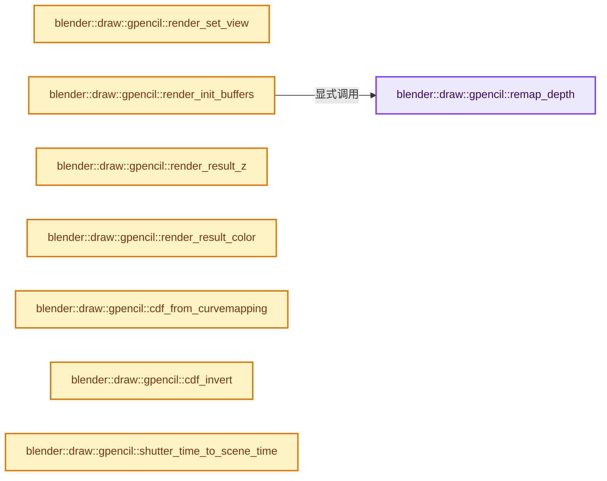

# 实现依赖专题：source/blender/draw/engines/gpencil/gpencil_render.cc

[方向导航](README.md) · [符号索引](../%E7%AC%A6%E5%8F%B7%E4%BE%9D%E8%B5%96%E4%B8%8E%E5%AE%9E%E7%8E%B0%E7%B4%A2%E5%BC%95.md)

本专题从正文实际调用进入，集中保存共享实现。函数有稳定锚点，可从调用处直接跳到对应完整函数；递归与互相调用通过回链组织。

## 本文件的实现关系




## 完整成员与函数实现

<a id="f-6177a10253679901"></a>

### `blender::draw::gpencil::remap_depth`

实现位置：[source/blender/draw/engines/gpencil/gpencil_render.cc](../../../../../source/blender/draw/engines/gpencil/gpencil_render.cc) · L33—L52。

接口参数：

- `const View &view`
- `MutableSpan<float> pix_z`

**教学注释版**

<!-- annotated:5b5efd0b2b638c -->

```cpp
static void remap_depth(const View &view, MutableSpan<float> pix_z)
{
  if (view.is_persp()) {
    const float4x4 &winmat = view.winmat();
    for (auto &pix : pix_z) {
      pix = (-winmat[3][2] / -pix) - winmat[2][2];
      pix = clamp_f(pix * 0.5f + 0.5f, 0.0f, 1.0f);
    }
  }
  else {
    /* Keep in mind, near and far distance are negatives. */
    const float near = view.near_clip();
    const float far = view.far_clip();
    const float range_inv = 1.0f / fabsf(far - near);
    for (auto &pix : pix_z) {
      pix = (pix + near) * range_inv;
      pix = clamp_f(pix, 0.0f, 1.0f);
    }
  }
}
```

<details>
<summary>核对原始源码：source/blender/draw/engines/gpencil/gpencil_render.cc · L33—L52</summary>

<!-- original:5b5efd0b2b638c:source/blender/draw/engines/gpencil/gpencil_render.cc:33:52 -->

```cpp
static void remap_depth(const View &view, MutableSpan<float> pix_z)
{
  if (view.is_persp()) {
    const float4x4 &winmat = view.winmat();
    for (auto &pix : pix_z) {
      pix = (-winmat[3][2] / -pix) - winmat[2][2];
      pix = clamp_f(pix * 0.5f + 0.5f, 0.0f, 1.0f);
    }
  }
  else {
    /* Keep in mind, near and far distance are negatives. */
    const float near = view.near_clip();
    const float far = view.far_clip();
    const float range_inv = 1.0f / fabsf(far - near);
    for (auto &pix : pix_z) {
      pix = (pix + near) * range_inv;
      pix = clamp_f(pix, 0.0f, 1.0f);
    }
  }
}
```

</details>

**沿实际写入检查状态**

- `pix = (-winmat[3][2] / -pix) - winmat[2][2];`
- `pix = clamp_f(pix * 0.5f + 0.5f, 0.0f, 1.0f);`
- `pix = (pix + near) * range_inv;`
- `pix = clamp_f(pix, 0.0f, 1.0f);`

**继续追踪实现**

- `view.is_persp` → [blender::draw::View::is_persp · L93](%E4%BE%9D%E8%B5%96-draw_view-94a480.md#f-d831deec5dae84cd)。
- `view.winmat` → [blender::draw::View::winmat · L148](%E4%BE%9D%E8%B5%96-draw_view-94a480.md#f-b9242a355f7e37dd)。
- `clamp_f` → [blender::clamp_f · L405](../12-%E7%A9%BA%E9%97%B4%E6%95%B0%E6%8D%AE%E7%BB%93%E6%9E%84%E4%B8%8E%E5%87%A0%E4%BD%95%E7%AE%97%E6%B3%95/%E4%BE%9D%E8%B5%96-math_base_inline-546b00.md#f-abaf19ee32d97de2)。
- `view.near_clip` → [blender::draw::View::near_clip · L115](%E4%BE%9D%E8%B5%96-draw_view-94a480.md#f-c0049dde1c431ade)。
- `view.far_clip` → [blender::draw::View::far_clip · L106](%E4%BE%9D%E8%B5%96-draw_view-94a480.md#f-a13e310948ecbe01)。
- `fabsf` → [fabsf · L21](%E4%BE%9D%E8%B5%96-radial_tiling_shared-98abf9.md#m-02cc4c69cfb3)；[fabsf · L43](%E4%BE%9D%E8%B5%96-radial_tiling_shared-98abf9.md#m-04effe61803b)；[fabsf · L74](%E4%BE%9D%E8%B5%96-radial_tiling_shared-98abf9.md#m-927dd4eba7dc)；[fabsf · L25](../01-%E5%9F%BA%E7%A1%80%E5%AE%B9%E5%99%A8%E4%B8%8E%E7%8E%B0%E4%BB%A3CPP/%E4%BE%9D%E8%B5%96-radial_tiling_shared-7989a4.md#m-8348d6b3d08f)；[fabsf · L47](../01-%E5%9F%BA%E7%A1%80%E5%AE%B9%E5%99%A8%E4%B8%8E%E7%8E%B0%E4%BB%A3CPP/%E4%BE%9D%E8%B5%96-radial_tiling_shared-7989a4.md#m-13b7e0b6d84f)；[fabsf · L78](../01-%E5%9F%BA%E7%A1%80%E5%AE%B9%E5%99%A8%E4%B8%8E%E7%8E%B0%E4%BB%A3CPP/%E4%BE%9D%E8%B5%96-radial_tiling_shared-7989a4.md#m-326c83464a0d)；[fabsf · L21](%E4%BE%9D%E8%B5%96-node_radial_tiling_shared-b14bc2.md#m-7c3ee12fc119)；[fabsf · L43](%E4%BE%9D%E8%B5%96-node_radial_tiling_shared-b14bc2.md#m-9112db0e2dd1)；[fabsf · L74](%E4%BE%9D%E8%B5%96-node_radial_tiling_shared-b14bc2.md#m-ee4e61908a6f)；[fabsf · L167](%E4%BE%9D%E8%B5%96-compat-56205c.md#m-b039ee6c1601)；[fabsf · L265](%E4%BE%9D%E8%B5%96-compat-efe0e9.md#m-6b21869e9f3f)。宏定义由构建条件选择。

<a id="f-af38e5deb487ca6f"></a>

### `blender::draw::gpencil::render_set_view`

实现位置：[source/blender/draw/engines/gpencil/gpencil_render.cc](../../../../../source/blender/draw/engines/gpencil/gpencil_render.cc) · L54—L67。

接口参数：

- `RenderEngine *engine`
- `const Depsgraph *depsgraph`
- `const float2 aa_offset = float2{0.0f}`

**教学注释版**

<!-- annotated:7203e0c386076e -->

```cpp
static void render_set_view(RenderEngine *engine,
                            const Depsgraph *depsgraph,
                            const float2 aa_offset = float2{0.0f})
{
  Object *camera = DEG_get_evaluated(depsgraph, RE_GetCamera(engine->re));

  float4x4 winmat, viewinv;
  RE_GetCameraWindow(engine->re, camera, winmat.ptr());
  RE_GetCameraModelMatrix(engine->re, camera, viewinv.ptr());

  window_translate_m4(winmat.ptr(), winmat.ptr(), UNPACK2(aa_offset));

  View::default_set(math::invert(viewinv), winmat);
}
```

<details>
<summary>核对原始源码：source/blender/draw/engines/gpencil/gpencil_render.cc · L54—L67</summary>

<!-- original:7203e0c386076e:source/blender/draw/engines/gpencil/gpencil_render.cc:54:67 -->

```cpp
static void render_set_view(RenderEngine *engine,
                            const Depsgraph *depsgraph,
                            const float2 aa_offset = float2{0.0f})
{
  Object *camera = DEG_get_evaluated(depsgraph, RE_GetCamera(engine->re));

  float4x4 winmat, viewinv;
  RE_GetCameraWindow(engine->re, camera, winmat.ptr());
  RE_GetCameraModelMatrix(engine->re, camera, viewinv.ptr());

  window_translate_m4(winmat.ptr(), winmat.ptr(), UNPACK2(aa_offset));

  View::default_set(math::invert(viewinv), winmat);
}
```

</details>

**继续追踪实现**

- `DEG_get_evaluated` → [blender::DEG_get_evaluated · L106](../11-Depsgraph%E4%B8%8E%E5%B9%B6%E8%A1%8C%E4%BB%BB%E5%8A%A1%E7%B3%BB%E7%BB%9F/%E4%BE%9D%E8%B5%96-DEG_depsgraph_query-db0d31.md#f-e70143fa875363bf)；[blender::DEG_get_evaluated · L112](../11-Depsgraph%E4%B8%8E%E5%B9%B6%E8%A1%8C%E4%BB%BB%E5%8A%A1%E7%B3%BB%E7%BB%9F/%E4%BE%9D%E8%B5%96-DEG_depsgraph_query-db0d31.md#f-129df72cfb5a1bad)。同名重载需按实参类型选择。
- `RE_GetCamera` → [blender::RE_GetCamera · L31](%E4%BE%9D%E8%B5%96-initrender-a27eba.md#f-c1bdb70ff4bf97c0)。
- `RE_GetCameraWindow` → [blender::RE_GetCameraWindow · L62](%E4%BE%9D%E8%B5%96-initrender-a27eba.md#f-01c1ec9fe7ee7242)。
- `winmat.ptr` → [调用协议](../%E6%A8%A1%E6%9D%BF%E5%AE%8F%E4%B8%8E%E5%8A%A8%E6%80%81%E5%88%86%E6%B4%BE%E5%8D%8F%E8%AE%AE.md)：由接收对象具体类型或运行时策略提供实现。调用位置L61。
- `RE_GetCameraModelMatrix` → [blender::RE_GetCameraModelMatrix · L74](%E4%BE%9D%E8%B5%96-initrender-a27eba.md#f-c87579d9293cf439)。
- `viewinv.ptr` → [调用协议](../%E6%A8%A1%E6%9D%BF%E5%AE%8F%E4%B8%8E%E5%8A%A8%E6%80%81%E5%88%86%E6%B4%BE%E5%8D%8F%E8%AE%AE.md)：接收对象类型依赖auto、返回值或模板实例；不按同名猜测目标。调用位置L62。
- `window_translate_m4` → [blender::window_translate_m4 · L4782](../12-%E7%A9%BA%E9%97%B4%E6%95%B0%E6%8D%AE%E7%BB%93%E6%9E%84%E4%B8%8E%E5%87%A0%E4%BD%95%E7%AE%97%E6%B3%95/%E4%BE%9D%E8%B5%96-math_geom-8d91a3.md#f-016299633280aee4)。
- `UNPACK2` → [UNPACK2 · L22](%E4%BE%9D%E8%B5%96-GHOST_utildefines-34b996.md#m-00ad768fe1c1)；[UNPACK2 · L234](../01-%E5%9F%BA%E7%A1%80%E5%AE%B9%E5%99%A8%E4%B8%8E%E7%8E%B0%E4%BB%A3CPP/%E4%BE%9D%E8%B5%96-BLI_utildefines-293a0a.md#m-96ff8266d239)；[UNPACK2 · L13](%E4%BE%9D%E8%B5%96-gpu_shader_utildefines.bsl-e9f199.md#m-8316603fb9a6)。宏定义由构建条件选择。
- `View::default_set` → [blender::draw::View::default_set · L322](%E4%BE%9D%E8%B5%96-draw_view-1762f2.md#f-4028261dbf15aded)。
- `math::invert` → [blender::math::invert · L202](../12-%E7%A9%BA%E9%97%B4%E6%95%B0%E6%8D%AE%E7%BB%93%E6%9E%84%E4%B8%8E%E5%87%A0%E4%BD%95%E7%AE%97%E6%B3%95/%E4%BE%9D%E8%B5%96-math_matrix-d7d8ee.md#f-222be9a4cab433f5)；[blender::math::invert · L234](../12-%E7%A9%BA%E9%97%B4%E6%95%B0%E6%8D%AE%E7%BB%93%E6%9E%84%E4%B8%8E%E5%87%A0%E4%BD%95%E7%AE%97%E6%B3%95/%E4%BE%9D%E8%B5%96-BLI_math_quaternion-cf105d.md#f-7ba965075f461895)；[blender::math::invert · L648](../12-%E7%A9%BA%E9%97%B4%E6%95%B0%E6%8D%AE%E7%BB%93%E6%9E%84%E4%B8%8E%E5%87%A0%E4%BD%95%E7%AE%97%E6%B3%95/%E4%BE%9D%E8%B5%96-BLI_math_matrix-b7b2b4.md#f-2b50b5262b2a9121)；[blender::math::invert · L460](../12-%E7%A9%BA%E9%97%B4%E6%95%B0%E6%8D%AE%E7%BB%93%E6%9E%84%E4%B8%8E%E5%87%A0%E4%BD%95%E7%AE%97%E6%B3%95/%E4%BE%9D%E8%B5%96-BLI_math_basis_types-fc7090.md#f-76b56b37f151208d)。同名重载需按实参类型选择。

<a id="f-e09ed948c886161f"></a>

### `blender::draw::gpencil::render_init_buffers`

实现位置：[source/blender/draw/engines/gpencil/gpencil_render.cc](../../../../../source/blender/draw/engines/gpencil/gpencil_render.cc) · L69—L155。

接口参数：

- `const DRWContext *draw_ctx`
- `Instance &inst`
- `RenderEngine *engine`
- `RenderLayer *render_layer`
- `const rcti *rect`
- `const bool use_separated_pass`

**教学注释版**

<!-- annotated:37eeacb0536fef -->

```cpp
static void render_init_buffers(const DRWContext *draw_ctx,
                                Instance &inst,
                                RenderEngine *engine,
                                RenderLayer *render_layer,
                                const rcti *rect,
                                const bool use_separated_pass)
{
  const int2 size = int2(draw_ctx->viewport_size_get());
  View &view = View::default_get();

  /* Create depth texture & color texture from render result. */
  const char *viewname = RE_GetActiveRenderView(engine->re);
  RenderPass *rpass_z_src = RE_pass_find_by_name(render_layer, RE_PASSNAME_DEPTH, viewname);
  RenderPass *rpass_col_src = RE_pass_find_by_name(render_layer, RE_PASSNAME_COMBINED, viewname);

  float *pix_z = (rpass_z_src) ? rpass_z_src->ibuf->float_data_for_write() : nullptr;
  float *pix_col = (rpass_col_src) ? rpass_col_src->ibuf->float_data_for_write() : nullptr;

  if (!pix_z || !pix_col) {
    RE_engine_set_error_message(engine,
                                "Warning: To correctly render occluded Grease Pencil objects, "
                                "enable Combined and Depth passes.");
  }

  if (pix_z) {
    /* Depth need to be remapped to [0..1] range. */
    pix_z = MEM_dupalloc(pix_z);
    remap_depth(view, {pix_z, rpass_z_src->rectx * rpass_z_src->recty});
  }

  const bool has_full_rect = (rect->xmin == 0 && rect->ymin == 0 && rect->xmax == size.x &&
                              rect->ymax == size.y);
  const bool do_region = !use_separated_pass && !has_full_rect;
  const bool do_clear_z = !pix_z || do_region;
  const bool do_clear_col = use_separated_pass || (!pix_col) || do_region;

  /* FIXME(fclem): we have a precision loss in the depth buffer because of this re-upload.
   * Find where it comes from! */
  /* In multi view render the textures can be reused. */
  if (inst.render_depth_tx.is_valid() && !do_clear_z && has_full_rect) {
    GPU_texture_update(inst.render_depth_tx, GPU_DATA_FLOAT, pix_z);
  }
  else {
    eGPUTextureUsage usage = GPU_TEXTURE_USAGE_SHADER_READ | GPU_TEXTURE_USAGE_ATTACHMENT |
                             GPU_TEXTURE_USAGE_HOST_READ;
    inst.render_depth_tx.ensure_2d(
        gpu::TextureFormat::SFLOAT_32_DEPTH, int2(size), usage, do_region ? nullptr : pix_z);
  }
  if (inst.render_color_tx.is_valid() && !do_clear_col && has_full_rect) {
    GPU_texture_update(inst.render_color_tx, GPU_DATA_FLOAT, pix_col);
  }
  else {
    eGPUTextureUsage usage = GPU_TEXTURE_USAGE_SHADER_READ | GPU_TEXTURE_USAGE_ATTACHMENT |
                             GPU_TEXTURE_USAGE_HOST_READ;
    inst.render_color_tx.ensure_2d(
        gpu::TextureFormat::SFLOAT_16_16_16_16, int2(size), usage, do_region ? nullptr : pix_col);
  }

  inst.render_fb.ensure(GPU_ATTACHMENT_TEXTURE(inst.render_depth_tx),
                        GPU_ATTACHMENT_TEXTURE(inst.render_color_tx));

  if (do_clear_z || do_clear_col) {
    /* To avoid unpredictable result, clear buffers that have not be initialized. */
    GPU_framebuffer_bind(inst.render_fb);
    if (do_clear_col) {
      GPU_framebuffer_clear_color(inst.render_fb, {0.0, 0.0, 0.0, 0.0});
    }
    if (do_clear_z) {
      GPU_framebuffer_clear_depth(inst.render_fb, 1.0f);
    }
  }

  if (do_region) {
    int x = rect->xmin;
    int y = rect->ymin;
    int w = BLI_rcti_size_x(rect);
    int h = BLI_rcti_size_y(rect);
    if (pix_col) {
      GPU_texture_update_sub(inst.render_color_tx, GPU_DATA_FLOAT, pix_col, x, y, 0, w, h, 0);
    }
    if (pix_z) {
      GPU_texture_update_sub(inst.render_depth_tx, GPU_DATA_FLOAT, pix_z, x, y, 0, w, h, 0);
    }
  }

  MEM_SAFE_DELETE(pix_z);
}
```

<details>
<summary>核对原始源码：source/blender/draw/engines/gpencil/gpencil_render.cc · L69—L155</summary>

<!-- original:37eeacb0536fef:source/blender/draw/engines/gpencil/gpencil_render.cc:69:155 -->

```cpp
static void render_init_buffers(const DRWContext *draw_ctx,
                                Instance &inst,
                                RenderEngine *engine,
                                RenderLayer *render_layer,
                                const rcti *rect,
                                const bool use_separated_pass)
{
  const int2 size = int2(draw_ctx->viewport_size_get());
  View &view = View::default_get();

  /* Create depth texture & color texture from render result. */
  const char *viewname = RE_GetActiveRenderView(engine->re);
  RenderPass *rpass_z_src = RE_pass_find_by_name(render_layer, RE_PASSNAME_DEPTH, viewname);
  RenderPass *rpass_col_src = RE_pass_find_by_name(render_layer, RE_PASSNAME_COMBINED, viewname);

  float *pix_z = (rpass_z_src) ? rpass_z_src->ibuf->float_data_for_write() : nullptr;
  float *pix_col = (rpass_col_src) ? rpass_col_src->ibuf->float_data_for_write() : nullptr;

  if (!pix_z || !pix_col) {
    RE_engine_set_error_message(engine,
                                "Warning: To correctly render occluded Grease Pencil objects, "
                                "enable Combined and Depth passes.");
  }

  if (pix_z) {
    /* Depth need to be remapped to [0..1] range. */
    pix_z = MEM_dupalloc(pix_z);
    remap_depth(view, {pix_z, rpass_z_src->rectx * rpass_z_src->recty});
  }

  const bool has_full_rect = (rect->xmin == 0 && rect->ymin == 0 && rect->xmax == size.x &&
                              rect->ymax == size.y);
  const bool do_region = !use_separated_pass && !has_full_rect;
  const bool do_clear_z = !pix_z || do_region;
  const bool do_clear_col = use_separated_pass || (!pix_col) || do_region;

  /* FIXME(fclem): we have a precision loss in the depth buffer because of this re-upload.
   * Find where it comes from! */
  /* In multi view render the textures can be reused. */
  if (inst.render_depth_tx.is_valid() && !do_clear_z && has_full_rect) {
    GPU_texture_update(inst.render_depth_tx, GPU_DATA_FLOAT, pix_z);
  }
  else {
    eGPUTextureUsage usage = GPU_TEXTURE_USAGE_SHADER_READ | GPU_TEXTURE_USAGE_ATTACHMENT |
                             GPU_TEXTURE_USAGE_HOST_READ;
    inst.render_depth_tx.ensure_2d(
        gpu::TextureFormat::SFLOAT_32_DEPTH, int2(size), usage, do_region ? nullptr : pix_z);
  }
  if (inst.render_color_tx.is_valid() && !do_clear_col && has_full_rect) {
    GPU_texture_update(inst.render_color_tx, GPU_DATA_FLOAT, pix_col);
  }
  else {
    eGPUTextureUsage usage = GPU_TEXTURE_USAGE_SHADER_READ | GPU_TEXTURE_USAGE_ATTACHMENT |
                             GPU_TEXTURE_USAGE_HOST_READ;
    inst.render_color_tx.ensure_2d(
        gpu::TextureFormat::SFLOAT_16_16_16_16, int2(size), usage, do_region ? nullptr : pix_col);
  }

  inst.render_fb.ensure(GPU_ATTACHMENT_TEXTURE(inst.render_depth_tx),
                        GPU_ATTACHMENT_TEXTURE(inst.render_color_tx));

  if (do_clear_z || do_clear_col) {
    /* To avoid unpredictable result, clear buffers that have not be initialized. */
    GPU_framebuffer_bind(inst.render_fb);
    if (do_clear_col) {
      GPU_framebuffer_clear_color(inst.render_fb, {0.0, 0.0, 0.0, 0.0});
    }
    if (do_clear_z) {
      GPU_framebuffer_clear_depth(inst.render_fb, 1.0f);
    }
  }

  if (do_region) {
    int x = rect->xmin;
    int y = rect->ymin;
    int w = BLI_rcti_size_x(rect);
    int h = BLI_rcti_size_y(rect);
    if (pix_col) {
      GPU_texture_update_sub(inst.render_color_tx, GPU_DATA_FLOAT, pix_col, x, y, 0, w, h, 0);
    }
    if (pix_z) {
      GPU_texture_update_sub(inst.render_depth_tx, GPU_DATA_FLOAT, pix_z, x, y, 0, w, h, 0);
    }
  }

  MEM_SAFE_DELETE(pix_z);
}
```

</details>

**沿实际写入检查状态**

- `pix_z = MEM_dupalloc(pix_z);`

**继续追踪实现**

- `int2` → [int2 · L643](%E4%BE%9D%E8%B5%96-smaa-b67bc2.md#m-8960c8e6139d)。宏定义由构建条件选择。
- `draw_ctx->viewport_size_get` → [blender::DRWContext::viewport_size_get · L405](%E4%BE%9D%E8%B5%96-DRW_render-2c5210.md#f-ad70e0f99f77aa24)。
- `View::default_get` → [blender::draw::View::default_get · L317](%E4%BE%9D%E8%B5%96-draw_view-1762f2.md#f-1edfe36a27ed8fa6)。
- `RE_GetActiveRenderView` → [blender::RE_GetActiveRenderView · L1875](%E4%BE%9D%E8%B5%96-pipeline-340e5b.md#f-b0ba993700cb386b)。
- `RE_pass_find_by_name` → [blender::RE_pass_find_by_name · L2891](%E4%BE%9D%E8%B5%96-pipeline-340e5b.md#f-a7386bb28c89daf6)。
- `rpass_z_src->ibuf->float_data_for_write` → [调用协议](../%E6%A8%A1%E6%9D%BF%E5%AE%8F%E4%B8%8E%E5%8A%A8%E6%80%81%E5%88%86%E6%B4%BE%E5%8D%8F%E8%AE%AE.md)：接收对象类型依赖auto、返回值或模板实例；不按同名猜测目标。调用位置L84。
- `rpass_col_src->ibuf->float_data_for_write` → [调用协议](../%E6%A8%A1%E6%9D%BF%E5%AE%8F%E4%B8%8E%E5%8A%A8%E6%80%81%E5%88%86%E6%B4%BE%E5%8D%8F%E8%AE%AE.md)：接收对象类型依赖auto、返回值或模板实例；不按同名猜测目标。调用位置L85。
- `RE_engine_set_error_message` → [blender::RE_engine_set_error_message · L554](%E4%BE%9D%E8%B5%96-engine-ac0ebe.md#f-c4eddc952e8741a1)。
- `MEM_dupalloc` → [MEM_dupalloc · L627](../03-%E5%86%85%E5%AD%98%E5%88%86%E9%85%8D%E4%B8%8E%E8%BF%90%E8%A1%8C%E6%97%B6%E7%B1%BB%E5%9E%8B/%E4%BE%9D%E8%B5%96-MEM_guardedalloc-b54eca.md#f-78a72b71e3c57010)。
- `remap_depth` → [blender::draw::gpencil::remap_depth · L33](%E4%BE%9D%E8%B5%96-gpencil_render-5d293a.md#f-6177a10253679901)。
- `inst.render_depth_tx.is_valid` → [调用协议](../%E6%A8%A1%E6%9D%BF%E5%AE%8F%E4%B8%8E%E5%8A%A8%E6%80%81%E5%88%86%E6%B4%BE%E5%8D%8F%E8%AE%AE.md)：接收对象类型依赖auto、返回值或模板实例；不按同名猜测目标。调用位置L108。
- `GPU_texture_update` → [blender::GPU_texture_update · L619](%E4%BE%9D%E8%B5%96-gpu_texture-234bda.md#f-4a6c14a1d8e5e73e)。
- `inst.render_depth_tx.ensure_2d` → [调用协议](../%E6%A8%A1%E6%9D%BF%E5%AE%8F%E4%B8%8E%E5%8A%A8%E6%80%81%E5%88%86%E6%B4%BE%E5%8D%8F%E8%AE%AE.md)：接收对象类型依赖auto、返回值或模板实例；不按同名猜测目标。调用位置L114。
- `inst.render_color_tx.is_valid` → [调用协议](../%E6%A8%A1%E6%9D%BF%E5%AE%8F%E4%B8%8E%E5%8A%A8%E6%80%81%E5%88%86%E6%B4%BE%E5%8D%8F%E8%AE%AE.md)：接收对象类型依赖auto、返回值或模板实例；不按同名猜测目标。调用位置L117。
- `inst.render_color_tx.ensure_2d` → [调用协议](../%E6%A8%A1%E6%9D%BF%E5%AE%8F%E4%B8%8E%E5%8A%A8%E6%80%81%E5%88%86%E6%B4%BE%E5%8D%8F%E8%AE%AE.md)：接收对象类型依赖auto、返回值或模板实例；不按同名猜测目标。调用位置L123。
- `inst.render_fb.ensure` → [调用协议](../%E6%A8%A1%E6%9D%BF%E5%AE%8F%E4%B8%8E%E5%8A%A8%E6%80%81%E5%88%86%E6%B4%BE%E5%8D%8F%E8%AE%AE.md)：接收对象类型依赖auto、返回值或模板实例；不按同名猜测目标。调用位置L127。
- `GPU_ATTACHMENT_TEXTURE` → [GPU_ATTACHMENT_TEXTURE · L275](%E4%BE%9D%E8%B5%96-GPU_framebuffer-faa4bc.md#m-8822354717b4)。宏定义由构建条件选择。
- `GPU_framebuffer_bind` → [blender::GPU_framebuffer_bind · L245](%E4%BE%9D%E8%B5%96-gpu_framebuffer-cfe3fe.md#f-0d0c4adf5c9771fd)。
- `GPU_framebuffer_clear_color` → [blender::GPU_framebuffer_clear_color · L471](%E4%BE%9D%E8%B5%96-gpu_framebuffer-cfe3fe.md#f-f3d83793fb50a69e)。
- `GPU_framebuffer_clear_depth` → [blender::GPU_framebuffer_clear_depth · L476](%E4%BE%9D%E8%B5%96-gpu_framebuffer-cfe3fe.md#f-8e9737dcb05d7088)。
- `BLI_rcti_size_x` → [blender::BLI_rcti_size_x · L203](../01-%E5%9F%BA%E7%A1%80%E5%AE%B9%E5%99%A8%E4%B8%8E%E7%8E%B0%E4%BB%A3CPP/%E4%BE%9D%E8%B5%96-BLI_rect-2996c6.md#f-7a8fb2c54a829be6)。
- `BLI_rcti_size_y` → [blender::BLI_rcti_size_y · L207](../01-%E5%9F%BA%E7%A1%80%E5%AE%B9%E5%99%A8%E4%B8%8E%E7%8E%B0%E4%BB%A3CPP/%E4%BE%9D%E8%B5%96-BLI_rect-2996c6.md#f-ac87d6c708d502ad)。
- `GPU_texture_update_sub` → [blender::GPU_texture_update_sub · L507](%E4%BE%9D%E8%B5%96-gpu_texture-234bda.md#f-2c901e7b4602b08e)。
- `MEM_SAFE_DELETE` → [MEM_SAFE_DELETE · L436](../03-%E5%86%85%E5%AD%98%E5%88%86%E9%85%8D%E4%B8%8E%E8%BF%90%E8%A1%8C%E6%97%B6%E7%B1%BB%E5%9E%8B/%E4%BE%9D%E8%B5%96-MEM_guardedalloc-b54eca.md#m-eadb3bc5b902)。宏定义由构建条件选择。

<a id="f-d660f92c51d51259"></a>

### `blender::draw::gpencil::render_result_z`

实现位置：[source/blender/draw/engines/gpencil/gpencil_render.cc](../../../../../source/blender/draw/engines/gpencil/gpencil_render.cc) · L157—L215。

接口参数：

- `const DRWContext *draw_ctx`
- `RenderLayer *rl`
- `const char *viewname`
- `Instance &instance`
- `const rcti *rect`

**教学注释版**

<!-- annotated:a55ad5ec643bd1 -->

```cpp
static void render_result_z(const DRWContext *draw_ctx,
                            RenderLayer *rl,
                            const char *viewname,
                            Instance &instance,
                            const rcti *rect)
{
  ViewLayer *view_layer = draw_ctx->view_layer;
  if ((view_layer->passflag & SCE_PASS_DEPTH) == 0) {
    return;
  }
  RenderPass *rp = RE_pass_find_by_name(rl, RE_PASSNAME_DEPTH, viewname);
  if (rp == nullptr) {
    return;
  }

  float *ro_buffer_data = rp->ibuf->float_data_for_write();

  GPU_framebuffer_read_depth(instance.render_fb,
                             rect->xmin,
                             rect->ymin,
                             BLI_rcti_size_x(rect),
                             BLI_rcti_size_y(rect),
                             GPU_DATA_FLOAT,
                             ro_buffer_data);

  float4x4 winmat = View::default_get().winmat();

  int pix_num = BLI_rcti_size_x(rect) * BLI_rcti_size_y(rect);

  /* Convert GPU depth [0..1] to view Z [near..far] */
  if (View::default_get().is_persp()) {
    for (int i = 0; i < pix_num; i++) {
      if (ro_buffer_data[i] == 1.0f) {
        ro_buffer_data[i] = 1e10f; /* Background */
      }
      else {
        ro_buffer_data[i] = ro_buffer_data[i] * 2.0f - 1.0f;
        ro_buffer_data[i] = winmat[3][2] / (ro_buffer_data[i] + winmat[2][2]);
      }
    }
  }
  else {
    /* Keep in mind, near and far distance are negatives. */
    float near = View::default_get().near_clip();
    float far = View::default_get().far_clip();
    float range = fabsf(far - near);

    for (int i = 0; i < pix_num; i++) {
      if (ro_buffer_data[i] == 1.0f) {
        ro_buffer_data[i] = 1e10f; /* Background */
      }
      else {
        ro_buffer_data[i] = ro_buffer_data[i] * range - near;
      }
    }
  }

  IMB_partial_update_mark_full(rp->ibuf);
}
```

<details>
<summary>核对原始源码：source/blender/draw/engines/gpencil/gpencil_render.cc · L157—L215</summary>

<!-- original:a55ad5ec643bd1:source/blender/draw/engines/gpencil/gpencil_render.cc:157:215 -->

```cpp
static void render_result_z(const DRWContext *draw_ctx,
                            RenderLayer *rl,
                            const char *viewname,
                            Instance &instance,
                            const rcti *rect)
{
  ViewLayer *view_layer = draw_ctx->view_layer;
  if ((view_layer->passflag & SCE_PASS_DEPTH) == 0) {
    return;
  }
  RenderPass *rp = RE_pass_find_by_name(rl, RE_PASSNAME_DEPTH, viewname);
  if (rp == nullptr) {
    return;
  }

  float *ro_buffer_data = rp->ibuf->float_data_for_write();

  GPU_framebuffer_read_depth(instance.render_fb,
                             rect->xmin,
                             rect->ymin,
                             BLI_rcti_size_x(rect),
                             BLI_rcti_size_y(rect),
                             GPU_DATA_FLOAT,
                             ro_buffer_data);

  float4x4 winmat = View::default_get().winmat();

  int pix_num = BLI_rcti_size_x(rect) * BLI_rcti_size_y(rect);

  /* Convert GPU depth [0..1] to view Z [near..far] */
  if (View::default_get().is_persp()) {
    for (int i = 0; i < pix_num; i++) {
      if (ro_buffer_data[i] == 1.0f) {
        ro_buffer_data[i] = 1e10f; /* Background */
      }
      else {
        ro_buffer_data[i] = ro_buffer_data[i] * 2.0f - 1.0f;
        ro_buffer_data[i] = winmat[3][2] / (ro_buffer_data[i] + winmat[2][2]);
      }
    }
  }
  else {
    /* Keep in mind, near and far distance are negatives. */
    float near = View::default_get().near_clip();
    float far = View::default_get().far_clip();
    float range = fabsf(far - near);

    for (int i = 0; i < pix_num; i++) {
      if (ro_buffer_data[i] == 1.0f) {
        ro_buffer_data[i] = 1e10f; /* Background */
      }
      else {
        ro_buffer_data[i] = ro_buffer_data[i] * range - near;
      }
    }
  }

  IMB_partial_update_mark_full(rp->ibuf);
}
```

</details>

**沿实际写入检查状态**

- `ro_buffer_data[i] = 1e10f; /* Background */`
- `ro_buffer_data[i] = ro_buffer_data[i] * 2.0f - 1.0f;`
- `ro_buffer_data[i] = winmat[3][2] / (ro_buffer_data[i] + winmat[2][2]);`
- `ro_buffer_data[i] = ro_buffer_data[i] * range - near;`

**继续追踪实现**

- `RE_pass_find_by_name` → [blender::RE_pass_find_by_name · L2891](%E4%BE%9D%E8%B5%96-pipeline-340e5b.md#f-a7386bb28c89daf6)。
- `rp->ibuf->float_data_for_write` → [调用协议](../%E6%A8%A1%E6%9D%BF%E5%AE%8F%E4%B8%8E%E5%8A%A8%E6%80%81%E5%88%86%E6%B4%BE%E5%8D%8F%E8%AE%AE.md)：接收对象类型依赖auto、返回值或模板实例；不按同名猜测目标。调用位置L172。
- `GPU_framebuffer_read_depth` → [blender::GPU_framebuffer_read_depth · L545](%E4%BE%9D%E8%B5%96-gpu_framebuffer-cfe3fe.md#f-7094292a5a064ad9)。
- `BLI_rcti_size_x` → [blender::BLI_rcti_size_x · L203](../01-%E5%9F%BA%E7%A1%80%E5%AE%B9%E5%99%A8%E4%B8%8E%E7%8E%B0%E4%BB%A3CPP/%E4%BE%9D%E8%B5%96-BLI_rect-2996c6.md#f-7a8fb2c54a829be6)。
- `BLI_rcti_size_y` → [blender::BLI_rcti_size_y · L207](../01-%E5%9F%BA%E7%A1%80%E5%AE%B9%E5%99%A8%E4%B8%8E%E7%8E%B0%E4%BB%A3CPP/%E4%BE%9D%E8%B5%96-BLI_rect-2996c6.md#f-ac87d6c708d502ad)。
- `View::default_get().winmat` → [调用协议](../%E6%A8%A1%E6%9D%BF%E5%AE%8F%E4%B8%8E%E5%8A%A8%E6%80%81%E5%88%86%E6%B4%BE%E5%8D%8F%E8%AE%AE.md)：接收对象类型依赖auto、返回值或模板实例；不按同名猜测目标。调用位置L182。
- `View::default_get` → [blender::draw::View::default_get · L317](%E4%BE%9D%E8%B5%96-draw_view-1762f2.md#f-1edfe36a27ed8fa6)。
- `View::default_get().is_persp` → [调用协议](../%E6%A8%A1%E6%9D%BF%E5%AE%8F%E4%B8%8E%E5%8A%A8%E6%80%81%E5%88%86%E6%B4%BE%E5%8D%8F%E8%AE%AE.md)：接收对象类型依赖auto、返回值或模板实例；不按同名猜测目标。调用位置L187。
- `View::default_get().near_clip` → [调用协议](../%E6%A8%A1%E6%9D%BF%E5%AE%8F%E4%B8%8E%E5%8A%A8%E6%80%81%E5%88%86%E6%B4%BE%E5%8D%8F%E8%AE%AE.md)：接收对象类型依赖auto、返回值或模板实例；不按同名猜测目标。调用位置L200。
- `View::default_get().far_clip` → [调用协议](../%E6%A8%A1%E6%9D%BF%E5%AE%8F%E4%B8%8E%E5%8A%A8%E6%80%81%E5%88%86%E6%B4%BE%E5%8D%8F%E8%AE%AE.md)：接收对象类型依赖auto、返回值或模板实例；不按同名猜测目标。调用位置L201。
- `fabsf` → [fabsf · L21](%E4%BE%9D%E8%B5%96-radial_tiling_shared-98abf9.md#m-02cc4c69cfb3)；[fabsf · L43](%E4%BE%9D%E8%B5%96-radial_tiling_shared-98abf9.md#m-04effe61803b)；[fabsf · L74](%E4%BE%9D%E8%B5%96-radial_tiling_shared-98abf9.md#m-927dd4eba7dc)；[fabsf · L25](../01-%E5%9F%BA%E7%A1%80%E5%AE%B9%E5%99%A8%E4%B8%8E%E7%8E%B0%E4%BB%A3CPP/%E4%BE%9D%E8%B5%96-radial_tiling_shared-7989a4.md#m-8348d6b3d08f)；[fabsf · L47](../01-%E5%9F%BA%E7%A1%80%E5%AE%B9%E5%99%A8%E4%B8%8E%E7%8E%B0%E4%BB%A3CPP/%E4%BE%9D%E8%B5%96-radial_tiling_shared-7989a4.md#m-13b7e0b6d84f)；[fabsf · L78](../01-%E5%9F%BA%E7%A1%80%E5%AE%B9%E5%99%A8%E4%B8%8E%E7%8E%B0%E4%BB%A3CPP/%E4%BE%9D%E8%B5%96-radial_tiling_shared-7989a4.md#m-326c83464a0d)；[fabsf · L21](%E4%BE%9D%E8%B5%96-node_radial_tiling_shared-b14bc2.md#m-7c3ee12fc119)；[fabsf · L43](%E4%BE%9D%E8%B5%96-node_radial_tiling_shared-b14bc2.md#m-9112db0e2dd1)；[fabsf · L74](%E4%BE%9D%E8%B5%96-node_radial_tiling_shared-b14bc2.md#m-ee4e61908a6f)；[fabsf · L167](%E4%BE%9D%E8%B5%96-compat-56205c.md#m-b039ee6c1601)；[fabsf · L265](%E4%BE%9D%E8%B5%96-compat-efe0e9.md#m-6b21869e9f3f)。宏定义由构建条件选择。
- `IMB_partial_update_mark_full` → [blender::IMB_partial_update_mark_full · L410](%E4%BE%9D%E8%B5%96-partial_update-895ded.md#f-7ee797d1ebd80468)。

<a id="f-775296df700c6268"></a>

### `blender::draw::gpencil::render_result_color`

实现位置：[source/blender/draw/engines/gpencil/gpencil_render.cc](../../../../../source/blender/draw/engines/gpencil/gpencil_render.cc) · L217—L233。

接口参数：

- `ImBuf *ibuf`
- `Instance &instance`
- `const rcti *rect`

**教学注释版**

<!-- annotated:5728af2db7e394 -->

```cpp
static void render_result_color(ImBuf *ibuf, Instance &instance, const rcti *rect)
{
  Framebuffer read_fb;
  read_fb.ensure(GPU_ATTACHMENT_NONE, GPU_ATTACHMENT_TEXTURE(instance.accumulation_tx));
  GPU_framebuffer_bind(read_fb);
  GPU_framebuffer_read_color(read_fb,
                             rect->xmin,
                             rect->ymin,
                             BLI_rcti_size_x(rect),
                             BLI_rcti_size_y(rect),
                             4,
                             0,
                             GPU_DATA_FLOAT,
                             ibuf->float_data_for_write());

  IMB_partial_update_mark_full(ibuf);
}
```

<details>
<summary>核对原始源码：source/blender/draw/engines/gpencil/gpencil_render.cc · L217—L233</summary>

<!-- original:5728af2db7e394:source/blender/draw/engines/gpencil/gpencil_render.cc:217:233 -->

```cpp
static void render_result_color(ImBuf *ibuf, Instance &instance, const rcti *rect)
{
  Framebuffer read_fb;
  read_fb.ensure(GPU_ATTACHMENT_NONE, GPU_ATTACHMENT_TEXTURE(instance.accumulation_tx));
  GPU_framebuffer_bind(read_fb);
  GPU_framebuffer_read_color(read_fb,
                             rect->xmin,
                             rect->ymin,
                             BLI_rcti_size_x(rect),
                             BLI_rcti_size_y(rect),
                             4,
                             0,
                             GPU_DATA_FLOAT,
                             ibuf->float_data_for_write());

  IMB_partial_update_mark_full(ibuf);
}
```

</details>

**继续追踪实现**

- `read_fb.ensure` → [Framebuffer::ensure · L1349](%E4%BE%9D%E8%B5%96-DRW_gpu_wrapper-c80c4f.md#f-131ae5493b8e8eb3)；[Framebuffer::ensure · L1370](%E4%BE%9D%E8%B5%96-DRW_gpu_wrapper-c80c4f.md#f-83c4714b059ed873)。同名重载需按实参类型选择。
- `GPU_ATTACHMENT_TEXTURE` → [GPU_ATTACHMENT_TEXTURE · L275](%E4%BE%9D%E8%B5%96-GPU_framebuffer-faa4bc.md#m-8822354717b4)。宏定义由构建条件选择。
- `GPU_framebuffer_bind` → [blender::GPU_framebuffer_bind · L245](%E4%BE%9D%E8%B5%96-gpu_framebuffer-cfe3fe.md#f-0d0c4adf5c9771fd)。
- `GPU_framebuffer_read_color` → [blender::GPU_framebuffer_read_color · L552](%E4%BE%9D%E8%B5%96-gpu_framebuffer-cfe3fe.md#f-672dd1244a1b9ff0)。
- `BLI_rcti_size_x` → [blender::BLI_rcti_size_x · L203](../01-%E5%9F%BA%E7%A1%80%E5%AE%B9%E5%99%A8%E4%B8%8E%E7%8E%B0%E4%BB%A3CPP/%E4%BE%9D%E8%B5%96-BLI_rect-2996c6.md#f-7a8fb2c54a829be6)。
- `BLI_rcti_size_y` → [blender::BLI_rcti_size_y · L207](../01-%E5%9F%BA%E7%A1%80%E5%AE%B9%E5%99%A8%E4%B8%8E%E7%8E%B0%E4%BB%A3CPP/%E4%BE%9D%E8%B5%96-BLI_rect-2996c6.md#f-ac87d6c708d502ad)。
- `ibuf->float_data_for_write` → [blender::ImBuf::float_data_for_write · L79](%E4%BE%9D%E8%B5%96-allocimbuf-bc68dd.md#f-1956ac4db88ed3eb)。
- `IMB_partial_update_mark_full` → [blender::IMB_partial_update_mark_full · L410](%E4%BE%9D%E8%B5%96-partial_update-895ded.md#f-7ee797d1ebd80468)。

<a id="f-8185612c9a51a2d1"></a>

### `blender::draw::gpencil::cdf_from_curvemapping`

实现位置：[source/blender/draw/engines/gpencil/gpencil_render.cc](../../../../../source/blender/draw/engines/gpencil/gpencil_render.cc) · L236—L251。

接口参数：

- `const CurveMapping &curve`
- `Array<float> &cdf`

**教学注释版**

<!-- annotated:4b7acb9459f482 -->

```cpp
static void cdf_from_curvemapping(const CurveMapping &curve, Array<float> &cdf)
{
  // [讲解] cdf.size：查询固定有效长度及其索引范围。
  BLI_assert(cdf.size() > 1);
  cdf[0] = 0.0f;
  /* Actual CDF evaluation. */
  for (const int u : IndexRange(cdf.size() - 1)) {
    const float x = float(u + 1) / float(cdf.size() - 1);
    cdf[u + 1] = cdf[u] + BKE_curvemapping_evaluateF(&curve, 0, x);
  }
  /* Normalize the CDF. */
  // [讲解] cdf.index_range：查询固定有效长度及其索引范围。
  for (const int u : cdf.index_range()) {
    cdf[u] /= cdf.last();
  }
  /* Just to make sure. */
  cdf.last() = 1.0f;
}
```

<details>
<summary>核对原始源码：source/blender/draw/engines/gpencil/gpencil_render.cc · L236—L251</summary>

<!-- original:4b7acb9459f482:source/blender/draw/engines/gpencil/gpencil_render.cc:236:251 -->

```cpp
static void cdf_from_curvemapping(const CurveMapping &curve, Array<float> &cdf)
{
  BLI_assert(cdf.size() > 1);
  cdf[0] = 0.0f;
  /* Actual CDF evaluation. */
  for (const int u : IndexRange(cdf.size() - 1)) {
    const float x = float(u + 1) / float(cdf.size() - 1);
    cdf[u + 1] = cdf[u] + BKE_curvemapping_evaluateF(&curve, 0, x);
  }
  /* Normalize the CDF. */
  for (const int u : cdf.index_range()) {
    cdf[u] /= cdf.last();
  }
  /* Just to make sure. */
  cdf.last() = 1.0f;
}
```

</details>

**沿实际写入检查状态**

- `cdf[0] = 0.0f;`

**继续追踪实现**

- `BLI_assert` → [BLI_assert · L48](../01-%E5%9F%BA%E7%A1%80%E5%AE%B9%E5%99%A8%E4%B8%8E%E7%8E%B0%E4%BB%A3CPP/%E4%BE%9D%E8%B5%96-BLI_assert-cc98e8.md#m-57a88495704d)；[BLI_assert · L63](../01-%E5%9F%BA%E7%A1%80%E5%AE%B9%E5%99%A8%E4%B8%8E%E7%8E%B0%E4%BB%A3CPP/%E4%BE%9D%E8%B5%96-BLI_assert-cc98e8.md#m-d07050020cb5)。宏定义由构建条件选择。
- `cdf.size` → [blender::Array::size · L267](../01-%E5%9F%BA%E7%A1%80%E5%AE%B9%E5%99%A8%E4%B8%8E%E7%8E%B0%E4%BB%A3CPP/08-Array%E5%A4%8D%E5%88%B6%E7%A7%BB%E5%8A%A8%E4%B8%8E%E9%94%80%E6%AF%81.md#f-c13f1b5a44f423b2)。
- `IndexRange` → [blender::IndexRange](../01-%E5%9F%BA%E7%A1%80%E5%AE%B9%E5%99%A8%E4%B8%8E%E7%8E%B0%E4%BB%A3CPP/%E4%BE%9D%E8%B5%96-BLI_index_range-7d7cc5.md#t-caa3466d6776)；[blender::gpu::shader::parser::IndexRange](%E4%BE%9D%E8%B5%96-utils-06433d.md#t-82d2bd4ea71c)；[blender::IndexRange](%E4%BE%9D%E8%B5%96-DNA_node_types-6708b9.md#t-0448cc889d39)。
- `BKE_curvemapping_evaluateF` → [blender::BKE_curvemapping_evaluateF · L1177](%E4%BE%9D%E8%B5%96-colortools-8bc37a.md#f-014584e04eeb1392)。
- `cdf.index_range` → [blender::Array::index_range · L371](../01-%E5%9F%BA%E7%A1%80%E5%AE%B9%E5%99%A8%E4%B8%8E%E7%8E%B0%E4%BB%A3CPP/08-Array%E5%A4%8D%E5%88%B6%E7%A7%BB%E5%8A%A8%E4%B8%8E%E9%94%80%E6%AF%81.md#f-50a09e14742887a0)。
- `cdf.last` → [blender::Array::last · L307](../01-%E5%9F%BA%E7%A1%80%E5%AE%B9%E5%99%A8%E4%B8%8E%E7%8E%B0%E4%BB%A3CPP/08-Array%E5%A4%8D%E5%88%B6%E7%A7%BB%E5%8A%A8%E4%B8%8E%E9%94%80%E6%AF%81.md#f-022e4eec5e52edfe)；[blender::Array::last · L313](../01-%E5%9F%BA%E7%A1%80%E5%AE%B9%E5%99%A8%E4%B8%8E%E7%8E%B0%E4%BB%A3CPP/08-Array%E5%A4%8D%E5%88%B6%E7%A7%BB%E5%8A%A8%E4%B8%8E%E9%94%80%E6%AF%81.md#f-5026b1478e15b195)。同名重载需按实参类型选择。

<a id="f-ecc4206b4c7d9323"></a>

### `blender::draw::gpencil::cdf_invert`

实现位置：[source/blender/draw/engines/gpencil/gpencil_render.cc](../../../../../source/blender/draw/engines/gpencil/gpencil_render.cc) · L254—L267。

接口参数：

- `Array<float> &cdf`
- `Array<float> &inverted_cdf`

**教学注释版**

<!-- annotated:a68bd3ead1d4a1 -->

```cpp
static void cdf_invert(Array<float> &cdf, Array<float> &inverted_cdf)
{
  BLI_assert(cdf.first() == 0.0f && cdf.last() == 1.0f);
  // [讲解] inverted_cdf.index_range：查询固定有效长度及其索引范围。
  for (const int u : inverted_cdf.index_range()) {
    // [讲解] inverted_cdf.size：查询固定有效长度及其索引范围。
    const float x = clamp_f(u / float(inverted_cdf.size() - 1), 1e-5f, 1.0f - 1e-5f);
    for (const int i : cdf.index_range().drop_front(1)) {
      if (cdf[i] >= x) {
        const float t = (x - cdf[i]) / (cdf[i] - cdf[i - 1]);
        inverted_cdf[u] = (float(i) + t) / float(cdf.size() - 1);
        break;
      }
    }
  }
}
```

<details>
<summary>核对原始源码：source/blender/draw/engines/gpencil/gpencil_render.cc · L254—L267</summary>

<!-- original:a68bd3ead1d4a1:source/blender/draw/engines/gpencil/gpencil_render.cc:254:267 -->

```cpp
static void cdf_invert(Array<float> &cdf, Array<float> &inverted_cdf)
{
  BLI_assert(cdf.first() == 0.0f && cdf.last() == 1.0f);
  for (const int u : inverted_cdf.index_range()) {
    const float x = clamp_f(u / float(inverted_cdf.size() - 1), 1e-5f, 1.0f - 1e-5f);
    for (const int i : cdf.index_range().drop_front(1)) {
      if (cdf[i] >= x) {
        const float t = (x - cdf[i]) / (cdf[i] - cdf[i - 1]);
        inverted_cdf[u] = (float(i) + t) / float(cdf.size() - 1);
        break;
      }
    }
  }
}
```

</details>

**沿实际写入检查状态**

- `inverted_cdf[u] = (float(i) + t) / float(cdf.size() - 1);`

**继续追踪实现**

- `BLI_assert` → [BLI_assert · L48](../01-%E5%9F%BA%E7%A1%80%E5%AE%B9%E5%99%A8%E4%B8%8E%E7%8E%B0%E4%BB%A3CPP/%E4%BE%9D%E8%B5%96-BLI_assert-cc98e8.md#m-57a88495704d)；[BLI_assert · L63](../01-%E5%9F%BA%E7%A1%80%E5%AE%B9%E5%99%A8%E4%B8%8E%E7%8E%B0%E4%BB%A3CPP/%E4%BE%9D%E8%B5%96-BLI_assert-cc98e8.md#m-d07050020cb5)。宏定义由构建条件选择。
- `cdf.first` → [blender::Array::first · L292](../01-%E5%9F%BA%E7%A1%80%E5%AE%B9%E5%99%A8%E4%B8%8E%E7%8E%B0%E4%BB%A3CPP/08-Array%E5%A4%8D%E5%88%B6%E7%A7%BB%E5%8A%A8%E4%B8%8E%E9%94%80%E6%AF%81.md#f-6342670317ce2cd2)；[blender::Array::first · L297](../01-%E5%9F%BA%E7%A1%80%E5%AE%B9%E5%99%A8%E4%B8%8E%E7%8E%B0%E4%BB%A3CPP/08-Array%E5%A4%8D%E5%88%B6%E7%A7%BB%E5%8A%A8%E4%B8%8E%E9%94%80%E6%AF%81.md#f-40adec4f230b5792)。同名重载需按实参类型选择。
- `cdf.last` → [blender::Array::last · L307](../01-%E5%9F%BA%E7%A1%80%E5%AE%B9%E5%99%A8%E4%B8%8E%E7%8E%B0%E4%BB%A3CPP/08-Array%E5%A4%8D%E5%88%B6%E7%A7%BB%E5%8A%A8%E4%B8%8E%E9%94%80%E6%AF%81.md#f-022e4eec5e52edfe)；[blender::Array::last · L313](../01-%E5%9F%BA%E7%A1%80%E5%AE%B9%E5%99%A8%E4%B8%8E%E7%8E%B0%E4%BB%A3CPP/08-Array%E5%A4%8D%E5%88%B6%E7%A7%BB%E5%8A%A8%E4%B8%8E%E9%94%80%E6%AF%81.md#f-5026b1478e15b195)。同名重载需按实参类型选择。
- `inverted_cdf.index_range` → [blender::Array::index_range · L371](../01-%E5%9F%BA%E7%A1%80%E5%AE%B9%E5%99%A8%E4%B8%8E%E7%8E%B0%E4%BB%A3CPP/08-Array%E5%A4%8D%E5%88%B6%E7%A7%BB%E5%8A%A8%E4%B8%8E%E9%94%80%E6%AF%81.md#f-50a09e14742887a0)。
- `clamp_f` → [blender::clamp_f · L405](../12-%E7%A9%BA%E9%97%B4%E6%95%B0%E6%8D%AE%E7%BB%93%E6%9E%84%E4%B8%8E%E5%87%A0%E4%BD%95%E7%AE%97%E6%B3%95/%E4%BE%9D%E8%B5%96-math_base_inline-546b00.md#f-abaf19ee32d97de2)。
- `inverted_cdf.size` → [blender::Array::size · L267](../01-%E5%9F%BA%E7%A1%80%E5%AE%B9%E5%99%A8%E4%B8%8E%E7%8E%B0%E4%BB%A3CPP/08-Array%E5%A4%8D%E5%88%B6%E7%A7%BB%E5%8A%A8%E4%B8%8E%E9%94%80%E6%AF%81.md#f-c13f1b5a44f423b2)。
- `cdf.index_range().drop_front` → [调用协议](../%E6%A8%A1%E6%9D%BF%E5%AE%8F%E4%B8%8E%E5%8A%A8%E6%80%81%E5%88%86%E6%B4%BE%E5%8D%8F%E8%AE%AE.md)：接收对象类型依赖auto、返回值或模板实例；不按同名猜测目标。调用位置L259。
- `cdf.index_range` → [blender::Array::index_range · L371](../01-%E5%9F%BA%E7%A1%80%E5%AE%B9%E5%99%A8%E4%B8%8E%E7%8E%B0%E4%BB%A3CPP/08-Array%E5%A4%8D%E5%88%B6%E7%A7%BB%E5%8A%A8%E4%B8%8E%E9%94%80%E6%AF%81.md#f-50a09e14742887a0)。
- `cdf.size` → [blender::Array::size · L267](../01-%E5%9F%BA%E7%A1%80%E5%AE%B9%E5%99%A8%E4%B8%8E%E7%8E%B0%E4%BB%A3CPP/08-Array%E5%A4%8D%E5%88%B6%E7%A7%BB%E5%8A%A8%E4%B8%8E%E9%94%80%E6%AF%81.md#f-c13f1b5a44f423b2)。

<a id="f-b2f962c3e1ba53de"></a>

### `blender::draw::gpencil::shutter_time_to_scene_time`

实现位置：[source/blender/draw/engines/gpencil/gpencil_render.cc](../../../../../source/blender/draw/engines/gpencil/gpencil_render.cc) · L270—L292。

接口参数：

- `const int shutter_position`
- `const float shutter_time`
- `const float frame_time`
- `float time`

**教学注释版**

<!-- annotated:0464683b04f7f1 -->

```cpp
static float shutter_time_to_scene_time(const int shutter_position,
                                        const float shutter_time,
                                        const float frame_time,
                                        float time)
{
  switch (shutter_position) {
    case SCE_MB_START:
      /* No offset. */
      break;
    case SCE_MB_CENTER:
      time -= 0.5f;
      break;
    case SCE_MB_END:
      time -= 1.0;
      break;
    default:
      BLI_assert_msg(false, "Invalid motion blur position enum!");
      break;
  }
  time *= shutter_time;
  time += frame_time;
  return time;
}
```

<details>
<summary>核对原始源码：source/blender/draw/engines/gpencil/gpencil_render.cc · L270—L292</summary>

<!-- original:0464683b04f7f1:source/blender/draw/engines/gpencil/gpencil_render.cc:270:292 -->

```cpp
static float shutter_time_to_scene_time(const int shutter_position,
                                        const float shutter_time,
                                        const float frame_time,
                                        float time)
{
  switch (shutter_position) {
    case SCE_MB_START:
      /* No offset. */
      break;
    case SCE_MB_CENTER:
      time -= 0.5f;
      break;
    case SCE_MB_END:
      time -= 1.0;
      break;
    default:
      BLI_assert_msg(false, "Invalid motion blur position enum!");
      break;
  }
  time *= shutter_time;
  time += frame_time;
  return time;
}
```

</details>

**沿实际写入检查状态**

- `time -= 0.5f;`
- `time -= 1.0;`
- `time *= shutter_time;`
- `time += frame_time;`

**结果出口**

- `return time;`

**继续追踪实现**

- `BLI_assert_msg` → [BLI_assert_msg · L55](../01-%E5%9F%BA%E7%A1%80%E5%AE%B9%E5%99%A8%E4%B8%8E%E7%8E%B0%E4%BB%A3CPP/%E4%BE%9D%E8%B5%96-BLI_assert-cc98e8.md#m-695eed20dceb)；[BLI_assert_msg · L64](../01-%E5%9F%BA%E7%A1%80%E5%AE%B9%E5%99%A8%E4%B8%8E%E7%8E%B0%E4%BB%A3CPP/%E4%BE%9D%E8%B5%96-BLI_assert-cc98e8.md#m-7de5563de4db)。宏定义由构建条件选择。

<a id="f-960faa312ab37d29"></a>

### `blender::draw::gpencil::render_frame`

实现位置：[source/blender/draw/engines/gpencil/gpencil_render.cc](../../../../../source/blender/draw/engines/gpencil/gpencil_render.cc) · L294—L395。

接口参数：

- `RenderEngine *engine`
- `Depsgraph *depsgraph`
- `const DRWContext *draw_ctx`
- `RenderLayer *render_layer`
- `const rcti rect`
- `gpencil::Instance &inst`
- `Manager &manager`
- `const bool separated_pass`

**教学注释版**

<!-- annotated:a8fc0e86393b81 -->

```cpp
static void render_frame(RenderEngine *engine,
                         Depsgraph *depsgraph,
                         const DRWContext *draw_ctx,
                         RenderLayer *render_layer,
                         const rcti rect,
                         gpencil::Instance &inst,
                         Manager &manager,
                         const bool separated_pass)
{
  Scene *scene = draw_ctx->scene;

  const float aa_radius = clamp_f(scene->r.gauss, 0.0f, 100.0f);

  const bool motion_blur_enabled = (scene->r.mode & R_MBLUR) != 0 &&
                                   (draw_ctx->view_layer->layflag & SCE_LAY_MOTION_BLUR) != 0 &&
                                   scene->grease_pencil_settings.motion_blur_steps > 0;

  const int motion_steps_count =
      motion_blur_enabled ? max_ii(1, scene->grease_pencil_settings.motion_blur_steps) * 2 + 1 : 1;
  const int total_step_count = ceil_to_multiple_u(scene->grease_pencil_settings.aa_samples,
                                                  motion_steps_count);
  const int aa_per_step = total_step_count / motion_steps_count;

  const int shutter_position = scene->r.motion_blur_position;
  const float shutter_time = scene->r.motion_blur_shutter;

  const int initial_frame = scene->r.cfra;
  const float initial_subframe = scene->r.subframe;
  const float frame_time = initial_frame + initial_subframe;

  Array<float> time_steps(motion_steps_count);
  if (motion_blur_enabled) {
    BKE_curvemapping_changed(&scene->r.mblur_shutter_curve, false);

    Array<float> cdf(CM_TABLE);
    cdf_from_curvemapping(scene->r.mblur_shutter_curve, cdf);
    cdf_invert(cdf, time_steps);

    for (float &scene_time : time_steps) {
      scene_time = shutter_time_to_scene_time(
          shutter_position, shutter_time, frame_time, scene_time);
    }
  }
  else {
    // [讲解] time_steps.size：查询固定有效长度及其索引范围。
    BLI_assert(time_steps.size() == 1);
    time_steps.first() = frame_time;
  }

  int sample_i = 0;
  for (const float time : time_steps) {
    inst.init();

    if (motion_blur_enabled) {
      DRW_render_set_time(engine, depsgraph, floorf(time), fractf(time));
    }

    inst.camera = DEG_get_evaluated(depsgraph, RE_GetCamera(engine->re));

    manager.begin_sync();

    /* Loop over all objects and create draw structure. */
    inst.begin_sync();
    DRW_render_object_iter(engine, depsgraph, [&](ObjectRef &ob_ref, RenderEngine *, Depsgraph *) {
      if (!ELEM(ob_ref.object->type, OB_GREASE_PENCIL, OB_LAMP)) {
        return;
      }
      if (!(DRW_object_visibility_in_active_context(ob_ref.object) & OB_VISIBLE_SELF)) {
        return;
      }
      inst.object_sync(ob_ref, manager);
    });
    inst.end_sync();

    manager.end_sync();

    for ([[maybe_unused]] const int i : IndexRange(aa_per_step)) {
      const float2 aa_sample = Instance::antialiasing_sample_get(sample_i, total_step_count) *
                               aa_radius;
      const float2 aa_offset = 2.0f * aa_sample / float2(inst.render_color_tx.size());
      render_set_view(engine, depsgraph, aa_offset);
      render_init_buffers(draw_ctx, inst, engine, render_layer, &rect, separated_pass);

      /* Render the gpencil object and merge the result to the underlying render. */
      inst.draw(manager);

      /* Weight of this render SSAA sample. The sum of previous samples is weighted by
       * `1 - weight`. This diminishes after each new sample as we want all samples to be equally
       * weighted inside the final result (inside the combined buffer). This weighting scheme
       * allows to always store the resolved result making it ready for in-progress display or
       * read-back. */
      const float weight = 1.0f / (1.0f + sample_i);
      inst.antialiasing_accumulate(manager, weight);

      sample_i++;
    }
  }

  if (motion_blur_enabled) {
    /* Restore original frame number. This is because the render pipeline expects it. */
    RE_engine_frame_set(engine, initial_frame, initial_subframe);
  }
}
```

<details>
<summary>核对原始源码：source/blender/draw/engines/gpencil/gpencil_render.cc · L294—L395</summary>

<!-- original:a8fc0e86393b81:source/blender/draw/engines/gpencil/gpencil_render.cc:294:395 -->

```cpp
static void render_frame(RenderEngine *engine,
                         Depsgraph *depsgraph,
                         const DRWContext *draw_ctx,
                         RenderLayer *render_layer,
                         const rcti rect,
                         gpencil::Instance &inst,
                         Manager &manager,
                         const bool separated_pass)
{
  Scene *scene = draw_ctx->scene;

  const float aa_radius = clamp_f(scene->r.gauss, 0.0f, 100.0f);

  const bool motion_blur_enabled = (scene->r.mode & R_MBLUR) != 0 &&
                                   (draw_ctx->view_layer->layflag & SCE_LAY_MOTION_BLUR) != 0 &&
                                   scene->grease_pencil_settings.motion_blur_steps > 0;

  const int motion_steps_count =
      motion_blur_enabled ? max_ii(1, scene->grease_pencil_settings.motion_blur_steps) * 2 + 1 : 1;
  const int total_step_count = ceil_to_multiple_u(scene->grease_pencil_settings.aa_samples,
                                                  motion_steps_count);
  const int aa_per_step = total_step_count / motion_steps_count;

  const int shutter_position = scene->r.motion_blur_position;
  const float shutter_time = scene->r.motion_blur_shutter;

  const int initial_frame = scene->r.cfra;
  const float initial_subframe = scene->r.subframe;
  const float frame_time = initial_frame + initial_subframe;

  Array<float> time_steps(motion_steps_count);
  if (motion_blur_enabled) {
    BKE_curvemapping_changed(&scene->r.mblur_shutter_curve, false);

    Array<float> cdf(CM_TABLE);
    cdf_from_curvemapping(scene->r.mblur_shutter_curve, cdf);
    cdf_invert(cdf, time_steps);

    for (float &scene_time : time_steps) {
      scene_time = shutter_time_to_scene_time(
          shutter_position, shutter_time, frame_time, scene_time);
    }
  }
  else {
    BLI_assert(time_steps.size() == 1);
    time_steps.first() = frame_time;
  }

  int sample_i = 0;
  for (const float time : time_steps) {
    inst.init();

    if (motion_blur_enabled) {
      DRW_render_set_time(engine, depsgraph, floorf(time), fractf(time));
    }

    inst.camera = DEG_get_evaluated(depsgraph, RE_GetCamera(engine->re));

    manager.begin_sync();

    /* Loop over all objects and create draw structure. */
    inst.begin_sync();
    DRW_render_object_iter(engine, depsgraph, [&](ObjectRef &ob_ref, RenderEngine *, Depsgraph *) {
      if (!ELEM(ob_ref.object->type, OB_GREASE_PENCIL, OB_LAMP)) {
        return;
      }
      if (!(DRW_object_visibility_in_active_context(ob_ref.object) & OB_VISIBLE_SELF)) {
        return;
      }
      inst.object_sync(ob_ref, manager);
    });
    inst.end_sync();

    manager.end_sync();

    for ([[maybe_unused]] const int i : IndexRange(aa_per_step)) {
      const float2 aa_sample = Instance::antialiasing_sample_get(sample_i, total_step_count) *
                               aa_radius;
      const float2 aa_offset = 2.0f * aa_sample / float2(inst.render_color_tx.size());
      render_set_view(engine, depsgraph, aa_offset);
      render_init_buffers(draw_ctx, inst, engine, render_layer, &rect, separated_pass);

      /* Render the gpencil object and merge the result to the underlying render. */
      inst.draw(manager);

      /* Weight of this render SSAA sample. The sum of previous samples is weighted by
       * `1 - weight`. This diminishes after each new sample as we want all samples to be equally
       * weighted inside the final result (inside the combined buffer). This weighting scheme
       * allows to always store the resolved result making it ready for in-progress display or
       * read-back. */
      const float weight = 1.0f / (1.0f + sample_i);
      inst.antialiasing_accumulate(manager, weight);

      sample_i++;
    }
  }

  if (motion_blur_enabled) {
    /* Restore original frame number. This is because the render pipeline expects it. */
    RE_engine_frame_set(engine, initial_frame, initial_subframe);
  }
}
```

</details>

**沿实际写入检查状态**

- `scene_time = shutter_time_to_scene_time(`
- `inst.camera = DEG_get_evaluated(depsgraph, RE_GetCamera(engine->re));`

**继续追踪实现**

- `clamp_f` → [blender::clamp_f · L405](../12-%E7%A9%BA%E9%97%B4%E6%95%B0%E6%8D%AE%E7%BB%93%E6%9E%84%E4%B8%8E%E5%87%A0%E4%BD%95%E7%AE%97%E6%B3%95/%E4%BE%9D%E8%B5%96-math_base_inline-546b00.md#f-abaf19ee32d97de2)。
- `max_ii` → [blender::max_ii · L368](../12-%E7%A9%BA%E9%97%B4%E6%95%B0%E6%8D%AE%E7%BB%93%E6%9E%84%E4%B8%8E%E5%87%A0%E4%BD%95%E7%AE%97%E6%B3%95/%E4%BE%9D%E8%B5%96-math_base_inline-546b00.md#f-c45aa7b373adb94c)。
- `ceil_to_multiple_u` → [blender::ceil_to_multiple_u · L245](../12-%E7%A9%BA%E9%97%B4%E6%95%B0%E6%8D%AE%E7%BB%93%E6%9E%84%E4%B8%8E%E5%87%A0%E4%BD%95%E7%AE%97%E6%B3%95/%E4%BE%9D%E8%B5%96-math_base_inline-546b00.md#f-b6a8b97456313c88)。
- `BKE_curvemapping_changed` → [blender::BKE_curvemapping_changed · L1049](%E4%BE%9D%E8%B5%96-colortools-8bc37a.md#f-32891a25dc0d6fd9)。
- `cdf_from_curvemapping` → [blender::draw::gpencil::cdf_from_curvemapping · L236](%E4%BE%9D%E8%B5%96-gpencil_render-5d293a.md#f-8185612c9a51a2d1)。
- `cdf_invert` → [blender::draw::gpencil::cdf_invert · L254](%E4%BE%9D%E8%B5%96-gpencil_render-5d293a.md#f-ecc4206b4c7d9323)。
- `shutter_time_to_scene_time` → [blender::draw::gpencil::shutter_time_to_scene_time · L270](%E4%BE%9D%E8%B5%96-gpencil_render-5d293a.md#f-b2f962c3e1ba53de)。
- `BLI_assert` → [BLI_assert · L48](../01-%E5%9F%BA%E7%A1%80%E5%AE%B9%E5%99%A8%E4%B8%8E%E7%8E%B0%E4%BB%A3CPP/%E4%BE%9D%E8%B5%96-BLI_assert-cc98e8.md#m-57a88495704d)；[BLI_assert · L63](../01-%E5%9F%BA%E7%A1%80%E5%AE%B9%E5%99%A8%E4%B8%8E%E7%8E%B0%E4%BB%A3CPP/%E4%BE%9D%E8%B5%96-BLI_assert-cc98e8.md#m-d07050020cb5)。宏定义由构建条件选择。
- `time_steps.size` → [blender::Array::size · L267](../01-%E5%9F%BA%E7%A1%80%E5%AE%B9%E5%99%A8%E4%B8%8E%E7%8E%B0%E4%BB%A3CPP/08-Array%E5%A4%8D%E5%88%B6%E7%A7%BB%E5%8A%A8%E4%B8%8E%E9%94%80%E6%AF%81.md#f-c13f1b5a44f423b2)。
- `time_steps.first` → [blender::Array::first · L292](../01-%E5%9F%BA%E7%A1%80%E5%AE%B9%E5%99%A8%E4%B8%8E%E7%8E%B0%E4%BB%A3CPP/08-Array%E5%A4%8D%E5%88%B6%E7%A7%BB%E5%8A%A8%E4%B8%8E%E9%94%80%E6%AF%81.md#f-6342670317ce2cd2)；[blender::Array::first · L297](../01-%E5%9F%BA%E7%A1%80%E5%AE%B9%E5%99%A8%E4%B8%8E%E7%8E%B0%E4%BB%A3CPP/08-Array%E5%A4%8D%E5%88%B6%E7%A7%BB%E5%8A%A8%E4%B8%8E%E9%94%80%E6%AF%81.md#f-40adec4f230b5792)。同名重载需按实参类型选择。
- `inst.init` → [blender::draw::gpencil::Instance::init · L54](%E4%BE%9D%E8%B5%96-gpencil_engine_c-86e37c.md#f-f8b5fddb11c4b419)。
- `DRW_render_set_time` → [blender::DRW_render_set_time · L2198](%E4%BE%9D%E8%B5%96-draw_context-58a534.md#f-32e4652ad51a9ee3)。
- `floorf` → [floorf · L22](%E4%BE%9D%E8%B5%96-radial_tiling_shared-98abf9.md#m-fb64dda1b0f0)；[floorf · L44](%E4%BE%9D%E8%B5%96-radial_tiling_shared-98abf9.md#m-25e4a157b53d)；[floorf · L75](%E4%BE%9D%E8%B5%96-radial_tiling_shared-98abf9.md#m-e128f662cbe8)；[floorf · L26](../01-%E5%9F%BA%E7%A1%80%E5%AE%B9%E5%99%A8%E4%B8%8E%E7%8E%B0%E4%BB%A3CPP/%E4%BE%9D%E8%B5%96-radial_tiling_shared-7989a4.md#m-ebadf845d492)；[floorf · L48](../01-%E5%9F%BA%E7%A1%80%E5%AE%B9%E5%99%A8%E4%B8%8E%E7%8E%B0%E4%BB%A3CPP/%E4%BE%9D%E8%B5%96-radial_tiling_shared-7989a4.md#m-efe0b148573a)；[floorf · L79](../01-%E5%9F%BA%E7%A1%80%E5%AE%B9%E5%99%A8%E4%B8%8E%E7%8E%B0%E4%BB%A3CPP/%E4%BE%9D%E8%B5%96-radial_tiling_shared-7989a4.md#m-9df2f26758e8)；[floorf · L22](%E4%BE%9D%E8%B5%96-node_radial_tiling_shared-b14bc2.md#m-6b2e29ad4b19)；[floorf · L44](%E4%BE%9D%E8%B5%96-node_radial_tiling_shared-b14bc2.md#m-f90222d9b445)；[floorf · L75](%E4%BE%9D%E8%B5%96-node_radial_tiling_shared-b14bc2.md#m-938380992bb5)；[floorf · L172](%E4%BE%9D%E8%B5%96-compat-56205c.md#m-176475a253a6)；[floorf · L270](%E4%BE%9D%E8%B5%96-compat-efe0e9.md#m-fb37dbc77698)；[floorf · L49](%E4%BE%9D%E8%B5%96-GPU_shader_shared_utils-0adda3.md#m-e7115fdd7560)；[floorf · L70](%E4%BE%9D%E8%B5%96-GPU_shader_shared_utils-0adda3.md#m-aee5f6a438e4)。宏定义由构建条件选择。
- `fractf` → [fractf · L25](%E4%BE%9D%E8%B5%96-radial_tiling_shared-98abf9.md#m-61cc16a44918)；[fractf · L47](%E4%BE%9D%E8%B5%96-radial_tiling_shared-98abf9.md#m-d0a4b7752bc6)；[fractf · L78](%E4%BE%9D%E8%B5%96-radial_tiling_shared-98abf9.md#m-e5a05aae8fbc)；[fractf · L29](../01-%E5%9F%BA%E7%A1%80%E5%AE%B9%E5%99%A8%E4%B8%8E%E7%8E%B0%E4%BB%A3CPP/%E4%BE%9D%E8%B5%96-radial_tiling_shared-7989a4.md#m-d04672a4209c)；[fractf · L51](../01-%E5%9F%BA%E7%A1%80%E5%AE%B9%E5%99%A8%E4%B8%8E%E7%8E%B0%E4%BB%A3CPP/%E4%BE%9D%E8%B5%96-radial_tiling_shared-7989a4.md#m-ab447c49568c)；[fractf · L82](../01-%E5%9F%BA%E7%A1%80%E5%AE%B9%E5%99%A8%E4%B8%8E%E7%8E%B0%E4%BB%A3CPP/%E4%BE%9D%E8%B5%96-radial_tiling_shared-7989a4.md#m-9290944a2040)；[fractf · L25](%E4%BE%9D%E8%B5%96-node_radial_tiling_shared-b14bc2.md#m-448104a926e9)；[fractf · L47](%E4%BE%9D%E8%B5%96-node_radial_tiling_shared-b14bc2.md#m-b39f4be054ef)；[fractf · L78](%E4%BE%9D%E8%B5%96-node_radial_tiling_shared-b14bc2.md#m-b31f37f89233)。宏定义由构建条件选择。
- `DEG_get_evaluated` → [blender::DEG_get_evaluated · L106](../11-Depsgraph%E4%B8%8E%E5%B9%B6%E8%A1%8C%E4%BB%BB%E5%8A%A1%E7%B3%BB%E7%BB%9F/%E4%BE%9D%E8%B5%96-DEG_depsgraph_query-db0d31.md#f-e70143fa875363bf)；[blender::DEG_get_evaluated · L112](../11-Depsgraph%E4%B8%8E%E5%B9%B6%E8%A1%8C%E4%BB%BB%E5%8A%A1%E7%B3%BB%E7%BB%9F/%E4%BE%9D%E8%B5%96-DEG_depsgraph_query-db0d31.md#f-129df72cfb5a1bad)。同名重载需按实参类型选择。
- `RE_GetCamera` → [blender::RE_GetCamera · L31](%E4%BE%9D%E8%B5%96-initrender-a27eba.md#f-c1bdb70ff4bf97c0)。
- `manager.begin_sync` → [blender::draw::Manager::begin_sync · L43](%E4%BE%9D%E8%B5%96-draw_manager-3065ec.md#f-31b6c3cd3f16088f)。
- `inst.begin_sync` → [blender::draw::gpencil::Instance::begin_sync · L167](%E4%BE%9D%E8%B5%96-gpencil_engine_c-86e37c.md#f-a5a5744628792a9a)。
- `DRW_render_object_iter` → [blender::DRW_render_object_iter · L2128](%E4%BE%9D%E8%B5%96-draw_context-58a534.md#f-81c66cd7591a7acd)。
- `ELEM` → [ELEM · L88](%E4%BE%9D%E8%B5%96-GHOST_utildefines-34b996.md#m-d28724a15928)；[ELEM · L135](../01-%E5%9F%BA%E7%A1%80%E5%AE%B9%E5%99%A8%E4%B8%8E%E7%8E%B0%E4%BB%A3CPP/%E4%BE%9D%E8%B5%96-BLI_utildefines-293a0a.md#m-d6572de7cae0)。宏定义由构建条件选择。
- `DRW_object_visibility_in_active_context` → [blender::DRW_object_visibility_in_active_context · L308](%E4%BE%9D%E8%B5%96-draw_context-58a534.md#f-ab53c6fc4a9c9deb)。
- `inst.object_sync` → [blender::draw::gpencil::Instance::object_sync · L631](%E4%BE%9D%E8%B5%96-gpencil_engine_c-86e37c.md#f-5b67f1e2c24a9046)。
- `inst.end_sync` → [blender::draw::gpencil::Instance::end_sync · L652](%E4%BE%9D%E8%B5%96-gpencil_engine_c-86e37c.md#f-f06492793585f320)。
- `manager.end_sync` → [blender::draw::Manager::end_sync · L160](%E4%BE%9D%E8%B5%96-draw_manager-3065ec.md#f-471784e5b8d9d0b0)。
- `IndexRange` → [blender::IndexRange](../01-%E5%9F%BA%E7%A1%80%E5%AE%B9%E5%99%A8%E4%B8%8E%E7%8E%B0%E4%BB%A3CPP/%E4%BE%9D%E8%B5%96-BLI_index_range-7d7cc5.md#t-caa3466d6776)；[blender::gpu::shader::parser::IndexRange](%E4%BE%9D%E8%B5%96-utils-06433d.md#t-82d2bd4ea71c)；[blender::IndexRange](%E4%BE%9D%E8%B5%96-DNA_node_types-6708b9.md#t-0448cc889d39)。
- `Instance::antialiasing_sample_get` → [blender::draw::gpencil::Instance::antialiasing_sample_get · L172](%E4%BE%9D%E8%B5%96-gpencil_antialiasing-1fe25b.md#f-8150302aa01f3107)。
- `float2` → [float2::float2 · L45](%E4%BE%9D%E8%B5%96-sky_math-8091a6.md#f-04c2783f21f996aa)；[float2::float2 · L47](%E4%BE%9D%E8%B5%96-sky_math-8091a6.md#f-dba79c4c10e5ea46)；[float2::float2 · L49](%E4%BE%9D%E8%B5%96-sky_math-8091a6.md#f-920ca90efa37bf0b)；[float2::float2 · L51](%E4%BE%9D%E8%B5%96-sky_math-8091a6.md#f-4b3fbf848d719a63)；[float2::float2 · L53](%E4%BE%9D%E8%B5%96-sky_math-8091a6.md#f-9b2acd8475cc2843)；[float2::float2 · L55](%E4%BE%9D%E8%B5%96-sky_math-8091a6.md#f-1e9233a9a231be51)。同名重载需按实参类型选择。
- `inst.render_color_tx.size` → [调用协议](../%E6%A8%A1%E6%9D%BF%E5%AE%8F%E4%B8%8E%E5%8A%A8%E6%80%81%E5%88%86%E6%B4%BE%E5%8D%8F%E8%AE%AE.md)：接收对象类型依赖auto、返回值或模板实例；不按同名猜测目标。调用位置L372。
- `render_set_view` → [blender::draw::gpencil::render_set_view · L54](%E4%BE%9D%E8%B5%96-gpencil_render-5d293a.md#f-af38e5deb487ca6f)。
- `render_init_buffers` → [blender::draw::gpencil::render_init_buffers · L69](%E4%BE%9D%E8%B5%96-gpencil_render-5d293a.md#f-e09ed948c886161f)。
- `inst.draw` → [blender::draw::gpencil::Instance::draw · L868](%E4%BE%9D%E8%B5%96-gpencil_engine_c-86e37c.md#f-4ef402b301a74d8b)。
- `inst.antialiasing_accumulate` → [blender::draw::gpencil::Instance::antialiasing_accumulate · L198](%E4%BE%9D%E8%B5%96-gpencil_antialiasing-1fe25b.md#f-efe1411ee0d60d08)。
- `RE_engine_frame_set` → [blender::RE_engine_frame_set · L748](%E4%BE%9D%E8%B5%96-engine-ac0ebe.md#f-445315afa7e977f3)。

<a id="f-1e0bb3c3f3aefa95"></a>

### `blender::draw::gpencil::Engine::render_to_image`

实现位置：[source/blender/draw/engines/gpencil/gpencil_render.cc](../../../../../source/blender/draw/engines/gpencil/gpencil_render.cc) · L397—L431。

接口参数：

- `RenderEngine *engine`
- `RenderLayer *render_layer`
- `const rcti rect`

**教学注释版**

<!-- annotated:6381ad51ad630c -->

```cpp
void Engine::render_to_image(RenderEngine *engine, RenderLayer *render_layer, const rcti rect)
{
  const char *viewname = RE_GetActiveRenderView(engine->re);

  const DRWContext *draw_ctx = DRW_context_get();
  Depsgraph *depsgraph = draw_ctx->depsgraph;

  if (draw_ctx->view_layer->grease_pencil_flags & GREASE_PENCIL_AS_SEPARATE_PASS) {
    Render *re = engine->re;
    RE_create_render_pass(
        re->result, RE_PASSNAME_GREASE_PENCIL, 4, "RGBA", render_layer->name, viewname, true);
  }

  gpencil::Instance inst;

  Manager &manager = *DRW_manager_get();

  render_set_view(engine, depsgraph);
  render_init_buffers(draw_ctx, inst, engine, render_layer, &rect, false);

  render_frame(engine, depsgraph, draw_ctx, render_layer, rect, inst, manager, false);
  ImBuf *combined_ibuf = RE_RenderLayerGetPassImBuf(render_layer, RE_PASSNAME_COMBINED, viewname);
  render_result_color(combined_ibuf, inst, &rect);

  ImBuf *gpencil_ibuf = RE_RenderLayerGetPassImBuf(
      render_layer, RE_PASSNAME_GREASE_PENCIL, viewname);
  if (gpencil_ibuf) {
    render_frame(engine, depsgraph, draw_ctx, render_layer, rect, inst, manager, true);
    render_result_color(gpencil_ibuf, inst, &rect);
  }

  /* Transfer depth in the last step, because if we need to render separate pass, we need original
   * untouched depth buffer. */
  render_result_z(draw_ctx, render_layer, viewname, inst, &rect);
}
```

<details>
<summary>核对原始源码：source/blender/draw/engines/gpencil/gpencil_render.cc · L397—L431</summary>

<!-- original:6381ad51ad630c:source/blender/draw/engines/gpencil/gpencil_render.cc:397:431 -->

```cpp
void Engine::render_to_image(RenderEngine *engine, RenderLayer *render_layer, const rcti rect)
{
  const char *viewname = RE_GetActiveRenderView(engine->re);

  const DRWContext *draw_ctx = DRW_context_get();
  Depsgraph *depsgraph = draw_ctx->depsgraph;

  if (draw_ctx->view_layer->grease_pencil_flags & GREASE_PENCIL_AS_SEPARATE_PASS) {
    Render *re = engine->re;
    RE_create_render_pass(
        re->result, RE_PASSNAME_GREASE_PENCIL, 4, "RGBA", render_layer->name, viewname, true);
  }

  gpencil::Instance inst;

  Manager &manager = *DRW_manager_get();

  render_set_view(engine, depsgraph);
  render_init_buffers(draw_ctx, inst, engine, render_layer, &rect, false);

  render_frame(engine, depsgraph, draw_ctx, render_layer, rect, inst, manager, false);
  ImBuf *combined_ibuf = RE_RenderLayerGetPassImBuf(render_layer, RE_PASSNAME_COMBINED, viewname);
  render_result_color(combined_ibuf, inst, &rect);

  ImBuf *gpencil_ibuf = RE_RenderLayerGetPassImBuf(
      render_layer, RE_PASSNAME_GREASE_PENCIL, viewname);
  if (gpencil_ibuf) {
    render_frame(engine, depsgraph, draw_ctx, render_layer, rect, inst, manager, true);
    render_result_color(gpencil_ibuf, inst, &rect);
  }

  /* Transfer depth in the last step, because if we need to render separate pass, we need original
   * untouched depth buffer. */
  render_result_z(draw_ctx, render_layer, viewname, inst, &rect);
}
```

</details>

**继续追踪实现**

- `RE_GetActiveRenderView` → [blender::RE_GetActiveRenderView · L1875](%E4%BE%9D%E8%B5%96-pipeline-340e5b.md#f-b0ba993700cb386b)。
- `DRW_context_get` → [blender::DRW_context_get · L2437](%E4%BE%9D%E8%B5%96-draw_context-58a534.md#f-98f4b7cf23aa98d9)。
- `RE_create_render_pass` → [blender::RE_create_render_pass · L392](%E4%BE%9D%E8%B5%96-render_result-8cc813.md#f-0a4f88ff7a3c4795)。
- `DRW_manager_get` → [blender::DRW_manager_get · L132](%E4%BE%9D%E8%B5%96-draw_view_data-a5cb02.md#f-5119622e7911956f)。
- `render_set_view` → [blender::draw::gpencil::render_set_view · L54](%E4%BE%9D%E8%B5%96-gpencil_render-5d293a.md#f-af38e5deb487ca6f)。
- `render_init_buffers` → [blender::draw::gpencil::render_init_buffers · L69](%E4%BE%9D%E8%B5%96-gpencil_render-5d293a.md#f-e09ed948c886161f)。
- `render_frame` → [blender::draw::gpencil::render_frame · L294](%E4%BE%9D%E8%B5%96-gpencil_render-5d293a.md#f-960faa312ab37d29)。
- `RE_RenderLayerGetPassImBuf` → [blender::RE_RenderLayerGetPassImBuf · L237](%E4%BE%9D%E8%B5%96-pipeline-340e5b.md#f-59dc32f25a302596)。
- `render_result_color` → [blender::draw::gpencil::render_result_color · L217](%E4%BE%9D%E8%B5%96-gpencil_render-5d293a.md#f-775296df700c6268)。
- `render_result_z` → [blender::draw::gpencil::render_result_z · L157](%E4%BE%9D%E8%B5%96-gpencil_render-5d293a.md#f-d660f92c51d51259)。
