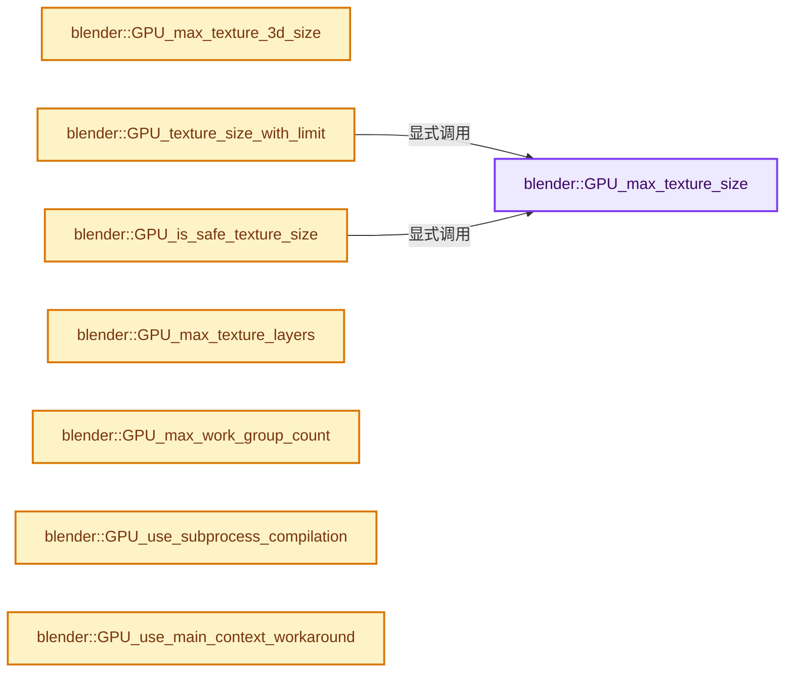

# 实现依赖专题：source/blender/gpu/intern/gpu_capabilities.cc

[方向导航](README.md) · [符号索引](../%E7%AC%A6%E5%8F%B7%E4%BE%9D%E8%B5%96%E4%B8%8E%E5%AE%9E%E7%8E%B0%E7%B4%A2%E5%BC%95.md)

本专题从正文实际调用进入，集中保存共享实现。函数有稳定锚点，可从调用处直接跳到对应完整函数；递归与互相调用通过回链组织。

## 本文件的实现关系




## 完整成员与函数实现

<a id="f-7f18d601f37c1adc"></a>

### `blender::GPU_max_texture_size`

实现位置：[source/blender/gpu/intern/gpu_capabilities.cc](../../../../../source/blender/gpu/intern/gpu_capabilities.cc) · L34—L37。

**教学注释版**

<!-- annotated:396666261209c7 -->

```cpp
int GPU_max_texture_size()
{
  return GCaps.max_texture_size;
}
```

<details>
<summary>核对原始源码：source/blender/gpu/intern/gpu_capabilities.cc · L34—L37</summary>

<!-- original:396666261209c7:source/blender/gpu/intern/gpu_capabilities.cc:34:37 -->

```cpp
int GPU_max_texture_size()
{
  return GCaps.max_texture_size;
}
```

</details>

**结果出口**

- `return GCaps.max_texture_size;`

**继续追踪实现**

本实现没有需要继续展开的显式调用；检查返回表达式、对象转换和调用者前置条件。

<a id="f-442fe9ee18ec7ca1"></a>

### `blender::GPU_max_texture_3d_size`

实现位置：[source/blender/gpu/intern/gpu_capabilities.cc](../../../../../source/blender/gpu/intern/gpu_capabilities.cc) · L39—L42。

**教学注释版**

<!-- annotated:aa4585b0cf21a1 -->

```cpp
int GPU_max_texture_3d_size()
{
  return GCaps.max_texture_3d_size;
}
```

<details>
<summary>核对原始源码：source/blender/gpu/intern/gpu_capabilities.cc · L39—L42</summary>

<!-- original:aa4585b0cf21a1:source/blender/gpu/intern/gpu_capabilities.cc:39:42 -->

```cpp
int GPU_max_texture_3d_size()
{
  return GCaps.max_texture_3d_size;
}
```

</details>

**结果出口**

- `return GCaps.max_texture_3d_size;`

**继续追踪实现**

本实现没有需要继续展开的显式调用；检查返回表达式、对象转换和调用者前置条件。

<a id="f-646196408c861985"></a>

### `blender::GPU_texture_size_with_limit`

实现位置：[source/blender/gpu/intern/gpu_capabilities.cc](../../../../../source/blender/gpu/intern/gpu_capabilities.cc) · L49—L54。

接口参数：

- `int res`

**教学注释版**

<!-- annotated:9f2f7ab44d9f4b -->

```cpp
int GPU_texture_size_with_limit(int res)
{
  int size = GPU_max_texture_size();
  int reslimit = (U.glreslimit != 0) ? min_ii(U.glreslimit, size) : size;
  return min_ii(reslimit, res);
}
```

<details>
<summary>核对原始源码：source/blender/gpu/intern/gpu_capabilities.cc · L49—L54</summary>

<!-- original:9f2f7ab44d9f4b:source/blender/gpu/intern/gpu_capabilities.cc:49:54 -->

```cpp
int GPU_texture_size_with_limit(int res)
{
  int size = GPU_max_texture_size();
  int reslimit = (U.glreslimit != 0) ? min_ii(U.glreslimit, size) : size;
  return min_ii(reslimit, res);
}
```

</details>

**结果出口**

- `return min_ii(reslimit, res);`

**继续追踪实现**

- `GPU_max_texture_size` → [blender::GPU_max_texture_size · L34](%E4%BE%9D%E8%B5%96-gpu_capabilities-508ffd.md#f-7f18d601f37c1adc)。
- `min_ii` → [blender::min_ii · L364](../12-%E7%A9%BA%E9%97%B4%E6%95%B0%E6%8D%AE%E7%BB%93%E6%9E%84%E4%B8%8E%E5%87%A0%E4%BD%95%E7%AE%97%E6%B3%95/%E4%BE%9D%E8%B5%96-math_base_inline-546b00.md#f-30336db35b2810b8)。

<a id="f-8dbb8d35d82602e6"></a>

### `blender::GPU_is_safe_texture_size`

实现位置：[source/blender/gpu/intern/gpu_capabilities.cc](../../../../../source/blender/gpu/intern/gpu_capabilities.cc) · L56—L60。

接口参数：

- `int width`
- `int height`

**教学注释版**

<!-- annotated:136a0bfe058510 -->

```cpp
bool GPU_is_safe_texture_size(int width, int height)
{
  const int max_texture_size = GPU_max_texture_size();
  return size_t(width) * height <= size_t(max_texture_size) * max_texture_size / 4;
}
```

<details>
<summary>核对原始源码：source/blender/gpu/intern/gpu_capabilities.cc · L56—L60</summary>

<!-- original:136a0bfe058510:source/blender/gpu/intern/gpu_capabilities.cc:56:60 -->

```cpp
bool GPU_is_safe_texture_size(int width, int height)
{
  const int max_texture_size = GPU_max_texture_size();
  return size_t(width) * height <= size_t(max_texture_size) * max_texture_size / 4;
}
```

</details>

**结果出口**

- `return size_t(width) * height <= size_t(max_texture_size) * max_texture_size / 4;`

**继续追踪实现**

- `GPU_max_texture_size` → [blender::GPU_max_texture_size · L34](%E4%BE%9D%E8%B5%96-gpu_capabilities-508ffd.md#f-7f18d601f37c1adc)。

<a id="f-cbbae6f5af2bb7d6"></a>

### `blender::GPU_max_texture_layers`

实现位置：[source/blender/gpu/intern/gpu_capabilities.cc](../../../../../source/blender/gpu/intern/gpu_capabilities.cc) · L62—L65。

**教学注释版**

<!-- annotated:1b2141c7d61b11 -->

```cpp
int GPU_max_texture_layers()
{
  return GCaps.max_texture_layers;
}
```

<details>
<summary>核对原始源码：source/blender/gpu/intern/gpu_capabilities.cc · L62—L65</summary>

<!-- original:1b2141c7d61b11:source/blender/gpu/intern/gpu_capabilities.cc:62:65 -->

```cpp
int GPU_max_texture_layers()
{
  return GCaps.max_texture_layers;
}
```

</details>

**结果出口**

- `return GCaps.max_texture_layers;`

**继续追踪实现**

本实现没有需要继续展开的显式调用；检查返回表达式、对象转换和调用者前置条件。

<a id="f-e09045a87e514cab"></a>

### `blender::GPU_max_work_group_count`

实现位置：[source/blender/gpu/intern/gpu_capabilities.cc](../../../../../source/blender/gpu/intern/gpu_capabilities.cc) · L77—L80。

接口参数：

- `int index`

**教学注释版**

<!-- annotated:b6b439dede85a7 -->

```cpp
int GPU_max_work_group_count(int index)
{
  return GCaps.max_work_group_count[index];
}
```

<details>
<summary>核对原始源码：source/blender/gpu/intern/gpu_capabilities.cc · L77—L80</summary>

<!-- original:b6b439dede85a7:source/blender/gpu/intern/gpu_capabilities.cc:77:80 -->

```cpp
int GPU_max_work_group_count(int index)
{
  return GCaps.max_work_group_count[index];
}
```

</details>

**结果出口**

- `return GCaps.max_work_group_count[index];`

**继续追踪实现**

本实现没有需要继续展开的显式调用；检查返回表达式、对象转换和调用者前置条件。

<a id="f-9436a2143d71fb18"></a>

### `blender::GPU_use_subprocess_compilation`

实现位置：[source/blender/gpu/intern/gpu_capabilities.cc](../../../../../source/blender/gpu/intern/gpu_capabilities.cc) · L127—L130。

**教学注释版**

<!-- annotated:038fb6876918fa -->

```cpp
bool GPU_use_subprocess_compilation()
{
  return GCaps.use_subprocess_shader_compilations;
}
```

<details>
<summary>核对原始源码：source/blender/gpu/intern/gpu_capabilities.cc · L127—L130</summary>

<!-- original:038fb6876918fa:source/blender/gpu/intern/gpu_capabilities.cc:127:130 -->

```cpp
bool GPU_use_subprocess_compilation()
{
  return GCaps.use_subprocess_shader_compilations;
}
```

</details>

**结果出口**

- `return GCaps.use_subprocess_shader_compilations;`

**继续追踪实现**

本实现没有需要继续展开的显式调用；检查返回表达式、对象转换和调用者前置条件。

<a id="f-8d3c73eb427675cb"></a>

### `blender::GPU_use_main_context_workaround`

实现位置：[source/blender/gpu/intern/gpu_capabilities.cc](../../../../../source/blender/gpu/intern/gpu_capabilities.cc) · L142—L145。

**教学注释版**

<!-- annotated:adc2bfe9935a2b -->

```cpp
bool GPU_use_main_context_workaround()
{
  return GCaps.use_main_context_workaround;
}
```

<details>
<summary>核对原始源码：source/blender/gpu/intern/gpu_capabilities.cc · L142—L145</summary>

<!-- original:adc2bfe9935a2b:source/blender/gpu/intern/gpu_capabilities.cc:142:145 -->

```cpp
bool GPU_use_main_context_workaround()
{
  return GCaps.use_main_context_workaround;
}
```

</details>

**结果出口**

- `return GCaps.use_main_context_workaround;`

**继续追踪实现**

本实现没有需要继续展开的显式调用；检查返回表达式、对象转换和调用者前置条件。

<a id="f-41b0c45a9f3667a7"></a>

### `blender::GPU_use_hq_normals_workaround`

实现位置：[source/blender/gpu/intern/gpu_capabilities.cc](../../../../../source/blender/gpu/intern/gpu_capabilities.cc) · L147—L150。

**教学注释版**

<!-- annotated:0f5aa722b5735d -->

```cpp
bool GPU_use_hq_normals_workaround()
{
  return GCaps.use_hq_normals_workaround;
}
```

<details>
<summary>核对原始源码：source/blender/gpu/intern/gpu_capabilities.cc · L147—L150</summary>

<!-- original:0f5aa722b5735d:source/blender/gpu/intern/gpu_capabilities.cc:147:150 -->

```cpp
bool GPU_use_hq_normals_workaround()
{
  return GCaps.use_hq_normals_workaround;
}
```

</details>

**结果出口**

- `return GCaps.use_hq_normals_workaround;`

**继续追踪实现**

本实现没有需要继续展开的显式调用；检查返回表达式、对象转换和调用者前置条件。

<a id="f-8c52b98d6ff6e080"></a>

### `blender::GPU_stencil_classify_buffer_workaround`

实现位置：[source/blender/gpu/intern/gpu_capabilities.cc](../../../../../source/blender/gpu/intern/gpu_capabilities.cc) · L152—L155。

**教学注释版**

<!-- annotated:c8d2e8ae487883 -->

```cpp
bool GPU_stencil_classify_buffer_workaround()
{
  return GCaps.stencil_classify_buffer_workaround;
}
```

<details>
<summary>核对原始源码：source/blender/gpu/intern/gpu_capabilities.cc · L152—L155</summary>

<!-- original:c8d2e8ae487883:source/blender/gpu/intern/gpu_capabilities.cc:152:155 -->

```cpp
bool GPU_stencil_classify_buffer_workaround()
{
  return GCaps.stencil_classify_buffer_workaround;
}
```

</details>

**结果出口**

- `return GCaps.stencil_classify_buffer_workaround;`

**继续追踪实现**

本实现没有需要继续展开的显式调用；检查返回表达式、对象转换和调用者前置条件。

<a id="f-724cd5d7af48ade6"></a>

### `blender::GPU_geometry_shader_support`

实现位置：[source/blender/gpu/intern/gpu_capabilities.cc](../../../../../source/blender/gpu/intern/gpu_capabilities.cc) · L157—L160。

**教学注释版**

<!-- annotated:b0b08f025a3fa8 -->

```cpp
bool GPU_geometry_shader_support()
{
  return GCaps.geometry_shader_support;
}
```

<details>
<summary>核对原始源码：source/blender/gpu/intern/gpu_capabilities.cc · L157—L160</summary>

<!-- original:b0b08f025a3fa8:source/blender/gpu/intern/gpu_capabilities.cc:157:160 -->

```cpp
bool GPU_geometry_shader_support()
{
  return GCaps.geometry_shader_support;
}
```

</details>

**结果出口**

- `return GCaps.geometry_shader_support;`

**继续追踪实现**

本实现没有需要继续展开的显式调用；检查返回表达式、对象转换和调用者前置条件。

<a id="f-507537451ec3f02d"></a>

### `blender::GPU_hdr_support`

实现位置：[source/blender/gpu/intern/gpu_capabilities.cc](../../../../../source/blender/gpu/intern/gpu_capabilities.cc) · L162—L165。

**教学注释版**

<!-- annotated:0fbcab892adf4c -->

```cpp
bool GPU_hdr_support()
{
  return GCaps.hdr_viewport_support;
}
```

<details>
<summary>核对原始源码：source/blender/gpu/intern/gpu_capabilities.cc · L162—L165</summary>

<!-- original:0fbcab892adf4c:source/blender/gpu/intern/gpu_capabilities.cc:162:165 -->

```cpp
bool GPU_hdr_support()
{
  return GCaps.hdr_viewport_support;
}
```

</details>

**结果出口**

- `return GCaps.hdr_viewport_support;`

**继续追踪实现**

本实现没有需要继续展开的显式调用；检查返回表达式、对象转换和调用者前置条件。

<a id="f-558d7d902e88c908"></a>

### `blender::GPU_stencil_export_support`

实现位置：[source/blender/gpu/intern/gpu_capabilities.cc](../../../../../source/blender/gpu/intern/gpu_capabilities.cc) · L172—L175。

**教学注释版**

<!-- annotated:58e49d1c95b491 -->

```cpp
bool GPU_stencil_export_support()
{
  return GCaps.stencil_export_support;
}
```

<details>
<summary>核对原始源码：source/blender/gpu/intern/gpu_capabilities.cc · L172—L175</summary>

<!-- original:58e49d1c95b491:source/blender/gpu/intern/gpu_capabilities.cc:172:175 -->

```cpp
bool GPU_stencil_export_support()
{
  return GCaps.stencil_export_support;
}
```

</details>

**结果出口**

- `return GCaps.stencil_export_support;`

**继续追踪实现**

本实现没有需要继续展开的显式调用；检查返回表达式、对象转换和调用者前置条件。

<a id="f-f7b1f24a7d209b27"></a>

### `blender::GPU_ray_query_support`

实现位置：[source/blender/gpu/intern/gpu_capabilities.cc](../../../../../source/blender/gpu/intern/gpu_capabilities.cc) · L177—L180。

**教学注释版**

<!-- annotated:11520479a881a7 -->

```cpp
bool GPU_ray_query_support()
{
  return GCaps.ray_query_support;
}
```

<details>
<summary>核对原始源码：source/blender/gpu/intern/gpu_capabilities.cc · L177—L180</summary>

<!-- original:11520479a881a7:source/blender/gpu/intern/gpu_capabilities.cc:177:180 -->

```cpp
bool GPU_ray_query_support()
{
  return GCaps.ray_query_support;
}
```

</details>

**结果出口**

- `return GCaps.ray_query_support;`

**继续追踪实现**

本实现没有需要继续展开的显式调用；检查返回表达式、对象转换和调用者前置条件。

<a id="f-c484ed43ab51c49f"></a>

### `blender::GPU_vertex_pipeline_stores_and_atomics_support`

实现位置：[source/blender/gpu/intern/gpu_capabilities.cc](../../../../../source/blender/gpu/intern/gpu_capabilities.cc) · L182—L185。

**教学注释版**

<!-- annotated:02e0895c73b297 -->

```cpp
bool GPU_vertex_pipeline_stores_and_atomics_support()
{
  return GCaps.vertex_pipeline_stores_and_atomics_support;
}
```

<details>
<summary>核对原始源码：source/blender/gpu/intern/gpu_capabilities.cc · L182—L185</summary>

<!-- original:02e0895c73b297:source/blender/gpu/intern/gpu_capabilities.cc:182:185 -->

```cpp
bool GPU_vertex_pipeline_stores_and_atomics_support()
{
  return GCaps.vertex_pipeline_stores_and_atomics_support;
}
```

</details>

**结果出口**

- `return GCaps.vertex_pipeline_stores_and_atomics_support;`

**继续追踪实现**

本实现没有需要继续展开的显式调用；检查返回表达式、对象转换和调用者前置条件。

<a id="f-e53b0b0ccb26094a"></a>

### `blender::GPU_max_compute_shader_storage_blocks`

实现位置：[source/blender/gpu/intern/gpu_capabilities.cc](../../../../../source/blender/gpu/intern/gpu_capabilities.cc) · L192—L195。

**教学注释版**

<!-- annotated:471d50cb5d9bac -->

```cpp
int GPU_max_compute_shader_storage_blocks()
{
  return GCaps.max_compute_shader_storage_blocks;
}
```

<details>
<summary>核对原始源码：source/blender/gpu/intern/gpu_capabilities.cc · L192—L195</summary>

<!-- original:471d50cb5d9bac:source/blender/gpu/intern/gpu_capabilities.cc:192:195 -->

```cpp
int GPU_max_compute_shader_storage_blocks()
{
  return GCaps.max_compute_shader_storage_blocks;
}
```

</details>

**结果出口**

- `return GCaps.max_compute_shader_storage_blocks;`

**继续追踪实现**

本实现没有需要继续展开的显式调用；检查返回表达式、对象转换和调用者前置条件。

<a id="f-86a9e42b396e1168"></a>

### `blender::GPU_storage_buffer_alignment`

实现位置：[source/blender/gpu/intern/gpu_capabilities.cc](../../../../../source/blender/gpu/intern/gpu_capabilities.cc) · L212—L215。

**教学注释版**

<!-- annotated:3c9ed57a7f52fd -->

```cpp
size_t GPU_storage_buffer_alignment()
{
  return GCaps.storage_buffer_alignment;
}
```

<details>
<summary>核对原始源码：source/blender/gpu/intern/gpu_capabilities.cc · L212—L215</summary>

<!-- original:3c9ed57a7f52fd:source/blender/gpu/intern/gpu_capabilities.cc:212:215 -->

```cpp
size_t GPU_storage_buffer_alignment()
{
  return GCaps.storage_buffer_alignment;
}
```

</details>

**结果出口**

- `return GCaps.storage_buffer_alignment;`

**继续追踪实现**

本实现没有需要继续展开的显式调用；检查返回表达式、对象转换和调用者前置条件。
