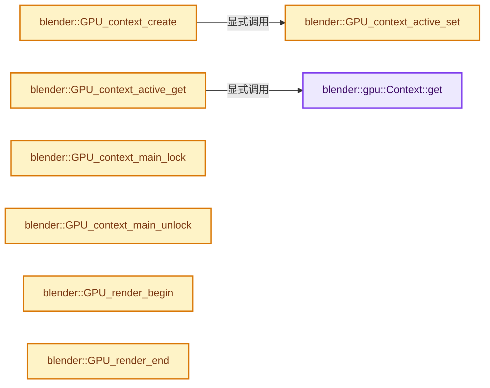
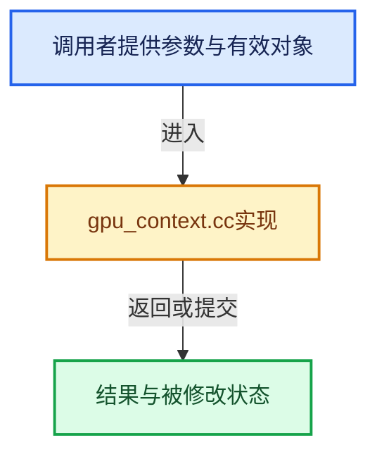

# 实现依赖专题：source/blender/gpu/intern/gpu_context.cc

[方向导航](README.md) · [符号索引](../%E7%AC%A6%E5%8F%B7%E4%BE%9D%E8%B5%96%E4%B8%8E%E5%AE%9E%E7%8E%B0%E7%B4%A2%E5%BC%95.md)

本专题从正文实际调用进入，集中保存共享实现。函数有稳定锚点，可从调用处直接跳到对应完整函数；递归与互相调用通过回链组织。

## 本文件的实现关系






## 完整成员与函数实现

<a id="f-7ca16707244f2d11"></a>

### `blender::gpu::Context::get`

实现位置：[source/blender/gpu/intern/gpu_context.cc](../../../../../source/blender/gpu/intern/gpu_context.cc) · L127—L130。

**教学注释版**

<!-- annotated:a898d23296ab13 -->

```cpp
Context *Context::get()
{
  return active_ctx;
}
```

<details>
<summary>核对原始源码：source/blender/gpu/intern/gpu_context.cc · L127—L130</summary>

<!-- original:a898d23296ab13:source/blender/gpu/intern/gpu_context.cc:127:130 -->

```cpp
Context *Context::get()
{
  return active_ctx;
}
```

</details>

**结果出口**

- `return active_ctx;`

**继续追踪实现**

本实现没有需要继续展开的显式调用；检查返回表达式、对象转换和调用者前置条件。

<a id="f-7cdf66fb41a963b5"></a>

### `blender::GPU_context_create`

实现位置：[source/blender/gpu/intern/gpu_context.cc](../../../../../source/blender/gpu/intern/gpu_context.cc) · L193—L215。

接口参数：

- `GHOST_IWindow *ghost_window`
- `GHOST_IContext *ghost_context`

**教学注释版**

<!-- annotated:93ab2c2b191d1f -->

```cpp
GPUContext *GPU_context_create(GHOST_IWindow *ghost_window, GHOST_IContext *ghost_context)
{
  {
    std::scoped_lock lock(backend_users_mutex);
    if (num_backend_users == 0) {
      /* Automatically create backend when first context is created. */
      gpu_backend_create();
    }
    num_backend_users++;
  }

  BLI_assert(ghost_context);
  if (ghost_window) {
    BLI_assert(ghost_context == ghost_window->getDrawingContext());
  }
  Context *ctx = GPUBackend::get()->context_alloc(ghost_window, ghost_context);

  GPU_context_active_set(wrap(ctx));

  draw::DebugDraw::get().acquire();

  return wrap(ctx);
}
```

<details>
<summary>核对原始源码：source/blender/gpu/intern/gpu_context.cc · L193—L215</summary>

<!-- original:93ab2c2b191d1f:source/blender/gpu/intern/gpu_context.cc:193:215 -->

```cpp
GPUContext *GPU_context_create(GHOST_IWindow *ghost_window, GHOST_IContext *ghost_context)
{
  {
    std::scoped_lock lock(backend_users_mutex);
    if (num_backend_users == 0) {
      /* Automatically create backend when first context is created. */
      gpu_backend_create();
    }
    num_backend_users++;
  }

  BLI_assert(ghost_context);
  if (ghost_window) {
    BLI_assert(ghost_context == ghost_window->getDrawingContext());
  }
  Context *ctx = GPUBackend::get()->context_alloc(ghost_window, ghost_context);

  GPU_context_active_set(wrap(ctx));

  draw::DebugDraw::get().acquire();

  return wrap(ctx);
}
```

</details>

**结果出口**

- `return wrap(ctx);`

**继续追踪实现**

- `gpu_backend_create` → [blender::gpu_backend_create · L564](%E4%BE%9D%E8%B5%96-gpu_context-77a234.md#f-bac3e62e359b7b8a)。
- `BLI_assert` → [BLI_assert · L48](../01-%E5%9F%BA%E7%A1%80%E5%AE%B9%E5%99%A8%E4%B8%8E%E7%8E%B0%E4%BB%A3CPP/%E4%BE%9D%E8%B5%96-BLI_assert-cc98e8.md#m-57a88495704d)；[BLI_assert · L63](../01-%E5%9F%BA%E7%A1%80%E5%AE%B9%E5%99%A8%E4%B8%8E%E7%8E%B0%E4%BB%A3CPP/%E4%BE%9D%E8%B5%96-BLI_assert-cc98e8.md#m-d07050020cb5)。宏定义由构建条件选择。
- `ghost_window->getDrawingContext` → [GHOST_Window::getDrawingContext · L102](%E4%BE%9D%E8%B5%96-GHOST_Window-d88676.md#f-c396ce148c6b8b60)。
- `GPUBackend::get()->context_alloc` → [调用协议](../%E6%A8%A1%E6%9D%BF%E5%AE%8F%E4%B8%8E%E5%8A%A8%E6%80%81%E5%88%86%E6%B4%BE%E5%8D%8F%E8%AE%AE.md)：接收对象类型依赖auto、返回值或模板实例；不按同名猜测目标。调用位置L208。
- `GPUBackend::get` → [blender::GPUBackend::get · L642](%E4%BE%9D%E8%B5%96-gpu_context-77a234.md#f-c876dc1cb5bd7700)。
- `GPU_context_active_set` → [blender::GPU_context_active_set · L244](%E4%BE%9D%E8%B5%96-gpu_context-77a234.md#f-52c17aead712db05)。
- `wrap` → [blender::bActionGroup::wrap · L1920](%E4%BE%9D%E8%B5%96-ANIM_action-8e402f.md#f-9a08743218798134)；[blender::bActionGroup::wrap · L1924](%E4%BE%9D%E8%B5%96-ANIM_action-8e402f.md#f-8c9475f8d3f02347)；[blender::bAction::wrap · L1929](%E4%BE%9D%E8%B5%96-ANIM_action-8e402f.md#f-f049614274fd7a45)；[blender::bAction::wrap · L1933](%E4%BE%9D%E8%B5%96-ANIM_action-8e402f.md#f-2d697d1983fd282f)；[blender::ActionLayer::wrap · L1938](%E4%BE%9D%E8%B5%96-ANIM_action-8e402f.md#f-29caef4c2f0f968e)；[blender::ActionLayer::wrap · L1942](%E4%BE%9D%E8%B5%96-ANIM_action-8e402f.md#f-c2a34899dde2a503)；[blender::ActionSlot::wrap · L1947](%E4%BE%9D%E8%B5%96-ANIM_action-8e402f.md#f-37d3bb556e72b85a)；[blender::ActionSlot::wrap · L1951](%E4%BE%9D%E8%B5%96-ANIM_action-8e402f.md#f-2b5d71bb53ce3f94)；[blender::ActionStrip::wrap · L1956](%E4%BE%9D%E8%B5%96-ANIM_action-8e402f.md#f-8ab5476ff9994c92)；[blender::ActionStrip::wrap · L1960](%E4%BE%9D%E8%B5%96-ANIM_action-8e402f.md#f-3b3377bf36559cb9)；[blender::ActionStripKeyframeData::wrap · L1965](%E4%BE%9D%E8%B5%96-ANIM_action-8e402f.md#f-5146ed493695bae6)；[blender::ActionStripKeyframeData::wrap · L1969](%E4%BE%9D%E8%B5%96-ANIM_action-8e402f.md#f-9ef7a2672fa9e473)；[blender::ActionChannelbag::wrap · L1974](%E4%BE%9D%E8%B5%96-ANIM_action-8e402f.md#f-58a68748e6602695)；[blender::ActionChannelbag::wrap · L1978](%E4%BE%9D%E8%B5%96-ANIM_action-8e402f.md#f-7cec1324025e7802)；[blender::GreasePencilDrawing::wrap · L1059](%E4%BE%9D%E8%B5%96-BKE_grease_pencil-42a7a1.md#f-566c8db236585685)；[blender::GreasePencilDrawing::wrap · L1063](%E4%BE%9D%E8%B5%96-BKE_grease_pencil-42a7a1.md#f-696df207288f4617)；[blender::GreasePencilDrawingReference::wrap · L1068](%E4%BE%9D%E8%B5%96-BKE_grease_pencil-42a7a1.md#f-9823f89ae1b58dd3)；[blender::GreasePencilDrawingReference::wrap · L1072](%E4%BE%9D%E8%B5%96-BKE_grease_pencil-42a7a1.md#f-5d0d58c43410ce9f)；[blender::GreasePencilLayerTreeNode::wrap · L1097](%E4%BE%9D%E8%B5%96-BKE_grease_pencil-42a7a1.md#f-49979aa55e7e3c10)；[blender::GreasePencilLayerTreeNode::wrap · L1101](%E4%BE%9D%E8%B5%96-BKE_grease_pencil-42a7a1.md#f-e97064e011b8609b)；[blender::GreasePencilLayer::wrap · L1106](%E4%BE%9D%E8%B5%96-BKE_grease_pencil-42a7a1.md#f-0a784c2f36fd3dec)；[blender::GreasePencilLayer::wrap · L1110](%E4%BE%9D%E8%B5%96-BKE_grease_pencil-42a7a1.md#f-8948e20a0da0410b)；[blender::GreasePencilLayerMask::wrap · L1115](%E4%BE%9D%E8%B5%96-BKE_grease_pencil-42a7a1.md#f-57e9b35f67172c94)；[blender::GreasePencilLayerMask::wrap · L1119](%E4%BE%9D%E8%B5%96-BKE_grease_pencil-42a7a1.md#f-c31fbb831a031422)；[blender::GreasePencilLayerTreeGroup::wrap · L1124](%E4%BE%9D%E8%B5%96-BKE_grease_pencil-42a7a1.md#f-062b7dbfa198df20)；[blender::GreasePencilLayerTreeGroup::wrap · L1128](%E4%BE%9D%E8%B5%96-BKE_grease_pencil-42a7a1.md#f-0262511e00afeedd)；[blender::CurvesGeometry::wrap · L1190](04-CurvesGeometry%E5%AD%98%E5%82%A8.md#f-a7765d40348cc475)；[blender::CurvesGeometry::wrap · L1194](04-CurvesGeometry%E5%AD%98%E5%82%A8.md#f-0a1accc9d07df888)；[blender::AttributeStorage::wrap · L343](10-%E5%B8%83%E5%B1%80%E5%85%BC%E5%AE%B9%E4%B8%8E%E5%87%A0%E4%BD%95%E5%AE%9E%E6%88%98.md#f-dcd2d04d6f92ca8c)；[blender::AttributeStorage::wrap · L347](10-%E5%B8%83%E5%B1%80%E5%85%BC%E5%AE%B9%E4%B8%8E%E5%87%A0%E4%BD%95%E5%AE%9E%E6%88%98.md#f-9ad0fac9bae8a380)；[blender::BoneColor::wrap · L595](%E4%BE%9D%E8%B5%96-DNA_armature_types-d1a618.md#f-50a6b39a0b2c6a80)；[blender::BoneColor::wrap · L599](%E4%BE%9D%E8%B5%96-DNA_armature_types-d1a618.md#f-2034fba332a3a41b)。同名重载需按实参类型选择。
- `draw::DebugDraw::get().acquire` → [调用协议](../%E6%A8%A1%E6%9D%BF%E5%AE%8F%E4%B8%8E%E5%8A%A8%E6%80%81%E5%88%86%E6%B4%BE%E5%8D%8F%E8%AE%AE.md)：接收对象类型依赖auto、返回值或模板实例；不按同名猜测目标。调用位置L212。
- `draw::DebugDraw::get` → [blender::GPUBackend::get · L642](%E4%BE%9D%E8%B5%96-gpu_context-77a234.md#f-c876dc1cb5bd7700)。

<a id="f-52c17aead712db05"></a>

### `blender::GPU_context_active_set`

实现位置：[source/blender/gpu/intern/gpu_context.cc](../../../../../source/blender/gpu/intern/gpu_context.cc) · L244—L265。

接口参数：

- `GPUContext *ctx_`

**教学注释版**

<!-- annotated:e0fee2ad8a14ff -->

```cpp
void GPU_context_active_set(GPUContext *ctx_)
{
  Context *ctx = unwrap(ctx_);

  if (active_ctx) {
    GPU_shader_unbind();
    active_ctx->deactivate();
  }

  active_ctx = ctx;

  if (ctx) {
    ctx->activate();
    /* It can happen that the previous context drew with a different color-space.
     * In the case where the new context is drawing with the same shader that was previously bound
     * (shader binding optimization), the uniform would not be set again because the dirty flag
     * would not have been set (since the color space of this new context never changed). The
     * shader would reuse the same color-space as the previous context frame-buffer (see #137855).
     */
    ctx->shader_builtin_srgb_is_dirty = true;
  }
}
```

<details>
<summary>核对原始源码：source/blender/gpu/intern/gpu_context.cc · L244—L265</summary>

<!-- original:e0fee2ad8a14ff:source/blender/gpu/intern/gpu_context.cc:244:265 -->

```cpp
void GPU_context_active_set(GPUContext *ctx_)
{
  Context *ctx = unwrap(ctx_);

  if (active_ctx) {
    GPU_shader_unbind();
    active_ctx->deactivate();
  }

  active_ctx = ctx;

  if (ctx) {
    ctx->activate();
    /* It can happen that the previous context drew with a different color-space.
     * In the case where the new context is drawing with the same shader that was previously bound
     * (shader binding optimization), the uniform would not be set again because the dirty flag
     * would not have been set (since the color space of this new context never changed). The
     * shader would reuse the same color-space as the previous context frame-buffer (see #137855).
     */
    ctx->shader_builtin_srgb_is_dirty = true;
  }
}
```

</details>

**沿实际写入检查状态**

- `active_ctx = ctx;`
- `ctx->shader_builtin_srgb_is_dirty = true;`

**继续追踪实现**

- `unwrap` → [调用协议](../%E6%A8%A1%E6%9D%BF%E5%AE%8F%E4%B8%8E%E5%8A%A8%E6%80%81%E5%88%86%E6%B4%BE%E5%8D%8F%E8%AE%AE.md)：函数指针、局部可调用对象或未展开的宏；必须结合调用者环境。调用位置L246。
- `GPU_shader_unbind` → [blender::GPU_shader_unbind · L424](%E4%BE%9D%E8%B5%96-gpu_shader-141cc9.md#f-e0462e112df4c1ef)。
- `active_ctx->deactivate` → [调用协议](../%E6%A8%A1%E6%9D%BF%E5%AE%8F%E4%B8%8E%E5%8A%A8%E6%80%81%E5%88%86%E6%B4%BE%E5%8D%8F%E8%AE%AE.md)：接收对象类型依赖auto、返回值或模板实例；不按同名猜测目标。调用位置L250。
- `ctx->activate` → [blender::gpu::GPUSecondaryContext::activate · L783](%E4%BE%9D%E8%B5%96-gpu_context-77a234.md#f-162b92b60451c015)。

<a id="f-edb6e7879ea67e3d"></a>

### `blender::GPU_context_active_get`

实现位置：[source/blender/gpu/intern/gpu_context.cc](../../../../../source/blender/gpu/intern/gpu_context.cc) · L267—L270。

**教学注释版**

<!-- annotated:a4444e3b67aecd -->

```cpp
GPUContext *GPU_context_active_get()
{
  return wrap(Context::get());
}
```

<details>
<summary>核对原始源码：source/blender/gpu/intern/gpu_context.cc · L267—L270</summary>

<!-- original:a4444e3b67aecd:source/blender/gpu/intern/gpu_context.cc:267:270 -->

```cpp
GPUContext *GPU_context_active_get()
{
  return wrap(Context::get());
}
```

</details>

**结果出口**

- `return wrap(Context::get());`

**继续追踪实现**

- `wrap` → [blender::bActionGroup::wrap · L1920](%E4%BE%9D%E8%B5%96-ANIM_action-8e402f.md#f-9a08743218798134)；[blender::bActionGroup::wrap · L1924](%E4%BE%9D%E8%B5%96-ANIM_action-8e402f.md#f-8c9475f8d3f02347)；[blender::bAction::wrap · L1929](%E4%BE%9D%E8%B5%96-ANIM_action-8e402f.md#f-f049614274fd7a45)；[blender::bAction::wrap · L1933](%E4%BE%9D%E8%B5%96-ANIM_action-8e402f.md#f-2d697d1983fd282f)；[blender::ActionLayer::wrap · L1938](%E4%BE%9D%E8%B5%96-ANIM_action-8e402f.md#f-29caef4c2f0f968e)；[blender::ActionLayer::wrap · L1942](%E4%BE%9D%E8%B5%96-ANIM_action-8e402f.md#f-c2a34899dde2a503)；[blender::ActionSlot::wrap · L1947](%E4%BE%9D%E8%B5%96-ANIM_action-8e402f.md#f-37d3bb556e72b85a)；[blender::ActionSlot::wrap · L1951](%E4%BE%9D%E8%B5%96-ANIM_action-8e402f.md#f-2b5d71bb53ce3f94)；[blender::ActionStrip::wrap · L1956](%E4%BE%9D%E8%B5%96-ANIM_action-8e402f.md#f-8ab5476ff9994c92)；[blender::ActionStrip::wrap · L1960](%E4%BE%9D%E8%B5%96-ANIM_action-8e402f.md#f-3b3377bf36559cb9)；[blender::ActionStripKeyframeData::wrap · L1965](%E4%BE%9D%E8%B5%96-ANIM_action-8e402f.md#f-5146ed493695bae6)；[blender::ActionStripKeyframeData::wrap · L1969](%E4%BE%9D%E8%B5%96-ANIM_action-8e402f.md#f-9ef7a2672fa9e473)；[blender::ActionChannelbag::wrap · L1974](%E4%BE%9D%E8%B5%96-ANIM_action-8e402f.md#f-58a68748e6602695)；[blender::ActionChannelbag::wrap · L1978](%E4%BE%9D%E8%B5%96-ANIM_action-8e402f.md#f-7cec1324025e7802)；[blender::GreasePencilDrawing::wrap · L1059](%E4%BE%9D%E8%B5%96-BKE_grease_pencil-42a7a1.md#f-566c8db236585685)；[blender::GreasePencilDrawing::wrap · L1063](%E4%BE%9D%E8%B5%96-BKE_grease_pencil-42a7a1.md#f-696df207288f4617)；[blender::GreasePencilDrawingReference::wrap · L1068](%E4%BE%9D%E8%B5%96-BKE_grease_pencil-42a7a1.md#f-9823f89ae1b58dd3)；[blender::GreasePencilDrawingReference::wrap · L1072](%E4%BE%9D%E8%B5%96-BKE_grease_pencil-42a7a1.md#f-5d0d58c43410ce9f)；[blender::GreasePencilLayerTreeNode::wrap · L1097](%E4%BE%9D%E8%B5%96-BKE_grease_pencil-42a7a1.md#f-49979aa55e7e3c10)；[blender::GreasePencilLayerTreeNode::wrap · L1101](%E4%BE%9D%E8%B5%96-BKE_grease_pencil-42a7a1.md#f-e97064e011b8609b)；[blender::GreasePencilLayer::wrap · L1106](%E4%BE%9D%E8%B5%96-BKE_grease_pencil-42a7a1.md#f-0a784c2f36fd3dec)；[blender::GreasePencilLayer::wrap · L1110](%E4%BE%9D%E8%B5%96-BKE_grease_pencil-42a7a1.md#f-8948e20a0da0410b)；[blender::GreasePencilLayerMask::wrap · L1115](%E4%BE%9D%E8%B5%96-BKE_grease_pencil-42a7a1.md#f-57e9b35f67172c94)；[blender::GreasePencilLayerMask::wrap · L1119](%E4%BE%9D%E8%B5%96-BKE_grease_pencil-42a7a1.md#f-c31fbb831a031422)；[blender::GreasePencilLayerTreeGroup::wrap · L1124](%E4%BE%9D%E8%B5%96-BKE_grease_pencil-42a7a1.md#f-062b7dbfa198df20)；[blender::GreasePencilLayerTreeGroup::wrap · L1128](%E4%BE%9D%E8%B5%96-BKE_grease_pencil-42a7a1.md#f-0262511e00afeedd)；[blender::CurvesGeometry::wrap · L1190](04-CurvesGeometry%E5%AD%98%E5%82%A8.md#f-a7765d40348cc475)；[blender::CurvesGeometry::wrap · L1194](04-CurvesGeometry%E5%AD%98%E5%82%A8.md#f-0a1accc9d07df888)；[blender::AttributeStorage::wrap · L343](10-%E5%B8%83%E5%B1%80%E5%85%BC%E5%AE%B9%E4%B8%8E%E5%87%A0%E4%BD%95%E5%AE%9E%E6%88%98.md#f-dcd2d04d6f92ca8c)；[blender::AttributeStorage::wrap · L347](10-%E5%B8%83%E5%B1%80%E5%85%BC%E5%AE%B9%E4%B8%8E%E5%87%A0%E4%BD%95%E5%AE%9E%E6%88%98.md#f-9ad0fac9bae8a380)；[blender::BoneColor::wrap · L595](%E4%BE%9D%E8%B5%96-DNA_armature_types-d1a618.md#f-50a6b39a0b2c6a80)；[blender::BoneColor::wrap · L599](%E4%BE%9D%E8%B5%96-DNA_armature_types-d1a618.md#f-2034fba332a3a41b)。同名重载需按实参类型选择。
- `Context::get` → [blender::gpu::Context::get · L127](%E4%BE%9D%E8%B5%96-gpu_context-77a234.md#f-7ca16707244f2d11)。

<a id="f-4f4e439173753112"></a>

### `blender::GPU_context_main_lock`

实现位置：[source/blender/gpu/intern/gpu_context.cc](../../../../../source/blender/gpu/intern/gpu_context.cc) · L304—L307。

**教学注释版**

<!-- annotated:5632fd179d2611 -->

```cpp
void GPU_context_main_lock()
{
  main_context_mutex.lock();
}
```

<details>
<summary>核对原始源码：source/blender/gpu/intern/gpu_context.cc · L304—L307</summary>

<!-- original:5632fd179d2611:source/blender/gpu/intern/gpu_context.cc:304:307 -->

```cpp
void GPU_context_main_lock()
{
  main_context_mutex.lock();
}
```

</details>

**继续追踪实现**

- `main_context_mutex.lock` → [调用协议](../%E6%A8%A1%E6%9D%BF%E5%AE%8F%E4%B8%8E%E5%8A%A8%E6%80%81%E5%88%86%E6%B4%BE%E5%8D%8F%E8%AE%AE.md)：接收对象类型依赖auto、返回值或模板实例；不按同名猜测目标。调用位置L306。

<a id="f-7cbd61f641482711"></a>

### `blender::GPU_context_main_unlock`

实现位置：[source/blender/gpu/intern/gpu_context.cc](../../../../../source/blender/gpu/intern/gpu_context.cc) · L309—L312。

**教学注释版**

<!-- annotated:de6ab97edd5e5c -->

```cpp
void GPU_context_main_unlock()
{
  main_context_mutex.unlock();
}
```

<details>
<summary>核对原始源码：source/blender/gpu/intern/gpu_context.cc · L309—L312</summary>

<!-- original:de6ab97edd5e5c:source/blender/gpu/intern/gpu_context.cc:309:312 -->

```cpp
void GPU_context_main_unlock()
{
  main_context_mutex.unlock();
}
```

</details>

**继续追踪实现**

- `main_context_mutex.unlock` → [调用协议](../%E6%A8%A1%E6%9D%BF%E5%AE%8F%E4%B8%8E%E5%8A%A8%E6%80%81%E5%88%86%E6%B4%BE%E5%8D%8F%E8%AE%AE.md)：接收对象类型依赖auto、返回值或模板实例；不按同名猜测目标。调用位置L311。

<a id="f-cce48be45b000520"></a>

### `blender::GPU_render_begin`

实现位置：[source/blender/gpu/intern/gpu_context.cc](../../../../../source/blender/gpu/intern/gpu_context.cc) · L323—L333。

**教学注释版**

<!-- annotated:e165d1ff4315c7 -->

```cpp
void GPU_render_begin()
{
  GPUBackend *backend = GPUBackend::get();
  BLI_assert(backend);
  /* WORKAROUND: Currently a band-aid for the heist production. Has no side effect for GL backend
   * but should be fixed for Metal. */
  if (backend) {
    backend->render_begin();
    printf_begin(active_ctx);
  }
}
```

<details>
<summary>核对原始源码：source/blender/gpu/intern/gpu_context.cc · L323—L333</summary>

<!-- original:e165d1ff4315c7:source/blender/gpu/intern/gpu_context.cc:323:333 -->

```cpp
void GPU_render_begin()
{
  GPUBackend *backend = GPUBackend::get();
  BLI_assert(backend);
  /* WORKAROUND: Currently a band-aid for the heist production. Has no side effect for GL backend
   * but should be fixed for Metal. */
  if (backend) {
    backend->render_begin();
    printf_begin(active_ctx);
  }
}
```

</details>

**继续追踪实现**

- `GPUBackend::get` → [blender::GPUBackend::get · L642](%E4%BE%9D%E8%B5%96-gpu_context-77a234.md#f-c876dc1cb5bd7700)。
- `BLI_assert` → [BLI_assert · L48](../01-%E5%9F%BA%E7%A1%80%E5%AE%B9%E5%99%A8%E4%B8%8E%E7%8E%B0%E4%BB%A3CPP/%E4%BE%9D%E8%B5%96-BLI_assert-cc98e8.md#m-57a88495704d)；[BLI_assert · L63](../01-%E5%9F%BA%E7%A1%80%E5%AE%B9%E5%99%A8%E4%B8%8E%E7%8E%B0%E4%BB%A3CPP/%E4%BE%9D%E8%B5%96-BLI_assert-cc98e8.md#m-d07050020cb5)。宏定义由构建条件选择。
- `backend->render_begin` → [调用协议](../%E6%A8%A1%E6%9D%BF%E5%AE%8F%E4%B8%8E%E5%8A%A8%E6%80%81%E5%88%86%E6%B4%BE%E5%8D%8F%E8%AE%AE.md)：由接收对象具体类型或运行时策略提供实现。调用位置L330。
- `printf_begin` → [blender::gpu::printf_begin · L382](%E4%BE%9D%E8%B5%96-gpu_shader_log-f23d6e.md#f-51c4fb018eb3c48f)。

<a id="f-925f1716017348b4"></a>

### `blender::GPU_render_end`

实现位置：[source/blender/gpu/intern/gpu_context.cc](../../../../../source/blender/gpu/intern/gpu_context.cc) · L334—L342。

**教学注释版**

<!-- annotated:dcce4a01906913 -->

```cpp
void GPU_render_end()
{
  GPUBackend *backend = GPUBackend::get();
  BLI_assert(backend);
  if (backend) {
    printf_end(active_ctx);
    backend->render_end();
  }
}
```

<details>
<summary>核对原始源码：source/blender/gpu/intern/gpu_context.cc · L334—L342</summary>

<!-- original:dcce4a01906913:source/blender/gpu/intern/gpu_context.cc:334:342 -->

```cpp
void GPU_render_end()
{
  GPUBackend *backend = GPUBackend::get();
  BLI_assert(backend);
  if (backend) {
    printf_end(active_ctx);
    backend->render_end();
  }
}
```

</details>

**继续追踪实现**

- `GPUBackend::get` → [blender::GPUBackend::get · L642](%E4%BE%9D%E8%B5%96-gpu_context-77a234.md#f-c876dc1cb5bd7700)。
- `BLI_assert` → [BLI_assert · L48](../01-%E5%9F%BA%E7%A1%80%E5%AE%B9%E5%99%A8%E4%B8%8E%E7%8E%B0%E4%BB%A3CPP/%E4%BE%9D%E8%B5%96-BLI_assert-cc98e8.md#m-57a88495704d)；[BLI_assert · L63](../01-%E5%9F%BA%E7%A1%80%E5%AE%B9%E5%99%A8%E4%B8%8E%E7%8E%B0%E4%BB%A3CPP/%E4%BE%9D%E8%B5%96-BLI_assert-cc98e8.md#m-d07050020cb5)。宏定义由构建条件选择。
- `printf_end` → [blender::gpu::printf_end · L399](%E4%BE%9D%E8%B5%96-gpu_shader_log-f23d6e.md#f-0fdec07e8a9f6ce5)。
- `backend->render_end` → [调用协议](../%E6%A8%A1%E6%9D%BF%E5%AE%8F%E4%B8%8E%E5%8A%A8%E6%80%81%E5%88%86%E6%B4%BE%E5%8D%8F%E8%AE%AE.md)：由接收对象具体类型或运行时策略提供实现。调用位置L340。

<a id="f-169ef7bceec1a7bf"></a>

### `blender::GPU_backend_ghost_system_set`

实现位置：[source/blender/gpu/intern/gpu_context.cc](../../../../../source/blender/gpu/intern/gpu_context.cc) · L370—L373。

接口参数：

- `GHOST_ISystem *ghost_system_handle`

**教学注释版**

<!-- annotated:564b3b038998fc -->

```cpp
void GPU_backend_ghost_system_set(GHOST_ISystem *ghost_system_handle)
{
  g_ghost_system = ghost_system_handle;
}
```

<details>
<summary>核对原始源码：source/blender/gpu/intern/gpu_context.cc · L370—L373</summary>

<!-- original:564b3b038998fc:source/blender/gpu/intern/gpu_context.cc:370:373 -->

```cpp
void GPU_backend_ghost_system_set(GHOST_ISystem *ghost_system_handle)
{
  g_ghost_system = ghost_system_handle;
}
```

</details>

**沿实际写入检查状态**

- `g_ghost_system = ghost_system_handle;`

**继续追踪实现**

本实现没有需要继续展开的显式调用；检查返回表达式、对象转换和调用者前置条件。

<a id="f-257fcb35e68c53a4"></a>

### `blender::GPU_backend_type_selection_set`

实现位置：[source/blender/gpu/intern/gpu_context.cc](../../../../../source/blender/gpu/intern/gpu_context.cc) · L380—L384。

接口参数：

- `const GPUBackendType backend`

**教学注释版**

<!-- annotated:e2667dd1782495 -->

```cpp
void GPU_backend_type_selection_set(const GPUBackendType backend)
{
  g_backend_type = backend;
  g_backend_type_supported = std::nullopt;
}
```

<details>
<summary>核对原始源码：source/blender/gpu/intern/gpu_context.cc · L380—L384</summary>

<!-- original:e2667dd1782495:source/blender/gpu/intern/gpu_context.cc:380:384 -->

```cpp
void GPU_backend_type_selection_set(const GPUBackendType backend)
{
  g_backend_type = backend;
  g_backend_type_supported = std::nullopt;
}
```

</details>

**沿实际写入检查状态**

- `g_backend_type = backend;`
- `g_backend_type_supported = std::nullopt;`

**继续追踪实现**

本实现没有需要继续展开的显式调用；检查返回表达式、对象转换和调用者前置条件。

<a id="f-3c0dacb3e1f75d8e"></a>

### `blender::GPU_backend_type_selection_get`

实现位置：[source/blender/gpu/intern/gpu_context.cc](../../../../../source/blender/gpu/intern/gpu_context.cc) · L401—L404。

**教学注释版**

<!-- annotated:db38eaff19d75f -->

```cpp
GPUBackendType GPU_backend_type_selection_get()
{
  return g_backend_type;
}
```

<details>
<summary>核对原始源码：source/blender/gpu/intern/gpu_context.cc · L401—L404</summary>

<!-- original:db38eaff19d75f:source/blender/gpu/intern/gpu_context.cc:401:404 -->

```cpp
GPUBackendType GPU_backend_type_selection_get()
{
  return g_backend_type;
}
```

</details>

**结果出口**

- `return g_backend_type;`

**继续追踪实现**

本实现没有需要继续展开的显式调用；检查返回表达式、对象转换和调用者前置条件。

<a id="f-e24c97c2c060224c"></a>

### `blender::gpu_backend_type_name`

实现位置：[source/blender/gpu/intern/gpu_context.cc](../../../../../source/blender/gpu/intern/gpu_context.cc) · L454—L470。

接口参数：

- `const GPUBackendType backend_type`

**教学注释版**

<!-- annotated:3c8577495f9210 -->

```cpp
static const char *gpu_backend_type_name(const GPUBackendType backend_type)
{
  switch (backend_type) {
    case GPU_BACKEND_OPENGL:
      return "OpenGL";
    case GPU_BACKEND_VULKAN:
      return "Vulkan";
    case GPU_BACKEND_METAL:
      return "Metal";
    case GPU_BACKEND_NONE:
      return "None";
    case GPU_BACKEND_ANY:
      break;
  }

  return "Unknown";
}
```

<details>
<summary>核对原始源码：source/blender/gpu/intern/gpu_context.cc · L454—L470</summary>

<!-- original:3c8577495f9210:source/blender/gpu/intern/gpu_context.cc:454:470 -->

```cpp
static const char *gpu_backend_type_name(const GPUBackendType backend_type)
{
  switch (backend_type) {
    case GPU_BACKEND_OPENGL:
      return "OpenGL";
    case GPU_BACKEND_VULKAN:
      return "Vulkan";
    case GPU_BACKEND_METAL:
      return "Metal";
    case GPU_BACKEND_NONE:
      return "None";
    case GPU_BACKEND_ANY:
      break;
  }

  return "Unknown";
}
```

</details>

**结果出口**

- `return "OpenGL";`
- `return "Vulkan";`
- `return "Metal";`
- `return "None";`
- `return "Unknown";`

**继续追踪实现**

本实现没有需要继续展开的显式调用；检查返回表达式、对象转换和调用者前置条件。

<a id="f-c10e962c8300e624"></a>

### `blender::GPU_backend_type_selection_detect`

实现位置：[source/blender/gpu/intern/gpu_context.cc](../../../../../source/blender/gpu/intern/gpu_context.cc) · L479—L520。

**教学注释版**

<!-- annotated:d7694f6aaf404c -->

```cpp
bool GPU_backend_type_selection_detect()
{
  /* Only detect once, can't switch backend until Blender restart. */
  static bool backend_type_detected = false;
  if (backend_type_detected) {
    return GPU_backend_type_selection_get() != GPU_BACKEND_NONE;
  }
  backend_type_detected = true;

  VectorSet<GPUBackendType> backends_to_check;
  if (g_backend_type_override.has_value()) {
    // [讲解] backends_to_check.add：按哈希与相等关系加入键或键值。
    backends_to_check.add(*g_backend_type_override);
  }
#if defined(WITH_OPENGL_BACKEND)
  backends_to_check.add(GPU_BACKEND_OPENGL);
#elif defined(WITH_METAL_BACKEND)
  backends_to_check.add(GPU_BACKEND_METAL);
#endif

#if defined(WITH_VULKAN_BACKEND)
  backends_to_check.add(GPU_BACKEND_VULKAN);
#endif

  for (const GPUBackendType backend_type : backends_to_check) {
    GPU_backend_type_selection_set(backend_type);
    if (GPU_backend_supported()) {
      if (g_preferred_device_override.has_value() && backend_type != GPU_BACKEND_VULKAN) {
        fprintf(stderr,
                "Warning: '--gpu-device' is only supported for the Vulkan backend. "
                "Ignoring the device override for the selected %s backend and falling back to the "
                "stored GPU preference.\n",
                gpu_backend_type_name(backend_type));
        g_preferred_device_override.reset();
      }
      return true;
    }
    G.f |= G_FLAG_GPU_BACKEND_FALLBACK;
  }

  GPU_backend_type_selection_set(GPU_BACKEND_NONE);
  return false;
}
```

<details>
<summary>核对原始源码：source/blender/gpu/intern/gpu_context.cc · L479—L520</summary>

<!-- original:d7694f6aaf404c:source/blender/gpu/intern/gpu_context.cc:479:520 -->

```cpp
bool GPU_backend_type_selection_detect()
{
  /* Only detect once, can't switch backend until Blender restart. */
  static bool backend_type_detected = false;
  if (backend_type_detected) {
    return GPU_backend_type_selection_get() != GPU_BACKEND_NONE;
  }
  backend_type_detected = true;

  VectorSet<GPUBackendType> backends_to_check;
  if (g_backend_type_override.has_value()) {
    backends_to_check.add(*g_backend_type_override);
  }
#if defined(WITH_OPENGL_BACKEND)
  backends_to_check.add(GPU_BACKEND_OPENGL);
#elif defined(WITH_METAL_BACKEND)
  backends_to_check.add(GPU_BACKEND_METAL);
#endif

#if defined(WITH_VULKAN_BACKEND)
  backends_to_check.add(GPU_BACKEND_VULKAN);
#endif

  for (const GPUBackendType backend_type : backends_to_check) {
    GPU_backend_type_selection_set(backend_type);
    if (GPU_backend_supported()) {
      if (g_preferred_device_override.has_value() && backend_type != GPU_BACKEND_VULKAN) {
        fprintf(stderr,
                "Warning: '--gpu-device' is only supported for the Vulkan backend. "
                "Ignoring the device override for the selected %s backend and falling back to the "
                "stored GPU preference.\n",
                gpu_backend_type_name(backend_type));
        g_preferred_device_override.reset();
      }
      return true;
    }
    G.f |= G_FLAG_GPU_BACKEND_FALLBACK;
  }

  GPU_backend_type_selection_set(GPU_BACKEND_NONE);
  return false;
}
```

</details>

**沿实际写入检查状态**

- `backend_type_detected = true;`
- `G.f |= G_FLAG_GPU_BACKEND_FALLBACK;`

**结果出口**

- `return GPU_backend_type_selection_get() != GPU_BACKEND_NONE;`
- `return true;`
- `return false;`

**继续追踪实现**

- `GPU_backend_type_selection_get` → [blender::GPU_backend_type_selection_get · L401](%E4%BE%9D%E8%B5%96-gpu_context-77a234.md#f-3c0dacb3e1f75d8e)。
- `g_backend_type_override.has_value` → [调用协议](../%E6%A8%A1%E6%9D%BF%E5%AE%8F%E4%B8%8E%E5%8A%A8%E6%80%81%E5%88%86%E6%B4%BE%E5%8D%8F%E8%AE%AE.md)：接收对象类型依赖auto、返回值或模板实例；不按同名猜测目标。调用位置L489。
- `backends_to_check.add` → [blender::VectorSet::add · L351](../01-%E5%9F%BA%E7%A1%80%E5%AE%B9%E5%99%A8%E4%B8%8E%E7%8E%B0%E4%BB%A3CPP/14-VectorSet%E7%A8%B3%E5%AE%9A%E7%B4%A2%E5%BC%95%E4%B8%8E%E5%8E%BB%E9%87%8D.md#f-96bfe2bf376d6298)；[blender::VectorSet::add · L355](../01-%E5%9F%BA%E7%A1%80%E5%AE%B9%E5%99%A8%E4%B8%8E%E7%8E%B0%E4%BB%A3CPP/14-VectorSet%E7%A8%B3%E5%AE%9A%E7%B4%A2%E5%BC%95%E4%B8%8E%E5%8E%BB%E9%87%8D.md#f-c0474f6a0568033b)。同名重载需按实参类型选择。
- `GPU_backend_type_selection_set` → [blender::GPU_backend_type_selection_set · L380](%E4%BE%9D%E8%B5%96-gpu_context-77a234.md#f-257fcb35e68c53a4)。
- `GPU_backend_supported` → [blender::GPU_backend_supported · L556](%E4%BE%9D%E8%B5%96-gpu_context-77a234.md#f-4a415245c3bf7368)。
- `g_preferred_device_override.has_value` → [调用协议](../%E6%A8%A1%E6%9D%BF%E5%AE%8F%E4%B8%8E%E5%8A%A8%E6%80%81%E5%88%86%E6%B4%BE%E5%8D%8F%E8%AE%AE.md)：接收对象类型依赖auto、返回值或模板实例；不按同名猜测目标。调用位置L505。
- `fprintf` → [外部契约](https://eel.is/c++draft/)：这个边界按实际表达式及所属类型核对参数、返回值、寿命与失败行为。这里提供接口入口，不声称已解释该第三方版本的内部实现。
- `gpu_backend_type_name` → [blender::gpu_backend_type_name · L454](%E4%BE%9D%E8%B5%96-gpu_context-77a234.md#f-e24c97c2c060224c)。
- `g_preferred_device_override.reset` → [调用协议](../%E6%A8%A1%E6%9D%BF%E5%AE%8F%E4%B8%8E%E5%8A%A8%E6%80%81%E5%88%86%E6%B4%BE%E5%8D%8F%E8%AE%AE.md)：接收对象类型依赖auto、返回值或模板实例；不按同名猜测目标。调用位置L511。

<a id="f-89c77af408e1b580"></a>

### `blender::gpu_backend_supported`

实现位置：[source/blender/gpu/intern/gpu_context.cc](../../../../../source/blender/gpu/intern/gpu_context.cc) · L522—L554。

**教学注释版**

<!-- annotated:436faa3503400a -->

```cpp
static bool gpu_backend_supported()
{
  /* Skip the support check if "--debug-gpu-backend-no-fallback" is used. */
  if (G.debug & G_DEBUG_GPU_BACKEND_NO_FALLBACK) {
    return true;
  }

  switch (g_backend_type) {
    case GPU_BACKEND_OPENGL:
#ifdef WITH_OPENGL_BACKEND
      return true;
#else
      return false;
#endif
    case GPU_BACKEND_VULKAN:
#ifdef WITH_VULKAN_BACKEND
      return VKBackend::is_supported();
#else
      return false;
#endif
    case GPU_BACKEND_METAL:
#ifdef WITH_METAL_BACKEND
      return MTLBackend::metal_is_supported();
#else
      return false;
#endif
    case GPU_BACKEND_NONE:
      return true;
    default:
      BLI_assert(false && "No backend specified");
      return false;
  }
}
```

<details>
<summary>核对原始源码：source/blender/gpu/intern/gpu_context.cc · L522—L554</summary>

<!-- original:436faa3503400a:source/blender/gpu/intern/gpu_context.cc:522:554 -->

```cpp
static bool gpu_backend_supported()
{
  /* Skip the support check if "--debug-gpu-backend-no-fallback" is used. */
  if (G.debug & G_DEBUG_GPU_BACKEND_NO_FALLBACK) {
    return true;
  }

  switch (g_backend_type) {
    case GPU_BACKEND_OPENGL:
#ifdef WITH_OPENGL_BACKEND
      return true;
#else
      return false;
#endif
    case GPU_BACKEND_VULKAN:
#ifdef WITH_VULKAN_BACKEND
      return VKBackend::is_supported();
#else
      return false;
#endif
    case GPU_BACKEND_METAL:
#ifdef WITH_METAL_BACKEND
      return MTLBackend::metal_is_supported();
#else
      return false;
#endif
    case GPU_BACKEND_NONE:
      return true;
    default:
      BLI_assert(false && "No backend specified");
      return false;
  }
}
```

</details>

**结果出口**

- `return true;`
- `return false;`
- `return VKBackend::is_supported();`
- `return MTLBackend::metal_is_supported();`

**继续追踪实现**

- `VKBackend::is_supported` → [blender::gpu::VKBackend::is_supported · L263](%E4%BE%9D%E8%B5%96-vk_backend-5cafaf.md#f-3edfee8871dac7be)。
- `MTLBackend::metal_is_supported` → [调用协议](../%E6%A8%A1%E6%9D%BF%E5%AE%8F%E4%B8%8E%E5%8A%A8%E6%80%81%E5%88%86%E6%B4%BE%E5%8D%8F%E8%AE%AE.md)：函数指针、局部可调用对象或未展开的宏；必须结合调用者环境。调用位置L544。
- `BLI_assert` → [BLI_assert · L48](../01-%E5%9F%BA%E7%A1%80%E5%AE%B9%E5%99%A8%E4%B8%8E%E7%8E%B0%E4%BB%A3CPP/%E4%BE%9D%E8%B5%96-BLI_assert-cc98e8.md#m-57a88495704d)；[BLI_assert · L63](../01-%E5%9F%BA%E7%A1%80%E5%AE%B9%E5%99%A8%E4%B8%8E%E7%8E%B0%E4%BB%A3CPP/%E4%BE%9D%E8%B5%96-BLI_assert-cc98e8.md#m-d07050020cb5)。宏定义由构建条件选择。

<a id="f-4a415245c3bf7368"></a>

### `blender::GPU_backend_supported`

实现位置：[source/blender/gpu/intern/gpu_context.cc](../../../../../source/blender/gpu/intern/gpu_context.cc) · L556—L562。

**教学注释版**

<!-- annotated:cf8e619e69c9d3 -->

```cpp
bool GPU_backend_supported()
{
  if (!g_backend_type_supported.has_value()) {
    g_backend_type_supported = gpu_backend_supported();
  }
  return *g_backend_type_supported;
}
```

<details>
<summary>核对原始源码：source/blender/gpu/intern/gpu_context.cc · L556—L562</summary>

<!-- original:cf8e619e69c9d3:source/blender/gpu/intern/gpu_context.cc:556:562 -->

```cpp
bool GPU_backend_supported()
{
  if (!g_backend_type_supported.has_value()) {
    g_backend_type_supported = gpu_backend_supported();
  }
  return *g_backend_type_supported;
}
```

</details>

**沿实际写入检查状态**

- `g_backend_type_supported = gpu_backend_supported();`

**结果出口**

- `return *g_backend_type_supported;`

**继续追踪实现**

- `g_backend_type_supported.has_value` → [调用协议](../%E6%A8%A1%E6%9D%BF%E5%AE%8F%E4%B8%8E%E5%8A%A8%E6%80%81%E5%88%86%E6%B4%BE%E5%8D%8F%E8%AE%AE.md)：接收对象类型依赖auto、返回值或模板实例；不按同名猜测目标。调用位置L558。
- `gpu_backend_supported` → [blender::gpu_backend_supported · L522](%E4%BE%9D%E8%B5%96-gpu_context-77a234.md#f-89c77af408e1b580)。

<a id="f-bac3e62e359b7b8a"></a>

### `blender::gpu_backend_create`

实现位置：[source/blender/gpu/intern/gpu_context.cc](../../../../../source/blender/gpu/intern/gpu_context.cc) · L564—L592。

**教学注释版**

<!-- annotated:dd3ebb84585bd0 -->

```cpp
static void gpu_backend_create()
{
  BLI_assert(g_backend == nullptr);
  BLI_assert(GPU_backend_supported());

  switch (g_backend_type) {
#ifdef WITH_OPENGL_BACKEND
    case GPU_BACKEND_OPENGL:
      g_backend = MEM_new<GLBackend>(__func__);
      break;
#endif
#ifdef WITH_VULKAN_BACKEND
    case GPU_BACKEND_VULKAN:
      g_backend = MEM_new<VKBackend>(__func__);
      break;
#endif
#ifdef WITH_METAL_BACKEND
    case GPU_BACKEND_METAL:
      g_backend = MEM_new<MTLBackend>(__func__);
      break;
#endif
    case GPU_BACKEND_NONE:
      g_backend = MEM_new<DummyBackend>(__func__);
      break;
    default:
      BLI_assert(0);
      break;
  }
}
```

<details>
<summary>核对原始源码：source/blender/gpu/intern/gpu_context.cc · L564—L592</summary>

<!-- original:dd3ebb84585bd0:source/blender/gpu/intern/gpu_context.cc:564:592 -->

```cpp
static void gpu_backend_create()
{
  BLI_assert(g_backend == nullptr);
  BLI_assert(GPU_backend_supported());

  switch (g_backend_type) {
#ifdef WITH_OPENGL_BACKEND
    case GPU_BACKEND_OPENGL:
      g_backend = MEM_new<GLBackend>(__func__);
      break;
#endif
#ifdef WITH_VULKAN_BACKEND
    case GPU_BACKEND_VULKAN:
      g_backend = MEM_new<VKBackend>(__func__);
      break;
#endif
#ifdef WITH_METAL_BACKEND
    case GPU_BACKEND_METAL:
      g_backend = MEM_new<MTLBackend>(__func__);
      break;
#endif
    case GPU_BACKEND_NONE:
      g_backend = MEM_new<DummyBackend>(__func__);
      break;
    default:
      BLI_assert(0);
      break;
  }
}
```

</details>

**沿实际写入检查状态**

- `g_backend = MEM_new<GLBackend>(__func__);`
- `g_backend = MEM_new<VKBackend>(__func__);`
- `g_backend = MEM_new<MTLBackend>(__func__);`
- `g_backend = MEM_new<DummyBackend>(__func__);`

**继续追踪实现**

- `BLI_assert` → [BLI_assert · L48](../01-%E5%9F%BA%E7%A1%80%E5%AE%B9%E5%99%A8%E4%B8%8E%E7%8E%B0%E4%BB%A3CPP/%E4%BE%9D%E8%B5%96-BLI_assert-cc98e8.md#m-57a88495704d)；[BLI_assert · L63](../01-%E5%9F%BA%E7%A1%80%E5%AE%B9%E5%99%A8%E4%B8%8E%E7%8E%B0%E4%BB%A3CPP/%E4%BE%9D%E8%B5%96-BLI_assert-cc98e8.md#m-d07050020cb5)。宏定义由构建条件选择。
- `GPU_backend_supported` → [blender::GPU_backend_supported · L556](%E4%BE%9D%E8%B5%96-gpu_context-77a234.md#f-4a415245c3bf7368)。
- `MEM_new<GLBackend>` → [MEM_new · L351](../03-%E5%86%85%E5%AD%98%E5%88%86%E9%85%8D%E4%B8%8E%E8%BF%90%E8%A1%8C%E6%97%B6%E7%B1%BB%E5%9E%8B/%E4%BE%9D%E8%B5%96-MEM_guardedalloc-b54eca.md#f-115f9b6784f89912)。
- `MEM_new<VKBackend>` → [MEM_new · L351](../03-%E5%86%85%E5%AD%98%E5%88%86%E9%85%8D%E4%B8%8E%E8%BF%90%E8%A1%8C%E6%97%B6%E7%B1%BB%E5%9E%8B/%E4%BE%9D%E8%B5%96-MEM_guardedalloc-b54eca.md#f-115f9b6784f89912)。
- `MEM_new<MTLBackend>` → [MEM_new · L351](../03-%E5%86%85%E5%AD%98%E5%88%86%E9%85%8D%E4%B8%8E%E8%BF%90%E8%A1%8C%E6%97%B6%E7%B1%BB%E5%9E%8B/%E4%BE%9D%E8%B5%96-MEM_guardedalloc-b54eca.md#f-115f9b6784f89912)。
- `MEM_new<DummyBackend>` → [MEM_new · L351](../03-%E5%86%85%E5%AD%98%E5%88%86%E9%85%8D%E4%B8%8E%E8%BF%90%E8%A1%8C%E6%97%B6%E7%B1%BB%E5%9E%8B/%E4%BE%9D%E8%B5%96-MEM_guardedalloc-b54eca.md#f-115f9b6784f89912)。

<a id="f-1dd6f97e21517f13"></a>

### `blender::gpu_backend_init_resources`

实现位置：[source/blender/gpu/intern/gpu_context.cc](../../../../../source/blender/gpu/intern/gpu_context.cc) · L594—L598。

**教学注释版**

<!-- annotated:74799df76871d0 -->

```cpp
void gpu_backend_init_resources()
{
  BLI_assert(g_backend);
  g_backend->init_resources();
}
```

<details>
<summary>核对原始源码：source/blender/gpu/intern/gpu_context.cc · L594—L598</summary>

<!-- original:74799df76871d0:source/blender/gpu/intern/gpu_context.cc:594:598 -->

```cpp
void gpu_backend_init_resources()
{
  BLI_assert(g_backend);
  g_backend->init_resources();
}
```

</details>

**继续追踪实现**

- `BLI_assert` → [BLI_assert · L48](../01-%E5%9F%BA%E7%A1%80%E5%AE%B9%E5%99%A8%E4%B8%8E%E7%8E%B0%E4%BB%A3CPP/%E4%BE%9D%E8%B5%96-BLI_assert-cc98e8.md#m-57a88495704d)；[BLI_assert · L63](../01-%E5%9F%BA%E7%A1%80%E5%AE%B9%E5%99%A8%E4%B8%8E%E7%8E%B0%E4%BB%A3CPP/%E4%BE%9D%E8%B5%96-BLI_assert-cc98e8.md#m-d07050020cb5)。宏定义由构建条件选择。
- `g_backend->init_resources` → [调用协议](../%E6%A8%A1%E6%9D%BF%E5%AE%8F%E4%B8%8E%E5%8A%A8%E6%80%81%E5%88%86%E6%B4%BE%E5%8D%8F%E8%AE%AE.md)：接收对象类型依赖auto、返回值或模板实例；不按同名猜测目标。调用位置L597。

<a id="f-f6a2f10bf5fbee87"></a>

### `blender::GPU_backend_get_type`

实现位置：[source/blender/gpu/intern/gpu_context.cc](../../../../../source/blender/gpu/intern/gpu_context.cc) · L613—L635。

**教学注释版**

<!-- annotated:41a99d7e69ce7f -->

```cpp
GPUBackendType GPU_backend_get_type()
{

#ifdef WITH_OPENGL_BACKEND
  if (g_backend && dynamic_cast<GLBackend *>(g_backend) != nullptr) {
    return GPU_BACKEND_OPENGL;
  }
#endif

#ifdef WITH_METAL_BACKEND
  if (g_backend && dynamic_cast<MTLBackend *>(g_backend) != nullptr) {
    return GPU_BACKEND_METAL;
  }
#endif

#ifdef WITH_VULKAN_BACKEND
  if (g_backend && dynamic_cast<VKBackend *>(g_backend) != nullptr) {
    return GPU_BACKEND_VULKAN;
  }
#endif

  return GPU_BACKEND_NONE;
}
```

<details>
<summary>核对原始源码：source/blender/gpu/intern/gpu_context.cc · L613—L635</summary>

<!-- original:41a99d7e69ce7f:source/blender/gpu/intern/gpu_context.cc:613:635 -->

```cpp
GPUBackendType GPU_backend_get_type()
{

#ifdef WITH_OPENGL_BACKEND
  if (g_backend && dynamic_cast<GLBackend *>(g_backend) != nullptr) {
    return GPU_BACKEND_OPENGL;
  }
#endif

#ifdef WITH_METAL_BACKEND
  if (g_backend && dynamic_cast<MTLBackend *>(g_backend) != nullptr) {
    return GPU_BACKEND_METAL;
  }
#endif

#ifdef WITH_VULKAN_BACKEND
  if (g_backend && dynamic_cast<VKBackend *>(g_backend) != nullptr) {
    return GPU_BACKEND_VULKAN;
  }
#endif

  return GPU_BACKEND_NONE;
}
```

</details>

**结果出口**

- `return GPU_BACKEND_OPENGL;`
- `return GPU_BACKEND_METAL;`
- `return GPU_BACKEND_VULKAN;`
- `return GPU_BACKEND_NONE;`

**继续追踪实现**

本实现没有需要继续展开的显式调用；检查返回表达式、对象转换和调用者前置条件。

<a id="f-c876dc1cb5bd7700"></a>

### `blender::GPUBackend::get`

实现位置：[source/blender/gpu/intern/gpu_context.cc](../../../../../source/blender/gpu/intern/gpu_context.cc) · L642—L645。

**教学注释版**

<!-- annotated:a503462d2c64d6 -->

```cpp
GPUBackend *GPUBackend::get()
{
  return g_backend;
}
```

<details>
<summary>核对原始源码：source/blender/gpu/intern/gpu_context.cc · L642—L645</summary>

<!-- original:a503462d2c64d6:source/blender/gpu/intern/gpu_context.cc:642:645 -->

```cpp
GPUBackend *GPUBackend::get()
{
  return g_backend;
}
```

</details>

**结果出口**

- `return g_backend;`

**继续追踪实现**

本实现没有需要继续展开的显式调用；检查返回表达式、对象转换和调用者前置条件。

<a id="f-0ecb32b1429d3b5c"></a>

### `blender::gpu::GPU_activate_secondary_context`

实现位置：[source/blender/gpu/intern/gpu_context.cc](../../../../../source/blender/gpu/intern/gpu_context.cc) · L725—L729。

接口参数：

- `const GPUSecondaryContextData &data`

**教学注释版**

<!-- annotated:d1ca9ed3298835 -->

```cpp
void GPU_activate_secondary_context(const GPUSecondaryContextData &data)
{
  data.ghost_context->activateDrawingContext();
  GPU_context_active_set(data.gpu_context);
}
```

<details>
<summary>核对原始源码：source/blender/gpu/intern/gpu_context.cc · L725—L729</summary>

<!-- original:d1ca9ed3298835:source/blender/gpu/intern/gpu_context.cc:725:729 -->

```cpp
void GPU_activate_secondary_context(const GPUSecondaryContextData &data)
{
  data.ghost_context->activateDrawingContext();
  GPU_context_active_set(data.gpu_context);
}
```

</details>

**继续追踪实现**

- `data.ghost_context->activateDrawingContext` → [调用协议](../%E6%A8%A1%E6%9D%BF%E5%AE%8F%E4%B8%8E%E5%8A%A8%E6%80%81%E5%88%86%E6%B4%BE%E5%8D%8F%E8%AE%AE.md)：接收对象类型依赖auto、返回值或模板实例；不按同名猜测目标。调用位置L727。
- `GPU_context_active_set` → [blender::GPU_context_active_set · L244](%E4%BE%9D%E8%B5%96-gpu_context-77a234.md#f-52c17aead712db05)。

<a id="f-2e947eed0260f1b8"></a>

### `blender::gpu::GPU_deactivate_secondary_context`

实现位置：[source/blender/gpu/intern/gpu_context.cc](../../../../../source/blender/gpu/intern/gpu_context.cc) · L731—L735。

接口参数：

- `const GPUSecondaryContextData &data`

**教学注释版**

<!-- annotated:a742cb33dd9ca3 -->

```cpp
void GPU_deactivate_secondary_context(const GPUSecondaryContextData &data)
{
  GPU_context_active_set(nullptr);
  data.ghost_context->releaseDrawingContext();
}
```

<details>
<summary>核对原始源码：source/blender/gpu/intern/gpu_context.cc · L731—L735</summary>

<!-- original:a742cb33dd9ca3:source/blender/gpu/intern/gpu_context.cc:731:735 -->

```cpp
void GPU_deactivate_secondary_context(const GPUSecondaryContextData &data)
{
  GPU_context_active_set(nullptr);
  data.ghost_context->releaseDrawingContext();
}
```

</details>

**继续追踪实现**

- `GPU_context_active_set` → [blender::GPU_context_active_set · L244](%E4%BE%9D%E8%B5%96-gpu_context-77a234.md#f-52c17aead712db05)。
- `data.ghost_context->releaseDrawingContext` → [调用协议](../%E6%A8%A1%E6%9D%BF%E5%AE%8F%E4%B8%8E%E5%8A%A8%E6%80%81%E5%88%86%E6%B4%BE%E5%8D%8F%E8%AE%AE.md)：接收对象类型依赖auto、返回值或模板实例；不按同名猜测目标。调用位置L734。

<a id="f-162b92b60451c015"></a>

### `blender::gpu::GPUSecondaryContext::activate`

实现位置：[source/blender/gpu/intern/gpu_context.cc](../../../../../source/blender/gpu/intern/gpu_context.cc) · L783—L790。

**教学注释版**

<!-- annotated:1b93cd03cf918b -->

```cpp
void GPUSecondaryContext::activate()
{
  /* Contexts need to be activated in the thread they're going to be used. */
  BLI_assert(!BLI_thread_is_main());

  data_.ghost_context->activateDrawingContext();
  GPU_context_active_set(data_.gpu_context);
}
```

<details>
<summary>核对原始源码：source/blender/gpu/intern/gpu_context.cc · L783—L790</summary>

<!-- original:1b93cd03cf918b:source/blender/gpu/intern/gpu_context.cc:783:790 -->

```cpp
void GPUSecondaryContext::activate()
{
  /* Contexts need to be activated in the thread they're going to be used. */
  BLI_assert(!BLI_thread_is_main());

  data_.ghost_context->activateDrawingContext();
  GPU_context_active_set(data_.gpu_context);
}
```

</details>

**继续追踪实现**

- `BLI_assert` → [BLI_assert · L48](../01-%E5%9F%BA%E7%A1%80%E5%AE%B9%E5%99%A8%E4%B8%8E%E7%8E%B0%E4%BB%A3CPP/%E4%BE%9D%E8%B5%96-BLI_assert-cc98e8.md#m-57a88495704d)；[BLI_assert · L63](../01-%E5%9F%BA%E7%A1%80%E5%AE%B9%E5%99%A8%E4%B8%8E%E7%8E%B0%E4%BB%A3CPP/%E4%BE%9D%E8%B5%96-BLI_assert-cc98e8.md#m-d07050020cb5)。宏定义由构建条件选择。
- `BLI_thread_is_main` → [BLI_thread_is_main · L184](../01-%E5%9F%BA%E7%A1%80%E5%AE%B9%E5%99%A8%E4%B8%8E%E7%8E%B0%E4%BB%A3CPP/%E4%BE%9D%E8%B5%96-threads-a036bf.md#f-da304af4327defdc)。
- `data_.ghost_context->activateDrawingContext` → [调用协议](../%E6%A8%A1%E6%9D%BF%E5%AE%8F%E4%B8%8E%E5%8A%A8%E6%80%81%E5%88%86%E6%B4%BE%E5%8D%8F%E8%AE%AE.md)：接收对象类型依赖auto、返回值或模板实例；不按同名猜测目标。调用位置L788。
- `GPU_context_active_set` → [blender::GPU_context_active_set · L244](%E4%BE%9D%E8%B5%96-gpu_context-77a234.md#f-52c17aead712db05)。
