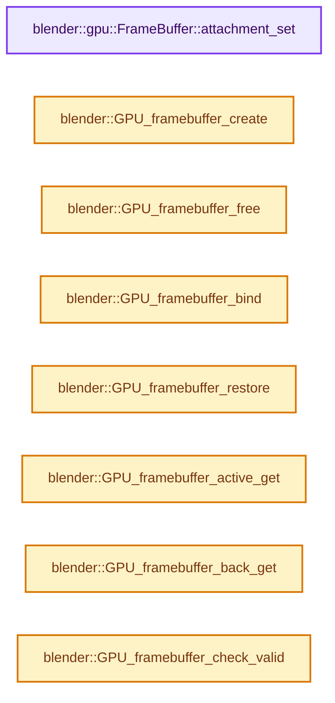

# 实现依赖专题：source/blender/gpu/intern/gpu_framebuffer.cc

[方向导航](README.md) · [符号索引](../%E7%AC%A6%E5%8F%B7%E4%BE%9D%E8%B5%96%E4%B8%8E%E5%AE%9E%E7%8E%B0%E7%B4%A2%E5%BC%95.md)

本专题从正文实际调用进入，集中保存共享实现。函数有稳定锚点，可从调用处直接跳到对应完整函数；递归与互相调用通过回链组织。

## 本文件的实现关系




## 完整成员与函数实现

<a id="f-81d5aa577963e93d"></a>

### `blender::gpu::FrameBuffer::attachment_set`

实现位置：[source/blender/gpu/intern/gpu_framebuffer.cc](../../../../../source/blender/gpu/intern/gpu_framebuffer.cc) · L76—L128。

接口参数：

- `GPUAttachmentType type`
- `const GPUAttachment &new_attachment`

**教学注释版**

<!-- annotated:e27d2b297e4570 -->

```cpp
void FrameBuffer::attachment_set(GPUAttachmentType type, const GPUAttachment &new_attachment)
{
  if (new_attachment.mip == -1) {
    return; /* GPU_ATTACHMENT_LEAVE */
  }

  if (type >= GPU_FB_MAX_ATTACHMENT) {
    fprintf(stderr,
            "GPUFramebuffer: Error: Trying to attach texture to type %d but maximum slot is %d.\n",
            type - GPU_FB_COLOR_ATTACHMENT0,
            GPU_FB_MAX_COLOR_ATTACHMENT);
    return;
  }

  if (new_attachment.tex) {
    if (new_attachment.layer > 0) {
      BLI_assert(GPU_texture_is_cube(new_attachment.tex) ||
                 GPU_texture_is_array(new_attachment.tex));
    }
    if (GPU_texture_has_stencil_format(new_attachment.tex)) {
      BLI_assert(ELEM(type, GPU_FB_DEPTH_STENCIL_ATTACHMENT));
    }
    else if (GPU_texture_has_depth_format(new_attachment.tex)) {
      BLI_assert(ELEM(type, GPU_FB_DEPTH_ATTACHMENT));
    }
  }

  GPUAttachment &attachment = attachments_[type];

  set_color_attachment_bit(type, new_attachment.tex != nullptr);

  if (attachment.tex == new_attachment.tex && attachment.layer == new_attachment.layer &&
      attachment.mip == new_attachment.mip)
  {
    return; /* Exact same texture already bound here. */
  }
  /* Unbind previous and bind new. */
  /* TODO(fclem): cleanup the casts. */
  if (attachment.tex) {
    reinterpret_cast<Texture *>(attachment.tex)->detach_from(this);
  }

  /* Might be null if this is for unbinding. */
  if (new_attachment.tex) {
    reinterpret_cast<Texture *>(new_attachment.tex)->attach_to(this, type);
  }
  else {
    /* GPU_ATTACHMENT_NONE */
  }

  attachment = new_attachment;
  dirty_attachments_ = true;
}
```

<details>
<summary>核对原始源码：source/blender/gpu/intern/gpu_framebuffer.cc · L76—L128</summary>

<!-- original:e27d2b297e4570:source/blender/gpu/intern/gpu_framebuffer.cc:76:128 -->

```cpp
void FrameBuffer::attachment_set(GPUAttachmentType type, const GPUAttachment &new_attachment)
{
  if (new_attachment.mip == -1) {
    return; /* GPU_ATTACHMENT_LEAVE */
  }

  if (type >= GPU_FB_MAX_ATTACHMENT) {
    fprintf(stderr,
            "GPUFramebuffer: Error: Trying to attach texture to type %d but maximum slot is %d.\n",
            type - GPU_FB_COLOR_ATTACHMENT0,
            GPU_FB_MAX_COLOR_ATTACHMENT);
    return;
  }

  if (new_attachment.tex) {
    if (new_attachment.layer > 0) {
      BLI_assert(GPU_texture_is_cube(new_attachment.tex) ||
                 GPU_texture_is_array(new_attachment.tex));
    }
    if (GPU_texture_has_stencil_format(new_attachment.tex)) {
      BLI_assert(ELEM(type, GPU_FB_DEPTH_STENCIL_ATTACHMENT));
    }
    else if (GPU_texture_has_depth_format(new_attachment.tex)) {
      BLI_assert(ELEM(type, GPU_FB_DEPTH_ATTACHMENT));
    }
  }

  GPUAttachment &attachment = attachments_[type];

  set_color_attachment_bit(type, new_attachment.tex != nullptr);

  if (attachment.tex == new_attachment.tex && attachment.layer == new_attachment.layer &&
      attachment.mip == new_attachment.mip)
  {
    return; /* Exact same texture already bound here. */
  }
  /* Unbind previous and bind new. */
  /* TODO(fclem): cleanup the casts. */
  if (attachment.tex) {
    reinterpret_cast<Texture *>(attachment.tex)->detach_from(this);
  }

  /* Might be null if this is for unbinding. */
  if (new_attachment.tex) {
    reinterpret_cast<Texture *>(new_attachment.tex)->attach_to(this, type);
  }
  else {
    /* GPU_ATTACHMENT_NONE */
  }

  attachment = new_attachment;
  dirty_attachments_ = true;
}
```

</details>

**沿实际写入检查状态**

- `attachment = new_attachment;`
- `dirty_attachments_ = true;`

**继续追踪实现**

- `fprintf` → [外部契约](https://eel.is/c++draft/)：这个边界按实际表达式及所属类型核对参数、返回值、寿命与失败行为。这里提供接口入口，不声称已解释该第三方版本的内部实现。
- `BLI_assert` → [BLI_assert · L48](../01-%E5%9F%BA%E7%A1%80%E5%AE%B9%E5%99%A8%E4%B8%8E%E7%8E%B0%E4%BB%A3CPP/%E4%BE%9D%E8%B5%96-BLI_assert-cc98e8.md#m-57a88495704d)；[BLI_assert · L63](../01-%E5%9F%BA%E7%A1%80%E5%AE%B9%E5%99%A8%E4%B8%8E%E7%8E%B0%E4%BB%A3CPP/%E4%BE%9D%E8%B5%96-BLI_assert-cc98e8.md#m-d07050020cb5)。宏定义由构建条件选择。
- `GPU_texture_is_cube` → [blender::GPU_texture_is_cube · L997](%E4%BE%9D%E8%B5%96-gpu_texture-234bda.md#f-375e4e4aecbcc279)。
- `GPU_texture_is_array` → [blender::GPU_texture_is_array · L1007](%E4%BE%9D%E8%B5%96-gpu_texture-234bda.md#f-e8d9a3fdb913720c)。
- `GPU_texture_has_stencil_format` → [blender::GPU_texture_has_stencil_format · L967](%E4%BE%9D%E8%B5%96-gpu_texture-234bda.md#f-990956722e1a23a9)。
- `ELEM` → [ELEM · L88](%E4%BE%9D%E8%B5%96-GHOST_utildefines-34b996.md#m-d28724a15928)；[ELEM · L135](../01-%E5%9F%BA%E7%A1%80%E5%AE%B9%E5%99%A8%E4%B8%8E%E7%8E%B0%E4%BB%A3CPP/%E4%BE%9D%E8%B5%96-BLI_utildefines-293a0a.md#m-d6572de7cae0)。宏定义由构建条件选择。
- `GPU_texture_has_depth_format` → [blender::GPU_texture_has_depth_format · L962](%E4%BE%9D%E8%B5%96-gpu_texture-234bda.md#f-aa2a91aea7f22c9f)。
- `set_color_attachment_bit` → [blender::gpu::FrameBuffer::set_color_attachment_bit · L136](%E4%BE%9D%E8%B5%96-gpu_framebuffer_private-e365da.md#f-395c422f1a0f4233)。
- `reinterpret_cast<Texture *>(attachment.tex)->detach_from` → [调用协议](../%E6%A8%A1%E6%9D%BF%E5%AE%8F%E4%B8%8E%E5%8A%A8%E6%80%81%E5%88%86%E6%B4%BE%E5%8D%8F%E8%AE%AE.md)：接收对象类型依赖auto、返回值或模板实例；不按同名猜测目标。调用位置L115。
- `reinterpret_cast<Texture *>(new_attachment.tex)->attach_to` → [调用协议](../%E6%A8%A1%E6%9D%BF%E5%AE%8F%E4%B8%8E%E5%8A%A8%E6%80%81%E5%88%86%E6%B4%BE%E5%8D%8F%E8%AE%AE.md)：接收对象类型依赖auto、返回值或模板实例；不按同名猜测目标。调用位置L120。

<a id="f-774e057b3b8fe207"></a>

### `blender::GPU_framebuffer_create`

实现位置：[source/blender/gpu/intern/gpu_framebuffer.cc](../../../../../source/blender/gpu/intern/gpu_framebuffer.cc) · L226—L231。

接口参数：

- `const char *name`

**教学注释版**

<!-- annotated:cdaabfa4881cc5 -->

```cpp
gpu::FrameBuffer *GPU_framebuffer_create(const char *name)
{
  /* We generate the FB object later at first use in order to
   * create the frame-buffer in the right opengl context. */
  return GPUBackend::get()->framebuffer_alloc(name);
}
```

<details>
<summary>核对原始源码：source/blender/gpu/intern/gpu_framebuffer.cc · L226—L231</summary>

<!-- original:cdaabfa4881cc5:source/blender/gpu/intern/gpu_framebuffer.cc:226:231 -->

```cpp
gpu::FrameBuffer *GPU_framebuffer_create(const char *name)
{
  /* We generate the FB object later at first use in order to
   * create the frame-buffer in the right opengl context. */
  return GPUBackend::get()->framebuffer_alloc(name);
}
```

</details>

**结果出口**

- `return GPUBackend::get()->framebuffer_alloc(name);`

**继续追踪实现**

- `GPUBackend::get()->framebuffer_alloc` → [调用协议](../%E6%A8%A1%E6%9D%BF%E5%AE%8F%E4%B8%8E%E5%8A%A8%E6%80%81%E5%88%86%E6%B4%BE%E5%8D%8F%E8%AE%AE.md)：接收对象类型依赖auto、返回值或模板实例；不按同名猜测目标。调用位置L230。
- `GPUBackend::get` → [blender::GPUBackend::get · L642](%E4%BE%9D%E8%B5%96-gpu_context-77a234.md#f-c876dc1cb5bd7700)。

<a id="f-415244998018c27e"></a>

### `blender::GPU_framebuffer_free`

实现位置：[source/blender/gpu/intern/gpu_framebuffer.cc](../../../../../source/blender/gpu/intern/gpu_framebuffer.cc) · L233—L236。

接口参数：

- `gpu::FrameBuffer *fb`

**教学注释版**

<!-- annotated:e16aadbfe5493a -->

```cpp
void GPU_framebuffer_free(gpu::FrameBuffer *fb)
{
  delete fb;
}
```

<details>
<summary>核对原始源码：source/blender/gpu/intern/gpu_framebuffer.cc · L233—L236</summary>

<!-- original:e16aadbfe5493a:source/blender/gpu/intern/gpu_framebuffer.cc:233:236 -->

```cpp
void GPU_framebuffer_free(gpu::FrameBuffer *fb)
{
  delete fb;
}
```

</details>

**继续追踪实现**

本实现没有需要继续展开的显式调用；检查返回表达式、对象转换和调用者前置条件。

<a id="f-0d0c4adf5c9771fd"></a>

### `blender::GPU_framebuffer_bind`

实现位置：[source/blender/gpu/intern/gpu_framebuffer.cc](../../../../../source/blender/gpu/intern/gpu_framebuffer.cc) · L245—L251。

接口参数：

- `gpu::FrameBuffer *fb`

**教学注释版**

<!-- annotated:c471b2e51e8a63 -->

```cpp
void GPU_framebuffer_bind(gpu::FrameBuffer *fb)
{
  const bool enable_srgb = true;
  /* Disable custom loadstore and bind. */
  fb->set_use_explicit_loadstore(false);
  fb->bind(enable_srgb);
}
```

<details>
<summary>核对原始源码：source/blender/gpu/intern/gpu_framebuffer.cc · L245—L251</summary>

<!-- original:c471b2e51e8a63:source/blender/gpu/intern/gpu_framebuffer.cc:245:251 -->

```cpp
void GPU_framebuffer_bind(gpu::FrameBuffer *fb)
{
  const bool enable_srgb = true;
  /* Disable custom loadstore and bind. */
  fb->set_use_explicit_loadstore(false);
  fb->bind(enable_srgb);
}
```

</details>

**继续追踪实现**

- `fb->set_use_explicit_loadstore` → [blender::gpu::FrameBuffer::set_use_explicit_loadstore · L262](%E4%BE%9D%E8%B5%96-gpu_framebuffer_private-e365da.md#f-66430ceb7a2e71fb)。
- `fb->bind` → [blender::GLShader::bind · L1410](%E4%BE%9D%E8%B5%96-gl_shader-766737.md#f-7374ce386abefd3f)；[blender::GLBatch::bind · L239](%E4%BE%9D%E8%B5%96-gl_batch-d8877a.md#f-09d832d1583277b2)。同名重载需按实参类型选择。

<a id="f-d742b8c64e0b18a0"></a>

### `blender::GPU_framebuffer_restore`

实现位置：[source/blender/gpu/intern/gpu_framebuffer.cc](../../../../../source/blender/gpu/intern/gpu_framebuffer.cc) · L292—L295。

**教学注释版**

<!-- annotated:b7f031fa65c344 -->

```cpp
void GPU_framebuffer_restore()
{
  Context::get()->back_left->bind(false);
}
```

<details>
<summary>核对原始源码：source/blender/gpu/intern/gpu_framebuffer.cc · L292—L295</summary>

<!-- original:b7f031fa65c344:source/blender/gpu/intern/gpu_framebuffer.cc:292:295 -->

```cpp
void GPU_framebuffer_restore()
{
  Context::get()->back_left->bind(false);
}
```

</details>

**继续追踪实现**

- `Context::get()->back_left->bind` → [调用协议](../%E6%A8%A1%E6%9D%BF%E5%AE%8F%E4%B8%8E%E5%8A%A8%E6%80%81%E5%88%86%E6%B4%BE%E5%8D%8F%E8%AE%AE.md)：接收对象类型依赖auto、返回值或模板实例；不按同名猜测目标。调用位置L294。
- `Context::get` → [blender::gpu::Context::get · L127](%E4%BE%9D%E8%B5%96-gpu_context-77a234.md#f-7ca16707244f2d11)。

<a id="f-ebdb4dc041100a0d"></a>

### `blender::GPU_framebuffer_active_get`

实现位置：[source/blender/gpu/intern/gpu_framebuffer.cc](../../../../../source/blender/gpu/intern/gpu_framebuffer.cc) · L297—L301。

**教学注释版**

<!-- annotated:a458324f5734ec -->

```cpp
gpu::FrameBuffer *GPU_framebuffer_active_get()
{
  Context *ctx = Context::get();
  return ctx ? ctx->active_fb : nullptr;
}
```

<details>
<summary>核对原始源码：source/blender/gpu/intern/gpu_framebuffer.cc · L297—L301</summary>

<!-- original:a458324f5734ec:source/blender/gpu/intern/gpu_framebuffer.cc:297:301 -->

```cpp
gpu::FrameBuffer *GPU_framebuffer_active_get()
{
  Context *ctx = Context::get();
  return ctx ? ctx->active_fb : nullptr;
}
```

</details>

**结果出口**

- `return ctx ? ctx->active_fb : nullptr;`

**继续追踪实现**

- `Context::get` → [blender::gpu::Context::get · L127](%E4%BE%9D%E8%B5%96-gpu_context-77a234.md#f-7ca16707244f2d11)。

<a id="f-d092ae819762f1bd"></a>

### `blender::GPU_framebuffer_back_get`

实现位置：[source/blender/gpu/intern/gpu_framebuffer.cc](../../../../../source/blender/gpu/intern/gpu_framebuffer.cc) · L303—L307。

**教学注释版**

<!-- annotated:ebf79c94d49c7c -->

```cpp
gpu::FrameBuffer *GPU_framebuffer_back_get()
{
  Context *ctx = Context::get();
  return ctx ? ctx->back_left : nullptr;
}
```

<details>
<summary>核对原始源码：source/blender/gpu/intern/gpu_framebuffer.cc · L303—L307</summary>

<!-- original:ebf79c94d49c7c:source/blender/gpu/intern/gpu_framebuffer.cc:303:307 -->

```cpp
gpu::FrameBuffer *GPU_framebuffer_back_get()
{
  Context *ctx = Context::get();
  return ctx ? ctx->back_left : nullptr;
}
```

</details>

**结果出口**

- `return ctx ? ctx->back_left : nullptr;`

**继续追踪实现**

- `Context::get` → [blender::gpu::Context::get · L127](%E4%BE%9D%E8%B5%96-gpu_context-77a234.md#f-7ca16707244f2d11)。

<a id="f-cba0ed43019d2137"></a>

### `blender::GPU_framebuffer_check_valid`

实现位置：[source/blender/gpu/intern/gpu_framebuffer.cc](../../../../../source/blender/gpu/intern/gpu_framebuffer.cc) · L316—L319。

接口参数：

- `gpu::FrameBuffer *gpu_fb`
- `char err_out[256]`

**教学注释版**

<!-- annotated:d5ad6f8215525b -->

```cpp
bool GPU_framebuffer_check_valid(gpu::FrameBuffer *gpu_fb, char err_out[256])
{
  return gpu_fb->check(err_out);
}
```

<details>
<summary>核对原始源码：source/blender/gpu/intern/gpu_framebuffer.cc · L316—L319</summary>

<!-- original:d5ad6f8215525b:source/blender/gpu/intern/gpu_framebuffer.cc:316:319 -->

```cpp
bool GPU_framebuffer_check_valid(gpu::FrameBuffer *gpu_fb, char err_out[256])
{
  return gpu_fb->check(err_out);
}
```

</details>

**结果出口**

- `return gpu_fb->check(err_out);`

**继续追踪实现**

- `gpu_fb->check` → [blender::check · L50](../01-%E5%9F%BA%E7%A1%80%E5%AE%B9%E5%99%A8%E4%B8%8E%E7%8E%B0%E4%BB%A3CPP/%E4%BE%9D%E8%B5%96-BLI_subprocess-32585a.md#f-5e2096d4b4f0fab7)；[blender::check · L257](../01-%E5%9F%BA%E7%A1%80%E5%AE%B9%E5%99%A8%E4%B8%8E%E7%8E%B0%E4%BB%A3CPP/%E4%BE%9D%E8%B5%96-BLI_subprocess-32585a.md#f-af801c412f160c15)。同名重载需按实参类型选择。

<a id="f-1a9deabccf418ff2"></a>

### `blender::GPU_framebuffer_config_array`

实现位置：[source/blender/gpu/intern/gpu_framebuffer.cc](../../../../../source/blender/gpu/intern/gpu_framebuffer.cc) · L355—L382。

接口参数：

- `gpu::FrameBuffer *fb`
- `const GPUAttachment *config`
- `int config_len`

**教学注释版**

<!-- annotated:d5fc55b12409f1 -->

```cpp
void GPU_framebuffer_config_array(gpu::FrameBuffer *fb,
                                  const GPUAttachment *config,
                                  int config_len)
{
  const GPUAttachment &depth_attachment = config[0];
  Span<GPUAttachment> color_attachments(config + 1, config_len - 1);

  if (depth_attachment.mip == -1) {
    /* GPU_ATTACHMENT_LEAVE */
  }
  else if (depth_attachment.tex == nullptr) {
    /* GPU_ATTACHMENT_NONE: Need to clear both targets. */
    fb->attachment_set(GPU_FB_DEPTH_STENCIL_ATTACHMENT, depth_attachment);
    fb->attachment_set(GPU_FB_DEPTH_ATTACHMENT, depth_attachment);
  }
  else {
    GPUAttachmentType type = GPU_texture_has_stencil_format(depth_attachment.tex) ?
                                 GPU_FB_DEPTH_STENCIL_ATTACHMENT :
                                 GPU_FB_DEPTH_ATTACHMENT;
    fb->attachment_set(type, depth_attachment);
  }

  GPUAttachmentType type = GPU_FB_COLOR_ATTACHMENT0;
  for (const GPUAttachment &attachment : color_attachments) {
    fb->attachment_set(type, attachment);
    ++type;
  }
}
```

<details>
<summary>核对原始源码：source/blender/gpu/intern/gpu_framebuffer.cc · L355—L382</summary>

<!-- original:d5fc55b12409f1:source/blender/gpu/intern/gpu_framebuffer.cc:355:382 -->

```cpp
void GPU_framebuffer_config_array(gpu::FrameBuffer *fb,
                                  const GPUAttachment *config,
                                  int config_len)
{
  const GPUAttachment &depth_attachment = config[0];
  Span<GPUAttachment> color_attachments(config + 1, config_len - 1);

  if (depth_attachment.mip == -1) {
    /* GPU_ATTACHMENT_LEAVE */
  }
  else if (depth_attachment.tex == nullptr) {
    /* GPU_ATTACHMENT_NONE: Need to clear both targets. */
    fb->attachment_set(GPU_FB_DEPTH_STENCIL_ATTACHMENT, depth_attachment);
    fb->attachment_set(GPU_FB_DEPTH_ATTACHMENT, depth_attachment);
  }
  else {
    GPUAttachmentType type = GPU_texture_has_stencil_format(depth_attachment.tex) ?
                                 GPU_FB_DEPTH_STENCIL_ATTACHMENT :
                                 GPU_FB_DEPTH_ATTACHMENT;
    fb->attachment_set(type, depth_attachment);
  }

  GPUAttachmentType type = GPU_FB_COLOR_ATTACHMENT0;
  for (const GPUAttachment &attachment : color_attachments) {
    fb->attachment_set(type, attachment);
    ++type;
  }
}
```

</details>

**继续追踪实现**

- `fb->attachment_set` → [blender::gpu::FrameBuffer::attachment_set · L76](%E4%BE%9D%E8%B5%96-gpu_framebuffer-cfe3fe.md#f-81d5aa577963e93d)。
- `GPU_texture_has_stencil_format` → [blender::GPU_texture_has_stencil_format · L967](%E4%BE%9D%E8%B5%96-gpu_texture-234bda.md#f-990956722e1a23a9)。

<a id="f-4bf5fc6e7feb2dc8"></a>

### `blender::GPU_framebuffer_default_size`

实现位置：[source/blender/gpu/intern/gpu_framebuffer.cc](../../../../../source/blender/gpu/intern/gpu_framebuffer.cc) · L384—L387。

接口参数：

- `gpu::FrameBuffer *gpu_fb`
- `int width`
- `int height`

**教学注释版**

<!-- annotated:3912939a30621c -->

```cpp
void GPU_framebuffer_default_size(gpu::FrameBuffer *gpu_fb, int width, int height)
{
  gpu_fb->default_size_set(width, height);
}
```

<details>
<summary>核对原始源码：source/blender/gpu/intern/gpu_framebuffer.cc · L384—L387</summary>

<!-- original:3912939a30621c:source/blender/gpu/intern/gpu_framebuffer.cc:384:387 -->

```cpp
void GPU_framebuffer_default_size(gpu::FrameBuffer *gpu_fb, int width, int height)
{
  gpu_fb->default_size_set(width, height);
}
```

</details>

**继续追踪实现**

- `gpu_fb->default_size_set` → [blender::gpu::FrameBuffer::default_size_set · L170](%E4%BE%9D%E8%B5%96-gpu_framebuffer_private-e365da.md#f-4b719af312e551c4)。

<a id="f-7be137bb5c9d8623"></a>

### `blender::GPU_framebuffer_viewport_reset`

实现位置：[source/blender/gpu/intern/gpu_framebuffer.cc](../../../../../source/blender/gpu/intern/gpu_framebuffer.cc) · L413—L416。

接口参数：

- `gpu::FrameBuffer *gpu_fb`

**教学注释版**

<!-- annotated:5727bb7edca2bc -->

```cpp
void GPU_framebuffer_viewport_reset(gpu::FrameBuffer *gpu_fb)
{
  gpu_fb->viewport_reset();
}
```

<details>
<summary>核对原始源码：source/blender/gpu/intern/gpu_framebuffer.cc · L413—L416</summary>

<!-- original:5727bb7edca2bc:source/blender/gpu/intern/gpu_framebuffer.cc:413:416 -->

```cpp
void GPU_framebuffer_viewport_reset(gpu::FrameBuffer *gpu_fb)
{
  gpu_fb->viewport_reset();
}
```

</details>

**继续追踪实现**

- `gpu_fb->viewport_reset` → [blender::gpu::FrameBuffer::viewport_reset · L227](%E4%BE%9D%E8%B5%96-gpu_framebuffer_private-e365da.md#f-a1cc648fb36eb95b)。

<a id="f-cd86daa36b8d5941"></a>

### `blender::check_clear_color`

实现位置：[source/blender/gpu/intern/gpu_framebuffer.cc](../../../../../source/blender/gpu/intern/gpu_framebuffer.cc) · L421—L447。

接口参数：

- `const Texture *tex`
- `double4 clear_value`
- `int attachment`

**教学注释版**

<!-- annotated:9c6f77643fa958 -->

```cpp
static void check_clear_color(const Texture *tex, double4 clear_value, int attachment)
{
  GPUTextureFormatFlag flag = tex->format_flag_get();

  if ((flag & GPU_FORMAT_INTEGER) && (flag & GPU_FORMAT_SIGNED)) {
    int4 data = int4(clear_value);
    if (double4(data) != clear_value) {
      CLOG_WARN(&LOG,
                "Lossy conversion when clearing integer attachment %d: "
                "(%f, %f, %f, %f) > (%d, %d, %d, %d)",
                attachment,
                UNPACK4(clear_value),
                UNPACK4(data));
    }
  }
  else if ((flag & GPU_FORMAT_INTEGER) && !(flag & GPU_FORMAT_SIGNED)) {
    uint4 data = uint4(clear_value);
    if (double4(data) != clear_value) {
      CLOG_WARN(&LOG,
                "Lossy conversion when clearing unsigned integer attachment %d: "
                "(%f, %f, %f, %f) > (%u, %u, %u, %u)",
                attachment,
                UNPACK4(clear_value),
                UNPACK4(data));
    }
  }
}
```

<details>
<summary>核对原始源码：source/blender/gpu/intern/gpu_framebuffer.cc · L421—L447</summary>

<!-- original:9c6f77643fa958:source/blender/gpu/intern/gpu_framebuffer.cc:421:447 -->

```cpp
static void check_clear_color(const Texture *tex, double4 clear_value, int attachment)
{
  GPUTextureFormatFlag flag = tex->format_flag_get();

  if ((flag & GPU_FORMAT_INTEGER) && (flag & GPU_FORMAT_SIGNED)) {
    int4 data = int4(clear_value);
    if (double4(data) != clear_value) {
      CLOG_WARN(&LOG,
                "Lossy conversion when clearing integer attachment %d: "
                "(%f, %f, %f, %f) > (%d, %d, %d, %d)",
                attachment,
                UNPACK4(clear_value),
                UNPACK4(data));
    }
  }
  else if ((flag & GPU_FORMAT_INTEGER) && !(flag & GPU_FORMAT_SIGNED)) {
    uint4 data = uint4(clear_value);
    if (double4(data) != clear_value) {
      CLOG_WARN(&LOG,
                "Lossy conversion when clearing unsigned integer attachment %d: "
                "(%f, %f, %f, %f) > (%u, %u, %u, %u)",
                attachment,
                UNPACK4(clear_value),
                UNPACK4(data));
    }
  }
}
```

</details>

**继续追踪实现**

- `tex->format_flag_get` → [blender::gpu::Texture::format_flag_get · L307](%E4%BE%9D%E8%B5%96-gpu_texture_private-c1aac7.md#f-4868a0a502f019d6)。
- `int4` → [int4 · L645](%E4%BE%9D%E8%B5%96-smaa-b67bc2.md#m-98b3207edab6)。宏定义由构建条件选择。
- `double4` → [调用协议](../%E6%A8%A1%E6%9D%BF%E5%AE%8F%E4%B8%8E%E5%8A%A8%E6%80%81%E5%88%86%E6%B4%BE%E5%8D%8F%E8%AE%AE.md)：函数指针、局部可调用对象或未展开的宏；必须结合调用者环境。调用位置L427。
- `CLOG_WARN` → [CLOG_WARN · L189](%E4%BE%9D%E8%B5%96-CLG_log-e9051b.md#m-9da21a06cdbe)。宏定义由构建条件选择。
- `UNPACK4` → [UNPACK4 · L24](%E4%BE%9D%E8%B5%96-GHOST_utildefines-34b996.md#m-b619f32aee40)；[UNPACK4 · L236](../01-%E5%9F%BA%E7%A1%80%E5%AE%B9%E5%99%A8%E4%B8%8E%E7%8E%B0%E4%BB%A3CPP/%E4%BE%9D%E8%B5%96-BLI_utildefines-293a0a.md#m-42ac26c4645f)；[UNPACK4 · L15](%E4%BE%9D%E8%B5%96-gpu_shader_utildefines.bsl-e9f199.md#m-7d8078767f53)。宏定义由构建条件选择。
- `uint4` → [uint4](%E4%BE%9D%E8%B5%96-types_uint4-675ccb.md#t-758c723e200c)。

<a id="f-276170825915c133"></a>

### `blender::GPU_framebuffer_clear`

实现位置：[source/blender/gpu/intern/gpu_framebuffer.cc](../../../../../source/blender/gpu/intern/gpu_framebuffer.cc) · L449—L469。

接口参数：

- `gpu::FrameBuffer *gpu_fb`
- `GPUFrameBufferBits buffers`
- `const double4 clear_col`
- `float clear_depth`
- `uint clear_stencil`

**教学注释版**

<!-- annotated:73c4e0009a4e4d -->

```cpp
void GPU_framebuffer_clear(gpu::FrameBuffer *gpu_fb,
                           GPUFrameBufferBits buffers,
                           const double4 clear_col,
                           float clear_depth,
                           uint clear_stencil)
{
  BLI_assert_msg(gpu_fb->get_use_explicit_loadstore() == false,
                 "Using GPU_framebuffer_clear_* functions in conjunction with custom load-store "
                 "state via GPU_framebuffer_bind_ex is invalid.");

  if ((G.debug & G_DEBUG_GPU) && (buffers & GPU_COLOR_BIT)) {
    for (int i = 0; i < GPU_FB_MAX_COLOR_ATTACHMENT; i++) {
      Texture *tex = gpu_fb->color_tex(i);
      if (tex != nullptr) {
        check_clear_color(tex, clear_col, i);
      }
    }
  }

  gpu_fb->clear(buffers, clear_col, clear_depth, clear_stencil);
}
```

<details>
<summary>核对原始源码：source/blender/gpu/intern/gpu_framebuffer.cc · L449—L469</summary>

<!-- original:73c4e0009a4e4d:source/blender/gpu/intern/gpu_framebuffer.cc:449:469 -->

```cpp
void GPU_framebuffer_clear(gpu::FrameBuffer *gpu_fb,
                           GPUFrameBufferBits buffers,
                           const double4 clear_col,
                           float clear_depth,
                           uint clear_stencil)
{
  BLI_assert_msg(gpu_fb->get_use_explicit_loadstore() == false,
                 "Using GPU_framebuffer_clear_* functions in conjunction with custom load-store "
                 "state via GPU_framebuffer_bind_ex is invalid.");

  if ((G.debug & G_DEBUG_GPU) && (buffers & GPU_COLOR_BIT)) {
    for (int i = 0; i < GPU_FB_MAX_COLOR_ATTACHMENT; i++) {
      Texture *tex = gpu_fb->color_tex(i);
      if (tex != nullptr) {
        check_clear_color(tex, clear_col, i);
      }
    }
  }

  gpu_fb->clear(buffers, clear_col, clear_depth, clear_stencil);
}
```

</details>

**继续追踪实现**

- `BLI_assert_msg` → [BLI_assert_msg · L55](../01-%E5%9F%BA%E7%A1%80%E5%AE%B9%E5%99%A8%E4%B8%8E%E7%8E%B0%E4%BB%A3CPP/%E4%BE%9D%E8%B5%96-BLI_assert-cc98e8.md#m-695eed20dceb)；[BLI_assert_msg · L64](../01-%E5%9F%BA%E7%A1%80%E5%AE%B9%E5%99%A8%E4%B8%8E%E7%8E%B0%E4%BB%A3CPP/%E4%BE%9D%E8%B5%96-BLI_assert-cc98e8.md#m-7de5563de4db)。宏定义由构建条件选择。
- `gpu_fb->get_use_explicit_loadstore` → [blender::gpu::FrameBuffer::get_use_explicit_loadstore · L267](%E4%BE%9D%E8%B5%96-gpu_framebuffer_private-e365da.md#f-5fc3fbabce7da755)。
- `gpu_fb->color_tex` → [blender::gpu::FrameBuffer::color_tex · L252](%E4%BE%9D%E8%B5%96-gpu_framebuffer_private-e365da.md#f-9c213f6faeb7003a)。
- `check_clear_color` → [blender::check_clear_color · L421](%E4%BE%9D%E8%B5%96-gpu_framebuffer-cfe3fe.md#f-cd86daa36b8d5941)。
- `gpu_fb->clear` → [blender::GVectorArray::clear · L70](../01-%E5%9F%BA%E7%A1%80%E5%AE%B9%E5%99%A8%E4%B8%8E%E7%8E%B0%E4%BB%A3CPP/%E4%BE%9D%E8%B5%96-generic_vector_array-7f86fb.md#f-c1d1074690264f12)；[blender::SortedFCurveBuffer::clear · L52](%E4%BE%9D%E8%B5%96-anim_convert-9192df.md#f-ce90e82a26cfe48c)；[blender::bNodeTreeInterfacePanel::clear · L1115](%E4%BE%9D%E8%B5%96-node_tree_interface-893d31.md#f-ecd53bd40ed5c756)；[blender::DRWViewData::clear · L78](%E4%BE%9D%E8%B5%96-draw_view_data-a5cb02.md#f-bb5156f3cc4be47b)；[blender::GLSharedOrphanLists::OrphanList::clear · L204](%E4%BE%9D%E8%B5%96-gl_context-43fe84.md#f-eed15c5c57f2e985)；[blender::GLVaoCache::clear · L140](%E4%BE%9D%E8%B5%96-gl_batch-d8877a.md#f-df1d6a2626841273)；[blender::clear · L213](%E4%BE%9D%E8%B5%96-msgfmt-76f41a.md#f-4d1f550b2a1999e3)。同名重载需按实参类型选择。

<a id="f-f3d83793fb50a69e"></a>

### `blender::GPU_framebuffer_clear_color`

实现位置：[source/blender/gpu/intern/gpu_framebuffer.cc](../../../../../source/blender/gpu/intern/gpu_framebuffer.cc) · L471—L474。

接口参数：

- `gpu::FrameBuffer *fb`
- `const double4 clear_col`

**教学注释版**

<!-- annotated:728fefab936513 -->

```cpp
void GPU_framebuffer_clear_color(gpu::FrameBuffer *fb, const double4 clear_col)
{
  GPU_framebuffer_clear(fb, GPU_COLOR_BIT, clear_col, 0.0f, 0x00);
}
```

<details>
<summary>核对原始源码：source/blender/gpu/intern/gpu_framebuffer.cc · L471—L474</summary>

<!-- original:728fefab936513:source/blender/gpu/intern/gpu_framebuffer.cc:471:474 -->

```cpp
void GPU_framebuffer_clear_color(gpu::FrameBuffer *fb, const double4 clear_col)
{
  GPU_framebuffer_clear(fb, GPU_COLOR_BIT, clear_col, 0.0f, 0x00);
}
```

</details>

**继续追踪实现**

- `GPU_framebuffer_clear` → [blender::GPU_framebuffer_clear · L449](%E4%BE%9D%E8%B5%96-gpu_framebuffer-cfe3fe.md#f-276170825915c133)。

<a id="f-8e9737dcb05d7088"></a>

### `blender::GPU_framebuffer_clear_depth`

实现位置：[source/blender/gpu/intern/gpu_framebuffer.cc](../../../../../source/blender/gpu/intern/gpu_framebuffer.cc) · L476—L479。

接口参数：

- `gpu::FrameBuffer *fb`
- `float clear_depth`

**教学注释版**

<!-- annotated:46303c9f28b887 -->

```cpp
void GPU_framebuffer_clear_depth(gpu::FrameBuffer *fb, float clear_depth)
{
  GPU_framebuffer_clear(fb, GPU_DEPTH_BIT, double4{}, clear_depth, 0x00);
}
```

<details>
<summary>核对原始源码：source/blender/gpu/intern/gpu_framebuffer.cc · L476—L479</summary>

<!-- original:46303c9f28b887:source/blender/gpu/intern/gpu_framebuffer.cc:476:479 -->

```cpp
void GPU_framebuffer_clear_depth(gpu::FrameBuffer *fb, float clear_depth)
{
  GPU_framebuffer_clear(fb, GPU_DEPTH_BIT, double4{}, clear_depth, 0x00);
}
```

</details>

**继续追踪实现**

- `GPU_framebuffer_clear` → [blender::GPU_framebuffer_clear · L449](%E4%BE%9D%E8%B5%96-gpu_framebuffer-cfe3fe.md#f-276170825915c133)。

<a id="f-657653aed1d79ab4"></a>

### `blender::GPU_framebuffer_clear_color_depth`

实现位置：[source/blender/gpu/intern/gpu_framebuffer.cc](../../../../../source/blender/gpu/intern/gpu_framebuffer.cc) · L481—L486。

接口参数：

- `gpu::FrameBuffer *fb`
- `const double4 clear_col`
- `float clear_depth`

**教学注释版**

<!-- annotated:6be370997530ee -->

```cpp
void GPU_framebuffer_clear_color_depth(gpu::FrameBuffer *fb,
                                       const double4 clear_col,
                                       float clear_depth)
{
  GPU_framebuffer_clear(fb, GPU_COLOR_BIT | GPU_DEPTH_BIT, clear_col, clear_depth, 0x00);
}
```

<details>
<summary>核对原始源码：source/blender/gpu/intern/gpu_framebuffer.cc · L481—L486</summary>

<!-- original:6be370997530ee:source/blender/gpu/intern/gpu_framebuffer.cc:481:486 -->

```cpp
void GPU_framebuffer_clear_color_depth(gpu::FrameBuffer *fb,
                                       const double4 clear_col,
                                       float clear_depth)
{
  GPU_framebuffer_clear(fb, GPU_COLOR_BIT | GPU_DEPTH_BIT, clear_col, clear_depth, 0x00);
}
```

</details>

**继续追踪实现**

- `GPU_framebuffer_clear` → [blender::GPU_framebuffer_clear · L449](%E4%BE%9D%E8%B5%96-gpu_framebuffer-cfe3fe.md#f-276170825915c133)。

<a id="f-18e7d39b0677df33"></a>

### `blender::GPU_framebuffer_clear_depth_stencil`

实现位置：[source/blender/gpu/intern/gpu_framebuffer.cc](../../../../../source/blender/gpu/intern/gpu_framebuffer.cc) · L493—L499。

接口参数：

- `gpu::FrameBuffer *fb`
- `float clear_depth`
- `uint clear_stencil`

**教学注释版**

<!-- annotated:45a68344dd545f -->

```cpp
void GPU_framebuffer_clear_depth_stencil(gpu::FrameBuffer *fb,
                                         float clear_depth,
                                         uint clear_stencil)
{
  GPU_framebuffer_clear(
      fb, GPU_DEPTH_BIT | GPU_STENCIL_BIT, double4{}, clear_depth, clear_stencil);
}
```

<details>
<summary>核对原始源码：source/blender/gpu/intern/gpu_framebuffer.cc · L493—L499</summary>

<!-- original:45a68344dd545f:source/blender/gpu/intern/gpu_framebuffer.cc:493:499 -->

```cpp
void GPU_framebuffer_clear_depth_stencil(gpu::FrameBuffer *fb,
                                         float clear_depth,
                                         uint clear_stencil)
{
  GPU_framebuffer_clear(
      fb, GPU_DEPTH_BIT | GPU_STENCIL_BIT, double4{}, clear_depth, clear_stencil);
}
```

</details>

**继续追踪实现**

- `GPU_framebuffer_clear` → [blender::GPU_framebuffer_clear · L449](%E4%BE%9D%E8%B5%96-gpu_framebuffer-cfe3fe.md#f-276170825915c133)。

<a id="f-6f89e84d183c8852"></a>

### `blender::GPU_framebuffer_multi_clear`

实现位置：[source/blender/gpu/intern/gpu_framebuffer.cc](../../../../../source/blender/gpu/intern/gpu_framebuffer.cc) · L510—L526。

接口参数：

- `gpu::FrameBuffer *fb`
- `Span<double4> clear_colors`

**教学注释版**

<!-- annotated:84560a9fa250c2 -->

```cpp
void GPU_framebuffer_multi_clear(gpu::FrameBuffer *fb, Span<double4> clear_colors)
{
  BLI_assert_msg(fb->get_use_explicit_loadstore() == false,
                 "Using GPU_framebuffer_clear_* functions in conjunction with custom load-store "
                 "state via GPU_framebuffer_bind_ex is invalid.");

  if (G.debug & G_DEBUG_GPU) {
    for (int i = 0; i < GPU_FB_MAX_COLOR_ATTACHMENT; i++) {
      Texture *tex = fb->color_tex(i);
      if (tex != nullptr) {
        check_clear_color(tex, clear_colors[i], i);
      }
    }
  }

  fb->clear_multi(clear_colors);
}
```

<details>
<summary>核对原始源码：source/blender/gpu/intern/gpu_framebuffer.cc · L510—L526</summary>

<!-- original:84560a9fa250c2:source/blender/gpu/intern/gpu_framebuffer.cc:510:526 -->

```cpp
void GPU_framebuffer_multi_clear(gpu::FrameBuffer *fb, Span<double4> clear_colors)
{
  BLI_assert_msg(fb->get_use_explicit_loadstore() == false,
                 "Using GPU_framebuffer_clear_* functions in conjunction with custom load-store "
                 "state via GPU_framebuffer_bind_ex is invalid.");

  if (G.debug & G_DEBUG_GPU) {
    for (int i = 0; i < GPU_FB_MAX_COLOR_ATTACHMENT; i++) {
      Texture *tex = fb->color_tex(i);
      if (tex != nullptr) {
        check_clear_color(tex, clear_colors[i], i);
      }
    }
  }

  fb->clear_multi(clear_colors);
}
```

</details>

**继续追踪实现**

- `BLI_assert_msg` → [BLI_assert_msg · L55](../01-%E5%9F%BA%E7%A1%80%E5%AE%B9%E5%99%A8%E4%B8%8E%E7%8E%B0%E4%BB%A3CPP/%E4%BE%9D%E8%B5%96-BLI_assert-cc98e8.md#m-695eed20dceb)；[BLI_assert_msg · L64](../01-%E5%9F%BA%E7%A1%80%E5%AE%B9%E5%99%A8%E4%B8%8E%E7%8E%B0%E4%BB%A3CPP/%E4%BE%9D%E8%B5%96-BLI_assert-cc98e8.md#m-7de5563de4db)。宏定义由构建条件选择。
- `fb->get_use_explicit_loadstore` → [blender::gpu::FrameBuffer::get_use_explicit_loadstore · L267](%E4%BE%9D%E8%B5%96-gpu_framebuffer_private-e365da.md#f-5fc3fbabce7da755)。
- `fb->color_tex` → [blender::gpu::FrameBuffer::color_tex · L252](%E4%BE%9D%E8%B5%96-gpu_framebuffer_private-e365da.md#f-9c213f6faeb7003a)。
- `check_clear_color` → [blender::check_clear_color · L421](%E4%BE%9D%E8%B5%96-gpu_framebuffer-cfe3fe.md#f-cd86daa36b8d5941)。
- `fb->clear_multi` → [调用协议](../%E6%A8%A1%E6%9D%BF%E5%AE%8F%E4%B8%8E%E5%8A%A8%E6%80%81%E5%88%86%E6%B4%BE%E5%8D%8F%E8%AE%AE.md)：由接收对象具体类型或运行时策略提供实现。调用位置L525。

<a id="f-5708ee95362015b1"></a>

### `blender::GPU_clear_color`

实现位置：[source/blender/gpu/intern/gpu_framebuffer.cc](../../../../../source/blender/gpu/intern/gpu_framebuffer.cc) · L528—L535。

接口参数：

- `float red`
- `float green`
- `float blue`
- `float alpha`

**教学注释版**

<!-- annotated:eaff93ae5cea30 -->

```cpp
void GPU_clear_color(float red, float green, float blue, float alpha)
{
  BLI_assert_msg(Context::get()->active_fb->get_use_explicit_loadstore() == false,
                 "Using GPU_framebuffer_clear_* functions in conjunction with custom load-store "
                 "state via GPU_framebuffer_bind_ex is invalid.");
  double4 clear_col = {red, green, blue, alpha};
  Context::get()->active_fb->clear(GPU_COLOR_BIT, clear_col, 0.0f, 0x0);
}
```

<details>
<summary>核对原始源码：source/blender/gpu/intern/gpu_framebuffer.cc · L528—L535</summary>

<!-- original:eaff93ae5cea30:source/blender/gpu/intern/gpu_framebuffer.cc:528:535 -->

```cpp
void GPU_clear_color(float red, float green, float blue, float alpha)
{
  BLI_assert_msg(Context::get()->active_fb->get_use_explicit_loadstore() == false,
                 "Using GPU_framebuffer_clear_* functions in conjunction with custom load-store "
                 "state via GPU_framebuffer_bind_ex is invalid.");
  double4 clear_col = {red, green, blue, alpha};
  Context::get()->active_fb->clear(GPU_COLOR_BIT, clear_col, 0.0f, 0x0);
}
```

</details>

**继续追踪实现**

- `BLI_assert_msg` → [BLI_assert_msg · L55](../01-%E5%9F%BA%E7%A1%80%E5%AE%B9%E5%99%A8%E4%B8%8E%E7%8E%B0%E4%BB%A3CPP/%E4%BE%9D%E8%B5%96-BLI_assert-cc98e8.md#m-695eed20dceb)；[BLI_assert_msg · L64](../01-%E5%9F%BA%E7%A1%80%E5%AE%B9%E5%99%A8%E4%B8%8E%E7%8E%B0%E4%BB%A3CPP/%E4%BE%9D%E8%B5%96-BLI_assert-cc98e8.md#m-7de5563de4db)。宏定义由构建条件选择。
- `Context::get()->active_fb->get_use_explicit_loadstore` → [调用协议](../%E6%A8%A1%E6%9D%BF%E5%AE%8F%E4%B8%8E%E5%8A%A8%E6%80%81%E5%88%86%E6%B4%BE%E5%8D%8F%E8%AE%AE.md)：接收对象类型依赖auto、返回值或模板实例；不按同名猜测目标。调用位置L530。
- `Context::get` → [blender::gpu::Context::get · L127](%E4%BE%9D%E8%B5%96-gpu_context-77a234.md#f-7ca16707244f2d11)。
- `Context::get()->active_fb->clear` → [调用协议](../%E6%A8%A1%E6%9D%BF%E5%AE%8F%E4%B8%8E%E5%8A%A8%E6%80%81%E5%88%86%E6%B4%BE%E5%8D%8F%E8%AE%AE.md)：接收对象类型依赖auto、返回值或模板实例；不按同名猜测目标。调用位置L534。

<a id="f-7094292a5a064ad9"></a>

### `blender::GPU_framebuffer_read_depth`

实现位置：[source/blender/gpu/intern/gpu_framebuffer.cc](../../../../../source/blender/gpu/intern/gpu_framebuffer.cc) · L545—L550。

接口参数：

- `gpu::FrameBuffer *fb`
- `int x`
- `int y`
- `int w`
- `int h`
- `eGPUDataFormat format`
- `void *data`

**教学注释版**

<!-- annotated:e81f8a052592f0 -->

```cpp
void GPU_framebuffer_read_depth(
    gpu::FrameBuffer *fb, int x, int y, int w, int h, eGPUDataFormat format, void *data)
{
  int rect[4] = {x, y, w, h};
  fb->read(GPU_DEPTH_BIT, format, rect, 1, 1, data);
}
```

<details>
<summary>核对原始源码：source/blender/gpu/intern/gpu_framebuffer.cc · L545—L550</summary>

<!-- original:e81f8a052592f0:source/blender/gpu/intern/gpu_framebuffer.cc:545:550 -->

```cpp
void GPU_framebuffer_read_depth(
    gpu::FrameBuffer *fb, int x, int y, int w, int h, eGPUDataFormat format, void *data)
{
  int rect[4] = {x, y, w, h};
  fb->read(GPU_DEPTH_BIT, format, rect, 1, 1, data);
}
```

</details>

**继续追踪实现**

- `fb->read` → [调用协议](../%E6%A8%A1%E6%9D%BF%E5%AE%8F%E4%B8%8E%E5%8A%A8%E6%80%81%E5%88%86%E6%B4%BE%E5%8D%8F%E8%AE%AE.md)：由接收对象具体类型或运行时策略提供实现。调用位置L549。

<a id="f-672dd1244a1b9ff0"></a>

### `blender::GPU_framebuffer_read_color`

实现位置：[source/blender/gpu/intern/gpu_framebuffer.cc](../../../../../source/blender/gpu/intern/gpu_framebuffer.cc) · L552—L564。

接口参数：

- `gpu::FrameBuffer *fb`
- `int x`
- `int y`
- `int w`
- `int h`
- `int channels`
- `int slot`
- `eGPUDataFormat format`
- `void *data`

**教学注释版**

<!-- annotated:ef8bb2f400bd70 -->

```cpp
void GPU_framebuffer_read_color(gpu::FrameBuffer *fb,
                                int x,
                                int y,
                                int w,
                                int h,
                                int channels,
                                int slot,
                                eGPUDataFormat format,
                                void *data)
{
  int rect[4] = {x, y, w, h};
  fb->read(GPU_COLOR_BIT, format, rect, channels, slot, data);
}
```

<details>
<summary>核对原始源码：source/blender/gpu/intern/gpu_framebuffer.cc · L552—L564</summary>

<!-- original:ef8bb2f400bd70:source/blender/gpu/intern/gpu_framebuffer.cc:552:564 -->

```cpp
void GPU_framebuffer_read_color(gpu::FrameBuffer *fb,
                                int x,
                                int y,
                                int w,
                                int h,
                                int channels,
                                int slot,
                                eGPUDataFormat format,
                                void *data)
{
  int rect[4] = {x, y, w, h};
  fb->read(GPU_COLOR_BIT, format, rect, channels, slot, data);
}
```

</details>

**继续追踪实现**

- `fb->read` → [调用协议](../%E6%A8%A1%E6%9D%BF%E5%AE%8F%E4%B8%8E%E5%8A%A8%E6%80%81%E5%88%86%E6%B4%BE%E5%8D%8F%E8%AE%AE.md)：由接收对象具体类型或运行时策略提供实现。调用位置L563。

<a id="f-c42544503840f3d0"></a>

### `blender::GPU_framebuffer_push`

实现位置：[source/blender/gpu/intern/gpu_framebuffer.cc](../../../../../source/blender/gpu/intern/gpu_framebuffer.cc) · L646—L651。

接口参数：

- `gpu::FrameBuffer *fb`

**教学注释版**

<!-- annotated:b8063c45587003 -->

```cpp
void GPU_framebuffer_push(gpu::FrameBuffer *fb)
{
  BLI_assert(FrameBufferStack.top < FRAMEBUFFER_STACK_DEPTH);
  FrameBufferStack.framebuffers[FrameBufferStack.top] = fb;
  FrameBufferStack.top++;
}
```

<details>
<summary>核对原始源码：source/blender/gpu/intern/gpu_framebuffer.cc · L646—L651</summary>

<!-- original:b8063c45587003:source/blender/gpu/intern/gpu_framebuffer.cc:646:651 -->

```cpp
void GPU_framebuffer_push(gpu::FrameBuffer *fb)
{
  BLI_assert(FrameBufferStack.top < FRAMEBUFFER_STACK_DEPTH);
  FrameBufferStack.framebuffers[FrameBufferStack.top] = fb;
  FrameBufferStack.top++;
}
```

</details>

**沿实际写入检查状态**

- `FrameBufferStack.framebuffers[FrameBufferStack.top] = fb;`

**继续追踪实现**

- `BLI_assert` → [BLI_assert · L48](../01-%E5%9F%BA%E7%A1%80%E5%AE%B9%E5%99%A8%E4%B8%8E%E7%8E%B0%E4%BB%A3CPP/%E4%BE%9D%E8%B5%96-BLI_assert-cc98e8.md#m-57a88495704d)；[BLI_assert · L63](../01-%E5%9F%BA%E7%A1%80%E5%AE%B9%E5%99%A8%E4%B8%8E%E7%8E%B0%E4%BB%A3CPP/%E4%BE%9D%E8%B5%96-BLI_assert-cc98e8.md#m-d07050020cb5)。宏定义由构建条件选择。

<a id="f-475d7bbfb9e613ea"></a>

### `blender::GPU_framebuffer_pop`

实现位置：[source/blender/gpu/intern/gpu_framebuffer.cc](../../../../../source/blender/gpu/intern/gpu_framebuffer.cc) · L653—L658。

**教学注释版**

<!-- annotated:28bfd2656018af -->

```cpp
gpu::FrameBuffer *GPU_framebuffer_pop()
{
  BLI_assert(FrameBufferStack.top > 0);
  FrameBufferStack.top--;
  return FrameBufferStack.framebuffers[FrameBufferStack.top];
}
```

<details>
<summary>核对原始源码：source/blender/gpu/intern/gpu_framebuffer.cc · L653—L658</summary>

<!-- original:28bfd2656018af:source/blender/gpu/intern/gpu_framebuffer.cc:653:658 -->

```cpp
gpu::FrameBuffer *GPU_framebuffer_pop()
{
  BLI_assert(FrameBufferStack.top > 0);
  FrameBufferStack.top--;
  return FrameBufferStack.framebuffers[FrameBufferStack.top];
}
```

</details>

**结果出口**

- `return FrameBufferStack.framebuffers[FrameBufferStack.top];`

**继续追踪实现**

- `BLI_assert` → [BLI_assert · L48](../01-%E5%9F%BA%E7%A1%80%E5%AE%B9%E5%99%A8%E4%B8%8E%E7%8E%B0%E4%BB%A3CPP/%E4%BE%9D%E8%B5%96-BLI_assert-cc98e8.md#m-57a88495704d)；[BLI_assert · L63](../01-%E5%9F%BA%E7%A1%80%E5%AE%B9%E5%99%A8%E4%B8%8E%E7%8E%B0%E4%BB%A3CPP/%E4%BE%9D%E8%B5%96-BLI_assert-cc98e8.md#m-d07050020cb5)。宏定义由构建条件选择。

<a id="f-dd87c5854f5bdb97"></a>

### `blender::gpu_offscreen_fb_get`

实现位置：[source/blender/gpu/intern/gpu_framebuffer.cc](../../../../../source/blender/gpu/intern/gpu_framebuffer.cc) · L691—L727。

接口参数：

- `GPUOffScreen *ofs`

**教学注释版**

<!-- annotated:2f2384b15d3b12 -->

```cpp
static gpu::FrameBuffer *gpu_offscreen_fb_get(GPUOffScreen *ofs)
{
  Context *ctx = Context::get();
  BLI_assert(ctx);

  for (auto &framebuffer : ofs->framebuffers) {
    if (framebuffer.fb == nullptr) {
      framebuffer.ctx = ctx;
      GPU_framebuffer_ensure_config(&framebuffer.fb,
                                    {
                                        GPU_ATTACHMENT_TEXTURE(ofs->depth),
                                        GPU_ATTACHMENT_TEXTURE(ofs->color),
                                    });
    }

    if (framebuffer.ctx == ctx) {
      return framebuffer.fb;
    }
  }

  /* List is full, this should never happen or
   * it might just slow things down if it happens
   * regularly. In this case we just empty the list
   * and start over. This is most likely never going
   * to happen under normal usage. */
  BLI_assert(0);
  printf(
      "Warning: GPUOffscreen used in more than 3 GPUContext. "
      "This may create performance drop.\n");

  for (auto &framebuffer : ofs->framebuffers) {
    GPU_framebuffer_free(framebuffer.fb);
    framebuffer.fb = nullptr;
  }

  return gpu_offscreen_fb_get(ofs);
}
```

<details>
<summary>核对原始源码：source/blender/gpu/intern/gpu_framebuffer.cc · L691—L727</summary>

<!-- original:2f2384b15d3b12:source/blender/gpu/intern/gpu_framebuffer.cc:691:727 -->

```cpp
static gpu::FrameBuffer *gpu_offscreen_fb_get(GPUOffScreen *ofs)
{
  Context *ctx = Context::get();
  BLI_assert(ctx);

  for (auto &framebuffer : ofs->framebuffers) {
    if (framebuffer.fb == nullptr) {
      framebuffer.ctx = ctx;
      GPU_framebuffer_ensure_config(&framebuffer.fb,
                                    {
                                        GPU_ATTACHMENT_TEXTURE(ofs->depth),
                                        GPU_ATTACHMENT_TEXTURE(ofs->color),
                                    });
    }

    if (framebuffer.ctx == ctx) {
      return framebuffer.fb;
    }
  }

  /* List is full, this should never happen or
   * it might just slow things down if it happens
   * regularly. In this case we just empty the list
   * and start over. This is most likely never going
   * to happen under normal usage. */
  BLI_assert(0);
  printf(
      "Warning: GPUOffscreen used in more than 3 GPUContext. "
      "This may create performance drop.\n");

  for (auto &framebuffer : ofs->framebuffers) {
    GPU_framebuffer_free(framebuffer.fb);
    framebuffer.fb = nullptr;
  }

  return gpu_offscreen_fb_get(ofs);
}
```

</details>

**沿实际写入检查状态**

- `framebuffer.ctx = ctx;`
- `framebuffer.fb = nullptr;`

**结果出口**

- `return framebuffer.fb;`
- `return gpu_offscreen_fb_get(ofs);`

**继续追踪实现**

- `Context::get` → [blender::gpu::Context::get · L127](%E4%BE%9D%E8%B5%96-gpu_context-77a234.md#f-7ca16707244f2d11)。
- `BLI_assert` → [BLI_assert · L48](../01-%E5%9F%BA%E7%A1%80%E5%AE%B9%E5%99%A8%E4%B8%8E%E7%8E%B0%E4%BB%A3CPP/%E4%BE%9D%E8%B5%96-BLI_assert-cc98e8.md#m-57a88495704d)；[BLI_assert · L63](../01-%E5%9F%BA%E7%A1%80%E5%AE%B9%E5%99%A8%E4%B8%8E%E7%8E%B0%E4%BB%A3CPP/%E4%BE%9D%E8%B5%96-BLI_assert-cc98e8.md#m-d07050020cb5)。宏定义由构建条件选择。
- `GPU_framebuffer_ensure_config` → [GPU_framebuffer_ensure_config · L243](%E4%BE%9D%E8%B5%96-GPU_framebuffer-faa4bc.md#m-5b4367b674b8)。宏定义由构建条件选择。
- `GPU_ATTACHMENT_TEXTURE` → [GPU_ATTACHMENT_TEXTURE · L275](%E4%BE%9D%E8%B5%96-GPU_framebuffer-faa4bc.md#m-8822354717b4)。宏定义由构建条件选择。
- `printf` → [外部契约](https://eel.is/c++draft/)：这个边界按实际表达式及所属类型核对参数、返回值、寿命与失败行为。这里提供接口入口，不声称已解释该第三方版本的内部实现。
- `GPU_framebuffer_free` → [blender::GPU_framebuffer_free · L233](%E4%BE%9D%E8%B5%96-gpu_framebuffer-cfe3fe.md#f-415244998018c27e)。
- `gpu_offscreen_fb_get` → [blender::gpu_offscreen_fb_get · L691](%E4%BE%9D%E8%B5%96-gpu_framebuffer-cfe3fe.md#f-dd87c5854f5bdb97)。

<a id="f-f6c589d92d64df1c"></a>

### `blender::GPU_offscreen_create`

实现位置：[source/blender/gpu/intern/gpu_framebuffer.cc](../../../../../source/blender/gpu/intern/gpu_framebuffer.cc) · L729—L793。

接口参数：

- `int width`
- `int height`
- `bool with_depth_buffer`
- `gpu::TextureFormat format`
- `eGPUTextureUsage usage`
- `bool clear`
- `char err_out[256]`

**教学注释版**

<!-- annotated:0b748fd59fd5a4 -->

```cpp
GPUOffScreen *GPU_offscreen_create(int width,
                                   int height,
                                   bool with_depth_buffer,
                                   gpu::TextureFormat format,
                                   eGPUTextureUsage usage,
                                   bool clear,
                                   char err_out[256])
{
  GPUOffScreen *ofs = MEM_new_zeroed<GPUOffScreen>(__func__);

  /* Sometimes areas can have 0 height or width and this will
   * create a 1D texture which we don't want. */
  height = max_ii(1, height);
  width = max_ii(1, width);

  /* Always add GPU_TEXTURE_USAGE_ATTACHMENT for convenience. */
  usage |= GPU_TEXTURE_USAGE_ATTACHMENT;

  ofs->color = GPU_texture_create_2d("ofs_color", width, height, 1, format, usage, nullptr);

  if (with_depth_buffer) {
    /* Format view flag is needed by Workbench Volumes to read the stencil view. */
    eGPUTextureUsage depth_usage = usage | GPU_TEXTURE_USAGE_FORMAT_VIEW;
    ofs->depth = GPU_texture_create_2d("ofs_depth",
                                       width,
                                       height,
                                       1,
                                       gpu::TextureFormat::SFLOAT_32_DEPTH_UINT_8,
                                       depth_usage,
                                       nullptr);
  }

  if ((with_depth_buffer && !ofs->depth) || !ofs->color) {
    const char error[] = "gpu::Texture: Texture allocation failed.";
    if (err_out) {
      BLI_strncpy(err_out, error, 256);
    }
    else {
      fprintf(stderr, "%s", error);
    }
    GPU_offscreen_free(ofs);
    return nullptr;
  }

  gpu::FrameBuffer *fb = gpu_offscreen_fb_get(ofs);

  /* check validity at the very end! */
  if (!GPU_framebuffer_check_valid(fb, err_out)) {
    GPU_offscreen_free(ofs);
    return nullptr;
  }

  if (clear) {
    GPU_framebuffer_bind(fb);
    if (with_depth_buffer) {
      GPU_framebuffer_clear_color_depth(fb, {0.0, 0.0, 0.0, 0.0}, 0.0f);
    }
    else {
      GPU_framebuffer_clear_color(fb, {0.0, 0.0, 0.0, 0.0});
    }
  }

  GPU_framebuffer_restore();
  return ofs;
}
```

<details>
<summary>核对原始源码：source/blender/gpu/intern/gpu_framebuffer.cc · L729—L793</summary>

<!-- original:0b748fd59fd5a4:source/blender/gpu/intern/gpu_framebuffer.cc:729:793 -->

```cpp
GPUOffScreen *GPU_offscreen_create(int width,
                                   int height,
                                   bool with_depth_buffer,
                                   gpu::TextureFormat format,
                                   eGPUTextureUsage usage,
                                   bool clear,
                                   char err_out[256])
{
  GPUOffScreen *ofs = MEM_new_zeroed<GPUOffScreen>(__func__);

  /* Sometimes areas can have 0 height or width and this will
   * create a 1D texture which we don't want. */
  height = max_ii(1, height);
  width = max_ii(1, width);

  /* Always add GPU_TEXTURE_USAGE_ATTACHMENT for convenience. */
  usage |= GPU_TEXTURE_USAGE_ATTACHMENT;

  ofs->color = GPU_texture_create_2d("ofs_color", width, height, 1, format, usage, nullptr);

  if (with_depth_buffer) {
    /* Format view flag is needed by Workbench Volumes to read the stencil view. */
    eGPUTextureUsage depth_usage = usage | GPU_TEXTURE_USAGE_FORMAT_VIEW;
    ofs->depth = GPU_texture_create_2d("ofs_depth",
                                       width,
                                       height,
                                       1,
                                       gpu::TextureFormat::SFLOAT_32_DEPTH_UINT_8,
                                       depth_usage,
                                       nullptr);
  }

  if ((with_depth_buffer && !ofs->depth) || !ofs->color) {
    const char error[] = "gpu::Texture: Texture allocation failed.";
    if (err_out) {
      BLI_strncpy(err_out, error, 256);
    }
    else {
      fprintf(stderr, "%s", error);
    }
    GPU_offscreen_free(ofs);
    return nullptr;
  }

  gpu::FrameBuffer *fb = gpu_offscreen_fb_get(ofs);

  /* check validity at the very end! */
  if (!GPU_framebuffer_check_valid(fb, err_out)) {
    GPU_offscreen_free(ofs);
    return nullptr;
  }

  if (clear) {
    GPU_framebuffer_bind(fb);
    if (with_depth_buffer) {
      GPU_framebuffer_clear_color_depth(fb, {0.0, 0.0, 0.0, 0.0}, 0.0f);
    }
    else {
      GPU_framebuffer_clear_color(fb, {0.0, 0.0, 0.0, 0.0});
    }
  }

  GPU_framebuffer_restore();
  return ofs;
}
```

</details>

**沿实际写入检查状态**

- `height = max_ii(1, height);`
- `width = max_ii(1, width);`
- `usage |= GPU_TEXTURE_USAGE_ATTACHMENT;`
- `ofs->color = GPU_texture_create_2d("ofs_color", width, height, 1, format, usage, nullptr);`
- `ofs->depth = GPU_texture_create_2d("ofs_depth",`

**结果出口**

- `return nullptr;`
- `return ofs;`

**继续追踪实现**

- `MEM_new_zeroed<GPUOffScreen>` → [MEM_new_zeroed · L550](../03-%E5%86%85%E5%AD%98%E5%88%86%E9%85%8D%E4%B8%8E%E8%BF%90%E8%A1%8C%E6%97%B6%E7%B1%BB%E5%9E%8B/%E4%BE%9D%E8%B5%96-MEM_guardedalloc-b54eca.md#f-eeb1e2a7f57dd231)；[MEM_new_zeroed · L114](../03-%E5%86%85%E5%AD%98%E5%88%86%E9%85%8D%E4%B8%8E%E8%BF%90%E8%A1%8C%E6%97%B6%E7%B1%BB%E5%9E%8B/%E4%BE%9D%E8%B5%96-mallocn-afdcd4.md#f-e04cf01c64c8b180)。同名重载需按实参类型选择。
- `max_ii` → [blender::max_ii · L368](../12-%E7%A9%BA%E9%97%B4%E6%95%B0%E6%8D%AE%E7%BB%93%E6%9E%84%E4%B8%8E%E5%87%A0%E4%BD%95%E7%AE%97%E6%B3%95/%E4%BE%9D%E8%B5%96-math_base_inline-546b00.md#f-c45aa7b373adb94c)。
- `GPU_texture_create_2d` → [blender::GPU_texture_create_2d · L308](%E4%BE%9D%E8%B5%96-gpu_texture-234bda.md#f-5aa2a42234aebbda)。
- `BLI_strncpy` → [blender::BLI_strncpy · L70](../01-%E5%9F%BA%E7%A1%80%E5%AE%B9%E5%99%A8%E4%B8%8E%E7%8E%B0%E4%BB%A3CPP/%E4%BE%9D%E8%B5%96-string-1d986f.md#f-6324147b0d116da1)。
- `fprintf` → [外部契约](https://eel.is/c++draft/)：这个边界按实际表达式及所属类型核对参数、返回值、寿命与失败行为。这里提供接口入口，不声称已解释该第三方版本的内部实现。
- `GPU_offscreen_free` → [blender::GPU_offscreen_free · L795](%E4%BE%9D%E8%B5%96-gpu_framebuffer-cfe3fe.md#f-bbe14db64a90c829)。
- `gpu_offscreen_fb_get` → [blender::gpu_offscreen_fb_get · L691](%E4%BE%9D%E8%B5%96-gpu_framebuffer-cfe3fe.md#f-dd87c5854f5bdb97)。
- `GPU_framebuffer_check_valid` → [blender::GPU_framebuffer_check_valid · L316](%E4%BE%9D%E8%B5%96-gpu_framebuffer-cfe3fe.md#f-cba0ed43019d2137)。
- `GPU_framebuffer_bind` → [blender::GPU_framebuffer_bind · L245](%E4%BE%9D%E8%B5%96-gpu_framebuffer-cfe3fe.md#f-0d0c4adf5c9771fd)。
- `GPU_framebuffer_clear_color_depth` → [blender::GPU_framebuffer_clear_color_depth · L481](%E4%BE%9D%E8%B5%96-gpu_framebuffer-cfe3fe.md#f-657653aed1d79ab4)。
- `GPU_framebuffer_clear_color` → [blender::GPU_framebuffer_clear_color · L471](%E4%BE%9D%E8%B5%96-gpu_framebuffer-cfe3fe.md#f-f3d83793fb50a69e)。
- `GPU_framebuffer_restore` → [blender::GPU_framebuffer_restore · L292](%E4%BE%9D%E8%B5%96-gpu_framebuffer-cfe3fe.md#f-d742b8c64e0b18a0)。

<a id="f-bbe14db64a90c829"></a>

### `blender::GPU_offscreen_free`

实现位置：[source/blender/gpu/intern/gpu_framebuffer.cc](../../../../../source/blender/gpu/intern/gpu_framebuffer.cc) · L795—L810。

接口参数：

- `GPUOffScreen *offscreen`

**教学注释版**

<!-- annotated:a749809a064a9f -->

```cpp
void GPU_offscreen_free(GPUOffScreen *offscreen)
{
  for (auto &framebuffer : offscreen->framebuffers) {
    if (framebuffer.fb) {
      GPU_framebuffer_free(framebuffer.fb);
    }
  }
  if (offscreen->color) {
    GPU_texture_free(offscreen->color);
  }
  if (offscreen->depth) {
    GPU_texture_free(offscreen->depth);
  }

  MEM_delete(offscreen);
}
```

<details>
<summary>核对原始源码：source/blender/gpu/intern/gpu_framebuffer.cc · L795—L810</summary>

<!-- original:a749809a064a9f:source/blender/gpu/intern/gpu_framebuffer.cc:795:810 -->

```cpp
void GPU_offscreen_free(GPUOffScreen *offscreen)
{
  for (auto &framebuffer : offscreen->framebuffers) {
    if (framebuffer.fb) {
      GPU_framebuffer_free(framebuffer.fb);
    }
  }
  if (offscreen->color) {
    GPU_texture_free(offscreen->color);
  }
  if (offscreen->depth) {
    GPU_texture_free(offscreen->depth);
  }

  MEM_delete(offscreen);
}
```

</details>

**继续追踪实现**

- `GPU_framebuffer_free` → [blender::GPU_framebuffer_free · L233](%E4%BE%9D%E8%B5%96-gpu_framebuffer-cfe3fe.md#f-415244998018c27e)。
- `GPU_texture_free` → [blender::GPU_texture_free · L735](%E4%BE%9D%E8%B5%96-gpu_texture-234bda.md#f-3f23c7904f8ea87f)。
- `MEM_delete` → [MEM_delete · L400](../03-%E5%86%85%E5%AD%98%E5%88%86%E9%85%8D%E4%B8%8E%E8%BF%90%E8%A1%8C%E6%97%B6%E7%B1%BB%E5%9E%8B/%E4%BE%9D%E8%B5%96-MEM_guardedalloc-b54eca.md#f-9049ffdd1682887c)。

<a id="f-8602ad78866608d1"></a>

### `blender::GPU_offscreen_bind`

实现位置：[source/blender/gpu/intern/gpu_framebuffer.cc](../../../../../source/blender/gpu/intern/gpu_framebuffer.cc) · L812—L819。

接口参数：

- `GPUOffScreen *offscreen`
- `bool save`

**教学注释版**

<!-- annotated:ec9022a3a3de5d -->

```cpp
void GPU_offscreen_bind(GPUOffScreen *offscreen, bool save)
{
  if (save) {
    gpu::FrameBuffer *fb = GPU_framebuffer_active_get();
    GPU_framebuffer_push(fb);
  }
  gpu_offscreen_fb_get(offscreen)->bind(false);
}
```

<details>
<summary>核对原始源码：source/blender/gpu/intern/gpu_framebuffer.cc · L812—L819</summary>

<!-- original:ec9022a3a3de5d:source/blender/gpu/intern/gpu_framebuffer.cc:812:819 -->

```cpp
void GPU_offscreen_bind(GPUOffScreen *offscreen, bool save)
{
  if (save) {
    gpu::FrameBuffer *fb = GPU_framebuffer_active_get();
    GPU_framebuffer_push(fb);
  }
  gpu_offscreen_fb_get(offscreen)->bind(false);
}
```

</details>

**继续追踪实现**

- `GPU_framebuffer_active_get` → [blender::GPU_framebuffer_active_get · L297](%E4%BE%9D%E8%B5%96-gpu_framebuffer-cfe3fe.md#f-ebdb4dc041100a0d)。
- `GPU_framebuffer_push` → [blender::GPU_framebuffer_push · L646](%E4%BE%9D%E8%B5%96-gpu_framebuffer-cfe3fe.md#f-c42544503840f3d0)。
- `gpu_offscreen_fb_get(offscreen)->bind` → [调用协议](../%E6%A8%A1%E6%9D%BF%E5%AE%8F%E4%B8%8E%E5%8A%A8%E6%80%81%E5%88%86%E6%B4%BE%E5%8D%8F%E8%AE%AE.md)：接收对象类型依赖auto、返回值或模板实例；不按同名猜测目标。调用位置L818。
- `gpu_offscreen_fb_get` → [blender::gpu_offscreen_fb_get · L691](%E4%BE%9D%E8%B5%96-gpu_framebuffer-cfe3fe.md#f-dd87c5854f5bdb97)。

<a id="f-271e56153388d964"></a>

### `blender::GPU_offscreen_unbind`

实现位置：[source/blender/gpu/intern/gpu_framebuffer.cc](../../../../../source/blender/gpu/intern/gpu_framebuffer.cc) · L821—L834。

接口参数：

- `GPUOffScreen *`
- `bool restore`

**教学注释版**

<!-- annotated:02c786b1168444 -->

```cpp
void GPU_offscreen_unbind(GPUOffScreen * /*offscreen*/, bool restore)
{
  gpu::FrameBuffer *fb = nullptr;
  if (restore) {
    fb = GPU_framebuffer_pop();
  }

  if (fb) {
    GPU_framebuffer_bind(fb);
  }
  else {
    GPU_framebuffer_restore();
  }
}
```

<details>
<summary>核对原始源码：source/blender/gpu/intern/gpu_framebuffer.cc · L821—L834</summary>

<!-- original:02c786b1168444:source/blender/gpu/intern/gpu_framebuffer.cc:821:834 -->

```cpp
void GPU_offscreen_unbind(GPUOffScreen * /*offscreen*/, bool restore)
{
  gpu::FrameBuffer *fb = nullptr;
  if (restore) {
    fb = GPU_framebuffer_pop();
  }

  if (fb) {
    GPU_framebuffer_bind(fb);
  }
  else {
    GPU_framebuffer_restore();
  }
}
```

</details>

**沿实际写入检查状态**

- `fb = GPU_framebuffer_pop();`

**继续追踪实现**

- `GPU_framebuffer_pop` → [blender::GPU_framebuffer_pop · L653](%E4%BE%9D%E8%B5%96-gpu_framebuffer-cfe3fe.md#f-475d7bbfb9e613ea)。
- `GPU_framebuffer_bind` → [blender::GPU_framebuffer_bind · L245](%E4%BE%9D%E8%B5%96-gpu_framebuffer-cfe3fe.md#f-0d0c4adf5c9771fd)。
- `GPU_framebuffer_restore` → [blender::GPU_framebuffer_restore · L292](%E4%BE%9D%E8%B5%96-gpu_framebuffer-cfe3fe.md#f-d742b8c64e0b18a0)。

<a id="f-eb80ac3547a9482c"></a>

### `blender::GPU_offscreen_read_color_region`

实现位置：[source/blender/gpu/intern/gpu_framebuffer.cc](../../../../../source/blender/gpu/intern/gpu_framebuffer.cc) · L843—L853。

接口参数：

- `GPUOffScreen *offscreen`
- `eGPUDataFormat format`
- `int x`
- `int y`
- `int w`
- `int h`
- `void *r_data`

**教学注释版**

<!-- annotated:1750a9eefdbff3 -->

```cpp
void GPU_offscreen_read_color_region(
    GPUOffScreen *offscreen, eGPUDataFormat format, int x, int y, int w, int h, void *r_data)
{
  BLI_assert(ELEM(format, GPU_DATA_UBYTE, GPU_DATA_FLOAT));
  BLI_assert(x >= 0 && y >= 0 && w > 0 && h > 0);
  BLI_assert(x + w <= GPU_texture_width(offscreen->color));
  BLI_assert(y + h <= GPU_texture_height(offscreen->color));

  gpu::FrameBuffer *ofs_fb = gpu_offscreen_fb_get(offscreen);
  GPU_framebuffer_read_color(ofs_fb, x, y, w, h, 4, 0, format, r_data);
}
```

<details>
<summary>核对原始源码：source/blender/gpu/intern/gpu_framebuffer.cc · L843—L853</summary>

<!-- original:1750a9eefdbff3:source/blender/gpu/intern/gpu_framebuffer.cc:843:853 -->

```cpp
void GPU_offscreen_read_color_region(
    GPUOffScreen *offscreen, eGPUDataFormat format, int x, int y, int w, int h, void *r_data)
{
  BLI_assert(ELEM(format, GPU_DATA_UBYTE, GPU_DATA_FLOAT));
  BLI_assert(x >= 0 && y >= 0 && w > 0 && h > 0);
  BLI_assert(x + w <= GPU_texture_width(offscreen->color));
  BLI_assert(y + h <= GPU_texture_height(offscreen->color));

  gpu::FrameBuffer *ofs_fb = gpu_offscreen_fb_get(offscreen);
  GPU_framebuffer_read_color(ofs_fb, x, y, w, h, 4, 0, format, r_data);
}
```

</details>

**继续追踪实现**

- `BLI_assert` → [BLI_assert · L48](../01-%E5%9F%BA%E7%A1%80%E5%AE%B9%E5%99%A8%E4%B8%8E%E7%8E%B0%E4%BB%A3CPP/%E4%BE%9D%E8%B5%96-BLI_assert-cc98e8.md#m-57a88495704d)；[BLI_assert · L63](../01-%E5%9F%BA%E7%A1%80%E5%AE%B9%E5%99%A8%E4%B8%8E%E7%8E%B0%E4%BB%A3CPP/%E4%BE%9D%E8%B5%96-BLI_assert-cc98e8.md#m-d07050020cb5)。宏定义由构建条件选择。
- `ELEM` → [ELEM · L88](%E4%BE%9D%E8%B5%96-GHOST_utildefines-34b996.md#m-d28724a15928)；[ELEM · L135](../01-%E5%9F%BA%E7%A1%80%E5%AE%B9%E5%99%A8%E4%B8%8E%E7%8E%B0%E4%BB%A3CPP/%E4%BE%9D%E8%B5%96-BLI_utildefines-293a0a.md#m-d6572de7cae0)。宏定义由构建条件选择。
- `GPU_texture_width` → [blender::GPU_texture_width · L773](%E4%BE%9D%E8%B5%96-gpu_texture-234bda.md#f-0f5cbfbefa217516)。
- `GPU_texture_height` → [blender::GPU_texture_height · L778](%E4%BE%9D%E8%B5%96-gpu_texture-234bda.md#f-aabd7afc7f83d281)。
- `gpu_offscreen_fb_get` → [blender::gpu_offscreen_fb_get · L691](%E4%BE%9D%E8%B5%96-gpu_framebuffer-cfe3fe.md#f-dd87c5854f5bdb97)。
- `GPU_framebuffer_read_color` → [blender::GPU_framebuffer_read_color · L552](%E4%BE%9D%E8%B5%96-gpu_framebuffer-cfe3fe.md#f-672dd1244a1b9ff0)。

<a id="f-ace058a82bd74d1e"></a>

### `blender::GPU_offscreen_read_color`

实现位置：[source/blender/gpu/intern/gpu_framebuffer.cc](../../../../../source/blender/gpu/intern/gpu_framebuffer.cc) · L855—L863。

接口参数：

- `GPUOffScreen *offscreen`
- `eGPUDataFormat format`
- `void *r_data`

**教学注释版**

<!-- annotated:70129b123fef8d -->

```cpp
void GPU_offscreen_read_color(GPUOffScreen *offscreen, eGPUDataFormat format, void *r_data)
{
  BLI_assert(ELEM(format, GPU_DATA_UBYTE, GPU_DATA_FLOAT));

  const int w = GPU_texture_width(offscreen->color);
  const int h = GPU_texture_height(offscreen->color);

  GPU_offscreen_read_color_region(offscreen, format, 0, 0, w, h, r_data);
}
```

<details>
<summary>核对原始源码：source/blender/gpu/intern/gpu_framebuffer.cc · L855—L863</summary>

<!-- original:70129b123fef8d:source/blender/gpu/intern/gpu_framebuffer.cc:855:863 -->

```cpp
void GPU_offscreen_read_color(GPUOffScreen *offscreen, eGPUDataFormat format, void *r_data)
{
  BLI_assert(ELEM(format, GPU_DATA_UBYTE, GPU_DATA_FLOAT));

  const int w = GPU_texture_width(offscreen->color);
  const int h = GPU_texture_height(offscreen->color);

  GPU_offscreen_read_color_region(offscreen, format, 0, 0, w, h, r_data);
}
```

</details>

**继续追踪实现**

- `BLI_assert` → [BLI_assert · L48](../01-%E5%9F%BA%E7%A1%80%E5%AE%B9%E5%99%A8%E4%B8%8E%E7%8E%B0%E4%BB%A3CPP/%E4%BE%9D%E8%B5%96-BLI_assert-cc98e8.md#m-57a88495704d)；[BLI_assert · L63](../01-%E5%9F%BA%E7%A1%80%E5%AE%B9%E5%99%A8%E4%B8%8E%E7%8E%B0%E4%BB%A3CPP/%E4%BE%9D%E8%B5%96-BLI_assert-cc98e8.md#m-d07050020cb5)。宏定义由构建条件选择。
- `ELEM` → [ELEM · L88](%E4%BE%9D%E8%B5%96-GHOST_utildefines-34b996.md#m-d28724a15928)；[ELEM · L135](../01-%E5%9F%BA%E7%A1%80%E5%AE%B9%E5%99%A8%E4%B8%8E%E7%8E%B0%E4%BB%A3CPP/%E4%BE%9D%E8%B5%96-BLI_utildefines-293a0a.md#m-d6572de7cae0)。宏定义由构建条件选择。
- `GPU_texture_width` → [blender::GPU_texture_width · L773](%E4%BE%9D%E8%B5%96-gpu_texture-234bda.md#f-0f5cbfbefa217516)。
- `GPU_texture_height` → [blender::GPU_texture_height · L778](%E4%BE%9D%E8%B5%96-gpu_texture-234bda.md#f-aabd7afc7f83d281)。
- `GPU_offscreen_read_color_region` → [blender::GPU_offscreen_read_color_region · L843](%E4%BE%9D%E8%B5%96-gpu_framebuffer-cfe3fe.md#f-eb80ac3547a9482c)。

<a id="f-c2fab8ea4cbaaf48"></a>

### `blender::GPU_offscreen_width`

实现位置：[source/blender/gpu/intern/gpu_framebuffer.cc](../../../../../source/blender/gpu/intern/gpu_framebuffer.cc) · L865—L868。

接口参数：

- `const GPUOffScreen *offscreen`

**教学注释版**

<!-- annotated:dfb037d738dd53 -->

```cpp
int GPU_offscreen_width(const GPUOffScreen *offscreen)
{
  return GPU_texture_width(offscreen->color);
}
```

<details>
<summary>核对原始源码：source/blender/gpu/intern/gpu_framebuffer.cc · L865—L868</summary>

<!-- original:dfb037d738dd53:source/blender/gpu/intern/gpu_framebuffer.cc:865:868 -->

```cpp
int GPU_offscreen_width(const GPUOffScreen *offscreen)
{
  return GPU_texture_width(offscreen->color);
}
```

</details>

**结果出口**

- `return GPU_texture_width(offscreen->color);`

**继续追踪实现**

- `GPU_texture_width` → [blender::GPU_texture_width · L773](%E4%BE%9D%E8%B5%96-gpu_texture-234bda.md#f-0f5cbfbefa217516)。

<a id="f-2bee374c0e52d0e3"></a>

### `blender::GPU_offscreen_height`

实现位置：[source/blender/gpu/intern/gpu_framebuffer.cc](../../../../../source/blender/gpu/intern/gpu_framebuffer.cc) · L870—L873。

接口参数：

- `const GPUOffScreen *offscreen`

**教学注释版**

<!-- annotated:e8a2b8b4432b98 -->

```cpp
int GPU_offscreen_height(const GPUOffScreen *offscreen)
{
  return GPU_texture_height(offscreen->color);
}
```

<details>
<summary>核对原始源码：source/blender/gpu/intern/gpu_framebuffer.cc · L870—L873</summary>

<!-- original:e8a2b8b4432b98:source/blender/gpu/intern/gpu_framebuffer.cc:870:873 -->

```cpp
int GPU_offscreen_height(const GPUOffScreen *offscreen)
{
  return GPU_texture_height(offscreen->color);
}
```

</details>

**结果出口**

- `return GPU_texture_height(offscreen->color);`

**继续追踪实现**

- `GPU_texture_height` → [blender::GPU_texture_height · L778](%E4%BE%9D%E8%B5%96-gpu_texture-234bda.md#f-aabd7afc7f83d281)。

<a id="f-8ebfbabee6fe81dd"></a>

### `blender::GPU_offscreen_format`

实现位置：[source/blender/gpu/intern/gpu_framebuffer.cc](../../../../../source/blender/gpu/intern/gpu_framebuffer.cc) · L880—L883。

接口参数：

- `const GPUOffScreen *offscreen`

**教学注释版**

<!-- annotated:5aba7b5b6aab2f -->

```cpp
gpu::TextureFormat GPU_offscreen_format(const GPUOffScreen *offscreen)
{
  return GPU_texture_format(offscreen->color);
}
```

<details>
<summary>核对原始源码：source/blender/gpu/intern/gpu_framebuffer.cc · L880—L883</summary>

<!-- original:5aba7b5b6aab2f:source/blender/gpu/intern/gpu_framebuffer.cc:880:883 -->

```cpp
gpu::TextureFormat GPU_offscreen_format(const GPUOffScreen *offscreen)
{
  return GPU_texture_format(offscreen->color);
}
```

</details>

**结果出口**

- `return GPU_texture_format(offscreen->color);`

**继续追踪实现**

- `GPU_texture_format` → [blender::GPU_texture_format · L814](%E4%BE%9D%E8%B5%96-gpu_texture-234bda.md#f-842c3f6555a1c248)。

<a id="f-b325e3463b2848c6"></a>

### `blender::GPU_offscreen_viewport_data_get`

实现位置：[source/blender/gpu/intern/gpu_framebuffer.cc](../../../../../source/blender/gpu/intern/gpu_framebuffer.cc) · L885—L893。

接口参数：

- `GPUOffScreen *offscreen`
- `gpu::FrameBuffer **r_fb`
- `gpu::Texture **r_color`
- `gpu::Texture **r_depth`

**教学注释版**

<!-- annotated:a3297c9fa475d8 -->

```cpp
void GPU_offscreen_viewport_data_get(GPUOffScreen *offscreen,
                                     gpu::FrameBuffer **r_fb,
                                     gpu::Texture **r_color,
                                     gpu::Texture **r_depth)
{
  *r_fb = gpu_offscreen_fb_get(offscreen);
  *r_color = offscreen->color;
  *r_depth = offscreen->depth;
}
```

<details>
<summary>核对原始源码：source/blender/gpu/intern/gpu_framebuffer.cc · L885—L893</summary>

<!-- original:a3297c9fa475d8:source/blender/gpu/intern/gpu_framebuffer.cc:885:893 -->

```cpp
void GPU_offscreen_viewport_data_get(GPUOffScreen *offscreen,
                                     gpu::FrameBuffer **r_fb,
                                     gpu::Texture **r_color,
                                     gpu::Texture **r_depth)
{
  *r_fb = gpu_offscreen_fb_get(offscreen);
  *r_color = offscreen->color;
  *r_depth = offscreen->depth;
}
```

</details>

**继续追踪实现**

- `gpu_offscreen_fb_get` → [blender::gpu_offscreen_fb_get · L691](%E4%BE%9D%E8%B5%96-gpu_framebuffer-cfe3fe.md#f-dd87c5854f5bdb97)。
