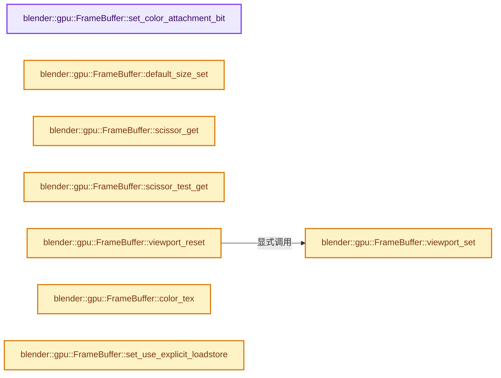
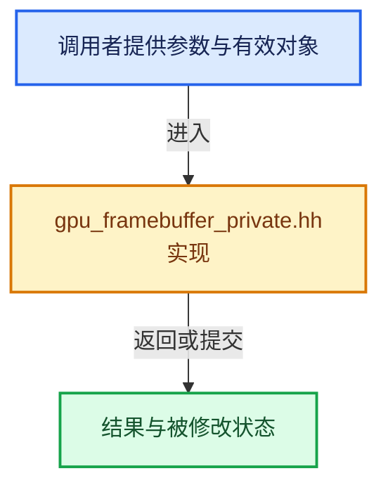

# 实现依赖专题：source/blender/gpu/intern/gpu_framebuffer_private.hh

[方向导航](README.md) · [符号索引](../%E7%AC%A6%E5%8F%B7%E4%BE%9D%E8%B5%96%E4%B8%8E%E5%AE%9E%E7%8E%B0%E7%B4%A2%E5%BC%95.md)

本专题从正文实际调用进入，集中保存共享实现。函数有稳定锚点，可从调用处直接跳到对应完整函数；递归与互相调用通过回链组织。

## 本文件的实现关系






## 完整成员与函数实现

<a id="f-395c422f1a0f4233"></a>

### `blender::gpu::FrameBuffer::set_color_attachment_bit`

实现位置：[source/blender/gpu/intern/gpu_framebuffer_private.hh](../../../../../source/blender/gpu/intern/gpu_framebuffer_private.hh) · L136—L142。

接口参数：

- `GPUAttachmentType type`
- `bool value`

**教学注释版**

<!-- annotated:5262e7a36d062d -->

```cpp
  void set_color_attachment_bit(GPUAttachmentType type, bool value)
  {
    if (type >= GPU_FB_COLOR_ATTACHMENT0) {
      int color_index = type - GPU_FB_COLOR_ATTACHMENT0;
      SET_FLAG_FROM_TEST(color_attachments_bits_, value, 1u << color_index);
    }
  }
```

<details>
<summary>核对原始源码：source/blender/gpu/intern/gpu_framebuffer_private.hh · L136—L142</summary>

<!-- original:5262e7a36d062d:source/blender/gpu/intern/gpu_framebuffer_private.hh:136:142 -->

```cpp
  void set_color_attachment_bit(GPUAttachmentType type, bool value)
  {
    if (type >= GPU_FB_COLOR_ATTACHMENT0) {
      int color_index = type - GPU_FB_COLOR_ATTACHMENT0;
      SET_FLAG_FROM_TEST(color_attachments_bits_, value, 1u << color_index);
    }
  }
```

</details>

**继续追踪实现**

- `SET_FLAG_FROM_TEST` → [SET_FLAG_FROM_TEST · L557](../01-%E5%9F%BA%E7%A1%80%E5%AE%B9%E5%99%A8%E4%B8%8E%E7%8E%B0%E4%BB%A3CPP/%E4%BE%9D%E8%B5%96-BLI_utildefines-293a0a.md#m-8e0dc83e01a8)。宏定义由构建条件选择。

<a id="f-4b719af312e551c4"></a>

### `blender::gpu::FrameBuffer::default_size_set`

实现位置：[source/blender/gpu/intern/gpu_framebuffer_private.hh](../../../../../source/blender/gpu/intern/gpu_framebuffer_private.hh) · L170—L176。

接口参数：

- `int width`
- `int height`

**教学注释版**

<!-- annotated:0450f769e8997d -->

```cpp
  void default_size_set(int width, int height)
  {
    width_ = width;
    height_ = height;
    dirty_attachments_ = true;
    dirty_state_ = true;
  }
```

<details>
<summary>核对原始源码：source/blender/gpu/intern/gpu_framebuffer_private.hh · L170—L176</summary>

<!-- original:0450f769e8997d:source/blender/gpu/intern/gpu_framebuffer_private.hh:170:176 -->

```cpp
  void default_size_set(int width, int height)
  {
    width_ = width;
    height_ = height;
    dirty_attachments_ = true;
    dirty_state_ = true;
  }
```

</details>

**沿实际写入检查状态**

- `width_ = width;`
- `height_ = height;`
- `dirty_attachments_ = true;`
- `dirty_state_ = true;`

**继续追踪实现**

本实现没有需要继续展开的显式调用；检查返回表达式、对象转换和调用者前置条件。

<a id="f-2efb0a90bced69c4"></a>

### `blender::gpu::FrameBuffer::viewport_set`

实现位置：[source/blender/gpu/intern/gpu_framebuffer_private.hh](../../../../../source/blender/gpu/intern/gpu_framebuffer_private.hh) · L178—L185。

接口参数：

- `const int viewport[4]`

**教学注释版**

<!-- annotated:c101b518589d08 -->

```cpp
  void viewport_set(const int viewport[4])
  {
    if (!equals_v4v4_int(viewport_[0], viewport)) {
      copy_v4_v4_int(viewport_[0], viewport);
      dirty_state_ = true;
    }
    multi_viewport_ = false;
  }
```

<details>
<summary>核对原始源码：source/blender/gpu/intern/gpu_framebuffer_private.hh · L178—L185</summary>

<!-- original:c101b518589d08:source/blender/gpu/intern/gpu_framebuffer_private.hh:178:185 -->

```cpp
  void viewport_set(const int viewport[4])
  {
    if (!equals_v4v4_int(viewport_[0], viewport)) {
      copy_v4_v4_int(viewport_[0], viewport);
      dirty_state_ = true;
    }
    multi_viewport_ = false;
  }
```

</details>

**沿实际写入检查状态**

- `dirty_state_ = true;`
- `multi_viewport_ = false;`

**继续追踪实现**

- `equals_v4v4_int` → [blender::equals_v4v4_int · L1016](../12-%E7%A9%BA%E9%97%B4%E6%95%B0%E6%8D%AE%E7%BB%93%E6%9E%84%E4%B8%8E%E5%87%A0%E4%BD%95%E7%AE%97%E6%B3%95/%E4%BE%9D%E8%B5%96-math_vector_inline-0c8541.md#f-7d166d7bb20a62a0)。
- `copy_v4_v4_int` → [blender::copy_v4_v4_int · L142](../12-%E7%A9%BA%E9%97%B4%E6%95%B0%E6%8D%AE%E7%BB%93%E6%9E%84%E4%B8%8E%E5%87%A0%E4%BD%95%E7%AE%97%E6%B3%95/%E4%BE%9D%E8%B5%96-math_vector_inline-0c8541.md#f-fb52f9203c152acf)。

<a id="f-c04f3f0bb934f038"></a>

### `blender::gpu::FrameBuffer::scissor_get`

实现位置：[source/blender/gpu/intern/gpu_framebuffer_private.hh](../../../../../source/blender/gpu/intern/gpu_framebuffer_private.hh) · L217—L220。

接口参数：

- `int r_scissor[4]`

**教学注释版**

<!-- annotated:3fab62df9f1f32 -->

```cpp
  void scissor_get(int r_scissor[4]) const
  {
    copy_v4_v4_int(r_scissor, scissor_);
  }
```

<details>
<summary>核对原始源码：source/blender/gpu/intern/gpu_framebuffer_private.hh · L217—L220</summary>

<!-- original:3fab62df9f1f32:source/blender/gpu/intern/gpu_framebuffer_private.hh:217:220 -->

```cpp
  void scissor_get(int r_scissor[4]) const
  {
    copy_v4_v4_int(r_scissor, scissor_);
  }
```

</details>

**继续追踪实现**

- `copy_v4_v4_int` → [blender::copy_v4_v4_int · L142](../12-%E7%A9%BA%E9%97%B4%E6%95%B0%E6%8D%AE%E7%BB%93%E6%9E%84%E4%B8%8E%E5%87%A0%E4%BD%95%E7%AE%97%E6%B3%95/%E4%BE%9D%E8%B5%96-math_vector_inline-0c8541.md#f-fb52f9203c152acf)。

<a id="f-c51983076af7c7ca"></a>

### `blender::gpu::FrameBuffer::scissor_test_get`

实现位置：[source/blender/gpu/intern/gpu_framebuffer_private.hh](../../../../../source/blender/gpu/intern/gpu_framebuffer_private.hh) · L222—L225。

**教学注释版**

<!-- annotated:0f01fd8d8e2c51 -->

```cpp
  bool scissor_test_get() const
  {
    return scissor_test_;
  }
```

<details>
<summary>核对原始源码：source/blender/gpu/intern/gpu_framebuffer_private.hh · L222—L225</summary>

<!-- original:0f01fd8d8e2c51:source/blender/gpu/intern/gpu_framebuffer_private.hh:222:225 -->

```cpp
  bool scissor_test_get() const
  {
    return scissor_test_;
  }
```

</details>

**结果出口**

- `return scissor_test_;`

**继续追踪实现**

本实现没有需要继续展开的显式调用；检查返回表达式、对象转换和调用者前置条件。

<a id="f-a1cc648fb36eb95b"></a>

### `blender::gpu::FrameBuffer::viewport_reset`

实现位置：[source/blender/gpu/intern/gpu_framebuffer_private.hh](../../../../../source/blender/gpu/intern/gpu_framebuffer_private.hh) · L227—L231。

**教学注释版**

<!-- annotated:d3c57fd65779a5 -->

```cpp
  void viewport_reset()
  {
    int viewport_rect[4] = {0, 0, width_, height_};
    viewport_set(viewport_rect);
  }
```

<details>
<summary>核对原始源码：source/blender/gpu/intern/gpu_framebuffer_private.hh · L227—L231</summary>

<!-- original:d3c57fd65779a5:source/blender/gpu/intern/gpu_framebuffer_private.hh:227:231 -->

```cpp
  void viewport_reset()
  {
    int viewport_rect[4] = {0, 0, width_, height_};
    viewport_set(viewport_rect);
  }
```

</details>

**继续追踪实现**

- `viewport_set` → [blender::gpu::FrameBuffer::viewport_set · L178](%E4%BE%9D%E8%B5%96-gpu_framebuffer_private-e365da.md#f-2efb0a90bced69c4)。

<a id="f-9c213f6faeb7003a"></a>

### `blender::gpu::FrameBuffer::color_tex`

实现位置：[source/blender/gpu/intern/gpu_framebuffer_private.hh](../../../../../source/blender/gpu/intern/gpu_framebuffer_private.hh) · L252—L255。

接口参数：

- `int slot`

**教学注释版**

<!-- annotated:09cc2d0da45c43 -->

```cpp
  gpu::Texture *color_tex(int slot) const
  {
    return attachments_[GPU_FB_COLOR_ATTACHMENT0 + slot].tex;
  };
```

<details>
<summary>核对原始源码：source/blender/gpu/intern/gpu_framebuffer_private.hh · L252—L255</summary>

<!-- original:09cc2d0da45c43:source/blender/gpu/intern/gpu_framebuffer_private.hh:252:255 -->

```cpp
  gpu::Texture *color_tex(int slot) const
  {
    return attachments_[GPU_FB_COLOR_ATTACHMENT0 + slot].tex;
  };
```

</details>

**结果出口**

- `return attachments_[GPU_FB_COLOR_ATTACHMENT0 + slot].tex;`

**继续追踪实现**

本实现没有需要继续展开的显式调用；检查返回表达式、对象转换和调用者前置条件。

<a id="f-66430ceb7a2e71fb"></a>

### `blender::gpu::FrameBuffer::set_use_explicit_loadstore`

实现位置：[source/blender/gpu/intern/gpu_framebuffer_private.hh](../../../../../source/blender/gpu/intern/gpu_framebuffer_private.hh) · L262—L265。

接口参数：

- `bool use_explicit_loadstore`

**教学注释版**

<!-- annotated:60aedad8ea8041 -->

```cpp
  void set_use_explicit_loadstore(bool use_explicit_loadstore)
  {
    use_explicit_load_store_ = use_explicit_loadstore;
  }
```

<details>
<summary>核对原始源码：source/blender/gpu/intern/gpu_framebuffer_private.hh · L262—L265</summary>

<!-- original:60aedad8ea8041:source/blender/gpu/intern/gpu_framebuffer_private.hh:262:265 -->

```cpp
  void set_use_explicit_loadstore(bool use_explicit_loadstore)
  {
    use_explicit_load_store_ = use_explicit_loadstore;
  }
```

</details>

**沿实际写入检查状态**

- `use_explicit_load_store_ = use_explicit_loadstore;`

**继续追踪实现**

本实现没有需要继续展开的显式调用；检查返回表达式、对象转换和调用者前置条件。

<a id="f-5fc3fbabce7da755"></a>

### `blender::gpu::FrameBuffer::get_use_explicit_loadstore`

实现位置：[source/blender/gpu/intern/gpu_framebuffer_private.hh](../../../../../source/blender/gpu/intern/gpu_framebuffer_private.hh) · L267—L270。

**教学注释版**

<!-- annotated:84dd2b5c5685eb -->

```cpp
  bool get_use_explicit_loadstore() const
  {
    return use_explicit_load_store_;
  }
```

<details>
<summary>核对原始源码：source/blender/gpu/intern/gpu_framebuffer_private.hh · L267—L270</summary>

<!-- original:84dd2b5c5685eb:source/blender/gpu/intern/gpu_framebuffer_private.hh:267:270 -->

```cpp
  bool get_use_explicit_loadstore() const
  {
    return use_explicit_load_store_;
  }
```

</details>

**结果出口**

- `return use_explicit_load_store_;`

**继续追踪实现**

本实现没有需要继续展开的显式调用；检查返回表达式、对象转换和调用者前置条件。
