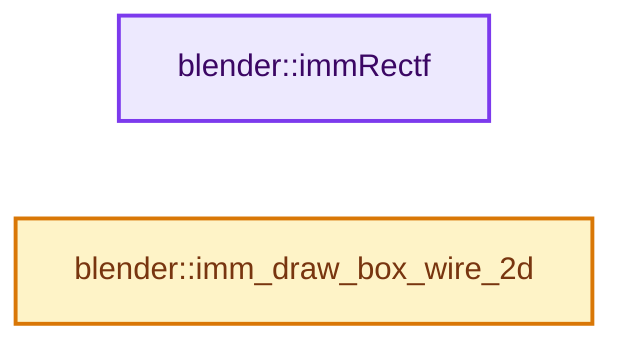

# 实现依赖专题：source/blender/gpu/intern/gpu_immediate_util.cc

[方向导航](README.md) · [符号索引](../%E7%AC%A6%E5%8F%B7%E4%BE%9D%E8%B5%96%E4%B8%8E%E5%AE%9E%E7%8E%B0%E7%B4%A2%E5%BC%95.md)

本专题从正文实际调用进入，集中保存共享实现。函数有稳定锚点，可从调用处直接跳到对应完整函数；递归与互相调用通过回链组织。

## 本文件的实现关系




## 完整成员与函数实现

<a id="f-2aebcd56c0f9ea7c"></a>

### `blender::immRectf`

实现位置：[source/blender/gpu/intern/gpu_immediate_util.cc](../../../../../source/blender/gpu/intern/gpu_immediate_util.cc) · L264—L272。

接口参数：

- `uint pos`
- `float x1`
- `float y1`
- `float x2`
- `float y2`

**教学注释版**

<!-- annotated:c415ba8e2f066f -->

```cpp
void immRectf(uint pos, float x1, float y1, float x2, float y2)
{
  immBegin(GPU_PRIM_TRI_FAN, 4);
  immVertex2f(pos, x1, y1);
  immVertex2f(pos, x2, y1);
  immVertex2f(pos, x2, y2);
  immVertex2f(pos, x1, y2);
  immEnd();
}
```

<details>
<summary>核对原始源码：source/blender/gpu/intern/gpu_immediate_util.cc · L264—L272</summary>

<!-- original:c415ba8e2f066f:source/blender/gpu/intern/gpu_immediate_util.cc:264:272 -->

```cpp
void immRectf(uint pos, float x1, float y1, float x2, float y2)
{
  immBegin(GPU_PRIM_TRI_FAN, 4);
  immVertex2f(pos, x1, y1);
  immVertex2f(pos, x2, y1);
  immVertex2f(pos, x2, y2);
  immVertex2f(pos, x1, y2);
  immEnd();
}
```

</details>

**继续追踪实现**

- `immBegin` → [blender::immBegin · L202](%E4%BE%9D%E8%B5%96-gpu_immediate-4842c0.md#f-d20e080325dd293f)。
- `immVertex2f` → [blender::immVertex2f · L539](%E4%BE%9D%E8%B5%96-gpu_immediate-4842c0.md#f-c5aa0ff286be3978)。
- `immEnd` → [blender::immEnd · L252](%E4%BE%9D%E8%B5%96-gpu_immediate-4842c0.md#f-ef4c47367ce69810)。

<a id="f-4916e373908b75f2"></a>

### `blender::imm_draw_box_wire_2d`

实现位置：[source/blender/gpu/intern/gpu_immediate_util.cc](../../../../../source/blender/gpu/intern/gpu_immediate_util.cc) · L636—L652。

接口参数：

- `uint pos`
- `float x1`
- `float y1`
- `float x2`
- `float y2`

**教学注释版**

<!-- annotated:a77215f2b1d41b -->

```cpp
void imm_draw_box_wire_2d(uint pos, float x1, float y1, float x2, float y2)
{
  /* NOTE(Metal/AMD): For small primitives, line list more efficient than line-strip. */
  immBegin(GPU_PRIM_LINES, 8);
  immVertex2f(pos, x1, y1);
  immVertex2f(pos, x1, y2);

  immVertex2f(pos, x1, y2);
  immVertex2f(pos, x2, y2);

  immVertex2f(pos, x2, y2);
  immVertex2f(pos, x2, y1);

  immVertex2f(pos, x2, y1);
  immVertex2f(pos, x1, y1);
  immEnd();
}
```

<details>
<summary>核对原始源码：source/blender/gpu/intern/gpu_immediate_util.cc · L636—L652</summary>

<!-- original:a77215f2b1d41b:source/blender/gpu/intern/gpu_immediate_util.cc:636:652 -->

```cpp
void imm_draw_box_wire_2d(uint pos, float x1, float y1, float x2, float y2)
{
  /* NOTE(Metal/AMD): For small primitives, line list more efficient than line-strip. */
  immBegin(GPU_PRIM_LINES, 8);
  immVertex2f(pos, x1, y1);
  immVertex2f(pos, x1, y2);

  immVertex2f(pos, x1, y2);
  immVertex2f(pos, x2, y2);

  immVertex2f(pos, x2, y2);
  immVertex2f(pos, x2, y1);

  immVertex2f(pos, x2, y1);
  immVertex2f(pos, x1, y1);
  immEnd();
}
```

</details>

**继续追踪实现**

- `immBegin` → [blender::immBegin · L202](%E4%BE%9D%E8%B5%96-gpu_immediate-4842c0.md#f-d20e080325dd293f)。
- `immVertex2f` → [blender::immVertex2f · L539](%E4%BE%9D%E8%B5%96-gpu_immediate-4842c0.md#f-c5aa0ff286be3978)。
- `immEnd` → [blender::immEnd · L252](%E4%BE%9D%E8%B5%96-gpu_immediate-4842c0.md#f-ef4c47367ce69810)。
