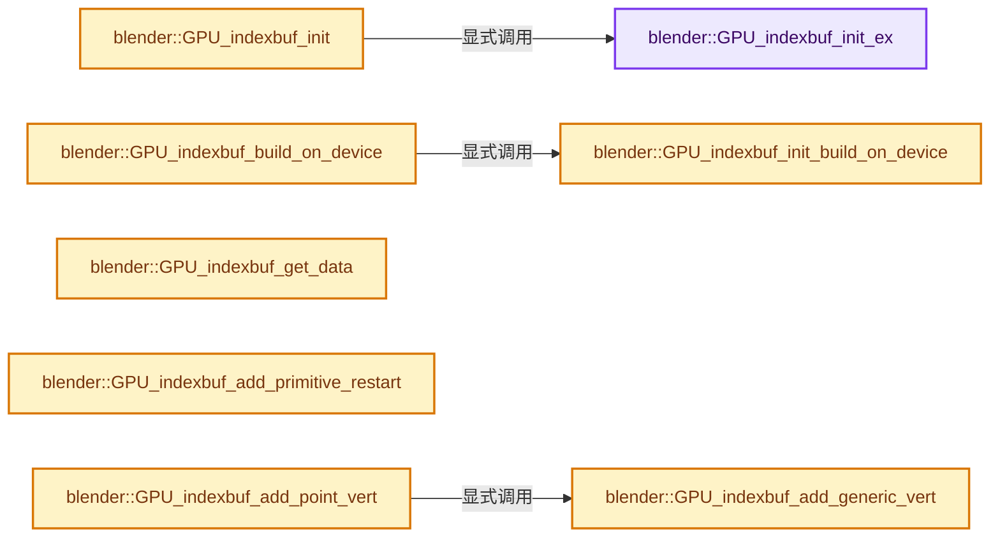

# 实现依赖专题：source/blender/gpu/intern/gpu_index_buffer.cc

[方向导航](README.md) · [符号索引](../%E7%AC%A6%E5%8F%B7%E4%BE%9D%E8%B5%96%E4%B8%8E%E5%AE%9E%E7%8E%B0%E7%B4%A2%E5%BC%95.md)

本专题从正文实际调用进入，集中保存共享实现。函数有稳定锚点，可从调用处直接跳到对应完整函数；递归与互相调用通过回链组织。

## 本文件的实现关系




## 完整成员与函数实现

<a id="f-29e263aa106dc635"></a>

### `blender::GPU_indexbuf_init_ex`

实现位置：[source/blender/gpu/intern/gpu_index_buffer.cc](../../../../../source/blender/gpu/intern/gpu_index_buffer.cc) · L37—L71。

接口参数：

- `GPUIndexBufBuilder *builder`
- `GPUPrimType prim_type`
- `uint index_len`
- `uint vertex_len`

**教学注释版**

<!-- annotated:10f5f3438b4e14 -->

```cpp
void GPU_indexbuf_init_ex(GPUIndexBufBuilder *builder,
                          GPUPrimType prim_type,
                          uint index_len,
                          uint vertex_len)
{
  builder->max_allowed_index = vertex_len - 1;
  builder->max_index_len = index_len;
  builder->index_len = 0;  // start empty
  builder->index_min = UINT32_MAX;
  builder->index_max = 0;
  builder->prim_type = prim_type;

#ifdef __APPLE__
  /* Only encode restart indices for restart-compatible primitive types.
   * Resolves out-of-bounds read error on macOS. Using 0-index will ensure
   * degenerative primitives when skipping primitives is required and will
   * incur no additional performance cost for rendering. */
  if (GPU_type_matches_ex(GPU_DEVICE_ANY, GPU_OS_MAC, GPU_DRIVER_ANY, GPU_BACKEND_METAL)) {
    /* We will still use restart-indices for point primitives and then
     * patch these during IndexBuf::init, as we cannot benefit from degenerative
     * primitives to eliminate these. */
    builder->restart_index_value = (is_restart_compatible(prim_type) ||
                                    prim_type == GPU_PRIM_POINTS) ?
                                       RESTART_INDEX :
                                       0;
  }
  else {
    builder->restart_index_value = RESTART_INDEX;
  }
#else
  builder->restart_index_value = RESTART_INDEX;
#endif
  builder->uses_restart_indices = false;
  builder->data = MEM_new_array_uninitialized<uint>(builder->max_index_len, "IndexBuf data");
}
```

<details>
<summary>核对原始源码：source/blender/gpu/intern/gpu_index_buffer.cc · L37—L71</summary>

<!-- original:10f5f3438b4e14:source/blender/gpu/intern/gpu_index_buffer.cc:37:71 -->

```cpp
void GPU_indexbuf_init_ex(GPUIndexBufBuilder *builder,
                          GPUPrimType prim_type,
                          uint index_len,
                          uint vertex_len)
{
  builder->max_allowed_index = vertex_len - 1;
  builder->max_index_len = index_len;
  builder->index_len = 0;  // start empty
  builder->index_min = UINT32_MAX;
  builder->index_max = 0;
  builder->prim_type = prim_type;

#ifdef __APPLE__
  /* Only encode restart indices for restart-compatible primitive types.
   * Resolves out-of-bounds read error on macOS. Using 0-index will ensure
   * degenerative primitives when skipping primitives is required and will
   * incur no additional performance cost for rendering. */
  if (GPU_type_matches_ex(GPU_DEVICE_ANY, GPU_OS_MAC, GPU_DRIVER_ANY, GPU_BACKEND_METAL)) {
    /* We will still use restart-indices for point primitives and then
     * patch these during IndexBuf::init, as we cannot benefit from degenerative
     * primitives to eliminate these. */
    builder->restart_index_value = (is_restart_compatible(prim_type) ||
                                    prim_type == GPU_PRIM_POINTS) ?
                                       RESTART_INDEX :
                                       0;
  }
  else {
    builder->restart_index_value = RESTART_INDEX;
  }
#else
  builder->restart_index_value = RESTART_INDEX;
#endif
  builder->uses_restart_indices = false;
  builder->data = MEM_new_array_uninitialized<uint>(builder->max_index_len, "IndexBuf data");
}
```

</details>

**沿实际写入检查状态**

- `builder->max_allowed_index = vertex_len - 1;`
- `builder->max_index_len = index_len;`
- `builder->index_len = 0;  // start empty`
- `builder->index_min = UINT32_MAX;`
- `builder->index_max = 0;`
- `builder->prim_type = prim_type;`
- `builder->restart_index_value = (is_restart_compatible(prim_type) ||`
- `builder->restart_index_value = RESTART_INDEX;`
- `builder->uses_restart_indices = false;`
- `builder->data = MEM_new_array_uninitialized<uint>(builder->max_index_len, "IndexBuf data");`

**继续追踪实现**

- `GPU_type_matches_ex` → [blender::GPU_type_matches_ex · L174](%E4%BE%9D%E8%B5%96-gpu_platform-4858e1.md#f-682b17461f99f91a)。
- `is_restart_compatible` → [blender::is_restart_compatible · L95](%E4%BE%9D%E8%B5%96-GPU_primitive-be38d9.md#f-33c627850cd717a0)。
- `MEM_new_array_uninitialized<uint>` → [MEM_new_array_uninitialized · L608](../03-%E5%86%85%E5%AD%98%E5%88%86%E9%85%8D%E4%B8%8E%E8%BF%90%E8%A1%8C%E6%97%B6%E7%B1%BB%E5%9E%8B/%E4%BE%9D%E8%B5%96-MEM_guardedalloc-b54eca.md#f-b7103eae8eb57b05)；[MEM_new_array_uninitialized · L129](../03-%E5%86%85%E5%AD%98%E5%88%86%E9%85%8D%E4%B8%8E%E8%BF%90%E8%A1%8C%E6%97%B6%E7%B1%BB%E5%9E%8B/%E4%BE%9D%E8%B5%96-mallocn-afdcd4.md#f-bf6ef4ddcfb6e5df)。同名重载需按实参类型选择。

<a id="f-adccf0f2321fb073"></a>

### `blender::GPU_indexbuf_init`

实现位置：[source/blender/gpu/intern/gpu_index_buffer.cc](../../../../../source/blender/gpu/intern/gpu_index_buffer.cc) · L73—L81。

接口参数：

- `GPUIndexBufBuilder *builder`
- `GPUPrimType prim_type`
- `uint prim_len`
- `uint vertex_len`

**教学注释版**

<!-- annotated:6af07cdd01f234 -->

```cpp
void GPU_indexbuf_init(GPUIndexBufBuilder *builder,
                       GPUPrimType prim_type,
                       uint prim_len,
                       uint vertex_len)
{
  int verts_per_prim = GPU_indexbuf_primitive_len(prim_type);
  BLI_assert(verts_per_prim != -1);
  GPU_indexbuf_init_ex(builder, prim_type, prim_len * uint(verts_per_prim), vertex_len);
}
```

<details>
<summary>核对原始源码：source/blender/gpu/intern/gpu_index_buffer.cc · L73—L81</summary>

<!-- original:6af07cdd01f234:source/blender/gpu/intern/gpu_index_buffer.cc:73:81 -->

```cpp
void GPU_indexbuf_init(GPUIndexBufBuilder *builder,
                       GPUPrimType prim_type,
                       uint prim_len,
                       uint vertex_len)
{
  int verts_per_prim = GPU_indexbuf_primitive_len(prim_type);
  BLI_assert(verts_per_prim != -1);
  GPU_indexbuf_init_ex(builder, prim_type, prim_len * uint(verts_per_prim), vertex_len);
}
```

</details>

**继续追踪实现**

- `GPU_indexbuf_primitive_len` → [blender::GPU_indexbuf_primitive_len · L525](%E4%BE%9D%E8%B5%96-gpu_index_buffer-c3daac.md#f-829da19ad674e1dd)。
- `BLI_assert` → [BLI_assert · L48](../01-%E5%9F%BA%E7%A1%80%E5%AE%B9%E5%99%A8%E4%B8%8E%E7%8E%B0%E4%BB%A3CPP/%E4%BE%9D%E8%B5%96-BLI_assert-cc98e8.md#m-57a88495704d)；[BLI_assert · L63](../01-%E5%9F%BA%E7%A1%80%E5%AE%B9%E5%99%A8%E4%B8%8E%E7%8E%B0%E4%BB%A3CPP/%E4%BE%9D%E8%B5%96-BLI_assert-cc98e8.md#m-d07050020cb5)。宏定义由构建条件选择。
- `GPU_indexbuf_init_ex` → [blender::GPU_indexbuf_init_ex · L37](%E4%BE%9D%E8%B5%96-gpu_index_buffer-c3daac.md#f-29e263aa106dc635)。

<a id="f-d79a15f80e7a5700"></a>

### `blender::GPU_indexbuf_build_on_device`

实现位置：[source/blender/gpu/intern/gpu_index_buffer.cc](../../../../../source/blender/gpu/intern/gpu_index_buffer.cc) · L83—L88。

接口参数：

- `uint index_len`

**教学注释版**

<!-- annotated:97e82d09af4594 -->

```cpp
IndexBuf *GPU_indexbuf_build_on_device(uint index_len)
{
  IndexBuf *elem_ = GPU_indexbuf_calloc();
  GPU_indexbuf_init_build_on_device(elem_, index_len);
  return elem_;
}
```

<details>
<summary>核对原始源码：source/blender/gpu/intern/gpu_index_buffer.cc · L83—L88</summary>

<!-- original:97e82d09af4594:source/blender/gpu/intern/gpu_index_buffer.cc:83:88 -->

```cpp
IndexBuf *GPU_indexbuf_build_on_device(uint index_len)
{
  IndexBuf *elem_ = GPU_indexbuf_calloc();
  GPU_indexbuf_init_build_on_device(elem_, index_len);
  return elem_;
}
```

</details>

**结果出口**

- `return elem_;`

**继续追踪实现**

- `GPU_indexbuf_calloc` → [blender::GPU_indexbuf_calloc · L422](%E4%BE%9D%E8%B5%96-gpu_index_buffer-c3daac.md#f-e8f02b2e987a3770)。
- `GPU_indexbuf_init_build_on_device` → [blender::GPU_indexbuf_init_build_on_device · L90](%E4%BE%9D%E8%B5%96-gpu_index_buffer-c3daac.md#f-6cafc6b9ce139c25)。

<a id="f-6cafc6b9ce139c25"></a>

### `blender::GPU_indexbuf_init_build_on_device`

实现位置：[source/blender/gpu/intern/gpu_index_buffer.cc](../../../../../source/blender/gpu/intern/gpu_index_buffer.cc) · L90—L94。

接口参数：

- `IndexBuf *elem`
- `uint index_len`

**教学注释版**

<!-- annotated:cda0d8693b4f23 -->

```cpp
void GPU_indexbuf_init_build_on_device(IndexBuf *elem, uint index_len)
{
  IndexBuf *elem_ = elem;
  elem_->init_build_on_device(index_len);
}
```

<details>
<summary>核对原始源码：source/blender/gpu/intern/gpu_index_buffer.cc · L90—L94</summary>

<!-- original:cda0d8693b4f23:source/blender/gpu/intern/gpu_index_buffer.cc:90:94 -->

```cpp
void GPU_indexbuf_init_build_on_device(IndexBuf *elem, uint index_len)
{
  IndexBuf *elem_ = elem;
  elem_->init_build_on_device(index_len);
}
```

</details>

**继续追踪实现**

- `elem_->init_build_on_device` → [blender::gpu::IndexBuf::init_build_on_device · L352](%E4%BE%9D%E8%B5%96-gpu_index_buffer-c3daac.md#f-7b9ed58c2cf148de)。

<a id="f-a5d0d67214a893c0"></a>

### `blender::GPU_indexbuf_get_data`

实现位置：[source/blender/gpu/intern/gpu_index_buffer.cc](../../../../../source/blender/gpu/intern/gpu_index_buffer.cc) · L96—L99。

接口参数：

- `GPUIndexBufBuilder *builder`

**教学注释版**

<!-- annotated:be80e21514783a -->

```cpp
MutableSpan<uint32_t> GPU_indexbuf_get_data(GPUIndexBufBuilder *builder)
{
  return {builder->data, builder->max_index_len};
}
```

<details>
<summary>核对原始源码：source/blender/gpu/intern/gpu_index_buffer.cc · L96—L99</summary>

<!-- original:be80e21514783a:source/blender/gpu/intern/gpu_index_buffer.cc:96:99 -->

```cpp
MutableSpan<uint32_t> GPU_indexbuf_get_data(GPUIndexBufBuilder *builder)
{
  return {builder->data, builder->max_index_len};
}
```

</details>

**结果出口**

- `return {builder->data, builder->max_index_len};`

**继续追踪实现**

本实现没有需要继续展开的显式调用；检查返回表达式、对象转换和调用者前置条件。

<a id="f-ec7d2b38e2fd5be1"></a>

### `blender::GPU_indexbuf_add_generic_vert`

实现位置：[source/blender/gpu/intern/gpu_index_buffer.cc](../../../../../source/blender/gpu/intern/gpu_index_buffer.cc) · L109—L117。

接口参数：

- `GPUIndexBufBuilder *builder`
- `uint v`

**教学注释版**

<!-- annotated:ac86410f5bb4fd -->

```cpp
void GPU_indexbuf_add_generic_vert(GPUIndexBufBuilder *builder, uint v)
{
  BLI_assert(builder->data != nullptr);
  BLI_assert(builder->index_len < builder->max_index_len);
  BLI_assert(v <= builder->max_allowed_index);
  builder->data[builder->index_len++] = v;
  // [讲解] std::min：按比较关系选取较小值；截断范围时还需先满足非负和可表示范围，min本身不会证明边界安全。
  builder->index_min = std::min(builder->index_min, v);
  // [讲解] std::max：按比较关系选取较大值。本讲解中的增长公式同时满足最低请求和几何增长；若保存返回引用，还需注意实参寿命。
  builder->index_max = std::max(builder->index_max, v);
}
```

<details>
<summary>核对原始源码：source/blender/gpu/intern/gpu_index_buffer.cc · L109—L117</summary>

<!-- original:ac86410f5bb4fd:source/blender/gpu/intern/gpu_index_buffer.cc:109:117 -->

```cpp
void GPU_indexbuf_add_generic_vert(GPUIndexBufBuilder *builder, uint v)
{
  BLI_assert(builder->data != nullptr);
  BLI_assert(builder->index_len < builder->max_index_len);
  BLI_assert(v <= builder->max_allowed_index);
  builder->data[builder->index_len++] = v;
  builder->index_min = std::min(builder->index_min, v);
  builder->index_max = std::max(builder->index_max, v);
}
```

</details>

**沿实际写入检查状态**

- `builder->index_min = std::min(builder->index_min, v);`
- `builder->index_max = std::max(builder->index_max, v);`

**继续追踪实现**

- `BLI_assert` → [BLI_assert · L48](../01-%E5%9F%BA%E7%A1%80%E5%AE%B9%E5%99%A8%E4%B8%8E%E7%8E%B0%E4%BB%A3CPP/%E4%BE%9D%E8%B5%96-BLI_assert-cc98e8.md#m-57a88495704d)；[BLI_assert · L63](../01-%E5%9F%BA%E7%A1%80%E5%AE%B9%E5%99%A8%E4%B8%8E%E7%8E%B0%E4%BB%A3CPP/%E4%BE%9D%E8%B5%96-BLI_assert-cc98e8.md#m-d07050020cb5)。宏定义由构建条件选择。
- `std::min` → [外部契约](https://eel.is/c++draft/alg.min.max)：按比较关系选取较小值；截断范围时还需先满足非负和可表示范围，min本身不会证明边界安全。
- `std::max` → [外部契约](https://eel.is/c++draft/alg.min.max)：按比较关系选取较大值。本讲解中的增长公式同时满足最低请求和几何增长；若保存返回引用，还需注意实参寿命。

<a id="f-77805e900869d607"></a>

### `blender::GPU_indexbuf_add_primitive_restart`

实现位置：[source/blender/gpu/intern/gpu_index_buffer.cc](../../../../../source/blender/gpu/intern/gpu_index_buffer.cc) · L119—L125。

接口参数：

- `GPUIndexBufBuilder *builder`

**教学注释版**

<!-- annotated:e06c42d9b63b16 -->

```cpp
void GPU_indexbuf_add_primitive_restart(GPUIndexBufBuilder *builder)
{
  BLI_assert(builder->data != nullptr);
  BLI_assert(builder->index_len < builder->max_index_len);
  builder->data[builder->index_len++] = builder->restart_index_value;
  builder->uses_restart_indices = true;
}
```

<details>
<summary>核对原始源码：source/blender/gpu/intern/gpu_index_buffer.cc · L119—L125</summary>

<!-- original:e06c42d9b63b16:source/blender/gpu/intern/gpu_index_buffer.cc:119:125 -->

```cpp
void GPU_indexbuf_add_primitive_restart(GPUIndexBufBuilder *builder)
{
  BLI_assert(builder->data != nullptr);
  BLI_assert(builder->index_len < builder->max_index_len);
  builder->data[builder->index_len++] = builder->restart_index_value;
  builder->uses_restart_indices = true;
}
```

</details>

**沿实际写入检查状态**

- `builder->uses_restart_indices = true;`

**继续追踪实现**

- `BLI_assert` → [BLI_assert · L48](../01-%E5%9F%BA%E7%A1%80%E5%AE%B9%E5%99%A8%E4%B8%8E%E7%8E%B0%E4%BB%A3CPP/%E4%BE%9D%E8%B5%96-BLI_assert-cc98e8.md#m-57a88495704d)；[BLI_assert · L63](../01-%E5%9F%BA%E7%A1%80%E5%AE%B9%E5%99%A8%E4%B8%8E%E7%8E%B0%E4%BB%A3CPP/%E4%BE%9D%E8%B5%96-BLI_assert-cc98e8.md#m-d07050020cb5)。宏定义由构建条件选择。

<a id="f-4dd53012d1ca27f3"></a>

### `blender::GPU_indexbuf_add_point_vert`

实现位置：[source/blender/gpu/intern/gpu_index_buffer.cc](../../../../../source/blender/gpu/intern/gpu_index_buffer.cc) · L127—L131。

接口参数：

- `GPUIndexBufBuilder *builder`
- `uint v`

**教学注释版**

<!-- annotated:ea8f43351ff60f -->

```cpp
void GPU_indexbuf_add_point_vert(GPUIndexBufBuilder *builder, uint v)
{
  BLI_assert(builder->prim_type == GPU_PRIM_POINTS);
  GPU_indexbuf_add_generic_vert(builder, v);
}
```

<details>
<summary>核对原始源码：source/blender/gpu/intern/gpu_index_buffer.cc · L127—L131</summary>

<!-- original:ea8f43351ff60f:source/blender/gpu/intern/gpu_index_buffer.cc:127:131 -->

```cpp
void GPU_indexbuf_add_point_vert(GPUIndexBufBuilder *builder, uint v)
{
  BLI_assert(builder->prim_type == GPU_PRIM_POINTS);
  GPU_indexbuf_add_generic_vert(builder, v);
}
```

</details>

**继续追踪实现**

- `BLI_assert` → [BLI_assert · L48](../01-%E5%9F%BA%E7%A1%80%E5%AE%B9%E5%99%A8%E4%B8%8E%E7%8E%B0%E4%BB%A3CPP/%E4%BE%9D%E8%B5%96-BLI_assert-cc98e8.md#m-57a88495704d)；[BLI_assert · L63](../01-%E5%9F%BA%E7%A1%80%E5%AE%B9%E5%99%A8%E4%B8%8E%E7%8E%B0%E4%BB%A3CPP/%E4%BE%9D%E8%B5%96-BLI_assert-cc98e8.md#m-d07050020cb5)。宏定义由构建条件选择。
- `GPU_indexbuf_add_generic_vert` → [blender::GPU_indexbuf_add_generic_vert · L109](%E4%BE%9D%E8%B5%96-gpu_index_buffer-c3daac.md#f-ec7d2b38e2fd5be1)。

<a id="f-193814170fbdd6a8"></a>

### `blender::GPU_indexbuf_add_line_verts`

实现位置：[source/blender/gpu/intern/gpu_index_buffer.cc](../../../../../source/blender/gpu/intern/gpu_index_buffer.cc) · L133—L139。

接口参数：

- `GPUIndexBufBuilder *builder`
- `uint v1`
- `uint v2`

**教学注释版**

<!-- annotated:24944645f6d3ba -->

```cpp
void GPU_indexbuf_add_line_verts(GPUIndexBufBuilder *builder, uint v1, uint v2)
{
  BLI_assert(builder->prim_type == GPU_PRIM_LINES);
  BLI_assert(v1 != v2);
  GPU_indexbuf_add_generic_vert(builder, v1);
  GPU_indexbuf_add_generic_vert(builder, v2);
}
```

<details>
<summary>核对原始源码：source/blender/gpu/intern/gpu_index_buffer.cc · L133—L139</summary>

<!-- original:24944645f6d3ba:source/blender/gpu/intern/gpu_index_buffer.cc:133:139 -->

```cpp
void GPU_indexbuf_add_line_verts(GPUIndexBufBuilder *builder, uint v1, uint v2)
{
  BLI_assert(builder->prim_type == GPU_PRIM_LINES);
  BLI_assert(v1 != v2);
  GPU_indexbuf_add_generic_vert(builder, v1);
  GPU_indexbuf_add_generic_vert(builder, v2);
}
```

</details>

**继续追踪实现**

- `BLI_assert` → [BLI_assert · L48](../01-%E5%9F%BA%E7%A1%80%E5%AE%B9%E5%99%A8%E4%B8%8E%E7%8E%B0%E4%BB%A3CPP/%E4%BE%9D%E8%B5%96-BLI_assert-cc98e8.md#m-57a88495704d)；[BLI_assert · L63](../01-%E5%9F%BA%E7%A1%80%E5%AE%B9%E5%99%A8%E4%B8%8E%E7%8E%B0%E4%BB%A3CPP/%E4%BE%9D%E8%B5%96-BLI_assert-cc98e8.md#m-d07050020cb5)。宏定义由构建条件选择。
- `GPU_indexbuf_add_generic_vert` → [blender::GPU_indexbuf_add_generic_vert · L109](%E4%BE%9D%E8%B5%96-gpu_index_buffer-c3daac.md#f-ec7d2b38e2fd5be1)。

<a id="f-cee5a2431f11c84e"></a>

### `blender::GPU_indexbuf_add_line_adj_verts`

实现位置：[source/blender/gpu/intern/gpu_index_buffer.cc](../../../../../source/blender/gpu/intern/gpu_index_buffer.cc) · L150—L159。

接口参数：

- `GPUIndexBufBuilder *builder`
- `uint v1`
- `uint v2`
- `uint v3`
- `uint v4`

**教学注释版**

<!-- annotated:466af25582d5f6 -->

```cpp
void GPU_indexbuf_add_line_adj_verts(
    GPUIndexBufBuilder *builder, uint v1, uint v2, uint v3, uint v4)
{
  BLI_assert(builder->prim_type == GPU_PRIM_LINES_ADJ);
  BLI_assert(v2 != v3); /* only the line need diff indices */
  GPU_indexbuf_add_generic_vert(builder, v1);
  GPU_indexbuf_add_generic_vert(builder, v2);
  GPU_indexbuf_add_generic_vert(builder, v3);
  GPU_indexbuf_add_generic_vert(builder, v4);
}
```

<details>
<summary>核对原始源码：source/blender/gpu/intern/gpu_index_buffer.cc · L150—L159</summary>

<!-- original:466af25582d5f6:source/blender/gpu/intern/gpu_index_buffer.cc:150:159 -->

```cpp
void GPU_indexbuf_add_line_adj_verts(
    GPUIndexBufBuilder *builder, uint v1, uint v2, uint v3, uint v4)
{
  BLI_assert(builder->prim_type == GPU_PRIM_LINES_ADJ);
  BLI_assert(v2 != v3); /* only the line need diff indices */
  GPU_indexbuf_add_generic_vert(builder, v1);
  GPU_indexbuf_add_generic_vert(builder, v2);
  GPU_indexbuf_add_generic_vert(builder, v3);
  GPU_indexbuf_add_generic_vert(builder, v4);
}
```

</details>

**继续追踪实现**

- `BLI_assert` → [BLI_assert · L48](../01-%E5%9F%BA%E7%A1%80%E5%AE%B9%E5%99%A8%E4%B8%8E%E7%8E%B0%E4%BB%A3CPP/%E4%BE%9D%E8%B5%96-BLI_assert-cc98e8.md#m-57a88495704d)；[BLI_assert · L63](../01-%E5%9F%BA%E7%A1%80%E5%AE%B9%E5%99%A8%E4%B8%8E%E7%8E%B0%E4%BB%A3CPP/%E4%BE%9D%E8%B5%96-BLI_assert-cc98e8.md#m-d07050020cb5)。宏定义由构建条件选择。
- `GPU_indexbuf_add_generic_vert` → [blender::GPU_indexbuf_add_generic_vert · L109](%E4%BE%9D%E8%B5%96-gpu_index_buffer-c3daac.md#f-ec7d2b38e2fd5be1)。

<a id="f-61830fc08219639f"></a>

### `blender::gpu::IndexBuf::init`

实现位置：[source/blender/gpu/intern/gpu_index_buffer.cc](../../../../../source/blender/gpu/intern/gpu_index_buffer.cc) · L299—L350。

接口参数：

- `uint indices_len`
- `uint32_t *indices`
- `uint min_index`
- `uint max_index`
- `GPUPrimType prim_type`
- `bool uses_restart_indices`

**教学注释版**

<!-- annotated:b22033f967804a -->

```cpp
void IndexBuf::init(uint indices_len,
                    uint32_t *indices,
                    uint min_index,
                    uint max_index,
                    GPUPrimType prim_type,
                    bool uses_restart_indices)
{
  is_init_ = true;
  data_ = indices;
  index_start_ = 0;
  index_len_ = indices_len;
  is_empty_ = min_index > max_index;

  /* Patch index buffer to remove restart indices from
   * non-restart-compatible primitive types. Restart indices
   * are situationally added to selectively hide vertices.
   * Metal does not support restart-indices for non-restart-compatible
   * types, as such we should remove these indices.
   *
   * We only need to perform this for point primitives, as
   * line primitives/triangle primitives can use index 0 for all
   * vertices to create a degenerative primitive, where all
   * vertices share the same index and skip rendering via HW
   * culling. */
  if (prim_type == GPU_PRIM_POINTS && uses_restart_indices) {
    this->strip_restart_indices();
  }

#if GPU_TRACK_INDEX_RANGE
  /* Everything remains 32 bit while building to keep things simple.
   * Find min/max after, then convert to smallest index type possible. */
  uint range = min_index < max_index ? max_index - min_index : 0;
  /* count the primitive restart index. */
  range += 1;

  if (range <= 0xFFFF) {
    index_type_ = GPU_INDEX_U16;
    bool do_clamp_indices = false;
#  ifdef __APPLE__
    /* NOTE: For the Metal Backend, we use degenerative primitives to hide vertices
     * which are not restart compatible. When this is done, we need to ensure
     * that compressed index ranges clamp all index values within the valid
     * range, rather than maximally clamping against the USHORT restart index
     * value of 0xFFFFu, as this will cause an out-of-bounds read during
     * vertex assembly. */
    do_clamp_indices = GPU_type_matches_ex(
        GPU_DEVICE_ANY, GPU_OS_MAC, GPU_DRIVER_ANY, GPU_BACKEND_METAL);
#  endif
    this->squeeze_indices_short(min_index, max_index, prim_type, do_clamp_indices);
  }
#endif
}
```

<details>
<summary>核对原始源码：source/blender/gpu/intern/gpu_index_buffer.cc · L299—L350</summary>

<!-- original:b22033f967804a:source/blender/gpu/intern/gpu_index_buffer.cc:299:350 -->

```cpp
void IndexBuf::init(uint indices_len,
                    uint32_t *indices,
                    uint min_index,
                    uint max_index,
                    GPUPrimType prim_type,
                    bool uses_restart_indices)
{
  is_init_ = true;
  data_ = indices;
  index_start_ = 0;
  index_len_ = indices_len;
  is_empty_ = min_index > max_index;

  /* Patch index buffer to remove restart indices from
   * non-restart-compatible primitive types. Restart indices
   * are situationally added to selectively hide vertices.
   * Metal does not support restart-indices for non-restart-compatible
   * types, as such we should remove these indices.
   *
   * We only need to perform this for point primitives, as
   * line primitives/triangle primitives can use index 0 for all
   * vertices to create a degenerative primitive, where all
   * vertices share the same index and skip rendering via HW
   * culling. */
  if (prim_type == GPU_PRIM_POINTS && uses_restart_indices) {
    this->strip_restart_indices();
  }

#if GPU_TRACK_INDEX_RANGE
  /* Everything remains 32 bit while building to keep things simple.
   * Find min/max after, then convert to smallest index type possible. */
  uint range = min_index < max_index ? max_index - min_index : 0;
  /* count the primitive restart index. */
  range += 1;

  if (range <= 0xFFFF) {
    index_type_ = GPU_INDEX_U16;
    bool do_clamp_indices = false;
#  ifdef __APPLE__
    /* NOTE: For the Metal Backend, we use degenerative primitives to hide vertices
     * which are not restart compatible. When this is done, we need to ensure
     * that compressed index ranges clamp all index values within the valid
     * range, rather than maximally clamping against the USHORT restart index
     * value of 0xFFFFu, as this will cause an out-of-bounds read during
     * vertex assembly. */
    do_clamp_indices = GPU_type_matches_ex(
        GPU_DEVICE_ANY, GPU_OS_MAC, GPU_DRIVER_ANY, GPU_BACKEND_METAL);
#  endif
    this->squeeze_indices_short(min_index, max_index, prim_type, do_clamp_indices);
  }
#endif
}
```

</details>

**沿实际写入检查状态**

- `is_init_ = true;`
- `data_ = indices;`
- `index_start_ = 0;`
- `index_len_ = indices_len;`
- `is_empty_ = min_index > max_index;`
- `range += 1;`
- `index_type_ = GPU_INDEX_U16;`
- `do_clamp_indices = GPU_type_matches_ex(`

**继续追踪实现**

- `this->strip_restart_indices` → [blender::gpu::GLIndexBuf::strip_restart_indices · L60](%E4%BE%9D%E8%B5%96-gl_index_buffer-81db26.md#f-dec0d5f4f3dd1b10)。
- `GPU_type_matches_ex` → [blender::GPU_type_matches_ex · L174](%E4%BE%9D%E8%B5%96-gpu_platform-4858e1.md#f-682b17461f99f91a)。
- `this->squeeze_indices_short` → [blender::gpu::IndexBuf::squeeze_indices_short · L376](%E4%BE%9D%E8%B5%96-gpu_index_buffer-c3daac.md#f-eba8d54d88058c4d)。

<a id="f-7b9ed58c2cf148de"></a>

### `blender::gpu::IndexBuf::init_build_on_device`

实现位置：[source/blender/gpu/intern/gpu_index_buffer.cc](../../../../../source/blender/gpu/intern/gpu_index_buffer.cc) · L352—L359。

接口参数：

- `uint index_len`

**教学注释版**

<!-- annotated:6439a7e9326c8f -->

```cpp
void IndexBuf::init_build_on_device(uint index_len)
{
  is_init_ = true;
  index_start_ = 0;
  index_len_ = index_len;
  index_type_ = GPU_INDEX_U32;
  data_ = nullptr;
}
```

<details>
<summary>核对原始源码：source/blender/gpu/intern/gpu_index_buffer.cc · L352—L359</summary>

<!-- original:6439a7e9326c8f:source/blender/gpu/intern/gpu_index_buffer.cc:352:359 -->

```cpp
void IndexBuf::init_build_on_device(uint index_len)
{
  is_init_ = true;
  index_start_ = 0;
  index_len_ = index_len;
  index_type_ = GPU_INDEX_U32;
  data_ = nullptr;
}
```

</details>

**沿实际写入检查状态**

- `is_init_ = true;`
- `index_start_ = 0;`
- `index_len_ = index_len;`
- `index_type_ = GPU_INDEX_U32;`
- `data_ = nullptr;`

**继续追踪实现**

本实现没有需要继续展开的显式调用；检查返回表达式、对象转换和调用者前置条件。

<a id="f-74498788dc7b2d6b"></a>

### `blender::gpu::IndexBuf::init_subrange`

实现位置：[source/blender/gpu/intern/gpu_index_buffer.cc](../../../../../source/blender/gpu/intern/gpu_index_buffer.cc) · L361—L374。

接口参数：

- `IndexBuf *elem_src`
- `uint start`
- `uint length`

**教学注释版**

<!-- annotated:8b7ba73a8379e5 -->

```cpp
void IndexBuf::init_subrange(IndexBuf *elem_src, uint start, uint length)
{
  /* We don't support nested sub-ranges. */
  BLI_assert(elem_src && elem_src->is_subrange_ == false);
  BLI_assert((length == 0) || (start + length <= elem_src->index_len_));

  is_init_ = true;
  is_subrange_ = true;
  src_ = elem_src;
  index_start_ = start;
  index_len_ = length;
  index_base_ = elem_src->index_base_;
  index_type_ = elem_src->index_type_;
}
```

<details>
<summary>核对原始源码：source/blender/gpu/intern/gpu_index_buffer.cc · L361—L374</summary>

<!-- original:8b7ba73a8379e5:source/blender/gpu/intern/gpu_index_buffer.cc:361:374 -->

```cpp
void IndexBuf::init_subrange(IndexBuf *elem_src, uint start, uint length)
{
  /* We don't support nested sub-ranges. */
  BLI_assert(elem_src && elem_src->is_subrange_ == false);
  BLI_assert((length == 0) || (start + length <= elem_src->index_len_));

  is_init_ = true;
  is_subrange_ = true;
  src_ = elem_src;
  index_start_ = start;
  index_len_ = length;
  index_base_ = elem_src->index_base_;
  index_type_ = elem_src->index_type_;
}
```

</details>

**沿实际写入检查状态**

- `is_init_ = true;`
- `is_subrange_ = true;`
- `src_ = elem_src;`
- `index_start_ = start;`
- `index_len_ = length;`
- `index_base_ = elem_src->index_base_;`
- `index_type_ = elem_src->index_type_;`

**继续追踪实现**

- `BLI_assert` → [BLI_assert · L48](../01-%E5%9F%BA%E7%A1%80%E5%AE%B9%E5%99%A8%E4%B8%8E%E7%8E%B0%E4%BB%A3CPP/%E4%BE%9D%E8%B5%96-BLI_assert-cc98e8.md#m-57a88495704d)；[BLI_assert · L63](../01-%E5%9F%BA%E7%A1%80%E5%AE%B9%E5%99%A8%E4%B8%8E%E7%8E%B0%E4%BB%A3CPP/%E4%BE%9D%E8%B5%96-BLI_assert-cc98e8.md#m-d07050020cb5)。宏定义由构建条件选择。

<a id="f-eba8d54d88058c4d"></a>

### `blender::gpu::IndexBuf::squeeze_indices_short`

实现位置：[source/blender/gpu/intern/gpu_index_buffer.cc](../../../../../source/blender/gpu/intern/gpu_index_buffer.cc) · L376—L412。

接口参数：

- `uint min_idx`
- `uint max_idx`
- `GPUPrimType prim_type`
- `bool clamp_indices_in_range`

**教学注释版**

<!-- annotated:7441b2afad31c2 -->

```cpp
void IndexBuf::squeeze_indices_short(uint min_idx,
                                     uint max_idx,
                                     GPUPrimType prim_type,
                                     bool clamp_indices_in_range)
{
  /* data will never be *larger* than builder->data...
   * converting in place to avoid extra allocation */
  uint16_t *ushort_idx = static_cast<uint16_t *>(data_);
  const uint32_t *uint_idx = static_cast<uint32_t *>(data_);

  if (max_idx >= 0xFFFF) {
    index_base_ = min_idx;
    /* NOTE: When using restart_index=0 for degenerative primitives indices,
     * the compressed index will go below zero and wrap around when min_idx > 0.
     * In order to ensure the resulting index is still within range, we instead
     * clamp index to the maximum within the index range.
     *
     * `clamp_max_idx` represents the maximum possible index to clamp against. If primitive is
     * restart-compatible, we can just clamp against the primitive-restart value, otherwise, we
     * must assign to a valid index within the range.
     *
     * NOTE: For OpenGL we skip this by disabling clamping, as we still need to use
     * restart index values for point primitives to disable rendering. */
    uint16_t clamp_max_idx = (is_restart_compatible(prim_type) || !clamp_indices_in_range) ?
                                 0xFFFFu :
                                 (max_idx - min_idx);
    for (uint i = 0; i < index_len_; i++) {
      // [讲解] std::min<uint16_t>：按比较关系选取较小值；截断范围时还需先满足非负和可表示范围，min本身不会证明边界安全。
      ushort_idx[i] = std::min<uint16_t>(clamp_max_idx, uint_idx[i] - min_idx);
    }
  }
  else {
    index_base_ = 0;
    for (uint i = 0; i < index_len_; i++) {
      ushort_idx[i] = uint16_t(uint_idx[i]);
    }
  }
}
```

<details>
<summary>核对原始源码：source/blender/gpu/intern/gpu_index_buffer.cc · L376—L412</summary>

<!-- original:7441b2afad31c2:source/blender/gpu/intern/gpu_index_buffer.cc:376:412 -->

```cpp
void IndexBuf::squeeze_indices_short(uint min_idx,
                                     uint max_idx,
                                     GPUPrimType prim_type,
                                     bool clamp_indices_in_range)
{
  /* data will never be *larger* than builder->data...
   * converting in place to avoid extra allocation */
  uint16_t *ushort_idx = static_cast<uint16_t *>(data_);
  const uint32_t *uint_idx = static_cast<uint32_t *>(data_);

  if (max_idx >= 0xFFFF) {
    index_base_ = min_idx;
    /* NOTE: When using restart_index=0 for degenerative primitives indices,
     * the compressed index will go below zero and wrap around when min_idx > 0.
     * In order to ensure the resulting index is still within range, we instead
     * clamp index to the maximum within the index range.
     *
     * `clamp_max_idx` represents the maximum possible index to clamp against. If primitive is
     * restart-compatible, we can just clamp against the primitive-restart value, otherwise, we
     * must assign to a valid index within the range.
     *
     * NOTE: For OpenGL we skip this by disabling clamping, as we still need to use
     * restart index values for point primitives to disable rendering. */
    uint16_t clamp_max_idx = (is_restart_compatible(prim_type) || !clamp_indices_in_range) ?
                                 0xFFFFu :
                                 (max_idx - min_idx);
    for (uint i = 0; i < index_len_; i++) {
      ushort_idx[i] = std::min<uint16_t>(clamp_max_idx, uint_idx[i] - min_idx);
    }
  }
  else {
    index_base_ = 0;
    for (uint i = 0; i < index_len_; i++) {
      ushort_idx[i] = uint16_t(uint_idx[i]);
    }
  }
}
```

</details>

**沿实际写入检查状态**

- `index_base_ = min_idx;`
- `ushort_idx[i] = std::min<uint16_t>(clamp_max_idx, uint_idx[i] - min_idx);`
- `index_base_ = 0;`
- `ushort_idx[i] = uint16_t(uint_idx[i]);`

**继续追踪实现**

- `is_restart_compatible` → [blender::is_restart_compatible · L95](%E4%BE%9D%E8%B5%96-GPU_primitive-be38d9.md#f-33c627850cd717a0)。
- `std::min<uint16_t>` → [外部契约](https://eel.is/c++draft/alg.min.max)：按比较关系选取较小值；截断范围时还需先满足非负和可表示范围，min本身不会证明边界安全。

<a id="f-e8f02b2e987a3770"></a>

### `blender::GPU_indexbuf_calloc`

实现位置：[source/blender/gpu/intern/gpu_index_buffer.cc](../../../../../source/blender/gpu/intern/gpu_index_buffer.cc) · L422—L425。

**教学注释版**

<!-- annotated:f5e2164f2b862b -->

```cpp
IndexBuf *GPU_indexbuf_calloc()
{
  return GPUBackend::get()->indexbuf_alloc();
}
```

<details>
<summary>核对原始源码：source/blender/gpu/intern/gpu_index_buffer.cc · L422—L425</summary>

<!-- original:f5e2164f2b862b:source/blender/gpu/intern/gpu_index_buffer.cc:422:425 -->

```cpp
IndexBuf *GPU_indexbuf_calloc()
{
  return GPUBackend::get()->indexbuf_alloc();
}
```

</details>

**结果出口**

- `return GPUBackend::get()->indexbuf_alloc();`

**继续追踪实现**

- `GPUBackend::get()->indexbuf_alloc` → [调用协议](../%E6%A8%A1%E6%9D%BF%E5%AE%8F%E4%B8%8E%E5%8A%A8%E6%80%81%E5%88%86%E6%B4%BE%E5%8D%8F%E8%AE%AE.md)：接收对象类型依赖auto、返回值或模板实例；不按同名猜测目标。调用位置L424。
- `GPUBackend::get` → [blender::GPUBackend::get · L642](%E4%BE%9D%E8%B5%96-gpu_context-77a234.md#f-c876dc1cb5bd7700)。

<a id="f-f67e34a8860e37a8"></a>

### `blender::GPU_indexbuf_build`

实现位置：[source/blender/gpu/intern/gpu_index_buffer.cc](../../../../../source/blender/gpu/intern/gpu_index_buffer.cc) · L427—L432。

接口参数：

- `GPUIndexBufBuilder *builder`

**教学注释版**

<!-- annotated:471afef05366c7 -->

```cpp
IndexBuf *GPU_indexbuf_build(GPUIndexBufBuilder *builder)
{
  IndexBuf *elem = GPU_indexbuf_calloc();
  GPU_indexbuf_build_in_place(builder, elem);
  return elem;
}
```

<details>
<summary>核对原始源码：source/blender/gpu/intern/gpu_index_buffer.cc · L427—L432</summary>

<!-- original:471afef05366c7:source/blender/gpu/intern/gpu_index_buffer.cc:427:432 -->

```cpp
IndexBuf *GPU_indexbuf_build(GPUIndexBufBuilder *builder)
{
  IndexBuf *elem = GPU_indexbuf_calloc();
  GPU_indexbuf_build_in_place(builder, elem);
  return elem;
}
```

</details>

**结果出口**

- `return elem;`

**继续追踪实现**

- `GPU_indexbuf_calloc` → [blender::GPU_indexbuf_calloc · L422](%E4%BE%9D%E8%B5%96-gpu_index_buffer-c3daac.md#f-e8f02b2e987a3770)。
- `GPU_indexbuf_build_in_place` → [blender::GPU_indexbuf_build_in_place · L441](%E4%BE%9D%E8%B5%96-gpu_index_buffer-c3daac.md#f-8acccf5b894fac78)。

<a id="f-16b280cb398e7157"></a>

### `blender::GPU_indexbuf_create_subrange`

实现位置：[source/blender/gpu/intern/gpu_index_buffer.cc](../../../../../source/blender/gpu/intern/gpu_index_buffer.cc) · L434—L439。

接口参数：

- `IndexBuf *elem_src`
- `uint start`
- `uint length`

**教学注释版**

<!-- annotated:0b0e3b46843b62 -->

```cpp
IndexBuf *GPU_indexbuf_create_subrange(IndexBuf *elem_src, uint start, uint length)
{
  IndexBuf *elem = GPU_indexbuf_calloc();
  GPU_indexbuf_create_subrange_in_place(elem, elem_src, start, length);
  return elem;
}
```

<details>
<summary>核对原始源码：source/blender/gpu/intern/gpu_index_buffer.cc · L434—L439</summary>

<!-- original:0b0e3b46843b62:source/blender/gpu/intern/gpu_index_buffer.cc:434:439 -->

```cpp
IndexBuf *GPU_indexbuf_create_subrange(IndexBuf *elem_src, uint start, uint length)
{
  IndexBuf *elem = GPU_indexbuf_calloc();
  GPU_indexbuf_create_subrange_in_place(elem, elem_src, start, length);
  return elem;
}
```

</details>

**结果出口**

- `return elem;`

**继续追踪实现**

- `GPU_indexbuf_calloc` → [blender::GPU_indexbuf_calloc · L422](%E4%BE%9D%E8%B5%96-gpu_index_buffer-c3daac.md#f-e8f02b2e987a3770)。
- `GPU_indexbuf_create_subrange_in_place` → [blender::GPU_indexbuf_create_subrange_in_place · L502](%E4%BE%9D%E8%B5%96-gpu_index_buffer-c3daac.md#f-5a18be2a853dce03)。

<a id="f-8acccf5b894fac78"></a>

### `blender::GPU_indexbuf_build_in_place`

实现位置：[source/blender/gpu/intern/gpu_index_buffer.cc](../../../../../source/blender/gpu/intern/gpu_index_buffer.cc) · L441—L453。

接口参数：

- `GPUIndexBufBuilder *builder`
- `IndexBuf *elem`

**教学注释版**

<!-- annotated:00008852eaa97b -->

```cpp
void GPU_indexbuf_build_in_place(GPUIndexBufBuilder *builder, IndexBuf *elem)
{
  BLI_assert(builder->data != nullptr);
  /* Transfer data ownership to IndexBuf.
   * It will be uploaded upon first use. */
  elem->init(builder->index_len,
             builder->data,
             builder->index_min,
             builder->index_max,
             builder->prim_type,
             builder->uses_restart_indices);
  builder->data = nullptr;
}
```

<details>
<summary>核对原始源码：source/blender/gpu/intern/gpu_index_buffer.cc · L441—L453</summary>

<!-- original:00008852eaa97b:source/blender/gpu/intern/gpu_index_buffer.cc:441:453 -->

```cpp
void GPU_indexbuf_build_in_place(GPUIndexBufBuilder *builder, IndexBuf *elem)
{
  BLI_assert(builder->data != nullptr);
  /* Transfer data ownership to IndexBuf.
   * It will be uploaded upon first use. */
  elem->init(builder->index_len,
             builder->data,
             builder->index_min,
             builder->index_max,
             builder->prim_type,
             builder->uses_restart_indices);
  builder->data = nullptr;
}
```

</details>

**沿实际写入检查状态**

- `builder->data = nullptr;`

**继续追踪实现**

- `BLI_assert` → [BLI_assert · L48](../01-%E5%9F%BA%E7%A1%80%E5%AE%B9%E5%99%A8%E4%B8%8E%E7%8E%B0%E4%BB%A3CPP/%E4%BE%9D%E8%B5%96-BLI_assert-cc98e8.md#m-57a88495704d)；[BLI_assert · L63](../01-%E5%9F%BA%E7%A1%80%E5%AE%B9%E5%99%A8%E4%B8%8E%E7%8E%B0%E4%BB%A3CPP/%E4%BE%9D%E8%B5%96-BLI_assert-cc98e8.md#m-d07050020cb5)。宏定义由构建条件选择。
- `elem->init` → [blender::gpu::IndexBuf::init · L299](%E4%BE%9D%E8%B5%96-gpu_index_buffer-c3daac.md#f-61830fc08219639f)。

<a id="f-3a20aaaa573a7e30"></a>

### `blender::GPU_indexbuf_build_in_place_ex`

实现位置：[source/blender/gpu/intern/gpu_index_buffer.cc](../../../../../source/blender/gpu/intern/gpu_index_buffer.cc) · L455—L471。

接口参数：

- `GPUIndexBufBuilder *builder`
- `const uint index_min`
- `const uint index_max`
- `const bool uses_restart_indices`
- `IndexBuf *elem`

**教学注释版**

<!-- annotated:6f565f9066a807 -->

```cpp
void GPU_indexbuf_build_in_place_ex(GPUIndexBufBuilder *builder,
                                    const uint index_min,
                                    const uint index_max,
                                    const bool uses_restart_indices,
                                    IndexBuf *elem)
{
  BLI_assert(builder->data != nullptr);
  /* Transfer data ownership to IndexBuf.
   * It will be uploaded upon first use. */
  elem->init(builder->max_index_len,
             builder->data,
             index_min,
             index_max,
             builder->prim_type,
             uses_restart_indices);
  builder->data = nullptr;
}
```

<details>
<summary>核对原始源码：source/blender/gpu/intern/gpu_index_buffer.cc · L455—L471</summary>

<!-- original:6f565f9066a807:source/blender/gpu/intern/gpu_index_buffer.cc:455:471 -->

```cpp
void GPU_indexbuf_build_in_place_ex(GPUIndexBufBuilder *builder,
                                    const uint index_min,
                                    const uint index_max,
                                    const bool uses_restart_indices,
                                    IndexBuf *elem)
{
  BLI_assert(builder->data != nullptr);
  /* Transfer data ownership to IndexBuf.
   * It will be uploaded upon first use. */
  elem->init(builder->max_index_len,
             builder->data,
             index_min,
             index_max,
             builder->prim_type,
             uses_restart_indices);
  builder->data = nullptr;
}
```

</details>

**沿实际写入检查状态**

- `builder->data = nullptr;`

**继续追踪实现**

- `BLI_assert` → [BLI_assert · L48](../01-%E5%9F%BA%E7%A1%80%E5%AE%B9%E5%99%A8%E4%B8%8E%E7%8E%B0%E4%BB%A3CPP/%E4%BE%9D%E8%B5%96-BLI_assert-cc98e8.md#m-57a88495704d)；[BLI_assert · L63](../01-%E5%9F%BA%E7%A1%80%E5%AE%B9%E5%99%A8%E4%B8%8E%E7%8E%B0%E4%BB%A3CPP/%E4%BE%9D%E8%B5%96-BLI_assert-cc98e8.md#m-d07050020cb5)。宏定义由构建条件选择。
- `elem->init` → [blender::gpu::IndexBuf::init · L299](%E4%BE%9D%E8%B5%96-gpu_index_buffer-c3daac.md#f-61830fc08219639f)。

<a id="f-99e8b36d94dd0581"></a>

### `blender::GPU_indexbuf_build_ex`

实现位置：[source/blender/gpu/intern/gpu_index_buffer.cc](../../../../../source/blender/gpu/intern/gpu_index_buffer.cc) · L473—L481。

接口参数：

- `GPUIndexBufBuilder *builder`
- `const uint index_min`
- `const uint index_max`
- `const bool uses_restart_indices`

**教学注释版**

<!-- annotated:1a52cc74d01d45 -->

```cpp
IndexBuf *GPU_indexbuf_build_ex(GPUIndexBufBuilder *builder,
                                const uint index_min,
                                const uint index_max,
                                const bool uses_restart_indices)
{
  IndexBuf *elem = GPU_indexbuf_calloc();
  GPU_indexbuf_build_in_place_ex(builder, index_min, index_max, uses_restart_indices, elem);
  return elem;
}
```

<details>
<summary>核对原始源码：source/blender/gpu/intern/gpu_index_buffer.cc · L473—L481</summary>

<!-- original:1a52cc74d01d45:source/blender/gpu/intern/gpu_index_buffer.cc:473:481 -->

```cpp
IndexBuf *GPU_indexbuf_build_ex(GPUIndexBufBuilder *builder,
                                const uint index_min,
                                const uint index_max,
                                const bool uses_restart_indices)
{
  IndexBuf *elem = GPU_indexbuf_calloc();
  GPU_indexbuf_build_in_place_ex(builder, index_min, index_max, uses_restart_indices, elem);
  return elem;
}
```

</details>

**结果出口**

- `return elem;`

**继续追踪实现**

- `GPU_indexbuf_calloc` → [blender::GPU_indexbuf_calloc · L422](%E4%BE%9D%E8%B5%96-gpu_index_buffer-c3daac.md#f-e8f02b2e987a3770)。
- `GPU_indexbuf_build_in_place_ex` → [blender::GPU_indexbuf_build_in_place_ex · L455](%E4%BE%9D%E8%B5%96-gpu_index_buffer-c3daac.md#f-3a20aaaa573a7e30)。

<a id="f-06c937699ed01175"></a>

### `blender::GPU_indexbuf_build_from_memory`

实现位置：[source/blender/gpu/intern/gpu_index_buffer.cc](../../../../../source/blender/gpu/intern/gpu_index_buffer.cc) · L483—L500。

接口参数：

- `const GPUPrimType prim_type`
- `const uint32_t *data`
- `const int32_t data_len`
- `const int32_t index_min`
- `const int32_t index_max`
- `const bool uses_restart_indices`

**教学注释版**

<!-- annotated:b5e4579b1ce003 -->

```cpp
IndexBuf *GPU_indexbuf_build_from_memory(const GPUPrimType prim_type,
                                         const uint32_t *data,
                                         const int32_t data_len,
                                         const int32_t index_min,
                                         const int32_t index_max,
                                         const bool uses_restart_indices)
{
  const uint32_t indices_num = data_len * indices_per_primitive(prim_type);
  /* TODO: The need for this copy is meant to be temporary. The data should be uploaded directly to
   * the GPU here rather than copied to an array owned by the IBO first. */
  uint32_t *copy = MEM_new_array_uninitialized<uint32_t>(indices_num, __func__);
  threading::memory_bandwidth_bound_task(sizeof(uint32_t) * indices_num * 2, [&]() {
    array_utils::copy(Span(data, indices_num), MutableSpan(copy, indices_num));
  });
  IndexBuf *ibo = GPU_indexbuf_calloc();
  ibo->init(indices_num, copy, index_min, index_max, prim_type, uses_restart_indices);
  return ibo;
}
```

<details>
<summary>核对原始源码：source/blender/gpu/intern/gpu_index_buffer.cc · L483—L500</summary>

<!-- original:b5e4579b1ce003:source/blender/gpu/intern/gpu_index_buffer.cc:483:500 -->

```cpp
IndexBuf *GPU_indexbuf_build_from_memory(const GPUPrimType prim_type,
                                         const uint32_t *data,
                                         const int32_t data_len,
                                         const int32_t index_min,
                                         const int32_t index_max,
                                         const bool uses_restart_indices)
{
  const uint32_t indices_num = data_len * indices_per_primitive(prim_type);
  /* TODO: The need for this copy is meant to be temporary. The data should be uploaded directly to
   * the GPU here rather than copied to an array owned by the IBO first. */
  uint32_t *copy = MEM_new_array_uninitialized<uint32_t>(indices_num, __func__);
  threading::memory_bandwidth_bound_task(sizeof(uint32_t) * indices_num * 2, [&]() {
    array_utils::copy(Span(data, indices_num), MutableSpan(copy, indices_num));
  });
  IndexBuf *ibo = GPU_indexbuf_calloc();
  ibo->init(indices_num, copy, index_min, index_max, prim_type, uses_restart_indices);
  return ibo;
}
```

</details>

**结果出口**

- `return ibo;`

**继续追踪实现**

- `indices_per_primitive` → [blender::gpu::indices_per_primitive · L142](%E4%BE%9D%E8%B5%96-GPU_index_buffer-093835.md#f-c4420465b2026f46)。
- `MEM_new_array_uninitialized<uint32_t>` → [MEM_new_array_uninitialized · L608](../03-%E5%86%85%E5%AD%98%E5%88%86%E9%85%8D%E4%B8%8E%E8%BF%90%E8%A1%8C%E6%97%B6%E7%B1%BB%E5%9E%8B/%E4%BE%9D%E8%B5%96-MEM_guardedalloc-b54eca.md#f-b7103eae8eb57b05)；[MEM_new_array_uninitialized · L129](../03-%E5%86%85%E5%AD%98%E5%88%86%E9%85%8D%E4%B8%8E%E8%BF%90%E8%A1%8C%E6%97%B6%E7%B1%BB%E5%9E%8B/%E4%BE%9D%E8%B5%96-mallocn-afdcd4.md#f-bf6ef4ddcfb6e5df)。同名重载需按实参类型选择。
- `threading::memory_bandwidth_bound_task` → [blender::threading::memory_bandwidth_bound_task · L250](../11-Depsgraph%E4%B8%8E%E5%B9%B6%E8%A1%8C%E4%BB%BB%E5%8A%A1%E7%B3%BB%E7%BB%9F/07-%E4%BB%BB%E5%8A%A1%E6%B1%A0%E4%B8%8ETBB%E6%8E%A5%E5%85%A5.md#f-aa412ccec656928d)。
- `array_utils::copy` → [调用协议](../%E6%A8%A1%E6%9D%BF%E5%AE%8F%E4%B8%8E%E5%8A%A8%E6%80%81%E5%88%86%E6%B4%BE%E5%8D%8F%E8%AE%AE.md)：局部可调用对象，须结合其初始化与捕获环境。调用位置L495。
- `Span` → [blender::Span · L214](../01-%E5%9F%BA%E7%A1%80%E5%AE%B9%E5%99%A8%E4%B8%8E%E7%8E%B0%E4%BB%A3CPP/15-StringRef%E5%AD%97%E7%AC%A6%E4%B8%B2%E8%A7%86%E5%9B%BE.md#f-eea723436ab634ed)。
- `MutableSpan` → [blender::MutableSpan::MutableSpan · L462](../01-%E5%9F%BA%E7%A1%80%E5%AE%B9%E5%99%A8%E4%B8%8E%E7%8E%B0%E4%BB%A3CPP/06-MutableSpan%E5%8F%AF%E5%86%99%E8%A7%86%E5%9B%BE.md#f-0f07034aaffc3384)；[blender::MutableSpan::MutableSpan · L464](../01-%E5%9F%BA%E7%A1%80%E5%AE%B9%E5%99%A8%E4%B8%8E%E7%8E%B0%E4%BB%A3CPP/06-MutableSpan%E5%8F%AF%E5%86%99%E8%A7%86%E5%9B%BE.md#f-39977234ad0ce192)；[blender::MutableSpan::MutableSpan · L466](../01-%E5%9F%BA%E7%A1%80%E5%AE%B9%E5%99%A8%E4%B8%8E%E7%8E%B0%E4%BB%A3CPP/06-MutableSpan%E5%8F%AF%E5%86%99%E8%A7%86%E5%9B%BE.md#f-ee249b5042dd38aa)；[blender::MutableSpan::MutableSpan · L468](../01-%E5%9F%BA%E7%A1%80%E5%AE%B9%E5%99%A8%E4%B8%8E%E7%8E%B0%E4%BB%A3CPP/06-MutableSpan%E5%8F%AF%E5%86%99%E8%A7%86%E5%9B%BE.md#f-479c5f85921e531f)；[blender::MutableSpan::MutableSpan · L477](../01-%E5%9F%BA%E7%A1%80%E5%AE%B9%E5%99%A8%E4%B8%8E%E7%8E%B0%E4%BB%A3CPP/06-MutableSpan%E5%8F%AF%E5%86%99%E8%A7%86%E5%9B%BE.md#f-afcce5325e6f19e0)。同名重载需按实参类型选择。
- `GPU_indexbuf_calloc` → [blender::GPU_indexbuf_calloc · L422](%E4%BE%9D%E8%B5%96-gpu_index_buffer-c3daac.md#f-e8f02b2e987a3770)。
- `ibo->init` → [blender::gpu::IndexBuf::init · L299](%E4%BE%9D%E8%B5%96-gpu_index_buffer-c3daac.md#f-61830fc08219639f)。

<a id="f-5a18be2a853dce03"></a>

### `blender::GPU_indexbuf_create_subrange_in_place`

实现位置：[source/blender/gpu/intern/gpu_index_buffer.cc](../../../../../source/blender/gpu/intern/gpu_index_buffer.cc) · L502—L508。

接口参数：

- `IndexBuf *elem`
- `IndexBuf *elem_src`
- `uint start`
- `uint length`

**教学注释版**

<!-- annotated:87bdacb479c720 -->

```cpp
void GPU_indexbuf_create_subrange_in_place(IndexBuf *elem,
                                           IndexBuf *elem_src,
                                           uint start,
                                           uint length)
{
  elem->init_subrange(elem_src, start, length);
}
```

<details>
<summary>核对原始源码：source/blender/gpu/intern/gpu_index_buffer.cc · L502—L508</summary>

<!-- original:87bdacb479c720:source/blender/gpu/intern/gpu_index_buffer.cc:502:508 -->

```cpp
void GPU_indexbuf_create_subrange_in_place(IndexBuf *elem,
                                           IndexBuf *elem_src,
                                           uint start,
                                           uint length)
{
  elem->init_subrange(elem_src, start, length);
}
```

</details>

**继续追踪实现**

- `elem->init_subrange` → [blender::gpu::IndexBuf::init_subrange · L361](%E4%BE%9D%E8%B5%96-gpu_index_buffer-c3daac.md#f-74498788dc7b2d6b)。

<a id="f-f6c3e23dd037b10c"></a>

### `blender::GPU_indexbuf_discard`

实现位置：[source/blender/gpu/intern/gpu_index_buffer.cc](../../../../../source/blender/gpu/intern/gpu_index_buffer.cc) · L515—L518。

接口参数：

- `IndexBuf *elem`

**教学注释版**

<!-- annotated:ec6bd2f03cacf3 -->

```cpp
void GPU_indexbuf_discard(IndexBuf *elem)
{
  delete elem;
}
```

<details>
<summary>核对原始源码：source/blender/gpu/intern/gpu_index_buffer.cc · L515—L518</summary>

<!-- original:ec6bd2f03cacf3:source/blender/gpu/intern/gpu_index_buffer.cc:515:518 -->

```cpp
void GPU_indexbuf_discard(IndexBuf *elem)
{
  delete elem;
}
```

</details>

**继续追踪实现**

本实现没有需要继续展开的显式调用；检查返回表达式、对象转换和调用者前置条件。

<a id="f-f03a499e8549fedc"></a>

### `blender::GPU_indexbuf_is_init`

实现位置：[source/blender/gpu/intern/gpu_index_buffer.cc](../../../../../source/blender/gpu/intern/gpu_index_buffer.cc) · L520—L523。

接口参数：

- `IndexBuf *elem`

**教学注释版**

<!-- annotated:ab9b9ae6354cfd -->

```cpp
bool GPU_indexbuf_is_init(IndexBuf *elem)
{
  return elem->is_init();
}
```

<details>
<summary>核对原始源码：source/blender/gpu/intern/gpu_index_buffer.cc · L520—L523</summary>

<!-- original:ab9b9ae6354cfd:source/blender/gpu/intern/gpu_index_buffer.cc:520:523 -->

```cpp
bool GPU_indexbuf_is_init(IndexBuf *elem)
{
  return elem->is_init();
}
```

</details>

**结果出口**

- `return elem->is_init();`

**继续追踪实现**

- `elem->is_init` → [blender::gpu::IndexBuf::is_init · L104](%E4%BE%9D%E8%B5%96-GPU_index_buffer-093835.md#f-9ce0bb95d9e9246f)。

<a id="f-829da19ad674e1dd"></a>

### `blender::GPU_indexbuf_primitive_len`

实现位置：[source/blender/gpu/intern/gpu_index_buffer.cc](../../../../../source/blender/gpu/intern/gpu_index_buffer.cc) · L525—L528。

接口参数：

- `GPUPrimType prim_type`

**教学注释版**

<!-- annotated:24fe1aefa14837 -->

```cpp
int GPU_indexbuf_primitive_len(GPUPrimType prim_type)
{
  return indices_per_primitive(prim_type);
}
```

<details>
<summary>核对原始源码：source/blender/gpu/intern/gpu_index_buffer.cc · L525—L528</summary>

<!-- original:24fe1aefa14837:source/blender/gpu/intern/gpu_index_buffer.cc:525:528 -->

```cpp
int GPU_indexbuf_primitive_len(GPUPrimType prim_type)
{
  return indices_per_primitive(prim_type);
}
```

</details>

**结果出口**

- `return indices_per_primitive(prim_type);`

**继续追踪实现**

- `indices_per_primitive` → [blender::gpu::indices_per_primitive · L142](%E4%BE%9D%E8%B5%96-GPU_index_buffer-093835.md#f-c4420465b2026f46)。

<a id="f-b6580b05809b63e3"></a>

### `blender::GPU_indexbuf_bind_as_ssbo`

实现位置：[source/blender/gpu/intern/gpu_index_buffer.cc](../../../../../source/blender/gpu/intern/gpu_index_buffer.cc) · L535—L538。

接口参数：

- `IndexBuf *elem`
- `int binding`

**教学注释版**

<!-- annotated:78201a740ed3ca -->

```cpp
void GPU_indexbuf_bind_as_ssbo(IndexBuf *elem, int binding)
{
  elem->bind_as_ssbo(binding);
}
```

<details>
<summary>核对原始源码：source/blender/gpu/intern/gpu_index_buffer.cc · L535—L538</summary>

<!-- original:78201a740ed3ca:source/blender/gpu/intern/gpu_index_buffer.cc:535:538 -->

```cpp
void GPU_indexbuf_bind_as_ssbo(IndexBuf *elem, int binding)
{
  elem->bind_as_ssbo(binding);
}
```

</details>

**继续追踪实现**

- `elem->bind_as_ssbo` → [调用协议](../%E6%A8%A1%E6%9D%BF%E5%AE%8F%E4%B8%8E%E5%8A%A8%E6%80%81%E5%88%86%E6%B4%BE%E5%8D%8F%E8%AE%AE.md)：由接收对象具体类型或运行时策略提供实现。调用位置L537。
