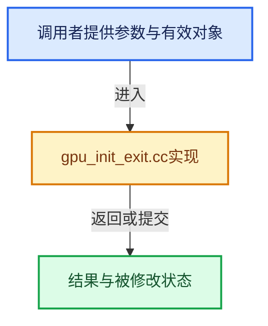

# 实现依赖专题：source/blender/gpu/intern/gpu_init_exit.cc

[方向导航](README.md) · [符号索引](../%E7%AC%A6%E5%8F%B7%E4%BE%9D%E8%B5%96%E4%B8%8E%E5%AE%9E%E7%8E%B0%E7%B4%A2%E5%BC%95.md)

本专题从正文实际调用进入，集中保存共享实现。函数有稳定锚点，可从调用处直接跳到对应完整函数；递归与互相调用通过回链组织。

## 本文件的实现关系





## 完整成员与函数实现

<a id="f-b606151a4976aec8"></a>

### `blender::GPU_init`

实现位置：[source/blender/gpu/intern/gpu_init_exit.cc](../../../../../source/blender/gpu/intern/gpu_init_exit.cc) · L27—L45。

**教学注释版**

<!-- annotated:33387e06fa8000 -->

```cpp
void GPU_init()
{
  /* can't avoid calling this multiple times, see wm_window_ghostwindow_add */
  if (initialized) {
    return;
  }

  initialized = true;

  gpu_backend_init_resources();

  gpu_shader_dependency_init();
  gpu_shader_create_info_init();

  GPU_shader_builtin_warm_up();
  GPU_pass_cache_init();

  gpu_batch_init();
}
```

<details>
<summary>核对原始源码：source/blender/gpu/intern/gpu_init_exit.cc · L27—L45</summary>

<!-- original:33387e06fa8000:source/blender/gpu/intern/gpu_init_exit.cc:27:45 -->

```cpp
void GPU_init()
{
  /* can't avoid calling this multiple times, see wm_window_ghostwindow_add */
  if (initialized) {
    return;
  }

  initialized = true;

  gpu_backend_init_resources();

  gpu_shader_dependency_init();
  gpu_shader_create_info_init();

  GPU_shader_builtin_warm_up();
  GPU_pass_cache_init();

  gpu_batch_init();
}
```

</details>

**沿实际写入检查状态**

- `initialized = true;`

**继续追踪实现**

- `gpu_backend_init_resources` → [blender::gpu_backend_init_resources · L594](%E4%BE%9D%E8%B5%96-gpu_context-77a234.md#f-1dd6f97e21517f13)。
- `gpu_shader_dependency_init` → [blender::gpu_shader_dependency_init · L550](%E4%BE%9D%E8%B5%96-gpu_shader_dependency-1f819e.md#f-8ece865771fc3bbc)。
- `gpu_shader_create_info_init` → [blender::gpu_shader_create_info_init · L775](%E4%BE%9D%E8%B5%96-gpu_shader_create_info-a2f1b5.md#f-f10530c3f8cfcdc3)。
- `GPU_shader_builtin_warm_up` → [blender::GPU_shader_builtin_warm_up · L273](%E4%BE%9D%E8%B5%96-gpu_shader_builtin-4b5195.md#f-ad96bbb220bd99b5)。
- `GPU_pass_cache_init` → [blender::GPU_pass_cache_init · L310](%E4%BE%9D%E8%B5%96-gpu_pass-efbc92.md#f-927a65018b16ebc4)。
- `gpu_batch_init` → [blender::gpu_batch_init · L539](%E4%BE%9D%E8%B5%96-gpu_batch-25aed8.md#f-7c83210cdba7882c)。
