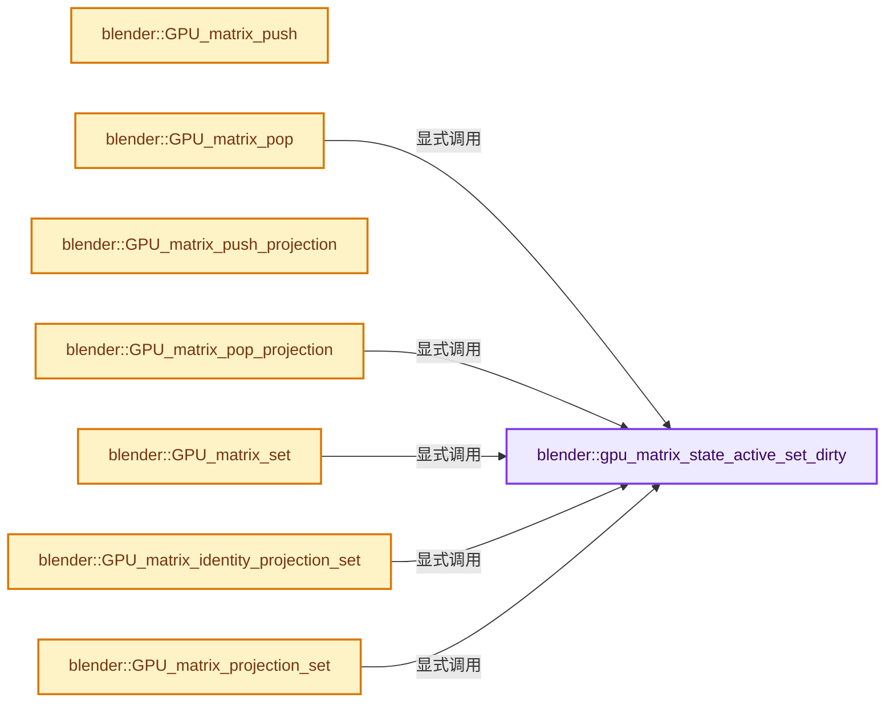
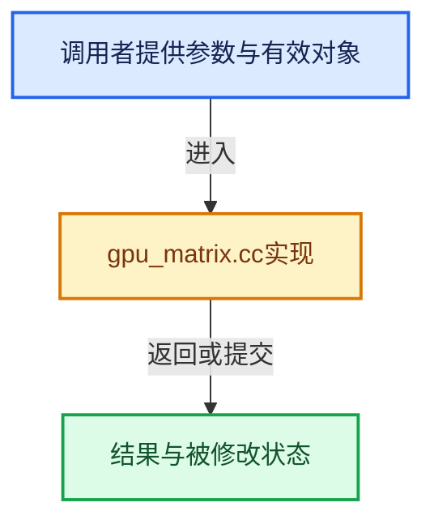

# 实现依赖专题：source/blender/gpu/intern/gpu_matrix.cc

[方向导航](README.md) · [符号索引](../%E7%AC%A6%E5%8F%B7%E4%BE%9D%E8%B5%96%E4%B8%8E%E5%AE%9E%E7%8E%B0%E7%B4%A2%E5%BC%95.md)

本专题从正文实际调用进入，集中保存共享实现。函数有稳定锚点，可从调用处直接跳到对应完整函数；递归与互相调用通过回链组织。

## 本文件的实现关系






<a id="m-0804133fc65c"></a>

## 宏 `CHECKMAT`

<!-- annotated:1987edacc61eda -->

```cpp
#  define CHECKMAT(m) checkmat((const float *)m)

```

<details>
<summary>核对原始源码：source/blender/gpu/intern/gpu_matrix.cc · L112—L113</summary>

<!-- original:1987edacc61eda:source/blender/gpu/intern/gpu_matrix.cc:112:113 -->

```cpp
#  define CHECKMAT(m) checkmat((const float *)m)

```

</details>

宏在预处理阶段展开，参数替换、重复求值和条件编译应直接从该定义检查。与普通函数不同，宏不会自动提供参数类型检查；构建配置选择哪个定义需结合外围条件。

<a id="m-8176896b2e44"></a>

## 宏 `CHECKMAT`

<!-- annotated:142905cc550ccb -->

```cpp
#  define CHECKMAT(m)

```

<details>
<summary>核对原始源码：source/blender/gpu/intern/gpu_matrix.cc · L116—L117</summary>

<!-- original:142905cc550ccb:source/blender/gpu/intern/gpu_matrix.cc:116:117 -->

```cpp
#  define CHECKMAT(m)

```

</details>

宏在预处理阶段展开，参数替换、重复求值和条件编译应直接从该定义检查。与普通函数不同，宏不会自动提供参数类型检查；构建配置选择哪个定义需结合外围条件。

## 完整成员与函数实现

<a id="f-9832cebe8bd5f1a6"></a>

### `blender::gpu_matrix_state_active_set_dirty`

实现位置：[source/blender/gpu/intern/gpu_matrix.cc](../../../../../source/blender/gpu/intern/gpu_matrix.cc) · L81—L85。

接口参数：

- `bool value`

**教学注释版**

<!-- annotated:1f757910efb5c1 -->

```cpp
static void gpu_matrix_state_active_set_dirty(bool value)
{
  GPUMatrixState *state = Context::get()->matrix_state;
  state->dirty = value;
}
```

<details>
<summary>核对原始源码：source/blender/gpu/intern/gpu_matrix.cc · L81—L85</summary>

<!-- original:1f757910efb5c1:source/blender/gpu/intern/gpu_matrix.cc:81:85 -->

```cpp
static void gpu_matrix_state_active_set_dirty(bool value)
{
  GPUMatrixState *state = Context::get()->matrix_state;
  state->dirty = value;
}
```

</details>

**沿实际写入检查状态**

- `state->dirty = value;`

**继续追踪实现**

- `Context::get` → [blender::gpu::Context::get · L127](%E4%BE%9D%E8%B5%96-gpu_context-77a234.md#f-7ca16707244f2d11)。

<a id="f-4461e6dee642cd0b"></a>

### `blender::GPU_matrix_push`

实现位置：[source/blender/gpu/intern/gpu_matrix.cc](../../../../../source/blender/gpu/intern/gpu_matrix.cc) · L120—L125。

**教学注释版**

<!-- annotated:cd0214882ed6e9 -->

```cpp
void GPU_matrix_push()
{
  BLI_assert(ModelViewStack.top + 1 < MATRIX_STACK_DEPTH);
  ModelViewStack.top++;
  copy_m4_m4(ModelView, ModelViewStack.stack[ModelViewStack.top - 1]);
}
```

<details>
<summary>核对原始源码：source/blender/gpu/intern/gpu_matrix.cc · L120—L125</summary>

<!-- original:cd0214882ed6e9:source/blender/gpu/intern/gpu_matrix.cc:120:125 -->

```cpp
void GPU_matrix_push()
{
  BLI_assert(ModelViewStack.top + 1 < MATRIX_STACK_DEPTH);
  ModelViewStack.top++;
  copy_m4_m4(ModelView, ModelViewStack.stack[ModelViewStack.top - 1]);
}
```

</details>

**继续追踪实现**

- `BLI_assert` → [BLI_assert · L48](../01-%E5%9F%BA%E7%A1%80%E5%AE%B9%E5%99%A8%E4%B8%8E%E7%8E%B0%E4%BB%A3CPP/%E4%BE%9D%E8%B5%96-BLI_assert-cc98e8.md#m-57a88495704d)；[BLI_assert · L63](../01-%E5%9F%BA%E7%A1%80%E5%AE%B9%E5%99%A8%E4%B8%8E%E7%8E%B0%E4%BB%A3CPP/%E4%BE%9D%E8%B5%96-BLI_assert-cc98e8.md#m-d07050020cb5)。宏定义由构建条件选择。
- `copy_m4_m4` → [blender::copy_m4_m4 · L84](../12-%E7%A9%BA%E9%97%B4%E6%95%B0%E6%8D%AE%E7%BB%93%E6%9E%84%E4%B8%8E%E5%87%A0%E4%BD%95%E7%AE%97%E6%B3%95/%E4%BE%9D%E8%B5%96-math_matrix_c-004123.md#f-b4390cf8c94710f5)。

<a id="f-873c4cfc32b18384"></a>

### `blender::GPU_matrix_pop`

实现位置：[source/blender/gpu/intern/gpu_matrix.cc](../../../../../source/blender/gpu/intern/gpu_matrix.cc) · L127—L132。

**教学注释版**

<!-- annotated:313f3a56cf8154 -->

```cpp
void GPU_matrix_pop()
{
  BLI_assert(ModelViewStack.top > 0);
  ModelViewStack.top--;
  gpu_matrix_state_active_set_dirty(true);
}
```

<details>
<summary>核对原始源码：source/blender/gpu/intern/gpu_matrix.cc · L127—L132</summary>

<!-- original:313f3a56cf8154:source/blender/gpu/intern/gpu_matrix.cc:127:132 -->

```cpp
void GPU_matrix_pop()
{
  BLI_assert(ModelViewStack.top > 0);
  ModelViewStack.top--;
  gpu_matrix_state_active_set_dirty(true);
}
```

</details>

**继续追踪实现**

- `BLI_assert` → [BLI_assert · L48](../01-%E5%9F%BA%E7%A1%80%E5%AE%B9%E5%99%A8%E4%B8%8E%E7%8E%B0%E4%BB%A3CPP/%E4%BE%9D%E8%B5%96-BLI_assert-cc98e8.md#m-57a88495704d)；[BLI_assert · L63](../01-%E5%9F%BA%E7%A1%80%E5%AE%B9%E5%99%A8%E4%B8%8E%E7%8E%B0%E4%BB%A3CPP/%E4%BE%9D%E8%B5%96-BLI_assert-cc98e8.md#m-d07050020cb5)。宏定义由构建条件选择。
- `gpu_matrix_state_active_set_dirty` → [blender::gpu_matrix_state_active_set_dirty · L81](%E4%BE%9D%E8%B5%96-gpu_matrix-f7dc40.md#f-9832cebe8bd5f1a6)。

<a id="f-ef664325369e7595"></a>

### `blender::GPU_matrix_push_projection`

实现位置：[source/blender/gpu/intern/gpu_matrix.cc](../../../../../source/blender/gpu/intern/gpu_matrix.cc) · L134—L139。

**教学注释版**

<!-- annotated:3269fa8c7209d2 -->

```cpp
void GPU_matrix_push_projection()
{
  BLI_assert(ProjectionStack.top + 1 < MATRIX_STACK_DEPTH);
  ProjectionStack.top++;
  copy_m4_m4(Projection, ProjectionStack.stack[ProjectionStack.top - 1]);
}
```

<details>
<summary>核对原始源码：source/blender/gpu/intern/gpu_matrix.cc · L134—L139</summary>

<!-- original:3269fa8c7209d2:source/blender/gpu/intern/gpu_matrix.cc:134:139 -->

```cpp
void GPU_matrix_push_projection()
{
  BLI_assert(ProjectionStack.top + 1 < MATRIX_STACK_DEPTH);
  ProjectionStack.top++;
  copy_m4_m4(Projection, ProjectionStack.stack[ProjectionStack.top - 1]);
}
```

</details>

**继续追踪实现**

- `BLI_assert` → [BLI_assert · L48](../01-%E5%9F%BA%E7%A1%80%E5%AE%B9%E5%99%A8%E4%B8%8E%E7%8E%B0%E4%BB%A3CPP/%E4%BE%9D%E8%B5%96-BLI_assert-cc98e8.md#m-57a88495704d)；[BLI_assert · L63](../01-%E5%9F%BA%E7%A1%80%E5%AE%B9%E5%99%A8%E4%B8%8E%E7%8E%B0%E4%BB%A3CPP/%E4%BE%9D%E8%B5%96-BLI_assert-cc98e8.md#m-d07050020cb5)。宏定义由构建条件选择。
- `copy_m4_m4` → [blender::copy_m4_m4 · L84](../12-%E7%A9%BA%E9%97%B4%E6%95%B0%E6%8D%AE%E7%BB%93%E6%9E%84%E4%B8%8E%E5%87%A0%E4%BD%95%E7%AE%97%E6%B3%95/%E4%BE%9D%E8%B5%96-math_matrix_c-004123.md#f-b4390cf8c94710f5)。

<a id="f-cb1c5ba0af1cf0b5"></a>

### `blender::GPU_matrix_pop_projection`

实现位置：[source/blender/gpu/intern/gpu_matrix.cc](../../../../../source/blender/gpu/intern/gpu_matrix.cc) · L141—L146。

**教学注释版**

<!-- annotated:372e4ad8bd9245 -->

```cpp
void GPU_matrix_pop_projection()
{
  BLI_assert(ProjectionStack.top > 0);
  ProjectionStack.top--;
  gpu_matrix_state_active_set_dirty(true);
}
```

<details>
<summary>核对原始源码：source/blender/gpu/intern/gpu_matrix.cc · L141—L146</summary>

<!-- original:372e4ad8bd9245:source/blender/gpu/intern/gpu_matrix.cc:141:146 -->

```cpp
void GPU_matrix_pop_projection()
{
  BLI_assert(ProjectionStack.top > 0);
  ProjectionStack.top--;
  gpu_matrix_state_active_set_dirty(true);
}
```

</details>

**继续追踪实现**

- `BLI_assert` → [BLI_assert · L48](../01-%E5%9F%BA%E7%A1%80%E5%AE%B9%E5%99%A8%E4%B8%8E%E7%8E%B0%E4%BB%A3CPP/%E4%BE%9D%E8%B5%96-BLI_assert-cc98e8.md#m-57a88495704d)；[BLI_assert · L63](../01-%E5%9F%BA%E7%A1%80%E5%AE%B9%E5%99%A8%E4%B8%8E%E7%8E%B0%E4%BB%A3CPP/%E4%BE%9D%E8%B5%96-BLI_assert-cc98e8.md#m-d07050020cb5)。宏定义由构建条件选择。
- `gpu_matrix_state_active_set_dirty` → [blender::gpu_matrix_state_active_set_dirty · L81](%E4%BE%9D%E8%B5%96-gpu_matrix-f7dc40.md#f-9832cebe8bd5f1a6)。

<a id="f-9a0e204d1b913771"></a>

### `blender::GPU_matrix_set`

实现位置：[source/blender/gpu/intern/gpu_matrix.cc](../../../../../source/blender/gpu/intern/gpu_matrix.cc) · L148—L153。

接口参数：

- `const float m[4][4]`

**教学注释版**

<!-- annotated:ffb521a1548c25 -->

```cpp
void GPU_matrix_set(const float m[4][4])
{
  copy_m4_m4(ModelView, m);
  CHECKMAT(ModelView3D);
  gpu_matrix_state_active_set_dirty(true);
}
```

<details>
<summary>核对原始源码：source/blender/gpu/intern/gpu_matrix.cc · L148—L153</summary>

<!-- original:ffb521a1548c25:source/blender/gpu/intern/gpu_matrix.cc:148:153 -->

```cpp
void GPU_matrix_set(const float m[4][4])
{
  copy_m4_m4(ModelView, m);
  CHECKMAT(ModelView3D);
  gpu_matrix_state_active_set_dirty(true);
}
```

</details>

**继续追踪实现**

- `copy_m4_m4` → [blender::copy_m4_m4 · L84](../12-%E7%A9%BA%E9%97%B4%E6%95%B0%E6%8D%AE%E7%BB%93%E6%9E%84%E4%B8%8E%E5%87%A0%E4%BD%95%E7%AE%97%E6%B3%95/%E4%BE%9D%E8%B5%96-math_matrix_c-004123.md#f-b4390cf8c94710f5)。
- `CHECKMAT` → [CHECKMAT · L112](%E4%BE%9D%E8%B5%96-gpu_matrix-f7dc40.md#m-0804133fc65c)；[CHECKMAT · L116](%E4%BE%9D%E8%B5%96-gpu_matrix-f7dc40.md#m-8176896b2e44)。宏定义由构建条件选择。
- `gpu_matrix_state_active_set_dirty` → [blender::gpu_matrix_state_active_set_dirty · L81](%E4%BE%9D%E8%B5%96-gpu_matrix-f7dc40.md#f-9832cebe8bd5f1a6)。

<a id="f-ce023837fe77cd5c"></a>

### `blender::GPU_matrix_identity_projection_set`

实现位置：[source/blender/gpu/intern/gpu_matrix.cc](../../../../../source/blender/gpu/intern/gpu_matrix.cc) · L155—L160。

**教学注释版**

<!-- annotated:1ade14d4ed7bb8 -->

```cpp
void GPU_matrix_identity_projection_set()
{
  unit_m4(Projection);
  CHECKMAT(Projection3D);
  gpu_matrix_state_active_set_dirty(true);
}
```

<details>
<summary>核对原始源码：source/blender/gpu/intern/gpu_matrix.cc · L155—L160</summary>

<!-- original:1ade14d4ed7bb8:source/blender/gpu/intern/gpu_matrix.cc:155:160 -->

```cpp
void GPU_matrix_identity_projection_set()
{
  unit_m4(Projection);
  CHECKMAT(Projection3D);
  gpu_matrix_state_active_set_dirty(true);
}
```

</details>

**继续追踪实现**

- `unit_m4` → [blender::unit_m4 · L55](../12-%E7%A9%BA%E9%97%B4%E6%95%B0%E6%8D%AE%E7%BB%93%E6%9E%84%E4%B8%8E%E5%87%A0%E4%BD%95%E7%AE%97%E6%B3%95/%E4%BE%9D%E8%B5%96-math_matrix_c-004123.md#f-e6cd812aae119176)。
- `CHECKMAT` → [CHECKMAT · L112](%E4%BE%9D%E8%B5%96-gpu_matrix-f7dc40.md#m-0804133fc65c)；[CHECKMAT · L116](%E4%BE%9D%E8%B5%96-gpu_matrix-f7dc40.md#m-8176896b2e44)。宏定义由构建条件选择。
- `gpu_matrix_state_active_set_dirty` → [blender::gpu_matrix_state_active_set_dirty · L81](%E4%BE%9D%E8%B5%96-gpu_matrix-f7dc40.md#f-9832cebe8bd5f1a6)。

<a id="f-2d7b9ce6e92ca6ad"></a>

### `blender::GPU_matrix_projection_set`

实现位置：[source/blender/gpu/intern/gpu_matrix.cc](../../../../../source/blender/gpu/intern/gpu_matrix.cc) · L162—L167。

接口参数：

- `const float m[4][4]`

**教学注释版**

<!-- annotated:d6035da3c6713e -->

```cpp
void GPU_matrix_projection_set(const float m[4][4])
{
  copy_m4_m4(Projection, m);
  CHECKMAT(Projection3D);
  gpu_matrix_state_active_set_dirty(true);
}
```

<details>
<summary>核对原始源码：source/blender/gpu/intern/gpu_matrix.cc · L162—L167</summary>

<!-- original:d6035da3c6713e:source/blender/gpu/intern/gpu_matrix.cc:162:167 -->

```cpp
void GPU_matrix_projection_set(const float m[4][4])
{
  copy_m4_m4(Projection, m);
  CHECKMAT(Projection3D);
  gpu_matrix_state_active_set_dirty(true);
}
```

</details>

**继续追踪实现**

- `copy_m4_m4` → [blender::copy_m4_m4 · L84](../12-%E7%A9%BA%E9%97%B4%E6%95%B0%E6%8D%AE%E7%BB%93%E6%9E%84%E4%B8%8E%E5%87%A0%E4%BD%95%E7%AE%97%E6%B3%95/%E4%BE%9D%E8%B5%96-math_matrix_c-004123.md#f-b4390cf8c94710f5)。
- `CHECKMAT` → [CHECKMAT · L112](%E4%BE%9D%E8%B5%96-gpu_matrix-f7dc40.md#m-0804133fc65c)；[CHECKMAT · L116](%E4%BE%9D%E8%B5%96-gpu_matrix-f7dc40.md#m-8176896b2e44)。宏定义由构建条件选择。
- `gpu_matrix_state_active_set_dirty` → [blender::gpu_matrix_state_active_set_dirty · L81](%E4%BE%9D%E8%B5%96-gpu_matrix-f7dc40.md#f-9832cebe8bd5f1a6)。

<a id="f-2295e3c9adcce99c"></a>

### `blender::GPU_matrix_identity_set`

实现位置：[source/blender/gpu/intern/gpu_matrix.cc](../../../../../source/blender/gpu/intern/gpu_matrix.cc) · L169—L173。

**教学注释版**

<!-- annotated:46d380f66d53cb -->

```cpp
void GPU_matrix_identity_set()
{
  unit_m4(ModelView);
  gpu_matrix_state_active_set_dirty(true);
}
```

<details>
<summary>核对原始源码：source/blender/gpu/intern/gpu_matrix.cc · L169—L173</summary>

<!-- original:46d380f66d53cb:source/blender/gpu/intern/gpu_matrix.cc:169:173 -->

```cpp
void GPU_matrix_identity_set()
{
  unit_m4(ModelView);
  gpu_matrix_state_active_set_dirty(true);
}
```

</details>

**继续追踪实现**

- `unit_m4` → [blender::unit_m4 · L55](../12-%E7%A9%BA%E9%97%B4%E6%95%B0%E6%8D%AE%E7%BB%93%E6%9E%84%E4%B8%8E%E5%87%A0%E4%BD%95%E7%AE%97%E6%B3%95/%E4%BE%9D%E8%B5%96-math_matrix_c-004123.md#f-e6cd812aae119176)。
- `gpu_matrix_state_active_set_dirty` → [blender::gpu_matrix_state_active_set_dirty · L81](%E4%BE%9D%E8%B5%96-gpu_matrix-f7dc40.md#f-9832cebe8bd5f1a6)。

<a id="f-9d9c07686dcf995a"></a>

### `blender::GPU_matrix_translate_2f`

实现位置：[source/blender/gpu/intern/gpu_matrix.cc](../../../../../source/blender/gpu/intern/gpu_matrix.cc) · L175—L182。

接口参数：

- `float x`
- `float y`

**教学注释版**

<!-- annotated:7229256d291455 -->

```cpp
void GPU_matrix_translate_2f(float x, float y)
{
  Mat4 m;
  unit_m4(m);
  m[3][0] = x;
  m[3][1] = y;
  GPU_matrix_mul(m);
}
```

<details>
<summary>核对原始源码：source/blender/gpu/intern/gpu_matrix.cc · L175—L182</summary>

<!-- original:7229256d291455:source/blender/gpu/intern/gpu_matrix.cc:175:182 -->

```cpp
void GPU_matrix_translate_2f(float x, float y)
{
  Mat4 m;
  unit_m4(m);
  m[3][0] = x;
  m[3][1] = y;
  GPU_matrix_mul(m);
}
```

</details>

**沿实际写入检查状态**

- `m[3][0] = x;`
- `m[3][1] = y;`

**继续追踪实现**

- `unit_m4` → [blender::unit_m4 · L55](../12-%E7%A9%BA%E9%97%B4%E6%95%B0%E6%8D%AE%E7%BB%93%E6%9E%84%E4%B8%8E%E5%87%A0%E4%BD%95%E7%AE%97%E6%B3%95/%E4%BE%9D%E8%B5%96-math_matrix_c-004123.md#f-e6cd812aae119176)。
- `GPU_matrix_mul` → [blender::GPU_matrix_mul · L247](%E4%BE%9D%E8%B5%96-gpu_matrix-f7dc40.md#f-e31cbfd1e82faf05)。

<a id="f-c5a90c747407f665"></a>

### `blender::GPU_matrix_translate_3f`

实现位置：[source/blender/gpu/intern/gpu_matrix.cc](../../../../../source/blender/gpu/intern/gpu_matrix.cc) · L189—L203。

接口参数：

- `float x`
- `float y`
- `float z`

**教学注释版**

<!-- annotated:2d77bf4856e0fc -->

```cpp
void GPU_matrix_translate_3f(float x, float y, float z)
{
#if 1
  translate_m4(ModelView, x, y, z);
  CHECKMAT(ModelView);
#else /* above works well in early testing, below is generic version */
  Mat4 m;
  unit_m4(m);
  m[3][0] = x;
  m[3][1] = y;
  m[3][2] = z;
  GPU_matrix_mul(m);
#endif
  gpu_matrix_state_active_set_dirty(true);
}
```

<details>
<summary>核对原始源码：source/blender/gpu/intern/gpu_matrix.cc · L189—L203</summary>

<!-- original:2d77bf4856e0fc:source/blender/gpu/intern/gpu_matrix.cc:189:203 -->

```cpp
void GPU_matrix_translate_3f(float x, float y, float z)
{
#if 1
  translate_m4(ModelView, x, y, z);
  CHECKMAT(ModelView);
#else /* above works well in early testing, below is generic version */
  Mat4 m;
  unit_m4(m);
  m[3][0] = x;
  m[3][1] = y;
  m[3][2] = z;
  GPU_matrix_mul(m);
#endif
  gpu_matrix_state_active_set_dirty(true);
}
```

</details>

**沿实际写入检查状态**

- `m[3][0] = x;`
- `m[3][1] = y;`
- `m[3][2] = z;`

**继续追踪实现**

- `translate_m4` → [blender::translate_m4 · L2108](../12-%E7%A9%BA%E9%97%B4%E6%95%B0%E6%8D%AE%E7%BB%93%E6%9E%84%E4%B8%8E%E5%87%A0%E4%BD%95%E7%AE%97%E6%B3%95/%E4%BE%9D%E8%B5%96-math_matrix_c-004123.md#f-e05a7854c4f638e6)。
- `CHECKMAT` → [CHECKMAT · L112](%E4%BE%9D%E8%B5%96-gpu_matrix-f7dc40.md#m-0804133fc65c)；[CHECKMAT · L116](%E4%BE%9D%E8%B5%96-gpu_matrix-f7dc40.md#m-8176896b2e44)。宏定义由构建条件选择。
- `unit_m4` → [blender::unit_m4 · L55](../12-%E7%A9%BA%E9%97%B4%E6%95%B0%E6%8D%AE%E7%BB%93%E6%9E%84%E4%B8%8E%E5%87%A0%E4%BD%95%E7%AE%97%E6%B3%95/%E4%BE%9D%E8%B5%96-math_matrix_c-004123.md#f-e6cd812aae119176)。
- `GPU_matrix_mul` → [blender::GPU_matrix_mul · L247](%E4%BE%9D%E8%B5%96-gpu_matrix-f7dc40.md#f-e31cbfd1e82faf05)。
- `gpu_matrix_state_active_set_dirty` → [blender::gpu_matrix_state_active_set_dirty · L81](%E4%BE%9D%E8%B5%96-gpu_matrix-f7dc40.md#f-9832cebe8bd5f1a6)。

<a id="f-7b22e14e518eb12d"></a>

### `blender::GPU_matrix_scale_2f`

实现位置：[source/blender/gpu/intern/gpu_matrix.cc](../../../../../source/blender/gpu/intern/gpu_matrix.cc) · L217—L225。

接口参数：

- `float x`
- `float y`

**教学注释版**

<!-- annotated:a4a419d3e1c609 -->

```cpp
void GPU_matrix_scale_2f(float x, float y)
{
  Mat4 m = {{0.0f}};
  m[0][0] = x;
  m[1][1] = y;
  m[2][2] = 1.0f;
  m[3][3] = 1.0f;
  GPU_matrix_mul(m);
}
```

<details>
<summary>核对原始源码：source/blender/gpu/intern/gpu_matrix.cc · L217—L225</summary>

<!-- original:a4a419d3e1c609:source/blender/gpu/intern/gpu_matrix.cc:217:225 -->

```cpp
void GPU_matrix_scale_2f(float x, float y)
{
  Mat4 m = {{0.0f}};
  m[0][0] = x;
  m[1][1] = y;
  m[2][2] = 1.0f;
  m[3][3] = 1.0f;
  GPU_matrix_mul(m);
}
```

</details>

**沿实际写入检查状态**

- `m[0][0] = x;`
- `m[1][1] = y;`
- `m[2][2] = 1.0f;`
- `m[3][3] = 1.0f;`

**继续追踪实现**

- `GPU_matrix_mul` → [blender::GPU_matrix_mul · L247](%E4%BE%9D%E8%B5%96-gpu_matrix-f7dc40.md#f-e31cbfd1e82faf05)。

<a id="f-4fad38ad8684ea64"></a>

### `blender::GPU_matrix_scale_3f`

实现位置：[source/blender/gpu/intern/gpu_matrix.cc](../../../../../source/blender/gpu/intern/gpu_matrix.cc) · L232—L240。

接口参数：

- `float x`
- `float y`
- `float z`

**教学注释版**

<!-- annotated:c74ad8432e9465 -->

```cpp
void GPU_matrix_scale_3f(float x, float y, float z)
{
  Mat4 m = {{0.0f}};
  m[0][0] = x;
  m[1][1] = y;
  m[2][2] = z;
  m[3][3] = 1.0f;
  GPU_matrix_mul(m);
}
```

<details>
<summary>核对原始源码：source/blender/gpu/intern/gpu_matrix.cc · L232—L240</summary>

<!-- original:c74ad8432e9465:source/blender/gpu/intern/gpu_matrix.cc:232:240 -->

```cpp
void GPU_matrix_scale_3f(float x, float y, float z)
{
  Mat4 m = {{0.0f}};
  m[0][0] = x;
  m[1][1] = y;
  m[2][2] = z;
  m[3][3] = 1.0f;
  GPU_matrix_mul(m);
}
```

</details>

**沿实际写入检查状态**

- `m[0][0] = x;`
- `m[1][1] = y;`
- `m[2][2] = z;`
- `m[3][3] = 1.0f;`

**继续追踪实现**

- `GPU_matrix_mul` → [blender::GPU_matrix_mul · L247](%E4%BE%9D%E8%B5%96-gpu_matrix-f7dc40.md#f-e31cbfd1e82faf05)。

<a id="f-ec03ab640b39d713"></a>

### `blender::GPU_matrix_scale_3fv`

实现位置：[source/blender/gpu/intern/gpu_matrix.cc](../../../../../source/blender/gpu/intern/gpu_matrix.cc) · L242—L245。

接口参数：

- `const float vec[3]`

**教学注释版**

<!-- annotated:c9041d0ebada2f -->

```cpp
void GPU_matrix_scale_3fv(const float vec[3])
{
  GPU_matrix_scale_3f(vec[0], vec[1], vec[2]);
}
```

<details>
<summary>核对原始源码：source/blender/gpu/intern/gpu_matrix.cc · L242—L245</summary>

<!-- original:c9041d0ebada2f:source/blender/gpu/intern/gpu_matrix.cc:242:245 -->

```cpp
void GPU_matrix_scale_3fv(const float vec[3])
{
  GPU_matrix_scale_3f(vec[0], vec[1], vec[2]);
}
```

</details>

**继续追踪实现**

- `GPU_matrix_scale_3f` → [blender::GPU_matrix_scale_3f · L232](%E4%BE%9D%E8%B5%96-gpu_matrix-f7dc40.md#f-4fad38ad8684ea64)。

<a id="f-e31cbfd1e82faf05"></a>

### `blender::GPU_matrix_mul`

实现位置：[source/blender/gpu/intern/gpu_matrix.cc](../../../../../source/blender/gpu/intern/gpu_matrix.cc) · L247—L252。

接口参数：

- `const float m[4][4]`

**教学注释版**

<!-- annotated:7448571d6292e3 -->

```cpp
void GPU_matrix_mul(const float m[4][4])
{
  mul_m4_m4_post(ModelView, m);
  CHECKMAT(ModelView);
  gpu_matrix_state_active_set_dirty(true);
}
```

<details>
<summary>核对原始源码：source/blender/gpu/intern/gpu_matrix.cc · L247—L252</summary>

<!-- original:7448571d6292e3:source/blender/gpu/intern/gpu_matrix.cc:247:252 -->

```cpp
void GPU_matrix_mul(const float m[4][4])
{
  mul_m4_m4_post(ModelView, m);
  CHECKMAT(ModelView);
  gpu_matrix_state_active_set_dirty(true);
}
```

</details>

**继续追踪实现**

- `mul_m4_m4_post` → [blender::mul_m4_m4_post · L304](../12-%E7%A9%BA%E9%97%B4%E6%95%B0%E6%8D%AE%E7%BB%93%E6%9E%84%E4%B8%8E%E5%87%A0%E4%BD%95%E7%AE%97%E6%B3%95/%E4%BE%9D%E8%B5%96-math_matrix_c-004123.md#f-7298bc3b4ad99baa)。
- `CHECKMAT` → [CHECKMAT · L112](%E4%BE%9D%E8%B5%96-gpu_matrix-f7dc40.md#m-0804133fc65c)；[CHECKMAT · L116](%E4%BE%9D%E8%B5%96-gpu_matrix-f7dc40.md#m-8176896b2e44)。宏定义由构建条件选择。
- `gpu_matrix_state_active_set_dirty` → [blender::gpu_matrix_state_active_set_dirty · L81](%E4%BE%9D%E8%B5%96-gpu_matrix-f7dc40.md#f-9832cebe8bd5f1a6)。

<a id="f-84dca34af3858aa5"></a>

### `blender::GPU_matrix_rotate_2d`

实现位置：[source/blender/gpu/intern/gpu_matrix.cc](../../../../../source/blender/gpu/intern/gpu_matrix.cc) · L254—L260。

接口参数：

- `float deg`

**教学注释版**

<!-- annotated:b54590823d5fba -->

```cpp
void GPU_matrix_rotate_2d(float deg)
{
  /* essentially RotateAxis('Z')
   * TODO: simpler math for 2D case
   */
  rotate_m4(ModelView, 'Z', DEG2RADF(deg));
}
```

<details>
<summary>核对原始源码：source/blender/gpu/intern/gpu_matrix.cc · L254—L260</summary>

<!-- original:b54590823d5fba:source/blender/gpu/intern/gpu_matrix.cc:254:260 -->

```cpp
void GPU_matrix_rotate_2d(float deg)
{
  /* essentially RotateAxis('Z')
   * TODO: simpler math for 2D case
   */
  rotate_m4(ModelView, 'Z', DEG2RADF(deg));
}
```

</details>

**继续追踪实现**

- `rotate_m4` → [blender::rotate_m4 · L2115](../12-%E7%A9%BA%E9%97%B4%E6%95%B0%E6%8D%AE%E7%BB%93%E6%9E%84%E4%B8%8E%E5%87%A0%E4%BD%95%E7%AE%97%E6%B3%95/%E4%BE%9D%E8%B5%96-math_matrix_c-004123.md#f-c255c473f69e9d03)。
- `DEG2RADF` → [DEG2RADF · L75](../12-%E7%A9%BA%E9%97%B4%E6%95%B0%E6%8D%AE%E7%BB%93%E6%9E%84%E4%B8%8E%E5%87%A0%E4%BD%95%E7%AE%97%E6%B3%95/%E4%BE%9D%E8%B5%96-BLI_math_constants-44e144.md#m-b7feaa4acbdb)；[DEG2RADF · L17](%E4%BE%9D%E8%B5%96-cycles_xml-1f0542.md#m-de839cbb85d5)。宏定义由构建条件选择。

<a id="f-f3c203346948f501"></a>

### `blender::mat4_ortho_set`

实现位置：[source/blender/gpu/intern/gpu_matrix.cc](../../../../../source/blender/gpu/intern/gpu_matrix.cc) · L283—L307。

接口参数：

- `float m[4][4]`
- `float left`
- `float right`
- `float bottom`
- `float top`
- `float near`
- `float far`

**教学注释版**

<!-- annotated:3f5bfa13ba40b5 -->

```cpp
static void mat4_ortho_set(
    float m[4][4], float left, float right, float bottom, float top, float near, float far)
{
  m[0][0] = 2.0f / (right - left);
  m[1][0] = 0.0f;
  m[2][0] = 0.0f;
  m[3][0] = -(right + left) / (right - left);

  m[0][1] = 0.0f;
  m[1][1] = 2.0f / (top - bottom);
  m[2][1] = 0.0f;
  m[3][1] = -(top + bottom) / (top - bottom);

  m[0][2] = 0.0f;
  m[1][2] = 0.0f;
  m[2][2] = -2.0f / (far - near);
  m[3][2] = -(far + near) / (far - near);

  m[0][3] = 0.0f;
  m[1][3] = 0.0f;
  m[2][3] = 0.0f;
  m[3][3] = 1.0f;

  gpu_matrix_state_active_set_dirty(true);
}
```

<details>
<summary>核对原始源码：source/blender/gpu/intern/gpu_matrix.cc · L283—L307</summary>

<!-- original:3f5bfa13ba40b5:source/blender/gpu/intern/gpu_matrix.cc:283:307 -->

```cpp
static void mat4_ortho_set(
    float m[4][4], float left, float right, float bottom, float top, float near, float far)
{
  m[0][0] = 2.0f / (right - left);
  m[1][0] = 0.0f;
  m[2][0] = 0.0f;
  m[3][0] = -(right + left) / (right - left);

  m[0][1] = 0.0f;
  m[1][1] = 2.0f / (top - bottom);
  m[2][1] = 0.0f;
  m[3][1] = -(top + bottom) / (top - bottom);

  m[0][2] = 0.0f;
  m[1][2] = 0.0f;
  m[2][2] = -2.0f / (far - near);
  m[3][2] = -(far + near) / (far - near);

  m[0][3] = 0.0f;
  m[1][3] = 0.0f;
  m[2][3] = 0.0f;
  m[3][3] = 1.0f;

  gpu_matrix_state_active_set_dirty(true);
}
```

</details>

**沿实际写入检查状态**

- `m[0][0] = 2.0f / (right - left);`
- `m[1][0] = 0.0f;`
- `m[2][0] = 0.0f;`
- `m[3][0] = -(right + left) / (right - left);`
- `m[0][1] = 0.0f;`
- `m[1][1] = 2.0f / (top - bottom);`
- `m[2][1] = 0.0f;`
- `m[3][1] = -(top + bottom) / (top - bottom);`
- `m[0][2] = 0.0f;`
- `m[1][2] = 0.0f;`
- `m[2][2] = -2.0f / (far - near);`
- `m[3][2] = -(far + near) / (far - near);`
- `m[0][3] = 0.0f;`
- `m[1][3] = 0.0f;`
- `m[2][3] = 0.0f;`
- `m[3][3] = 1.0f;`

**继续追踪实现**

- `gpu_matrix_state_active_set_dirty` → [blender::gpu_matrix_state_active_set_dirty · L81](%E4%BE%9D%E8%B5%96-gpu_matrix-f7dc40.md#f-9832cebe8bd5f1a6)。

<a id="f-5f2221e903c42f74"></a>

### `blender::mat4_frustum_set`

实现位置：[source/blender/gpu/intern/gpu_matrix.cc](../../../../../source/blender/gpu/intern/gpu_matrix.cc) · L309—L333。

接口参数：

- `float m[4][4]`
- `float left`
- `float right`
- `float bottom`
- `float top`
- `float near`
- `float far`

**教学注释版**

<!-- annotated:2b32e3e377acbd -->

```cpp
static void mat4_frustum_set(
    float m[4][4], float left, float right, float bottom, float top, float near, float far)
{
  m[0][0] = 2.0f * near / (right - left);
  m[1][0] = 0.0f;
  m[2][0] = (right + left) / (right - left);
  m[3][0] = 0.0f;

  m[0][1] = 0.0f;
  m[1][1] = 2.0f * near / (top - bottom);
  m[2][1] = (top + bottom) / (top - bottom);
  m[3][1] = 0.0f;

  m[0][2] = 0.0f;
  m[1][2] = 0.0f;
  m[2][2] = -(far + near) / (far - near);
  m[3][2] = -2.0f * far * near / (far - near);

  m[0][3] = 0.0f;
  m[1][3] = 0.0f;
  m[2][3] = -1.0f;
  m[3][3] = 0.0f;

  gpu_matrix_state_active_set_dirty(true);
}
```

<details>
<summary>核对原始源码：source/blender/gpu/intern/gpu_matrix.cc · L309—L333</summary>

<!-- original:2b32e3e377acbd:source/blender/gpu/intern/gpu_matrix.cc:309:333 -->

```cpp
static void mat4_frustum_set(
    float m[4][4], float left, float right, float bottom, float top, float near, float far)
{
  m[0][0] = 2.0f * near / (right - left);
  m[1][0] = 0.0f;
  m[2][0] = (right + left) / (right - left);
  m[3][0] = 0.0f;

  m[0][1] = 0.0f;
  m[1][1] = 2.0f * near / (top - bottom);
  m[2][1] = (top + bottom) / (top - bottom);
  m[3][1] = 0.0f;

  m[0][2] = 0.0f;
  m[1][2] = 0.0f;
  m[2][2] = -(far + near) / (far - near);
  m[3][2] = -2.0f * far * near / (far - near);

  m[0][3] = 0.0f;
  m[1][3] = 0.0f;
  m[2][3] = -1.0f;
  m[3][3] = 0.0f;

  gpu_matrix_state_active_set_dirty(true);
}
```

</details>

**沿实际写入检查状态**

- `m[0][0] = 2.0f * near / (right - left);`
- `m[1][0] = 0.0f;`
- `m[2][0] = (right + left) / (right - left);`
- `m[3][0] = 0.0f;`
- `m[0][1] = 0.0f;`
- `m[1][1] = 2.0f * near / (top - bottom);`
- `m[2][1] = (top + bottom) / (top - bottom);`
- `m[3][1] = 0.0f;`
- `m[0][2] = 0.0f;`
- `m[1][2] = 0.0f;`
- `m[2][2] = -(far + near) / (far - near);`
- `m[3][2] = -2.0f * far * near / (far - near);`
- `m[0][3] = 0.0f;`
- `m[1][3] = 0.0f;`
- `m[2][3] = -1.0f;`
- `m[3][3] = 0.0f;`

**继续追踪实现**

- `gpu_matrix_state_active_set_dirty` → [blender::gpu_matrix_state_active_set_dirty · L81](%E4%BE%9D%E8%B5%96-gpu_matrix-f7dc40.md#f-9832cebe8bd5f1a6)。

<a id="f-0bb5e2d8c02c2c99"></a>

### `blender::GPU_matrix_ortho_set`

实现位置：[source/blender/gpu/intern/gpu_matrix.cc](../../../../../source/blender/gpu/intern/gpu_matrix.cc) · L400—L405。

接口参数：

- `float left`
- `float right`
- `float bottom`
- `float top`
- `float near`
- `float far`

**教学注释版**

<!-- annotated:7832594407a6e6 -->

```cpp
void GPU_matrix_ortho_set(float left, float right, float bottom, float top, float near, float far)
{
  mat4_ortho_set(Projection, left, right, bottom, top, near, far);
  CHECKMAT(Projection);
  gpu_matrix_state_active_set_dirty(true);
}
```

<details>
<summary>核对原始源码：source/blender/gpu/intern/gpu_matrix.cc · L400—L405</summary>

<!-- original:7832594407a6e6:source/blender/gpu/intern/gpu_matrix.cc:400:405 -->

```cpp
void GPU_matrix_ortho_set(float left, float right, float bottom, float top, float near, float far)
{
  mat4_ortho_set(Projection, left, right, bottom, top, near, far);
  CHECKMAT(Projection);
  gpu_matrix_state_active_set_dirty(true);
}
```

</details>

**继续追踪实现**

- `mat4_ortho_set` → [blender::mat4_ortho_set · L283](%E4%BE%9D%E8%B5%96-gpu_matrix-f7dc40.md#f-f3c203346948f501)。
- `CHECKMAT` → [CHECKMAT · L112](%E4%BE%9D%E8%B5%96-gpu_matrix-f7dc40.md#m-0804133fc65c)；[CHECKMAT · L116](%E4%BE%9D%E8%B5%96-gpu_matrix-f7dc40.md#m-8176896b2e44)。宏定义由构建条件选择。
- `gpu_matrix_state_active_set_dirty` → [blender::gpu_matrix_state_active_set_dirty · L81](%E4%BE%9D%E8%B5%96-gpu_matrix-f7dc40.md#f-9832cebe8bd5f1a6)。

<a id="f-618e253c5c23f237"></a>

### `blender::GPU_matrix_frustum_set`

实现位置：[source/blender/gpu/intern/gpu_matrix.cc](../../../../../source/blender/gpu/intern/gpu_matrix.cc) · L423—L429。

接口参数：

- `float left`
- `float right`
- `float bottom`
- `float top`
- `float near`
- `float far`

**教学注释版**

<!-- annotated:4191792f59b982 -->

```cpp
void GPU_matrix_frustum_set(
    float left, float right, float bottom, float top, float near, float far)
{
  mat4_frustum_set(Projection, left, right, bottom, top, near, far);
  CHECKMAT(Projection);
  gpu_matrix_state_active_set_dirty(true);
}
```

<details>
<summary>核对原始源码：source/blender/gpu/intern/gpu_matrix.cc · L423—L429</summary>

<!-- original:4191792f59b982:source/blender/gpu/intern/gpu_matrix.cc:423:429 -->

```cpp
void GPU_matrix_frustum_set(
    float left, float right, float bottom, float top, float near, float far)
{
  mat4_frustum_set(Projection, left, right, bottom, top, near, far);
  CHECKMAT(Projection);
  gpu_matrix_state_active_set_dirty(true);
}
```

</details>

**继续追踪实现**

- `mat4_frustum_set` → [blender::mat4_frustum_set · L309](%E4%BE%9D%E8%B5%96-gpu_matrix-f7dc40.md#f-5f2221e903c42f74)。
- `CHECKMAT` → [CHECKMAT · L112](%E4%BE%9D%E8%B5%96-gpu_matrix-f7dc40.md#m-0804133fc65c)；[CHECKMAT · L116](%E4%BE%9D%E8%B5%96-gpu_matrix-f7dc40.md#m-8176896b2e44)。宏定义由构建条件选择。
- `gpu_matrix_state_active_set_dirty` → [blender::gpu_matrix_state_active_set_dirty · L81](%E4%BE%9D%E8%B5%96-gpu_matrix-f7dc40.md#f-9832cebe8bd5f1a6)。

<a id="f-fa882bc99cef8a30"></a>

### `blender::GPU_matrix_model_view_get`

实现位置：[source/blender/gpu/intern/gpu_matrix.cc](../../../../../source/blender/gpu/intern/gpu_matrix.cc) · L553—L561。

接口参数：

- `float m[4][4]`

**教学注释版**

<!-- annotated:e56db8ea8dbffb -->

```cpp
const float (*GPU_matrix_model_view_get(float m[4][4]))[4]
{
  if (m) {
    copy_m4_m4(m, ModelView);
    return m;
  }

  return ModelView;
}
```

<details>
<summary>核对原始源码：source/blender/gpu/intern/gpu_matrix.cc · L553—L561</summary>

<!-- original:e56db8ea8dbffb:source/blender/gpu/intern/gpu_matrix.cc:553:561 -->

```cpp
const float (*GPU_matrix_model_view_get(float m[4][4]))[4]
{
  if (m) {
    copy_m4_m4(m, ModelView);
    return m;
  }

  return ModelView;
}
```

</details>

**结果出口**

- `return m;`
- `return ModelView;`

**继续追踪实现**

- `copy_m4_m4` → [blender::copy_m4_m4 · L84](../12-%E7%A9%BA%E9%97%B4%E6%95%B0%E6%8D%AE%E7%BB%93%E6%9E%84%E4%B8%8E%E5%87%A0%E4%BD%95%E7%AE%97%E6%B3%95/%E4%BE%9D%E8%B5%96-math_matrix_c-004123.md#f-b4390cf8c94710f5)。

<a id="f-0898a9a110e7a668"></a>

### `blender::GPU_matrix_projection_get`

实现位置：[source/blender/gpu/intern/gpu_matrix.cc](../../../../../source/blender/gpu/intern/gpu_matrix.cc) · L563—L571。

接口参数：

- `float m[4][4]`

**教学注释版**

<!-- annotated:4356ea0b862d35 -->

```cpp
const float (*GPU_matrix_projection_get(float m[4][4]))[4]
{
  if (m) {
    copy_m4_m4(m, Projection);
    return m;
  }

  return Projection;
}
```

<details>
<summary>核对原始源码：source/blender/gpu/intern/gpu_matrix.cc · L563—L571</summary>

<!-- original:4356ea0b862d35:source/blender/gpu/intern/gpu_matrix.cc:563:571 -->

```cpp
const float (*GPU_matrix_projection_get(float m[4][4]))[4]
{
  if (m) {
    copy_m4_m4(m, Projection);
    return m;
  }

  return Projection;
}
```

</details>

**结果出口**

- `return m;`
- `return Projection;`

**继续追踪实现**

- `copy_m4_m4` → [blender::copy_m4_m4 · L84](../12-%E7%A9%BA%E9%97%B4%E6%95%B0%E6%8D%AE%E7%BB%93%E6%9E%84%E4%B8%8E%E5%87%A0%E4%BD%95%E7%AE%97%E6%B3%95/%E4%BE%9D%E8%B5%96-math_matrix_c-004123.md#f-b4390cf8c94710f5)。

<a id="f-7a56f733dae420c6"></a>

### `blender::GPU_matrix_model_view_projection_get`

实现位置：[source/blender/gpu/intern/gpu_matrix.cc](../../../../../source/blender/gpu/intern/gpu_matrix.cc) · L573—L582。

接口参数：

- `float m[4][4]`

**教学注释版**

<!-- annotated:6b726510283bae -->

```cpp
const float (*GPU_matrix_model_view_projection_get(float m[4][4]))[4]
{
  if (m == nullptr) {
    static Mat4 temp;
    m = temp;
  }

  mul_m4_m4m4(m, Projection, ModelView);
  return m;
}
```

<details>
<summary>核对原始源码：source/blender/gpu/intern/gpu_matrix.cc · L573—L582</summary>

<!-- original:6b726510283bae:source/blender/gpu/intern/gpu_matrix.cc:573:582 -->

```cpp
const float (*GPU_matrix_model_view_projection_get(float m[4][4]))[4]
{
  if (m == nullptr) {
    static Mat4 temp;
    m = temp;
  }

  mul_m4_m4m4(m, Projection, ModelView);
  return m;
}
```

</details>

**沿实际写入检查状态**

- `m = temp;`

**结果出口**

- `return m;`

**继续追踪实现**

- `mul_m4_m4m4` → [blender::mul_m4_m4m4 · L217](../12-%E7%A9%BA%E9%97%B4%E6%95%B0%E6%8D%AE%E7%BB%93%E6%9E%84%E4%B8%8E%E5%87%A0%E4%BD%95%E7%AE%97%E6%B3%95/%E4%BE%9D%E8%B5%96-math_matrix_c-004123.md#f-b5272136b543b73b)。

<a id="f-2370174b2b8bb0dc"></a>

### `blender::GPU_matrix_normal_get`

实现位置：[source/blender/gpu/intern/gpu_matrix.cc](../../../../../source/blender/gpu/intern/gpu_matrix.cc) · L584—L597。

接口参数：

- `float m[3][3]`

**教学注释版**

<!-- annotated:dc1ca3b83716ba -->

```cpp
const float (*GPU_matrix_normal_get(float m[3][3]))[3]
{
  if (m == nullptr) {
    static Mat3 temp3;
    m = temp3;
  }

  copy_m3_m4(m, GPU_matrix_model_view_get(nullptr));

  invert_m3(m);
  transpose_m3(m);

  return m;
}
```

<details>
<summary>核对原始源码：source/blender/gpu/intern/gpu_matrix.cc · L584—L597</summary>

<!-- original:dc1ca3b83716ba:source/blender/gpu/intern/gpu_matrix.cc:584:597 -->

```cpp
const float (*GPU_matrix_normal_get(float m[3][3]))[3]
{
  if (m == nullptr) {
    static Mat3 temp3;
    m = temp3;
  }

  copy_m3_m4(m, GPU_matrix_model_view_get(nullptr));

  invert_m3(m);
  transpose_m3(m);

  return m;
}
```

</details>

**沿实际写入检查状态**

- `m = temp3;`

**结果出口**

- `return m;`

**继续追踪实现**

- `copy_m3_m4` → [blender::copy_m3_m4 · L94](../12-%E7%A9%BA%E9%97%B4%E6%95%B0%E6%8D%AE%E7%BB%93%E6%9E%84%E4%B8%8E%E5%87%A0%E4%BD%95%E7%AE%97%E6%B3%95/%E4%BE%9D%E8%B5%96-math_matrix_c-004123.md#f-1141cb3624c754b0)。
- `GPU_matrix_model_view_get` → [blender::GPU_matrix_model_view_get · L553](%E4%BE%9D%E8%B5%96-gpu_matrix-f7dc40.md#f-fa882bc99cef8a30)。
- `invert_m3` → [blender::invert_m3 · L1034](../12-%E7%A9%BA%E9%97%B4%E6%95%B0%E6%8D%AE%E7%BB%93%E6%9E%84%E4%B8%8E%E5%87%A0%E4%BD%95%E7%AE%97%E6%B3%95/%E4%BE%9D%E8%B5%96-math_matrix_c-004123.md#f-0d44d9713a300227)。
- `transpose_m3` → [blender::transpose_m3 · L1199](../12-%E7%A9%BA%E9%97%B4%E6%95%B0%E6%8D%AE%E7%BB%93%E6%9E%84%E4%B8%8E%E5%87%A0%E4%BD%95%E7%AE%97%E6%B3%95/%E4%BE%9D%E8%B5%96-math_matrix_c-004123.md#f-ba1c715782a096a2)。

<a id="f-c4bd0ac3f45ded4f"></a>

### `blender::GPU_matrix_bind`

实现位置：[source/blender/gpu/intern/gpu_matrix.cc](../../../../../source/blender/gpu/intern/gpu_matrix.cc) · L612—L660。

接口参数：

- `gpu::Shader *shader`

**教学注释版**

<!-- annotated:51d51c5027527f -->

```cpp
void GPU_matrix_bind(gpu::Shader *shader)
{
  /* set uniform values to matrix stack values
   * call this before a draw call if desired matrices are dirty
   * call glUseProgram before this, as glUniform expects program to be bound
   */
  int32_t MV = GPU_shader_get_builtin_uniform(shader, GPU_UNIFORM_MODELVIEW);
  int32_t P = GPU_shader_get_builtin_uniform(shader, GPU_UNIFORM_PROJECTION);
  int32_t MVP = GPU_shader_get_builtin_uniform(shader, GPU_UNIFORM_MVP);

  int32_t N = GPU_shader_get_builtin_uniform(shader, GPU_UNIFORM_NORMAL);
  int32_t MV_inv = GPU_shader_get_builtin_uniform(shader, GPU_UNIFORM_MODELVIEW_INV);
  int32_t P_inv = GPU_shader_get_builtin_uniform(shader, GPU_UNIFORM_PROJECTION_INV);

  if (MV != -1) {
    GPU_shader_uniform_float_ex(
        shader, MV, 16, 1, reinterpret_cast<const float *>(GPU_matrix_model_view_get(nullptr)));
  }
  if (P != -1) {
    GPU_shader_uniform_float_ex(
        shader, P, 16, 1, reinterpret_cast<const float *>(GPU_matrix_projection_get(nullptr)));
  }
  if (MVP != -1) {
    GPU_shader_uniform_float_ex(
        shader,
        MVP,
        16,
        1,
        reinterpret_cast<const float *>(GPU_matrix_model_view_projection_get(nullptr)));
  }
  if (N != -1) {
    GPU_shader_uniform_float_ex(
        shader, N, 9, 1, reinterpret_cast<const float *>(GPU_matrix_normal_get(nullptr)));
  }
  if (MV_inv != -1) {
    Mat4 m;
    GPU_matrix_model_view_get(m);
    invert_m4(m);
    GPU_shader_uniform_float_ex(shader, MV_inv, 16, 1, reinterpret_cast<const float *>(m));
  }
  if (P_inv != -1) {
    Mat4 m;
    GPU_matrix_projection_get(m);
    invert_m4(m);
    GPU_shader_uniform_float_ex(shader, P_inv, 16, 1, reinterpret_cast<const float *>(m));
  }

  gpu_matrix_state_active_set_dirty(false);
}
```

<details>
<summary>核对原始源码：source/blender/gpu/intern/gpu_matrix.cc · L612—L660</summary>

<!-- original:51d51c5027527f:source/blender/gpu/intern/gpu_matrix.cc:612:660 -->

```cpp
void GPU_matrix_bind(gpu::Shader *shader)
{
  /* set uniform values to matrix stack values
   * call this before a draw call if desired matrices are dirty
   * call glUseProgram before this, as glUniform expects program to be bound
   */
  int32_t MV = GPU_shader_get_builtin_uniform(shader, GPU_UNIFORM_MODELVIEW);
  int32_t P = GPU_shader_get_builtin_uniform(shader, GPU_UNIFORM_PROJECTION);
  int32_t MVP = GPU_shader_get_builtin_uniform(shader, GPU_UNIFORM_MVP);

  int32_t N = GPU_shader_get_builtin_uniform(shader, GPU_UNIFORM_NORMAL);
  int32_t MV_inv = GPU_shader_get_builtin_uniform(shader, GPU_UNIFORM_MODELVIEW_INV);
  int32_t P_inv = GPU_shader_get_builtin_uniform(shader, GPU_UNIFORM_PROJECTION_INV);

  if (MV != -1) {
    GPU_shader_uniform_float_ex(
        shader, MV, 16, 1, reinterpret_cast<const float *>(GPU_matrix_model_view_get(nullptr)));
  }
  if (P != -1) {
    GPU_shader_uniform_float_ex(
        shader, P, 16, 1, reinterpret_cast<const float *>(GPU_matrix_projection_get(nullptr)));
  }
  if (MVP != -1) {
    GPU_shader_uniform_float_ex(
        shader,
        MVP,
        16,
        1,
        reinterpret_cast<const float *>(GPU_matrix_model_view_projection_get(nullptr)));
  }
  if (N != -1) {
    GPU_shader_uniform_float_ex(
        shader, N, 9, 1, reinterpret_cast<const float *>(GPU_matrix_normal_get(nullptr)));
  }
  if (MV_inv != -1) {
    Mat4 m;
    GPU_matrix_model_view_get(m);
    invert_m4(m);
    GPU_shader_uniform_float_ex(shader, MV_inv, 16, 1, reinterpret_cast<const float *>(m));
  }
  if (P_inv != -1) {
    Mat4 m;
    GPU_matrix_projection_get(m);
    invert_m4(m);
    GPU_shader_uniform_float_ex(shader, P_inv, 16, 1, reinterpret_cast<const float *>(m));
  }

  gpu_matrix_state_active_set_dirty(false);
}
```

</details>

**继续追踪实现**

- `GPU_shader_get_builtin_uniform` → [blender::GPU_shader_get_builtin_uniform · L538](%E4%BE%9D%E8%B5%96-gpu_shader-141cc9.md#f-5c493ac2a8f00630)。
- `GPU_shader_uniform_float_ex` → [blender::GPU_shader_uniform_float_ex · L634](%E4%BE%9D%E8%B5%96-gpu_shader-141cc9.md#f-bae0e0521a75040e)。
- `GPU_matrix_model_view_get` → [blender::GPU_matrix_model_view_get · L553](%E4%BE%9D%E8%B5%96-gpu_matrix-f7dc40.md#f-fa882bc99cef8a30)。
- `GPU_matrix_projection_get` → [blender::GPU_matrix_projection_get · L563](%E4%BE%9D%E8%B5%96-gpu_matrix-f7dc40.md#f-0898a9a110e7a668)。
- `GPU_matrix_model_view_projection_get` → [blender::GPU_matrix_model_view_projection_get · L573](%E4%BE%9D%E8%B5%96-gpu_matrix-f7dc40.md#f-7a56f733dae420c6)。
- `GPU_matrix_normal_get` → [blender::GPU_matrix_normal_get · L584](%E4%BE%9D%E8%B5%96-gpu_matrix-f7dc40.md#f-2370174b2b8bb0dc)。
- `invert_m4` → [blender::invert_m4 · L1069](../12-%E7%A9%BA%E9%97%B4%E6%95%B0%E6%8D%AE%E7%BB%93%E6%9E%84%E4%B8%8E%E5%87%A0%E4%BD%95%E7%AE%97%E6%B3%95/%E4%BE%9D%E8%B5%96-math_matrix_c-004123.md#f-db172dd1e3ce5867)。
- `gpu_matrix_state_active_set_dirty` → [blender::gpu_matrix_state_active_set_dirty · L81](%E4%BE%9D%E8%B5%96-gpu_matrix-f7dc40.md#f-9832cebe8bd5f1a6)。

<a id="f-9b273c4286f88eeb"></a>

### `blender::GPU_matrix_dirty_get`

实现位置：[source/blender/gpu/intern/gpu_matrix.cc](../../../../../source/blender/gpu/intern/gpu_matrix.cc) · L662—L666。

**教学注释版**

<!-- annotated:9e7e7bae6195eb -->

```cpp
bool GPU_matrix_dirty_get()
{
  GPUMatrixState *state = Context::get()->matrix_state;
  return state->dirty;
}
```

<details>
<summary>核对原始源码：source/blender/gpu/intern/gpu_matrix.cc · L662—L666</summary>

<!-- original:9e7e7bae6195eb:source/blender/gpu/intern/gpu_matrix.cc:662:666 -->

```cpp
bool GPU_matrix_dirty_get()
{
  GPUMatrixState *state = Context::get()->matrix_state;
  return state->dirty;
}
```

</details>

**结果出口**

- `return state->dirty;`

**继续追踪实现**

- `Context::get` → [blender::gpu::Context::get · L127](%E4%BE%9D%E8%B5%96-gpu_context-77a234.md#f-7ca16707244f2d11)。

<a id="f-bc9a38b18b984d94"></a>

### `blender::GPU_polygon_offset_calc`

实现位置：[source/blender/gpu/intern/gpu_matrix.cc](../../../../../source/blender/gpu/intern/gpu_matrix.cc) · L697—L726。

接口参数：

- `const float (*winmat)[4]`
- `float viewdist`
- `float dist`

**教学注释版**

<!-- annotated:8ba3023073f9a1 -->

```cpp
float GPU_polygon_offset_calc(const float (*winmat)[4], float viewdist, float dist)
{
  /* Seems like we have a factor of 2 more offset than 2.79 for some reason. Correct for this. */
  dist *= 0.5f;

  if (winmat[3][3] > 0.5f) {
#if 1
    return 0.00001f * dist * viewdist;  // ortho tweaking
#else
    static float depth_fac = 0.0f;
    if (depth_fac == 0.0f) {
      /* Hard-code for 24 bit precision. */
      int depthbits = 24;
      depth_fac = 1.0f / float((1 << depthbits) - 1);
    }
    ofs = (-1.0 / winmat[2][2]) * dist * depth_fac;

    UNUSED_VARS(viewdist);
#endif
  }

  /* This adjustment effectively results in reducing the Z value by 0.25%.
   *
   * winmat[4][3] actually evaluates to `-2 * far * near / (far - near)`,
   * is very close to -0.2 with default clip range,
   * and is used as the coefficient multiplied by `w / z`,
   * thus controlling the z dependent part of the depth value.
   */
  return winmat[3][2] * -0.0025f * dist;
}
```

<details>
<summary>核对原始源码：source/blender/gpu/intern/gpu_matrix.cc · L697—L726</summary>

<!-- original:8ba3023073f9a1:source/blender/gpu/intern/gpu_matrix.cc:697:726 -->

```cpp
float GPU_polygon_offset_calc(const float (*winmat)[4], float viewdist, float dist)
{
  /* Seems like we have a factor of 2 more offset than 2.79 for some reason. Correct for this. */
  dist *= 0.5f;

  if (winmat[3][3] > 0.5f) {
#if 1
    return 0.00001f * dist * viewdist;  // ortho tweaking
#else
    static float depth_fac = 0.0f;
    if (depth_fac == 0.0f) {
      /* Hard-code for 24 bit precision. */
      int depthbits = 24;
      depth_fac = 1.0f / float((1 << depthbits) - 1);
    }
    ofs = (-1.0 / winmat[2][2]) * dist * depth_fac;

    UNUSED_VARS(viewdist);
#endif
  }

  /* This adjustment effectively results in reducing the Z value by 0.25%.
   *
   * winmat[4][3] actually evaluates to `-2 * far * near / (far - near)`,
   * is very close to -0.2 with default clip range,
   * and is used as the coefficient multiplied by `w / z`,
   * thus controlling the z dependent part of the depth value.
   */
  return winmat[3][2] * -0.0025f * dist;
}
```

</details>

**沿实际写入检查状态**

- `dist *= 0.5f;`
- `depth_fac = 1.0f / float((1 << depthbits) - 1);`
- `ofs = (-1.0 / winmat[2][2]) * dist * depth_fac;`

**结果出口**

- `return 0.00001f * dist * viewdist;  // ortho tweaking`
- `return winmat[3][2] * -0.0025f * dist;`

**继续追踪实现**

- `UNUSED_VARS` → [UNUSED_VARS · L522](../01-%E5%9F%BA%E7%A1%80%E5%AE%B9%E5%99%A8%E4%B8%8E%E7%8E%B0%E4%BB%A3CPP/%E4%BE%9D%E8%B5%96-BLI_utildefines-293a0a.md#m-013582537634)；[UNUSED_VARS · L41](%E4%BE%9D%E8%B5%96-GPU_shader_shared_utils-0adda3.md#m-05d9d7a33da0)；[UNUSED_VARS · L62](%E4%BE%9D%E8%B5%96-GPU_shader_shared_utils-0adda3.md#m-e12c683a4aca)。宏定义由构建条件选择。

<a id="f-d67796a5887f2946"></a>

### `blender::GPU_polygon_offset`

实现位置：[source/blender/gpu/intern/gpu_matrix.cc](../../../../../source/blender/gpu/intern/gpu_matrix.cc) · L728—L749。

接口参数：

- `float viewdist`
- `float dist`

**教学注释版**

<!-- annotated:43c207f127a757 -->

```cpp
void GPU_polygon_offset(float viewdist, float dist)
{
  static float winmat[4][4], offset = 0.0f;

  if (dist != 0.0f) {
    /* hack below is to mimic polygon offset */
    GPU_matrix_projection_get(winmat);

    /* dist is from camera to center point */

    float ofs = GPU_polygon_offset_calc(winmat, viewdist, dist);

    winmat[3][2] -= ofs;
    offset += ofs;
  }
  else {
    winmat[3][2] += offset;
    offset = 0.0;
  }

  GPU_matrix_projection_set(winmat);
}
```

<details>
<summary>核对原始源码：source/blender/gpu/intern/gpu_matrix.cc · L728—L749</summary>

<!-- original:43c207f127a757:source/blender/gpu/intern/gpu_matrix.cc:728:749 -->

```cpp
void GPU_polygon_offset(float viewdist, float dist)
{
  static float winmat[4][4], offset = 0.0f;

  if (dist != 0.0f) {
    /* hack below is to mimic polygon offset */
    GPU_matrix_projection_get(winmat);

    /* dist is from camera to center point */

    float ofs = GPU_polygon_offset_calc(winmat, viewdist, dist);

    winmat[3][2] -= ofs;
    offset += ofs;
  }
  else {
    winmat[3][2] += offset;
    offset = 0.0;
  }

  GPU_matrix_projection_set(winmat);
}
```

</details>

**沿实际写入检查状态**

- `winmat[3][2] -= ofs;`
- `offset += ofs;`
- `winmat[3][2] += offset;`
- `offset = 0.0;`

**继续追踪实现**

- `GPU_matrix_projection_get` → [blender::GPU_matrix_projection_get · L563](%E4%BE%9D%E8%B5%96-gpu_matrix-f7dc40.md#f-0898a9a110e7a668)。
- `GPU_polygon_offset_calc` → [blender::GPU_polygon_offset_calc · L697](%E4%BE%9D%E8%B5%96-gpu_matrix-f7dc40.md#f-bc9a38b18b984d94)。
- `GPU_matrix_projection_set` → [blender::GPU_matrix_projection_set · L162](%E4%BE%9D%E8%B5%96-gpu_matrix-f7dc40.md#f-2d7b9ce6e92ca6ad)。
