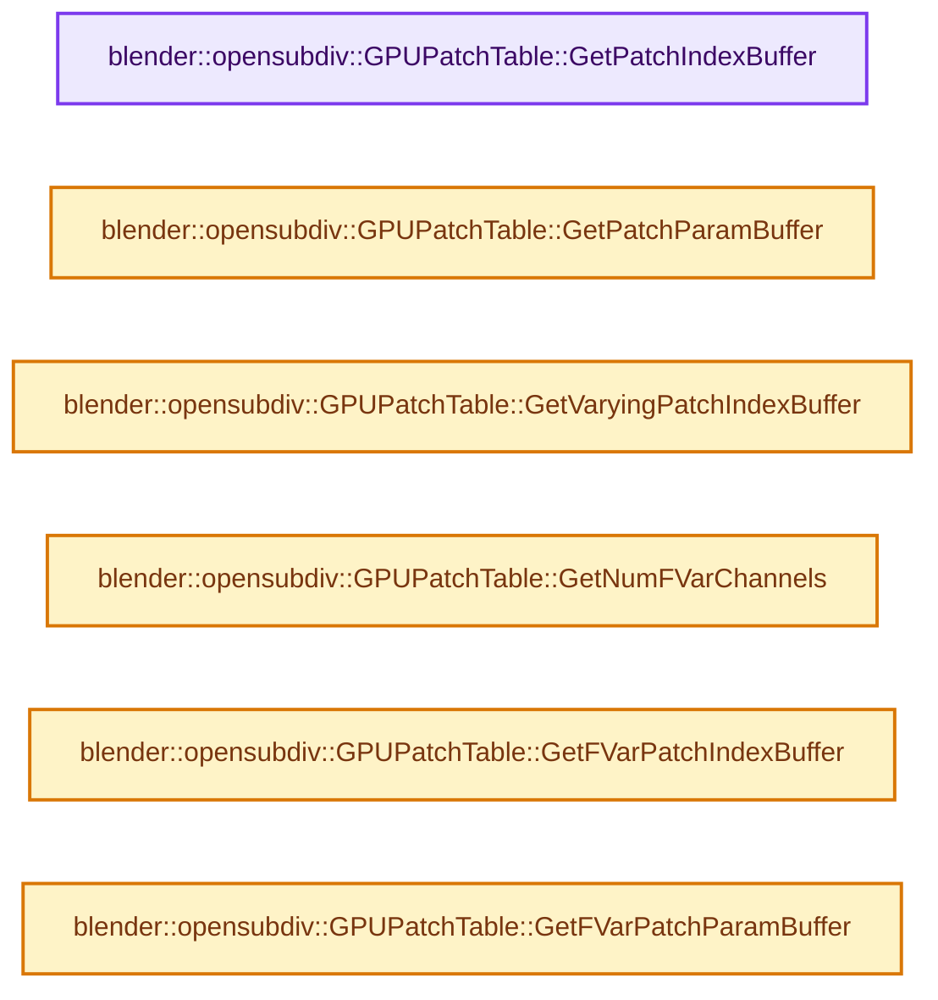

# 实现依赖专题：intern/opensubdiv/internal/evaluator/gpu_patch_table.hh

[方向导航](README.md) · [符号索引](../%E7%AC%A6%E5%8F%B7%E4%BE%9D%E8%B5%96%E4%B8%8E%E5%AE%9E%E7%8E%B0%E7%B4%A2%E5%BC%95.md)

本专题从正文实际调用进入，集中保存共享实现。函数有稳定锚点，可从调用处直接跳到对应完整函数；递归与互相调用通过回链组织。

## 本文件的实现关系




## 完整成员与函数实现

<a id="f-bbe12493ea0baa29"></a>

### `blender::opensubdiv::GPUPatchTable::GetPatchIndexBuffer`

实现位置：[intern/opensubdiv/internal/evaluator/gpu_patch_table.hh](../../../../../intern/opensubdiv/internal/evaluator/gpu_patch_table.hh) · L34—L37。

**教学注释版**

<!-- annotated:38fcac081e0277 -->

```cpp
  gpu::StorageBuf *GetPatchIndexBuffer() const
  {
    return _patchIndexBuffer;
  }
```

<details>
<summary>核对原始源码：intern/opensubdiv/internal/evaluator/gpu_patch_table.hh · L34—L37</summary>

<!-- original:38fcac081e0277:intern/opensubdiv/internal/evaluator/gpu_patch_table.hh:34:37 -->

```cpp
  gpu::StorageBuf *GetPatchIndexBuffer() const
  {
    return _patchIndexBuffer;
  }
```

</details>

**结果出口**

- `return _patchIndexBuffer;`

**继续追踪实现**

本实现没有需要继续展开的显式调用；检查返回表达式、对象转换和调用者前置条件。

<a id="f-2d98e130a8e57809"></a>

### `blender::opensubdiv::GPUPatchTable::GetPatchParamBuffer`

实现位置：[intern/opensubdiv/internal/evaluator/gpu_patch_table.hh](../../../../../intern/opensubdiv/internal/evaluator/gpu_patch_table.hh) · L40—L43。

**教学注释版**

<!-- annotated:538136aba88b27 -->

```cpp
  gpu::StorageBuf *GetPatchParamBuffer() const
  {
    return _patchParamBuffer;
  }
```

<details>
<summary>核对原始源码：intern/opensubdiv/internal/evaluator/gpu_patch_table.hh · L40—L43</summary>

<!-- original:538136aba88b27:intern/opensubdiv/internal/evaluator/gpu_patch_table.hh:40:43 -->

```cpp
  gpu::StorageBuf *GetPatchParamBuffer() const
  {
    return _patchParamBuffer;
  }
```

</details>

**结果出口**

- `return _patchParamBuffer;`

**继续追踪实现**

本实现没有需要继续展开的显式调用；检查返回表达式、对象转换和调用者前置条件。

<a id="f-f1af0b5a4da11abb"></a>

### `blender::opensubdiv::GPUPatchTable::GetVaryingPatchIndexBuffer`

实现位置：[intern/opensubdiv/internal/evaluator/gpu_patch_table.hh](../../../../../intern/opensubdiv/internal/evaluator/gpu_patch_table.hh) · L52—L55。

**教学注释版**

<!-- annotated:3c3344873715d8 -->

```cpp
  gpu::StorageBuf *GetVaryingPatchIndexBuffer() const
  {
    return _varyingIndexBuffer;
  }
```

<details>
<summary>核对原始源码：intern/opensubdiv/internal/evaluator/gpu_patch_table.hh · L52—L55</summary>

<!-- original:3c3344873715d8:intern/opensubdiv/internal/evaluator/gpu_patch_table.hh:52:55 -->

```cpp
  gpu::StorageBuf *GetVaryingPatchIndexBuffer() const
  {
    return _varyingIndexBuffer;
  }
```

</details>

**结果出口**

- `return _varyingIndexBuffer;`

**继续追踪实现**

本实现没有需要继续展开的显式调用；检查返回表达式、对象转换和调用者前置条件。

<a id="f-be07aa1249e0dbff"></a>

### `blender::opensubdiv::GPUPatchTable::GetNumFVarChannels`

实现位置：[intern/opensubdiv/internal/evaluator/gpu_patch_table.hh](../../../../../intern/opensubdiv/internal/evaluator/gpu_patch_table.hh) · L58—L61。

**教学注释版**

<!-- annotated:f650e902b73ff4 -->

```cpp
  int GetNumFVarChannels() const
  {
    return (int)_fvarPatchArrays.size();
  }
```

<details>
<summary>核对原始源码：intern/opensubdiv/internal/evaluator/gpu_patch_table.hh · L58—L61</summary>

<!-- original:f650e902b73ff4:intern/opensubdiv/internal/evaluator/gpu_patch_table.hh:58:61 -->

```cpp
  int GetNumFVarChannels() const
  {
    return (int)_fvarPatchArrays.size();
  }
```

</details>

**结果出口**

- `return (int)_fvarPatchArrays.size();`

**继续追踪实现**

- `_fvarPatchArrays.size` → [外部契约](https://eel.is/c++draft/)：这个边界按实际表达式及所属类型核对参数、返回值、寿命与失败行为。这里提供接口入口，不声称已解释该第三方版本的内部实现。

<a id="f-bd6cebd98a523da1"></a>

### `blender::opensubdiv::GPUPatchTable::GetFVarPatchIndexBuffer`

实现位置：[intern/opensubdiv/internal/evaluator/gpu_patch_table.hh](../../../../../intern/opensubdiv/internal/evaluator/gpu_patch_table.hh) · L70—L73。

接口参数：

- `int fvarChannel = 0`

**教学注释版**

<!-- annotated:a1f923dac0717a -->

```cpp
  gpu::StorageBuf *GetFVarPatchIndexBuffer(int fvarChannel = 0) const
  {
    return _fvarIndexBuffers[fvarChannel];
  }
```

<details>
<summary>核对原始源码：intern/opensubdiv/internal/evaluator/gpu_patch_table.hh · L70—L73</summary>

<!-- original:a1f923dac0717a:intern/opensubdiv/internal/evaluator/gpu_patch_table.hh:70:73 -->

```cpp
  gpu::StorageBuf *GetFVarPatchIndexBuffer(int fvarChannel = 0) const
  {
    return _fvarIndexBuffers[fvarChannel];
  }
```

</details>

**结果出口**

- `return _fvarIndexBuffers[fvarChannel];`

**继续追踪实现**

本实现没有需要继续展开的显式调用；检查返回表达式、对象转换和调用者前置条件。

<a id="f-8a35ebed3ac70aaf"></a>

### `blender::opensubdiv::GPUPatchTable::GetFVarPatchParamBuffer`

实现位置：[intern/opensubdiv/internal/evaluator/gpu_patch_table.hh](../../../../../intern/opensubdiv/internal/evaluator/gpu_patch_table.hh) · L76—L79。

接口参数：

- `int fvarChannel = 0`

**教学注释版**

<!-- annotated:321d6e40ab9a19 -->

```cpp
  gpu::StorageBuf *GetFVarPatchParamBuffer(int fvarChannel = 0) const
  {
    return _fvarParamBuffers[fvarChannel];
  }
```

<details>
<summary>核对原始源码：intern/opensubdiv/internal/evaluator/gpu_patch_table.hh · L76—L79</summary>

<!-- original:321d6e40ab9a19:intern/opensubdiv/internal/evaluator/gpu_patch_table.hh:76:79 -->

```cpp
  gpu::StorageBuf *GetFVarPatchParamBuffer(int fvarChannel = 0) const
  {
    return _fvarParamBuffers[fvarChannel];
  }
```

</details>

**结果出口**

- `return _fvarParamBuffers[fvarChannel];`

**继续追踪实现**

本实现没有需要继续展开的显式调用；检查返回表达式、对象转换和调用者前置条件。
