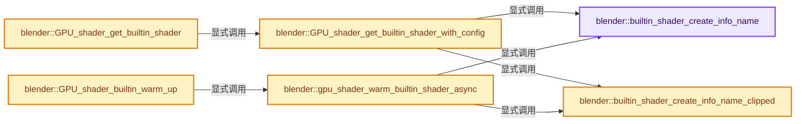

# 实现依赖专题：source/blender/gpu/intern/gpu_shader_builtin.cc

[方向导航](README.md) · [符号索引](../%E7%AC%A6%E5%8F%B7%E4%BE%9D%E8%B5%96%E4%B8%8E%E5%AE%9E%E7%8E%B0%E7%B4%A2%E5%BC%95.md)

本专题从正文实际调用进入，集中保存共享实现。函数有稳定锚点，可从调用处直接跳到对应完整函数；递归与互相调用通过回链组织。

## 本文件的实现关系




## 完整成员与函数实现

<a id="f-c1853a3938d3d44e"></a>

### `blender::builtin_shader_create_info_name`

实现位置：[source/blender/gpu/intern/gpu_shader_builtin.cc](../../../../../source/blender/gpu/intern/gpu_shader_builtin.cc) · L30—L159。

接口参数：

- `GPUBuiltinShader shader`

**教学注释版**

<!-- annotated:d8d88fb9ee2429 -->

```cpp
static const char *builtin_shader_create_info_name(GPUBuiltinShader shader)
{
  switch (shader) {
    case GPU_SHADER_TEXT:
      return "gpu_shader_text";
    case GPU_SHADER_KEYFRAME_SHAPE:
      return "gpu_shader_keyframe_shape";
    case GPU_SHADER_SIMPLE_LIGHTING:
      return "gpu_shader_simple_lighting";
    case GPU_SHADER_3D_IMAGE:
      return "gpu_shader_3D_image";
    case GPU_SHADER_3D_IMAGE_SCENE_LINEAR_TO_REC709_SRGB:
      return "gpu_shader_3D_image_scene_linear";
    case GPU_SHADER_3D_IMAGE_COLOR:
      return "gpu_shader_3D_image_color";
    case GPU_SHADER_3D_IMAGE_COLOR_SCENE_LINEAR_TO_REC709_SRGB:
      return "gpu_shader_3D_image_color_scene_linear";
    case GPU_SHADER_2D_CHECKER:
      return "gpu_shader_2D_checker";
    case GPU_SHADER_2D_DIAG_STRIPES:
      return "gpu_shader_2D_diag_stripes";
    case GPU_SHADER_2D_IMAGE_OVERLAYS_MERGE:
      return "gpu_shader_2D_image_overlays_merge";
    case GPU_SHADER_2D_IMAGE_OVERLAYS_STEREO_MERGE:
      return "gpu_shader_2D_image_overlays_stereo_merge";
    case GPU_SHADER_2D_IMAGE_DESATURATE_COLOR:
      return "gpu_shader_2D_image_desaturate_color";
    case GPU_SHADER_2D_IMAGE_SHUFFLE_COLOR:
      return "gpu_shader_2D_image_shuffle_color";
    case GPU_SHADER_2D_IMAGE_RECT_COLOR:
      return "gpu_shader_2D_image_rect_color";
    case GPU_SHADER_ICON_MULTI:
      return "gpu_shader_icon";
    case GPU_SHADER_3D_UNIFORM_COLOR:
      return "gpu_shader_3D_uniform_color";
    case GPU_SHADER_3D_FLAT_COLOR:
      return "gpu_shader_3D_flat_color";
    case GPU_SHADER_3D_SMOOTH_COLOR:
      return "gpu_shader_3D_smooth_color";
    case GPU_SHADER_3D_CLIPPED_UNIFORM_COLOR:
      return "gpu_shader_3D_clipped_uniform_color";
    case GPU_SHADER_3D_POLYLINE_UNIFORM_COLOR:
      return "gpu_shader_polyline_uniform_color";
    case GPU_SHADER_3D_POLYLINE_CLIPPED_UNIFORM_COLOR:
      return "gpu_shader_polyline_uniform_color_clipped";
    case GPU_SHADER_3D_POLYLINE_FLAT_COLOR:
      return "gpu_shader_polyline_flat_color";
    case GPU_SHADER_3D_POLYLINE_SMOOTH_COLOR:
      return "gpu_shader_polyline_smooth_color";
    case GPU_SHADER_3D_LINE_DASHED_UNIFORM_COLOR:
      return "gpu_shader_3D_line_dashed_uniform_color";
    case GPU_SHADER_2D_POINT_UNIFORM_SIZE_UNIFORM_COLOR_OUTLINE_AA:
      return "gpu_shader_3D_point_uniform_size_uniform_color_outline_aa";
    case GPU_SHADER_3D_POINT_VARYING_SIZE_VARYING_COLOR:
      return "gpu_shader_3D_point_varying_size_varying_color";
    case GPU_SHADER_2D_POINT_UNIFORM_SIZE_UNIFORM_COLOR_AA:
    case GPU_SHADER_3D_POINT_UNIFORM_SIZE_UNIFORM_COLOR_AA:
      return "gpu_shader_3D_point_uniform_size_uniform_color_aa";
    case GPU_SHADER_3D_POINT_FLAT_COLOR:
      return "gpu_shader_3D_point_flat_color";
    case GPU_SHADER_3D_POINT_UNIFORM_COLOR:
      return "gpu_shader_3D_point_uniform_color";
    case GPU_SHADER_2D_AREA_BORDERS:
      return "gpu_shader_2D_area_borders";
    case GPU_SHADER_2D_ROUNDED_CORNER_MASK:
      return "gpu_shader_2D_rounded_corner_mask";
    case GPU_SHADER_2D_WIDGET_BASE:
      return "gpu_shader_2D_widget_base";
    case GPU_SHADER_2D_WIDGET_BASE_INST:
      return "gpu_shader_2D_widget_base_inst";
    case GPU_SHADER_2D_WIDGET_SHADOW:
      return "gpu_shader_2D_widget_shadow";
    case GPU_SHADER_2D_NODE_SOCKET:
      return "gpu_shader_2D_node_socket";
    case GPU_SHADER_2D_NODE_SOCKET_INST:
      return "gpu_shader_2D_node_socket_inst";
    case GPU_SHADER_2D_NODELINK:
      return "gpu_shader_2D_nodelink";
    case GPU_SHADER_GPENCIL_STROKE:
      return "gpu_shader_annotation";
    case GPU_SHADER_SEQUENCER_STRIPS:
      return "gpu_shader_sequencer_strips";
    case GPU_SHADER_SEQUENCER_THUMBS:
      return "gpu_shader_sequencer_thumbs";
    case GPU_SHADER_SEQUENCER_SCOPE_RASTER:
      return "gpu_shader_sequencer_scope_raster";
    case GPU_SHADER_SEQUENCER_SCOPE_RESOLVE:
      return "gpu_shader_sequencer_scope_resolve";
    case GPU_SHADER_SEQUENCER_ZEBRA:
      return "gpu_shader_sequencer_zebra";
    case GPU_SHADER_INDEXBUF_POINTS:
      return "gpu_shader_index_2d_array_points";
    case GPU_SHADER_INDEXBUF_LINES:
      return "gpu_shader_index_2d_array_lines";
    case GPU_SHADER_INDEXBUF_TRIS:
      return "gpu_shader_index_2d_array_tris";

    case GPU_SHADER_2D_UPDATE_MIPMAPS_UNORM_8:
      return "gpu_shader_2D_update_mipmaps_unorm_8";
    case GPU_SHADER_2D_UPDATE_MIPMAPS_UNORM_8_LAYERED:
      return "gpu_shader_2D_update_mipmaps_unorm_8_layered";
    case GPU_SHADER_2D_UPDATE_MIPMAPS_UNORM_8_8_8_8:
      return "gpu_shader_2D_update_mipmaps_unorm_8_8_8_8";
    case GPU_SHADER_2D_UPDATE_MIPMAPS_UNORM_8_8_8_8_LAYERED:
      return "gpu_shader_2D_update_mipmaps_unorm_8_8_8_8_layered";
    case GPU_SHADER_2D_UPDATE_MIPMAPS_SFLOAT_16:
      return "gpu_shader_2D_update_mipmaps_sfloat_16";
    case GPU_SHADER_2D_UPDATE_MIPMAPS_SFLOAT_16_LAYERED:
      return "gpu_shader_2D_update_mipmaps_sfloat_16_layered";
    case GPU_SHADER_2D_UPDATE_MIPMAPS_SFLOAT_16_16_16_16:
      return "gpu_shader_2D_update_mipmaps_sfloat_16_16_16_16";
    case GPU_SHADER_2D_UPDATE_MIPMAPS_SFLOAT_16_16_16_16_LAYERED:
      return "gpu_shader_2D_update_mipmaps_sfloat_16_16_16_16_layered";
    case GPU_SHADER_2D_UPDATE_MIPMAPS_SFLOAT_32:
      return "gpu_shader_2D_update_mipmaps_sfloat_32";
    case GPU_SHADER_2D_UPDATE_MIPMAPS_SFLOAT_32_LAYERED:
      return "gpu_shader_2D_update_mipmaps_sfloat_32_layered";
    case GPU_SHADER_2D_UPDATE_MIPMAPS_SFLOAT_32_32_32_32:
      return "gpu_shader_2D_update_mipmaps_sfloat_32_32_32_32";
    case GPU_SHADER_2D_UPDATE_MIPMAPS_SFLOAT_32_32_32_32_LAYERED:
      return "gpu_shader_2D_update_mipmaps_sfloat_32_32_32_32_layered";
    case GPU_SHADER_2D_UPDATE_MIPMAPS_SRGBA_8_8_8_8:
      return "gpu_shader_2D_update_mipmaps_srgba_8_8_8_8";
    case GPU_SHADER_2D_UPDATE_MIPMAPS_SRGBA_8_8_8_8_LAYERED:
      return "gpu_shader_2D_update_mipmaps_srgba_8_8_8_8_layered";
    default:
      BLI_assert_unreachable();
      return "";
  }
}
```

<details>
<summary>核对原始源码：source/blender/gpu/intern/gpu_shader_builtin.cc · L30—L159</summary>

<!-- original:d8d88fb9ee2429:source/blender/gpu/intern/gpu_shader_builtin.cc:30:159 -->

```cpp
static const char *builtin_shader_create_info_name(GPUBuiltinShader shader)
{
  switch (shader) {
    case GPU_SHADER_TEXT:
      return "gpu_shader_text";
    case GPU_SHADER_KEYFRAME_SHAPE:
      return "gpu_shader_keyframe_shape";
    case GPU_SHADER_SIMPLE_LIGHTING:
      return "gpu_shader_simple_lighting";
    case GPU_SHADER_3D_IMAGE:
      return "gpu_shader_3D_image";
    case GPU_SHADER_3D_IMAGE_SCENE_LINEAR_TO_REC709_SRGB:
      return "gpu_shader_3D_image_scene_linear";
    case GPU_SHADER_3D_IMAGE_COLOR:
      return "gpu_shader_3D_image_color";
    case GPU_SHADER_3D_IMAGE_COLOR_SCENE_LINEAR_TO_REC709_SRGB:
      return "gpu_shader_3D_image_color_scene_linear";
    case GPU_SHADER_2D_CHECKER:
      return "gpu_shader_2D_checker";
    case GPU_SHADER_2D_DIAG_STRIPES:
      return "gpu_shader_2D_diag_stripes";
    case GPU_SHADER_2D_IMAGE_OVERLAYS_MERGE:
      return "gpu_shader_2D_image_overlays_merge";
    case GPU_SHADER_2D_IMAGE_OVERLAYS_STEREO_MERGE:
      return "gpu_shader_2D_image_overlays_stereo_merge";
    case GPU_SHADER_2D_IMAGE_DESATURATE_COLOR:
      return "gpu_shader_2D_image_desaturate_color";
    case GPU_SHADER_2D_IMAGE_SHUFFLE_COLOR:
      return "gpu_shader_2D_image_shuffle_color";
    case GPU_SHADER_2D_IMAGE_RECT_COLOR:
      return "gpu_shader_2D_image_rect_color";
    case GPU_SHADER_ICON_MULTI:
      return "gpu_shader_icon";
    case GPU_SHADER_3D_UNIFORM_COLOR:
      return "gpu_shader_3D_uniform_color";
    case GPU_SHADER_3D_FLAT_COLOR:
      return "gpu_shader_3D_flat_color";
    case GPU_SHADER_3D_SMOOTH_COLOR:
      return "gpu_shader_3D_smooth_color";
    case GPU_SHADER_3D_CLIPPED_UNIFORM_COLOR:
      return "gpu_shader_3D_clipped_uniform_color";
    case GPU_SHADER_3D_POLYLINE_UNIFORM_COLOR:
      return "gpu_shader_polyline_uniform_color";
    case GPU_SHADER_3D_POLYLINE_CLIPPED_UNIFORM_COLOR:
      return "gpu_shader_polyline_uniform_color_clipped";
    case GPU_SHADER_3D_POLYLINE_FLAT_COLOR:
      return "gpu_shader_polyline_flat_color";
    case GPU_SHADER_3D_POLYLINE_SMOOTH_COLOR:
      return "gpu_shader_polyline_smooth_color";
    case GPU_SHADER_3D_LINE_DASHED_UNIFORM_COLOR:
      return "gpu_shader_3D_line_dashed_uniform_color";
    case GPU_SHADER_2D_POINT_UNIFORM_SIZE_UNIFORM_COLOR_OUTLINE_AA:
      return "gpu_shader_3D_point_uniform_size_uniform_color_outline_aa";
    case GPU_SHADER_3D_POINT_VARYING_SIZE_VARYING_COLOR:
      return "gpu_shader_3D_point_varying_size_varying_color";
    case GPU_SHADER_2D_POINT_UNIFORM_SIZE_UNIFORM_COLOR_AA:
    case GPU_SHADER_3D_POINT_UNIFORM_SIZE_UNIFORM_COLOR_AA:
      return "gpu_shader_3D_point_uniform_size_uniform_color_aa";
    case GPU_SHADER_3D_POINT_FLAT_COLOR:
      return "gpu_shader_3D_point_flat_color";
    case GPU_SHADER_3D_POINT_UNIFORM_COLOR:
      return "gpu_shader_3D_point_uniform_color";
    case GPU_SHADER_2D_AREA_BORDERS:
      return "gpu_shader_2D_area_borders";
    case GPU_SHADER_2D_ROUNDED_CORNER_MASK:
      return "gpu_shader_2D_rounded_corner_mask";
    case GPU_SHADER_2D_WIDGET_BASE:
      return "gpu_shader_2D_widget_base";
    case GPU_SHADER_2D_WIDGET_BASE_INST:
      return "gpu_shader_2D_widget_base_inst";
    case GPU_SHADER_2D_WIDGET_SHADOW:
      return "gpu_shader_2D_widget_shadow";
    case GPU_SHADER_2D_NODE_SOCKET:
      return "gpu_shader_2D_node_socket";
    case GPU_SHADER_2D_NODE_SOCKET_INST:
      return "gpu_shader_2D_node_socket_inst";
    case GPU_SHADER_2D_NODELINK:
      return "gpu_shader_2D_nodelink";
    case GPU_SHADER_GPENCIL_STROKE:
      return "gpu_shader_annotation";
    case GPU_SHADER_SEQUENCER_STRIPS:
      return "gpu_shader_sequencer_strips";
    case GPU_SHADER_SEQUENCER_THUMBS:
      return "gpu_shader_sequencer_thumbs";
    case GPU_SHADER_SEQUENCER_SCOPE_RASTER:
      return "gpu_shader_sequencer_scope_raster";
    case GPU_SHADER_SEQUENCER_SCOPE_RESOLVE:
      return "gpu_shader_sequencer_scope_resolve";
    case GPU_SHADER_SEQUENCER_ZEBRA:
      return "gpu_shader_sequencer_zebra";
    case GPU_SHADER_INDEXBUF_POINTS:
      return "gpu_shader_index_2d_array_points";
    case GPU_SHADER_INDEXBUF_LINES:
      return "gpu_shader_index_2d_array_lines";
    case GPU_SHADER_INDEXBUF_TRIS:
      return "gpu_shader_index_2d_array_tris";

    case GPU_SHADER_2D_UPDATE_MIPMAPS_UNORM_8:
      return "gpu_shader_2D_update_mipmaps_unorm_8";
    case GPU_SHADER_2D_UPDATE_MIPMAPS_UNORM_8_LAYERED:
      return "gpu_shader_2D_update_mipmaps_unorm_8_layered";
    case GPU_SHADER_2D_UPDATE_MIPMAPS_UNORM_8_8_8_8:
      return "gpu_shader_2D_update_mipmaps_unorm_8_8_8_8";
    case GPU_SHADER_2D_UPDATE_MIPMAPS_UNORM_8_8_8_8_LAYERED:
      return "gpu_shader_2D_update_mipmaps_unorm_8_8_8_8_layered";
    case GPU_SHADER_2D_UPDATE_MIPMAPS_SFLOAT_16:
      return "gpu_shader_2D_update_mipmaps_sfloat_16";
    case GPU_SHADER_2D_UPDATE_MIPMAPS_SFLOAT_16_LAYERED:
      return "gpu_shader_2D_update_mipmaps_sfloat_16_layered";
    case GPU_SHADER_2D_UPDATE_MIPMAPS_SFLOAT_16_16_16_16:
      return "gpu_shader_2D_update_mipmaps_sfloat_16_16_16_16";
    case GPU_SHADER_2D_UPDATE_MIPMAPS_SFLOAT_16_16_16_16_LAYERED:
      return "gpu_shader_2D_update_mipmaps_sfloat_16_16_16_16_layered";
    case GPU_SHADER_2D_UPDATE_MIPMAPS_SFLOAT_32:
      return "gpu_shader_2D_update_mipmaps_sfloat_32";
    case GPU_SHADER_2D_UPDATE_MIPMAPS_SFLOAT_32_LAYERED:
      return "gpu_shader_2D_update_mipmaps_sfloat_32_layered";
    case GPU_SHADER_2D_UPDATE_MIPMAPS_SFLOAT_32_32_32_32:
      return "gpu_shader_2D_update_mipmaps_sfloat_32_32_32_32";
    case GPU_SHADER_2D_UPDATE_MIPMAPS_SFLOAT_32_32_32_32_LAYERED:
      return "gpu_shader_2D_update_mipmaps_sfloat_32_32_32_32_layered";
    case GPU_SHADER_2D_UPDATE_MIPMAPS_SRGBA_8_8_8_8:
      return "gpu_shader_2D_update_mipmaps_srgba_8_8_8_8";
    case GPU_SHADER_2D_UPDATE_MIPMAPS_SRGBA_8_8_8_8_LAYERED:
      return "gpu_shader_2D_update_mipmaps_srgba_8_8_8_8_layered";
    default:
      BLI_assert_unreachable();
      return "";
  }
}
```

</details>

**结果出口**

- `return "gpu_shader_text";`
- `return "gpu_shader_keyframe_shape";`
- `return "gpu_shader_simple_lighting";`
- `return "gpu_shader_3D_image";`
- `return "gpu_shader_3D_image_scene_linear";`
- `return "gpu_shader_3D_image_color";`
- `return "gpu_shader_3D_image_color_scene_linear";`
- `return "gpu_shader_2D_checker";`
- `return "gpu_shader_2D_diag_stripes";`
- `return "gpu_shader_2D_image_overlays_merge";`
- `return "gpu_shader_2D_image_overlays_stereo_merge";`
- `return "gpu_shader_2D_image_desaturate_color";`
- `return "gpu_shader_2D_image_shuffle_color";`
- `return "gpu_shader_2D_image_rect_color";`
- `return "gpu_shader_icon";`
- `return "gpu_shader_3D_uniform_color";`
- `return "gpu_shader_3D_flat_color";`
- `return "gpu_shader_3D_smooth_color";`
- `return "gpu_shader_3D_clipped_uniform_color";`
- `return "gpu_shader_polyline_uniform_color";`
- `return "gpu_shader_polyline_uniform_color_clipped";`
- `return "gpu_shader_polyline_flat_color";`
- `return "gpu_shader_polyline_smooth_color";`
- `return "gpu_shader_3D_line_dashed_uniform_color";`
- `return "gpu_shader_3D_point_uniform_size_uniform_color_outline_aa";`
- `return "gpu_shader_3D_point_varying_size_varying_color";`
- `return "gpu_shader_3D_point_uniform_size_uniform_color_aa";`
- `return "gpu_shader_3D_point_flat_color";`
- `return "gpu_shader_3D_point_uniform_color";`
- `return "gpu_shader_2D_area_borders";`
- `return "gpu_shader_2D_rounded_corner_mask";`
- `return "gpu_shader_2D_widget_base";`
- `return "gpu_shader_2D_widget_base_inst";`
- `return "gpu_shader_2D_widget_shadow";`
- `return "gpu_shader_2D_node_socket";`
- `return "gpu_shader_2D_node_socket_inst";`
- `return "gpu_shader_2D_nodelink";`
- `return "gpu_shader_annotation";`
- `return "gpu_shader_sequencer_strips";`
- `return "gpu_shader_sequencer_thumbs";`
- `return "gpu_shader_sequencer_scope_raster";`
- `return "gpu_shader_sequencer_scope_resolve";`
- `return "gpu_shader_sequencer_zebra";`
- `return "gpu_shader_index_2d_array_points";`
- `return "gpu_shader_index_2d_array_lines";`
- `return "gpu_shader_index_2d_array_tris";`
- `return "gpu_shader_2D_update_mipmaps_unorm_8";`
- `return "gpu_shader_2D_update_mipmaps_unorm_8_layered";`
- `return "gpu_shader_2D_update_mipmaps_unorm_8_8_8_8";`
- `return "gpu_shader_2D_update_mipmaps_unorm_8_8_8_8_layered";`
- `return "gpu_shader_2D_update_mipmaps_sfloat_16";`
- `return "gpu_shader_2D_update_mipmaps_sfloat_16_layered";`
- `return "gpu_shader_2D_update_mipmaps_sfloat_16_16_16_16";`
- `return "gpu_shader_2D_update_mipmaps_sfloat_16_16_16_16_layered";`
- `return "gpu_shader_2D_update_mipmaps_sfloat_32";`
- `return "gpu_shader_2D_update_mipmaps_sfloat_32_layered";`
- `return "gpu_shader_2D_update_mipmaps_sfloat_32_32_32_32";`
- `return "gpu_shader_2D_update_mipmaps_sfloat_32_32_32_32_layered";`
- `return "gpu_shader_2D_update_mipmaps_srgba_8_8_8_8";`
- `return "gpu_shader_2D_update_mipmaps_srgba_8_8_8_8_layered";`
- `return "";`

**继续追踪实现**

- `BLI_assert_unreachable` → [BLI_assert_unreachable · L77](../01-%E5%9F%BA%E7%A1%80%E5%AE%B9%E5%99%A8%E4%B8%8E%E7%8E%B0%E4%BB%A3CPP/%E4%BE%9D%E8%B5%96-BLI_assert-cc98e8.md#m-7a2d91a67d8e)。宏定义由构建条件选择。

<a id="f-0a014d5ec30610bc"></a>

### `blender::builtin_shader_create_info_name_clipped`

实现位置：[source/blender/gpu/intern/gpu_shader_builtin.cc](../../../../../source/blender/gpu/intern/gpu_shader_builtin.cc) · L161—L180。

接口参数：

- `GPUBuiltinShader shader`

**教学注释版**

<!-- annotated:09a7c275a9da8d -->

```cpp
static const char *builtin_shader_create_info_name_clipped(GPUBuiltinShader shader)
{
  switch (shader) {
    case GPU_SHADER_3D_UNIFORM_COLOR:
      return "gpu_shader_3D_uniform_color_clipped";
    case GPU_SHADER_3D_FLAT_COLOR:
      return "gpu_shader_3D_flat_color_clipped";
    case GPU_SHADER_3D_SMOOTH_COLOR:
      return "gpu_shader_3D_smooth_color_clipped";
    case GPU_SHADER_3D_LINE_DASHED_UNIFORM_COLOR:
      return "gpu_shader_3D_line_dashed_uniform_color_clipped";
    case GPU_SHADER_3D_POINT_UNIFORM_SIZE_UNIFORM_COLOR_AA:
      return "gpu_shader_3D_point_uniform_size_uniform_color_aa_clipped";
    case GPU_SHADER_3D_POLYLINE_UNIFORM_COLOR:
      return "gpu_shader_polyline_uniform_color_clipped";
    default:
      BLI_assert_msg(false, "Clipped shader configuration not available.");
      return "";
  }
}
```

<details>
<summary>核对原始源码：source/blender/gpu/intern/gpu_shader_builtin.cc · L161—L180</summary>

<!-- original:09a7c275a9da8d:source/blender/gpu/intern/gpu_shader_builtin.cc:161:180 -->

```cpp
static const char *builtin_shader_create_info_name_clipped(GPUBuiltinShader shader)
{
  switch (shader) {
    case GPU_SHADER_3D_UNIFORM_COLOR:
      return "gpu_shader_3D_uniform_color_clipped";
    case GPU_SHADER_3D_FLAT_COLOR:
      return "gpu_shader_3D_flat_color_clipped";
    case GPU_SHADER_3D_SMOOTH_COLOR:
      return "gpu_shader_3D_smooth_color_clipped";
    case GPU_SHADER_3D_LINE_DASHED_UNIFORM_COLOR:
      return "gpu_shader_3D_line_dashed_uniform_color_clipped";
    case GPU_SHADER_3D_POINT_UNIFORM_SIZE_UNIFORM_COLOR_AA:
      return "gpu_shader_3D_point_uniform_size_uniform_color_aa_clipped";
    case GPU_SHADER_3D_POLYLINE_UNIFORM_COLOR:
      return "gpu_shader_polyline_uniform_color_clipped";
    default:
      BLI_assert_msg(false, "Clipped shader configuration not available.");
      return "";
  }
}
```

</details>

**结果出口**

- `return "gpu_shader_3D_uniform_color_clipped";`
- `return "gpu_shader_3D_flat_color_clipped";`
- `return "gpu_shader_3D_smooth_color_clipped";`
- `return "gpu_shader_3D_line_dashed_uniform_color_clipped";`
- `return "gpu_shader_3D_point_uniform_size_uniform_color_aa_clipped";`
- `return "gpu_shader_polyline_uniform_color_clipped";`
- `return "";`

**继续追踪实现**

- `BLI_assert_msg` → [BLI_assert_msg · L55](../01-%E5%9F%BA%E7%A1%80%E5%AE%B9%E5%99%A8%E4%B8%8E%E7%8E%B0%E4%BB%A3CPP/%E4%BE%9D%E8%B5%96-BLI_assert-cc98e8.md#m-695eed20dceb)；[BLI_assert_msg · L64](../01-%E5%9F%BA%E7%A1%80%E5%AE%B9%E5%99%A8%E4%B8%8E%E7%8E%B0%E4%BB%A3CPP/%E4%BE%9D%E8%B5%96-BLI_assert-cc98e8.md#m-7de5563de4db)。宏定义由构建条件选择。

<a id="f-260d02af71af7ecb"></a>

### `blender::GPU_shader_get_builtin_shader_with_config`

实现位置：[source/blender/gpu/intern/gpu_shader_builtin.cc](../../../../../source/blender/gpu/intern/gpu_shader_builtin.cc) · L182—L233。

接口参数：

- `GPUBuiltinShader shader`
- `GPUShaderConfig sh_cfg`

**教学注释版**

<!-- annotated:397abcafaa733e -->

```cpp
gpu::Shader *GPU_shader_get_builtin_shader_with_config(GPUBuiltinShader shader,
                                                       GPUShaderConfig sh_cfg)
{
  BLI_assert(shader < GPU_SHADER_BUILTIN_LEN);

#ifdef __GNUC__
#  pragma GCC diagnostic push
#  pragma GCC diagnostic ignored "-Warray-bounds"
#endif
  BuiltinShader **sh_p = &builtin_shaders[sh_cfg][shader];
#ifdef __GNUC__
#  pragma GCC diagnostic pop
#endif

  if (*sh_p == nullptr) {
    if (sh_cfg == GPU_SHADER_CFG_DEFAULT) {
      /* Common case. */
      const char *info_name = builtin_shader_create_info_name(shader);
      *sh_p = MEM_new<BuiltinShader>(__func__, info_name);
    }
    else if (sh_cfg == GPU_SHADER_CFG_CLIPPED) {
      /* In rare cases geometry shaders calculate clipping themselves. */
      const char *info_name_clipped = builtin_shader_create_info_name_clipped(shader);
      if (!StringRefNull(info_name_clipped).is_empty()) {
        *sh_p = MEM_new<BuiltinShader>(__func__, info_name_clipped);
      }
    }
    else {
      BLI_assert(0);
    }
  }

  if ((*sh_p)->init == false) {
    (*sh_p)->init = true;
    if (ELEM(shader,
             GPU_SHADER_3D_POLYLINE_CLIPPED_UNIFORM_COLOR,
             GPU_SHADER_3D_POLYLINE_UNIFORM_COLOR,
             GPU_SHADER_3D_POLYLINE_FLAT_COLOR,
             GPU_SHADER_3D_POLYLINE_SMOOTH_COLOR))
    {
      gpu::Shader *sh = (*sh_p)->get();
      /* Set a default value for `lineSmooth`.
       * Ideally this value should be set by the caller. */
      GPU_shader_bind(sh);
      GPU_shader_uniform_1i(sh, "lineSmooth", 1);
      /* WORKAROUND: See is_polyline declaration. */
      sh->is_polyline = true;
    }
  }

  return (*sh_p)->get();
}
```

<details>
<summary>核对原始源码：source/blender/gpu/intern/gpu_shader_builtin.cc · L182—L233</summary>

<!-- original:397abcafaa733e:source/blender/gpu/intern/gpu_shader_builtin.cc:182:233 -->

```cpp
gpu::Shader *GPU_shader_get_builtin_shader_with_config(GPUBuiltinShader shader,
                                                       GPUShaderConfig sh_cfg)
{
  BLI_assert(shader < GPU_SHADER_BUILTIN_LEN);

#ifdef __GNUC__
#  pragma GCC diagnostic push
#  pragma GCC diagnostic ignored "-Warray-bounds"
#endif
  BuiltinShader **sh_p = &builtin_shaders[sh_cfg][shader];
#ifdef __GNUC__
#  pragma GCC diagnostic pop
#endif

  if (*sh_p == nullptr) {
    if (sh_cfg == GPU_SHADER_CFG_DEFAULT) {
      /* Common case. */
      const char *info_name = builtin_shader_create_info_name(shader);
      *sh_p = MEM_new<BuiltinShader>(__func__, info_name);
    }
    else if (sh_cfg == GPU_SHADER_CFG_CLIPPED) {
      /* In rare cases geometry shaders calculate clipping themselves. */
      const char *info_name_clipped = builtin_shader_create_info_name_clipped(shader);
      if (!StringRefNull(info_name_clipped).is_empty()) {
        *sh_p = MEM_new<BuiltinShader>(__func__, info_name_clipped);
      }
    }
    else {
      BLI_assert(0);
    }
  }

  if ((*sh_p)->init == false) {
    (*sh_p)->init = true;
    if (ELEM(shader,
             GPU_SHADER_3D_POLYLINE_CLIPPED_UNIFORM_COLOR,
             GPU_SHADER_3D_POLYLINE_UNIFORM_COLOR,
             GPU_SHADER_3D_POLYLINE_FLAT_COLOR,
             GPU_SHADER_3D_POLYLINE_SMOOTH_COLOR))
    {
      gpu::Shader *sh = (*sh_p)->get();
      /* Set a default value for `lineSmooth`.
       * Ideally this value should be set by the caller. */
      GPU_shader_bind(sh);
      GPU_shader_uniform_1i(sh, "lineSmooth", 1);
      /* WORKAROUND: See is_polyline declaration. */
      sh->is_polyline = true;
    }
  }

  return (*sh_p)->get();
}
```

</details>

**沿实际写入检查状态**

- `sh->is_polyline = true;`

**结果出口**

- `return (*sh_p)->get();`

**继续追踪实现**

- `BLI_assert` → [BLI_assert · L48](../01-%E5%9F%BA%E7%A1%80%E5%AE%B9%E5%99%A8%E4%B8%8E%E7%8E%B0%E4%BB%A3CPP/%E4%BE%9D%E8%B5%96-BLI_assert-cc98e8.md#m-57a88495704d)；[BLI_assert · L63](../01-%E5%9F%BA%E7%A1%80%E5%AE%B9%E5%99%A8%E4%B8%8E%E7%8E%B0%E4%BB%A3CPP/%E4%BE%9D%E8%B5%96-BLI_assert-cc98e8.md#m-d07050020cb5)。宏定义由构建条件选择。
- `builtin_shader_create_info_name` → [blender::builtin_shader_create_info_name · L30](%E4%BE%9D%E8%B5%96-gpu_shader_builtin-4b5195.md#f-c1853a3938d3d44e)。
- `MEM_new<BuiltinShader>` → [MEM_new · L351](../03-%E5%86%85%E5%AD%98%E5%88%86%E9%85%8D%E4%B8%8E%E8%BF%90%E8%A1%8C%E6%97%B6%E7%B1%BB%E5%9E%8B/%E4%BE%9D%E8%B5%96-MEM_guardedalloc-b54eca.md#f-115f9b6784f89912)。
- `builtin_shader_create_info_name_clipped` → [blender::builtin_shader_create_info_name_clipped · L161](%E4%BE%9D%E8%B5%96-gpu_shader_builtin-4b5195.md#f-0a014d5ec30610bc)。
- `StringRefNull(info_name_clipped).is_empty` → [调用协议](../%E6%A8%A1%E6%9D%BF%E5%AE%8F%E4%B8%8E%E5%8A%A8%E6%80%81%E5%88%86%E6%B4%BE%E5%8D%8F%E8%AE%AE.md)：接收对象类型依赖auto、返回值或模板实例；不按同名猜测目标。调用位置L205。
- `StringRefNull` → [blender::StringRefNull::StringRefNull · L496](../01-%E5%9F%BA%E7%A1%80%E5%AE%B9%E5%99%A8%E4%B8%8E%E7%8E%B0%E4%BB%A3CPP/15-StringRef%E5%AD%97%E7%AC%A6%E4%B8%B2%E8%A7%86%E5%9B%BE.md#f-936c98fc0d9ae39e)；[blender::StringRefNull::StringRefNull · L502](../01-%E5%9F%BA%E7%A1%80%E5%AE%B9%E5%99%A8%E4%B8%8E%E7%8E%B0%E4%BB%A3CPP/15-StringRef%E5%AD%97%E7%AC%A6%E4%B8%B2%E8%A7%86%E5%9B%BE.md#f-cf03ac0c28007ee0)；[blender::StringRefNull::StringRefNull · L512](../01-%E5%9F%BA%E7%A1%80%E5%AE%B9%E5%99%A8%E4%B8%8E%E7%8E%B0%E4%BB%A3CPP/15-StringRef%E5%AD%97%E7%AC%A6%E4%B8%B2%E8%A7%86%E5%9B%BE.md#f-8a14273318bc57e1)；[blender::StringRefNull::StringRefNull · L523](../01-%E5%9F%BA%E7%A1%80%E5%AE%B9%E5%99%A8%E4%B8%8E%E7%8E%B0%E4%BB%A3CPP/15-StringRef%E5%AD%97%E7%AC%A6%E4%B8%B2%E8%A7%86%E5%9B%BE.md#f-e1cc63a4ff92775b)。同名重载需按实参类型选择。
- `ELEM` → [ELEM · L88](%E4%BE%9D%E8%B5%96-GHOST_utildefines-34b996.md#m-d28724a15928)；[ELEM · L135](../01-%E5%9F%BA%E7%A1%80%E5%AE%B9%E5%99%A8%E4%B8%8E%E7%8E%B0%E4%BB%A3CPP/%E4%BE%9D%E8%B5%96-BLI_utildefines-293a0a.md#m-d6572de7cae0)。宏定义由构建条件选择。
- `(*sh_p)->get` → [调用协议](../%E6%A8%A1%E6%9D%BF%E5%AE%8F%E4%B8%8E%E5%8A%A8%E6%80%81%E5%88%86%E6%B4%BE%E5%8D%8F%E8%AE%AE.md)：接收对象类型依赖auto、返回值或模板实例；不按同名猜测目标。调用位置L222。
- `GPU_shader_bind` → [blender::GPU_shader_bind · L387](%E4%BE%9D%E8%B5%96-gpu_shader-141cc9.md#f-a879eef1816db611)。
- `GPU_shader_uniform_1i` → [blender::GPU_shader_uniform_1i · L646](%E4%BE%9D%E8%B5%96-gpu_shader-141cc9.md#f-d02d234ed60d9de0)。

<a id="f-12192b11e42625fb"></a>

### `blender::gpu_shader_warm_builtin_shader_async`

实现位置：[source/blender/gpu/intern/gpu_shader_builtin.cc](../../../../../source/blender/gpu/intern/gpu_shader_builtin.cc) · L235—L266。

接口参数：

- `GPUBuiltinShader shader`
- `GPUShaderConfig sh_cfg`

**教学注释版**

<!-- annotated:f072d19dfa285f -->

```cpp
static void gpu_shader_warm_builtin_shader_async(GPUBuiltinShader shader, GPUShaderConfig sh_cfg)
{
  BLI_assert(shader < GPU_SHADER_BUILTIN_LEN);

#ifdef __GNUC__
#  pragma GCC diagnostic push
#  pragma GCC diagnostic ignored "-Warray-bounds"
#endif
  BuiltinShader **sh_p = &builtin_shaders[sh_cfg][shader];
#ifdef __GNUC__
#  pragma GCC diagnostic pop
#endif

  if (*sh_p == nullptr) {
    if (sh_cfg == GPU_SHADER_CFG_DEFAULT) {
      /* Common case. */
      const char *info_name = builtin_shader_create_info_name(shader);
      *sh_p = MEM_new<BuiltinShader>(__func__, info_name);
    }
    else if (sh_cfg == GPU_SHADER_CFG_CLIPPED) {
      /* In rare cases geometry shaders calculate clipping themselves. */
      const char *info_name_clipped = builtin_shader_create_info_name_clipped(shader);
      if (!StringRefNull(info_name_clipped).is_empty()) {
        *sh_p = MEM_new<BuiltinShader>(__func__, info_name_clipped);
      }
    }
    else {
      BLI_assert(0);
    }
  }
  (*sh_p)->ensure_compile_async();
}
```

<details>
<summary>核对原始源码：source/blender/gpu/intern/gpu_shader_builtin.cc · L235—L266</summary>

<!-- original:f072d19dfa285f:source/blender/gpu/intern/gpu_shader_builtin.cc:235:266 -->

```cpp
static void gpu_shader_warm_builtin_shader_async(GPUBuiltinShader shader, GPUShaderConfig sh_cfg)
{
  BLI_assert(shader < GPU_SHADER_BUILTIN_LEN);

#ifdef __GNUC__
#  pragma GCC diagnostic push
#  pragma GCC diagnostic ignored "-Warray-bounds"
#endif
  BuiltinShader **sh_p = &builtin_shaders[sh_cfg][shader];
#ifdef __GNUC__
#  pragma GCC diagnostic pop
#endif

  if (*sh_p == nullptr) {
    if (sh_cfg == GPU_SHADER_CFG_DEFAULT) {
      /* Common case. */
      const char *info_name = builtin_shader_create_info_name(shader);
      *sh_p = MEM_new<BuiltinShader>(__func__, info_name);
    }
    else if (sh_cfg == GPU_SHADER_CFG_CLIPPED) {
      /* In rare cases geometry shaders calculate clipping themselves. */
      const char *info_name_clipped = builtin_shader_create_info_name_clipped(shader);
      if (!StringRefNull(info_name_clipped).is_empty()) {
        *sh_p = MEM_new<BuiltinShader>(__func__, info_name_clipped);
      }
    }
    else {
      BLI_assert(0);
    }
  }
  (*sh_p)->ensure_compile_async();
}
```

</details>

**继续追踪实现**

- `BLI_assert` → [BLI_assert · L48](../01-%E5%9F%BA%E7%A1%80%E5%AE%B9%E5%99%A8%E4%B8%8E%E7%8E%B0%E4%BB%A3CPP/%E4%BE%9D%E8%B5%96-BLI_assert-cc98e8.md#m-57a88495704d)；[BLI_assert · L63](../01-%E5%9F%BA%E7%A1%80%E5%AE%B9%E5%99%A8%E4%B8%8E%E7%8E%B0%E4%BB%A3CPP/%E4%BE%9D%E8%B5%96-BLI_assert-cc98e8.md#m-d07050020cb5)。宏定义由构建条件选择。
- `builtin_shader_create_info_name` → [blender::builtin_shader_create_info_name · L30](%E4%BE%9D%E8%B5%96-gpu_shader_builtin-4b5195.md#f-c1853a3938d3d44e)。
- `MEM_new<BuiltinShader>` → [MEM_new · L351](../03-%E5%86%85%E5%AD%98%E5%88%86%E9%85%8D%E4%B8%8E%E8%BF%90%E8%A1%8C%E6%97%B6%E7%B1%BB%E5%9E%8B/%E4%BE%9D%E8%B5%96-MEM_guardedalloc-b54eca.md#f-115f9b6784f89912)。
- `builtin_shader_create_info_name_clipped` → [blender::builtin_shader_create_info_name_clipped · L161](%E4%BE%9D%E8%B5%96-gpu_shader_builtin-4b5195.md#f-0a014d5ec30610bc)。
- `StringRefNull(info_name_clipped).is_empty` → [调用协议](../%E6%A8%A1%E6%9D%BF%E5%AE%8F%E4%B8%8E%E5%8A%A8%E6%80%81%E5%88%86%E6%B4%BE%E5%8D%8F%E8%AE%AE.md)：接收对象类型依赖auto、返回值或模板实例；不按同名猜测目标。调用位置L257。
- `StringRefNull` → [blender::StringRefNull::StringRefNull · L496](../01-%E5%9F%BA%E7%A1%80%E5%AE%B9%E5%99%A8%E4%B8%8E%E7%8E%B0%E4%BB%A3CPP/15-StringRef%E5%AD%97%E7%AC%A6%E4%B8%B2%E8%A7%86%E5%9B%BE.md#f-936c98fc0d9ae39e)；[blender::StringRefNull::StringRefNull · L502](../01-%E5%9F%BA%E7%A1%80%E5%AE%B9%E5%99%A8%E4%B8%8E%E7%8E%B0%E4%BB%A3CPP/15-StringRef%E5%AD%97%E7%AC%A6%E4%B8%B2%E8%A7%86%E5%9B%BE.md#f-cf03ac0c28007ee0)；[blender::StringRefNull::StringRefNull · L512](../01-%E5%9F%BA%E7%A1%80%E5%AE%B9%E5%99%A8%E4%B8%8E%E7%8E%B0%E4%BB%A3CPP/15-StringRef%E5%AD%97%E7%AC%A6%E4%B8%B2%E8%A7%86%E5%9B%BE.md#f-8a14273318bc57e1)；[blender::StringRefNull::StringRefNull · L523](../01-%E5%9F%BA%E7%A1%80%E5%AE%B9%E5%99%A8%E4%B8%8E%E7%8E%B0%E4%BB%A3CPP/15-StringRef%E5%AD%97%E7%AC%A6%E4%B8%B2%E8%A7%86%E5%9B%BE.md#f-e1cc63a4ff92775b)。同名重载需按实参类型选择。
- `(*sh_p)->ensure_compile_async` → [调用协议](../%E6%A8%A1%E6%9D%BF%E5%AE%8F%E4%B8%8E%E5%8A%A8%E6%80%81%E5%88%86%E6%B4%BE%E5%8D%8F%E8%AE%AE.md)：接收对象类型依赖auto、返回值或模板实例；不按同名猜测目标。调用位置L265。

<a id="f-235dd2ce9b1ac196"></a>

### `blender::GPU_shader_get_builtin_shader`

实现位置：[source/blender/gpu/intern/gpu_shader_builtin.cc](../../../../../source/blender/gpu/intern/gpu_shader_builtin.cc) · L268—L271。

接口参数：

- `GPUBuiltinShader shader`

**教学注释版**

<!-- annotated:552778d8a970dd -->

```cpp
gpu::Shader *GPU_shader_get_builtin_shader(GPUBuiltinShader shader)
{
  return GPU_shader_get_builtin_shader_with_config(shader, GPU_SHADER_CFG_DEFAULT);
}
```

<details>
<summary>核对原始源码：source/blender/gpu/intern/gpu_shader_builtin.cc · L268—L271</summary>

<!-- original:552778d8a970dd:source/blender/gpu/intern/gpu_shader_builtin.cc:268:271 -->

```cpp
gpu::Shader *GPU_shader_get_builtin_shader(GPUBuiltinShader shader)
{
  return GPU_shader_get_builtin_shader_with_config(shader, GPU_SHADER_CFG_DEFAULT);
}
```

</details>

**结果出口**

- `return GPU_shader_get_builtin_shader_with_config(shader, GPU_SHADER_CFG_DEFAULT);`

**继续追踪实现**

- `GPU_shader_get_builtin_shader_with_config` → [blender::GPU_shader_get_builtin_shader_with_config · L182](%E4%BE%9D%E8%B5%96-gpu_shader_builtin-4b5195.md#f-260d02af71af7ecb)。

<a id="f-ad96bbb220bd99b5"></a>

### `blender::GPU_shader_builtin_warm_up`

实现位置：[source/blender/gpu/intern/gpu_shader_builtin.cc](../../../../../source/blender/gpu/intern/gpu_shader_builtin.cc) · L273—L308。

**教学注释版**

<!-- annotated:973d180dd430db -->

```cpp
void GPU_shader_builtin_warm_up()
{
  if ((G.debug & G_DEBUG_GPU) && (GPU_backend_get_type() == GPU_BACKEND_OPENGL)) {
    /* On some system (Mesa OpenGL), doing this warm up seems to breaks something related to debug
     * hooks and makes the Blender application hang. */
    return;
  }

  if (GPU_use_subprocess_compilation() && (GPU_backend_get_type() == GPU_BACKEND_OPENGL)) {
    /* The overhead of creating the subprocesses at this exact moment can create bubbles during the
     * startup process. It is usually fast enough on OpenGL that we can skip it. */
    return;
  }
  /* Ordered by first usage in default startup screen.
   * Adding more to this list will delay the scheduling of engine shaders and increase time to
   * first pixel. */
  gpu_shader_warm_builtin_shader_async(GPU_SHADER_TEXT, GPU_SHADER_CFG_DEFAULT);
  gpu_shader_warm_builtin_shader_async(GPU_SHADER_2D_WIDGET_BASE, GPU_SHADER_CFG_DEFAULT);
  gpu_shader_warm_builtin_shader_async(GPU_SHADER_3D_UNIFORM_COLOR, GPU_SHADER_CFG_DEFAULT);
  gpu_shader_warm_builtin_shader_async(GPU_SHADER_3D_POLYLINE_UNIFORM_COLOR,
                                       GPU_SHADER_CFG_DEFAULT);
  gpu_shader_warm_builtin_shader_async(GPU_SHADER_3D_IMAGE_COLOR, GPU_SHADER_CFG_DEFAULT);
  gpu_shader_warm_builtin_shader_async(GPU_SHADER_2D_NODE_SOCKET, GPU_SHADER_CFG_DEFAULT);
  gpu_shader_warm_builtin_shader_async(GPU_SHADER_2D_WIDGET_BASE_INST, GPU_SHADER_CFG_DEFAULT);
  gpu_shader_warm_builtin_shader_async(GPU_SHADER_3D_LINE_DASHED_UNIFORM_COLOR,
                                       GPU_SHADER_CFG_DEFAULT);
  gpu_shader_warm_builtin_shader_async(GPU_SHADER_2D_IMAGE_DESATURATE_COLOR,
                                       GPU_SHADER_CFG_DEFAULT);
  gpu_shader_warm_builtin_shader_async(GPU_SHADER_3D_POLYLINE_SMOOTH_COLOR,
                                       GPU_SHADER_CFG_DEFAULT);
  gpu_shader_warm_builtin_shader_async(GPU_SHADER_2D_WIDGET_SHADOW, GPU_SHADER_CFG_DEFAULT);
  gpu_shader_warm_builtin_shader_async(GPU_SHADER_2D_DIAG_STRIPES, GPU_SHADER_CFG_DEFAULT);
  gpu_shader_warm_builtin_shader_async(GPU_SHADER_2D_IMAGE_RECT_COLOR, GPU_SHADER_CFG_DEFAULT);
  gpu_shader_warm_builtin_shader_async(GPU_SHADER_2D_AREA_BORDERS, GPU_SHADER_CFG_DEFAULT);
  gpu_shader_warm_builtin_shader_async(GPU_SHADER_2D_ROUNDED_CORNER_MASK, GPU_SHADER_CFG_DEFAULT);
}
```

<details>
<summary>核对原始源码：source/blender/gpu/intern/gpu_shader_builtin.cc · L273—L308</summary>

<!-- original:973d180dd430db:source/blender/gpu/intern/gpu_shader_builtin.cc:273:308 -->

```cpp
void GPU_shader_builtin_warm_up()
{
  if ((G.debug & G_DEBUG_GPU) && (GPU_backend_get_type() == GPU_BACKEND_OPENGL)) {
    /* On some system (Mesa OpenGL), doing this warm up seems to breaks something related to debug
     * hooks and makes the Blender application hang. */
    return;
  }

  if (GPU_use_subprocess_compilation() && (GPU_backend_get_type() == GPU_BACKEND_OPENGL)) {
    /* The overhead of creating the subprocesses at this exact moment can create bubbles during the
     * startup process. It is usually fast enough on OpenGL that we can skip it. */
    return;
  }
  /* Ordered by first usage in default startup screen.
   * Adding more to this list will delay the scheduling of engine shaders and increase time to
   * first pixel. */
  gpu_shader_warm_builtin_shader_async(GPU_SHADER_TEXT, GPU_SHADER_CFG_DEFAULT);
  gpu_shader_warm_builtin_shader_async(GPU_SHADER_2D_WIDGET_BASE, GPU_SHADER_CFG_DEFAULT);
  gpu_shader_warm_builtin_shader_async(GPU_SHADER_3D_UNIFORM_COLOR, GPU_SHADER_CFG_DEFAULT);
  gpu_shader_warm_builtin_shader_async(GPU_SHADER_3D_POLYLINE_UNIFORM_COLOR,
                                       GPU_SHADER_CFG_DEFAULT);
  gpu_shader_warm_builtin_shader_async(GPU_SHADER_3D_IMAGE_COLOR, GPU_SHADER_CFG_DEFAULT);
  gpu_shader_warm_builtin_shader_async(GPU_SHADER_2D_NODE_SOCKET, GPU_SHADER_CFG_DEFAULT);
  gpu_shader_warm_builtin_shader_async(GPU_SHADER_2D_WIDGET_BASE_INST, GPU_SHADER_CFG_DEFAULT);
  gpu_shader_warm_builtin_shader_async(GPU_SHADER_3D_LINE_DASHED_UNIFORM_COLOR,
                                       GPU_SHADER_CFG_DEFAULT);
  gpu_shader_warm_builtin_shader_async(GPU_SHADER_2D_IMAGE_DESATURATE_COLOR,
                                       GPU_SHADER_CFG_DEFAULT);
  gpu_shader_warm_builtin_shader_async(GPU_SHADER_3D_POLYLINE_SMOOTH_COLOR,
                                       GPU_SHADER_CFG_DEFAULT);
  gpu_shader_warm_builtin_shader_async(GPU_SHADER_2D_WIDGET_SHADOW, GPU_SHADER_CFG_DEFAULT);
  gpu_shader_warm_builtin_shader_async(GPU_SHADER_2D_DIAG_STRIPES, GPU_SHADER_CFG_DEFAULT);
  gpu_shader_warm_builtin_shader_async(GPU_SHADER_2D_IMAGE_RECT_COLOR, GPU_SHADER_CFG_DEFAULT);
  gpu_shader_warm_builtin_shader_async(GPU_SHADER_2D_AREA_BORDERS, GPU_SHADER_CFG_DEFAULT);
  gpu_shader_warm_builtin_shader_async(GPU_SHADER_2D_ROUNDED_CORNER_MASK, GPU_SHADER_CFG_DEFAULT);
}
```

</details>

**继续追踪实现**

- `GPU_backend_get_type` → [blender::GPU_backend_get_type · L613](%E4%BE%9D%E8%B5%96-gpu_context-77a234.md#f-f6a2f10bf5fbee87)。
- `GPU_use_subprocess_compilation` → [blender::GPU_use_subprocess_compilation · L127](%E4%BE%9D%E8%B5%96-gpu_capabilities-508ffd.md#f-9436a2143d71fb18)。
- `gpu_shader_warm_builtin_shader_async` → [blender::gpu_shader_warm_builtin_shader_async · L235](%E4%BE%9D%E8%B5%96-gpu_shader_builtin-4b5195.md#f-12192b11e42625fb)。
