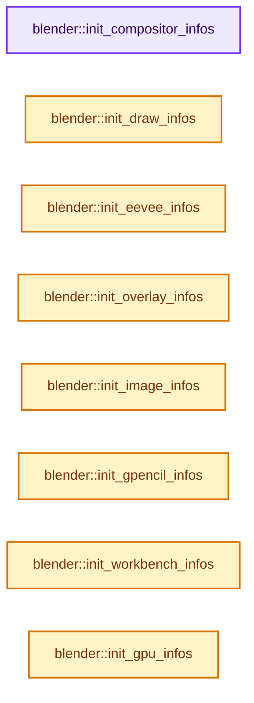
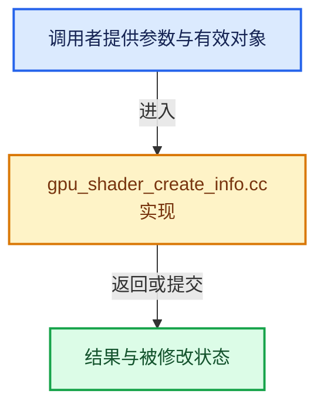

# 实现依赖专题：source/blender/gpu/intern/gpu_shader_create_info.cc

[方向导航](README.md) · [符号索引](../%E7%AC%A6%E5%8F%B7%E4%BE%9D%E8%B5%96%E4%B8%8E%E5%AE%9E%E7%8E%B0%E7%B4%A2%E5%BC%95.md)

本专题从正文实际调用进入，集中保存共享实现。函数有稳定锚点，可从调用处直接跳到对应完整函数；递归与互相调用通过回链组织。

## 本文件的实现关系






## 完整成员与函数实现

<a id="f-567699f06cddb164"></a>

### `blender::init_compositor_infos`

实现位置：[source/blender/gpu/intern/gpu_shader_create_info.cc](../../../../../source/blender/gpu/intern/gpu_shader_create_info.cc) · L705—L709。

**教学注释版**

<!-- annotated:2933aeabd3972a -->

```cpp
static void init_compositor_infos()
{
/* Declare, register and construct the infos. */
#include "glsl_compositor_infos_list.hh"
}
```

<details>
<summary>核对原始源码：source/blender/gpu/intern/gpu_shader_create_info.cc · L705—L709</summary>

<!-- original:2933aeabd3972a:source/blender/gpu/intern/gpu_shader_create_info.cc:705:709 -->

```cpp
static void init_compositor_infos()
{
/* Declare, register and construct the infos. */
#include "glsl_compositor_infos_list.hh"
}
```

</details>

**继续追踪实现**

本实现没有需要继续展开的显式调用；检查返回表达式、对象转换和调用者前置条件。

<a id="f-28900ec1fe957e88"></a>

### `blender::init_draw_infos`

实现位置：[source/blender/gpu/intern/gpu_shader_create_info.cc](../../../../../source/blender/gpu/intern/gpu_shader_create_info.cc) · L711—L715。

**教学注释版**

<!-- annotated:5ec420fea04253 -->

```cpp
static void init_draw_infos()
{
/* Declare, register and construct the infos. */
#include "glsl_draw_infos_list.hh"
}
```

<details>
<summary>核对原始源码：source/blender/gpu/intern/gpu_shader_create_info.cc · L711—L715</summary>

<!-- original:5ec420fea04253:source/blender/gpu/intern/gpu_shader_create_info.cc:711:715 -->

```cpp
static void init_draw_infos()
{
/* Declare, register and construct the infos. */
#include "glsl_draw_infos_list.hh"
}
```

</details>

**继续追踪实现**

本实现没有需要继续展开的显式调用；检查返回表达式、对象转换和调用者前置条件。

<a id="f-efb31e9d3181eb8c"></a>

### `blender::init_eevee_infos`

实现位置：[source/blender/gpu/intern/gpu_shader_create_info.cc](../../../../../source/blender/gpu/intern/gpu_shader_create_info.cc) · L717—L727。

**教学注释版**

<!-- annotated:c50b51f46474fe -->

```cpp
static void init_eevee_infos()
{
/* Declare, register and construct the infos. */
#include "glsl_eevee_infos_list.hh"

  if (GPU_stencil_classify_buffer_workaround()) {
    /* WORKAROUND: Adding a dummy buffer that isn't used fixes a bug inside the Qualcomm driver. */
    eevee_deferred_tile_classify.storage_buf(
        12, Qualifier::read_write, "uint", "dummy_workaround_buf[]");
  }
}
```

<details>
<summary>核对原始源码：source/blender/gpu/intern/gpu_shader_create_info.cc · L717—L727</summary>

<!-- original:c50b51f46474fe:source/blender/gpu/intern/gpu_shader_create_info.cc:717:727 -->

```cpp
static void init_eevee_infos()
{
/* Declare, register and construct the infos. */
#include "glsl_eevee_infos_list.hh"

  if (GPU_stencil_classify_buffer_workaround()) {
    /* WORKAROUND: Adding a dummy buffer that isn't used fixes a bug inside the Qualcomm driver. */
    eevee_deferred_tile_classify.storage_buf(
        12, Qualifier::read_write, "uint", "dummy_workaround_buf[]");
  }
}
```

</details>

**继续追踪实现**

- `GPU_stencil_classify_buffer_workaround` → [blender::GPU_stencil_classify_buffer_workaround · L152](%E4%BE%9D%E8%B5%96-gpu_capabilities-508ffd.md#f-8c52b98d6ff6e080)。
- `eevee_deferred_tile_classify.storage_buf` → [调用协议](../%E6%A8%A1%E6%9D%BF%E5%AE%8F%E4%B8%8E%E5%8A%A8%E6%80%81%E5%88%86%E6%B4%BE%E5%8D%8F%E8%AE%AE.md)：接收对象类型依赖auto、返回值或模板实例；不按同名猜测目标。调用位置L724。

<a id="f-32537c9eaa05ac32"></a>

### `blender::init_overlay_infos`

实现位置：[source/blender/gpu/intern/gpu_shader_create_info.cc](../../../../../source/blender/gpu/intern/gpu_shader_create_info.cc) · L729—L735。

**教学注释版**

<!-- annotated:0369f893e0f540 -->

```cpp
static void init_overlay_infos()
{
/* Declare, register and construct the infos. */
#include "glsl_select_id_infos_list.hh"
/* Requires select id infos. */
#include "glsl_overlay_infos_list.hh"
}
```

<details>
<summary>核对原始源码：source/blender/gpu/intern/gpu_shader_create_info.cc · L729—L735</summary>

<!-- original:0369f893e0f540:source/blender/gpu/intern/gpu_shader_create_info.cc:729:735 -->

```cpp
static void init_overlay_infos()
{
/* Declare, register and construct the infos. */
#include "glsl_select_id_infos_list.hh"
/* Requires select id infos. */
#include "glsl_overlay_infos_list.hh"
}
```

</details>

**继续追踪实现**

本实现没有需要继续展开的显式调用；检查返回表达式、对象转换和调用者前置条件。

<a id="f-867c2b9f13cab1e3"></a>

### `blender::init_image_infos`

实现位置：[source/blender/gpu/intern/gpu_shader_create_info.cc](../../../../../source/blender/gpu/intern/gpu_shader_create_info.cc) · L737—L741。

**教学注释版**

<!-- annotated:e3ab5fa5459501 -->

```cpp
static void init_image_infos()
{
/* Declare, register and construct the infos. */
#include "glsl_image_infos_list.hh"
}
```

<details>
<summary>核对原始源码：source/blender/gpu/intern/gpu_shader_create_info.cc · L737—L741</summary>

<!-- original:e3ab5fa5459501:source/blender/gpu/intern/gpu_shader_create_info.cc:737:741 -->

```cpp
static void init_image_infos()
{
/* Declare, register and construct the infos. */
#include "glsl_image_infos_list.hh"
}
```

</details>

**继续追踪实现**

本实现没有需要继续展开的显式调用；检查返回表达式、对象转换和调用者前置条件。

<a id="f-488aebc3816321d0"></a>

### `blender::init_gpencil_infos`

实现位置：[source/blender/gpu/intern/gpu_shader_create_info.cc](../../../../../source/blender/gpu/intern/gpu_shader_create_info.cc) · L743—L747。

**教学注释版**

<!-- annotated:c1b5868551ebf8 -->

```cpp
static void init_gpencil_infos()
{
/* Declare, register and construct the infos. */
#include "glsl_gpencil_infos_list.hh"
}
```

<details>
<summary>核对原始源码：source/blender/gpu/intern/gpu_shader_create_info.cc · L743—L747</summary>

<!-- original:c1b5868551ebf8:source/blender/gpu/intern/gpu_shader_create_info.cc:743:747 -->

```cpp
static void init_gpencil_infos()
{
/* Declare, register and construct the infos. */
#include "glsl_gpencil_infos_list.hh"
}
```

</details>

**继续追踪实现**

本实现没有需要继续展开的显式调用；检查返回表达式、对象转换和调用者前置条件。

<a id="f-d33373db558c9a27"></a>

### `blender::init_workbench_infos`

实现位置：[source/blender/gpu/intern/gpu_shader_create_info.cc](../../../../../source/blender/gpu/intern/gpu_shader_create_info.cc) · L749—L753。

**教学注释版**

<!-- annotated:5b3aec58f4aed7 -->

```cpp
static void init_workbench_infos()
{
/* Declare, register and construct the infos. */
#include "glsl_workbench_infos_list.hh"
}
```

<details>
<summary>核对原始源码：source/blender/gpu/intern/gpu_shader_create_info.cc · L749—L753</summary>

<!-- original:5b3aec58f4aed7:source/blender/gpu/intern/gpu_shader_create_info.cc:749:753 -->

```cpp
static void init_workbench_infos()
{
/* Declare, register and construct the infos. */
#include "glsl_workbench_infos_list.hh"
}
```

</details>

**继续追踪实现**

本实现没有需要继续展开的显式调用；检查返回表达式、对象转换和调用者前置条件。

<a id="f-7a219f4bcc813079"></a>

### `blender::init_gpu_infos`

实现位置：[source/blender/gpu/intern/gpu_shader_create_info.cc](../../../../../source/blender/gpu/intern/gpu_shader_create_info.cc) · L755—L759。

**教学注释版**

<!-- annotated:035f37e05bebcb -->

```cpp
static void init_gpu_infos()
{
/* Declare, register and construct the infos. */
#include "glsl_gpu_infos_list.hh"
}
```

<details>
<summary>核对原始源码：source/blender/gpu/intern/gpu_shader_create_info.cc · L755—L759</summary>

<!-- original:035f37e05bebcb:source/blender/gpu/intern/gpu_shader_create_info.cc:755:759 -->

```cpp
static void init_gpu_infos()
{
/* Declare, register and construct the infos. */
#include "glsl_gpu_infos_list.hh"
}
```

</details>

**继续追踪实现**

本实现没有需要继续展开的显式调用；检查返回表达式、对象转换和调用者前置条件。

<a id="f-4873ca4000e06302"></a>

### `blender::init_ocio_infos`

实现位置：[source/blender/gpu/intern/gpu_shader_create_info.cc](../../../../../source/blender/gpu/intern/gpu_shader_create_info.cc) · L761—L765。

**教学注释版**

<!-- annotated:f507ec1e797a41 -->

```cpp
static void init_ocio_infos()
{
/* Declare, register and construct the infos. */
#include "glsl_ocio_infos_list.hh"
}
```

<details>
<summary>核对原始源码：source/blender/gpu/intern/gpu_shader_create_info.cc · L761—L765</summary>

<!-- original:f507ec1e797a41:source/blender/gpu/intern/gpu_shader_create_info.cc:761:765 -->

```cpp
static void init_ocio_infos()
{
/* Declare, register and construct the infos. */
#include "glsl_ocio_infos_list.hh"
}
```

</details>

**继续追踪实现**

本实现没有需要继续展开的显式调用；检查返回表达式、对象转换和调用者前置条件。

<a id="f-24ed9f8e4debb3b9"></a>

### `blender::init_osd_infos`

实现位置：[source/blender/gpu/intern/gpu_shader_create_info.cc](../../../../../source/blender/gpu/intern/gpu_shader_create_info.cc) · L767—L773。

**教学注释版**

<!-- annotated:df0268f7b6b56e -->

```cpp
static void init_osd_infos()
{
/* Declare, register and construct the infos. */
#ifdef WITH_OPENSUBDIV
#  include "glsl_osd_infos_list.hh"
#endif
}
```

<details>
<summary>核对原始源码：source/blender/gpu/intern/gpu_shader_create_info.cc · L767—L773</summary>

<!-- original:df0268f7b6b56e:source/blender/gpu/intern/gpu_shader_create_info.cc:767:773 -->

```cpp
static void init_osd_infos()
{
/* Declare, register and construct the infos. */
#ifdef WITH_OPENSUBDIV
#  include "glsl_osd_infos_list.hh"
#endif
}
```

</details>

**继续追踪实现**

本实现没有需要继续展开的显式调用；检查返回表达式、对象转换和调用者前置条件。

<a id="f-f10530c3f8cfcdc3"></a>

### `blender::gpu_shader_create_info_init`

实现位置：[source/blender/gpu/intern/gpu_shader_create_info.cc](../../../../../source/blender/gpu/intern/gpu_shader_create_info.cc) · L775—L830。

**教学注释版**

<!-- annotated:b04a70dbe9c385 -->

```cpp
void gpu_shader_create_info_init()
{
  g_create_infos = new CreateInfoDictionary();
  g_interfaces = new InterfaceDictionary();

  init_compositor_infos();
  init_draw_infos();
  init_eevee_infos();
  init_overlay_infos();
  init_image_infos();
  init_gpencil_infos();
  init_workbench_infos();
  init_gpu_infos();
  init_ocio_infos();
  init_osd_infos();

  for (ShaderCreateInfo *info : g_create_infos->values()) {
    info->is_generated_ = false;

    gpu::shader::BuiltinBits builtins = gpu::shader::BuiltinBits::NONE;
    builtins = builtins | gpu_shader_dependency_get_builtins(info->vertex_source_);
    builtins = builtins | gpu_shader_dependency_get_builtins(info->fragment_source_);
    builtins = builtins | gpu_shader_dependency_get_builtins(info->geometry_source_);
    builtins = builtins | gpu_shader_dependency_get_builtins(info->compute_source_);

    info->builtins(builtins);

    if (!info->compute_source_.is_empty()) {
      info->shared_variables_.extend(
          gpu_shader_dependency_get_shared_variables(info->compute_source_));
    }

#if GPU_SHADER_PRINTF_ENABLE
    const bool is_material_shader = StringRefNull(info->name_).startswith("eevee_surf_");
    if (flag_is_set(info->builtins_combined(), BuiltinBits::USE_PRINTF) ||
        (gpu_shader_dependency_force_gpu_print_injection() && is_material_shader))
    {
      info->additional_info("gpu_print");
    }
#endif

#ifndef NDEBUG
    /* Automatically amend the create info for ease of use of the debug feature. */
    if (flag_is_set(info->builtins_combined(), BuiltinBits::USE_DEBUG_DRAW)) {
      info->additional_info("DebugDraw");
    }
#endif
  }

  for (ShaderCreateInfo *info : g_create_infos->values()) {
    info->finalize(true);
  }

  /* TEST */
  // gpu_shader_create_info_compile(nullptr);
}
```

<details>
<summary>核对原始源码：source/blender/gpu/intern/gpu_shader_create_info.cc · L775—L830</summary>

<!-- original:b04a70dbe9c385:source/blender/gpu/intern/gpu_shader_create_info.cc:775:830 -->

```cpp
void gpu_shader_create_info_init()
{
  g_create_infos = new CreateInfoDictionary();
  g_interfaces = new InterfaceDictionary();

  init_compositor_infos();
  init_draw_infos();
  init_eevee_infos();
  init_overlay_infos();
  init_image_infos();
  init_gpencil_infos();
  init_workbench_infos();
  init_gpu_infos();
  init_ocio_infos();
  init_osd_infos();

  for (ShaderCreateInfo *info : g_create_infos->values()) {
    info->is_generated_ = false;

    gpu::shader::BuiltinBits builtins = gpu::shader::BuiltinBits::NONE;
    builtins = builtins | gpu_shader_dependency_get_builtins(info->vertex_source_);
    builtins = builtins | gpu_shader_dependency_get_builtins(info->fragment_source_);
    builtins = builtins | gpu_shader_dependency_get_builtins(info->geometry_source_);
    builtins = builtins | gpu_shader_dependency_get_builtins(info->compute_source_);

    info->builtins(builtins);

    if (!info->compute_source_.is_empty()) {
      info->shared_variables_.extend(
          gpu_shader_dependency_get_shared_variables(info->compute_source_));
    }

#if GPU_SHADER_PRINTF_ENABLE
    const bool is_material_shader = StringRefNull(info->name_).startswith("eevee_surf_");
    if (flag_is_set(info->builtins_combined(), BuiltinBits::USE_PRINTF) ||
        (gpu_shader_dependency_force_gpu_print_injection() && is_material_shader))
    {
      info->additional_info("gpu_print");
    }
#endif

#ifndef NDEBUG
    /* Automatically amend the create info for ease of use of the debug feature. */
    if (flag_is_set(info->builtins_combined(), BuiltinBits::USE_DEBUG_DRAW)) {
      info->additional_info("DebugDraw");
    }
#endif
  }

  for (ShaderCreateInfo *info : g_create_infos->values()) {
    info->finalize(true);
  }

  /* TEST */
  // gpu_shader_create_info_compile(nullptr);
}
```

</details>

**沿实际写入检查状态**

- `g_create_infos = new CreateInfoDictionary();`
- `g_interfaces = new InterfaceDictionary();`
- `info->is_generated_ = false;`
- `builtins = builtins | gpu_shader_dependency_get_builtins(info->vertex_source_);`
- `builtins = builtins | gpu_shader_dependency_get_builtins(info->fragment_source_);`
- `builtins = builtins | gpu_shader_dependency_get_builtins(info->geometry_source_);`
- `builtins = builtins | gpu_shader_dependency_get_builtins(info->compute_source_);`

**继续追踪实现**

- `init_compositor_infos` → [blender::init_compositor_infos · L705](%E4%BE%9D%E8%B5%96-gpu_shader_create_info-a2f1b5.md#f-567699f06cddb164)。
- `init_draw_infos` → [blender::init_draw_infos · L711](%E4%BE%9D%E8%B5%96-gpu_shader_create_info-a2f1b5.md#f-28900ec1fe957e88)。
- `init_eevee_infos` → [blender::init_eevee_infos · L717](%E4%BE%9D%E8%B5%96-gpu_shader_create_info-a2f1b5.md#f-efb31e9d3181eb8c)。
- `init_overlay_infos` → [blender::init_overlay_infos · L729](%E4%BE%9D%E8%B5%96-gpu_shader_create_info-a2f1b5.md#f-32537c9eaa05ac32)。
- `init_image_infos` → [blender::init_image_infos · L737](%E4%BE%9D%E8%B5%96-gpu_shader_create_info-a2f1b5.md#f-867c2b9f13cab1e3)。
- `init_gpencil_infos` → [blender::init_gpencil_infos · L743](%E4%BE%9D%E8%B5%96-gpu_shader_create_info-a2f1b5.md#f-488aebc3816321d0)。
- `init_workbench_infos` → [blender::init_workbench_infos · L749](%E4%BE%9D%E8%B5%96-gpu_shader_create_info-a2f1b5.md#f-d33373db558c9a27)。
- `init_gpu_infos` → [blender::init_gpu_infos · L755](%E4%BE%9D%E8%B5%96-gpu_shader_create_info-a2f1b5.md#f-7a219f4bcc813079)。
- `init_ocio_infos` → [blender::init_ocio_infos · L761](%E4%BE%9D%E8%B5%96-gpu_shader_create_info-a2f1b5.md#f-4873ca4000e06302)。
- `init_osd_infos` → [blender::init_osd_infos · L767](%E4%BE%9D%E8%B5%96-gpu_shader_create_info-a2f1b5.md#f-24ed9f8e4debb3b9)。
- `g_create_infos->values` → [调用协议](../%E6%A8%A1%E6%9D%BF%E5%AE%8F%E4%B8%8E%E5%8A%A8%E6%80%81%E5%88%86%E6%B4%BE%E5%8D%8F%E8%AE%AE.md)：接收对象类型依赖auto、返回值或模板实例；不按同名猜测目标。调用位置L791。
- `gpu_shader_dependency_get_builtins` → [blender::gpu::shader::gpu_shader_dependency_get_builtins · L672](%E4%BE%9D%E8%B5%96-gpu_shader_dependency-1f819e.md#f-f2ab50983dc382e6)。
- `info->builtins` → [调用协议](../%E6%A8%A1%E6%9D%BF%E5%AE%8F%E4%B8%8E%E5%8A%A8%E6%80%81%E5%88%86%E6%B4%BE%E5%8D%8F%E8%AE%AE.md)：接收对象类型依赖auto、返回值或模板实例；不按同名猜测目标。调用位置L800。
- `info->compute_source_.is_empty` → [调用协议](../%E6%A8%A1%E6%9D%BF%E5%AE%8F%E4%B8%8E%E5%8A%A8%E6%80%81%E5%88%86%E6%B4%BE%E5%8D%8F%E8%AE%AE.md)：接收对象类型依赖auto、返回值或模板实例；不按同名猜测目标。调用位置L802。
- `info->shared_variables_.extend` → [调用协议](../%E6%A8%A1%E6%9D%BF%E5%AE%8F%E4%B8%8E%E5%8A%A8%E6%80%81%E5%88%86%E6%B4%BE%E5%8D%8F%E8%AE%AE.md)：接收对象类型依赖auto、返回值或模板实例；不按同名猜测目标。调用位置L803。
- `gpu_shader_dependency_get_shared_variables` → [blender::gpu::shader::gpu_shader_dependency_get_shared_variables · L687](%E4%BE%9D%E8%B5%96-gpu_shader_dependency-1f819e.md#f-756c4c52058a1430)。
- `StringRefNull(info->name_).startswith` → [调用协议](../%E6%A8%A1%E6%9D%BF%E5%AE%8F%E4%B8%8E%E5%8A%A8%E6%80%81%E5%88%86%E6%B4%BE%E5%8D%8F%E8%AE%AE.md)：接收对象类型依赖auto、返回值或模板实例；不按同名猜测目标。调用位置L808。
- `StringRefNull` → [blender::StringRefNull::StringRefNull · L496](../01-%E5%9F%BA%E7%A1%80%E5%AE%B9%E5%99%A8%E4%B8%8E%E7%8E%B0%E4%BB%A3CPP/15-StringRef%E5%AD%97%E7%AC%A6%E4%B8%B2%E8%A7%86%E5%9B%BE.md#f-936c98fc0d9ae39e)；[blender::StringRefNull::StringRefNull · L502](../01-%E5%9F%BA%E7%A1%80%E5%AE%B9%E5%99%A8%E4%B8%8E%E7%8E%B0%E4%BB%A3CPP/15-StringRef%E5%AD%97%E7%AC%A6%E4%B8%B2%E8%A7%86%E5%9B%BE.md#f-cf03ac0c28007ee0)；[blender::StringRefNull::StringRefNull · L512](../01-%E5%9F%BA%E7%A1%80%E5%AE%B9%E5%99%A8%E4%B8%8E%E7%8E%B0%E4%BB%A3CPP/15-StringRef%E5%AD%97%E7%AC%A6%E4%B8%B2%E8%A7%86%E5%9B%BE.md#f-8a14273318bc57e1)；[blender::StringRefNull::StringRefNull · L523](../01-%E5%9F%BA%E7%A1%80%E5%AE%B9%E5%99%A8%E4%B8%8E%E7%8E%B0%E4%BB%A3CPP/15-StringRef%E5%AD%97%E7%AC%A6%E4%B8%B2%E8%A7%86%E5%9B%BE.md#f-e1cc63a4ff92775b)。同名重载需按实参类型选择。
- `flag_is_set` → [调用协议](../%E6%A8%A1%E6%9D%BF%E5%AE%8F%E4%B8%8E%E5%8A%A8%E6%80%81%E5%88%86%E6%B4%BE%E5%8D%8F%E8%AE%AE.md)：函数指针、局部可调用对象或未展开的宏；必须结合调用者环境。调用位置L809。
- `info->builtins_combined` → [调用协议](../%E6%A8%A1%E6%9D%BF%E5%AE%8F%E4%B8%8E%E5%8A%A8%E6%80%81%E5%88%86%E6%B4%BE%E5%8D%8F%E8%AE%AE.md)：接收对象类型依赖auto、返回值或模板实例；不按同名猜测目标。调用位置L809。
- `gpu_shader_dependency_force_gpu_print_injection` → [blender::gpu::shader::gpu_shader_dependency_force_gpu_print_injection · L655](%E4%BE%9D%E8%B5%96-gpu_shader_dependency-1f819e.md#f-afce539653376960)。
- `info->additional_info` → [调用协议](../%E6%A8%A1%E6%9D%BF%E5%AE%8F%E4%B8%8E%E5%8A%A8%E6%80%81%E5%88%86%E6%B4%BE%E5%8D%8F%E8%AE%AE.md)：接收对象类型依赖auto、返回值或模板实例；不按同名猜测目标。调用位置L812。
- `info->finalize` → [调用协议](../%E6%A8%A1%E6%9D%BF%E5%AE%8F%E4%B8%8E%E5%8A%A8%E6%80%81%E5%88%86%E6%B4%BE%E5%8D%8F%E8%AE%AE.md)：接收对象类型依赖auto、返回值或模板实例；不按同名猜测目标。调用位置L825。

<a id="f-0d5720a078dd9b0a"></a>

### `blender::gpu_shader_create_info_compile_all`

实现位置：[source/blender/gpu/intern/gpu_shader_create_info.cc](../../../../../source/blender/gpu/intern/gpu_shader_create_info.cc) · L848—L948。

接口参数：

- `const char *name_starts_with_filter`

**教学注释版**

<!-- annotated:651868a3ba5181 -->

```cpp
bool gpu_shader_create_info_compile_all(const char *name_starts_with_filter)
{
  using namespace blender::gpu;
  int success = 0;
  int skipped_filter = 0;
  int skipped = 0;
  int total = 0;

  Vector<AsyncCompilationHandle> handles;

  for (ShaderCreateInfo *info : g_create_infos->values()) {
    info->finalize();
    if (info->do_static_compilation_) {
      if (name_starts_with_filter &&
          !StringRefNull(info->name_).startswith(StringRefNull(name_starts_with_filter)))
      {
        skipped_filter++;
        continue;
      }
      if ((info->metal_backend_only_ && GPU_backend_get_type() != GPU_BACKEND_METAL) ||
          (GPU_geometry_shader_support() == false && info->geometry_source_ != nullptr))
      {
        skipped++;
        continue;
      }
      if (flag_is_set(info->builtins_combined(), BuiltinBits::RAY_QUERY) &&
          !GPU_ray_query_support())
      {
        skipped++;
        continue;
      }
      total++;

      // [讲解] handles.append：在尾部建立新元素，必要时先扩大存储。
      handles.append(
          GPU_shader_async_compilation(reinterpret_cast<const GPUShaderCreateInfo *>(info)));
    }
  }

  GPU_shader_compiler_wait_for_all();

  for (AsyncCompilationHandle handle : handles) {
    if (gpu::Shader *result = GPU_shader_async_compilation_finalize(handle)) {
      success++;
#if 0 /* TODO(fclem): This is too verbose for now. Make it a cmake option. */
        /* Test if any resource is optimized out and print a warning if that's the case. */
        /* TODO(fclem): Limit this to OpenGL backend. */
        const ShaderInterface *interface = shader->interface;

        Vector<ShaderCreateInfo::Resource> all_resources = info->resources_get_all_();

        for (ShaderCreateInfo::Resource &res : all_resources) {
          StringRefNull name = "";
          const ShaderInput *input = nullptr;

          switch (res.bind_type) {
            case ShaderCreateInfo::Resource::BindType::UNIFORM_BUFFER:
              input = interface->ubo_get(res.slot);
              name = res.uniformbuf.name;
              break;
            case ShaderCreateInfo::Resource::BindType::STORAGE_BUFFER:
              input = interface->ssbo_get(res.slot);
              name = res.storagebuf.name;
              break;
            case ShaderCreateInfo::Resource::BindType::SAMPLER:
              input = interface->texture_get(res.slot);
              name = res.sampler.name;
              break;
            case ShaderCreateInfo::Resource::BindType::IMAGE:
              input = interface->texture_get(res.slot);
              name = res.image.name;
              break;
            case ShaderCreateInfo::Resource::BindType::ACCELERATION_STRUCTURE:
              input = interface->acceleration_structure_get(res.slot);
              name = res.acceleration_structure.name;
              break;
          }

          if (input == nullptr) {
            std::cerr << "Error: " << info->name_;
            std::cerr << ": Resource « " << name << " » not found in the shader interface\n";
          }
          else if (input->location == -1) {
            std::cerr << "Warning: " << info->name_;
            std::cerr << ": Resource « " << name << " » is optimized out\n";
          }
        }
#endif
      GPU_shader_free(result);
    }
  }

  printf("Shader Test compilation result: %d / %d passed", success, total);
  if (skipped_filter > 0) {
    printf(" (skipped %d when filtering)", skipped_filter);
  }
  if (skipped > 0) {
    printf(" (skipped %d for compatibility reasons)", skipped);
  }
  printf("\n");
  return success == total;
}
```

<details>
<summary>核对原始源码：source/blender/gpu/intern/gpu_shader_create_info.cc · L848—L948</summary>

<!-- original:651868a3ba5181:source/blender/gpu/intern/gpu_shader_create_info.cc:848:948 -->

```cpp
bool gpu_shader_create_info_compile_all(const char *name_starts_with_filter)
{
  using namespace blender::gpu;
  int success = 0;
  int skipped_filter = 0;
  int skipped = 0;
  int total = 0;

  Vector<AsyncCompilationHandle> handles;

  for (ShaderCreateInfo *info : g_create_infos->values()) {
    info->finalize();
    if (info->do_static_compilation_) {
      if (name_starts_with_filter &&
          !StringRefNull(info->name_).startswith(StringRefNull(name_starts_with_filter)))
      {
        skipped_filter++;
        continue;
      }
      if ((info->metal_backend_only_ && GPU_backend_get_type() != GPU_BACKEND_METAL) ||
          (GPU_geometry_shader_support() == false && info->geometry_source_ != nullptr))
      {
        skipped++;
        continue;
      }
      if (flag_is_set(info->builtins_combined(), BuiltinBits::RAY_QUERY) &&
          !GPU_ray_query_support())
      {
        skipped++;
        continue;
      }
      total++;

      handles.append(
          GPU_shader_async_compilation(reinterpret_cast<const GPUShaderCreateInfo *>(info)));
    }
  }

  GPU_shader_compiler_wait_for_all();

  for (AsyncCompilationHandle handle : handles) {
    if (gpu::Shader *result = GPU_shader_async_compilation_finalize(handle)) {
      success++;
#if 0 /* TODO(fclem): This is too verbose for now. Make it a cmake option. */
        /* Test if any resource is optimized out and print a warning if that's the case. */
        /* TODO(fclem): Limit this to OpenGL backend. */
        const ShaderInterface *interface = shader->interface;

        Vector<ShaderCreateInfo::Resource> all_resources = info->resources_get_all_();

        for (ShaderCreateInfo::Resource &res : all_resources) {
          StringRefNull name = "";
          const ShaderInput *input = nullptr;

          switch (res.bind_type) {
            case ShaderCreateInfo::Resource::BindType::UNIFORM_BUFFER:
              input = interface->ubo_get(res.slot);
              name = res.uniformbuf.name;
              break;
            case ShaderCreateInfo::Resource::BindType::STORAGE_BUFFER:
              input = interface->ssbo_get(res.slot);
              name = res.storagebuf.name;
              break;
            case ShaderCreateInfo::Resource::BindType::SAMPLER:
              input = interface->texture_get(res.slot);
              name = res.sampler.name;
              break;
            case ShaderCreateInfo::Resource::BindType::IMAGE:
              input = interface->texture_get(res.slot);
              name = res.image.name;
              break;
            case ShaderCreateInfo::Resource::BindType::ACCELERATION_STRUCTURE:
              input = interface->acceleration_structure_get(res.slot);
              name = res.acceleration_structure.name;
              break;
          }

          if (input == nullptr) {
            std::cerr << "Error: " << info->name_;
            std::cerr << ": Resource « " << name << " » not found in the shader interface\n";
          }
          else if (input->location == -1) {
            std::cerr << "Warning: " << info->name_;
            std::cerr << ": Resource « " << name << " » is optimized out\n";
          }
        }
#endif
      GPU_shader_free(result);
    }
  }

  printf("Shader Test compilation result: %d / %d passed", success, total);
  if (skipped_filter > 0) {
    printf(" (skipped %d when filtering)", skipped_filter);
  }
  if (skipped > 0) {
    printf(" (skipped %d for compatibility reasons)", skipped);
  }
  printf("\n");
  return success == total;
}
```

</details>

**沿实际写入检查状态**

- `input = interface->ubo_get(res.slot);`
- `name = res.uniformbuf.name;`
- `input = interface->ssbo_get(res.slot);`
- `name = res.storagebuf.name;`
- `input = interface->texture_get(res.slot);`
- `name = res.sampler.name;`
- `name = res.image.name;`
- `input = interface->acceleration_structure_get(res.slot);`
- `name = res.acceleration_structure.name;`

**结果出口**

- `return success == total;`

**继续追踪实现**

- `g_create_infos->values` → [调用协议](../%E6%A8%A1%E6%9D%BF%E5%AE%8F%E4%B8%8E%E5%8A%A8%E6%80%81%E5%88%86%E6%B4%BE%E5%8D%8F%E8%AE%AE.md)：接收对象类型依赖auto、返回值或模板实例；不按同名猜测目标。调用位置L858。
- `info->finalize` → [调用协议](../%E6%A8%A1%E6%9D%BF%E5%AE%8F%E4%B8%8E%E5%8A%A8%E6%80%81%E5%88%86%E6%B4%BE%E5%8D%8F%E8%AE%AE.md)：接收对象类型依赖auto、返回值或模板实例；不按同名猜测目标。调用位置L859。
- `StringRefNull(info->name_).startswith` → [调用协议](../%E6%A8%A1%E6%9D%BF%E5%AE%8F%E4%B8%8E%E5%8A%A8%E6%80%81%E5%88%86%E6%B4%BE%E5%8D%8F%E8%AE%AE.md)：接收对象类型依赖auto、返回值或模板实例；不按同名猜测目标。调用位置L862。
- `StringRefNull` → [blender::StringRefNull::StringRefNull · L496](../01-%E5%9F%BA%E7%A1%80%E5%AE%B9%E5%99%A8%E4%B8%8E%E7%8E%B0%E4%BB%A3CPP/15-StringRef%E5%AD%97%E7%AC%A6%E4%B8%B2%E8%A7%86%E5%9B%BE.md#f-936c98fc0d9ae39e)；[blender::StringRefNull::StringRefNull · L502](../01-%E5%9F%BA%E7%A1%80%E5%AE%B9%E5%99%A8%E4%B8%8E%E7%8E%B0%E4%BB%A3CPP/15-StringRef%E5%AD%97%E7%AC%A6%E4%B8%B2%E8%A7%86%E5%9B%BE.md#f-cf03ac0c28007ee0)；[blender::StringRefNull::StringRefNull · L512](../01-%E5%9F%BA%E7%A1%80%E5%AE%B9%E5%99%A8%E4%B8%8E%E7%8E%B0%E4%BB%A3CPP/15-StringRef%E5%AD%97%E7%AC%A6%E4%B8%B2%E8%A7%86%E5%9B%BE.md#f-8a14273318bc57e1)；[blender::StringRefNull::StringRefNull · L523](../01-%E5%9F%BA%E7%A1%80%E5%AE%B9%E5%99%A8%E4%B8%8E%E7%8E%B0%E4%BB%A3CPP/15-StringRef%E5%AD%97%E7%AC%A6%E4%B8%B2%E8%A7%86%E5%9B%BE.md#f-e1cc63a4ff92775b)。同名重载需按实参类型选择。
- `GPU_backend_get_type` → [blender::GPU_backend_get_type · L613](%E4%BE%9D%E8%B5%96-gpu_context-77a234.md#f-f6a2f10bf5fbee87)。
- `GPU_geometry_shader_support` → [blender::GPU_geometry_shader_support · L157](%E4%BE%9D%E8%B5%96-gpu_capabilities-508ffd.md#f-724cd5d7af48ade6)。
- `flag_is_set` → [调用协议](../%E6%A8%A1%E6%9D%BF%E5%AE%8F%E4%B8%8E%E5%8A%A8%E6%80%81%E5%88%86%E6%B4%BE%E5%8D%8F%E8%AE%AE.md)：函数指针、局部可调用对象或未展开的宏；必须结合调用者环境。调用位置L873。
- `info->builtins_combined` → [调用协议](../%E6%A8%A1%E6%9D%BF%E5%AE%8F%E4%B8%8E%E5%8A%A8%E6%80%81%E5%88%86%E6%B4%BE%E5%8D%8F%E8%AE%AE.md)：接收对象类型依赖auto、返回值或模板实例；不按同名猜测目标。调用位置L873。
- `GPU_ray_query_support` → [blender::GPU_ray_query_support · L177](%E4%BE%9D%E8%B5%96-gpu_capabilities-508ffd.md#f-f7b1f24a7d209b27)。
- `handles.append` → [blender::Vector::append · L498](../01-%E5%9F%BA%E7%A1%80%E5%AE%B9%E5%99%A8%E4%B8%8E%E7%8E%B0%E4%BB%A3CPP/11-Vector%E6%8F%92%E5%85%A5%E5%88%A0%E9%99%A4%E4%B8%8E%E9%87%8D%E6%8E%92.md#f-5bde268a69e443ec)；[blender::Vector::append · L502](../01-%E5%9F%BA%E7%A1%80%E5%AE%B9%E5%99%A8%E4%B8%8E%E7%8E%B0%E4%BB%A3CPP/11-Vector%E6%8F%92%E5%85%A5%E5%88%A0%E9%99%A4%E4%B8%8E%E9%87%8D%E6%8E%92.md#f-591e0b15e6308532)。同名重载需按实参类型选择。
- `GPU_shader_async_compilation` → [blender::GPU_shader_async_compilation · L320](%E4%BE%9D%E8%B5%96-gpu_shader-141cc9.md#f-86d291f0e30f2e39)。
- `GPU_shader_compiler_wait_for_all` → [blender::GPU_shader_compiler_wait_for_all · L355](%E4%BE%9D%E8%B5%96-gpu_shader-141cc9.md#f-49322c6a72e3f0f9)。
- `GPU_shader_async_compilation_finalize` → [blender::GPU_shader_async_compilation_finalize · L333](%E4%BE%9D%E8%B5%96-gpu_shader-141cc9.md#f-9551a6f2f3ddc30c)。
- `info->resources_get_all_` → [调用协议](../%E6%A8%A1%E6%9D%BF%E5%AE%8F%E4%B8%8E%E5%8A%A8%E6%80%81%E5%88%86%E6%B4%BE%E5%8D%8F%E8%AE%AE.md)：接收对象类型依赖auto、返回值或模板实例；不按同名猜测目标。调用位置L896。
- `interface->ubo_get` → [blender::gpu::ShaderInterface::ubo_get · L111](%E4%BE%9D%E8%B5%96-gpu_shader_interface-80a49f.md#f-3c1cfdde10aacbef)；[blender::gpu::ShaderInterface::ubo_get · L115](%E4%BE%9D%E8%B5%96-gpu_shader_interface-80a49f.md#f-68ce09474348e845)。同名重载需按实参类型选择。
- `interface->ssbo_get` → [blender::gpu::ShaderInterface::ssbo_get · L130](%E4%BE%9D%E8%B5%96-gpu_shader_interface-80a49f.md#f-5cb2063c862d0179)；[blender::gpu::ShaderInterface::ssbo_get · L134](%E4%BE%9D%E8%B5%96-gpu_shader_interface-80a49f.md#f-7faa3482fa8684d8)。同名重载需按实参类型选择。
- `interface->texture_get` → [blender::gpu::ShaderInterface::texture_get · L125](%E4%BE%9D%E8%B5%96-gpu_shader_interface-80a49f.md#f-3f380c6fa87cea55)。
- `interface->acceleration_structure_get` → [调用协议](../%E6%A8%A1%E6%9D%BF%E5%AE%8F%E4%B8%8E%E5%8A%A8%E6%80%81%E5%88%86%E6%B4%BE%E5%8D%8F%E8%AE%AE.md)：由接收对象具体类型或运行时策略提供实现。调用位置L920。
- `GPU_shader_free` → [blender::GPU_shader_free · L185](%E4%BE%9D%E8%B5%96-gpu_shader-141cc9.md#f-cf33ab59d64fe377)。
- `printf` → [外部契约](https://eel.is/c++draft/)：这个边界按实际表达式及所属类型核对参数、返回值、寿命与失败行为。这里提供接口入口，不声称已解释该第三方版本的内部实现。
