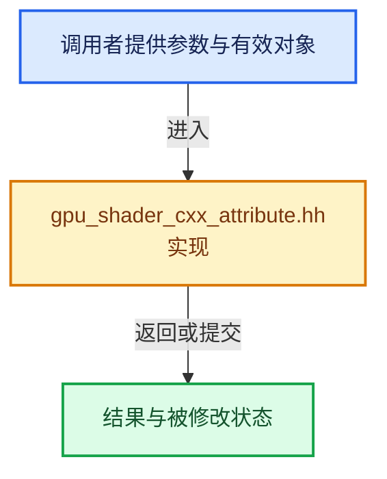

# 实现依赖专题：source/blender/gpu/shaders/compat/gpu_shader_cxx_attribute.hh

[方向导航](README.md) · [符号索引](../%E7%AC%A6%E5%8F%B7%E4%BE%9D%E8%B5%96%E4%B8%8E%E5%AE%9E%E7%8E%B0%E7%B4%A2%E5%BC%95.md)

本专题从正文实际调用进入，集中保存共享实现。函数有稳定锚点，可从调用处直接跳到对应完整函数；递归与互相调用通过回链组织。

## 本文件的实现关系





<a id="m-ea80b54273b2"></a>

## 宏 `compute`

<!-- annotated:929509bad834f6 -->

```cpp
#  define compute maybe_unused
/* Specify a function is a vertex shader entry point. */
```

<details>
<summary>核对原始源码：source/blender/gpu/shaders/compat/gpu_shader_cxx_attribute.hh · L22—L23</summary>

<!-- original:929509bad834f6:source/blender/gpu/shaders/compat/gpu_shader_cxx_attribute.hh:22:23 -->

```cpp
#  define compute maybe_unused
/* Specify a function is a vertex shader entry point. */
```

</details>

宏在预处理阶段展开，参数替换、重复求值和条件编译应直接从该定义检查。与普通函数不同，宏不会自动提供参数类型检查；构建配置选择哪个定义需结合外围条件。

<a id="m-a452734c9407"></a>

## 宏 `index`

<!-- annotated:5021202a01639d -->

```cpp
#  define index(i) maybe_unused
/* Fragment shader color output index for raster order group on Metal. */
```

<details>
<summary>核对原始源码：source/blender/gpu/shaders/compat/gpu_shader_cxx_attribute.hh · L103—L104</summary>

<!-- original:5021202a01639d:source/blender/gpu/shaders/compat/gpu_shader_cxx_attribute.hh:103:104 -->

```cpp
#  define index(i) maybe_unused
/* Fragment shader color output index for raster order group on Metal. */
```

</details>

宏在预处理阶段展开，参数替换、重复求值和条件编译应直接从该定义检查。与普通函数不同，宏不会自动提供参数类型检查；构建配置选择哪个定义需结合外围条件。

<a id="m-5e91abed202c"></a>

## 宏 `push_constant`

<!-- annotated:59731a7eba087c -->

```cpp
#  define push_constant maybe_unused
/* Declare a nested resource table member. */
```

<details>
<summary>核对原始源码：source/blender/gpu/shaders/compat/gpu_shader_cxx_attribute.hh · L126—L127</summary>

<!-- original:59731a7eba087c:source/blender/gpu/shaders/compat/gpu_shader_cxx_attribute.hh:126:127 -->

```cpp
#  define push_constant maybe_unused
/* Declare a nested resource table member. */
```

</details>

宏在预处理阶段展开，参数替换、重复求值和条件编译应直接从该定义检查。与普通函数不同，宏不会自动提供参数类型检查；构建配置选择哪个定义需结合外围条件。

<a id="m-6e31a7e10f76"></a>

## 宏 `capacity`

<!-- annotated:1f9e5b69f3f2fc -->

```cpp
#  define capacity(const) maybe_unused

```

<details>
<summary>核对原始源码：source/blender/gpu/shaders/compat/gpu_shader_cxx_attribute.hh · L135—L136</summary>

<!-- original:1f9e5b69f3f2fc:source/blender/gpu/shaders/compat/gpu_shader_cxx_attribute.hh:135:136 -->

```cpp
#  define capacity(const) maybe_unused

```

</details>

宏在预处理阶段展开，参数替换、重复求值和条件编译应直接从该定义检查。与普通函数不同，宏不会自动提供参数类型检查；构建配置选择哪个定义需结合外围条件。

<a id="m-357756b70038"></a>

## 宏 `node`

<!-- annotated:3168a4d5a8851e -->

```cpp
#  define node maybe_unused

```

<details>
<summary>核对原始源码：source/blender/gpu/shaders/compat/gpu_shader_cxx_attribute.hh · L142—L143</summary>

<!-- original:3168a4d5a8851e:source/blender/gpu/shaders/compat/gpu_shader_cxx_attribute.hh:142:143 -->

```cpp
#  define node maybe_unused

```

</details>

宏在预处理阶段展开，参数替换、重复求值和条件编译应直接从该定义检查。与普通函数不同，宏不会自动提供参数类型检查；构建配置选择哪个定义需结合外围条件。

## 完整成员与函数实现
