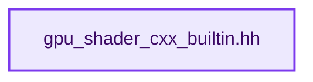
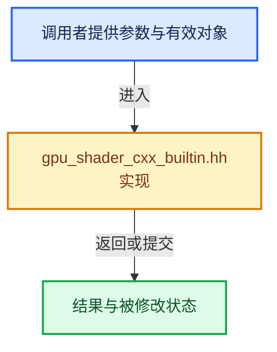

# 实现依赖专题：source/blender/gpu/shaders/compat/gpu_shader_cxx_builtin.hh

[方向导航](README.md) · [符号索引](../%E7%AC%A6%E5%8F%B7%E4%BE%9D%E8%B5%96%E4%B8%8E%E5%AE%9E%E7%8E%B0%E7%B4%A2%E5%BC%95.md)

本专题从正文实际调用进入，集中保存共享实现。函数有稳定锚点，可从调用处直接跳到对应完整函数；递归与互相调用通过回链组织。

## 本文件的实现关系






<a id="m-14b5712612c4"></a>

## 宏 `abs`

<!-- annotated:f1e248a7ce5c33 -->

```cpp
#define abs glsl::abs
#define ceil glsl::ceil
```

<details>
<summary>核对原始源码：source/blender/gpu/shaders/compat/gpu_shader_cxx_builtin.hh · L104—L105</summary>

<!-- original:f1e248a7ce5c33:source/blender/gpu/shaders/compat/gpu_shader_cxx_builtin.hh:104:105 -->

```cpp
#define abs glsl::abs
#define ceil glsl::ceil
```

</details>

宏在预处理阶段展开，参数替换、重复求值和条件编译应直接从该定义检查。与普通函数不同，宏不会自动提供参数类型检查；构建配置选择哪个定义需结合外围条件。

<a id="m-dd7e1d600c32"></a>

## 宏 `exp`

<!-- annotated:4ec55581436381 -->

```cpp
#define exp glsl::exp
#define exp2 glsl::exp2
```

<details>
<summary>核对原始源码：source/blender/gpu/shaders/compat/gpu_shader_cxx_builtin.hh · L106—L107</summary>

<!-- original:4ec55581436381:source/blender/gpu/shaders/compat/gpu_shader_cxx_builtin.hh:106:107 -->

```cpp
#define exp glsl::exp
#define exp2 glsl::exp2
```

</details>

宏在预处理阶段展开，参数替换、重复求值和条件编译应直接从该定义检查。与普通函数不同，宏不会自动提供参数类型检查；构建配置选择哪个定义需结合外围条件。

<a id="m-b6b82c5e925e"></a>

## 宏 `log`

<!-- annotated:372f147fc6f3b1 -->

```cpp
#define log glsl::log
#define log2 glsl::log2
```

<details>
<summary>核对原始源码：source/blender/gpu/shaders/compat/gpu_shader_cxx_builtin.hh · L113—L114</summary>

<!-- original:372f147fc6f3b1:source/blender/gpu/shaders/compat/gpu_shader_cxx_builtin.hh:113:114 -->

```cpp
#define log glsl::log
#define log2 glsl::log2
```

</details>

宏在预处理阶段展开，参数替换、重复求值和条件编译应直接从该定义检查。与普通函数不同，宏不会自动提供参数类型检查；构建配置选择哪个定义需结合外围条件。

<a id="m-608db5336d75"></a>

## 宏 `log2`

<!-- annotated:2c6c0f0d31b957 -->

```cpp
#define log2 glsl::log2
#define modf glsl::modf
```

<details>
<summary>核对原始源码：source/blender/gpu/shaders/compat/gpu_shader_cxx_builtin.hh · L114—L115</summary>

<!-- original:2c6c0f0d31b957:source/blender/gpu/shaders/compat/gpu_shader_cxx_builtin.hh:114:115 -->

```cpp
#define log2 glsl::log2
#define modf glsl::modf
```

</details>

宏在预处理阶段展开，参数替换、重复求值和条件编译应直接从该定义检查。与普通函数不同，宏不会自动提供参数类型检查；构建配置选择哪个定义需结合外围条件。

<a id="m-3f8be846bac5"></a>

## 宏 `modf`

<!-- annotated:16dc42a7ade0e9 -->

```cpp
#define modf glsl::modf
#define pow glsl::pow
```

<details>
<summary>核对原始源码：source/blender/gpu/shaders/compat/gpu_shader_cxx_builtin.hh · L115—L116</summary>

<!-- original:16dc42a7ade0e9:source/blender/gpu/shaders/compat/gpu_shader_cxx_builtin.hh:115:116 -->

```cpp
#define modf glsl::modf
#define pow glsl::pow
```

</details>

宏在预处理阶段展开，参数替换、重复求值和条件编译应直接从该定义检查。与普通函数不同，宏不会自动提供参数类型检查；构建配置选择哪个定义需结合外围条件。

<a id="m-46b6cdaedd36"></a>

## 宏 `round`

<!-- annotated:9d3ea255e6c34d -->

```cpp
#define round glsl::round
#define sqrt glsl::sqrt
```

<details>
<summary>核对原始源码：source/blender/gpu/shaders/compat/gpu_shader_cxx_builtin.hh · L117—L118</summary>

<!-- original:9d3ea255e6c34d:source/blender/gpu/shaders/compat/gpu_shader_cxx_builtin.hh:117:118 -->

```cpp
#define round glsl::round
#define sqrt glsl::sqrt
```

</details>

宏在预处理阶段展开，参数替换、重复求值和条件编译应直接从该定义检查。与普通函数不同，宏不会自动提供参数类型检查；构建配置选择哪个定义需结合外围条件。

<a id="m-a491293e37c4"></a>

## 宏 `acos`

<!-- annotated:cedee74e531751 -->

```cpp
#define acos glsl::acos
#define acosh glsl::acosh
```

<details>
<summary>核对原始源码：source/blender/gpu/shaders/compat/gpu_shader_cxx_builtin.hh · L121—L122</summary>

<!-- original:cedee74e531751:source/blender/gpu/shaders/compat/gpu_shader_cxx_builtin.hh:121:122 -->

```cpp
#define acos glsl::acos
#define acosh glsl::acosh
```

</details>

宏在预处理阶段展开，参数替换、重复求值和条件编译应直接从该定义检查。与普通函数不同，宏不会自动提供参数类型检查；构建配置选择哪个定义需结合外围条件。

<a id="m-4ad80f3fe350"></a>

## 宏 `tan`

<!-- annotated:b59c13e2a28b05 -->

```cpp
#define tan glsl::tan
#define tanh glsl::tanh
```

<details>
<summary>核对原始源码：source/blender/gpu/shaders/compat/gpu_shader_cxx_builtin.hh · L131—L132</summary>

<!-- original:b59c13e2a28b05:source/blender/gpu/shaders/compat/gpu_shader_cxx_builtin.hh:131:132 -->

```cpp
#define tan glsl::tan
#define tanh glsl::tanh
```

</details>

宏在预处理阶段展开，参数替换、重复求值和条件编译应直接从该定义检查。与普通函数不同，宏不会自动提供参数类型检查；构建配置选择哪个定义需结合外围条件。

<a id="m-0ffd01e7f752"></a>

## 宏 `tanh`

<!-- annotated:dc058a8e91ad95 -->

```cpp
#define tanh glsl::tanh

```

<details>
<summary>核对原始源码：source/blender/gpu/shaders/compat/gpu_shader_cxx_builtin.hh · L132—L133</summary>

<!-- original:dc058a8e91ad95:source/blender/gpu/shaders/compat/gpu_shader_cxx_builtin.hh:132:133 -->

```cpp
#define tanh glsl::tanh

```

</details>

宏在预处理阶段展开，参数替换、重复求值和条件编译应直接从该定义检查。与普通函数不同，宏不会自动提供参数类型检查；构建配置选择哪个定义需结合外围条件。

## 完整成员与函数实现
