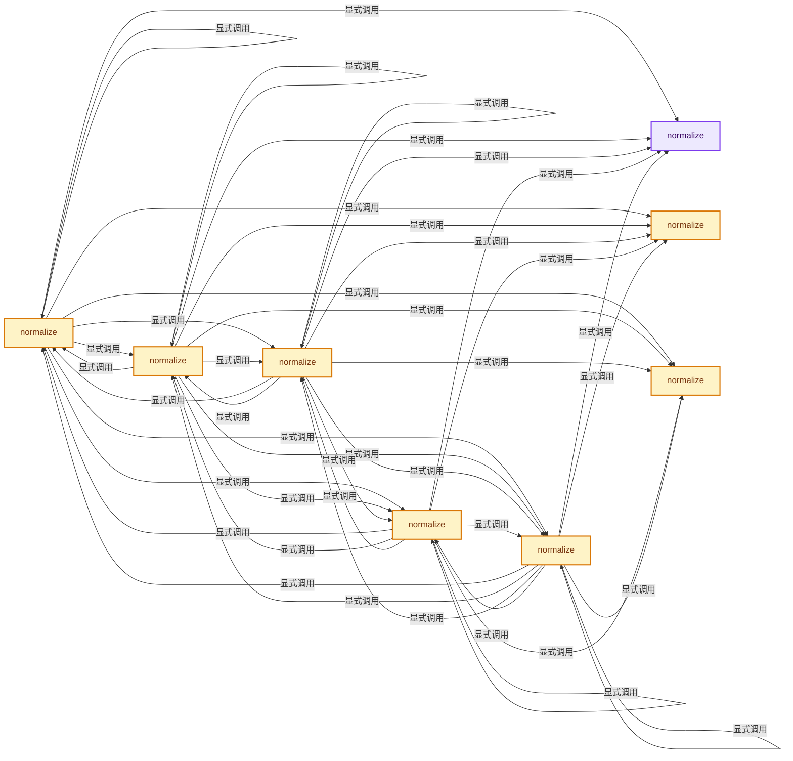
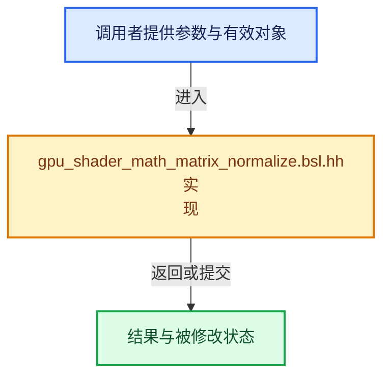

# 实现依赖专题：source/blender/gpu/shaders/common/gpu_shader_math_matrix_normalize.bsl.hh

[方向导航](README.md) · [符号索引](../%E7%AC%A6%E5%8F%B7%E4%BE%9D%E8%B5%96%E4%B8%8E%E5%AE%9E%E7%8E%B0%E7%B4%A2%E5%BC%95.md)

本专题从正文实际调用进入，集中保存共享实现。函数有稳定锚点，可从调用处直接跳到对应完整函数；递归与互相调用通过回链组织。

## 本文件的实现关系






## 完整成员与函数实现

<a id="f-c7ae20a29ab4da76"></a>

### `normalize`

实现位置：[source/blender/gpu/shaders/common/gpu_shader_math_matrix_normalize.bsl.hh](../../../../../source/blender/gpu/shaders/common/gpu_shader_math_matrix_normalize.bsl.hh) · L16—L19。

接口参数：

- `float2 a`

**教学注释版**

<!-- annotated:e627280cb68ffa -->

```cpp
float2 normalize(float2 a)
{
  return a * inversesqrt(length_squared(a));
}
```

<details>
<summary>核对原始源码：source/blender/gpu/shaders/common/gpu_shader_math_matrix_normalize.bsl.hh · L16—L19</summary>

<!-- original:e627280cb68ffa:source/blender/gpu/shaders/common/gpu_shader_math_matrix_normalize.bsl.hh:16:19 -->

```cpp
float2 normalize(float2 a)
{
  return a * inversesqrt(length_squared(a));
}
```

</details>

**结果出口**

- `return a * inversesqrt(length_squared(a));`

**继续追踪实现**

- `inversesqrt` → [inversesqrt · L302](%E4%BE%9D%E8%B5%96-math_dual-a0f3ee.md#f-27f4d70d114d3bd3)。
- `length_squared` → [length_squared · L90](%E4%BE%9D%E8%B5%96-gpu_shader_math_vector.bsl-418712.md#f-1bc529235547f337)。

<a id="f-058e4a05bbb6b503"></a>

### `normalize`

实现位置：[source/blender/gpu/shaders/common/gpu_shader_math_matrix_normalize.bsl.hh](../../../../../source/blender/gpu/shaders/common/gpu_shader_math_matrix_normalize.bsl.hh) · L20—L23。

接口参数：

- `float3 a`

**教学注释版**

<!-- annotated:b73d6efdb90e74 -->

```cpp
float3 normalize(float3 a)
{
  return a * inversesqrt(length_squared(a));
}
```

<details>
<summary>核对原始源码：source/blender/gpu/shaders/common/gpu_shader_math_matrix_normalize.bsl.hh · L20—L23</summary>

<!-- original:b73d6efdb90e74:source/blender/gpu/shaders/common/gpu_shader_math_matrix_normalize.bsl.hh:20:23 -->

```cpp
float3 normalize(float3 a)
{
  return a * inversesqrt(length_squared(a));
}
```

</details>

**结果出口**

- `return a * inversesqrt(length_squared(a));`

**继续追踪实现**

- `inversesqrt` → [inversesqrt · L302](%E4%BE%9D%E8%B5%96-math_dual-a0f3ee.md#f-27f4d70d114d3bd3)。
- `length_squared` → [length_squared · L90](%E4%BE%9D%E8%B5%96-gpu_shader_math_vector.bsl-418712.md#f-1bc529235547f337)。

<a id="f-14dbdba2c67d0e8b"></a>

### `normalize`

实现位置：[source/blender/gpu/shaders/common/gpu_shader_math_matrix_normalize.bsl.hh](../../../../../source/blender/gpu/shaders/common/gpu_shader_math_matrix_normalize.bsl.hh) · L24—L27。

接口参数：

- `float4 a`

**教学注释版**

<!-- annotated:09ec308d76838b -->

```cpp
float4 normalize(float4 a)
{
  return a * inversesqrt(length_squared(a));
}
```

<details>
<summary>核对原始源码：source/blender/gpu/shaders/common/gpu_shader_math_matrix_normalize.bsl.hh · L24—L27</summary>

<!-- original:09ec308d76838b:source/blender/gpu/shaders/common/gpu_shader_math_matrix_normalize.bsl.hh:24:27 -->

```cpp
float4 normalize(float4 a)
{
  return a * inversesqrt(length_squared(a));
}
```

</details>

**结果出口**

- `return a * inversesqrt(length_squared(a));`

**继续追踪实现**

- `inversesqrt` → [inversesqrt · L302](%E4%BE%9D%E8%B5%96-math_dual-a0f3ee.md#f-27f4d70d114d3bd3)。
- `length_squared` → [length_squared · L90](%E4%BE%9D%E8%B5%96-gpu_shader_math_vector.bsl-418712.md#f-1bc529235547f337)。

<a id="f-625d4bad43dffd9c"></a>

### `normalize`

实现位置：[source/blender/gpu/shaders/common/gpu_shader_math_matrix_normalize.bsl.hh](../../../../../source/blender/gpu/shaders/common/gpu_shader_math_matrix_normalize.bsl.hh) · L34—L40。

接口参数：

- `float2x2 mat`

**教学注释版**

<!-- annotated:1dc1bd2fb8adfe -->

```cpp
float2x2 normalize(float2x2 mat)
{
  float2x2 ret;
  ret[0] = normalize(mat[0].xy);
  ret[1] = normalize(mat[1].xy);
  return ret;
}
```

<details>
<summary>核对原始源码：source/blender/gpu/shaders/common/gpu_shader_math_matrix_normalize.bsl.hh · L34—L40</summary>

<!-- original:1dc1bd2fb8adfe:source/blender/gpu/shaders/common/gpu_shader_math_matrix_normalize.bsl.hh:34:40 -->

```cpp
float2x2 normalize(float2x2 mat)
{
  float2x2 ret;
  ret[0] = normalize(mat[0].xy);
  ret[1] = normalize(mat[1].xy);
  return ret;
}
```

</details>

**沿实际写入检查状态**

- `ret[0] = normalize(mat[0].xy);`
- `ret[1] = normalize(mat[1].xy);`

**结果出口**

- `return ret;`

**继续追踪实现**

- `normalize` → [normalize · L16](%E4%BE%9D%E8%B5%96-gpu_shader_math_matrix_normalize.bsl-299c5b.md#f-c7ae20a29ab4da76)；[normalize · L20](%E4%BE%9D%E8%B5%96-gpu_shader_math_matrix_normalize.bsl-299c5b.md#f-058e4a05bbb6b503)；[normalize · L24](%E4%BE%9D%E8%B5%96-gpu_shader_math_matrix_normalize.bsl-299c5b.md#f-14dbdba2c67d0e8b)；[normalize · L34](%E4%BE%9D%E8%B5%96-gpu_shader_math_matrix_normalize.bsl-299c5b.md#f-625d4bad43dffd9c)；[normalize · L41](%E4%BE%9D%E8%B5%96-gpu_shader_math_matrix_normalize.bsl-299c5b.md#f-d55b4ac328dde4cb)；[normalize · L48](%E4%BE%9D%E8%B5%96-gpu_shader_math_matrix_normalize.bsl-299c5b.md#f-8a8b0bd437b339c5)；[normalize · L55](%E4%BE%9D%E8%B5%96-gpu_shader_math_matrix_normalize.bsl-299c5b.md#f-64d092bea6e62c87)；[normalize · L64](%E4%BE%9D%E8%B5%96-gpu_shader_math_matrix_normalize.bsl-299c5b.md#f-5e2d66321c5b1c64)；[normalize · L73](%E4%BE%9D%E8%B5%96-gpu_shader_math_matrix_normalize.bsl-299c5b.md#f-678c05ab6e94ffc2)；[normalize · L81](%E4%BE%9D%E8%B5%96-gpu_shader_math_matrix_normalize.bsl-299c5b.md#f-693795be99ff0d63)；[normalize · L90](%E4%BE%9D%E8%B5%96-gpu_shader_math_matrix_normalize.bsl-299c5b.md#f-e7110cf1e4527133)；[normalize · L100](%E4%BE%9D%E8%B5%96-gpu_shader_math_matrix_normalize.bsl-299c5b.md#f-c074535e46937142)。同名重载需按实参类型选择。

<a id="f-d55b4ac328dde4cb"></a>

### `normalize`

实现位置：[source/blender/gpu/shaders/common/gpu_shader_math_matrix_normalize.bsl.hh](../../../../../source/blender/gpu/shaders/common/gpu_shader_math_matrix_normalize.bsl.hh) · L41—L47。

接口参数：

- `float2x3 mat`

**教学注释版**

<!-- annotated:3edaed9cf3d034 -->

```cpp
float2x3 normalize(float2x3 mat)
{
  float2x3 ret;
  ret[0] = normalize(mat[0].xyz);
  ret[1] = normalize(mat[1].xyz);
  return ret;
}
```

<details>
<summary>核对原始源码：source/blender/gpu/shaders/common/gpu_shader_math_matrix_normalize.bsl.hh · L41—L47</summary>

<!-- original:3edaed9cf3d034:source/blender/gpu/shaders/common/gpu_shader_math_matrix_normalize.bsl.hh:41:47 -->

```cpp
float2x3 normalize(float2x3 mat)
{
  float2x3 ret;
  ret[0] = normalize(mat[0].xyz);
  ret[1] = normalize(mat[1].xyz);
  return ret;
}
```

</details>

**沿实际写入检查状态**

- `ret[0] = normalize(mat[0].xyz);`
- `ret[1] = normalize(mat[1].xyz);`

**结果出口**

- `return ret;`

**继续追踪实现**

- `normalize` → [normalize · L16](%E4%BE%9D%E8%B5%96-gpu_shader_math_matrix_normalize.bsl-299c5b.md#f-c7ae20a29ab4da76)；[normalize · L20](%E4%BE%9D%E8%B5%96-gpu_shader_math_matrix_normalize.bsl-299c5b.md#f-058e4a05bbb6b503)；[normalize · L24](%E4%BE%9D%E8%B5%96-gpu_shader_math_matrix_normalize.bsl-299c5b.md#f-14dbdba2c67d0e8b)；[normalize · L34](%E4%BE%9D%E8%B5%96-gpu_shader_math_matrix_normalize.bsl-299c5b.md#f-625d4bad43dffd9c)；[normalize · L41](%E4%BE%9D%E8%B5%96-gpu_shader_math_matrix_normalize.bsl-299c5b.md#f-d55b4ac328dde4cb)；[normalize · L48](%E4%BE%9D%E8%B5%96-gpu_shader_math_matrix_normalize.bsl-299c5b.md#f-8a8b0bd437b339c5)；[normalize · L55](%E4%BE%9D%E8%B5%96-gpu_shader_math_matrix_normalize.bsl-299c5b.md#f-64d092bea6e62c87)；[normalize · L64](%E4%BE%9D%E8%B5%96-gpu_shader_math_matrix_normalize.bsl-299c5b.md#f-5e2d66321c5b1c64)；[normalize · L73](%E4%BE%9D%E8%B5%96-gpu_shader_math_matrix_normalize.bsl-299c5b.md#f-678c05ab6e94ffc2)；[normalize · L81](%E4%BE%9D%E8%B5%96-gpu_shader_math_matrix_normalize.bsl-299c5b.md#f-693795be99ff0d63)；[normalize · L90](%E4%BE%9D%E8%B5%96-gpu_shader_math_matrix_normalize.bsl-299c5b.md#f-e7110cf1e4527133)；[normalize · L100](%E4%BE%9D%E8%B5%96-gpu_shader_math_matrix_normalize.bsl-299c5b.md#f-c074535e46937142)。同名重载需按实参类型选择。

<a id="f-8a8b0bd437b339c5"></a>

### `normalize`

实现位置：[source/blender/gpu/shaders/common/gpu_shader_math_matrix_normalize.bsl.hh](../../../../../source/blender/gpu/shaders/common/gpu_shader_math_matrix_normalize.bsl.hh) · L48—L54。

接口参数：

- `float2x4 mat`

**教学注释版**

<!-- annotated:b00feaaf07c858 -->

```cpp
float2x4 normalize(float2x4 mat)
{
  float2x4 ret;
  ret[0] = normalize(mat[0].xyzw);
  ret[1] = normalize(mat[1].xyzw);
  return ret;
}
```

<details>
<summary>核对原始源码：source/blender/gpu/shaders/common/gpu_shader_math_matrix_normalize.bsl.hh · L48—L54</summary>

<!-- original:b00feaaf07c858:source/blender/gpu/shaders/common/gpu_shader_math_matrix_normalize.bsl.hh:48:54 -->

```cpp
float2x4 normalize(float2x4 mat)
{
  float2x4 ret;
  ret[0] = normalize(mat[0].xyzw);
  ret[1] = normalize(mat[1].xyzw);
  return ret;
}
```

</details>

**沿实际写入检查状态**

- `ret[0] = normalize(mat[0].xyzw);`
- `ret[1] = normalize(mat[1].xyzw);`

**结果出口**

- `return ret;`

**继续追踪实现**

- `normalize` → [normalize · L16](%E4%BE%9D%E8%B5%96-gpu_shader_math_matrix_normalize.bsl-299c5b.md#f-c7ae20a29ab4da76)；[normalize · L20](%E4%BE%9D%E8%B5%96-gpu_shader_math_matrix_normalize.bsl-299c5b.md#f-058e4a05bbb6b503)；[normalize · L24](%E4%BE%9D%E8%B5%96-gpu_shader_math_matrix_normalize.bsl-299c5b.md#f-14dbdba2c67d0e8b)；[normalize · L34](%E4%BE%9D%E8%B5%96-gpu_shader_math_matrix_normalize.bsl-299c5b.md#f-625d4bad43dffd9c)；[normalize · L41](%E4%BE%9D%E8%B5%96-gpu_shader_math_matrix_normalize.bsl-299c5b.md#f-d55b4ac328dde4cb)；[normalize · L48](%E4%BE%9D%E8%B5%96-gpu_shader_math_matrix_normalize.bsl-299c5b.md#f-8a8b0bd437b339c5)；[normalize · L55](%E4%BE%9D%E8%B5%96-gpu_shader_math_matrix_normalize.bsl-299c5b.md#f-64d092bea6e62c87)；[normalize · L64](%E4%BE%9D%E8%B5%96-gpu_shader_math_matrix_normalize.bsl-299c5b.md#f-5e2d66321c5b1c64)；[normalize · L73](%E4%BE%9D%E8%B5%96-gpu_shader_math_matrix_normalize.bsl-299c5b.md#f-678c05ab6e94ffc2)；[normalize · L81](%E4%BE%9D%E8%B5%96-gpu_shader_math_matrix_normalize.bsl-299c5b.md#f-693795be99ff0d63)；[normalize · L90](%E4%BE%9D%E8%B5%96-gpu_shader_math_matrix_normalize.bsl-299c5b.md#f-e7110cf1e4527133)；[normalize · L100](%E4%BE%9D%E8%B5%96-gpu_shader_math_matrix_normalize.bsl-299c5b.md#f-c074535e46937142)。同名重载需按实参类型选择。

<a id="f-64d092bea6e62c87"></a>

### `normalize`

实现位置：[source/blender/gpu/shaders/common/gpu_shader_math_matrix_normalize.bsl.hh](../../../../../source/blender/gpu/shaders/common/gpu_shader_math_matrix_normalize.bsl.hh) · L55—L62。

接口参数：

- `float3x2 mat`

**教学注释版**

<!-- annotated:affe6a9acf8e83 -->

```cpp
float3x2 normalize(float3x2 mat)
{
  float3x2 ret;
  ret[0] = normalize(mat[0].xy);
  ret[1] = normalize(mat[1].xy);
  ret[2] = normalize(mat[2].xy);
  return ret;
}
```

<details>
<summary>核对原始源码：source/blender/gpu/shaders/common/gpu_shader_math_matrix_normalize.bsl.hh · L55—L62</summary>

<!-- original:affe6a9acf8e83:source/blender/gpu/shaders/common/gpu_shader_math_matrix_normalize.bsl.hh:55:62 -->

```cpp
float3x2 normalize(float3x2 mat)
{
  float3x2 ret;
  ret[0] = normalize(mat[0].xy);
  ret[1] = normalize(mat[1].xy);
  ret[2] = normalize(mat[2].xy);
  return ret;
}
```

</details>

**沿实际写入检查状态**

- `ret[0] = normalize(mat[0].xy);`
- `ret[1] = normalize(mat[1].xy);`
- `ret[2] = normalize(mat[2].xy);`

**结果出口**

- `return ret;`

**继续追踪实现**

- `normalize` → [normalize · L16](%E4%BE%9D%E8%B5%96-gpu_shader_math_matrix_normalize.bsl-299c5b.md#f-c7ae20a29ab4da76)；[normalize · L20](%E4%BE%9D%E8%B5%96-gpu_shader_math_matrix_normalize.bsl-299c5b.md#f-058e4a05bbb6b503)；[normalize · L24](%E4%BE%9D%E8%B5%96-gpu_shader_math_matrix_normalize.bsl-299c5b.md#f-14dbdba2c67d0e8b)；[normalize · L34](%E4%BE%9D%E8%B5%96-gpu_shader_math_matrix_normalize.bsl-299c5b.md#f-625d4bad43dffd9c)；[normalize · L41](%E4%BE%9D%E8%B5%96-gpu_shader_math_matrix_normalize.bsl-299c5b.md#f-d55b4ac328dde4cb)；[normalize · L48](%E4%BE%9D%E8%B5%96-gpu_shader_math_matrix_normalize.bsl-299c5b.md#f-8a8b0bd437b339c5)；[normalize · L55](%E4%BE%9D%E8%B5%96-gpu_shader_math_matrix_normalize.bsl-299c5b.md#f-64d092bea6e62c87)；[normalize · L64](%E4%BE%9D%E8%B5%96-gpu_shader_math_matrix_normalize.bsl-299c5b.md#f-5e2d66321c5b1c64)；[normalize · L73](%E4%BE%9D%E8%B5%96-gpu_shader_math_matrix_normalize.bsl-299c5b.md#f-678c05ab6e94ffc2)；[normalize · L81](%E4%BE%9D%E8%B5%96-gpu_shader_math_matrix_normalize.bsl-299c5b.md#f-693795be99ff0d63)；[normalize · L90](%E4%BE%9D%E8%B5%96-gpu_shader_math_matrix_normalize.bsl-299c5b.md#f-e7110cf1e4527133)；[normalize · L100](%E4%BE%9D%E8%B5%96-gpu_shader_math_matrix_normalize.bsl-299c5b.md#f-c074535e46937142)。同名重载需按实参类型选择。

<a id="f-5e2d66321c5b1c64"></a>

### `normalize`

实现位置：[source/blender/gpu/shaders/common/gpu_shader_math_matrix_normalize.bsl.hh](../../../../../source/blender/gpu/shaders/common/gpu_shader_math_matrix_normalize.bsl.hh) · L64—L71。

接口参数：

- `float3x3 mat`

**教学注释版**

<!-- annotated:9a6e7ea7499732 -->

```cpp
float3x3 normalize(float3x3 mat)
{
  float3x3 ret;
  ret[0] = normalize(mat[0].xyz);
  ret[1] = normalize(mat[1].xyz);
  ret[2] = normalize(mat[2].xyz);
  return ret;
}
```

<details>
<summary>核对原始源码：source/blender/gpu/shaders/common/gpu_shader_math_matrix_normalize.bsl.hh · L64—L71</summary>

<!-- original:9a6e7ea7499732:source/blender/gpu/shaders/common/gpu_shader_math_matrix_normalize.bsl.hh:64:71 -->

```cpp
float3x3 normalize(float3x3 mat)
{
  float3x3 ret;
  ret[0] = normalize(mat[0].xyz);
  ret[1] = normalize(mat[1].xyz);
  ret[2] = normalize(mat[2].xyz);
  return ret;
}
```

</details>

**沿实际写入检查状态**

- `ret[0] = normalize(mat[0].xyz);`
- `ret[1] = normalize(mat[1].xyz);`
- `ret[2] = normalize(mat[2].xyz);`

**结果出口**

- `return ret;`

**继续追踪实现**

- `normalize` → [normalize · L16](%E4%BE%9D%E8%B5%96-gpu_shader_math_matrix_normalize.bsl-299c5b.md#f-c7ae20a29ab4da76)；[normalize · L20](%E4%BE%9D%E8%B5%96-gpu_shader_math_matrix_normalize.bsl-299c5b.md#f-058e4a05bbb6b503)；[normalize · L24](%E4%BE%9D%E8%B5%96-gpu_shader_math_matrix_normalize.bsl-299c5b.md#f-14dbdba2c67d0e8b)；[normalize · L34](%E4%BE%9D%E8%B5%96-gpu_shader_math_matrix_normalize.bsl-299c5b.md#f-625d4bad43dffd9c)；[normalize · L41](%E4%BE%9D%E8%B5%96-gpu_shader_math_matrix_normalize.bsl-299c5b.md#f-d55b4ac328dde4cb)；[normalize · L48](%E4%BE%9D%E8%B5%96-gpu_shader_math_matrix_normalize.bsl-299c5b.md#f-8a8b0bd437b339c5)；[normalize · L55](%E4%BE%9D%E8%B5%96-gpu_shader_math_matrix_normalize.bsl-299c5b.md#f-64d092bea6e62c87)；[normalize · L64](%E4%BE%9D%E8%B5%96-gpu_shader_math_matrix_normalize.bsl-299c5b.md#f-5e2d66321c5b1c64)；[normalize · L73](%E4%BE%9D%E8%B5%96-gpu_shader_math_matrix_normalize.bsl-299c5b.md#f-678c05ab6e94ffc2)；[normalize · L81](%E4%BE%9D%E8%B5%96-gpu_shader_math_matrix_normalize.bsl-299c5b.md#f-693795be99ff0d63)；[normalize · L90](%E4%BE%9D%E8%B5%96-gpu_shader_math_matrix_normalize.bsl-299c5b.md#f-e7110cf1e4527133)；[normalize · L100](%E4%BE%9D%E8%B5%96-gpu_shader_math_matrix_normalize.bsl-299c5b.md#f-c074535e46937142)。同名重载需按实参类型选择。

<a id="f-678c05ab6e94ffc2"></a>

### `normalize`

实现位置：[source/blender/gpu/shaders/common/gpu_shader_math_matrix_normalize.bsl.hh](../../../../../source/blender/gpu/shaders/common/gpu_shader_math_matrix_normalize.bsl.hh) · L73—L80。

接口参数：

- `float3x4 mat`

**教学注释版**

<!-- annotated:8df06531d56303 -->

```cpp
float3x4 normalize(float3x4 mat)
{
  float3x4 ret;
  ret[0] = normalize(mat[0].xyzw);
  ret[1] = normalize(mat[1].xyzw);
  ret[2] = normalize(mat[2].xyzw);
  return ret;
}
```

<details>
<summary>核对原始源码：source/blender/gpu/shaders/common/gpu_shader_math_matrix_normalize.bsl.hh · L73—L80</summary>

<!-- original:8df06531d56303:source/blender/gpu/shaders/common/gpu_shader_math_matrix_normalize.bsl.hh:73:80 -->

```cpp
float3x4 normalize(float3x4 mat)
{
  float3x4 ret;
  ret[0] = normalize(mat[0].xyzw);
  ret[1] = normalize(mat[1].xyzw);
  ret[2] = normalize(mat[2].xyzw);
  return ret;
}
```

</details>

**沿实际写入检查状态**

- `ret[0] = normalize(mat[0].xyzw);`
- `ret[1] = normalize(mat[1].xyzw);`
- `ret[2] = normalize(mat[2].xyzw);`

**结果出口**

- `return ret;`

**继续追踪实现**

- `normalize` → [normalize · L16](%E4%BE%9D%E8%B5%96-gpu_shader_math_matrix_normalize.bsl-299c5b.md#f-c7ae20a29ab4da76)；[normalize · L20](%E4%BE%9D%E8%B5%96-gpu_shader_math_matrix_normalize.bsl-299c5b.md#f-058e4a05bbb6b503)；[normalize · L24](%E4%BE%9D%E8%B5%96-gpu_shader_math_matrix_normalize.bsl-299c5b.md#f-14dbdba2c67d0e8b)；[normalize · L34](%E4%BE%9D%E8%B5%96-gpu_shader_math_matrix_normalize.bsl-299c5b.md#f-625d4bad43dffd9c)；[normalize · L41](%E4%BE%9D%E8%B5%96-gpu_shader_math_matrix_normalize.bsl-299c5b.md#f-d55b4ac328dde4cb)；[normalize · L48](%E4%BE%9D%E8%B5%96-gpu_shader_math_matrix_normalize.bsl-299c5b.md#f-8a8b0bd437b339c5)；[normalize · L55](%E4%BE%9D%E8%B5%96-gpu_shader_math_matrix_normalize.bsl-299c5b.md#f-64d092bea6e62c87)；[normalize · L64](%E4%BE%9D%E8%B5%96-gpu_shader_math_matrix_normalize.bsl-299c5b.md#f-5e2d66321c5b1c64)；[normalize · L73](%E4%BE%9D%E8%B5%96-gpu_shader_math_matrix_normalize.bsl-299c5b.md#f-678c05ab6e94ffc2)；[normalize · L81](%E4%BE%9D%E8%B5%96-gpu_shader_math_matrix_normalize.bsl-299c5b.md#f-693795be99ff0d63)；[normalize · L90](%E4%BE%9D%E8%B5%96-gpu_shader_math_matrix_normalize.bsl-299c5b.md#f-e7110cf1e4527133)；[normalize · L100](%E4%BE%9D%E8%B5%96-gpu_shader_math_matrix_normalize.bsl-299c5b.md#f-c074535e46937142)。同名重载需按实参类型选择。

<a id="f-693795be99ff0d63"></a>

### `normalize`

实现位置：[source/blender/gpu/shaders/common/gpu_shader_math_matrix_normalize.bsl.hh](../../../../../source/blender/gpu/shaders/common/gpu_shader_math_matrix_normalize.bsl.hh) · L81—L89。

接口参数：

- `float4x2 mat`

**教学注释版**

<!-- annotated:19115b51045453 -->

```cpp
float4x2 normalize(float4x2 mat)
{
  float4x2 ret;
  ret[0] = normalize(mat[0].xy);
  ret[1] = normalize(mat[1].xy);
  ret[2] = normalize(mat[2].xy);
  ret[3] = normalize(mat[3].xy);
  return ret;
}
```

<details>
<summary>核对原始源码：source/blender/gpu/shaders/common/gpu_shader_math_matrix_normalize.bsl.hh · L81—L89</summary>

<!-- original:19115b51045453:source/blender/gpu/shaders/common/gpu_shader_math_matrix_normalize.bsl.hh:81:89 -->

```cpp
float4x2 normalize(float4x2 mat)
{
  float4x2 ret;
  ret[0] = normalize(mat[0].xy);
  ret[1] = normalize(mat[1].xy);
  ret[2] = normalize(mat[2].xy);
  ret[3] = normalize(mat[3].xy);
  return ret;
}
```

</details>

**沿实际写入检查状态**

- `ret[0] = normalize(mat[0].xy);`
- `ret[1] = normalize(mat[1].xy);`
- `ret[2] = normalize(mat[2].xy);`
- `ret[3] = normalize(mat[3].xy);`

**结果出口**

- `return ret;`

**继续追踪实现**

- `normalize` → [normalize · L16](%E4%BE%9D%E8%B5%96-gpu_shader_math_matrix_normalize.bsl-299c5b.md#f-c7ae20a29ab4da76)；[normalize · L20](%E4%BE%9D%E8%B5%96-gpu_shader_math_matrix_normalize.bsl-299c5b.md#f-058e4a05bbb6b503)；[normalize · L24](%E4%BE%9D%E8%B5%96-gpu_shader_math_matrix_normalize.bsl-299c5b.md#f-14dbdba2c67d0e8b)；[normalize · L34](%E4%BE%9D%E8%B5%96-gpu_shader_math_matrix_normalize.bsl-299c5b.md#f-625d4bad43dffd9c)；[normalize · L41](%E4%BE%9D%E8%B5%96-gpu_shader_math_matrix_normalize.bsl-299c5b.md#f-d55b4ac328dde4cb)；[normalize · L48](%E4%BE%9D%E8%B5%96-gpu_shader_math_matrix_normalize.bsl-299c5b.md#f-8a8b0bd437b339c5)；[normalize · L55](%E4%BE%9D%E8%B5%96-gpu_shader_math_matrix_normalize.bsl-299c5b.md#f-64d092bea6e62c87)；[normalize · L64](%E4%BE%9D%E8%B5%96-gpu_shader_math_matrix_normalize.bsl-299c5b.md#f-5e2d66321c5b1c64)；[normalize · L73](%E4%BE%9D%E8%B5%96-gpu_shader_math_matrix_normalize.bsl-299c5b.md#f-678c05ab6e94ffc2)；[normalize · L81](%E4%BE%9D%E8%B5%96-gpu_shader_math_matrix_normalize.bsl-299c5b.md#f-693795be99ff0d63)；[normalize · L90](%E4%BE%9D%E8%B5%96-gpu_shader_math_matrix_normalize.bsl-299c5b.md#f-e7110cf1e4527133)；[normalize · L100](%E4%BE%9D%E8%B5%96-gpu_shader_math_matrix_normalize.bsl-299c5b.md#f-c074535e46937142)。同名重载需按实参类型选择。

<a id="f-e7110cf1e4527133"></a>

### `normalize`

实现位置：[source/blender/gpu/shaders/common/gpu_shader_math_matrix_normalize.bsl.hh](../../../../../source/blender/gpu/shaders/common/gpu_shader_math_matrix_normalize.bsl.hh) · L90—L98。

接口参数：

- `float4x3 mat`

**教学注释版**

<!-- annotated:4fc9a4e641ce8e -->

```cpp
float4x3 normalize(float4x3 mat)
{
  float4x3 ret;
  ret[0] = normalize(mat[0].xyz);
  ret[1] = normalize(mat[1].xyz);
  ret[2] = normalize(mat[2].xyz);
  ret[3] = normalize(mat[3].xyz);
  return ret;
}
```

<details>
<summary>核对原始源码：source/blender/gpu/shaders/common/gpu_shader_math_matrix_normalize.bsl.hh · L90—L98</summary>

<!-- original:4fc9a4e641ce8e:source/blender/gpu/shaders/common/gpu_shader_math_matrix_normalize.bsl.hh:90:98 -->

```cpp
float4x3 normalize(float4x3 mat)
{
  float4x3 ret;
  ret[0] = normalize(mat[0].xyz);
  ret[1] = normalize(mat[1].xyz);
  ret[2] = normalize(mat[2].xyz);
  ret[3] = normalize(mat[3].xyz);
  return ret;
}
```

</details>

**沿实际写入检查状态**

- `ret[0] = normalize(mat[0].xyz);`
- `ret[1] = normalize(mat[1].xyz);`
- `ret[2] = normalize(mat[2].xyz);`
- `ret[3] = normalize(mat[3].xyz);`

**结果出口**

- `return ret;`

**继续追踪实现**

- `normalize` → [normalize · L16](%E4%BE%9D%E8%B5%96-gpu_shader_math_matrix_normalize.bsl-299c5b.md#f-c7ae20a29ab4da76)；[normalize · L20](%E4%BE%9D%E8%B5%96-gpu_shader_math_matrix_normalize.bsl-299c5b.md#f-058e4a05bbb6b503)；[normalize · L24](%E4%BE%9D%E8%B5%96-gpu_shader_math_matrix_normalize.bsl-299c5b.md#f-14dbdba2c67d0e8b)；[normalize · L34](%E4%BE%9D%E8%B5%96-gpu_shader_math_matrix_normalize.bsl-299c5b.md#f-625d4bad43dffd9c)；[normalize · L41](%E4%BE%9D%E8%B5%96-gpu_shader_math_matrix_normalize.bsl-299c5b.md#f-d55b4ac328dde4cb)；[normalize · L48](%E4%BE%9D%E8%B5%96-gpu_shader_math_matrix_normalize.bsl-299c5b.md#f-8a8b0bd437b339c5)；[normalize · L55](%E4%BE%9D%E8%B5%96-gpu_shader_math_matrix_normalize.bsl-299c5b.md#f-64d092bea6e62c87)；[normalize · L64](%E4%BE%9D%E8%B5%96-gpu_shader_math_matrix_normalize.bsl-299c5b.md#f-5e2d66321c5b1c64)；[normalize · L73](%E4%BE%9D%E8%B5%96-gpu_shader_math_matrix_normalize.bsl-299c5b.md#f-678c05ab6e94ffc2)；[normalize · L81](%E4%BE%9D%E8%B5%96-gpu_shader_math_matrix_normalize.bsl-299c5b.md#f-693795be99ff0d63)；[normalize · L90](%E4%BE%9D%E8%B5%96-gpu_shader_math_matrix_normalize.bsl-299c5b.md#f-e7110cf1e4527133)；[normalize · L100](%E4%BE%9D%E8%B5%96-gpu_shader_math_matrix_normalize.bsl-299c5b.md#f-c074535e46937142)。同名重载需按实参类型选择。

<a id="f-c074535e46937142"></a>

### `normalize`

实现位置：[source/blender/gpu/shaders/common/gpu_shader_math_matrix_normalize.bsl.hh](../../../../../source/blender/gpu/shaders/common/gpu_shader_math_matrix_normalize.bsl.hh) · L100—L108。

接口参数：

- `float4x4 mat`

**教学注释版**

<!-- annotated:432221db964472 -->

```cpp
float4x4 normalize(float4x4 mat)
{
  float4x4 ret;
  ret[0] = normalize(mat[0].xyzw);
  ret[1] = normalize(mat[1].xyzw);
  ret[2] = normalize(mat[2].xyzw);
  ret[3] = normalize(mat[3].xyzw);
  return ret;
}
```

<details>
<summary>核对原始源码：source/blender/gpu/shaders/common/gpu_shader_math_matrix_normalize.bsl.hh · L100—L108</summary>

<!-- original:432221db964472:source/blender/gpu/shaders/common/gpu_shader_math_matrix_normalize.bsl.hh:100:108 -->

```cpp
float4x4 normalize(float4x4 mat)
{
  float4x4 ret;
  ret[0] = normalize(mat[0].xyzw);
  ret[1] = normalize(mat[1].xyzw);
  ret[2] = normalize(mat[2].xyzw);
  ret[3] = normalize(mat[3].xyzw);
  return ret;
}
```

</details>

**沿实际写入检查状态**

- `ret[0] = normalize(mat[0].xyzw);`
- `ret[1] = normalize(mat[1].xyzw);`
- `ret[2] = normalize(mat[2].xyzw);`
- `ret[3] = normalize(mat[3].xyzw);`

**结果出口**

- `return ret;`

**继续追踪实现**

- `normalize` → [normalize · L16](%E4%BE%9D%E8%B5%96-gpu_shader_math_matrix_normalize.bsl-299c5b.md#f-c7ae20a29ab4da76)；[normalize · L20](%E4%BE%9D%E8%B5%96-gpu_shader_math_matrix_normalize.bsl-299c5b.md#f-058e4a05bbb6b503)；[normalize · L24](%E4%BE%9D%E8%B5%96-gpu_shader_math_matrix_normalize.bsl-299c5b.md#f-14dbdba2c67d0e8b)；[normalize · L34](%E4%BE%9D%E8%B5%96-gpu_shader_math_matrix_normalize.bsl-299c5b.md#f-625d4bad43dffd9c)；[normalize · L41](%E4%BE%9D%E8%B5%96-gpu_shader_math_matrix_normalize.bsl-299c5b.md#f-d55b4ac328dde4cb)；[normalize · L48](%E4%BE%9D%E8%B5%96-gpu_shader_math_matrix_normalize.bsl-299c5b.md#f-8a8b0bd437b339c5)；[normalize · L55](%E4%BE%9D%E8%B5%96-gpu_shader_math_matrix_normalize.bsl-299c5b.md#f-64d092bea6e62c87)；[normalize · L64](%E4%BE%9D%E8%B5%96-gpu_shader_math_matrix_normalize.bsl-299c5b.md#f-5e2d66321c5b1c64)；[normalize · L73](%E4%BE%9D%E8%B5%96-gpu_shader_math_matrix_normalize.bsl-299c5b.md#f-678c05ab6e94ffc2)；[normalize · L81](%E4%BE%9D%E8%B5%96-gpu_shader_math_matrix_normalize.bsl-299c5b.md#f-693795be99ff0d63)；[normalize · L90](%E4%BE%9D%E8%B5%96-gpu_shader_math_matrix_normalize.bsl-299c5b.md#f-e7110cf1e4527133)；[normalize · L100](%E4%BE%9D%E8%B5%96-gpu_shader_math_matrix_normalize.bsl-299c5b.md#f-c074535e46937142)。同名重载需按实参类型选择。
