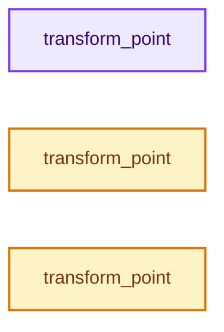
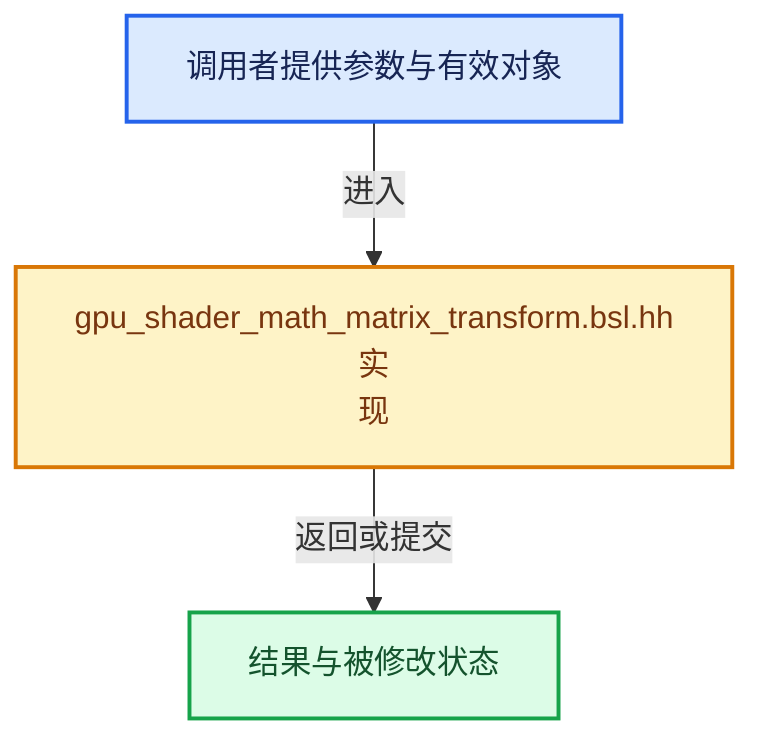

# 实现依赖专题：source/blender/gpu/shaders/common/gpu_shader_math_matrix_transform.bsl.hh

[方向导航](README.md) · [符号索引](../%E7%AC%A6%E5%8F%B7%E4%BE%9D%E8%B5%96%E4%B8%8E%E5%AE%9E%E7%8E%B0%E7%B4%A2%E5%BC%95.md)

本专题从正文实际调用进入，集中保存共享实现。函数有稳定锚点，可从调用处直接跳到对应完整函数；递归与互相调用通过回链组织。

## 本文件的实现关系






## 完整成员与函数实现

<a id="f-310baff1ea9fe157"></a>

### `transform_point`

实现位置：[source/blender/gpu/shaders/common/gpu_shader_math_matrix_transform.bsl.hh](../../../../../source/blender/gpu/shaders/common/gpu_shader_math_matrix_transform.bsl.hh) · L16—L19。

接口参数：

- `float3x3 mat`
- `float3 point`

**教学注释版**

<!-- annotated:d19555d28cae54 -->

```cpp
float3 transform_point(float3x3 mat, float3 point)
{
  return mat * point;
}
```

<details>
<summary>核对原始源码：source/blender/gpu/shaders/common/gpu_shader_math_matrix_transform.bsl.hh · L16—L19</summary>

<!-- original:d19555d28cae54:source/blender/gpu/shaders/common/gpu_shader_math_matrix_transform.bsl.hh:16:19 -->

```cpp
float3 transform_point(float3x3 mat, float3 point)
{
  return mat * point;
}
```

</details>

**结果出口**

- `return mat * point;`

**继续追踪实现**

本实现没有需要继续展开的显式调用；检查返回表达式、对象转换和调用者前置条件。

<a id="f-2513e8fa2340a0da"></a>

### `transform_point`

实现位置：[source/blender/gpu/shaders/common/gpu_shader_math_matrix_transform.bsl.hh](../../../../../source/blender/gpu/shaders/common/gpu_shader_math_matrix_transform.bsl.hh) · L24—L27。

接口参数：

- `float4x4 mat`
- `float3 point`

**教学注释版**

<!-- annotated:2f2283f16fb783 -->

```cpp
float3 transform_point(float4x4 mat, float3 point)
{
  return (mat * float4(point, 1.0f)).xyz;
}
```

<details>
<summary>核对原始源码：source/blender/gpu/shaders/common/gpu_shader_math_matrix_transform.bsl.hh · L24—L27</summary>

<!-- original:2f2283f16fb783:source/blender/gpu/shaders/common/gpu_shader_math_matrix_transform.bsl.hh:24:27 -->

```cpp
float3 transform_point(float4x4 mat, float3 point)
{
  return (mat * float4(point, 1.0f)).xyz;
}
```

</details>

**结果出口**

- `return (mat * float4(point, 1.0f)).xyz;`

**继续追踪实现**

- `float4` → [float4 · L56](%E4%BE%9D%E8%B5%96-radial_tiling_shared-98abf9.md#m-f0908e385c5b)；[float4 · L60](../01-%E5%9F%BA%E7%A1%80%E5%AE%B9%E5%99%A8%E4%B8%8E%E7%8E%B0%E4%BB%A3CPP/%E4%BE%9D%E8%B5%96-radial_tiling_shared-7989a4.md#m-7962dcdc288b)；[float4 · L56](%E4%BE%9D%E8%B5%96-node_radial_tiling_shared-b14bc2.md#m-adb8e9e87775)；[float4 · L642](%E4%BE%9D%E8%B5%96-smaa-b67bc2.md#m-9362daaa821c)。宏定义由构建条件选择。

<a id="f-eed6772306122f84"></a>

### `transform_point`

实现位置：[source/blender/gpu/shaders/common/gpu_shader_math_matrix_transform.bsl.hh](../../../../../source/blender/gpu/shaders/common/gpu_shader_math_matrix_transform.bsl.hh) · L32—L35。

接口参数：

- `float3x3 mat`
- `float2 point`

**教学注释版**

<!-- annotated:216c07712b5e4f -->

```cpp
float2 transform_point(float3x3 mat, float2 point)
{
  return (mat * float3(point, 1.0f)).xy;
}
```

<details>
<summary>核对原始源码：source/blender/gpu/shaders/common/gpu_shader_math_matrix_transform.bsl.hh · L32—L35</summary>

<!-- original:216c07712b5e4f:source/blender/gpu/shaders/common/gpu_shader_math_matrix_transform.bsl.hh:32:35 -->

```cpp
float2 transform_point(float3x3 mat, float2 point)
{
  return (mat * float3(point, 1.0f)).xy;
}
```

</details>

**结果出口**

- `return (mat * float3(point, 1.0f)).xy;`

**继续追踪实现**

- `float3` → [float3 · L41](%E4%BE%9D%E8%B5%96-types_float3-48c65a.md#f-7da2e52c0fb766ec)；[float3 · L42](%E4%BE%9D%E8%B5%96-types_float3-48c65a.md#f-4c476b25be347939)；[float3 · L43](%E4%BE%9D%E8%B5%96-types_float3-48c65a.md#f-776e8df31bde8162)。同名重载需按实参类型选择。
