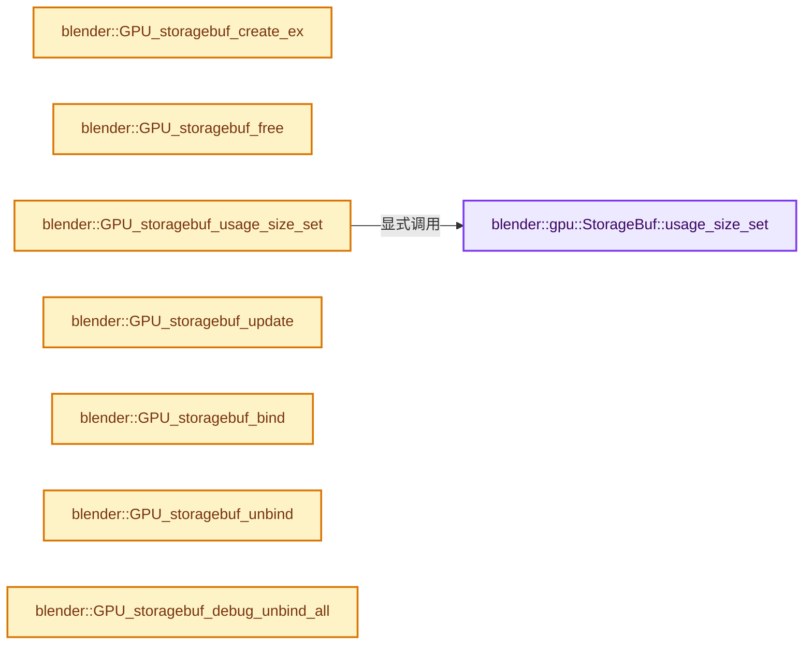

# 实现依赖专题：source/blender/gpu/intern/gpu_storage_buffer.cc

[方向导航](README.md) · [符号索引](../%E7%AC%A6%E5%8F%B7%E4%BE%9D%E8%B5%96%E4%B8%8E%E5%AE%9E%E7%8E%B0%E7%B4%A2%E5%BC%95.md)

本专题从正文实际调用进入，集中保存共享实现。函数有稳定锚点，可从调用处直接跳到对应完整函数；递归与互相调用通过回链组织。

## 本文件的实现关系




## 完整成员与函数实现

<a id="f-bba329f85a114b57"></a>

### `blender::gpu::StorageBuf::usage_size_set`

实现位置：[source/blender/gpu/intern/gpu_storage_buffer.cc](../../../../../source/blender/gpu/intern/gpu_storage_buffer.cc) · L43—L47。

接口参数：

- `size_t usage_size`

**教学注释版**

<!-- annotated:f25a8ef11638ac -->

```cpp
void StorageBuf::usage_size_set(size_t usage_size)
{
  BLI_assert(usage_size <= size_in_bytes_);
  usage_size_in_bytes_ = usage_size;
}
```

<details>
<summary>核对原始源码：source/blender/gpu/intern/gpu_storage_buffer.cc · L43—L47</summary>

<!-- original:f25a8ef11638ac:source/blender/gpu/intern/gpu_storage_buffer.cc:43:47 -->

```cpp
void StorageBuf::usage_size_set(size_t usage_size)
{
  BLI_assert(usage_size <= size_in_bytes_);
  usage_size_in_bytes_ = usage_size;
}
```

</details>

**沿实际写入检查状态**

- `usage_size_in_bytes_ = usage_size;`

**继续追踪实现**

- `BLI_assert` → [BLI_assert · L48](../01-%E5%9F%BA%E7%A1%80%E5%AE%B9%E5%99%A8%E4%B8%8E%E7%8E%B0%E4%BB%A3CPP/%E4%BE%9D%E8%B5%96-BLI_assert-cc98e8.md#m-57a88495704d)；[BLI_assert · L63](../01-%E5%9F%BA%E7%A1%80%E5%AE%B9%E5%99%A8%E4%B8%8E%E7%8E%B0%E4%BB%A3CPP/%E4%BE%9D%E8%B5%96-BLI_assert-cc98e8.md#m-d07050020cb5)。宏定义由构建条件选择。

<a id="f-4042921669abadf8"></a>

### `blender::GPU_storagebuf_create_ex`

实现位置：[source/blender/gpu/intern/gpu_storage_buffer.cc](../../../../../source/blender/gpu/intern/gpu_storage_buffer.cc) · L59—L77。

接口参数：

- `size_t size`
- `const void *data`
- `GPUUsageType usage`
- `const char *name`

**教学注释版**

<!-- annotated:11ae031fbe4f5b -->

```cpp
gpu::StorageBuf *GPU_storagebuf_create_ex(size_t size,
                                          const void *data,
                                          GPUUsageType usage,
                                          const char *name)
{
  StorageBuf *ssbo = GPUBackend::get()->storagebuf_alloc(size, usage, name);
  /* Direct init. */
  if (data != nullptr) {
    ssbo->update(data);
  }
  else if (G.debug & G_DEBUG_GPU) {
    /* Fill the buffer with poison values.
     * (NaN for floats, -1 for `int` and "max value" for `uint`). */
    Vector<uchar> uninitialized_data(size, 0xFF);
    // [讲解] uninitialized_data.data：提供当前存储或有效范围的地址。
    ssbo->update(uninitialized_data.data());
  }

  return ssbo;
}
```

<details>
<summary>核对原始源码：source/blender/gpu/intern/gpu_storage_buffer.cc · L59—L77</summary>

<!-- original:11ae031fbe4f5b:source/blender/gpu/intern/gpu_storage_buffer.cc:59:77 -->

```cpp
gpu::StorageBuf *GPU_storagebuf_create_ex(size_t size,
                                          const void *data,
                                          GPUUsageType usage,
                                          const char *name)
{
  StorageBuf *ssbo = GPUBackend::get()->storagebuf_alloc(size, usage, name);
  /* Direct init. */
  if (data != nullptr) {
    ssbo->update(data);
  }
  else if (G.debug & G_DEBUG_GPU) {
    /* Fill the buffer with poison values.
     * (NaN for floats, -1 for `int` and "max value" for `uint`). */
    Vector<uchar> uninitialized_data(size, 0xFF);
    ssbo->update(uninitialized_data.data());
  }

  return ssbo;
}
```

</details>

**结果出口**

- `return ssbo;`

**继续追踪实现**

- `GPUBackend::get()->storagebuf_alloc` → [调用协议](../%E6%A8%A1%E6%9D%BF%E5%AE%8F%E4%B8%8E%E5%8A%A8%E6%80%81%E5%88%86%E6%B4%BE%E5%8D%8F%E8%AE%AE.md)：接收对象类型依赖auto、返回值或模板实例；不按同名猜测目标。调用位置L64。
- `GPUBackend::get` → [blender::GPUBackend::get · L642](%E4%BE%9D%E8%B5%96-gpu_context-77a234.md#f-c876dc1cb5bd7700)。
- `ssbo->update` → [blender::update · L121](../09-LazyFunction%E4%B8%8E%E8%8A%82%E7%82%B9%E6%89%A7%E8%A1%8C%E6%9E%B6%E6%9E%84/%E4%BE%9D%E8%B5%96-node_texture_tree-b9c111.md#f-7591916c55b3dfe3)；[blender::update · L76](../09-LazyFunction%E4%B8%8E%E8%8A%82%E7%82%B9%E6%89%A7%E8%A1%8C%E6%9E%B6%E6%9E%84/%E4%BE%9D%E8%B5%96-node_texture_separate_color-ac4f58.md#f-f216062a9f7b7859)；[blender::update · L54](../09-LazyFunction%E4%B8%8E%E8%8A%82%E7%82%B9%E6%89%A7%E8%A1%8C%E6%9E%B6%E6%9E%84/%E4%BE%9D%E8%B5%96-node_texture_combine_color-871e59.md#f-9377b7191cf4cec4)；[blender::update · L106](../09-LazyFunction%E4%B8%8E%E8%8A%82%E7%82%B9%E6%89%A7%E8%A1%8C%E6%9E%B6%E6%9E%84/%E4%BE%9D%E8%B5%96-node_composite_tree-a763ff.md#f-7565befdaeb2a373)。同名重载需按实参类型选择。
- `uninitialized_data.data` → [blender::Vector::data · L954](../01-%E5%9F%BA%E7%A1%80%E5%AE%B9%E5%99%A8%E4%B8%8E%E7%8E%B0%E4%BB%A3CPP/12-Vector%E5%BC%82%E5%B8%B8%E5%AE%89%E5%85%A8%E4%B8%8E%E8%BE%B9%E7%95%8C.md#f-6e441591404715bc)；[blender::Vector::data · L962](../01-%E5%9F%BA%E7%A1%80%E5%AE%B9%E5%99%A8%E4%B8%8E%E7%8E%B0%E4%BB%A3CPP/12-Vector%E5%BC%82%E5%B8%B8%E5%AE%89%E5%85%A8%E4%B8%8E%E8%BE%B9%E7%95%8C.md#f-4bc78d4954c1021a)。同名重载需按实参类型选择。

<a id="f-2c69e3c2aa7fa861"></a>

### `blender::GPU_storagebuf_free`

实现位置：[source/blender/gpu/intern/gpu_storage_buffer.cc](../../../../../source/blender/gpu/intern/gpu_storage_buffer.cc) · L79—L82。

接口参数：

- `gpu::StorageBuf *ssbo`

**教学注释版**

<!-- annotated:138c9053afa825 -->

```cpp
void GPU_storagebuf_free(gpu::StorageBuf *ssbo)
{
  delete ssbo;
}
```

<details>
<summary>核对原始源码：source/blender/gpu/intern/gpu_storage_buffer.cc · L79—L82</summary>

<!-- original:138c9053afa825:source/blender/gpu/intern/gpu_storage_buffer.cc:79:82 -->

```cpp
void GPU_storagebuf_free(gpu::StorageBuf *ssbo)
{
  delete ssbo;
}
```

</details>

**继续追踪实现**

本实现没有需要继续展开的显式调用；检查返回表达式、对象转换和调用者前置条件。

<a id="f-86d98ca0ca4307ab"></a>

### `blender::GPU_storagebuf_usage_size_set`

实现位置：[source/blender/gpu/intern/gpu_storage_buffer.cc](../../../../../source/blender/gpu/intern/gpu_storage_buffer.cc) · L84—L87。

接口参数：

- `gpu::StorageBuf *ssbo`
- `size_t usage_size`

**教学注释版**

<!-- annotated:ee6d983b8bab37 -->

```cpp
void GPU_storagebuf_usage_size_set(gpu::StorageBuf *ssbo, size_t usage_size)
{
  ssbo->usage_size_set(usage_size);
}
```

<details>
<summary>核对原始源码：source/blender/gpu/intern/gpu_storage_buffer.cc · L84—L87</summary>

<!-- original:ee6d983b8bab37:source/blender/gpu/intern/gpu_storage_buffer.cc:84:87 -->

```cpp
void GPU_storagebuf_usage_size_set(gpu::StorageBuf *ssbo, size_t usage_size)
{
  ssbo->usage_size_set(usage_size);
}
```

</details>

**继续追踪实现**

- `ssbo->usage_size_set` → [blender::gpu::StorageBuf::usage_size_set · L43](%E4%BE%9D%E8%B5%96-gpu_storage_buffer-1706c5.md#f-bba329f85a114b57)。

<a id="f-6dc36991891ed610"></a>

### `blender::GPU_storagebuf_update`

实现位置：[source/blender/gpu/intern/gpu_storage_buffer.cc](../../../../../source/blender/gpu/intern/gpu_storage_buffer.cc) · L89—L92。

接口参数：

- `gpu::StorageBuf *ssbo`
- `const void *data`

**教学注释版**

<!-- annotated:eab09de472bc5a -->

```cpp
void GPU_storagebuf_update(gpu::StorageBuf *ssbo, const void *data)
{
  ssbo->update(data);
}
```

<details>
<summary>核对原始源码：source/blender/gpu/intern/gpu_storage_buffer.cc · L89—L92</summary>

<!-- original:eab09de472bc5a:source/blender/gpu/intern/gpu_storage_buffer.cc:89:92 -->

```cpp
void GPU_storagebuf_update(gpu::StorageBuf *ssbo, const void *data)
{
  ssbo->update(data);
}
```

</details>

**继续追踪实现**

- `ssbo->update` → [blender::update · L121](../09-LazyFunction%E4%B8%8E%E8%8A%82%E7%82%B9%E6%89%A7%E8%A1%8C%E6%9E%B6%E6%9E%84/%E4%BE%9D%E8%B5%96-node_texture_tree-b9c111.md#f-7591916c55b3dfe3)；[blender::update · L76](../09-LazyFunction%E4%B8%8E%E8%8A%82%E7%82%B9%E6%89%A7%E8%A1%8C%E6%9E%B6%E6%9E%84/%E4%BE%9D%E8%B5%96-node_texture_separate_color-ac4f58.md#f-f216062a9f7b7859)；[blender::update · L54](../09-LazyFunction%E4%B8%8E%E8%8A%82%E7%82%B9%E6%89%A7%E8%A1%8C%E6%9E%B6%E6%9E%84/%E4%BE%9D%E8%B5%96-node_texture_combine_color-871e59.md#f-9377b7191cf4cec4)；[blender::update · L106](../09-LazyFunction%E4%B8%8E%E8%8A%82%E7%82%B9%E6%89%A7%E8%A1%8C%E6%9E%B6%E6%9E%84/%E4%BE%9D%E8%B5%96-node_composite_tree-a763ff.md#f-7565befdaeb2a373)。同名重载需按实参类型选择。

<a id="f-e795e74fcc758ac4"></a>

### `blender::GPU_storagebuf_bind`

实现位置：[source/blender/gpu/intern/gpu_storage_buffer.cc](../../../../../source/blender/gpu/intern/gpu_storage_buffer.cc) · L94—L97。

接口参数：

- `gpu::StorageBuf *ssbo`
- `int slot`

**教学注释版**

<!-- annotated:6497e45e5657eb -->

```cpp
void GPU_storagebuf_bind(gpu::StorageBuf *ssbo, int slot)
{
  ssbo->bind(slot);
}
```

<details>
<summary>核对原始源码：source/blender/gpu/intern/gpu_storage_buffer.cc · L94—L97</summary>

<!-- original:6497e45e5657eb:source/blender/gpu/intern/gpu_storage_buffer.cc:94:97 -->

```cpp
void GPU_storagebuf_bind(gpu::StorageBuf *ssbo, int slot)
{
  ssbo->bind(slot);
}
```

</details>

**继续追踪实现**

- `ssbo->bind` → [blender::GLShader::bind · L1410](%E4%BE%9D%E8%B5%96-gl_shader-766737.md#f-7374ce386abefd3f)；[blender::GLBatch::bind · L239](%E4%BE%9D%E8%B5%96-gl_batch-d8877a.md#f-09d832d1583277b2)。同名重载需按实参类型选择。

<a id="f-c9503033675146ed"></a>

### `blender::GPU_storagebuf_unbind`

实现位置：[source/blender/gpu/intern/gpu_storage_buffer.cc](../../../../../source/blender/gpu/intern/gpu_storage_buffer.cc) · L99—L102。

接口参数：

- `gpu::StorageBuf *ssbo`

**教学注释版**

<!-- annotated:f7ab124d37b6b2 -->

```cpp
void GPU_storagebuf_unbind(gpu::StorageBuf *ssbo)
{
  ssbo->unbind();
}
```

<details>
<summary>核对原始源码：source/blender/gpu/intern/gpu_storage_buffer.cc · L99—L102</summary>

<!-- original:f7ab124d37b6b2:source/blender/gpu/intern/gpu_storage_buffer.cc:99:102 -->

```cpp
void GPU_storagebuf_unbind(gpu::StorageBuf *ssbo)
{
  ssbo->unbind();
}
```

</details>

**继续追踪实现**

- `ssbo->unbind` → [blender::GLShader::unbind · L1416](%E4%BE%9D%E8%B5%96-gl_shader-766737.md#f-cfcdd31d4ba1279b)。

<a id="f-a89be9cc20c6d67e"></a>

### `blender::GPU_storagebuf_debug_unbind_all`

实现位置：[source/blender/gpu/intern/gpu_storage_buffer.cc](../../../../../source/blender/gpu/intern/gpu_storage_buffer.cc) · L104—L107。

**教学注释版**

<!-- annotated:15aa3345953b1e -->

```cpp
void GPU_storagebuf_debug_unbind_all()
{
  Context::get()->debug_unbind_all_ssbo();
}
```

<details>
<summary>核对原始源码：source/blender/gpu/intern/gpu_storage_buffer.cc · L104—L107</summary>

<!-- original:15aa3345953b1e:source/blender/gpu/intern/gpu_storage_buffer.cc:104:107 -->

```cpp
void GPU_storagebuf_debug_unbind_all()
{
  Context::get()->debug_unbind_all_ssbo();
}
```

</details>

**继续追踪实现**

- `Context::get()->debug_unbind_all_ssbo` → [调用协议](../%E6%A8%A1%E6%9D%BF%E5%AE%8F%E4%B8%8E%E5%8A%A8%E6%80%81%E5%88%86%E6%B4%BE%E5%8D%8F%E8%AE%AE.md)：接收对象类型依赖auto、返回值或模板实例；不按同名猜测目标。调用位置L106。
- `Context::get` → [blender::gpu::Context::get · L127](%E4%BE%9D%E8%B5%96-gpu_context-77a234.md#f-7ca16707244f2d11)。

<a id="f-3df087cf8d73387d"></a>

### `blender::GPU_storagebuf_clear_to_zero`

实现位置：[source/blender/gpu/intern/gpu_storage_buffer.cc](../../../../../source/blender/gpu/intern/gpu_storage_buffer.cc) · L109—L112。

接口参数：

- `gpu::StorageBuf *ssbo`

**教学注释版**

<!-- annotated:ccc5678f6cf250 -->

```cpp
void GPU_storagebuf_clear_to_zero(gpu::StorageBuf *ssbo)
{
  GPU_storagebuf_clear(ssbo, 0);
}
```

<details>
<summary>核对原始源码：source/blender/gpu/intern/gpu_storage_buffer.cc · L109—L112</summary>

<!-- original:ccc5678f6cf250:source/blender/gpu/intern/gpu_storage_buffer.cc:109:112 -->

```cpp
void GPU_storagebuf_clear_to_zero(gpu::StorageBuf *ssbo)
{
  GPU_storagebuf_clear(ssbo, 0);
}
```

</details>

**继续追踪实现**

- `GPU_storagebuf_clear` → [blender::GPU_storagebuf_clear · L114](%E4%BE%9D%E8%B5%96-gpu_storage_buffer-1706c5.md#f-697dd35ae1aa8463)。

<a id="f-697dd35ae1aa8463"></a>

### `blender::GPU_storagebuf_clear`

实现位置：[source/blender/gpu/intern/gpu_storage_buffer.cc](../../../../../source/blender/gpu/intern/gpu_storage_buffer.cc) · L114—L117。

接口参数：

- `gpu::StorageBuf *ssbo`
- `uint32_t clear_value`

**教学注释版**

<!-- annotated:34387d1804353c -->

```cpp
void GPU_storagebuf_clear(gpu::StorageBuf *ssbo, uint32_t clear_value)
{
  ssbo->clear(clear_value);
}
```

<details>
<summary>核对原始源码：source/blender/gpu/intern/gpu_storage_buffer.cc · L114—L117</summary>

<!-- original:34387d1804353c:source/blender/gpu/intern/gpu_storage_buffer.cc:114:117 -->

```cpp
void GPU_storagebuf_clear(gpu::StorageBuf *ssbo, uint32_t clear_value)
{
  ssbo->clear(clear_value);
}
```

</details>

**继续追踪实现**

- `ssbo->clear` → [blender::GVectorArray::clear · L70](../01-%E5%9F%BA%E7%A1%80%E5%AE%B9%E5%99%A8%E4%B8%8E%E7%8E%B0%E4%BB%A3CPP/%E4%BE%9D%E8%B5%96-generic_vector_array-7f86fb.md#f-c1d1074690264f12)；[blender::SortedFCurveBuffer::clear · L52](%E4%BE%9D%E8%B5%96-anim_convert-9192df.md#f-ce90e82a26cfe48c)；[blender::bNodeTreeInterfacePanel::clear · L1115](%E4%BE%9D%E8%B5%96-node_tree_interface-893d31.md#f-ecd53bd40ed5c756)；[blender::DRWViewData::clear · L78](%E4%BE%9D%E8%B5%96-draw_view_data-a5cb02.md#f-bb5156f3cc4be47b)；[blender::GLSharedOrphanLists::OrphanList::clear · L204](%E4%BE%9D%E8%B5%96-gl_context-43fe84.md#f-eed15c5c57f2e985)；[blender::GLVaoCache::clear · L140](%E4%BE%9D%E8%B5%96-gl_batch-d8877a.md#f-df1d6a2626841273)；[blender::clear · L213](%E4%BE%9D%E8%B5%96-msgfmt-76f41a.md#f-4d1f550b2a1999e3)。同名重载需按实参类型选择。

<a id="f-23a1a6f735982fa6"></a>

### `blender::GPU_storagebuf_read`

实现位置：[source/blender/gpu/intern/gpu_storage_buffer.cc](../../../../../source/blender/gpu/intern/gpu_storage_buffer.cc) · L130—L133。

接口参数：

- `gpu::StorageBuf *ssbo`
- `void *data`

**教学注释版**

<!-- annotated:5b84f494fc6f2e -->

```cpp
void GPU_storagebuf_read(gpu::StorageBuf *ssbo, void *data)
{
  ssbo->read(data);
}
```

<details>
<summary>核对原始源码：source/blender/gpu/intern/gpu_storage_buffer.cc · L130—L133</summary>

<!-- original:5b84f494fc6f2e:source/blender/gpu/intern/gpu_storage_buffer.cc:130:133 -->

```cpp
void GPU_storagebuf_read(gpu::StorageBuf *ssbo, void *data)
{
  ssbo->read(data);
}
```

</details>

**继续追踪实现**

- `ssbo->read` → [调用协议](../%E6%A8%A1%E6%9D%BF%E5%AE%8F%E4%B8%8E%E5%8A%A8%E6%80%81%E5%88%86%E6%B4%BE%E5%8D%8F%E8%AE%AE.md)：由接收对象具体类型或运行时策略提供实现。调用位置L132。
