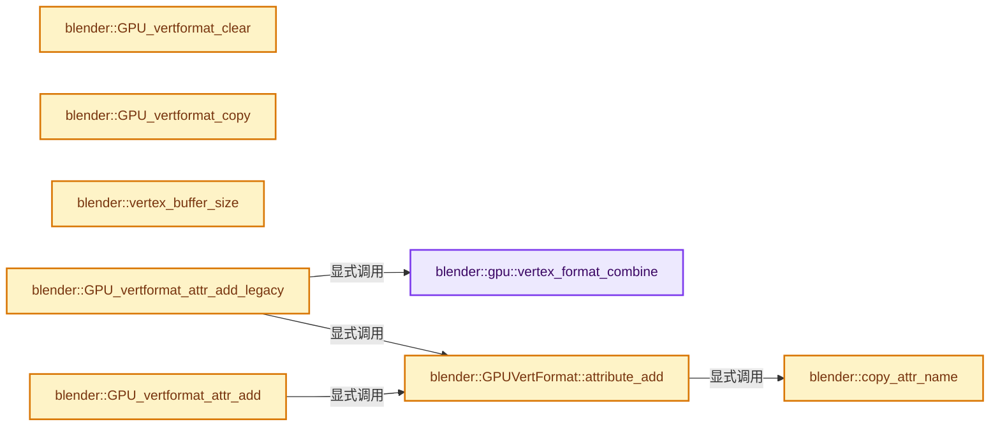
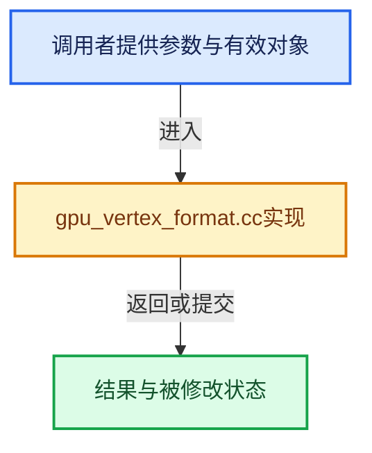

# 实现依赖专题：source/blender/gpu/intern/gpu_vertex_format.cc

[方向导航](README.md) · [符号索引](../%E7%AC%A6%E5%8F%B7%E4%BE%9D%E8%B5%96%E4%B8%8E%E5%AE%9E%E7%8E%B0%E7%B4%A2%E5%BC%95.md)

本专题从正文实际调用进入，集中保存共享实现。函数有稳定锚点，可从调用处直接跳到对应完整函数；递归与互相调用通过回链组织。

## 本文件的实现关系






## 完整成员与函数实现

<a id="f-50ceef80bcaa1877"></a>

### `blender::gpu::vertex_format_combine`

实现位置：[source/blender/gpu/intern/gpu_vertex_format.cc](../../../../../source/blender/gpu/intern/gpu_vertex_format.cc) · L38—L238。

接口参数：

- `GPUVertCompType component_type`
- `GPUVertFetchMode fetch_mode`
- `uint32_t component_len`

**教学注释版**

<!-- annotated:f292516bbef315 -->

```cpp
static VertAttrType vertex_format_combine(GPUVertCompType component_type,
                                          GPUVertFetchMode fetch_mode,
                                          uint32_t component_len)
{
  switch (component_type) {
    case GPU_COMP_I8: {
      switch (fetch_mode) {
        case GPU_FETCH_INT_TO_FLOAT_UNIT:
          switch (component_len) {
            case 1:
              return VertAttrType::SNORM_8_DEPRECATED;
            case 2:
              return VertAttrType::SNORM_8_8_DEPRECATED;
            case 3:
              return VertAttrType::SNORM_8_8_8_DEPRECATED;
            case 4:
              return VertAttrType::SNORM_8_8_8_8;
          }
          break;
        case GPU_FETCH_INT:
          switch (component_len) {
            case 1:
              return VertAttrType::SINT_8_DEPRECATED;
            case 2:
              return VertAttrType::SINT_8_8_DEPRECATED;
            case 3:
              return VertAttrType::SINT_8_8_8_DEPRECATED;
            case 4:
              return VertAttrType::SINT_8_8_8_8;
          }
          break;
        default:
          break;
      }
      break;
    }
    case GPU_COMP_U8: {
      switch (fetch_mode) {
        case GPU_FETCH_INT_TO_FLOAT_UNIT:
          switch (component_len) {
            case 1:
              return VertAttrType::UNORM_8_DEPRECATED;
            case 2:
              return VertAttrType::UNORM_8_8_DEPRECATED;
            case 3:
              return VertAttrType::UNORM_8_8_8_DEPRECATED;
            case 4:
              return VertAttrType::UNORM_8_8_8_8;
          }
          break;
        case GPU_FETCH_INT:
          switch (component_len) {
            case 1:
              return VertAttrType::UINT_8_DEPRECATED;
            case 2:
              return VertAttrType::UINT_8_8_DEPRECATED;
            case 3:
              return VertAttrType::UINT_8_8_8_DEPRECATED;
            case 4:
              return VertAttrType::UINT_8_8_8_8;
          }
          break;
        default:
          break;
      }
      break;
    }
    case GPU_COMP_I16: {
      switch (fetch_mode) {
        case GPU_FETCH_INT_TO_FLOAT_UNIT:
          switch (component_len) {
            case 1:
              return VertAttrType::SNORM_16_DEPRECATED;
            case 2:
              return VertAttrType::SNORM_16_16;
            case 3:
              return VertAttrType::SNORM_16_16_16_DEPRECATED;
            case 4:
              return VertAttrType::SNORM_16_16_16_16;
          }
          break;
        case GPU_FETCH_INT:
          switch (component_len) {
            case 1:
              return VertAttrType::SINT_16_DEPRECATED;
            case 2:
              return VertAttrType::SINT_16_16;
            case 3:
              return VertAttrType::SINT_16_16_16_DEPRECATED;
            case 4:
              return VertAttrType::SINT_16_16_16_16;
          }
          break;
        default:
          break;
      }
      break;
    }
    case GPU_COMP_U16: {
      switch (fetch_mode) {
        case GPU_FETCH_INT_TO_FLOAT_UNIT:
          switch (component_len) {
            case 1:
              return VertAttrType::UNORM_16_DEPRECATED;
            case 2:
              return VertAttrType::UNORM_16_16;
            case 3:
              return VertAttrType::UNORM_16_16_16_DEPRECATED;
            case 4:
              return VertAttrType::UNORM_16_16_16_16;
          }
          break;
        case GPU_FETCH_INT:
          switch (component_len) {
            case 1:
              return VertAttrType::UINT_16_DEPRECATED;
            case 2:
              return VertAttrType::UINT_16_16;
            case 3:
              return VertAttrType::UINT_16_16_16_DEPRECATED;
            case 4:
              return VertAttrType::UINT_16_16_16_16;
          }
          break;
        default:
          break;
      }
      break;
    }
    case GPU_COMP_I32: {
      switch (fetch_mode) {
        case GPU_FETCH_INT:
          switch (component_len) {
            case 1:
              return VertAttrType::SINT_32;
            case 2:
              return VertAttrType::SINT_32_32;
            case 3:
              return VertAttrType::SINT_32_32_32;
            case 4:
              return VertAttrType::SINT_32_32_32_32;
          }
          break;
        default:
          break;
      }
      break;
    }
    case GPU_COMP_U32: {
      switch (fetch_mode) {
        case GPU_FETCH_INT:
          switch (component_len) {
            case 1:
              return VertAttrType::UINT_32;
            case 2:
              return VertAttrType::UINT_32_32;
            case 3:
              return VertAttrType::UINT_32_32_32;
            case 4:
              return VertAttrType::UINT_32_32_32_32;
          }
          break;
        default:
          break;
      }
      break;
    }
    case GPU_COMP_F32: {
      switch (fetch_mode) {
        case GPU_FETCH_FLOAT:
          switch (component_len) {
            case 1:
              return VertAttrType::SFLOAT_32;
            case 2:
              return VertAttrType::SFLOAT_32_32;
            case 3:
              return VertAttrType::SFLOAT_32_32_32;
            case 4:
              return VertAttrType::SFLOAT_32_32_32_32;
          }
          break;
        default:
          break;
      }
      break;
    }
    case GPU_COMP_I10: {
      switch (fetch_mode) {
        case GPU_FETCH_INT_TO_FLOAT_UNIT:
          return VertAttrType::SNORM_10_10_10_2;
        default:
          break;
      }
      break;
    }
    case GPU_COMP_MAX:
      break;
  }

  return VertAttrType::Invalid;
};
```

<details>
<summary>核对原始源码：source/blender/gpu/intern/gpu_vertex_format.cc · L38—L238</summary>

<!-- original:f292516bbef315:source/blender/gpu/intern/gpu_vertex_format.cc:38:238 -->

```cpp
static VertAttrType vertex_format_combine(GPUVertCompType component_type,
                                          GPUVertFetchMode fetch_mode,
                                          uint32_t component_len)
{
  switch (component_type) {
    case GPU_COMP_I8: {
      switch (fetch_mode) {
        case GPU_FETCH_INT_TO_FLOAT_UNIT:
          switch (component_len) {
            case 1:
              return VertAttrType::SNORM_8_DEPRECATED;
            case 2:
              return VertAttrType::SNORM_8_8_DEPRECATED;
            case 3:
              return VertAttrType::SNORM_8_8_8_DEPRECATED;
            case 4:
              return VertAttrType::SNORM_8_8_8_8;
          }
          break;
        case GPU_FETCH_INT:
          switch (component_len) {
            case 1:
              return VertAttrType::SINT_8_DEPRECATED;
            case 2:
              return VertAttrType::SINT_8_8_DEPRECATED;
            case 3:
              return VertAttrType::SINT_8_8_8_DEPRECATED;
            case 4:
              return VertAttrType::SINT_8_8_8_8;
          }
          break;
        default:
          break;
      }
      break;
    }
    case GPU_COMP_U8: {
      switch (fetch_mode) {
        case GPU_FETCH_INT_TO_FLOAT_UNIT:
          switch (component_len) {
            case 1:
              return VertAttrType::UNORM_8_DEPRECATED;
            case 2:
              return VertAttrType::UNORM_8_8_DEPRECATED;
            case 3:
              return VertAttrType::UNORM_8_8_8_DEPRECATED;
            case 4:
              return VertAttrType::UNORM_8_8_8_8;
          }
          break;
        case GPU_FETCH_INT:
          switch (component_len) {
            case 1:
              return VertAttrType::UINT_8_DEPRECATED;
            case 2:
              return VertAttrType::UINT_8_8_DEPRECATED;
            case 3:
              return VertAttrType::UINT_8_8_8_DEPRECATED;
            case 4:
              return VertAttrType::UINT_8_8_8_8;
          }
          break;
        default:
          break;
      }
      break;
    }
    case GPU_COMP_I16: {
      switch (fetch_mode) {
        case GPU_FETCH_INT_TO_FLOAT_UNIT:
          switch (component_len) {
            case 1:
              return VertAttrType::SNORM_16_DEPRECATED;
            case 2:
              return VertAttrType::SNORM_16_16;
            case 3:
              return VertAttrType::SNORM_16_16_16_DEPRECATED;
            case 4:
              return VertAttrType::SNORM_16_16_16_16;
          }
          break;
        case GPU_FETCH_INT:
          switch (component_len) {
            case 1:
              return VertAttrType::SINT_16_DEPRECATED;
            case 2:
              return VertAttrType::SINT_16_16;
            case 3:
              return VertAttrType::SINT_16_16_16_DEPRECATED;
            case 4:
              return VertAttrType::SINT_16_16_16_16;
          }
          break;
        default:
          break;
      }
      break;
    }
    case GPU_COMP_U16: {
      switch (fetch_mode) {
        case GPU_FETCH_INT_TO_FLOAT_UNIT:
          switch (component_len) {
            case 1:
              return VertAttrType::UNORM_16_DEPRECATED;
            case 2:
              return VertAttrType::UNORM_16_16;
            case 3:
              return VertAttrType::UNORM_16_16_16_DEPRECATED;
            case 4:
              return VertAttrType::UNORM_16_16_16_16;
          }
          break;
        case GPU_FETCH_INT:
          switch (component_len) {
            case 1:
              return VertAttrType::UINT_16_DEPRECATED;
            case 2:
              return VertAttrType::UINT_16_16;
            case 3:
              return VertAttrType::UINT_16_16_16_DEPRECATED;
            case 4:
              return VertAttrType::UINT_16_16_16_16;
          }
          break;
        default:
          break;
      }
      break;
    }
    case GPU_COMP_I32: {
      switch (fetch_mode) {
        case GPU_FETCH_INT:
          switch (component_len) {
            case 1:
              return VertAttrType::SINT_32;
            case 2:
              return VertAttrType::SINT_32_32;
            case 3:
              return VertAttrType::SINT_32_32_32;
            case 4:
              return VertAttrType::SINT_32_32_32_32;
          }
          break;
        default:
          break;
      }
      break;
    }
    case GPU_COMP_U32: {
      switch (fetch_mode) {
        case GPU_FETCH_INT:
          switch (component_len) {
            case 1:
              return VertAttrType::UINT_32;
            case 2:
              return VertAttrType::UINT_32_32;
            case 3:
              return VertAttrType::UINT_32_32_32;
            case 4:
              return VertAttrType::UINT_32_32_32_32;
          }
          break;
        default:
          break;
      }
      break;
    }
    case GPU_COMP_F32: {
      switch (fetch_mode) {
        case GPU_FETCH_FLOAT:
          switch (component_len) {
            case 1:
              return VertAttrType::SFLOAT_32;
            case 2:
              return VertAttrType::SFLOAT_32_32;
            case 3:
              return VertAttrType::SFLOAT_32_32_32;
            case 4:
              return VertAttrType::SFLOAT_32_32_32_32;
          }
          break;
        default:
          break;
      }
      break;
    }
    case GPU_COMP_I10: {
      switch (fetch_mode) {
        case GPU_FETCH_INT_TO_FLOAT_UNIT:
          return VertAttrType::SNORM_10_10_10_2;
        default:
          break;
      }
      break;
    }
    case GPU_COMP_MAX:
      break;
  }

  return VertAttrType::Invalid;
};
```

</details>

**结果出口**

- `return VertAttrType::SNORM_8_DEPRECATED;`
- `return VertAttrType::SNORM_8_8_DEPRECATED;`
- `return VertAttrType::SNORM_8_8_8_DEPRECATED;`
- `return VertAttrType::SNORM_8_8_8_8;`
- `return VertAttrType::SINT_8_DEPRECATED;`
- `return VertAttrType::SINT_8_8_DEPRECATED;`
- `return VertAttrType::SINT_8_8_8_DEPRECATED;`
- `return VertAttrType::SINT_8_8_8_8;`
- `return VertAttrType::UNORM_8_DEPRECATED;`
- `return VertAttrType::UNORM_8_8_DEPRECATED;`
- `return VertAttrType::UNORM_8_8_8_DEPRECATED;`
- `return VertAttrType::UNORM_8_8_8_8;`
- `return VertAttrType::UINT_8_DEPRECATED;`
- `return VertAttrType::UINT_8_8_DEPRECATED;`
- `return VertAttrType::UINT_8_8_8_DEPRECATED;`
- `return VertAttrType::UINT_8_8_8_8;`
- `return VertAttrType::SNORM_16_DEPRECATED;`
- `return VertAttrType::SNORM_16_16;`
- `return VertAttrType::SNORM_16_16_16_DEPRECATED;`
- `return VertAttrType::SNORM_16_16_16_16;`
- `return VertAttrType::SINT_16_DEPRECATED;`
- `return VertAttrType::SINT_16_16;`
- `return VertAttrType::SINT_16_16_16_DEPRECATED;`
- `return VertAttrType::SINT_16_16_16_16;`
- `return VertAttrType::UNORM_16_DEPRECATED;`
- `return VertAttrType::UNORM_16_16;`
- `return VertAttrType::UNORM_16_16_16_DEPRECATED;`
- `return VertAttrType::UNORM_16_16_16_16;`
- `return VertAttrType::UINT_16_DEPRECATED;`
- `return VertAttrType::UINT_16_16;`
- `return VertAttrType::UINT_16_16_16_DEPRECATED;`
- `return VertAttrType::UINT_16_16_16_16;`
- `return VertAttrType::SINT_32;`
- `return VertAttrType::SINT_32_32;`
- `return VertAttrType::SINT_32_32_32;`
- `return VertAttrType::SINT_32_32_32_32;`
- `return VertAttrType::UINT_32;`
- `return VertAttrType::UINT_32_32;`
- `return VertAttrType::UINT_32_32_32;`
- `return VertAttrType::UINT_32_32_32_32;`
- `return VertAttrType::SFLOAT_32;`
- `return VertAttrType::SFLOAT_32_32;`
- `return VertAttrType::SFLOAT_32_32_32;`
- `return VertAttrType::SFLOAT_32_32_32_32;`
- `return VertAttrType::SNORM_10_10_10_2;`
- `return VertAttrType::Invalid;`

**继续追踪实现**

本实现没有需要继续展开的显式调用；检查返回表达式、对象转换和调用者前置条件。

<a id="f-8e1d1779ec8338af"></a>

### `blender::GPU_vertformat_clear`

实现位置：[source/blender/gpu/intern/gpu_vertex_format.cc](../../../../../source/blender/gpu/intern/gpu_vertex_format.cc) · L331—L346。

接口参数：

- `GPUVertFormat *format`

**教学注释版**

<!-- annotated:088ba62517b199 -->

```cpp
void GPU_vertformat_clear(GPUVertFormat *format)
{
#ifndef NDEBUG
  // [讲解] memset：填充字节，不调用T构造函数，也不保证任意类型的全零表示是合法或期望值。
  memset(format, 0, sizeof(GPUVertFormat));
#else
  format->attr_len = 0;
  format->packed = false;
  format->name_offset = 0;
  format->name_len = 0;
  format->deinterleaved = false;

  for (uint i = 0; i < GPU_VERT_ATTR_MAX_LEN; i++) {
    format->attrs[i].name_len = 0;
  }
#endif
}
```

<details>
<summary>核对原始源码：source/blender/gpu/intern/gpu_vertex_format.cc · L331—L346</summary>

<!-- original:088ba62517b199:source/blender/gpu/intern/gpu_vertex_format.cc:331:346 -->

```cpp
void GPU_vertformat_clear(GPUVertFormat *format)
{
#ifndef NDEBUG
  memset(format, 0, sizeof(GPUVertFormat));
#else
  format->attr_len = 0;
  format->packed = false;
  format->name_offset = 0;
  format->name_len = 0;
  format->deinterleaved = false;

  for (uint i = 0; i < GPU_VERT_ATTR_MAX_LEN; i++) {
    format->attrs[i].name_len = 0;
  }
#endif
}
```

</details>

**沿实际写入检查状态**

- `format->attr_len = 0;`
- `format->packed = false;`
- `format->name_offset = 0;`
- `format->name_len = 0;`
- `format->deinterleaved = false;`
- `format->attrs[i].name_len = 0;`

**继续追踪实现**

- `memset` → [外部契约](https://eel.is/c++draft/cstring.syn)：填充字节，不调用T构造函数，也不保证任意类型的全零表示是合法或期望值。

<a id="f-66c632db5e5374dd"></a>

### `blender::GPU_vertformat_copy`

实现位置：[source/blender/gpu/intern/gpu_vertex_format.cc](../../../../../source/blender/gpu/intern/gpu_vertex_format.cc) · L348—L352。

接口参数：

- `GPUVertFormat *dest`
- `const GPUVertFormat &src`

**教学注释版**

<!-- annotated:803c27752113c7 -->

```cpp
void GPU_vertformat_copy(GPUVertFormat *dest, const GPUVertFormat &src)
{
  /* copy regular struct fields */
  // [讲解] memcpy：复制字节，源与目标不应重叠。类型生命周期、对齐和可复制表示须由调用者证明，不是任意对象的复制构造。
  memcpy(dest, &src, sizeof(GPUVertFormat));
}
```

<details>
<summary>核对原始源码：source/blender/gpu/intern/gpu_vertex_format.cc · L348—L352</summary>

<!-- original:803c27752113c7:source/blender/gpu/intern/gpu_vertex_format.cc:348:352 -->

```cpp
void GPU_vertformat_copy(GPUVertFormat *dest, const GPUVertFormat &src)
{
  /* copy regular struct fields */
  memcpy(dest, &src, sizeof(GPUVertFormat));
}
```

</details>

**继续追踪实现**

- `memcpy` → [外部契约](https://eel.is/c++draft/cstring.syn)：复制字节，源与目标不应重叠。类型生命周期、对齐和可复制表示须由调用者证明，不是任意对象的复制构造。

<a id="f-4bf048994dbfc23a"></a>

### `blender::vertex_buffer_size`

实现位置：[source/blender/gpu/intern/gpu_vertex_format.cc](../../../../../source/blender/gpu/intern/gpu_vertex_format.cc) · L360—L364。

接口参数：

- `const GPUVertFormat *format`
- `uint vertex_len`

**教学注释版**

<!-- annotated:67aee25d0c27ce -->

```cpp
uint vertex_buffer_size(const GPUVertFormat *format, uint vertex_len)
{
  BLI_assert(format->packed && format->stride > 0);
  return format->stride * vertex_len;
}
```

<details>
<summary>核对原始源码：source/blender/gpu/intern/gpu_vertex_format.cc · L360—L364</summary>

<!-- original:67aee25d0c27ce:source/blender/gpu/intern/gpu_vertex_format.cc:360:364 -->

```cpp
uint vertex_buffer_size(const GPUVertFormat *format, uint vertex_len)
{
  BLI_assert(format->packed && format->stride > 0);
  return format->stride * vertex_len;
}
```

</details>

**结果出口**

- `return format->stride * vertex_len;`

**继续追踪实现**

- `BLI_assert` → [BLI_assert · L48](../01-%E5%9F%BA%E7%A1%80%E5%AE%B9%E5%99%A8%E4%B8%8E%E7%8E%B0%E4%BB%A3CPP/%E4%BE%9D%E8%B5%96-BLI_assert-cc98e8.md#m-57a88495704d)；[BLI_assert · L63](../01-%E5%9F%BA%E7%A1%80%E5%AE%B9%E5%99%A8%E4%B8%8E%E7%8E%B0%E4%BB%A3CPP/%E4%BE%9D%E8%B5%96-BLI_assert-cc98e8.md#m-d07050020cb5)。宏定义由构建条件选择。

<a id="f-f80676744923f09f"></a>

### `blender::copy_attr_name`

实现位置：[source/blender/gpu/intern/gpu_vertex_format.cc](../../../../../source/blender/gpu/intern/gpu_vertex_format.cc) · L366—L378。

接口参数：

- `GPUVertFormat *format`
- `const StringRef name`

**教学注释版**

<!-- annotated:8b20a35d04698f -->

```cpp
static uchar copy_attr_name(GPUVertFormat *format, const StringRef name)
{
  const uchar name_offset = format->name_offset;
  /* Subtract one to make sure there's enough space for the last null terminator. */
  const int64_t available = GPU_VERT_ATTR_NAMES_BUF_LEN - name_offset - 1;
  // [讲解] std::min：按比较关系选取较小值；截断范围时还需先满足非负和可表示范围，min本身不会证明边界安全。
  const int64_t chars_to_copy = std::min(name.size(), available);

  name.substr(0, available).copy_unsafe(format->names + name_offset);
  BLI_assert((format->name_offset + chars_to_copy + 1) <= GPU_VERT_ATTR_NAMES_BUF_LEN);
  format->name_offset += chars_to_copy + 1;

  return name_offset;
}
```

<details>
<summary>核对原始源码：source/blender/gpu/intern/gpu_vertex_format.cc · L366—L378</summary>

<!-- original:8b20a35d04698f:source/blender/gpu/intern/gpu_vertex_format.cc:366:378 -->

```cpp
static uchar copy_attr_name(GPUVertFormat *format, const StringRef name)
{
  const uchar name_offset = format->name_offset;
  /* Subtract one to make sure there's enough space for the last null terminator. */
  const int64_t available = GPU_VERT_ATTR_NAMES_BUF_LEN - name_offset - 1;
  const int64_t chars_to_copy = std::min(name.size(), available);

  name.substr(0, available).copy_unsafe(format->names + name_offset);
  BLI_assert((format->name_offset + chars_to_copy + 1) <= GPU_VERT_ATTR_NAMES_BUF_LEN);
  format->name_offset += chars_to_copy + 1;

  return name_offset;
}
```

</details>

**沿实际写入检查状态**

- `format->name_offset += chars_to_copy + 1;`

**结果出口**

- `return name_offset;`

**继续追踪实现**

- `std::min` → [外部契约](https://eel.is/c++draft/alg.min.max)：按比较关系选取较小值；截断范围时还需先满足非负和可表示范围，min本身不会证明边界安全。
- `name.size` → [blender::Bounds<T>::size · L543](../12-%E7%A9%BA%E9%97%B4%E6%95%B0%E6%8D%AE%E7%BB%93%E6%9E%84%E4%B8%8E%E5%87%A0%E4%BD%95%E7%AE%97%E6%B3%95/07-Bounds%E4%B8%8EBVH%E5%AF%B9%E6%AF%94.md#f-fcce88c0824fcd97)；[blender::GVArrayImpl::size · L651](../04-%E8%99%9A%E6%8B%9F%E6%95%B0%E7%BB%84%E4%B8%8E%E7%B4%A2%E5%BC%95%E9%80%89%E6%8B%A9/05-GVArray%E8%BF%90%E8%A1%8C%E6%97%B6%E7%B1%BB%E5%9E%8B.md#f-f23d3d1f3b110f1e)；[blender::GVArrayCommon::size · L759](../04-%E8%99%9A%E6%8B%9F%E6%95%B0%E7%BB%84%E4%B8%8E%E7%B4%A2%E5%BC%95%E9%80%89%E6%8B%A9/05-GVArray%E8%BF%90%E8%A1%8C%E6%97%B6%E7%B1%BB%E5%9E%8B.md#f-0856784f4e4fd3c9)；[blender::StringRefBase::size · L196](../01-%E5%9F%BA%E7%A1%80%E5%AE%B9%E5%99%A8%E4%B8%8E%E7%8E%B0%E4%BB%A3CPP/15-StringRef%E5%AD%97%E7%AC%A6%E4%B8%B2%E8%A7%86%E5%9B%BE.md#f-60d4631c74931d2e)；[blender::KDTreeNew<T>::size · L493](../12-%E7%A9%BA%E9%97%B4%E6%95%B0%E6%8D%AE%E7%BB%93%E6%9E%84%E4%B8%8E%E5%87%A0%E4%BD%95%E7%AE%97%E6%B3%95/05-K%E8%BF%91%E9%82%BB%E4%B8%8E%E8%8C%83%E5%9B%B4%E6%9F%A5%E8%AF%A2.md#f-233c05ce6d5c8d39)；[blender::MainAllIDsIterator::size · L1291](%E4%BE%9D%E8%B5%96-main-ffa8b3.md#f-520d1311c646452f)；[blender::GLSourcesBaked::size · L1541](%E4%BE%9D%E8%B5%96-gl_shader-766737.md#f-5b5b539d533c6792)。同名重载需按实参类型选择。
- `name.substr(0, available).copy_unsafe` → [调用协议](../%E6%A8%A1%E6%9D%BF%E5%AE%8F%E4%B8%8E%E5%8A%A8%E6%80%81%E5%88%86%E6%B4%BE%E5%8D%8F%E8%AE%AE.md)：接收对象类型依赖auto、返回值或模板实例；不按同名猜测目标。调用位置L373。
- `name.substr` → [blender::StringRefBase::substr · L303](../01-%E5%9F%BA%E7%A1%80%E5%AE%B9%E5%99%A8%E4%B8%8E%E7%8E%B0%E4%BB%A3CPP/15-StringRef%E5%AD%97%E7%AC%A6%E4%B8%B2%E8%A7%86%E5%9B%BE.md#f-cc876508a516d26d)。
- `BLI_assert` → [BLI_assert · L48](../01-%E5%9F%BA%E7%A1%80%E5%AE%B9%E5%99%A8%E4%B8%8E%E7%8E%B0%E4%BB%A3CPP/%E4%BE%9D%E8%B5%96-BLI_assert-cc98e8.md#m-57a88495704d)；[BLI_assert · L63](../01-%E5%9F%BA%E7%A1%80%E5%AE%B9%E5%99%A8%E4%B8%8E%E7%8E%B0%E4%BB%A3CPP/%E4%BE%9D%E8%B5%96-BLI_assert-cc98e8.md#m-d07050020cb5)。宏定义由构建条件选择。

<a id="f-6ad9c5472902c65d"></a>

### `blender::GPU_vertformat_attr_add_legacy`

实现位置：[source/blender/gpu/intern/gpu_vertex_format.cc](../../../../../source/blender/gpu/intern/gpu_vertex_format.cc) · L380—L387。

接口参数：

- `GPUVertFormat *format`
- `const StringRef name`
- `GPUVertCompType comp_type`
- `uint comp_len`
- `GPUVertFetchMode fetch_mode`

**教学注释版**

<!-- annotated:3a18b43b9d1f8e -->

```cpp
uint GPU_vertformat_attr_add_legacy(GPUVertFormat *format,
                                    const StringRef name,
                                    GPUVertCompType comp_type,
                                    uint comp_len,
                                    GPUVertFetchMode fetch_mode)
{
  return format->attribute_add(name, vertex_format_combine(comp_type, fetch_mode, comp_len));
}
```

<details>
<summary>核对原始源码：source/blender/gpu/intern/gpu_vertex_format.cc · L380—L387</summary>

<!-- original:3a18b43b9d1f8e:source/blender/gpu/intern/gpu_vertex_format.cc:380:387 -->

```cpp
uint GPU_vertformat_attr_add_legacy(GPUVertFormat *format,
                                    const StringRef name,
                                    GPUVertCompType comp_type,
                                    uint comp_len,
                                    GPUVertFetchMode fetch_mode)
{
  return format->attribute_add(name, vertex_format_combine(comp_type, fetch_mode, comp_len));
}
```

</details>

**结果出口**

- `return format->attribute_add(name, vertex_format_combine(comp_type, fetch_mode, comp_len));`

**继续追踪实现**

- `format->attribute_add` → [blender::GPUVertFormat::attribute_add · L396](%E4%BE%9D%E8%B5%96-gpu_vertex_format-4f7148.md#f-600d71a489a291d1)。
- `vertex_format_combine` → [blender::gpu::vertex_format_combine · L38](%E4%BE%9D%E8%B5%96-gpu_vertex_format-4f7148.md#f-50ceef80bcaa1877)。

<a id="f-a36e23f37b97fff4"></a>

### `blender::GPU_vertformat_attr_add`

实现位置：[source/blender/gpu/intern/gpu_vertex_format.cc](../../../../../source/blender/gpu/intern/gpu_vertex_format.cc) · L389—L394。

接口参数：

- `GPUVertFormat *format`
- `const StringRef name`
- `const gpu::VertAttrType type`

**教学注释版**

<!-- annotated:9a790d86d44ec7 -->

```cpp
uint GPU_vertformat_attr_add(GPUVertFormat *format,
                             const StringRef name,
                             const gpu::VertAttrType type)
{
  return format->attribute_add(name, type);
}
```

<details>
<summary>核对原始源码：source/blender/gpu/intern/gpu_vertex_format.cc · L389—L394</summary>

<!-- original:9a790d86d44ec7:source/blender/gpu/intern/gpu_vertex_format.cc:389:394 -->

```cpp
uint GPU_vertformat_attr_add(GPUVertFormat *format,
                             const StringRef name,
                             const gpu::VertAttrType type)
{
  return format->attribute_add(name, type);
}
```

</details>

**结果出口**

- `return format->attribute_add(name, type);`

**继续追踪实现**

- `format->attribute_add` → [blender::GPUVertFormat::attribute_add · L396](%E4%BE%9D%E8%B5%96-gpu_vertex_format-4f7148.md#f-600d71a489a291d1)。

<a id="f-600d71a489a291d1"></a>

### `blender::GPUVertFormat::attribute_add`

实现位置：[source/blender/gpu/intern/gpu_vertex_format.cc](../../../../../source/blender/gpu/intern/gpu_vertex_format.cc) · L396—L416。

接口参数：

- `StringRef name`
- `gpu::VertAttrType type`
- `size_t offset`

**教学注释版**

<!-- annotated:61668d579feb8b -->

```cpp
uint GPUVertFormat::attribute_add(StringRef name, gpu::VertAttrType type, size_t offset)
{
  BLI_assert(this->name_len < GPU_VERT_FORMAT_MAX_NAMES); /* there's room for more */
  BLI_assert(this->attr_len < GPU_VERT_ATTR_MAX_LEN);     /* there's room for more */
  BLI_assert(!this->packed);                              /* packed means frozen/locked */
  BLI_assert(type != gpu::VertAttrType::Invalid);

  this->name_len++; /* Multi-name support. */

  const uint attr_id = this->attr_len++;
  GPUVertAttr *attr = &this->attrs[attr_id];
  attr->names[attr->name_len++] = copy_attr_name(this, name);
  if (offset != -1) {
    attr->offset = offset; /* Offset computed externally. */
  }
  else {
    attr->offset = 0; /* offsets & stride are calculated later (during pack) */
  }
  attr->type.format = type;
  return attr_id;
}
```

<details>
<summary>核对原始源码：source/blender/gpu/intern/gpu_vertex_format.cc · L396—L416</summary>

<!-- original:61668d579feb8b:source/blender/gpu/intern/gpu_vertex_format.cc:396:416 -->

```cpp
uint GPUVertFormat::attribute_add(StringRef name, gpu::VertAttrType type, size_t offset)
{
  BLI_assert(this->name_len < GPU_VERT_FORMAT_MAX_NAMES); /* there's room for more */
  BLI_assert(this->attr_len < GPU_VERT_ATTR_MAX_LEN);     /* there's room for more */
  BLI_assert(!this->packed);                              /* packed means frozen/locked */
  BLI_assert(type != gpu::VertAttrType::Invalid);

  this->name_len++; /* Multi-name support. */

  const uint attr_id = this->attr_len++;
  GPUVertAttr *attr = &this->attrs[attr_id];
  attr->names[attr->name_len++] = copy_attr_name(this, name);
  if (offset != -1) {
    attr->offset = offset; /* Offset computed externally. */
  }
  else {
    attr->offset = 0; /* offsets & stride are calculated later (during pack) */
  }
  attr->type.format = type;
  return attr_id;
}
```

</details>

**沿实际写入检查状态**

- `attr->offset = offset; /* Offset computed externally. */`
- `attr->offset = 0; /* offsets & stride are calculated later (during pack) */`
- `attr->type.format = type;`

**结果出口**

- `return attr_id;`

**继续追踪实现**

- `BLI_assert` → [BLI_assert · L48](../01-%E5%9F%BA%E7%A1%80%E5%AE%B9%E5%99%A8%E4%B8%8E%E7%8E%B0%E4%BB%A3CPP/%E4%BE%9D%E8%B5%96-BLI_assert-cc98e8.md#m-57a88495704d)；[BLI_assert · L63](../01-%E5%9F%BA%E7%A1%80%E5%AE%B9%E5%99%A8%E4%B8%8E%E7%8E%B0%E4%BB%A3CPP/%E4%BE%9D%E8%B5%96-BLI_assert-cc98e8.md#m-d07050020cb5)。宏定义由构建条件选择。
- `copy_attr_name` → [blender::copy_attr_name · L366](%E4%BE%9D%E8%B5%96-gpu_vertex_format-4f7148.md#f-f80676744923f09f)。

<a id="f-5b19cd8281d0191e"></a>

### `blender::GPU_vertformat_alias_add`

实现位置：[source/blender/gpu/intern/gpu_vertex_format.cc](../../../../../source/blender/gpu/intern/gpu_vertex_format.cc) · L418—L425。

接口参数：

- `GPUVertFormat *format`
- `const StringRef alias`

**教学注释版**

<!-- annotated:2d62daaba80462 -->

```cpp
void GPU_vertformat_alias_add(GPUVertFormat *format, const StringRef alias)
{
  GPUVertAttr *attr = &format->attrs[format->attr_len - 1];
  BLI_assert(format->name_len < GPU_VERT_FORMAT_MAX_NAMES); /* there's room for more */
  BLI_assert(attr->name_len < GPU_VERT_ATTR_MAX_NAMES);
  format->name_len++; /* Multi-name support. */
  attr->names[attr->name_len++] = copy_attr_name(format, alias);
}
```

<details>
<summary>核对原始源码：source/blender/gpu/intern/gpu_vertex_format.cc · L418—L425</summary>

<!-- original:2d62daaba80462:source/blender/gpu/intern/gpu_vertex_format.cc:418:425 -->

```cpp
void GPU_vertformat_alias_add(GPUVertFormat *format, const StringRef alias)
{
  GPUVertAttr *attr = &format->attrs[format->attr_len - 1];
  BLI_assert(format->name_len < GPU_VERT_FORMAT_MAX_NAMES); /* there's room for more */
  BLI_assert(attr->name_len < GPU_VERT_ATTR_MAX_NAMES);
  format->name_len++; /* Multi-name support. */
  attr->names[attr->name_len++] = copy_attr_name(format, alias);
}
```

</details>

**继续追踪实现**

- `BLI_assert` → [BLI_assert · L48](../01-%E5%9F%BA%E7%A1%80%E5%AE%B9%E5%99%A8%E4%B8%8E%E7%8E%B0%E4%BB%A3CPP/%E4%BE%9D%E8%B5%96-BLI_assert-cc98e8.md#m-57a88495704d)；[BLI_assert · L63](../01-%E5%9F%BA%E7%A1%80%E5%AE%B9%E5%99%A8%E4%B8%8E%E7%8E%B0%E4%BB%A3CPP/%E4%BE%9D%E8%B5%96-BLI_assert-cc98e8.md#m-d07050020cb5)。宏定义由构建条件选择。
- `copy_attr_name` → [blender::copy_attr_name · L366](%E4%BE%9D%E8%B5%96-gpu_vertex_format-4f7148.md#f-f80676744923f09f)。

<a id="f-2643d25087989f8e"></a>

### `blender::GPU_vertformat_from_attribute`

实现位置：[source/blender/gpu/intern/gpu_vertex_format.cc](../../../../../source/blender/gpu/intern/gpu_vertex_format.cc) · L427—L432。

接口参数：

- `const StringRef name`
- `const gpu::VertAttrType type`

**教学注释版**

<!-- annotated:d5f366e0b227f8 -->

```cpp
GPUVertFormat GPU_vertformat_from_attribute(const StringRef name, const gpu::VertAttrType type)
{
  GPUVertFormat format{};
  format.attribute_add(name, type);
  return format;
}
```

<details>
<summary>核对原始源码：source/blender/gpu/intern/gpu_vertex_format.cc · L427—L432</summary>

<!-- original:d5f366e0b227f8:source/blender/gpu/intern/gpu_vertex_format.cc:427:432 -->

```cpp
GPUVertFormat GPU_vertformat_from_attribute(const StringRef name, const gpu::VertAttrType type)
{
  GPUVertFormat format{};
  format.attribute_add(name, type);
  return format;
}
```

</details>

**结果出口**

- `return format;`

**继续追踪实现**

- `format.attribute_add` → [blender::GPUVertFormat::attribute_add · L396](%E4%BE%9D%E8%B5%96-gpu_vertex_format-4f7148.md#f-600d71a489a291d1)。

<a id="f-55b12768c552bb17"></a>

### `blender::GPU_vertformat_attr_id_get`

实现位置：[source/blender/gpu/intern/gpu_vertex_format.cc](../../../../../source/blender/gpu/intern/gpu_vertex_format.cc) · L464—L476。

接口参数：

- `const GPUVertFormat *format`
- `const StringRef name`

**教学注释版**

<!-- annotated:e16de3c1b14e66 -->

```cpp
int GPU_vertformat_attr_id_get(const GPUVertFormat *format, const StringRef name)
{
  for (int i = 0; i < format->attr_len; i++) {
    const GPUVertAttr *attr = &format->attrs[i];
    for (int j = 0; j < attr->name_len; j++) {
      const char *attr_name = GPU_vertformat_attr_name_get(format, attr, j);
      if (name == attr_name) {
        return i;
      }
    }
  }
  return -1;
}
```

<details>
<summary>核对原始源码：source/blender/gpu/intern/gpu_vertex_format.cc · L464—L476</summary>

<!-- original:e16de3c1b14e66:source/blender/gpu/intern/gpu_vertex_format.cc:464:476 -->

```cpp
int GPU_vertformat_attr_id_get(const GPUVertFormat *format, const StringRef name)
{
  for (int i = 0; i < format->attr_len; i++) {
    const GPUVertAttr *attr = &format->attrs[i];
    for (int j = 0; j < attr->name_len; j++) {
      const char *attr_name = GPU_vertformat_attr_name_get(format, attr, j);
      if (name == attr_name) {
        return i;
      }
    }
  }
  return -1;
}
```

</details>

**结果出口**

- `return i;`
- `return -1;`

**继续追踪实现**

- `GPU_vertformat_attr_name_get` → [GPU_vertformat_attr_name_get · L396](%E4%BE%9D%E8%B5%96-GPU_vertex_format-ef1cca.md#f-4e696cf84e31ef7f)。

<a id="f-914c4386998139fe"></a>

### `blender::safe_bytes`

实现位置：[source/blender/gpu/intern/gpu_vertex_format.cc](../../../../../source/blender/gpu/intern/gpu_vertex_format.cc) · L493—L502。

接口参数：

- `char out[11]`
- `const char data[8]`

**教学注释版**

<!-- annotated:2772fb71fe1297 -->

```cpp
static void safe_bytes(char out[11], const char data[8])
{
  const char safe_chars[] = "abcdefghijklmnopqrstuvwxyzABCDEFGHIJKLMNOPQRSTUVWXYZ0123456789";

  uint64_t in = *reinterpret_cast<uint64_t *>(const_cast<char *>(data));
  for (int i = 0; i < 11; i++) {
    out[i] = safe_chars[in % 62lu];
    in /= 62lu;
  }
}
```

<details>
<summary>核对原始源码：source/blender/gpu/intern/gpu_vertex_format.cc · L493—L502</summary>

<!-- original:2772fb71fe1297:source/blender/gpu/intern/gpu_vertex_format.cc:493:502 -->

```cpp
static void safe_bytes(char out[11], const char data[8])
{
  const char safe_chars[] = "abcdefghijklmnopqrstuvwxyzABCDEFGHIJKLMNOPQRSTUVWXYZ0123456789";

  uint64_t in = *reinterpret_cast<uint64_t *>(const_cast<char *>(data));
  for (int i = 0; i < 11; i++) {
    out[i] = safe_chars[in % 62lu];
    in /= 62lu;
  }
}
```

</details>

**沿实际写入检查状态**

- `out[i] = safe_chars[in % 62lu];`

**继续追踪实现**

本实现没有需要继续展开的显式调用；检查返回表达式、对象转换和调用者前置条件。

<a id="f-eee6d101d3a4213e"></a>

### `blender::GPU_vertformat_safe_attr_name`

实现位置：[source/blender/gpu/intern/gpu_vertex_format.cc](../../../../../source/blender/gpu/intern/gpu_vertex_format.cc) · L504—L533。

接口参数：

- `const StringRef attr_name`
- `char *r_safe_name`
- `uint`

**教学注释版**

<!-- annotated:3acb6617f405fb -->

```cpp
void GPU_vertformat_safe_attr_name(const StringRef attr_name, char *r_safe_name, uint /*max_len*/)
{
  char data[8] = {0};
  uint len = attr_name.size();

  if (len > 8) {
    /* Start with the first 4 chars of the name. */
    // [讲解] memcpy：复制字节，源与目标不应重叠。类型生命周期、对齐和可复制表示须由调用者证明，不是任意对象的复制构造。
    memcpy(data, attr_name.data(), 4);
    /* We use a hash to identify each data layer based on its name.
     * NOTE: This is still prone to hash collision but the risks are very low. */
    /* Start hashing after the first 2 chars. */
    const StringRef to_hash = attr_name.drop_prefix(4);
    *reinterpret_cast<uint *>(&data[4]) = BLI_hash_mm2(
        reinterpret_cast<const uchar *>(to_hash.data()), to_hash.size(), 0);
  }
  else {
    /* Copy the whole name. Collision is barely possible
     * (hash would have to be equal to the last 4 bytes). */
    // [讲解] std::min<int>：按比较关系选取较小值；截断范围时还需先满足非负和可表示范围，min本身不会证明边界安全。
    memcpy(data, attr_name.data(), std::min<int>(8, len));
  }
  /* Convert to safe bytes characters. */
  safe_bytes(r_safe_name, data);
  /* End the string */
  r_safe_name[11] = '\0';

  BLI_assert(GPU_MAX_SAFE_ATTR_NAME >= 12);
#if 0 /* For debugging */
  printf("%s > %lx > %s\n", attr_name, *(uint64_t *)data, r_safe_name);
#endif
}
```

<details>
<summary>核对原始源码：source/blender/gpu/intern/gpu_vertex_format.cc · L504—L533</summary>

<!-- original:3acb6617f405fb:source/blender/gpu/intern/gpu_vertex_format.cc:504:533 -->

```cpp
void GPU_vertformat_safe_attr_name(const StringRef attr_name, char *r_safe_name, uint /*max_len*/)
{
  char data[8] = {0};
  uint len = attr_name.size();

  if (len > 8) {
    /* Start with the first 4 chars of the name. */
    memcpy(data, attr_name.data(), 4);
    /* We use a hash to identify each data layer based on its name.
     * NOTE: This is still prone to hash collision but the risks are very low. */
    /* Start hashing after the first 2 chars. */
    const StringRef to_hash = attr_name.drop_prefix(4);
    *reinterpret_cast<uint *>(&data[4]) = BLI_hash_mm2(
        reinterpret_cast<const uchar *>(to_hash.data()), to_hash.size(), 0);
  }
  else {
    /* Copy the whole name. Collision is barely possible
     * (hash would have to be equal to the last 4 bytes). */
    memcpy(data, attr_name.data(), std::min<int>(8, len));
  }
  /* Convert to safe bytes characters. */
  safe_bytes(r_safe_name, data);
  /* End the string */
  r_safe_name[11] = '\0';

  BLI_assert(GPU_MAX_SAFE_ATTR_NAME >= 12);
#if 0 /* For debugging */
  printf("%s > %lx > %s\n", attr_name, *(uint64_t *)data, r_safe_name);
#endif
}
```

</details>

**沿实际写入检查状态**

- `r_safe_name[11] = '\0';`

**继续追踪实现**

- `attr_name.size` → [blender::Bounds<T>::size · L543](../12-%E7%A9%BA%E9%97%B4%E6%95%B0%E6%8D%AE%E7%BB%93%E6%9E%84%E4%B8%8E%E5%87%A0%E4%BD%95%E7%AE%97%E6%B3%95/07-Bounds%E4%B8%8EBVH%E5%AF%B9%E6%AF%94.md#f-fcce88c0824fcd97)；[blender::GVArrayImpl::size · L651](../04-%E8%99%9A%E6%8B%9F%E6%95%B0%E7%BB%84%E4%B8%8E%E7%B4%A2%E5%BC%95%E9%80%89%E6%8B%A9/05-GVArray%E8%BF%90%E8%A1%8C%E6%97%B6%E7%B1%BB%E5%9E%8B.md#f-f23d3d1f3b110f1e)；[blender::GVArrayCommon::size · L759](../04-%E8%99%9A%E6%8B%9F%E6%95%B0%E7%BB%84%E4%B8%8E%E7%B4%A2%E5%BC%95%E9%80%89%E6%8B%A9/05-GVArray%E8%BF%90%E8%A1%8C%E6%97%B6%E7%B1%BB%E5%9E%8B.md#f-0856784f4e4fd3c9)；[blender::StringRefBase::size · L196](../01-%E5%9F%BA%E7%A1%80%E5%AE%B9%E5%99%A8%E4%B8%8E%E7%8E%B0%E4%BB%A3CPP/15-StringRef%E5%AD%97%E7%AC%A6%E4%B8%B2%E8%A7%86%E5%9B%BE.md#f-60d4631c74931d2e)；[blender::KDTreeNew<T>::size · L493](../12-%E7%A9%BA%E9%97%B4%E6%95%B0%E6%8D%AE%E7%BB%93%E6%9E%84%E4%B8%8E%E5%87%A0%E4%BD%95%E7%AE%97%E6%B3%95/05-K%E8%BF%91%E9%82%BB%E4%B8%8E%E8%8C%83%E5%9B%B4%E6%9F%A5%E8%AF%A2.md#f-233c05ce6d5c8d39)；[blender::MainAllIDsIterator::size · L1291](%E4%BE%9D%E8%B5%96-main-ffa8b3.md#f-520d1311c646452f)；[blender::GLSourcesBaked::size · L1541](%E4%BE%9D%E8%B5%96-gl_shader-766737.md#f-5b5b539d533c6792)。同名重载需按实参类型选择。
- `memcpy` → [外部契约](https://eel.is/c++draft/cstring.syn)：复制字节，源与目标不应重叠。类型生命周期、对齐和可复制表示须由调用者证明，不是任意对象的复制构造。
- `attr_name.data` → [blender::StringRefBase::data · L209](../01-%E5%9F%BA%E7%A1%80%E5%AE%B9%E5%99%A8%E4%B8%8E%E7%8E%B0%E4%BB%A3CPP/15-StringRef%E5%AD%97%E7%AC%A6%E4%B8%B2%E8%A7%86%E5%9B%BE.md#f-cced1a1ccd124155)。
- `attr_name.drop_prefix` → [blender::StringRef::drop_prefix · L578](../01-%E5%9F%BA%E7%A1%80%E5%AE%B9%E5%99%A8%E4%B8%8E%E7%8E%B0%E4%BB%A3CPP/15-StringRef%E5%AD%97%E7%AC%A6%E4%B8%B2%E8%A7%86%E5%9B%BE.md#f-d6d7a931996e7e19)。
- `BLI_hash_mm2` → [blender::BLI_hash_mm2 · L102](../02-%E5%93%88%E5%B8%8C%E8%A1%A8%E4%B8%8E%E5%85%B3%E8%81%94%E6%95%B0%E6%8D%AE%E7%BB%93%E6%9E%84/%E4%BE%9D%E8%B5%96-hash_mm2a-fe59c3.md#f-5be8e1cec230b6b9)。
- `to_hash.data` → [blender::StringRefBase::data · L209](../01-%E5%9F%BA%E7%A1%80%E5%AE%B9%E5%99%A8%E4%B8%8E%E7%8E%B0%E4%BB%A3CPP/15-StringRef%E5%AD%97%E7%AC%A6%E4%B8%B2%E8%A7%86%E5%9B%BE.md#f-cced1a1ccd124155)。
- `to_hash.size` → [blender::Bounds<T>::size · L543](../12-%E7%A9%BA%E9%97%B4%E6%95%B0%E6%8D%AE%E7%BB%93%E6%9E%84%E4%B8%8E%E5%87%A0%E4%BD%95%E7%AE%97%E6%B3%95/07-Bounds%E4%B8%8EBVH%E5%AF%B9%E6%AF%94.md#f-fcce88c0824fcd97)；[blender::GVArrayImpl::size · L651](../04-%E8%99%9A%E6%8B%9F%E6%95%B0%E7%BB%84%E4%B8%8E%E7%B4%A2%E5%BC%95%E9%80%89%E6%8B%A9/05-GVArray%E8%BF%90%E8%A1%8C%E6%97%B6%E7%B1%BB%E5%9E%8B.md#f-f23d3d1f3b110f1e)；[blender::GVArrayCommon::size · L759](../04-%E8%99%9A%E6%8B%9F%E6%95%B0%E7%BB%84%E4%B8%8E%E7%B4%A2%E5%BC%95%E9%80%89%E6%8B%A9/05-GVArray%E8%BF%90%E8%A1%8C%E6%97%B6%E7%B1%BB%E5%9E%8B.md#f-0856784f4e4fd3c9)；[blender::StringRefBase::size · L196](../01-%E5%9F%BA%E7%A1%80%E5%AE%B9%E5%99%A8%E4%B8%8E%E7%8E%B0%E4%BB%A3CPP/15-StringRef%E5%AD%97%E7%AC%A6%E4%B8%B2%E8%A7%86%E5%9B%BE.md#f-60d4631c74931d2e)；[blender::KDTreeNew<T>::size · L493](../12-%E7%A9%BA%E9%97%B4%E6%95%B0%E6%8D%AE%E7%BB%93%E6%9E%84%E4%B8%8E%E5%87%A0%E4%BD%95%E7%AE%97%E6%B3%95/05-K%E8%BF%91%E9%82%BB%E4%B8%8E%E8%8C%83%E5%9B%B4%E6%9F%A5%E8%AF%A2.md#f-233c05ce6d5c8d39)；[blender::MainAllIDsIterator::size · L1291](%E4%BE%9D%E8%B5%96-main-ffa8b3.md#f-520d1311c646452f)；[blender::GLSourcesBaked::size · L1541](%E4%BE%9D%E8%B5%96-gl_shader-766737.md#f-5b5b539d533c6792)。同名重载需按实参类型选择。
- `std::min<int>` → [外部契约](https://eel.is/c++draft/alg.min.max)：按比较关系选取较小值；截断范围时还需先满足非负和可表示范围，min本身不会证明边界安全。
- `safe_bytes` → [blender::safe_bytes · L493](%E4%BE%9D%E8%B5%96-gpu_vertex_format-4f7148.md#f-914c4386998139fe)。
- `BLI_assert` → [BLI_assert · L48](../01-%E5%9F%BA%E7%A1%80%E5%AE%B9%E5%99%A8%E4%B8%8E%E7%8E%B0%E4%BB%A3CPP/%E4%BE%9D%E8%B5%96-BLI_assert-cc98e8.md#m-57a88495704d)；[BLI_assert · L63](../01-%E5%9F%BA%E7%A1%80%E5%AE%B9%E5%99%A8%E4%B8%8E%E7%8E%B0%E4%BB%A3CPP/%E4%BE%9D%E8%B5%96-BLI_assert-cc98e8.md#m-d07050020cb5)。宏定义由构建条件选择。
- `printf` → [外部契约](https://eel.is/c++draft/)：这个边界按实际表达式及所属类型核对参数、返回值、寿命与失败行为。这里提供接口入口，不声称已解释该第三方版本的内部实现。

<a id="f-a5e5e2b43e5e9f26"></a>

### `blender::GPU_vertformat_deinterleave`

实现位置：[source/blender/gpu/intern/gpu_vertex_format.cc](../../../../../source/blender/gpu/intern/gpu_vertex_format.cc) · L535—L543。

接口参数：

- `GPUVertFormat *format`

**教学注释版**

<!-- annotated:22afaf90155df6 -->

```cpp
void GPU_vertformat_deinterleave(GPUVertFormat *format)
{
  /* Ideally we should change the stride and offset here. This would allow
   * us to use GPU_vertbuf_attr_set / GPU_vertbuf_attr_fill. But since
   * we use only 11 bits for attr->offset this limits the size of the
   * buffer considerably. So instead we do the conversion when creating
   * bindings in create_bindings(). */
  format->deinterleaved = true;
}
```

<details>
<summary>核对原始源码：source/blender/gpu/intern/gpu_vertex_format.cc · L535—L543</summary>

<!-- original:22afaf90155df6:source/blender/gpu/intern/gpu_vertex_format.cc:535:543 -->

```cpp
void GPU_vertformat_deinterleave(GPUVertFormat *format)
{
  /* Ideally we should change the stride and offset here. This would allow
   * us to use GPU_vertbuf_attr_set / GPU_vertbuf_attr_fill. But since
   * we use only 11 bits for attr->offset this limits the size of the
   * buffer considerably. So instead we do the conversion when creating
   * bindings in create_bindings(). */
  format->deinterleaved = true;
}
```

</details>

**沿实际写入检查状态**

- `format->deinterleaved = true;`

**继续追踪实现**

本实现没有需要继续展开的显式调用；检查返回表达式、对象转换和调用者前置条件。

<a id="f-349bf76ecb60a148"></a>

### `blender::padding`

实现位置：[source/blender/gpu/intern/gpu_vertex_format.cc](../../../../../source/blender/gpu/intern/gpu_vertex_format.cc) · L545—L549。

接口参数：

- `uint offset`
- `uint alignment`

**教学注释版**

<!-- annotated:8b8dd8a0aa8df8 -->

```cpp
uint padding(uint offset, uint alignment)
{
  const uint mod = offset % alignment;
  return (mod == 0) ? 0 : (alignment - mod);
}
```

<details>
<summary>核对原始源码：source/blender/gpu/intern/gpu_vertex_format.cc · L545—L549</summary>

<!-- original:8b8dd8a0aa8df8:source/blender/gpu/intern/gpu_vertex_format.cc:545:549 -->

```cpp
uint padding(uint offset, uint alignment)
{
  const uint mod = offset % alignment;
  return (mod == 0) ? 0 : (alignment - mod);
}
```

</details>

**结果出口**

- `return (mod == 0) ? 0 : (alignment - mod);`

**继续追踪实现**

本实现没有需要继续展开的显式调用；检查返回表达式、对象转换和调用者前置条件。

<a id="f-2ac935f11fa00f23"></a>

### `blender::VertexFormat_pack`

实现位置：[source/blender/gpu/intern/gpu_vertex_format.cc](../../../../../source/blender/gpu/intern/gpu_vertex_format.cc) · L564—L574。

接口参数：

- `GPUVertFormat *format`

**教学注释版**

<!-- annotated:8360d48902dea1 -->

```cpp
void VertexFormat_pack(GPUVertFormat *format)
{
  uint offset = 0;
  for (uint a_idx = 0; a_idx < format->attr_len; a_idx++) {
    GPUVertAttr *a = &format->attrs[a_idx];
    a->offset = offset;
    offset += a->type.size();
  }
  format->stride = offset;
  format->packed = true;
}
```

<details>
<summary>核对原始源码：source/blender/gpu/intern/gpu_vertex_format.cc · L564—L574</summary>

<!-- original:8360d48902dea1:source/blender/gpu/intern/gpu_vertex_format.cc:564:574 -->

```cpp
void VertexFormat_pack(GPUVertFormat *format)
{
  uint offset = 0;
  for (uint a_idx = 0; a_idx < format->attr_len; a_idx++) {
    GPUVertAttr *a = &format->attrs[a_idx];
    a->offset = offset;
    offset += a->type.size();
  }
  format->stride = offset;
  format->packed = true;
}
```

</details>

**沿实际写入检查状态**

- `a->offset = offset;`
- `offset += a->type.size();`
- `format->stride = offset;`
- `format->packed = true;`

**继续追踪实现**

- `a->type.size` → [调用协议](../%E6%A8%A1%E6%9D%BF%E5%AE%8F%E4%B8%8E%E5%8A%A8%E6%80%81%E5%88%86%E6%B4%BE%E5%8D%8F%E8%AE%AE.md)：接收对象类型依赖auto、返回值或模板实例；不按同名猜测目标。调用位置L570。
