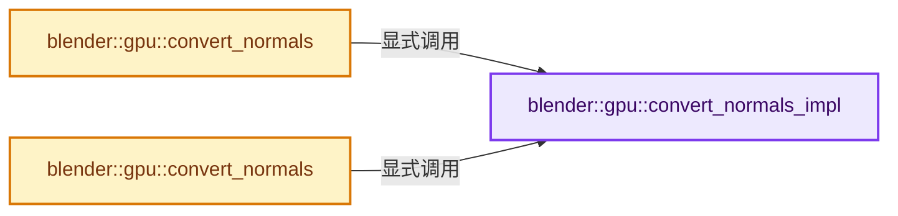
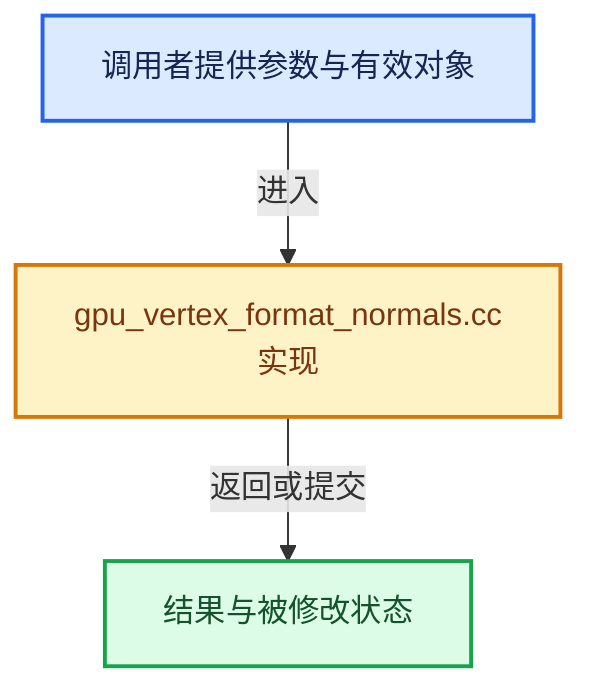

# 实现依赖专题：source/blender/gpu/intern/gpu_vertex_format_normals.cc

[方向导航](README.md) · [符号索引](../%E7%AC%A6%E5%8F%B7%E4%BE%9D%E8%B5%96%E4%B8%8E%E5%AE%9E%E7%8E%B0%E7%B4%A2%E5%BC%95.md)

本专题从正文实际调用进入，集中保存共享实现。函数有稳定锚点，可从调用处直接跳到对应完整函数；递归与互相调用通过回链组织。

## 本文件的实现关系






## 完整成员与函数实现

<a id="f-e2bf775b3748b2fd"></a>

### `blender::gpu::convert_normals_impl`

实现位置：[source/blender/gpu/intern/gpu_vertex_format_normals.cc](../../../../../source/blender/gpu/intern/gpu_vertex_format_normals.cc) · L17—L25。

接口参数：

- `const Span<float3> src`
- `MutableSpan<GPUType> dst`

**教学注释版**

<!-- annotated:2c9fa4211aa639 -->

```cpp
template<typename GPUType>
static void convert_normals_impl(const Span<float3> src, MutableSpan<GPUType> dst)
{
  // [讲解] src.index_range：查询视图长度或生成对应有效索引区间。
  threading::parallel_for(src.index_range(), 2048, [&](const IndexRange range) {
    for (const int i : range) {
      dst[i] = convert_normal<GPUType>(src[i]);
    }
  });
}
```

<details>
<summary>核对原始源码：source/blender/gpu/intern/gpu_vertex_format_normals.cc · L17—L25</summary>

<!-- original:2c9fa4211aa639:source/blender/gpu/intern/gpu_vertex_format_normals.cc:17:25 -->

```cpp
template<typename GPUType>
static void convert_normals_impl(const Span<float3> src, MutableSpan<GPUType> dst)
{
  threading::parallel_for(src.index_range(), 2048, [&](const IndexRange range) {
    for (const int i : range) {
      dst[i] = convert_normal<GPUType>(src[i]);
    }
  });
}
```

</details>

**沿实际写入检查状态**

- `dst[i] = convert_normal<GPUType>(src[i]);`

**继续追踪实现**

- `threading::parallel_for` → [blender::threading::parallel_for · L68](../11-Depsgraph%E4%B8%8E%E5%B9%B6%E8%A1%8C%E4%BB%BB%E5%8A%A1%E7%B3%BB%E7%BB%9F/07-%E4%BB%BB%E5%8A%A1%E6%B1%A0%E4%B8%8ETBB%E6%8E%A5%E5%85%A5.md#f-838294754c24426c)。
- `src.index_range` → [blender::Span::index_range · L405](../01-%E5%9F%BA%E7%A1%80%E5%AE%B9%E5%99%A8%E4%B8%8E%E7%8E%B0%E4%BB%A3CPP/05-Span%E5%8F%AA%E8%AF%BB%E8%BF%9E%E7%BB%AD%E8%A7%86%E5%9B%BE.md#f-caaa9b06e13e53e0)。
- `convert_normal<GPUType>` → [blender::gpu::convert_normal · L21](%E4%BE%9D%E8%B5%96-GPU_attribute_convert-3259c7.md#f-d24eef906ebcd8b5)；[blender::gpu::convert_normal · L26](%E4%BE%9D%E8%B5%96-GPU_attribute_convert-3259c7.md#f-40f0824f9b7edbbb)。同名重载需按实参类型选择。

<a id="f-8089add92715f800"></a>

### `blender::gpu::convert_normals`

实现位置：[source/blender/gpu/intern/gpu_vertex_format_normals.cc](../../../../../source/blender/gpu/intern/gpu_vertex_format_normals.cc) · L27—L30。

接口参数：

- `const Span<float3> src`
- `MutableSpan<int1010102_norm> dst`

**教学注释版**

<!-- annotated:bbe28a7157ef81 -->

```cpp
template<> void convert_normals(const Span<float3> src, MutableSpan<int1010102_norm> dst)
{
  convert_normals_impl(src, dst);
}
```

<details>
<summary>核对原始源码：source/blender/gpu/intern/gpu_vertex_format_normals.cc · L27—L30</summary>

<!-- original:bbe28a7157ef81:source/blender/gpu/intern/gpu_vertex_format_normals.cc:27:30 -->

```cpp
template<> void convert_normals(const Span<float3> src, MutableSpan<int1010102_norm> dst)
{
  convert_normals_impl(src, dst);
}
```

</details>

**继续追踪实现**

- `convert_normals_impl` → [blender::gpu::convert_normals_impl · L17](%E4%BE%9D%E8%B5%96-gpu_vertex_format_normals-1f47a6.md#f-e2bf775b3748b2fd)。

<a id="f-c169df59eea7544c"></a>

### `blender::gpu::convert_normals`

实现位置：[source/blender/gpu/intern/gpu_vertex_format_normals.cc](../../../../../source/blender/gpu/intern/gpu_vertex_format_normals.cc) · L31—L34。

接口参数：

- `const Span<float3> src`
- `MutableSpan<short4> dst`

**教学注释版**

<!-- annotated:a9085ea5c8af02 -->

```cpp
template<> void convert_normals(const Span<float3> src, MutableSpan<short4> dst)
{
  convert_normals_impl(src, dst);
}
```

<details>
<summary>核对原始源码：source/blender/gpu/intern/gpu_vertex_format_normals.cc · L31—L34</summary>

<!-- original:a9085ea5c8af02:source/blender/gpu/intern/gpu_vertex_format_normals.cc:31:34 -->

```cpp
template<> void convert_normals(const Span<float3> src, MutableSpan<short4> dst)
{
  convert_normals_impl(src, dst);
}
```

</details>

**继续追踪实现**

- `convert_normals_impl` → [blender::gpu::convert_normals_impl · L17](%E4%BE%9D%E8%B5%96-gpu_vertex_format_normals-1f47a6.md#f-e2bf775b3748b2fd)。
