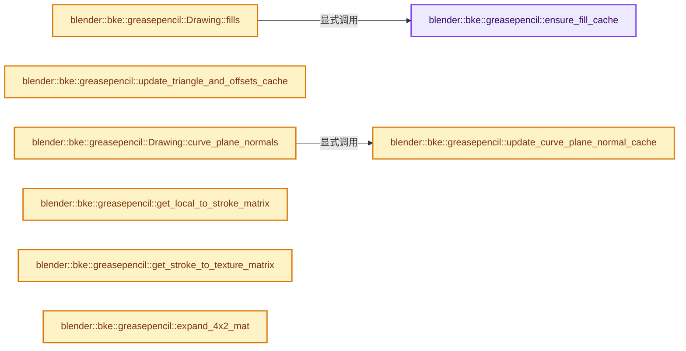
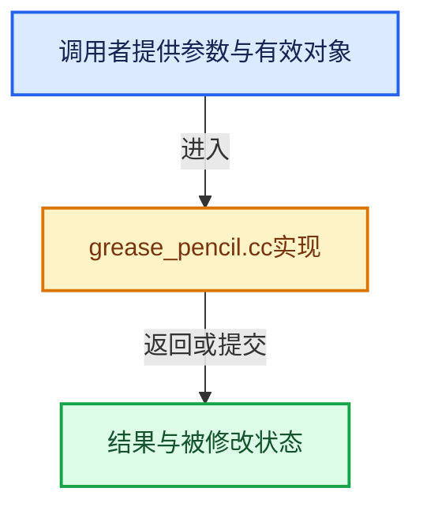

# 实现依赖专题：source/blender/blenkernel/intern/grease_pencil.cc

[方向导航](README.md) · [符号索引](../%E7%AC%A6%E5%8F%B7%E4%BE%9D%E8%B5%96%E4%B8%8E%E5%AE%9E%E7%8E%B0%E7%B4%A2%E5%BC%95.md)

本专题从正文实际调用进入，集中保存共享实现。函数有稳定锚点，可从调用处直接跳到对应完整函数；递归与互相调用通过回链组织。

## 本文件的实现关系






## 完整成员与函数实现

<a id="f-cc8197008ad48383"></a>

### `blender::bke::greasepencil::ensure_fill_cache`

实现位置：[source/blender/blenkernel/intern/grease_pencil.cc](../../../../../source/blender/blenkernel/intern/grease_pencil.cc) · L460—L469。

接口参数：

- `const Drawing &drawing`

**教学注释版**

<!-- annotated:e0d394e2de0b1f -->

```cpp
static void ensure_fill_cache(const Drawing &drawing)
{
  drawing.runtime->fill_cache.ensure([&](std::optional<FillCache> &r_fill_cache) {
    const CurvesGeometry &curves = drawing.strokes();
    const bke::AttributeAccessor attributes = curves.attributes();

    const VArray<int> fill_ids = *attributes.lookup<int>("fill_id", bke::AttrDomain::Curve);
    r_fill_cache = fill_cache_from_fill_ids(fill_ids);
  });
}
```

<details>
<summary>核对原始源码：source/blender/blenkernel/intern/grease_pencil.cc · L460—L469</summary>

<!-- original:e0d394e2de0b1f:source/blender/blenkernel/intern/grease_pencil.cc:460:469 -->

```cpp
static void ensure_fill_cache(const Drawing &drawing)
{
  drawing.runtime->fill_cache.ensure([&](std::optional<FillCache> &r_fill_cache) {
    const CurvesGeometry &curves = drawing.strokes();
    const bke::AttributeAccessor attributes = curves.attributes();

    const VArray<int> fill_ids = *attributes.lookup<int>("fill_id", bke::AttrDomain::Curve);
    r_fill_cache = fill_cache_from_fill_ids(fill_ids);
  });
}
```

</details>

**沿实际写入检查状态**

- `r_fill_cache = fill_cache_from_fill_ids(fill_ids);`

**继续追踪实现**

- `drawing.runtime->fill_cache.ensure` → [调用协议](../%E6%A8%A1%E6%9D%BF%E5%AE%8F%E4%B8%8E%E5%8A%A8%E6%80%81%E5%88%86%E6%B4%BE%E5%8D%8F%E8%AE%AE.md)：接收对象类型依赖auto、返回值或模板实例；不按同名猜测目标。调用位置L462。
- `drawing.strokes` → [blender::bke::greasepencil::Drawing::strokes · L1007](%E4%BE%9D%E8%B5%96-grease_pencil-f750d6.md#f-59e6522a8e8ac409)。
- `curves.attributes` → [blender::bke::CurvesGeometry::attributes · L1908](%E4%BE%9D%E8%B5%96-curves_geometry-ad7f9f.md#f-8e24fbf758862a22)。
- `attributes.lookup<int>` → [blender::bke::AttributeAccessor::lookup · L401](%E4%BE%9D%E8%B5%96-attribute_access-bceef3.md#f-4673351b7bb3b651)。
- `fill_cache_from_fill_ids` → [blender::bke::greasepencil::fill_cache_from_fill_ids · L19](%E4%BE%9D%E8%B5%96-grease_pencil_fills-e96a03.md#f-c5e2a98b2a240b8e)。

<a id="f-0c72835da55064f9"></a>

### `blender::bke::greasepencil::Drawing::fills`

实现位置：[source/blender/blenkernel/intern/grease_pencil.cc](../../../../../source/blender/blenkernel/intern/grease_pencil.cc) · L471—L479。

**教学注释版**

<!-- annotated:d0c44bb78a3886 -->

```cpp
std::optional<GroupedSpan<int>> Drawing::fills() const
{
  ensure_fill_cache(*this);
  if (this->runtime->fill_cache.data().has_value()) {
    const FillCache &fill_cache = *this->runtime->fill_cache.data();
    return GroupedSpan<int>(fill_cache.fill_offsets.as_span(), fill_cache.fill_map.as_span());
  }
  return std::nullopt;
}
```

<details>
<summary>核对原始源码：source/blender/blenkernel/intern/grease_pencil.cc · L471—L479</summary>

<!-- original:d0c44bb78a3886:source/blender/blenkernel/intern/grease_pencil.cc:471:479 -->

```cpp
std::optional<GroupedSpan<int>> Drawing::fills() const
{
  ensure_fill_cache(*this);
  if (this->runtime->fill_cache.data().has_value()) {
    const FillCache &fill_cache = *this->runtime->fill_cache.data();
    return GroupedSpan<int>(fill_cache.fill_offsets.as_span(), fill_cache.fill_map.as_span());
  }
  return std::nullopt;
}
```

</details>

**结果出口**

- `return GroupedSpan<int>(fill_cache.fill_offsets.as_span(), fill_cache.fill_map.as_span());`
- `return std::nullopt;`

**继续追踪实现**

- `ensure_fill_cache` → [blender::bke::greasepencil::ensure_fill_cache · L460](%E4%BE%9D%E8%B5%96-grease_pencil-f750d6.md#f-cc8197008ad48383)。
- `this->runtime->fill_cache.data().has_value` → [调用协议](../%E6%A8%A1%E6%9D%BF%E5%AE%8F%E4%B8%8E%E5%8A%A8%E6%80%81%E5%88%86%E6%B4%BE%E5%8D%8F%E8%AE%AE.md)：接收对象类型依赖auto、返回值或模板实例；不按同名猜测目标。调用位置L474。
- `this->runtime->fill_cache.data` → [调用协议](../%E6%A8%A1%E6%9D%BF%E5%AE%8F%E4%B8%8E%E5%8A%A8%E6%80%81%E5%88%86%E6%B4%BE%E5%8D%8F%E8%AE%AE.md)：接收对象类型依赖auto、返回值或模板实例；不按同名猜测目标。调用位置L474。
- `GroupedSpan<int>` → [blender::offset_indices::GroupedSpan::GroupedSpan · L127](02-OffsetIndices%E5%AE%8C%E6%95%B4%E6%8E%A5%E5%8F%A3.md#f-7873f891bc51e8c7)；[blender::offset_indices::GroupedSpan::GroupedSpan · L128](02-OffsetIndices%E5%AE%8C%E6%95%B4%E6%8E%A5%E5%8F%A3.md#f-d59a6907578831ba)。同名重载需按实参类型选择。
- `fill_cache.fill_offsets.as_span` → [调用协议](../%E6%A8%A1%E6%9D%BF%E5%AE%8F%E4%B8%8E%E5%8A%A8%E6%80%81%E5%88%86%E6%B4%BE%E5%8D%8F%E8%AE%AE.md)：接收对象类型依赖auto、返回值或模板实例；不按同名猜测目标。调用位置L476。
- `fill_cache.fill_map.as_span` → [调用协议](../%E6%A8%A1%E6%9D%BF%E5%AE%8F%E4%B8%8E%E5%8A%A8%E6%80%81%E5%88%86%E6%B4%BE%E5%8D%8F%E8%AE%AE.md)：接收对象类型依赖auto、返回值或模板实例；不按同名猜测目标。调用位置L476。

<a id="f-aeeff4efc8883306"></a>

### `blender::bke::greasepencil::update_triangle_and_offsets_cache`

实现位置：[source/blender/blenkernel/intern/grease_pencil.cc](../../../../../source/blender/blenkernel/intern/grease_pencil.cc) · L481—L689。

接口参数：

- `const Span<float3> positions`
- `const Span<float3> normals`
- `const OffsetIndices<int> points_by_curve`
- `const IndexMask &fill_mask`
- `const GroupedSpan<int> fills`
- `Vector<int3> &r_triangles`
- `MutableSpan<int> r_triangle_offsets`
- `Vector<float3> &r_intersection_points`
- `MutableSpan<int> r_intersection_point_offsets`

**教学注释版**

<!-- annotated:545824b068b0e2 -->

```cpp
static void update_triangle_and_offsets_cache(const Span<float3> positions,
                                              const Span<float3> normals,
                                              const OffsetIndices<int> points_by_curve,
                                              const IndexMask &fill_mask,
                                              const GroupedSpan<int> fills,
                                              Vector<int3> &r_triangles,
                                              MutableSpan<int> r_triangle_offsets,
                                              Vector<float3> &r_intersection_points,
                                              MutableSpan<int> r_intersection_point_offsets)
{
  struct LocalMemArena {
    MemArena *pf_arena = nullptr;
    LocalMemArena() : pf_arena(BLI_memarena_new(BLI_MEMARENA_STD_BUFSIZE, "Drawing::triangles")) {}

    ~LocalMemArena()
    {
      if (pf_arena != nullptr) {
        BLI_memarena_free(pf_arena);
      }
    }
  };

  Array<Vector<int3>> triangle_results(fill_mask.size());
  Array<Vector<float3>> intersection_point_results(fill_mask.size());

  threading::EnumerableThreadSpecific<LocalMemArena> all_local_mem_arenas;
  fill_mask.foreach_segment(
      [&](const IndexMaskSegment mask_segment, const int segment_pos) {
        threading::isolate_task([&] {
          MemArena *pf_arena = all_local_mem_arenas.local().pf_arena;
          for (const int index : mask_segment.index_range()) {
            const int fill_index = mask_segment[index];
            const int pos = segment_pos + index;

            IndexMaskMemory memory;
            const IndexMask base_fill = IndexMask::from_indices(fills[fill_index], memory);

            /* Only get curves that are in the fill and valid. */
            const IndexMask fill = IndexMask::from_predicate(
                base_fill, memory, [&](const int64_t curve_i) {
                  const IndexRange points = points_by_curve[curve_i];
                  // [讲解] points.size：读取连续区间或分组的边界信息。
                  return points.size() >= 3;
                });

            if (fill.is_empty()) {
              continue;
            }

            float3x3 axis_mat;
            axis_dominant_v3_to_m3(axis_mat.ptr(), normals[fill.first()]);
            const int num_points = offset_indices::sum_group_sizes(points_by_curve, fill);

            float (*projverts)[2] = static_cast<float (*)[2]>(
                BLI_memarena_alloc(pf_arena, sizeof(*projverts) * size_t(num_points)));

            int *fill_points_by_curve_data = static_cast<int(*)>(BLI_memarena_alloc(
                pf_arena, sizeof(*fill_points_by_curve_data) * size_t(fill.size() + 1)));
            const OffsetIndices<int> fill_points_by_curve =
                offset_indices::gather_selected_offsets(
                    points_by_curve,
                    fill,
                    MutableSpan(fill_points_by_curve_data, fill.size() + 1));

            fill.foreach_index(
                [&](const int64_t curve_i, const int64_t pos) {
                  const IndexRange fill_points = fill_points_by_curve[pos];
                  const IndexRange points = points_by_curve[curve_i];
                  for (const int i : points.index_range()) {
                    const int curve_p = points[i];
                    const int fill_p = fill_points[i];
                    mul_v2_m3v3(projverts[fill_p], axis_mat.ptr(), positions[curve_p]);
                  }
                },
                exec_mode::grain_size(256));

            /* If there is only one stroke then simple poly fill will be used. */
            if (fill.size() == 1) {
              triangle_results[pos].resize(num_points - 2);
              MutableSpan<int3> r_tris = triangle_results[pos];

              BLI_polyfill_calc_arena(projverts,
                                      num_points,
                                      0,
                                      // [讲解] r_tris.data：返回借用范围的地址。
                                      reinterpret_cast<uint32_t (*)[3]>(r_tris.data()),
                                      pf_arena);

              BLI_memarena_clear(pf_arena);
              continue;
            }

            Array<double2, 64> verts(num_points);
            threading::parallel_for(IndexRange(num_points), 512, [&](const IndexRange range) {
              for (const int i : range) {
                verts[i] = double2(projverts[i]);
              }
            });

            const Span<float2> projverts_span = Span(reinterpret_cast<float2 *>(projverts),
                                                     num_points);

            Array<int, 64> face_vert_indices(fill_points_by_curve.total_size());
            threading::parallel_for(fill.index_range(), 256, [&](const IndexRange range) {
              for (const int i : range) {
                const IndexRange fill_points = fill_points_by_curve[i];
                // [讲解] face_vert_indices.as_mutable_span：提供数组的借用访问入口。
                MutableSpan<int> face = face_vert_indices.as_mutable_span().slice(fill_points);

                // [讲解] fill_points.first：读取范围两端的有效索引或值。
                array_utils::fill_index_range<int>(face, fill_points.first());
                // [讲解] projverts_span.slice：建立原连续范围的子视图。
                const Span<float2> projpoints = projverts_span.slice(fill_points);

                /* Curve have to be in a counterclockwise order, so check if a flip is need. */
                if (cross_poly_v2(reinterpret_cast<const float (*)[2]>(projpoints.data()),
                                  projpoints.size()) < 0.0)
                {
                  face.reverse();
                }
              }
            });

            meshintersect::CDT_input<double> input;
            input.vert = verts;
            input.face_offsets = fill_points_by_curve;
            input.face_vert_indices = face_vert_indices;
            input.needed_ids = CDT_ORIG_VERTS | CDT_ONLY_ONE_ORIG;

            meshintersect::CDT_result<double> result = delaunay_2d_calc(input,
                                                                        CDT_INSIDE_WITH_HOLES);

            Map<int, int> vert_id_to_intersection_point;
            const float3x3 invert_axis_mat = math::invert(axis_mat);
            const float3 depth_point = positions[points_by_curve[fill.first()].first()];
            float2 pos2d;
            mul_v2_m3v3(pos2d, axis_mat.ptr(), depth_point);
            const float3 depth_direction = depth_point - invert_axis_mat * float3(pos2d, 0.0f);

            for (const int vert : result.vert.index_range()) {
              /* The point already exists. */
              if (!result.vert_orig[vert].is_empty()) {
                continue;
              }

              // [讲解] vert_id_to_intersection_point.add_new：按哈希与相等关系加入键或键值。
              vert_id_to_intersection_point.add_new(vert, intersection_point_results[pos].size());

              const float2 co = float2(result.vert[vert]);
              intersection_point_results[pos].append(invert_axis_mat * float3(co.x, co.y, 0.0f) +
                                                     depth_direction);
            }

            auto vert_to_point = [&](const int vert) {
              /* The points is a newly added intersection point. */
              if (result.vert_orig[vert].is_empty()) {
                // [讲解] vert_id_to_intersection_point.lookup：按键查找对应项。
                const int inter = vert_id_to_intersection_point.lookup(vert);
                return -(inter + 1);
              }
              /* Just get the first point if there are multiple at the same position. */
              return int(result.vert_orig[vert].first());
            };

            for (const int i : result.face.index_range()) {
              BLI_assert(result.face[i].size() == 3);
              const int3 tri = int3(vert_to_point(result.face[i][0]),
                                    vert_to_point(result.face[i][1]),
                                    vert_to_point(result.face[i][2]));

              triangle_results[pos].append(tri);
            }

            BLI_memarena_clear(pf_arena);
          }
        });
      },
      exec_mode::grain_size(32));

  // [讲解] triangle_results.index_range：查询固定有效长度及其索引范围。
  threading::parallel_for(triangle_results.index_range(), 512, [&](const IndexRange range) {
    for (const int i : range) {
      r_triangle_offsets[i] = triangle_results[i].size();
    }
  });
  threading::parallel_for(
      intersection_point_results.index_range(), 512, [&](const IndexRange range) {
        for (const int i : range) {
          r_intersection_point_offsets[i] = intersection_point_results[i].size();
        }
      });

  const OffsetIndices<int> triangle_offsets = offset_indices::accumulate_counts_to_offsets(
      r_triangle_offsets);
  const OffsetIndices<int> intersection_point_offsets =
      offset_indices::accumulate_counts_to_offsets(r_intersection_point_offsets);

  // [讲解] r_triangles.resize：把有效元素数调整为new_size。增长路径构造新元素，缩小路径销毁尾部对象，最后才提交新的end_。
  r_triangles.resize(triangle_offsets.total_size());
  r_intersection_points.resize(intersection_point_offsets.total_size());

  MutableSpan<int3> r_triangles_span = r_triangles.as_mutable_span();
  threading::parallel_for(fill_mask.index_range(), 512, [&](const IndexRange range) {
    for (const int pos : range) {
      const IndexRange fill_range = triangle_offsets[pos];
      array_utils::copy(triangle_results[pos].as_span(), r_triangles_span.slice(fill_range));
    }
  });

  MutableSpan<float3> r_intersection_points_span = r_intersection_points.as_mutable_span();
  threading::parallel_for(fill_mask.index_range(), 512, [&](const IndexRange range) {
    for (const int pos : range) {
      const IndexRange fill_range = intersection_point_offsets[pos];
      array_utils::copy(intersection_point_results[pos].as_span(),
                        r_intersection_points_span.slice(fill_range));
    }
  });
}
```

<details>
<summary>核对原始源码：source/blender/blenkernel/intern/grease_pencil.cc · L481—L689</summary>

<!-- original:545824b068b0e2:source/blender/blenkernel/intern/grease_pencil.cc:481:689 -->

```cpp
static void update_triangle_and_offsets_cache(const Span<float3> positions,
                                              const Span<float3> normals,
                                              const OffsetIndices<int> points_by_curve,
                                              const IndexMask &fill_mask,
                                              const GroupedSpan<int> fills,
                                              Vector<int3> &r_triangles,
                                              MutableSpan<int> r_triangle_offsets,
                                              Vector<float3> &r_intersection_points,
                                              MutableSpan<int> r_intersection_point_offsets)
{
  struct LocalMemArena {
    MemArena *pf_arena = nullptr;
    LocalMemArena() : pf_arena(BLI_memarena_new(BLI_MEMARENA_STD_BUFSIZE, "Drawing::triangles")) {}

    ~LocalMemArena()
    {
      if (pf_arena != nullptr) {
        BLI_memarena_free(pf_arena);
      }
    }
  };

  Array<Vector<int3>> triangle_results(fill_mask.size());
  Array<Vector<float3>> intersection_point_results(fill_mask.size());

  threading::EnumerableThreadSpecific<LocalMemArena> all_local_mem_arenas;
  fill_mask.foreach_segment(
      [&](const IndexMaskSegment mask_segment, const int segment_pos) {
        threading::isolate_task([&] {
          MemArena *pf_arena = all_local_mem_arenas.local().pf_arena;
          for (const int index : mask_segment.index_range()) {
            const int fill_index = mask_segment[index];
            const int pos = segment_pos + index;

            IndexMaskMemory memory;
            const IndexMask base_fill = IndexMask::from_indices(fills[fill_index], memory);

            /* Only get curves that are in the fill and valid. */
            const IndexMask fill = IndexMask::from_predicate(
                base_fill, memory, [&](const int64_t curve_i) {
                  const IndexRange points = points_by_curve[curve_i];
                  return points.size() >= 3;
                });

            if (fill.is_empty()) {
              continue;
            }

            float3x3 axis_mat;
            axis_dominant_v3_to_m3(axis_mat.ptr(), normals[fill.first()]);
            const int num_points = offset_indices::sum_group_sizes(points_by_curve, fill);

            float (*projverts)[2] = static_cast<float (*)[2]>(
                BLI_memarena_alloc(pf_arena, sizeof(*projverts) * size_t(num_points)));

            int *fill_points_by_curve_data = static_cast<int(*)>(BLI_memarena_alloc(
                pf_arena, sizeof(*fill_points_by_curve_data) * size_t(fill.size() + 1)));
            const OffsetIndices<int> fill_points_by_curve =
                offset_indices::gather_selected_offsets(
                    points_by_curve,
                    fill,
                    MutableSpan(fill_points_by_curve_data, fill.size() + 1));

            fill.foreach_index(
                [&](const int64_t curve_i, const int64_t pos) {
                  const IndexRange fill_points = fill_points_by_curve[pos];
                  const IndexRange points = points_by_curve[curve_i];
                  for (const int i : points.index_range()) {
                    const int curve_p = points[i];
                    const int fill_p = fill_points[i];
                    mul_v2_m3v3(projverts[fill_p], axis_mat.ptr(), positions[curve_p]);
                  }
                },
                exec_mode::grain_size(256));

            /* If there is only one stroke then simple poly fill will be used. */
            if (fill.size() == 1) {
              triangle_results[pos].resize(num_points - 2);
              MutableSpan<int3> r_tris = triangle_results[pos];

              BLI_polyfill_calc_arena(projverts,
                                      num_points,
                                      0,
                                      reinterpret_cast<uint32_t (*)[3]>(r_tris.data()),
                                      pf_arena);

              BLI_memarena_clear(pf_arena);
              continue;
            }

            Array<double2, 64> verts(num_points);
            threading::parallel_for(IndexRange(num_points), 512, [&](const IndexRange range) {
              for (const int i : range) {
                verts[i] = double2(projverts[i]);
              }
            });

            const Span<float2> projverts_span = Span(reinterpret_cast<float2 *>(projverts),
                                                     num_points);

            Array<int, 64> face_vert_indices(fill_points_by_curve.total_size());
            threading::parallel_for(fill.index_range(), 256, [&](const IndexRange range) {
              for (const int i : range) {
                const IndexRange fill_points = fill_points_by_curve[i];
                MutableSpan<int> face = face_vert_indices.as_mutable_span().slice(fill_points);

                array_utils::fill_index_range<int>(face, fill_points.first());
                const Span<float2> projpoints = projverts_span.slice(fill_points);

                /* Curve have to be in a counterclockwise order, so check if a flip is need. */
                if (cross_poly_v2(reinterpret_cast<const float (*)[2]>(projpoints.data()),
                                  projpoints.size()) < 0.0)
                {
                  face.reverse();
                }
              }
            });

            meshintersect::CDT_input<double> input;
            input.vert = verts;
            input.face_offsets = fill_points_by_curve;
            input.face_vert_indices = face_vert_indices;
            input.needed_ids = CDT_ORIG_VERTS | CDT_ONLY_ONE_ORIG;

            meshintersect::CDT_result<double> result = delaunay_2d_calc(input,
                                                                        CDT_INSIDE_WITH_HOLES);

            Map<int, int> vert_id_to_intersection_point;
            const float3x3 invert_axis_mat = math::invert(axis_mat);
            const float3 depth_point = positions[points_by_curve[fill.first()].first()];
            float2 pos2d;
            mul_v2_m3v3(pos2d, axis_mat.ptr(), depth_point);
            const float3 depth_direction = depth_point - invert_axis_mat * float3(pos2d, 0.0f);

            for (const int vert : result.vert.index_range()) {
              /* The point already exists. */
              if (!result.vert_orig[vert].is_empty()) {
                continue;
              }

              vert_id_to_intersection_point.add_new(vert, intersection_point_results[pos].size());

              const float2 co = float2(result.vert[vert]);
              intersection_point_results[pos].append(invert_axis_mat * float3(co.x, co.y, 0.0f) +
                                                     depth_direction);
            }

            auto vert_to_point = [&](const int vert) {
              /* The points is a newly added intersection point. */
              if (result.vert_orig[vert].is_empty()) {
                const int inter = vert_id_to_intersection_point.lookup(vert);
                return -(inter + 1);
              }
              /* Just get the first point if there are multiple at the same position. */
              return int(result.vert_orig[vert].first());
            };

            for (const int i : result.face.index_range()) {
              BLI_assert(result.face[i].size() == 3);
              const int3 tri = int3(vert_to_point(result.face[i][0]),
                                    vert_to_point(result.face[i][1]),
                                    vert_to_point(result.face[i][2]));

              triangle_results[pos].append(tri);
            }

            BLI_memarena_clear(pf_arena);
          }
        });
      },
      exec_mode::grain_size(32));

  threading::parallel_for(triangle_results.index_range(), 512, [&](const IndexRange range) {
    for (const int i : range) {
      r_triangle_offsets[i] = triangle_results[i].size();
    }
  });
  threading::parallel_for(
      intersection_point_results.index_range(), 512, [&](const IndexRange range) {
        for (const int i : range) {
          r_intersection_point_offsets[i] = intersection_point_results[i].size();
        }
      });

  const OffsetIndices<int> triangle_offsets = offset_indices::accumulate_counts_to_offsets(
      r_triangle_offsets);
  const OffsetIndices<int> intersection_point_offsets =
      offset_indices::accumulate_counts_to_offsets(r_intersection_point_offsets);

  r_triangles.resize(triangle_offsets.total_size());
  r_intersection_points.resize(intersection_point_offsets.total_size());

  MutableSpan<int3> r_triangles_span = r_triangles.as_mutable_span();
  threading::parallel_for(fill_mask.index_range(), 512, [&](const IndexRange range) {
    for (const int pos : range) {
      const IndexRange fill_range = triangle_offsets[pos];
      array_utils::copy(triangle_results[pos].as_span(), r_triangles_span.slice(fill_range));
    }
  });

  MutableSpan<float3> r_intersection_points_span = r_intersection_points.as_mutable_span();
  threading::parallel_for(fill_mask.index_range(), 512, [&](const IndexRange range) {
    for (const int pos : range) {
      const IndexRange fill_range = intersection_point_offsets[pos];
      array_utils::copy(intersection_point_results[pos].as_span(),
                        r_intersection_points_span.slice(fill_range));
    }
  });
}
```

</details>

**沿实际写入检查状态**

- `verts[i] = double2(projverts[i]);`
- `input.vert = verts;`
- `input.face_offsets = fill_points_by_curve;`
- `input.face_vert_indices = face_vert_indices;`
- `input.needed_ids = CDT_ORIG_VERTS | CDT_ONLY_ONE_ORIG;`
- `r_triangle_offsets[i] = triangle_results[i].size();`
- `r_intersection_point_offsets[i] = intersection_point_results[i].size();`

**结果出口**

- `return points.size() >= 3;`
- `return -(inter + 1);`
- `return int(result.vert_orig[vert].first());`

**继续追踪实现**

- `BLI_memarena_new` → [blender::BLI_memarena_new · L73](../01-%E5%9F%BA%E7%A1%80%E5%AE%B9%E5%99%A8%E4%B8%8E%E7%8E%B0%E4%BB%A3CPP/%E4%BE%9D%E8%B5%96-BLI_memarena-aea32a.md#f-590ef4f6ab548c98)。
- `BLI_memarena_free` → [blender::BLI_memarena_free · L103](../01-%E5%9F%BA%E7%A1%80%E5%AE%B9%E5%99%A8%E4%B8%8E%E7%8E%B0%E4%BB%A3CPP/%E4%BE%9D%E8%B5%96-BLI_memarena-aea32a.md#f-a655794ad41d1bdf)。
- `fill_mask.size` → [blender::index_mask::IndexMask::size · L743](../04-%E8%99%9A%E6%8B%9F%E6%95%B0%E7%BB%84%E4%B8%8E%E7%B4%A2%E5%BC%95%E9%80%89%E6%8B%A9/09-%E5%88%86%E6%AE%B5%E5%AD%98%E5%82%A8%E4%B8%8E%E9%81%8D%E5%8E%86.md#f-0163b32abc9a0d9c)。
- `fill_mask.foreach_segment` → [blender::index_mask::IndexMask::foreach_segment · L1012](../04-%E8%99%9A%E6%8B%9F%E6%95%B0%E7%BB%84%E4%B8%8E%E7%B4%A2%E5%BC%95%E9%80%89%E6%8B%A9/12-%E9%87%8D%E6%9E%84%E5%8E%86%E5%8F%B2%E4%B8%8E%E5%9F%BA%E5%87%86%E7%BB%83%E4%B9%A0.md#f-ae3b9242dccf9a21)。
- `threading::isolate_task` → [blender::threading::isolate_task · L224](../11-Depsgraph%E4%B8%8E%E5%B9%B6%E8%A1%8C%E4%BB%BB%E5%8A%A1%E7%B3%BB%E7%BB%9F/07-%E4%BB%BB%E5%8A%A1%E6%B1%A0%E4%B8%8ETBB%E6%8E%A5%E5%85%A5.md#f-c13dd3df595aa4f8)。
- `all_local_mem_arenas.local` → [blender::threading::EnumerableThreadSpecific::local · L51](../01-%E5%9F%BA%E7%A1%80%E5%AE%B9%E5%99%A8%E4%B8%8E%E7%8E%B0%E4%BB%A3CPP/%E4%BE%9D%E8%B5%96-BLI_enumerable_thread_specific-ceb6f9.md#f-38c6c32570e94c93)；[blender::threading::EnumerableThreadSpecific::local · L87](../01-%E5%9F%BA%E7%A1%80%E5%AE%B9%E5%99%A8%E4%B8%8E%E7%8E%B0%E4%BB%A3CPP/%E4%BE%9D%E8%B5%96-BLI_enumerable_thread_specific-ceb6f9.md#f-3c8975467b7a35ba)。同名重载需按实参类型选择。
- `mask_segment.index_range` → [调用协议](../%E6%A8%A1%E6%9D%BF%E5%AE%8F%E4%B8%8E%E5%8A%A8%E6%80%81%E5%88%86%E6%B4%BE%E5%8D%8F%E8%AE%AE.md)：由接收对象具体类型或运行时策略提供实现。调用位置L511。
- `IndexMask::from_indices` → [blender::index_mask::IndexMask::from_indices · L414](../04-%E8%99%9A%E6%8B%9F%E6%95%B0%E7%BB%84%E4%B8%8E%E7%B4%A2%E5%BC%95%E9%80%89%E6%8B%A9/10-IndexMask%E6%9E%84%E5%BB%BA%E4%B8%8E%E5%B9%B6%E8%A1%8C.md#f-85c4cb3a40ba9bbe)。
- `IndexMask::from_predicate` → [blender::index_mask::IndexMask::from_predicate · L1073](../04-%E8%99%9A%E6%8B%9F%E6%95%B0%E7%BB%84%E4%B8%8E%E7%B4%A2%E5%BC%95%E9%80%89%E6%8B%A9/12-%E9%87%8D%E6%9E%84%E5%8E%86%E5%8F%B2%E4%B8%8E%E5%9F%BA%E5%87%86%E7%BB%83%E4%B9%A0.md#f-3864daa059098df8)。
- `points.size` → [blender::IndexRange::size · L156](../01-%E5%9F%BA%E7%A1%80%E5%AE%B9%E5%99%A8%E4%B8%8E%E7%8E%B0%E4%BB%A3CPP/04-IndexRange%E8%BF%9E%E7%BB%AD%E6%95%B4%E6%95%B0%E5%8C%BA%E9%97%B4.md#f-05f66c3ebb2fdfec)。
- `fill.is_empty` → [blender::index_mask::IndexMask::is_empty · L748](../04-%E8%99%9A%E6%8B%9F%E6%95%B0%E7%BB%84%E4%B8%8E%E7%B4%A2%E5%BC%95%E9%80%89%E6%8B%A9/09-%E5%88%86%E6%AE%B5%E5%AD%98%E5%82%A8%E4%B8%8E%E9%81%8D%E5%8E%86.md#f-190ac996386064f4)。
- `axis_dominant_v3_to_m3` → [blender::axis_dominant_v3_to_m3 · L3702](../12-%E7%A9%BA%E9%97%B4%E6%95%B0%E6%8D%AE%E7%BB%93%E6%9E%84%E4%B8%8E%E5%87%A0%E4%BD%95%E7%AE%97%E6%B3%95/%E4%BE%9D%E8%B5%96-math_geom-8d91a3.md#f-3e28943552d479d7)。
- `axis_mat.ptr` → [调用协议](../%E6%A8%A1%E6%9D%BF%E5%AE%8F%E4%B8%8E%E5%8A%A8%E6%80%81%E5%88%86%E6%B4%BE%E5%8D%8F%E8%AE%AE.md)：由接收对象具体类型或运行时策略提供实现。调用位置L530。
- `fill.first` → [blender::index_mask::IndexMask::first · L768](../04-%E8%99%9A%E6%8B%9F%E6%95%B0%E7%BB%84%E4%B8%8E%E7%B4%A2%E5%BC%95%E9%80%89%E6%8B%A9/09-%E5%88%86%E6%AE%B5%E5%AD%98%E5%82%A8%E4%B8%8E%E9%81%8D%E5%8E%86.md#f-0fdcf75a0be7ad37)。
- `offset_indices::sum_group_sizes` → [blender::offset_indices::sum_group_sizes · L110](05-%E9%82%BB%E6%8E%A5%E5%85%B3%E7%B3%BB%E4%B8%8E%E5%89%8D%E7%BC%80%E5%92%8C.md#f-89e81645a99e1102)；[blender::offset_indices::sum_group_sizes · L119](05-%E9%82%BB%E6%8E%A5%E5%85%B3%E7%B3%BB%E4%B8%8E%E5%89%8D%E7%BC%80%E5%92%8C.md#f-2d8c42ca6d454833)。同名重载需按实参类型选择。
- `BLI_memarena_alloc` → [blender::BLI_memarena_alloc · L125](../01-%E5%9F%BA%E7%A1%80%E5%AE%B9%E5%99%A8%E4%B8%8E%E7%8E%B0%E4%BB%A3CPP/%E4%BE%9D%E8%B5%96-BLI_memarena-aea32a.md#f-ae79828c3629e134)；[blender::BLI_memarena_alloc · L43](../01-%E5%9F%BA%E7%A1%80%E5%AE%B9%E5%99%A8%E4%B8%8E%E7%8E%B0%E4%BB%A3CPP/%E4%BE%9D%E8%B5%96-BLI_memarena-d0ed90.md#f-3c7ccf0d8384021b)。同名重载需按实参类型选择。
- `fill.size` → [blender::index_mask::IndexMask::size · L743](../04-%E8%99%9A%E6%8B%9F%E6%95%B0%E7%BB%84%E4%B8%8E%E7%B4%A2%E5%BC%95%E9%80%89%E6%8B%A9/09-%E5%88%86%E6%AE%B5%E5%AD%98%E5%82%A8%E4%B8%8E%E9%81%8D%E5%8E%86.md#f-0163b32abc9a0d9c)。
- `offset_indices::gather_selected_offsets` → [blender::offset_indices::gather_selected_offsets · L135](05-%E9%82%BB%E6%8E%A5%E5%85%B3%E7%B3%BB%E4%B8%8E%E5%89%8D%E7%BC%80%E5%92%8C.md#f-db58dc5f33a70276)；[blender::offset_indices::gather_selected_offsets · L152](05-%E9%82%BB%E6%8E%A5%E5%85%B3%E7%B3%BB%E4%B8%8E%E5%89%8D%E7%BC%80%E5%92%8C.md#f-81774b7fe5ae69aa)；[blender::offset_indices::gather_selected_offsets · L182](02-OffsetIndices%E5%AE%8C%E6%95%B4%E6%8E%A5%E5%8F%A3.md#f-7114c46ef264d80b)；[blender::offset_indices::gather_selected_offsets · L192](02-OffsetIndices%E5%AE%8C%E6%95%B4%E6%8E%A5%E5%8F%A3.md#f-25cd4510af788ad9)。同名重载需按实参类型选择。
- `MutableSpan` → [blender::MutableSpan::MutableSpan · L462](../01-%E5%9F%BA%E7%A1%80%E5%AE%B9%E5%99%A8%E4%B8%8E%E7%8E%B0%E4%BB%A3CPP/06-MutableSpan%E5%8F%AF%E5%86%99%E8%A7%86%E5%9B%BE.md#f-0f07034aaffc3384)；[blender::MutableSpan::MutableSpan · L464](../01-%E5%9F%BA%E7%A1%80%E5%AE%B9%E5%99%A8%E4%B8%8E%E7%8E%B0%E4%BB%A3CPP/06-MutableSpan%E5%8F%AF%E5%86%99%E8%A7%86%E5%9B%BE.md#f-39977234ad0ce192)；[blender::MutableSpan::MutableSpan · L466](../01-%E5%9F%BA%E7%A1%80%E5%AE%B9%E5%99%A8%E4%B8%8E%E7%8E%B0%E4%BB%A3CPP/06-MutableSpan%E5%8F%AF%E5%86%99%E8%A7%86%E5%9B%BE.md#f-ee249b5042dd38aa)；[blender::MutableSpan::MutableSpan · L468](../01-%E5%9F%BA%E7%A1%80%E5%AE%B9%E5%99%A8%E4%B8%8E%E7%8E%B0%E4%BB%A3CPP/06-MutableSpan%E5%8F%AF%E5%86%99%E8%A7%86%E5%9B%BE.md#f-479c5f85921e531f)；[blender::MutableSpan::MutableSpan · L477](../01-%E5%9F%BA%E7%A1%80%E5%AE%B9%E5%99%A8%E4%B8%8E%E7%8E%B0%E4%BB%A3CPP/06-MutableSpan%E5%8F%AF%E5%86%99%E8%A7%86%E5%9B%BE.md#f-afcce5325e6f19e0)。同名重载需按实参类型选择。
- `fill.foreach_index` → [blender::index_mask::IndexMask::foreach_index · L855](../04-%E8%99%9A%E6%8B%9F%E6%95%B0%E7%BB%84%E4%B8%8E%E7%B4%A2%E5%BC%95%E9%80%89%E6%8B%A9/09-%E5%88%86%E6%AE%B5%E5%AD%98%E5%82%A8%E4%B8%8E%E9%81%8D%E5%8E%86.md#f-cd6cd317e2e2812c)。
- `points.index_range` → [blender::IndexRange::index_range · L161](../01-%E5%9F%BA%E7%A1%80%E5%AE%B9%E5%99%A8%E4%B8%8E%E7%8E%B0%E4%BB%A3CPP/04-IndexRange%E8%BF%9E%E7%BB%AD%E6%95%B4%E6%95%B0%E5%8C%BA%E9%97%B4.md#f-fd83072b4b81bce5)。
- `mul_v2_m3v3` → [blender::mul_v2_m3v3 · L844](../12-%E7%A9%BA%E9%97%B4%E6%95%B0%E6%8D%AE%E7%BB%93%E6%9E%84%E4%B8%8E%E5%87%A0%E4%BD%95%E7%AE%97%E6%B3%95/%E4%BE%9D%E8%B5%96-math_matrix_c-004123.md#f-2550a487d003ca6b)。
- `exec_mode::grain_size` → [blender::exec_mode::grain_size · L79](../01-%E5%9F%BA%E7%A1%80%E5%AE%B9%E5%99%A8%E4%B8%8E%E7%8E%B0%E4%BB%A3CPP/%E4%BE%9D%E8%B5%96-BLI_execution_mode-1528fb.md#f-0b4fc2f9fa6e66e7)。
- `triangle_results[pos].resize` → [调用协议](../%E6%A8%A1%E6%9D%BF%E5%AE%8F%E4%B8%8E%E5%8A%A8%E6%80%81%E5%88%86%E6%B4%BE%E5%8D%8F%E8%AE%AE.md)：接收对象类型依赖auto、返回值或模板实例；不按同名猜测目标。调用位置L558。
- `BLI_polyfill_calc_arena` → [blender::BLI_polyfill_calc_arena · L1065](../01-%E5%9F%BA%E7%A1%80%E5%AE%B9%E5%99%A8%E4%B8%8E%E7%8E%B0%E4%BB%A3CPP/%E4%BE%9D%E8%B5%96-polyfill_2d-89228d.md#f-85769b09e7961330)。
- `r_tris.data` → [blender::MutableSpan::data · L545](../01-%E5%9F%BA%E7%A1%80%E5%AE%B9%E5%99%A8%E4%B8%8E%E7%8E%B0%E4%BB%A3CPP/06-MutableSpan%E5%8F%AF%E5%86%99%E8%A7%86%E5%9B%BE.md#f-eb45a6e4d8211efd)；[blender::gpu::shader::parser::MutableSpan::data · L82](%E4%BE%9D%E8%B5%96-utils-06433d.md#f-ad0a09cec9741c65)。同名重载需按实参类型选择。
- `BLI_memarena_clear` → [blender::BLI_memarena_clear · L225](../01-%E5%9F%BA%E7%A1%80%E5%AE%B9%E5%99%A8%E4%B8%8E%E7%8E%B0%E4%BB%A3CPP/%E4%BE%9D%E8%B5%96-BLI_memarena-aea32a.md#f-58102a3c4f840caa)。
- `threading::parallel_for` → [blender::threading::parallel_for · L68](../11-Depsgraph%E4%B8%8E%E5%B9%B6%E8%A1%8C%E4%BB%BB%E5%8A%A1%E7%B3%BB%E7%BB%9F/07-%E4%BB%BB%E5%8A%A1%E6%B1%A0%E4%B8%8ETBB%E6%8E%A5%E5%85%A5.md#f-838294754c24426c)。
- `IndexRange` → [blender::IndexRange](../01-%E5%9F%BA%E7%A1%80%E5%AE%B9%E5%99%A8%E4%B8%8E%E7%8E%B0%E4%BB%A3CPP/%E4%BE%9D%E8%B5%96-BLI_index_range-7d7cc5.md#t-caa3466d6776)；[blender::gpu::shader::parser::IndexRange](%E4%BE%9D%E8%B5%96-utils-06433d.md#t-82d2bd4ea71c)；[blender::IndexRange](%E4%BE%9D%E8%B5%96-DNA_node_types-6708b9.md#t-0448cc889d39)。
- `double2` → [调用协议](../%E6%A8%A1%E6%9D%BF%E5%AE%8F%E4%B8%8E%E5%8A%A8%E6%80%81%E5%88%86%E6%B4%BE%E5%8D%8F%E8%AE%AE.md)：函数指针、局部可调用对象或未展开的宏；必须结合调用者环境。调用位置L574。
- `Span` → [blender::Span](../01-%E5%9F%BA%E7%A1%80%E5%AE%B9%E5%99%A8%E4%B8%8E%E7%8E%B0%E4%BB%A3CPP/%E4%BE%9D%E8%B5%96-BLI_span-6aa95f.md#t-8765a8e0c1d5)；[blender::Span](../01-%E5%9F%BA%E7%A1%80%E5%AE%B9%E5%99%A8%E4%B8%8E%E7%8E%B0%E4%BB%A3CPP/%E4%BE%9D%E8%B5%96-BLI_index_range-7d7cc5.md#t-86091874a1c0)；[blender::Span](%E4%BE%9D%E8%B5%96-DNA_pointcloud_types-cfb82c.md#t-112aa6ed842c)；[blender::Span](%E4%BE%9D%E8%B5%96-DNA_node_types-6708b9.md#t-49ec6fbb9b69)；[blender::Span](%E4%BE%9D%E8%B5%96-DNA_mesh_types-81f02e.md#t-184fd48fb638)；[blender::Span](%E4%BE%9D%E8%B5%96-DNA_anim_types-39c5d9.md#t-d841071994c2)；[blender::Span](%E4%BE%9D%E8%B5%96-RNA_path_fwd-79c989.md#t-4dbb08969e41)。
- `fill_points_by_curve.total_size` → [blender::offset_indices::OffsetIndices::total_size · L58](02-OffsetIndices%E5%AE%8C%E6%95%B4%E6%8E%A5%E5%8F%A3.md#f-c111ffdac7a19248)。
- `fill.index_range` → [blender::index_mask::IndexMask::index_range · L753](../04-%E8%99%9A%E6%8B%9F%E6%95%B0%E7%BB%84%E4%B8%8E%E7%B4%A2%E5%BC%95%E9%80%89%E6%8B%A9/09-%E5%88%86%E6%AE%B5%E5%AD%98%E5%82%A8%E4%B8%8E%E9%81%8D%E5%8E%86.md#f-749c399cf5bc4035)。
- `face_vert_indices.as_mutable_span().slice` → [调用协议](../%E6%A8%A1%E6%9D%BF%E5%AE%8F%E4%B8%8E%E5%8A%A8%E6%80%81%E5%88%86%E6%B4%BE%E5%8D%8F%E8%AE%AE.md)：接收对象类型依赖auto、返回值或模板实例；不按同名猜测目标。调用位置L585。
- `face_vert_indices.as_mutable_span` → [blender::Array::as_mutable_span · L259](../01-%E5%9F%BA%E7%A1%80%E5%AE%B9%E5%99%A8%E4%B8%8E%E7%8E%B0%E4%BB%A3CPP/08-Array%E5%A4%8D%E5%88%B6%E7%A7%BB%E5%8A%A8%E4%B8%8E%E9%94%80%E6%AF%81.md#f-4e91de9f1337c144)。
- `array_utils::fill_index_range<int>` → [blender::array_utils::fill_index_range · L434](07-%E5%88%86%E7%BB%84%E8%AE%BF%E9%97%AE%E4%B8%8E%E5%8F%8D%E5%90%91%E7%B4%A2%E5%BC%95.md#f-f8128b104d76df0f)；[blender::array_utils::fill_index_range · L439](07-%E5%88%86%E7%BB%84%E8%AE%BF%E9%97%AE%E4%B8%8E%E5%8F%8D%E5%90%91%E7%B4%A2%E5%BC%95.md#f-95ca84458bfc7e7e)；[blender::array_utils::fill_index_range · L445](07-%E5%88%86%E7%BB%84%E8%AE%BF%E9%97%AE%E4%B8%8E%E5%8F%8D%E5%90%91%E7%B4%A2%E5%BC%95.md#f-c11b114c213cd61a)。同名重载需按实参类型选择。
- `fill_points.first` → [blender::IndexRange::first · L204](../01-%E5%9F%BA%E7%A1%80%E5%AE%B9%E5%99%A8%E4%B8%8E%E7%8E%B0%E4%BB%A3CPP/04-IndexRange%E8%BF%9E%E7%BB%AD%E6%95%B4%E6%95%B0%E5%8C%BA%E9%97%B4.md#f-ab443c94e531befa)。
- `projverts_span.slice` → [blender::Span::slice · L141](../01-%E5%9F%BA%E7%A1%80%E5%AE%B9%E5%99%A8%E4%B8%8E%E7%8E%B0%E4%BB%A3CPP/05-Span%E5%8F%AA%E8%AF%BB%E8%BF%9E%E7%BB%AD%E8%A7%86%E5%9B%BE.md#f-380a0e8fdcbd53cc)；[blender::Span::slice · L149](../01-%E5%9F%BA%E7%A1%80%E5%AE%B9%E5%99%A8%E4%B8%8E%E7%8E%B0%E4%BB%A3CPP/05-Span%E5%8F%AA%E8%AF%BB%E8%BF%9E%E7%BB%AD%E8%A7%86%E5%9B%BE.md#f-9b9c15e78dd54eec)。同名重载需按实参类型选择。
- `cross_poly_v2` → [blender::cross_poly_v2 · L153](../12-%E7%A9%BA%E9%97%B4%E6%95%B0%E6%8D%AE%E7%BB%93%E6%9E%84%E4%B8%8E%E5%87%A0%E4%BD%95%E7%AE%97%E6%B3%95/%E4%BE%9D%E8%B5%96-math_geom-8d91a3.md#f-8812c9f84a991b4f)。
- `projpoints.data` → [blender::Span::data · L219](../01-%E5%9F%BA%E7%A1%80%E5%AE%B9%E5%99%A8%E4%B8%8E%E7%8E%B0%E4%BB%A3CPP/05-Span%E5%8F%AA%E8%AF%BB%E8%BF%9E%E7%BB%AD%E8%A7%86%E5%9B%BE.md#f-10c5889198935800)。
- `projpoints.size` → [blender::Span::size · L256](../01-%E5%9F%BA%E7%A1%80%E5%AE%B9%E5%99%A8%E4%B8%8E%E7%8E%B0%E4%BB%A3CPP/05-Span%E5%8F%AA%E8%AF%BB%E8%BF%9E%E7%BB%AD%E8%A7%86%E5%9B%BE.md#f-5f80fa006089c998)。
- `face.reverse` → [blender::MutableSpan::reverse · L656](../01-%E5%9F%BA%E7%A1%80%E5%AE%B9%E5%99%A8%E4%B8%8E%E7%8E%B0%E4%BB%A3CPP/06-MutableSpan%E5%8F%AF%E5%86%99%E8%A7%86%E5%9B%BE.md#f-2b346f2468d4245c)。
- `delaunay_2d_calc` → [调用协议](../%E6%A8%A1%E6%9D%BF%E5%AE%8F%E4%B8%8E%E5%8A%A8%E6%80%81%E5%88%86%E6%B4%BE%E5%8D%8F%E8%AE%AE.md)：函数指针、局部可调用对象或未展开的宏；必须结合调用者环境。调用位置L605。
- `math::invert` → [blender::math::invert · L202](../12-%E7%A9%BA%E9%97%B4%E6%95%B0%E6%8D%AE%E7%BB%93%E6%9E%84%E4%B8%8E%E5%87%A0%E4%BD%95%E7%AE%97%E6%B3%95/%E4%BE%9D%E8%B5%96-math_matrix-d7d8ee.md#f-222be9a4cab433f5)；[blender::math::invert · L234](../12-%E7%A9%BA%E9%97%B4%E6%95%B0%E6%8D%AE%E7%BB%93%E6%9E%84%E4%B8%8E%E5%87%A0%E4%BD%95%E7%AE%97%E6%B3%95/%E4%BE%9D%E8%B5%96-BLI_math_quaternion-cf105d.md#f-7ba965075f461895)；[blender::math::invert · L648](../12-%E7%A9%BA%E9%97%B4%E6%95%B0%E6%8D%AE%E7%BB%93%E6%9E%84%E4%B8%8E%E5%87%A0%E4%BD%95%E7%AE%97%E6%B3%95/%E4%BE%9D%E8%B5%96-BLI_math_matrix-b7b2b4.md#f-2b50b5262b2a9121)；[blender::math::invert · L460](../12-%E7%A9%BA%E9%97%B4%E6%95%B0%E6%8D%AE%E7%BB%93%E6%9E%84%E4%B8%8E%E5%87%A0%E4%BD%95%E7%AE%97%E6%B3%95/%E4%BE%9D%E8%B5%96-BLI_math_basis_types-fc7090.md#f-76b56b37f151208d)。同名重载需按实参类型选择。
- `points_by_curve[fill.first()].first` → [调用协议](../%E6%A8%A1%E6%9D%BF%E5%AE%8F%E4%B8%8E%E5%8A%A8%E6%80%81%E5%88%86%E6%B4%BE%E5%8D%8F%E8%AE%AE.md)：接收对象类型依赖auto、返回值或模板实例；不按同名猜测目标。调用位置L610。
- `float3` → [float3 · L641](%E4%BE%9D%E8%B5%96-smaa-b67bc2.md#m-0ea8254cfdb4)。宏定义由构建条件选择。
- `result.vert.index_range` → [调用协议](../%E6%A8%A1%E6%9D%BF%E5%AE%8F%E4%B8%8E%E5%8A%A8%E6%80%81%E5%88%86%E6%B4%BE%E5%8D%8F%E8%AE%AE.md)：接收对象类型依赖auto、返回值或模板实例；不按同名猜测目标。调用位置L615。
- `result.vert_orig[vert].is_empty` → [调用协议](../%E6%A8%A1%E6%9D%BF%E5%AE%8F%E4%B8%8E%E5%8A%A8%E6%80%81%E5%88%86%E6%B4%BE%E5%8D%8F%E8%AE%AE.md)：接收对象类型依赖auto、返回值或模板实例；不按同名猜测目标。调用位置L617。
- `vert_id_to_intersection_point.add_new` → [blender::Map::add_new · L265](../02-%E5%93%88%E5%B8%8C%E8%A1%A8%E4%B8%8E%E5%85%B3%E8%81%94%E6%95%B0%E6%8D%AE%E7%BB%93%E6%9E%84/02-Map%E6%80%BB%E4%BD%93%E5%B8%83%E5%B1%80.md#f-521ff0865e8229d0)；[blender::Map::add_new · L269](../02-%E5%93%88%E5%B8%8C%E8%A1%A8%E4%B8%8E%E5%85%B3%E8%81%94%E6%95%B0%E6%8D%AE%E7%BB%93%E6%9E%84/02-Map%E6%80%BB%E4%BD%93%E5%B8%83%E5%B1%80.md#f-d89cee0e3d2848a0)；[blender::Map::add_new · L273](../02-%E5%93%88%E5%B8%8C%E8%A1%A8%E4%B8%8E%E5%85%B3%E8%81%94%E6%95%B0%E6%8D%AE%E7%BB%93%E6%9E%84/02-Map%E6%80%BB%E4%BD%93%E5%B8%83%E5%B1%80.md#f-c13142c32e703ebd)；[blender::Map::add_new · L277](../02-%E5%93%88%E5%B8%8C%E8%A1%A8%E4%B8%8E%E5%85%B3%E8%81%94%E6%95%B0%E6%8D%AE%E7%BB%93%E6%9E%84/04-Map%E6%9F%A5%E6%89%BE%E4%B8%8E%E9%94%AE%E8%AE%BF%E9%97%AE.md#f-da1e537f229db040)。同名重载需按实参类型选择。
- `intersection_point_results[pos].size` → [调用协议](../%E6%A8%A1%E6%9D%BF%E5%AE%8F%E4%B8%8E%E5%8A%A8%E6%80%81%E5%88%86%E6%B4%BE%E5%8D%8F%E8%AE%AE.md)：接收对象类型依赖auto、返回值或模板实例；不按同名猜测目标。调用位置L621。
- `float2` → [float2::float2 · L45](%E4%BE%9D%E8%B5%96-sky_math-8091a6.md#f-04c2783f21f996aa)；[float2::float2 · L47](%E4%BE%9D%E8%B5%96-sky_math-8091a6.md#f-dba79c4c10e5ea46)；[float2::float2 · L49](%E4%BE%9D%E8%B5%96-sky_math-8091a6.md#f-920ca90efa37bf0b)；[float2::float2 · L51](%E4%BE%9D%E8%B5%96-sky_math-8091a6.md#f-4b3fbf848d719a63)；[float2::float2 · L53](%E4%BE%9D%E8%B5%96-sky_math-8091a6.md#f-9b2acd8475cc2843)；[float2::float2 · L55](%E4%BE%9D%E8%B5%96-sky_math-8091a6.md#f-1e9233a9a231be51)。同名重载需按实参类型选择。
- `intersection_point_results[pos].append` → [调用协议](../%E6%A8%A1%E6%9D%BF%E5%AE%8F%E4%B8%8E%E5%8A%A8%E6%80%81%E5%88%86%E6%B4%BE%E5%8D%8F%E8%AE%AE.md)：接收对象类型依赖auto、返回值或模板实例；不按同名猜测目标。调用位置L624。
- `vert_id_to_intersection_point.lookup` → [blender::Map::lookup · L545](../02-%E5%93%88%E5%B8%8C%E8%A1%A8%E4%B8%8E%E5%85%B3%E8%81%94%E6%95%B0%E6%8D%AE%E7%BB%93%E6%9E%84/04-Map%E6%9F%A5%E6%89%BE%E4%B8%8E%E9%94%AE%E8%AE%BF%E9%97%AE.md#f-f25ef95f1454656d)；[blender::Map::lookup · L549](../02-%E5%93%88%E5%B8%8C%E8%A1%A8%E4%B8%8E%E5%85%B3%E8%81%94%E6%95%B0%E6%8D%AE%E7%BB%93%E6%9E%84/04-Map%E6%9F%A5%E6%89%BE%E4%B8%8E%E9%94%AE%E8%AE%BF%E9%97%AE.md#f-742f9454fa7ea4b9)。同名重载需按实参类型选择。
- `result.vert_orig[vert].first` → [调用协议](../%E6%A8%A1%E6%9D%BF%E5%AE%8F%E4%B8%8E%E5%8A%A8%E6%80%81%E5%88%86%E6%B4%BE%E5%8D%8F%E8%AE%AE.md)：接收对象类型依赖auto、返回值或模板实例；不按同名猜测目标。调用位置L635。
- `result.face.index_range` → [调用协议](../%E6%A8%A1%E6%9D%BF%E5%AE%8F%E4%B8%8E%E5%8A%A8%E6%80%81%E5%88%86%E6%B4%BE%E5%8D%8F%E8%AE%AE.md)：接收对象类型依赖auto、返回值或模板实例；不按同名猜测目标。调用位置L638。
- `BLI_assert` → [BLI_assert · L48](../01-%E5%9F%BA%E7%A1%80%E5%AE%B9%E5%99%A8%E4%B8%8E%E7%8E%B0%E4%BB%A3CPP/%E4%BE%9D%E8%B5%96-BLI_assert-cc98e8.md#m-57a88495704d)；[BLI_assert · L63](../01-%E5%9F%BA%E7%A1%80%E5%AE%B9%E5%99%A8%E4%B8%8E%E7%8E%B0%E4%BB%A3CPP/%E4%BE%9D%E8%B5%96-BLI_assert-cc98e8.md#m-d07050020cb5)。宏定义由构建条件选择。
- `result.face[i].size` → [调用协议](../%E6%A8%A1%E6%9D%BF%E5%AE%8F%E4%B8%8E%E5%8A%A8%E6%80%81%E5%88%86%E6%B4%BE%E5%8D%8F%E8%AE%AE.md)：接收对象类型依赖auto、返回值或模板实例；不按同名猜测目标。调用位置L639。
- `int3` → [int3 · L644](%E4%BE%9D%E8%B5%96-smaa-b67bc2.md#m-1865e8d83631)。宏定义由构建条件选择。
- `vert_to_point` → [调用协议](../%E6%A8%A1%E6%9D%BF%E5%AE%8F%E4%B8%8E%E5%8A%A8%E6%80%81%E5%88%86%E6%B4%BE%E5%8D%8F%E8%AE%AE.md)：局部可调用对象，须结合其初始化与捕获环境。调用位置L640。
- `triangle_results[pos].append` → [调用协议](../%E6%A8%A1%E6%9D%BF%E5%AE%8F%E4%B8%8E%E5%8A%A8%E6%80%81%E5%88%86%E6%B4%BE%E5%8D%8F%E8%AE%AE.md)：接收对象类型依赖auto、返回值或模板实例；不按同名猜测目标。调用位置L644。
- `triangle_results.index_range` → [blender::Array::index_range · L371](../01-%E5%9F%BA%E7%A1%80%E5%AE%B9%E5%99%A8%E4%B8%8E%E7%8E%B0%E4%BB%A3CPP/08-Array%E5%A4%8D%E5%88%B6%E7%A7%BB%E5%8A%A8%E4%B8%8E%E9%94%80%E6%AF%81.md#f-50a09e14742887a0)。
- `triangle_results[i].size` → [调用协议](../%E6%A8%A1%E6%9D%BF%E5%AE%8F%E4%B8%8E%E5%8A%A8%E6%80%81%E5%88%86%E6%B4%BE%E5%8D%8F%E8%AE%AE.md)：接收对象类型依赖auto、返回值或模板实例；不按同名猜测目标。调用位置L655。
- `intersection_point_results.index_range` → [blender::Array::index_range · L371](../01-%E5%9F%BA%E7%A1%80%E5%AE%B9%E5%99%A8%E4%B8%8E%E7%8E%B0%E4%BB%A3CPP/08-Array%E5%A4%8D%E5%88%B6%E7%A7%BB%E5%8A%A8%E4%B8%8E%E9%94%80%E6%AF%81.md#f-50a09e14742887a0)。
- `intersection_point_results[i].size` → [调用协议](../%E6%A8%A1%E6%9D%BF%E5%AE%8F%E4%B8%8E%E5%8A%A8%E6%80%81%E5%88%86%E6%B4%BE%E5%8D%8F%E8%AE%AE.md)：接收对象类型依赖auto、返回值或模板实例；不按同名猜测目标。调用位置L661。
- `offset_indices::accumulate_counts_to_offsets` → [blender::offset_indices::accumulate_counts_to_offsets · L24](05-%E9%82%BB%E6%8E%A5%E5%85%B3%E7%B3%BB%E4%B8%8E%E5%89%8D%E7%BC%80%E5%92%8C.md#f-cfa9fbd186afcdd5)。
- `r_triangles.resize` → [blender::Vector::resize · L418](../01-%E5%9F%BA%E7%A1%80%E5%AE%B9%E5%99%A8%E4%B8%8E%E7%8E%B0%E4%BB%A3CPP/10-Vector%E6%89%A9%E5%AE%B9%E4%B8%8E%E5%A2%9E%E9%95%BF.md#f-059312cabb8abe3a)；[blender::Vector::resize · L439](../01-%E5%9F%BA%E7%A1%80%E5%AE%B9%E5%99%A8%E4%B8%8E%E7%8E%B0%E4%BB%A3CPP/10-Vector%E6%89%A9%E5%AE%B9%E4%B8%8E%E5%A2%9E%E9%95%BF.md#f-ab8f94924ebe2d12)。同名重载需按实参类型选择。
- `triangle_offsets.total_size` → [blender::offset_indices::OffsetIndices::total_size · L58](02-OffsetIndices%E5%AE%8C%E6%95%B4%E6%8E%A5%E5%8F%A3.md#f-c111ffdac7a19248)。
- `r_intersection_points.resize` → [blender::Vector::resize · L418](../01-%E5%9F%BA%E7%A1%80%E5%AE%B9%E5%99%A8%E4%B8%8E%E7%8E%B0%E4%BB%A3CPP/10-Vector%E6%89%A9%E5%AE%B9%E4%B8%8E%E5%A2%9E%E9%95%BF.md#f-059312cabb8abe3a)；[blender::Vector::resize · L439](../01-%E5%9F%BA%E7%A1%80%E5%AE%B9%E5%99%A8%E4%B8%8E%E7%8E%B0%E4%BB%A3CPP/10-Vector%E6%89%A9%E5%AE%B9%E4%B8%8E%E5%A2%9E%E9%95%BF.md#f-ab8f94924ebe2d12)。同名重载需按实参类型选择。
- `intersection_point_offsets.total_size` → [blender::offset_indices::OffsetIndices::total_size · L58](02-OffsetIndices%E5%AE%8C%E6%95%B4%E6%8E%A5%E5%8F%A3.md#f-c111ffdac7a19248)。
- `r_triangles.as_mutable_span` → [blender::Vector::as_mutable_span · L395](../01-%E5%9F%BA%E7%A1%80%E5%AE%B9%E5%99%A8%E4%B8%8E%E7%8E%B0%E4%BB%A3CPP/10-Vector%E6%89%A9%E5%AE%B9%E4%B8%8E%E5%A2%9E%E9%95%BF.md#f-98b7994c0b2e3bae)。
- `fill_mask.index_range` → [blender::index_mask::IndexMask::index_range · L753](../04-%E8%99%9A%E6%8B%9F%E6%95%B0%E7%BB%84%E4%B8%8E%E7%B4%A2%E5%BC%95%E9%80%89%E6%8B%A9/09-%E5%88%86%E6%AE%B5%E5%AD%98%E5%82%A8%E4%B8%8E%E9%81%8D%E5%8E%86.md#f-749c399cf5bc4035)。
- `array_utils::copy` → [blender::array_utils::copy · L54](../01-%E5%9F%BA%E7%A1%80%E5%AE%B9%E5%99%A8%E4%B8%8E%E7%8E%B0%E4%BB%A3CPP/20-%E5%AE%B9%E5%99%A8%E9%80%89%E6%8B%A9%E4%B8%8E%E7%8B%AC%E7%AB%8B%E5%AE%9E%E7%8E%B0.md#f-82e21acdac93f91c)；[blender::array_utils::copy · L72](../01-%E5%9F%BA%E7%A1%80%E5%AE%B9%E5%99%A8%E4%B8%8E%E7%8E%B0%E4%BB%A3CPP/20-%E5%AE%B9%E5%99%A8%E9%80%89%E6%8B%A9%E4%B8%8E%E7%8B%AC%E7%AB%8B%E5%AE%9E%E7%8E%B0.md#f-ee9c17de026a6c9a)；[blender::array_utils::copy · L98](../01-%E5%9F%BA%E7%A1%80%E5%AE%B9%E5%99%A8%E4%B8%8E%E7%8E%B0%E4%BB%A3CPP/20-%E5%AE%B9%E5%99%A8%E9%80%89%E6%8B%A9%E4%B8%8E%E7%8B%AC%E7%AB%8B%E5%AE%9E%E7%8E%B0.md#f-ec9fd099c7280717)；[blender::array_utils::copy · L27](../01-%E5%9F%BA%E7%A1%80%E5%AE%B9%E5%99%A8%E4%B8%8E%E7%8E%B0%E4%BB%A3CPP/%E4%BE%9D%E8%B5%96-array_utils-cbb70f.md#f-245f7c23437cf35f)；[blender::array_utils::copy · L43](../01-%E5%9F%BA%E7%A1%80%E5%AE%B9%E5%99%A8%E4%B8%8E%E7%8E%B0%E4%BB%A3CPP/%E4%BE%9D%E8%B5%96-array_utils-cbb70f.md#f-6170524934215b36)。同名重载需按实参类型选择。
- `triangle_results[pos].as_span` → [调用协议](../%E6%A8%A1%E6%9D%BF%E5%AE%8F%E4%B8%8E%E5%8A%A8%E6%80%81%E5%88%86%E6%B4%BE%E5%8D%8F%E8%AE%AE.md)：接收对象类型依赖auto、返回值或模板实例；不按同名猜测目标。调用位置L677。
- `r_triangles_span.slice` → [blender::MutableSpan::slice · L579](../01-%E5%9F%BA%E7%A1%80%E5%AE%B9%E5%99%A8%E4%B8%8E%E7%8E%B0%E4%BB%A3CPP/06-MutableSpan%E5%8F%AF%E5%86%99%E8%A7%86%E5%9B%BE.md#f-6808b4aefbf58808)；[blender::MutableSpan::slice · L587](../01-%E5%9F%BA%E7%A1%80%E5%AE%B9%E5%99%A8%E4%B8%8E%E7%8E%B0%E4%BB%A3CPP/06-MutableSpan%E5%8F%AF%E5%86%99%E8%A7%86%E5%9B%BE.md#f-c05b010821861e4f)。同名重载需按实参类型选择。
- `r_intersection_points.as_mutable_span` → [blender::Vector::as_mutable_span · L395](../01-%E5%9F%BA%E7%A1%80%E5%AE%B9%E5%99%A8%E4%B8%8E%E7%8E%B0%E4%BB%A3CPP/10-Vector%E6%89%A9%E5%AE%B9%E4%B8%8E%E5%A2%9E%E9%95%BF.md#f-98b7994c0b2e3bae)。
- `intersection_point_results[pos].as_span` → [调用协议](../%E6%A8%A1%E6%9D%BF%E5%AE%8F%E4%B8%8E%E5%8A%A8%E6%80%81%E5%88%86%E6%B4%BE%E5%8D%8F%E8%AE%AE.md)：接收对象类型依赖auto、返回值或模板实例；不按同名猜测目标。调用位置L685。
- `r_intersection_points_span.slice` → [blender::MutableSpan::slice · L579](../01-%E5%9F%BA%E7%A1%80%E5%AE%B9%E5%99%A8%E4%B8%8E%E7%8E%B0%E4%BB%A3CPP/06-MutableSpan%E5%8F%AF%E5%86%99%E8%A7%86%E5%9B%BE.md#f-6808b4aefbf58808)；[blender::MutableSpan::slice · L587](../01-%E5%9F%BA%E7%A1%80%E5%AE%B9%E5%99%A8%E4%B8%8E%E7%8E%B0%E4%BB%A3CPP/06-MutableSpan%E5%8F%AF%E5%86%99%E8%A7%86%E5%9B%BE.md#f-c05b010821861e4f)。同名重载需按实参类型选择。

<a id="f-37645c3718a458ad"></a>

### `blender::bke::greasepencil::update_curve_plane_normal_cache`

实现位置：[source/blender/blenkernel/intern/grease_pencil.cc](../../../../../source/blender/blenkernel/intern/grease_pencil.cc) · L741—L786。

接口参数：

- `const Span<float3> positions`
- `const OffsetIndices<int> points_by_curve`
- `const IndexMask &curve_mask`
- `MutableSpan<float3> normals`

**教学注释版**

<!-- annotated:ac44b0d28d3a21 -->

```cpp
static void update_curve_plane_normal_cache(const Span<float3> positions,
                                            const OffsetIndices<int> points_by_curve,
                                            const IndexMask &curve_mask,
                                            MutableSpan<float3> normals)
{
  curve_mask.foreach_index(
      [&](const int curve_i) {
        const IndexRange points = points_by_curve[curve_i];
        // [讲解] points.size：读取连续区间或分组的边界信息。
        if (points.size() < 2) {
          normals[curve_i] = float3(1.0f, 0.0f, 0.0f);
          return;
        }

        /* Calculate normal using Newell's method. */
        float3 normal(0.0f);
        // [讲解] points.first：读取范围两端的有效索引或值。
        const float3 first_point = positions[points.first()];
        // [讲解] points.last：读取范围两端的有效索引或值。
        float3 prev_point = positions[points.last()];
        float max_extent_sq = 0.0f;
        for (const int point_i : points) {
          const float3 curr_point = positions[point_i];
          add_newell_cross_v3_v3v3(normal, prev_point, curr_point);
          max_extent_sq = math::max(max_extent_sq, math::length_squared(curr_point - first_point));
          prev_point = curr_point;
        }

        float length;
        normal = math::normalize_and_get_length(normal, length);
        /* Check for degenerate case where the points are on a line (Newell's method can introduce
         * a small error that accumulates with many points, scaling with the squared extent of the
         * stroke, hence the `max_extent_sq` factor). */
        if (length <
            std::numeric_limits<float>::epsilon() * math::max(points.size() * max_extent_sq, 1.0f))
        {
          for (const int point_i : points.drop_back(1)) {
            float3 segment_vec = positions[point_i] - positions[point_i + 1];
            if (math::length_squared(segment_vec) != 0.0f) {
              normal = math::normalize(float3(segment_vec.y, -segment_vec.x, 0.0f));
              break;
            }
          }
        }

        normals[curve_i] = normal;
      },
      exec_mode::grain_size(512));
}
```

<details>
<summary>核对原始源码：source/blender/blenkernel/intern/grease_pencil.cc · L741—L786</summary>

<!-- original:ac44b0d28d3a21:source/blender/blenkernel/intern/grease_pencil.cc:741:786 -->

```cpp
static void update_curve_plane_normal_cache(const Span<float3> positions,
                                            const OffsetIndices<int> points_by_curve,
                                            const IndexMask &curve_mask,
                                            MutableSpan<float3> normals)
{
  curve_mask.foreach_index(
      [&](const int curve_i) {
        const IndexRange points = points_by_curve[curve_i];
        if (points.size() < 2) {
          normals[curve_i] = float3(1.0f, 0.0f, 0.0f);
          return;
        }

        /* Calculate normal using Newell's method. */
        float3 normal(0.0f);
        const float3 first_point = positions[points.first()];
        float3 prev_point = positions[points.last()];
        float max_extent_sq = 0.0f;
        for (const int point_i : points) {
          const float3 curr_point = positions[point_i];
          add_newell_cross_v3_v3v3(normal, prev_point, curr_point);
          max_extent_sq = math::max(max_extent_sq, math::length_squared(curr_point - first_point));
          prev_point = curr_point;
        }

        float length;
        normal = math::normalize_and_get_length(normal, length);
        /* Check for degenerate case where the points are on a line (Newell's method can introduce
         * a small error that accumulates with many points, scaling with the squared extent of the
         * stroke, hence the `max_extent_sq` factor). */
        if (length <
            std::numeric_limits<float>::epsilon() * math::max(points.size() * max_extent_sq, 1.0f))
        {
          for (const int point_i : points.drop_back(1)) {
            float3 segment_vec = positions[point_i] - positions[point_i + 1];
            if (math::length_squared(segment_vec) != 0.0f) {
              normal = math::normalize(float3(segment_vec.y, -segment_vec.x, 0.0f));
              break;
            }
          }
        }

        normals[curve_i] = normal;
      },
      exec_mode::grain_size(512));
}
```

</details>

**沿实际写入检查状态**

- `normals[curve_i] = float3(1.0f, 0.0f, 0.0f);`
- `max_extent_sq = math::max(max_extent_sq, math::length_squared(curr_point - first_point));`
- `prev_point = curr_point;`
- `normal = math::normalize_and_get_length(normal, length);`
- `normal = math::normalize(float3(segment_vec.y, -segment_vec.x, 0.0f));`
- `normals[curve_i] = normal;`

**继续追踪实现**

- `curve_mask.foreach_index` → [blender::index_mask::IndexMask::foreach_index · L855](../04-%E8%99%9A%E6%8B%9F%E6%95%B0%E7%BB%84%E4%B8%8E%E7%B4%A2%E5%BC%95%E9%80%89%E6%8B%A9/09-%E5%88%86%E6%AE%B5%E5%AD%98%E5%82%A8%E4%B8%8E%E9%81%8D%E5%8E%86.md#f-cd6cd317e2e2812c)。
- `points.size` → [blender::IndexRange::size · L156](../01-%E5%9F%BA%E7%A1%80%E5%AE%B9%E5%99%A8%E4%B8%8E%E7%8E%B0%E4%BB%A3CPP/04-IndexRange%E8%BF%9E%E7%BB%AD%E6%95%B4%E6%95%B0%E5%8C%BA%E9%97%B4.md#f-05f66c3ebb2fdfec)。
- `float3` → [float3 · L641](%E4%BE%9D%E8%B5%96-smaa-b67bc2.md#m-0ea8254cfdb4)。宏定义由构建条件选择。
- `points.first` → [blender::IndexRange::first · L204](../01-%E5%9F%BA%E7%A1%80%E5%AE%B9%E5%99%A8%E4%B8%8E%E7%8E%B0%E4%BB%A3CPP/04-IndexRange%E8%BF%9E%E7%BB%AD%E6%95%B4%E6%95%B0%E5%8C%BA%E9%97%B4.md#f-ab443c94e531befa)。
- `points.last` → [blender::IndexRange::last · L214](../01-%E5%9F%BA%E7%A1%80%E5%AE%B9%E5%99%A8%E4%B8%8E%E7%8E%B0%E4%BB%A3CPP/04-IndexRange%E8%BF%9E%E7%BB%AD%E6%95%B4%E6%95%B0%E5%8C%BA%E9%97%B4.md#f-66896c6351a40de1)；[blender::gpu::shader::parser::IndexRange::last · L62](%E4%BE%9D%E8%B5%96-utils-06433d.md#f-373501206569c3b3)。同名重载需按实参类型选择。
- `add_newell_cross_v3_v3v3` → [调用协议](../%E6%A8%A1%E6%9D%BF%E5%AE%8F%E4%B8%8E%E5%8A%A8%E6%80%81%E5%88%86%E6%B4%BE%E5%8D%8F%E8%AE%AE.md)：函数指针、局部可调用对象或未展开的宏；必须结合调用者环境。调用位置L761。
- `math::max` → [blender::math::max · L87](../12-%E7%A9%BA%E9%97%B4%E6%95%B0%E6%8D%AE%E7%BB%93%E6%9E%84%E4%B8%8E%E5%87%A0%E4%BD%95%E7%AE%97%E6%B3%95/%E4%BE%9D%E8%B5%96-BLI_math_vector-906a87.md#f-9be564a293777d6b)；[blender::math::max · L96](../12-%E7%A9%BA%E9%97%B4%E6%95%B0%E6%8D%AE%E7%BB%93%E6%9E%84%E4%B8%8E%E5%87%A0%E4%BD%95%E7%AE%97%E6%B3%95/%E4%BE%9D%E8%B5%96-BLI_math_vector-906a87.md#f-ce32dff37d0af3bc)；[blender::math::max · L112](../12-%E7%A9%BA%E9%97%B4%E6%95%B0%E6%8D%AE%E7%BB%93%E6%9E%84%E4%B8%8E%E5%87%A0%E4%BD%95%E7%AE%97%E6%B3%95/%E4%BE%9D%E8%B5%96-BLI_math_vector-906a87.md#f-668eb1fcf1fa8292)；[blender::math::max · L49](../12-%E7%A9%BA%E9%97%B4%E6%95%B0%E6%8D%AE%E7%BB%93%E6%9E%84%E4%B8%8E%E5%87%A0%E4%BD%95%E7%AE%97%E6%B3%95/%E4%BE%9D%E8%B5%96-BLI_math_base-0728eb.md#f-a6991ca3d12937e1)。同名重载需按实参类型选择。
- `math::length_squared` → [blender::math::length_squared · L452](../12-%E7%A9%BA%E9%97%B4%E6%95%B0%E6%8D%AE%E7%BB%93%E6%9E%84%E4%B8%8E%E5%87%A0%E4%BD%95%E7%AE%97%E6%B3%95/%E4%BE%9D%E8%B5%96-BLI_math_vector-906a87.md#f-b1e1749f57230265)。
- `math::normalize_and_get_length` → [blender::math::normalize_and_get_length · L526](../12-%E7%A9%BA%E9%97%B4%E6%95%B0%E6%8D%AE%E7%BB%93%E6%9E%84%E4%B8%8E%E5%87%A0%E4%BD%95%E7%AE%97%E6%B3%95/%E4%BE%9D%E8%B5%96-BLI_math_vector-906a87.md#f-77d1393eb1349806)；[blender::math::normalize_and_get_length · L250](../12-%E7%A9%BA%E9%97%B4%E6%95%B0%E6%8D%AE%E7%BB%93%E6%9E%84%E4%B8%8E%E5%87%A0%E4%BD%95%E7%AE%97%E6%B3%95/%E4%BE%9D%E8%B5%96-BLI_math_quaternion-cf105d.md#f-6fcf25529d2136aa)。同名重载需按实参类型选择。
- `std::numeric_limits<float>::epsilon` → [外部契约](https://eel.is/c++draft/)：这个边界按实际表达式及所属类型核对参数、返回值、寿命与失败行为。这里提供接口入口，不声称已解释该第三方版本的内部实现。
- `points.drop_back` → [blender::IndexRange::drop_back · L317](../01-%E5%9F%BA%E7%A1%80%E5%AE%B9%E5%99%A8%E4%B8%8E%E7%8E%B0%E4%BB%A3CPP/04-IndexRange%E8%BF%9E%E7%BB%AD%E6%95%B4%E6%95%B0%E5%8C%BA%E9%97%B4.md#f-be17c307e5b14575)。
- `math::normalize` → [blender::math::normalize · L542](../12-%E7%A9%BA%E9%97%B4%E6%95%B0%E6%8D%AE%E7%BB%93%E6%9E%84%E4%B8%8E%E5%87%A0%E4%BD%95%E7%AE%97%E6%B3%95/%E4%BE%9D%E8%B5%96-BLI_math_vector-906a87.md#f-5bea914457e11f7f)；[blender::math::normalize · L258](../12-%E7%A9%BA%E9%97%B4%E6%95%B0%E6%8D%AE%E7%BB%93%E6%9E%84%E4%B8%8E%E5%87%A0%E4%BD%95%E7%AE%97%E6%B3%95/%E4%BE%9D%E8%B5%96-BLI_math_quaternion-cf105d.md#f-5bf6b351333e4054)；[blender::math::normalize · L450](../12-%E7%A9%BA%E9%97%B4%E6%95%B0%E6%8D%AE%E7%BB%93%E6%9E%84%E4%B8%8E%E5%87%A0%E4%BD%95%E7%AE%97%E6%B3%95/%E4%BE%9D%E8%B5%96-BLI_math_quaternion-cf105d.md#f-b852cee8f0cc9b6a)；[blender::math::normalize · L745](../12-%E7%A9%BA%E9%97%B4%E6%95%B0%E6%8D%AE%E7%BB%93%E6%9E%84%E4%B8%8E%E5%87%A0%E4%BD%95%E7%AE%97%E6%B3%95/%E4%BE%9D%E8%B5%96-BLI_math_matrix-b7b2b4.md#f-2235cb6f5ec7ff18)；[blender::math::normalize · L783](../12-%E7%A9%BA%E9%97%B4%E6%95%B0%E6%8D%AE%E7%BB%93%E6%9E%84%E4%B8%8E%E5%87%A0%E4%BD%95%E7%AE%97%E6%B3%95/%E4%BE%9D%E8%B5%96-BLI_math_matrix-b7b2b4.md#f-0386bc4ee9ac7425)。同名重载需按实参类型选择。
- `exec_mode::grain_size` → [blender::exec_mode::grain_size · L79](../01-%E5%9F%BA%E7%A1%80%E5%AE%B9%E5%99%A8%E4%B8%8E%E7%8E%B0%E4%BB%A3CPP/%E4%BE%9D%E8%B5%96-BLI_execution_mode-1528fb.md#f-0b4fc2f9fa6e66e7)。

<a id="f-84a868266ab1f8ed"></a>

### `blender::bke::greasepencil::Drawing::curve_plane_normals`

实现位置：[source/blender/blenkernel/intern/grease_pencil.cc](../../../../../source/blender/blenkernel/intern/grease_pencil.cc) · L788—L799。

**教学注释版**

<!-- annotated:2e26abdf9c7d83 -->

```cpp
Span<float3> Drawing::curve_plane_normals() const
{
  this->runtime->curve_plane_normals_cache.ensure([&](Vector<float3> &r_data) {
    const CurvesGeometry &curves = this->strokes();
    // [讲解] r_data.reinitialize：先销毁全部旧元素，再按新长度重新构造；旧元素不参与扩容迁移。
    r_data.reinitialize(curves.curves_num());
    update_curve_plane_normal_cache(curves.positions(),
                                    curves.points_by_curve(),
                                    curves.curves_range(),
                                    // [讲解] r_data.as_mutable_span：构造对当前有效元素区间的借用视图。
                                    r_data.as_mutable_span());
  });
  return this->runtime->curve_plane_normals_cache.data().as_span();
}
```

<details>
<summary>核对原始源码：source/blender/blenkernel/intern/grease_pencil.cc · L788—L799</summary>

<!-- original:2e26abdf9c7d83:source/blender/blenkernel/intern/grease_pencil.cc:788:799 -->

```cpp
Span<float3> Drawing::curve_plane_normals() const
{
  this->runtime->curve_plane_normals_cache.ensure([&](Vector<float3> &r_data) {
    const CurvesGeometry &curves = this->strokes();
    r_data.reinitialize(curves.curves_num());
    update_curve_plane_normal_cache(curves.positions(),
                                    curves.points_by_curve(),
                                    curves.curves_range(),
                                    r_data.as_mutable_span());
  });
  return this->runtime->curve_plane_normals_cache.data().as_span();
}
```

</details>

**结果出口**

- `return this->runtime->curve_plane_normals_cache.data().as_span();`

**继续追踪实现**

- `this->runtime->curve_plane_normals_cache.ensure` → [调用协议](../%E6%A8%A1%E6%9D%BF%E5%AE%8F%E4%B8%8E%E5%8A%A8%E6%80%81%E5%88%86%E6%B4%BE%E5%8D%8F%E8%AE%AE.md)：接收对象类型依赖auto、返回值或模板实例；不按同名猜测目标。调用位置L790。
- `this->strokes` → [blender::bke::greasepencil::Drawing::strokes · L1007](%E4%BE%9D%E8%B5%96-grease_pencil-f750d6.md#f-59e6522a8e8ac409)。
- `r_data.reinitialize` → [blender::Vector::reinitialize · L458](../01-%E5%9F%BA%E7%A1%80%E5%AE%B9%E5%99%A8%E4%B8%8E%E7%8E%B0%E4%BB%A3CPP/10-Vector%E6%89%A9%E5%AE%B9%E4%B8%8E%E5%A2%9E%E9%95%BF.md#f-9249cd61747c1405)。
- `curves.curves_num` → [blender::bke::CurvesGeometry::curves_num · L1005](04-CurvesGeometry%E5%AD%98%E5%82%A8.md#f-eabb3f0e5d3c57be)。
- `update_curve_plane_normal_cache` → [blender::bke::greasepencil::update_curve_plane_normal_cache · L741](%E4%BE%9D%E8%B5%96-grease_pencil-f750d6.md#f-37645c3718a458ad)。
- `curves.positions` → [blender::bke::CurvesGeometry::positions · L323](%E4%BE%9D%E8%B5%96-curves_geometry-ad7f9f.md#f-42ba586557e8ff18)。
- `curves.points_by_curve` → [blender::bke::CurvesGeometry::points_by_curve · L1058](04-CurvesGeometry%E5%AD%98%E5%82%A8.md#f-a0416697e10ec205)。
- `curves.curves_range` → [blender::bke::CurvesGeometry::curves_range · L1023](04-CurvesGeometry%E5%AD%98%E5%82%A8.md#f-9aedfb1afc5ebcfb)。
- `r_data.as_mutable_span` → [blender::Vector::as_mutable_span · L395](../01-%E5%9F%BA%E7%A1%80%E5%AE%B9%E5%99%A8%E4%B8%8E%E7%8E%B0%E4%BB%A3CPP/10-Vector%E6%89%A9%E5%AE%B9%E4%B8%8E%E5%A2%9E%E9%95%BF.md#f-98b7994c0b2e3bae)。
- `this->runtime->curve_plane_normals_cache.data().as_span` → [调用协议](../%E6%A8%A1%E6%9D%BF%E5%AE%8F%E4%B8%8E%E5%8A%A8%E6%80%81%E5%88%86%E6%B4%BE%E5%8D%8F%E8%AE%AE.md)：接收对象类型依赖auto、返回值或模板实例；不按同名猜测目标。调用位置L798。
- `this->runtime->curve_plane_normals_cache.data` → [调用协议](../%E6%A8%A1%E6%9D%BF%E5%AE%8F%E4%B8%8E%E5%8A%A8%E6%80%81%E5%88%86%E6%B4%BE%E5%8D%8F%E8%AE%AE.md)：接收对象类型依赖auto、返回值或模板实例；不按同名猜测目标。调用位置L798。

<a id="f-0ce4ecc53d49e3ff"></a>

### `blender::bke::greasepencil::get_local_to_stroke_matrix`

实现位置：[source/blender/blenkernel/intern/grease_pencil.cc](../../../../../source/blender/blenkernel/intern/grease_pencil.cc) · L805—L830。

接口参数：

- `const Span<float3> positions`
- `const float3 normal`

**教学注释版**

<!-- annotated:703ed57851c348 -->

```cpp
static float4x2 get_local_to_stroke_matrix(const Span<float3> positions, const float3 normal)
{
  using namespace blender::math;

  // [讲解] positions.size：查询视图长度或生成对应有效索引区间。
  if (positions.size() <= 2) {
    return float4x2::identity();
  }

  const float3 point_0 = positions[0];
  const float3 point_1 = positions[1];

  /* Local X axis (p0 -> p1) */
  const float3 local_x = normalize(point_1 - point_0);
  /* Local Y axis (cross to normal/x axis). */
  const float3 local_y = normalize(cross(normal, local_x));

  if (length_squared(local_x) == 0.0f || length_squared(local_y) == 0.0f) {
    return float4x2::identity();
  }

  /* Get local space using first point as origin. */
  const float4x2 mat = transpose(
      float2x4(float4(local_x, -dot(point_0, local_x)), float4(local_y, -dot(point_0, local_y))));

  return mat;
}
```

<details>
<summary>核对原始源码：source/blender/blenkernel/intern/grease_pencil.cc · L805—L830</summary>

<!-- original:703ed57851c348:source/blender/blenkernel/intern/grease_pencil.cc:805:830 -->

```cpp
static float4x2 get_local_to_stroke_matrix(const Span<float3> positions, const float3 normal)
{
  using namespace blender::math;

  if (positions.size() <= 2) {
    return float4x2::identity();
  }

  const float3 point_0 = positions[0];
  const float3 point_1 = positions[1];

  /* Local X axis (p0 -> p1) */
  const float3 local_x = normalize(point_1 - point_0);
  /* Local Y axis (cross to normal/x axis). */
  const float3 local_y = normalize(cross(normal, local_x));

  if (length_squared(local_x) == 0.0f || length_squared(local_y) == 0.0f) {
    return float4x2::identity();
  }

  /* Get local space using first point as origin. */
  const float4x2 mat = transpose(
      float2x4(float4(local_x, -dot(point_0, local_x)), float4(local_y, -dot(point_0, local_y))));

  return mat;
}
```

</details>

**结果出口**

- `return float4x2::identity();`
- `return mat;`

**继续追踪实现**

- `positions.size` → [blender::Span::size · L256](../01-%E5%9F%BA%E7%A1%80%E5%AE%B9%E5%99%A8%E4%B8%8E%E7%8E%B0%E4%BB%A3CPP/05-Span%E5%8F%AA%E8%AF%BB%E8%BF%9E%E7%BB%AD%E8%A7%86%E5%9B%BE.md#f-5f80fa006089c998)。
- `float4x2::identity` → [调用协议](../%E6%A8%A1%E6%9D%BF%E5%AE%8F%E4%B8%8E%E5%8A%A8%E6%80%81%E5%88%86%E6%B4%BE%E5%8D%8F%E8%AE%AE.md)：函数指针、局部可调用对象或未展开的宏；必须结合调用者环境。调用位置L810。
- `normalize` → [调用协议](../%E6%A8%A1%E6%9D%BF%E5%AE%8F%E4%B8%8E%E5%8A%A8%E6%80%81%E5%88%86%E6%B4%BE%E5%8D%8F%E8%AE%AE.md)：函数指针、局部可调用对象或未展开的宏；必须结合调用者环境。调用位置L817。
- `cross` → [调用协议](../%E6%A8%A1%E6%9D%BF%E5%AE%8F%E4%B8%8E%E5%8A%A8%E6%80%81%E5%88%86%E6%B4%BE%E5%8D%8F%E8%AE%AE.md)：函数指针、局部可调用对象或未展开的宏；必须结合调用者环境。调用位置L819。
- `length_squared` → [调用协议](../%E6%A8%A1%E6%9D%BF%E5%AE%8F%E4%B8%8E%E5%8A%A8%E6%80%81%E5%88%86%E6%B4%BE%E5%8D%8F%E8%AE%AE.md)：函数指针、局部可调用对象或未展开的宏；必须结合调用者环境。调用位置L821。
- `transpose` → [调用协议](../%E6%A8%A1%E6%9D%BF%E5%AE%8F%E4%B8%8E%E5%8A%A8%E6%80%81%E5%88%86%E6%B4%BE%E5%8D%8F%E8%AE%AE.md)：函数指针、局部可调用对象或未展开的宏；必须结合调用者环境。调用位置L826。
- `float2x4` → [调用协议](../%E6%A8%A1%E6%9D%BF%E5%AE%8F%E4%B8%8E%E5%8A%A8%E6%80%81%E5%88%86%E6%B4%BE%E5%8D%8F%E8%AE%AE.md)：函数指针、局部可调用对象或未展开的宏；必须结合调用者环境。调用位置L827。
- `float4` → [float4 · L56](%E4%BE%9D%E8%B5%96-radial_tiling_shared-98abf9.md#m-f0908e385c5b)；[float4 · L60](../01-%E5%9F%BA%E7%A1%80%E5%AE%B9%E5%99%A8%E4%B8%8E%E7%8E%B0%E4%BB%A3CPP/%E4%BE%9D%E8%B5%96-radial_tiling_shared-7989a4.md#m-7962dcdc288b)；[float4 · L56](%E4%BE%9D%E8%B5%96-node_radial_tiling_shared-b14bc2.md#m-adb8e9e87775)；[float4 · L642](%E4%BE%9D%E8%B5%96-smaa-b67bc2.md#m-9362daaa821c)。宏定义由构建条件选择。
- `dot` → [调用协议](../%E6%A8%A1%E6%9D%BF%E5%AE%8F%E4%B8%8E%E5%8A%A8%E6%80%81%E5%88%86%E6%B4%BE%E5%8D%8F%E8%AE%AE.md)：函数指针、局部可调用对象或未展开的宏；必须结合调用者环境。调用位置L827。

<a id="f-449a19141a2c4548"></a>

### `blender::bke::greasepencil::get_stroke_to_texture_matrix`

实现位置：[source/blender/blenkernel/intern/grease_pencil.cc](../../../../../source/blender/blenkernel/intern/grease_pencil.cc) · L836—L870。

接口参数：

- `const float uv_rotation`
- `const float2 uv_translation`
- `const float2 uv_scale`

**教学注释版**

<!-- annotated:82d7fccc7b95b7 -->

```cpp
static float3x2 get_stroke_to_texture_matrix(const float uv_rotation,
                                             const float2 uv_translation,
                                             const float2 uv_scale)
{
  using namespace blender::math;

  const float2 uv_scale_inv = safe_rcp(uv_scale);
  const float s = sin(uv_rotation);
  const float c = cos(uv_rotation);
  const float2x2 rot = float2x2(float2(c, s), float2(-s, c));

  float3x2 texture_matrix = float3x2::identity();
  /*
   * The order in which the three transforms are applied has been carefully chosen to be easy to
   * invert.
   *
   * The translation is applied last so that the origin goes to `uv_translation`
   * The rotation is applied after the scale so that the `u` direction's angle is `uv_rotation`
   * Scale is the only transform that changes the length of the basis vectors and if it is applied
   * first it's independent of the other transforms.
   *
   * These properties are not true with a different order.
   */

  /* Apply scale. */
  texture_matrix = from_scale<float2x2>(uv_scale_inv) * texture_matrix;

  /* Apply rotation. */
  texture_matrix = rot * texture_matrix;

  /* Apply translation. */
  texture_matrix[2] += uv_translation;

  return texture_matrix;
}
```

<details>
<summary>核对原始源码：source/blender/blenkernel/intern/grease_pencil.cc · L836—L870</summary>

<!-- original:82d7fccc7b95b7:source/blender/blenkernel/intern/grease_pencil.cc:836:870 -->

```cpp
static float3x2 get_stroke_to_texture_matrix(const float uv_rotation,
                                             const float2 uv_translation,
                                             const float2 uv_scale)
{
  using namespace blender::math;

  const float2 uv_scale_inv = safe_rcp(uv_scale);
  const float s = sin(uv_rotation);
  const float c = cos(uv_rotation);
  const float2x2 rot = float2x2(float2(c, s), float2(-s, c));

  float3x2 texture_matrix = float3x2::identity();
  /*
   * The order in which the three transforms are applied has been carefully chosen to be easy to
   * invert.
   *
   * The translation is applied last so that the origin goes to `uv_translation`
   * The rotation is applied after the scale so that the `u` direction's angle is `uv_rotation`
   * Scale is the only transform that changes the length of the basis vectors and if it is applied
   * first it's independent of the other transforms.
   *
   * These properties are not true with a different order.
   */

  /* Apply scale. */
  texture_matrix = from_scale<float2x2>(uv_scale_inv) * texture_matrix;

  /* Apply rotation. */
  texture_matrix = rot * texture_matrix;

  /* Apply translation. */
  texture_matrix[2] += uv_translation;

  return texture_matrix;
}
```

</details>

**沿实际写入检查状态**

- `texture_matrix = from_scale<float2x2>(uv_scale_inv) * texture_matrix;`
- `texture_matrix = rot * texture_matrix;`
- `texture_matrix[2] += uv_translation;`

**结果出口**

- `return texture_matrix;`

**继续追踪实现**

- `safe_rcp` → [调用协议](../%E6%A8%A1%E6%9D%BF%E5%AE%8F%E4%B8%8E%E5%8A%A8%E6%80%81%E5%88%86%E6%B4%BE%E5%8D%8F%E8%AE%AE.md)：函数指针、局部可调用对象或未展开的宏；必须结合调用者环境。调用位置L842。
- `sin` → [外部契约](https://eel.is/c++draft/)：这个边界按实际表达式及所属类型核对参数、返回值、寿命与失败行为。这里提供接口入口，不声称已解释该第三方版本的内部实现。
- `cos` → [外部契约](https://eel.is/c++draft/)：这个边界按实际表达式及所属类型核对参数、返回值、寿命与失败行为。这里提供接口入口，不声称已解释该第三方版本的内部实现。
- `float2x2` → [调用协议](../%E6%A8%A1%E6%9D%BF%E5%AE%8F%E4%B8%8E%E5%8A%A8%E6%80%81%E5%88%86%E6%B4%BE%E5%8D%8F%E8%AE%AE.md)：函数指针、局部可调用对象或未展开的宏；必须结合调用者环境。调用位置L845。
- `float2` → [float2::float2 · L45](%E4%BE%9D%E8%B5%96-sky_math-8091a6.md#f-04c2783f21f996aa)；[float2::float2 · L47](%E4%BE%9D%E8%B5%96-sky_math-8091a6.md#f-dba79c4c10e5ea46)；[float2::float2 · L49](%E4%BE%9D%E8%B5%96-sky_math-8091a6.md#f-920ca90efa37bf0b)；[float2::float2 · L51](%E4%BE%9D%E8%B5%96-sky_math-8091a6.md#f-4b3fbf848d719a63)；[float2::float2 · L53](%E4%BE%9D%E8%B5%96-sky_math-8091a6.md#f-9b2acd8475cc2843)；[float2::float2 · L55](%E4%BE%9D%E8%B5%96-sky_math-8091a6.md#f-1e9233a9a231be51)。同名重载需按实参类型选择。
- `float3x2::identity` → [调用协议](../%E6%A8%A1%E6%9D%BF%E5%AE%8F%E4%B8%8E%E5%8A%A8%E6%80%81%E5%88%86%E6%B4%BE%E5%8D%8F%E8%AE%AE.md)：函数指针、局部可调用对象或未展开的宏；必须结合调用者环境。调用位置L847。
- `from_scale<float2x2>` → [调用协议](../%E6%A8%A1%E6%9D%BF%E5%AE%8F%E4%B8%8E%E5%8A%A8%E6%80%81%E5%88%86%E6%B4%BE%E5%8D%8F%E8%AE%AE.md)：函数指针、局部可调用对象或未展开的宏；必须结合调用者环境。调用位置L861。

<a id="f-89625f8ddb5fb330"></a>

### `blender::bke::greasepencil::expand_4x2_mat`

实现位置：[source/blender/blenkernel/intern/grease_pencil.cc](../../../../../source/blender/blenkernel/intern/grease_pencil.cc) · L872—L890。

接口参数：

- `const float4x2 &strokemat`

**教学注释版**

<!-- annotated:ac82a10f6f9f05 -->

```cpp
static float4x3 expand_4x2_mat(const float4x2 &strokemat)
{
  float4x3 strokemat4x3 = float4x3(strokemat);

  /*
   * We need the diagonal of ones to start from the bottom right instead top left to properly
   * apply the two matrices.
   *
   * i.e.
   *          # # # #              # # # #
   * We need  # # # #  Instead of  # # # #
   *          0 0 0 1              0 0 1 0
   *
   */
  strokemat4x3[2][2] = 0.0f;
  strokemat4x3[3][2] = 1.0f;

  return strokemat4x3;
}
```

<details>
<summary>核对原始源码：source/blender/blenkernel/intern/grease_pencil.cc · L872—L890</summary>

<!-- original:ac82a10f6f9f05:source/blender/blenkernel/intern/grease_pencil.cc:872:890 -->

```cpp
static float4x3 expand_4x2_mat(const float4x2 &strokemat)
{
  float4x3 strokemat4x3 = float4x3(strokemat);

  /*
   * We need the diagonal of ones to start from the bottom right instead top left to properly
   * apply the two matrices.
   *
   * i.e.
   *          # # # #              # # # #
   * We need  # # # #  Instead of  # # # #
   *          0 0 0 1              0 0 1 0
   *
   */
  strokemat4x3[2][2] = 0.0f;
  strokemat4x3[3][2] = 1.0f;

  return strokemat4x3;
}
```

</details>

**沿实际写入检查状态**

- `strokemat4x3[2][2] = 0.0f;`
- `strokemat4x3[3][2] = 1.0f;`

**结果出口**

- `return strokemat4x3;`

**继续追踪实现**

- `float4x3` → [调用协议](../%E6%A8%A1%E6%9D%BF%E5%AE%8F%E4%B8%8E%E5%8A%A8%E6%80%81%E5%88%86%E6%B4%BE%E5%8D%8F%E8%AE%AE.md)：函数指针、局部可调用对象或未展开的宏；必须结合调用者环境。调用位置L874。

<a id="f-3454e3cb8fa4ecf6"></a>

### `blender::bke::greasepencil::Drawing::texture_matrices`

实现位置：[source/blender/blenkernel/intern/grease_pencil.cc](../../../../../source/blender/blenkernel/intern/grease_pencil.cc) · L892—L925。

**教学注释版**

<!-- annotated:31a06627411312 -->

```cpp
Span<float4x2> Drawing::texture_matrices() const
{
  this->runtime->curve_texture_matrices.ensure([&](Vector<float4x2> &r_data) {
    const CurvesGeometry &curves = this->strokes();
    const AttributeAccessor attributes = curves.attributes();

    const VArray<float> uv_rotations = *attributes.lookup_or_default<float>(
        "uv_rotation", AttrDomain::Curve, 0.0f);
    const VArray<float2> uv_translations = *attributes.lookup_or_default<float2>(
        "uv_translation", AttrDomain::Curve, float2(0.0f, 0.0f));
    const VArray<float2> uv_scales = *attributes.lookup_or_default<float2>(
        "uv_scale", AttrDomain::Curve, float2(1.0f, 1.0f));

    const OffsetIndices<int> points_by_curve = curves.points_by_curve();
    const Span<float3> positions = curves.positions();
    const Span<float3> normals = this->curve_plane_normals();

    // [讲解] r_data.reinitialize：先销毁全部旧元素，再按新长度重新构造；旧元素不参与扩容迁移。
    r_data.reinitialize(curves.curves_num());
    threading::parallel_for(curves.curves_range(), 512, [&](const IndexRange range) {
      for (const int curve_i : range) {
        const IndexRange points = points_by_curve[curve_i];
        const float3 normal = normals[curve_i];
        // [讲解] positions.slice：建立原连续范围的子视图。
        const float4x2 strokemat = get_local_to_stroke_matrix(positions.slice(points), normal);
        const float3x2 texture_matrix = get_stroke_to_texture_matrix(
            uv_rotations[curve_i], uv_translations[curve_i], uv_scales[curve_i]);

        const float4x2 texspace = texture_matrix * expand_4x2_mat(strokemat);

        r_data[curve_i] = texspace;
      }
    });
  });
  return this->runtime->curve_texture_matrices.data().as_span();
}
```

<details>
<summary>核对原始源码：source/blender/blenkernel/intern/grease_pencil.cc · L892—L925</summary>

<!-- original:31a06627411312:source/blender/blenkernel/intern/grease_pencil.cc:892:925 -->

```cpp
Span<float4x2> Drawing::texture_matrices() const
{
  this->runtime->curve_texture_matrices.ensure([&](Vector<float4x2> &r_data) {
    const CurvesGeometry &curves = this->strokes();
    const AttributeAccessor attributes = curves.attributes();

    const VArray<float> uv_rotations = *attributes.lookup_or_default<float>(
        "uv_rotation", AttrDomain::Curve, 0.0f);
    const VArray<float2> uv_translations = *attributes.lookup_or_default<float2>(
        "uv_translation", AttrDomain::Curve, float2(0.0f, 0.0f));
    const VArray<float2> uv_scales = *attributes.lookup_or_default<float2>(
        "uv_scale", AttrDomain::Curve, float2(1.0f, 1.0f));

    const OffsetIndices<int> points_by_curve = curves.points_by_curve();
    const Span<float3> positions = curves.positions();
    const Span<float3> normals = this->curve_plane_normals();

    r_data.reinitialize(curves.curves_num());
    threading::parallel_for(curves.curves_range(), 512, [&](const IndexRange range) {
      for (const int curve_i : range) {
        const IndexRange points = points_by_curve[curve_i];
        const float3 normal = normals[curve_i];
        const float4x2 strokemat = get_local_to_stroke_matrix(positions.slice(points), normal);
        const float3x2 texture_matrix = get_stroke_to_texture_matrix(
            uv_rotations[curve_i], uv_translations[curve_i], uv_scales[curve_i]);

        const float4x2 texspace = texture_matrix * expand_4x2_mat(strokemat);

        r_data[curve_i] = texspace;
      }
    });
  });
  return this->runtime->curve_texture_matrices.data().as_span();
}
```

</details>

**沿实际写入检查状态**

- `r_data[curve_i] = texspace;`

**结果出口**

- `return this->runtime->curve_texture_matrices.data().as_span();`

**继续追踪实现**

- `this->runtime->curve_texture_matrices.ensure` → [调用协议](../%E6%A8%A1%E6%9D%BF%E5%AE%8F%E4%B8%8E%E5%8A%A8%E6%80%81%E5%88%86%E6%B4%BE%E5%8D%8F%E8%AE%AE.md)：接收对象类型依赖auto、返回值或模板实例；不按同名猜测目标。调用位置L894。
- `this->strokes` → [blender::bke::greasepencil::Drawing::strokes · L1007](%E4%BE%9D%E8%B5%96-grease_pencil-f750d6.md#f-59e6522a8e8ac409)。
- `curves.attributes` → [blender::bke::CurvesGeometry::attributes · L1908](%E4%BE%9D%E8%B5%96-curves_geometry-ad7f9f.md#f-8e24fbf758862a22)。
- `attributes.lookup_or_default<float>` → [blender::bke::AttributeAccessor::lookup_or_default · L415](%E4%BE%9D%E8%B5%96-attribute_access-bceef3.md#f-a0cc3e316f1da4bd)。
- `attributes.lookup_or_default<float2>` → [blender::bke::AttributeAccessor::lookup_or_default · L415](%E4%BE%9D%E8%B5%96-attribute_access-bceef3.md#f-a0cc3e316f1da4bd)。
- `float2` → [float2::float2 · L45](%E4%BE%9D%E8%B5%96-sky_math-8091a6.md#f-04c2783f21f996aa)；[float2::float2 · L47](%E4%BE%9D%E8%B5%96-sky_math-8091a6.md#f-dba79c4c10e5ea46)；[float2::float2 · L49](%E4%BE%9D%E8%B5%96-sky_math-8091a6.md#f-920ca90efa37bf0b)；[float2::float2 · L51](%E4%BE%9D%E8%B5%96-sky_math-8091a6.md#f-4b3fbf848d719a63)；[float2::float2 · L53](%E4%BE%9D%E8%B5%96-sky_math-8091a6.md#f-9b2acd8475cc2843)；[float2::float2 · L55](%E4%BE%9D%E8%B5%96-sky_math-8091a6.md#f-1e9233a9a231be51)。同名重载需按实参类型选择。
- `curves.points_by_curve` → [blender::bke::CurvesGeometry::points_by_curve · L1058](04-CurvesGeometry%E5%AD%98%E5%82%A8.md#f-a0416697e10ec205)。
- `curves.positions` → [blender::bke::CurvesGeometry::positions · L323](%E4%BE%9D%E8%B5%96-curves_geometry-ad7f9f.md#f-42ba586557e8ff18)。
- `this->curve_plane_normals` → [blender::bke::greasepencil::Drawing::curve_plane_normals · L788](%E4%BE%9D%E8%B5%96-grease_pencil-f750d6.md#f-84a868266ab1f8ed)。
- `r_data.reinitialize` → [blender::Vector::reinitialize · L458](../01-%E5%9F%BA%E7%A1%80%E5%AE%B9%E5%99%A8%E4%B8%8E%E7%8E%B0%E4%BB%A3CPP/10-Vector%E6%89%A9%E5%AE%B9%E4%B8%8E%E5%A2%9E%E9%95%BF.md#f-9249cd61747c1405)。
- `curves.curves_num` → [blender::bke::CurvesGeometry::curves_num · L1005](04-CurvesGeometry%E5%AD%98%E5%82%A8.md#f-eabb3f0e5d3c57be)。
- `threading::parallel_for` → [blender::threading::parallel_for · L68](../11-Depsgraph%E4%B8%8E%E5%B9%B6%E8%A1%8C%E4%BB%BB%E5%8A%A1%E7%B3%BB%E7%BB%9F/07-%E4%BB%BB%E5%8A%A1%E6%B1%A0%E4%B8%8ETBB%E6%8E%A5%E5%85%A5.md#f-838294754c24426c)。
- `curves.curves_range` → [blender::bke::CurvesGeometry::curves_range · L1023](04-CurvesGeometry%E5%AD%98%E5%82%A8.md#f-9aedfb1afc5ebcfb)。
- `get_local_to_stroke_matrix` → [blender::bke::greasepencil::get_local_to_stroke_matrix · L805](%E4%BE%9D%E8%B5%96-grease_pencil-f750d6.md#f-0ce4ecc53d49e3ff)。
- `positions.slice` → [blender::Span::slice · L141](../01-%E5%9F%BA%E7%A1%80%E5%AE%B9%E5%99%A8%E4%B8%8E%E7%8E%B0%E4%BB%A3CPP/05-Span%E5%8F%AA%E8%AF%BB%E8%BF%9E%E7%BB%AD%E8%A7%86%E5%9B%BE.md#f-380a0e8fdcbd53cc)；[blender::Span::slice · L149](../01-%E5%9F%BA%E7%A1%80%E5%AE%B9%E5%99%A8%E4%B8%8E%E7%8E%B0%E4%BB%A3CPP/05-Span%E5%8F%AA%E8%AF%BB%E8%BF%9E%E7%BB%AD%E8%A7%86%E5%9B%BE.md#f-9b9c15e78dd54eec)。同名重载需按实参类型选择。
- `get_stroke_to_texture_matrix` → [blender::bke::greasepencil::get_stroke_to_texture_matrix · L836](%E4%BE%9D%E8%B5%96-grease_pencil-f750d6.md#f-449a19141a2c4548)。
- `expand_4x2_mat` → [blender::bke::greasepencil::expand_4x2_mat · L872](%E4%BE%9D%E8%B5%96-grease_pencil-f750d6.md#f-89625f8ddb5fb330)。
- `this->runtime->curve_texture_matrices.data().as_span` → [调用协议](../%E6%A8%A1%E6%9D%BF%E5%AE%8F%E4%B8%8E%E5%8A%A8%E6%80%81%E5%88%86%E6%B4%BE%E5%8D%8F%E8%AE%AE.md)：接收对象类型依赖auto、返回值或模板实例；不按同名猜测目标。调用位置L924。
- `this->runtime->curve_texture_matrices.data` → [调用协议](../%E6%A8%A1%E6%9D%BF%E5%AE%8F%E4%B8%8E%E5%8A%A8%E6%80%81%E5%88%86%E6%B4%BE%E5%8D%8F%E8%AE%AE.md)：接收对象类型依赖auto、返回值或模板实例；不按同名猜测目标。调用位置L924。

<a id="f-0706932cf1275ed3"></a>

### `blender::bke::greasepencil::Drawing::set_texture_matrices`

实现位置：[source/blender/blenkernel/intern/grease_pencil.cc](../../../../../source/blender/blenkernel/intern/grease_pencil.cc) · L927—L1005。

接口参数：

- `Span<float4x2> matrices`
- `const IndexMask &selection`

**教学注释版**

<!-- annotated:9cf00a76eca5ca -->

```cpp
void Drawing::set_texture_matrices(Span<float4x2> matrices, const IndexMask &selection)
{
  CurvesGeometry &curves = this->strokes_for_write();
  MutableAttributeAccessor attributes = curves.attributes_for_write();
  SpanAttributeWriter<float> uv_rotations = attributes.lookup_or_add_for_write_span<float>(
      "uv_rotation", AttrDomain::Curve);
  SpanAttributeWriter<float2> uv_translations = attributes.lookup_or_add_for_write_span<float2>(
      "uv_translation", AttrDomain::Curve);
  SpanAttributeWriter<float2> uv_scales = attributes.lookup_or_add_for_write_span<float2>(
      "uv_scale", AttrDomain::Curve, AttributeInitValue(float2(1.0f, 1.0f)));

  if (!uv_rotations || !uv_translations || !uv_scales) {
    /* FIXME: It might be better to ensure the attributes exist and are on the right domain. */
    return;
  }

  const OffsetIndices<int> points_by_curve = curves.points_by_curve();
  const Span<float3> positions = curves.positions();
  const Span<float3> normals = this->curve_plane_normals();

  selection.foreach_index(
      [&](const int64_t curve_i, const int64_t pos) {
        const IndexRange points = points_by_curve[curve_i];
        const float3 normal = normals[curve_i];
        // [讲解] positions.slice：建立原连续范围的子视图。
        const float4x2 strokemat = get_local_to_stroke_matrix(positions.slice(points), normal);
        const float4x2 texspace = matrices[pos];

        /* We do the computation using doubles to avoid numerical precision errors. */
        const double4x3 strokemat4x3 = double4x3(expand_4x2_mat(strokemat));

        /*
         * We want to solve for `texture_matrix` in the equation:
         * `texspace = texture_matrix * strokemat4x3`
         * Because these matrices are not square we can not use a standard inverse.
         *
         * Our problem has the form of: `X = A * Y`
         * We can solve for `A` using: `A = X * B`
         *
         * Where `B` is the Right-sided inverse or Moore-Penrose pseudo inverse.
         * Calculated as:
         *
         *  |--------------------------|
         *  | B = T(Y) * (Y * T(Y))^-1 |
         *  |--------------------------|
         *
         * And `T()` is transpose and `()^-1` is the inverse.
         */

        const double3x4 transpose_strokemat = math::transpose(strokemat4x3);
        const double3x4 right_inverse = transpose_strokemat *
                                        math::invert(strokemat4x3 * transpose_strokemat);

        const float3x2 texture_matrix = float3x2(double4x2(texspace) * right_inverse);

        /* Solve for translation, the translation is simply the origin. */
        const float2 uv_translation = texture_matrix[2];

        /* Solve rotation, the angle of the `u` basis is the rotation. */
        const float uv_rotation = math::atan2(texture_matrix[0][1], texture_matrix[0][0]);

        /* Calculate the determinant to check if the `v` scale is negative. */
        const float det = math::determinant(float2x2(texture_matrix));

        /* Solve scale, scaling is the only transformation that changes the length, so scale factor
         * is simply the length. And flip the sign of `v` if the determinant is negative. */
        const float2 uv_scale = math::safe_rcp(float2(
            math::length(texture_matrix[0]), math::sign(det) * math::length(texture_matrix[1])));

        uv_rotations.span[curve_i] = uv_rotation;
        uv_translations.span[curve_i] = uv_translation;
        uv_scales.span[curve_i] = uv_scale;
      },
      exec_mode::grain_size(256));
  uv_rotations.finish();
  uv_translations.finish();
  uv_scales.finish();

  this->tag_texture_matrices_changed();
}
```

<details>
<summary>核对原始源码：source/blender/blenkernel/intern/grease_pencil.cc · L927—L1005</summary>

<!-- original:9cf00a76eca5ca:source/blender/blenkernel/intern/grease_pencil.cc:927:1005 -->

```cpp
void Drawing::set_texture_matrices(Span<float4x2> matrices, const IndexMask &selection)
{
  CurvesGeometry &curves = this->strokes_for_write();
  MutableAttributeAccessor attributes = curves.attributes_for_write();
  SpanAttributeWriter<float> uv_rotations = attributes.lookup_or_add_for_write_span<float>(
      "uv_rotation", AttrDomain::Curve);
  SpanAttributeWriter<float2> uv_translations = attributes.lookup_or_add_for_write_span<float2>(
      "uv_translation", AttrDomain::Curve);
  SpanAttributeWriter<float2> uv_scales = attributes.lookup_or_add_for_write_span<float2>(
      "uv_scale", AttrDomain::Curve, AttributeInitValue(float2(1.0f, 1.0f)));

  if (!uv_rotations || !uv_translations || !uv_scales) {
    /* FIXME: It might be better to ensure the attributes exist and are on the right domain. */
    return;
  }

  const OffsetIndices<int> points_by_curve = curves.points_by_curve();
  const Span<float3> positions = curves.positions();
  const Span<float3> normals = this->curve_plane_normals();

  selection.foreach_index(
      [&](const int64_t curve_i, const int64_t pos) {
        const IndexRange points = points_by_curve[curve_i];
        const float3 normal = normals[curve_i];
        const float4x2 strokemat = get_local_to_stroke_matrix(positions.slice(points), normal);
        const float4x2 texspace = matrices[pos];

        /* We do the computation using doubles to avoid numerical precision errors. */
        const double4x3 strokemat4x3 = double4x3(expand_4x2_mat(strokemat));

        /*
         * We want to solve for `texture_matrix` in the equation:
         * `texspace = texture_matrix * strokemat4x3`
         * Because these matrices are not square we can not use a standard inverse.
         *
         * Our problem has the form of: `X = A * Y`
         * We can solve for `A` using: `A = X * B`
         *
         * Where `B` is the Right-sided inverse or Moore-Penrose pseudo inverse.
         * Calculated as:
         *
         *  |--------------------------|
         *  | B = T(Y) * (Y * T(Y))^-1 |
         *  |--------------------------|
         *
         * And `T()` is transpose and `()^-1` is the inverse.
         */

        const double3x4 transpose_strokemat = math::transpose(strokemat4x3);
        const double3x4 right_inverse = transpose_strokemat *
                                        math::invert(strokemat4x3 * transpose_strokemat);

        const float3x2 texture_matrix = float3x2(double4x2(texspace) * right_inverse);

        /* Solve for translation, the translation is simply the origin. */
        const float2 uv_translation = texture_matrix[2];

        /* Solve rotation, the angle of the `u` basis is the rotation. */
        const float uv_rotation = math::atan2(texture_matrix[0][1], texture_matrix[0][0]);

        /* Calculate the determinant to check if the `v` scale is negative. */
        const float det = math::determinant(float2x2(texture_matrix));

        /* Solve scale, scaling is the only transformation that changes the length, so scale factor
         * is simply the length. And flip the sign of `v` if the determinant is negative. */
        const float2 uv_scale = math::safe_rcp(float2(
            math::length(texture_matrix[0]), math::sign(det) * math::length(texture_matrix[1])));

        uv_rotations.span[curve_i] = uv_rotation;
        uv_translations.span[curve_i] = uv_translation;
        uv_scales.span[curve_i] = uv_scale;
      },
      exec_mode::grain_size(256));
  uv_rotations.finish();
  uv_translations.finish();
  uv_scales.finish();

  this->tag_texture_matrices_changed();
}
```

</details>

**沿实际写入检查状态**

- `uv_rotations.span[curve_i] = uv_rotation;`
- `uv_translations.span[curve_i] = uv_translation;`
- `uv_scales.span[curve_i] = uv_scale;`

**继续追踪实现**

- `this->strokes_for_write` → [blender::bke::greasepencil::Drawing::strokes_for_write · L1012](%E4%BE%9D%E8%B5%96-grease_pencil-f750d6.md#f-0649333785d0aa95)。
- `curves.attributes_for_write` → [blender::bke::CurvesGeometry::attributes_for_write · L1913](%E4%BE%9D%E8%B5%96-curves_geometry-ad7f9f.md#f-4930091b34fa9663)。
- `attributes.lookup_or_add_for_write_span<float>` → [blender::bke::MutableAttributeAccessor::lookup_or_add_for_write_span · L533](%E4%BE%9D%E8%B5%96-attribute_access-bceef3.md#f-c533eff1b9a4973e)。
- `attributes.lookup_or_add_for_write_span<float2>` → [blender::bke::MutableAttributeAccessor::lookup_or_add_for_write_span · L533](%E4%BE%9D%E8%B5%96-attribute_access-bceef3.md#f-c533eff1b9a4973e)。
- `AttributeInitValue` → [blender::bke::AttributeInitValue::AttributeInitValue · L100](08-AttributeAccessor%E6%8E%A5%E5%8F%A3.md#f-cd502d5742ad6d0f)；[blender::bke::AttributeInitValue::AttributeInitValue · L104](08-AttributeAccessor%E6%8E%A5%E5%8F%A3.md#f-54b1dad08bff7914)。同名重载需按实参类型选择。
- `float2` → [float2::float2 · L45](%E4%BE%9D%E8%B5%96-sky_math-8091a6.md#f-04c2783f21f996aa)；[float2::float2 · L47](%E4%BE%9D%E8%B5%96-sky_math-8091a6.md#f-dba79c4c10e5ea46)；[float2::float2 · L49](%E4%BE%9D%E8%B5%96-sky_math-8091a6.md#f-920ca90efa37bf0b)；[float2::float2 · L51](%E4%BE%9D%E8%B5%96-sky_math-8091a6.md#f-4b3fbf848d719a63)；[float2::float2 · L53](%E4%BE%9D%E8%B5%96-sky_math-8091a6.md#f-9b2acd8475cc2843)；[float2::float2 · L55](%E4%BE%9D%E8%B5%96-sky_math-8091a6.md#f-1e9233a9a231be51)。同名重载需按实参类型选择。
- `curves.points_by_curve` → [blender::bke::CurvesGeometry::points_by_curve · L1058](04-CurvesGeometry%E5%AD%98%E5%82%A8.md#f-a0416697e10ec205)。
- `curves.positions` → [blender::bke::CurvesGeometry::positions · L323](%E4%BE%9D%E8%B5%96-curves_geometry-ad7f9f.md#f-42ba586557e8ff18)。
- `this->curve_plane_normals` → [blender::bke::greasepencil::Drawing::curve_plane_normals · L788](%E4%BE%9D%E8%B5%96-grease_pencil-f750d6.md#f-84a868266ab1f8ed)。
- `selection.foreach_index` → [blender::index_mask::IndexMask::foreach_index · L855](../04-%E8%99%9A%E6%8B%9F%E6%95%B0%E7%BB%84%E4%B8%8E%E7%B4%A2%E5%BC%95%E9%80%89%E6%8B%A9/09-%E5%88%86%E6%AE%B5%E5%AD%98%E5%82%A8%E4%B8%8E%E9%81%8D%E5%8E%86.md#f-cd6cd317e2e2812c)。
- `get_local_to_stroke_matrix` → [blender::bke::greasepencil::get_local_to_stroke_matrix · L805](%E4%BE%9D%E8%B5%96-grease_pencil-f750d6.md#f-0ce4ecc53d49e3ff)。
- `positions.slice` → [blender::Span::slice · L141](../01-%E5%9F%BA%E7%A1%80%E5%AE%B9%E5%99%A8%E4%B8%8E%E7%8E%B0%E4%BB%A3CPP/05-Span%E5%8F%AA%E8%AF%BB%E8%BF%9E%E7%BB%AD%E8%A7%86%E5%9B%BE.md#f-380a0e8fdcbd53cc)；[blender::Span::slice · L149](../01-%E5%9F%BA%E7%A1%80%E5%AE%B9%E5%99%A8%E4%B8%8E%E7%8E%B0%E4%BB%A3CPP/05-Span%E5%8F%AA%E8%AF%BB%E8%BF%9E%E7%BB%AD%E8%A7%86%E5%9B%BE.md#f-9b9c15e78dd54eec)。同名重载需按实参类型选择。
- `double4x3` → [调用协议](../%E6%A8%A1%E6%9D%BF%E5%AE%8F%E4%B8%8E%E5%8A%A8%E6%80%81%E5%88%86%E6%B4%BE%E5%8D%8F%E8%AE%AE.md)：函数指针、局部可调用对象或未展开的宏；必须结合调用者环境。调用位置L955。
- `expand_4x2_mat` → [blender::bke::greasepencil::expand_4x2_mat · L872](%E4%BE%9D%E8%B5%96-grease_pencil-f750d6.md#f-89625f8ddb5fb330)。
- `math::transpose` → [blender::math::transpose · L656](../12-%E7%A9%BA%E9%97%B4%E6%95%B0%E6%8D%AE%E7%BB%93%E6%9E%84%E4%B8%8E%E5%87%A0%E4%BD%95%E7%AE%97%E6%B3%95/%E4%BE%9D%E8%B5%96-BLI_math_matrix-b7b2b4.md#f-3e15c82dc61a01f4)。
- `math::invert` → [blender::math::invert · L202](../12-%E7%A9%BA%E9%97%B4%E6%95%B0%E6%8D%AE%E7%BB%93%E6%9E%84%E4%B8%8E%E5%87%A0%E4%BD%95%E7%AE%97%E6%B3%95/%E4%BE%9D%E8%B5%96-math_matrix-d7d8ee.md#f-222be9a4cab433f5)；[blender::math::invert · L234](../12-%E7%A9%BA%E9%97%B4%E6%95%B0%E6%8D%AE%E7%BB%93%E6%9E%84%E4%B8%8E%E5%87%A0%E4%BD%95%E7%AE%97%E6%B3%95/%E4%BE%9D%E8%B5%96-BLI_math_quaternion-cf105d.md#f-7ba965075f461895)；[blender::math::invert · L648](../12-%E7%A9%BA%E9%97%B4%E6%95%B0%E6%8D%AE%E7%BB%93%E6%9E%84%E4%B8%8E%E5%87%A0%E4%BD%95%E7%AE%97%E6%B3%95/%E4%BE%9D%E8%B5%96-BLI_math_matrix-b7b2b4.md#f-2b50b5262b2a9121)；[blender::math::invert · L460](../12-%E7%A9%BA%E9%97%B4%E6%95%B0%E6%8D%AE%E7%BB%93%E6%9E%84%E4%B8%8E%E5%87%A0%E4%BD%95%E7%AE%97%E6%B3%95/%E4%BE%9D%E8%B5%96-BLI_math_basis_types-fc7090.md#f-76b56b37f151208d)。同名重载需按实参类型选择。
- `float3x2` → [调用协议](../%E6%A8%A1%E6%9D%BF%E5%AE%8F%E4%B8%8E%E5%8A%A8%E6%80%81%E5%88%86%E6%B4%BE%E5%8D%8F%E8%AE%AE.md)：函数指针、局部可调用对象或未展开的宏；必须结合调用者环境。调用位置L979。
- `double4x2` → [调用协议](../%E6%A8%A1%E6%9D%BF%E5%AE%8F%E4%B8%8E%E5%8A%A8%E6%80%81%E5%88%86%E6%B4%BE%E5%8D%8F%E8%AE%AE.md)：函数指针、局部可调用对象或未展开的宏；必须结合调用者环境。调用位置L979。
- `math::atan2` → [blender::math::atan2 · L268](../12-%E7%A9%BA%E9%97%B4%E6%95%B0%E6%8D%AE%E7%BB%93%E6%9E%84%E4%B8%8E%E5%87%A0%E4%BD%95%E7%AE%97%E6%B3%95/%E4%BE%9D%E8%B5%96-BLI_math_base-0728eb.md#f-97a0b24e14551058)。
- `math::determinant` → [blender::math::determinant · L131](../12-%E7%A9%BA%E9%97%B4%E6%95%B0%E6%8D%AE%E7%BB%93%E6%9E%84%E4%B8%8E%E5%87%A0%E4%BD%95%E7%AE%97%E6%B3%95/%E4%BE%9D%E8%B5%96-math_matrix-d7d8ee.md#f-f8bee3c591c62f5f)。
- `float2x2` → [调用协议](../%E6%A8%A1%E6%9D%BF%E5%AE%8F%E4%B8%8E%E5%8A%A8%E6%80%81%E5%88%86%E6%B4%BE%E5%8D%8F%E8%AE%AE.md)：函数指针、局部可调用对象或未展开的宏；必须结合调用者环境。调用位置L988。
- `math::safe_rcp` → [blender::math::safe_rcp · L412](../12-%E7%A9%BA%E9%97%B4%E6%95%B0%E6%8D%AE%E7%BB%93%E6%9E%84%E4%B8%8E%E5%87%A0%E4%BD%95%E7%AE%97%E6%B3%95/%E4%BE%9D%E8%B5%96-BLI_math_vector-906a87.md#f-2ab396fe1193778b)；[blender::math::safe_rcp · L168](../12-%E7%A9%BA%E9%97%B4%E6%95%B0%E6%8D%AE%E7%BB%93%E6%9E%84%E4%B8%8E%E5%87%A0%E4%BD%95%E7%AE%97%E6%B3%95/%E4%BE%9D%E8%B5%96-BLI_math_base-0728eb.md#f-f06a817fcc49e8a6)。同名重载需按实参类型选择。
- `math::length` → [blender::math::length · L40](../12-%E7%A9%BA%E9%97%B4%E6%95%B0%E6%8D%AE%E7%BB%93%E6%9E%84%E4%B8%8E%E5%87%A0%E4%BD%95%E7%AE%97%E6%B3%95/%E4%BE%9D%E8%B5%96-BLI_math_vector_mpq_types-faeefa.md#f-16c31b0e3391026f)；[blender::math::length · L49](../12-%E7%A9%BA%E9%97%B4%E6%95%B0%E6%8D%AE%E7%BB%93%E6%9E%84%E4%B8%8E%E5%87%A0%E4%BD%95%E7%AE%97%E6%B3%95/%E4%BE%9D%E8%B5%96-BLI_math_vector_mpq_types-faeefa.md#f-82d5aa193c621065)；[blender::math::length · L457](../12-%E7%A9%BA%E9%97%B4%E6%95%B0%E6%8D%AE%E7%BB%93%E6%9E%84%E4%B8%8E%E5%87%A0%E4%BD%95%E7%AE%97%E6%B3%95/%E4%BE%9D%E8%B5%96-BLI_math_vector-906a87.md#f-2c7dceafa898907c)。同名重载需按实参类型选择。
- `math::sign` → [blender::math::sign · L50](../12-%E7%A9%BA%E9%97%B4%E6%95%B0%E6%8D%AE%E7%BB%93%E6%9E%84%E4%B8%8E%E5%87%A0%E4%BD%95%E7%AE%97%E6%B3%95/%E4%BE%9D%E8%B5%96-BLI_math_vector-906a87.md#f-b7253f6f10bbfe6e)；[blender::math::sign · L206](../12-%E7%A9%BA%E9%97%B4%E6%95%B0%E6%8D%AE%E7%BB%93%E6%9E%84%E4%B8%8E%E5%87%A0%E4%BD%95%E7%AE%97%E6%B3%95/%E4%BE%9D%E8%B5%96-BLI_math_basis_types-fc7090.md#f-7adf39762e9224c7)；[blender::math::sign · L38](../12-%E7%A9%BA%E9%97%B4%E6%95%B0%E6%8D%AE%E7%BB%93%E6%9E%84%E4%B8%8E%E5%87%A0%E4%BD%95%E7%AE%97%E6%B3%95/%E4%BE%9D%E8%B5%96-BLI_math_base-0728eb.md#f-7ce2c8677a11dcaa)。同名重载需按实参类型选择。
- `exec_mode::grain_size` → [blender::exec_mode::grain_size · L79](../01-%E5%9F%BA%E7%A1%80%E5%AE%B9%E5%99%A8%E4%B8%8E%E7%8E%B0%E4%BB%A3CPP/%E4%BE%9D%E8%B5%96-BLI_execution_mode-1528fb.md#f-0b4fc2f9fa6e66e7)。
- `uv_rotations.finish` → [blender::bke::SpanAttributeWriter::finish · L279](08-AttributeAccessor%E6%8E%A5%E5%8F%A3.md#f-585970a3b1bd4da4)。
- `uv_translations.finish` → [blender::bke::SpanAttributeWriter::finish · L279](08-AttributeAccessor%E6%8E%A5%E5%8F%A3.md#f-585970a3b1bd4da4)。
- `uv_scales.finish` → [blender::bke::SpanAttributeWriter::finish · L279](08-AttributeAccessor%E6%8E%A5%E5%8F%A3.md#f-585970a3b1bd4da4)。
- `this->tag_texture_matrices_changed` → [blender::bke::greasepencil::Drawing::tag_texture_matrices_changed · L1079](%E4%BE%9D%E8%B5%96-grease_pencil-f750d6.md#f-936af97b7a465a5d)。

<a id="f-59e6522a8e8ac409"></a>

### `blender::bke::greasepencil::Drawing::strokes`

实现位置：[source/blender/blenkernel/intern/grease_pencil.cc](../../../../../source/blender/blenkernel/intern/grease_pencil.cc) · L1007—L1010。

**教学注释版**

<!-- annotated:5179dac8ae54a5 -->

```cpp
const bke::CurvesGeometry &Drawing::strokes() const
{
  return this->geometry.wrap();
}
```

<details>
<summary>核对原始源码：source/blender/blenkernel/intern/grease_pencil.cc · L1007—L1010</summary>

<!-- original:5179dac8ae54a5:source/blender/blenkernel/intern/grease_pencil.cc:1007:1010 -->

```cpp
const bke::CurvesGeometry &Drawing::strokes() const
{
  return this->geometry.wrap();
}
```

</details>

**结果出口**

- `return this->geometry.wrap();`

**继续追踪实现**

- `this->geometry.wrap` → [调用协议](../%E6%A8%A1%E6%9D%BF%E5%AE%8F%E4%B8%8E%E5%8A%A8%E6%80%81%E5%88%86%E6%B4%BE%E5%8D%8F%E8%AE%AE.md)：接收对象类型依赖auto、返回值或模板实例；不按同名猜测目标。调用位置L1009。

<a id="f-0649333785d0aa95"></a>

### `blender::bke::greasepencil::Drawing::strokes_for_write`

实现位置：[source/blender/blenkernel/intern/grease_pencil.cc](../../../../../source/blender/blenkernel/intern/grease_pencil.cc) · L1012—L1015。

**教学注释版**

<!-- annotated:61f8e9312ab6f0 -->

```cpp
bke::CurvesGeometry &Drawing::strokes_for_write()
{
  return this->geometry.wrap();
}
```

<details>
<summary>核对原始源码：source/blender/blenkernel/intern/grease_pencil.cc · L1012—L1015</summary>

<!-- original:61f8e9312ab6f0:source/blender/blenkernel/intern/grease_pencil.cc:1012:1015 -->

```cpp
bke::CurvesGeometry &Drawing::strokes_for_write()
{
  return this->geometry.wrap();
}
```

</details>

**结果出口**

- `return this->geometry.wrap();`

**继续追踪实现**

- `this->geometry.wrap` → [调用协议](../%E6%A8%A1%E6%9D%BF%E5%AE%8F%E4%B8%8E%E5%8A%A8%E6%80%81%E5%88%86%E6%B4%BE%E5%8D%8F%E8%AE%AE.md)：接收对象类型依赖auto、返回值或模板实例；不按同名猜测目标。调用位置L1014。

<a id="f-ca404e4336ddab39"></a>

### `blender::bke::greasepencil::Drawing::radii`

实现位置：[source/blender/blenkernel/intern/grease_pencil.cc](../../../../../source/blender/blenkernel/intern/grease_pencil.cc) · L1017—L1021。

**教学注释版**

<!-- annotated:be7badbc3530cc -->

```cpp
VArray<float> Drawing::radii() const
{
  return *this->strokes().attributes().lookup_or_default<float>(
      ATTR_RADIUS, AttrDomain::Point, 0.01f);
}
```

<details>
<summary>核对原始源码：source/blender/blenkernel/intern/grease_pencil.cc · L1017—L1021</summary>

<!-- original:be7badbc3530cc:source/blender/blenkernel/intern/grease_pencil.cc:1017:1021 -->

```cpp
VArray<float> Drawing::radii() const
{
  return *this->strokes().attributes().lookup_or_default<float>(
      ATTR_RADIUS, AttrDomain::Point, 0.01f);
}
```

</details>

**结果出口**

- `return *this->strokes().attributes().lookup_or_default<float>(`

**继续追踪实现**

- `this->strokes().attributes().lookup_or_default<float>` → [调用协议](../%E6%A8%A1%E6%9D%BF%E5%AE%8F%E4%B8%8E%E5%8A%A8%E6%80%81%E5%88%86%E6%B4%BE%E5%8D%8F%E8%AE%AE.md)：接收对象类型依赖auto、返回值或模板实例；不按同名猜测目标。调用位置L1019。
- `this->strokes().attributes` → [调用协议](../%E6%A8%A1%E6%9D%BF%E5%AE%8F%E4%B8%8E%E5%8A%A8%E6%80%81%E5%88%86%E6%B4%BE%E5%8D%8F%E8%AE%AE.md)：接收对象类型依赖auto、返回值或模板实例；不按同名猜测目标。调用位置L1019。
- `this->strokes` → [blender::bke::greasepencil::Drawing::strokes · L1007](%E4%BE%9D%E8%B5%96-grease_pencil-f750d6.md#f-59e6522a8e8ac409)。

<a id="f-53b2a01d6a3079c0"></a>

### `blender::bke::greasepencil::Drawing::radii_for_write`

实现位置：[source/blender/blenkernel/intern/grease_pencil.cc](../../../../../source/blender/blenkernel/intern/grease_pencil.cc) · L1023—L1030。

**教学注释版**

<!-- annotated:3adbf6a50523c9 -->

```cpp
MutableSpan<float> Drawing::radii_for_write()
{
  return bke::get_mutable_attribute<float>(this->strokes_for_write().attribute_storage.wrap(),
                                           AttrDomain::Point,
                                           ATTR_RADIUS,
                                           this->strokes().points_num(),
                                           0.01f);
}
```

<details>
<summary>核对原始源码：source/blender/blenkernel/intern/grease_pencil.cc · L1023—L1030</summary>

<!-- original:3adbf6a50523c9:source/blender/blenkernel/intern/grease_pencil.cc:1023:1030 -->

```cpp
MutableSpan<float> Drawing::radii_for_write()
{
  return bke::get_mutable_attribute<float>(this->strokes_for_write().attribute_storage.wrap(),
                                           AttrDomain::Point,
                                           ATTR_RADIUS,
                                           this->strokes().points_num(),
                                           0.01f);
}
```

</details>

**结果出口**

- `return bke::get_mutable_attribute<float>(this->strokes_for_write().attribute_storage.wrap(),`

**继续追踪实现**

- `bke::get_mutable_attribute<float>` → [blender::bke::get_mutable_attribute · L90](%E4%BE%9D%E8%B5%96-attribute_storage_access-8d5498.md#f-94948323441578df)；[blender::bke::get_mutable_attribute · L188](%E4%BE%9D%E8%B5%96-attribute_storage_access-f9a095.md#f-1dc04fa7db8e0dd3)。同名重载需按实参类型选择。
- `this->strokes_for_write().attribute_storage.wrap` → [调用协议](../%E6%A8%A1%E6%9D%BF%E5%AE%8F%E4%B8%8E%E5%8A%A8%E6%80%81%E5%88%86%E6%B4%BE%E5%8D%8F%E8%AE%AE.md)：接收对象类型依赖auto、返回值或模板实例；不按同名猜测目标。调用位置L1025。
- `this->strokes_for_write` → [blender::bke::greasepencil::Drawing::strokes_for_write · L1012](%E4%BE%9D%E8%B5%96-grease_pencil-f750d6.md#f-0649333785d0aa95)。
- `this->strokes().points_num` → [调用协议](../%E6%A8%A1%E6%9D%BF%E5%AE%8F%E4%B8%8E%E5%8A%A8%E6%80%81%E5%88%86%E6%B4%BE%E5%8D%8F%E8%AE%AE.md)：接收对象类型依赖auto、返回值或模板实例；不按同名猜测目标。调用位置L1028。
- `this->strokes` → [blender::bke::greasepencil::Drawing::strokes · L1007](%E4%BE%9D%E8%B5%96-grease_pencil-f750d6.md#f-59e6522a8e8ac409)。

<a id="f-de72f0daf0c0041f"></a>

### `blender::bke::greasepencil::Drawing::opacities`

实现位置：[source/blender/blenkernel/intern/grease_pencil.cc](../../../../../source/blender/blenkernel/intern/grease_pencil.cc) · L1032—L1036。

**教学注释版**

<!-- annotated:b5efb955ccebef -->

```cpp
VArray<float> Drawing::opacities() const
{
  return *this->strokes().attributes().lookup_or_default<float>(
      ATTR_OPACITY, AttrDomain::Point, 1.0f);
}
```

<details>
<summary>核对原始源码：source/blender/blenkernel/intern/grease_pencil.cc · L1032—L1036</summary>

<!-- original:b5efb955ccebef:source/blender/blenkernel/intern/grease_pencil.cc:1032:1036 -->

```cpp
VArray<float> Drawing::opacities() const
{
  return *this->strokes().attributes().lookup_or_default<float>(
      ATTR_OPACITY, AttrDomain::Point, 1.0f);
}
```

</details>

**结果出口**

- `return *this->strokes().attributes().lookup_or_default<float>(`

**继续追踪实现**

- `this->strokes().attributes().lookup_or_default<float>` → [调用协议](../%E6%A8%A1%E6%9D%BF%E5%AE%8F%E4%B8%8E%E5%8A%A8%E6%80%81%E5%88%86%E6%B4%BE%E5%8D%8F%E8%AE%AE.md)：接收对象类型依赖auto、返回值或模板实例；不按同名猜测目标。调用位置L1034。
- `this->strokes().attributes` → [调用协议](../%E6%A8%A1%E6%9D%BF%E5%AE%8F%E4%B8%8E%E5%8A%A8%E6%80%81%E5%88%86%E6%B4%BE%E5%8D%8F%E8%AE%AE.md)：接收对象类型依赖auto、返回值或模板实例；不按同名猜测目标。调用位置L1034。
- `this->strokes` → [blender::bke::greasepencil::Drawing::strokes · L1007](%E4%BE%9D%E8%B5%96-grease_pencil-f750d6.md#f-59e6522a8e8ac409)。

<a id="f-e9418de3657dd416"></a>

### `blender::bke::greasepencil::Drawing::opacities_for_write`

实现位置：[source/blender/blenkernel/intern/grease_pencil.cc](../../../../../source/blender/blenkernel/intern/grease_pencil.cc) · L1038—L1045。

**教学注释版**

<!-- annotated:9f0be3607e79cd -->

```cpp
MutableSpan<float> Drawing::opacities_for_write()
{
  return bke::get_mutable_attribute<float>(this->strokes_for_write().attribute_storage.wrap(),
                                           AttrDomain::Point,
                                           ATTR_OPACITY,
                                           this->strokes().points_num(),
                                           1.0f);
}
```

<details>
<summary>核对原始源码：source/blender/blenkernel/intern/grease_pencil.cc · L1038—L1045</summary>

<!-- original:9f0be3607e79cd:source/blender/blenkernel/intern/grease_pencil.cc:1038:1045 -->

```cpp
MutableSpan<float> Drawing::opacities_for_write()
{
  return bke::get_mutable_attribute<float>(this->strokes_for_write().attribute_storage.wrap(),
                                           AttrDomain::Point,
                                           ATTR_OPACITY,
                                           this->strokes().points_num(),
                                           1.0f);
}
```

</details>

**结果出口**

- `return bke::get_mutable_attribute<float>(this->strokes_for_write().attribute_storage.wrap(),`

**继续追踪实现**

- `bke::get_mutable_attribute<float>` → [blender::bke::get_mutable_attribute · L90](%E4%BE%9D%E8%B5%96-attribute_storage_access-8d5498.md#f-94948323441578df)；[blender::bke::get_mutable_attribute · L188](%E4%BE%9D%E8%B5%96-attribute_storage_access-f9a095.md#f-1dc04fa7db8e0dd3)。同名重载需按实参类型选择。
- `this->strokes_for_write().attribute_storage.wrap` → [调用协议](../%E6%A8%A1%E6%9D%BF%E5%AE%8F%E4%B8%8E%E5%8A%A8%E6%80%81%E5%88%86%E6%B4%BE%E5%8D%8F%E8%AE%AE.md)：接收对象类型依赖auto、返回值或模板实例；不按同名猜测目标。调用位置L1040。
- `this->strokes_for_write` → [blender::bke::greasepencil::Drawing::strokes_for_write · L1012](%E4%BE%9D%E8%B5%96-grease_pencil-f750d6.md#f-0649333785d0aa95)。
- `this->strokes().points_num` → [调用协议](../%E6%A8%A1%E6%9D%BF%E5%AE%8F%E4%B8%8E%E5%8A%A8%E6%80%81%E5%88%86%E6%B4%BE%E5%8D%8F%E8%AE%AE.md)：接收对象类型依赖auto、返回值或模板实例；不按同名猜测目标。调用位置L1043。
- `this->strokes` → [blender::bke::greasepencil::Drawing::strokes · L1007](%E4%BE%9D%E8%B5%96-grease_pencil-f750d6.md#f-59e6522a8e8ac409)。

<a id="f-2d24b72934b99ac2"></a>

### `blender::bke::greasepencil::Drawing::vertex_colors_for_write`

实现位置：[source/blender/blenkernel/intern/grease_pencil.cc](../../../../../source/blender/blenkernel/intern/grease_pencil.cc) · L1053—L1061。

**教学注释版**

<!-- annotated:86dec443a8d683 -->

```cpp
MutableSpan<ColorGeometry4f> Drawing::vertex_colors_for_write()
{
  return bke::get_mutable_attribute<ColorGeometry4f>(
      this->strokes_for_write().attribute_storage.wrap(),
      AttrDomain::Point,
      ATTR_VERTEX_COLOR,
      this->strokes().points_num(),
      ColorGeometry4f(0.0f, 0.0f, 0.0f, 0.0f));
}
```

<details>
<summary>核对原始源码：source/blender/blenkernel/intern/grease_pencil.cc · L1053—L1061</summary>

<!-- original:86dec443a8d683:source/blender/blenkernel/intern/grease_pencil.cc:1053:1061 -->

```cpp
MutableSpan<ColorGeometry4f> Drawing::vertex_colors_for_write()
{
  return bke::get_mutable_attribute<ColorGeometry4f>(
      this->strokes_for_write().attribute_storage.wrap(),
      AttrDomain::Point,
      ATTR_VERTEX_COLOR,
      this->strokes().points_num(),
      ColorGeometry4f(0.0f, 0.0f, 0.0f, 0.0f));
}
```

</details>

**结果出口**

- `return bke::get_mutable_attribute<ColorGeometry4f>(`

**继续追踪实现**

- `bke::get_mutable_attribute<ColorGeometry4f>` → [blender::bke::get_mutable_attribute · L90](%E4%BE%9D%E8%B5%96-attribute_storage_access-8d5498.md#f-94948323441578df)；[blender::bke::get_mutable_attribute · L188](%E4%BE%9D%E8%B5%96-attribute_storage_access-f9a095.md#f-1dc04fa7db8e0dd3)。同名重载需按实参类型选择。
- `this->strokes_for_write().attribute_storage.wrap` → [调用协议](../%E6%A8%A1%E6%9D%BF%E5%AE%8F%E4%B8%8E%E5%8A%A8%E6%80%81%E5%88%86%E6%B4%BE%E5%8D%8F%E8%AE%AE.md)：接收对象类型依赖auto、返回值或模板实例；不按同名猜测目标。调用位置L1056。
- `this->strokes_for_write` → [blender::bke::greasepencil::Drawing::strokes_for_write · L1012](%E4%BE%9D%E8%B5%96-grease_pencil-f750d6.md#f-0649333785d0aa95)。
- `this->strokes().points_num` → [调用协议](../%E6%A8%A1%E6%9D%BF%E5%AE%8F%E4%B8%8E%E5%8A%A8%E6%80%81%E5%88%86%E6%B4%BE%E5%8D%8F%E8%AE%AE.md)：接收对象类型依赖auto、返回值或模板实例；不按同名猜测目标。调用位置L1059。
- `this->strokes` → [blender::bke::greasepencil::Drawing::strokes · L1007](%E4%BE%9D%E8%B5%96-grease_pencil-f750d6.md#f-59e6522a8e8ac409)。
- `ColorGeometry4f` → [调用协议](../%E6%A8%A1%E6%9D%BF%E5%AE%8F%E4%B8%8E%E5%8A%A8%E6%80%81%E5%88%86%E6%B4%BE%E5%8D%8F%E8%AE%AE.md)：函数指针、局部可调用对象或未展开的宏；必须结合调用者环境。调用位置L1060。

<a id="f-c1670c8b77b029fa"></a>

### `blender::bke::greasepencil::Drawing::fill_colors_for_write`

实现位置：[source/blender/blenkernel/intern/grease_pencil.cc](../../../../../source/blender/blenkernel/intern/grease_pencil.cc) · L1069—L1077。

**教学注释版**

<!-- annotated:0185a6b24fdb4d -->

```cpp
MutableSpan<ColorGeometry4f> Drawing::fill_colors_for_write()
{
  return bke::get_mutable_attribute<ColorGeometry4f>(
      this->strokes_for_write().attribute_storage.wrap(),
      AttrDomain::Curve,
      ATTR_FILL_COLOR,
      this->strokes().curves_num(),
      ColorGeometry4f(0.0f, 0.0f, 0.0f, 0.0f));
}
```

<details>
<summary>核对原始源码：source/blender/blenkernel/intern/grease_pencil.cc · L1069—L1077</summary>

<!-- original:0185a6b24fdb4d:source/blender/blenkernel/intern/grease_pencil.cc:1069:1077 -->

```cpp
MutableSpan<ColorGeometry4f> Drawing::fill_colors_for_write()
{
  return bke::get_mutable_attribute<ColorGeometry4f>(
      this->strokes_for_write().attribute_storage.wrap(),
      AttrDomain::Curve,
      ATTR_FILL_COLOR,
      this->strokes().curves_num(),
      ColorGeometry4f(0.0f, 0.0f, 0.0f, 0.0f));
}
```

</details>

**结果出口**

- `return bke::get_mutable_attribute<ColorGeometry4f>(`

**继续追踪实现**

- `bke::get_mutable_attribute<ColorGeometry4f>` → [blender::bke::get_mutable_attribute · L90](%E4%BE%9D%E8%B5%96-attribute_storage_access-8d5498.md#f-94948323441578df)；[blender::bke::get_mutable_attribute · L188](%E4%BE%9D%E8%B5%96-attribute_storage_access-f9a095.md#f-1dc04fa7db8e0dd3)。同名重载需按实参类型选择。
- `this->strokes_for_write().attribute_storage.wrap` → [调用协议](../%E6%A8%A1%E6%9D%BF%E5%AE%8F%E4%B8%8E%E5%8A%A8%E6%80%81%E5%88%86%E6%B4%BE%E5%8D%8F%E8%AE%AE.md)：接收对象类型依赖auto、返回值或模板实例；不按同名猜测目标。调用位置L1072。
- `this->strokes_for_write` → [blender::bke::greasepencil::Drawing::strokes_for_write · L1012](%E4%BE%9D%E8%B5%96-grease_pencil-f750d6.md#f-0649333785d0aa95)。
- `this->strokes().curves_num` → [调用协议](../%E6%A8%A1%E6%9D%BF%E5%AE%8F%E4%B8%8E%E5%8A%A8%E6%80%81%E5%88%86%E6%B4%BE%E5%8D%8F%E8%AE%AE.md)：接收对象类型依赖auto、返回值或模板实例；不按同名猜测目标。调用位置L1075。
- `this->strokes` → [blender::bke::greasepencil::Drawing::strokes · L1007](%E4%BE%9D%E8%B5%96-grease_pencil-f750d6.md#f-59e6522a8e8ac409)。
- `ColorGeometry4f` → [调用协议](../%E6%A8%A1%E6%9D%BF%E5%AE%8F%E4%B8%8E%E5%8A%A8%E6%80%81%E5%88%86%E6%B4%BE%E5%8D%8F%E8%AE%AE.md)：函数指针、局部可调用对象或未展开的宏；必须结合调用者环境。调用位置L1076。

<a id="f-936af97b7a465a5d"></a>

### `blender::bke::greasepencil::Drawing::tag_texture_matrices_changed`

实现位置：[source/blender/blenkernel/intern/grease_pencil.cc](../../../../../source/blender/blenkernel/intern/grease_pencil.cc) · L1079—L1082。

**教学注释版**

<!-- annotated:a755cf5f0de2bf -->

```cpp
void Drawing::tag_texture_matrices_changed()
{
  this->runtime->curve_texture_matrices.tag_dirty();
}
```

<details>
<summary>核对原始源码：source/blender/blenkernel/intern/grease_pencil.cc · L1079—L1082</summary>

<!-- original:a755cf5f0de2bf:source/blender/blenkernel/intern/grease_pencil.cc:1079:1082 -->

```cpp
void Drawing::tag_texture_matrices_changed()
{
  this->runtime->curve_texture_matrices.tag_dirty();
}
```

</details>

**继续追踪实现**

- `this->runtime->curve_texture_matrices.tag_dirty` → [调用协议](../%E6%A8%A1%E6%9D%BF%E5%AE%8F%E4%B8%8E%E5%8A%A8%E6%80%81%E5%88%86%E6%B4%BE%E5%8D%8F%E8%AE%AE.md)：接收对象类型依赖auto、返回值或模板实例；不按同名猜测目标。调用位置L1081。

<a id="f-7b4dadbde429b01d"></a>

### `blender::bke::greasepencil::Drawing::tag_triangles_changed`

实现位置：[source/blender/blenkernel/intern/grease_pencil.cc](../../../../../source/blender/blenkernel/intern/grease_pencil.cc) · L1084—L1087。

**教学注释版**

<!-- annotated:dfe2f7c7168901 -->

```cpp
void Drawing::tag_triangles_changed()
{
  this->runtime->triangle_cache.tag_dirty();
}
```

<details>
<summary>核对原始源码：source/blender/blenkernel/intern/grease_pencil.cc · L1084—L1087</summary>

<!-- original:dfe2f7c7168901:source/blender/blenkernel/intern/grease_pencil.cc:1084:1087 -->

```cpp
void Drawing::tag_triangles_changed()
{
  this->runtime->triangle_cache.tag_dirty();
}
```

</details>

**继续追踪实现**

- `this->runtime->triangle_cache.tag_dirty` → [调用协议](../%E6%A8%A1%E6%9D%BF%E5%AE%8F%E4%B8%8E%E5%8A%A8%E6%80%81%E5%88%86%E6%B4%BE%E5%8D%8F%E8%AE%AE.md)：接收对象类型依赖auto、返回值或模板实例；不按同名猜测目标。调用位置L1086。

<a id="f-2d7af9226cc06aa6"></a>

### `blender::bke::greasepencil::Drawing::tag_fills_changed`

实现位置：[source/blender/blenkernel/intern/grease_pencil.cc](../../../../../source/blender/blenkernel/intern/grease_pencil.cc) · L1089—L1093。

**教学注释版**

<!-- annotated:28c9f916a04a0a -->

```cpp
void Drawing::tag_fills_changed()
{
  this->runtime->fill_cache.tag_dirty();
  this->tag_triangles_changed();
}
```

<details>
<summary>核对原始源码：source/blender/blenkernel/intern/grease_pencil.cc · L1089—L1093</summary>

<!-- original:28c9f916a04a0a:source/blender/blenkernel/intern/grease_pencil.cc:1089:1093 -->

```cpp
void Drawing::tag_fills_changed()
{
  this->runtime->fill_cache.tag_dirty();
  this->tag_triangles_changed();
}
```

</details>

**继续追踪实现**

- `this->runtime->fill_cache.tag_dirty` → [调用协议](../%E6%A8%A1%E6%9D%BF%E5%AE%8F%E4%B8%8E%E5%8A%A8%E6%80%81%E5%88%86%E6%B4%BE%E5%8D%8F%E8%AE%AE.md)：接收对象类型依赖auto、返回值或模板实例；不按同名猜测目标。调用位置L1091。
- `this->tag_triangles_changed` → [blender::bke::greasepencil::Drawing::tag_triangles_changed · L1084](%E4%BE%9D%E8%B5%96-grease_pencil-f750d6.md#f-7b4dadbde429b01d)。

<a id="f-cc348dc1ca18c109"></a>

### `blender::bke::greasepencil::Drawing::tag_positions_changed`

实现位置：[source/blender/blenkernel/intern/grease_pencil.cc](../../../../../source/blender/blenkernel/intern/grease_pencil.cc) · L1095—L1101。

**教学注释版**

<!-- annotated:dd1f4247a13580 -->

```cpp
void Drawing::tag_positions_changed()
{
  this->strokes_for_write().tag_positions_changed();
  this->runtime->curve_plane_normals_cache.tag_dirty();
  this->tag_triangles_changed();
  this->tag_texture_matrices_changed();
}
```

<details>
<summary>核对原始源码：source/blender/blenkernel/intern/grease_pencil.cc · L1095—L1101</summary>

<!-- original:dd1f4247a13580:source/blender/blenkernel/intern/grease_pencil.cc:1095:1101 -->

```cpp
void Drawing::tag_positions_changed()
{
  this->strokes_for_write().tag_positions_changed();
  this->runtime->curve_plane_normals_cache.tag_dirty();
  this->tag_triangles_changed();
  this->tag_texture_matrices_changed();
}
```

</details>

**继续追踪实现**

- `this->strokes_for_write().tag_positions_changed` → [调用协议](../%E6%A8%A1%E6%9D%BF%E5%AE%8F%E4%B8%8E%E5%8A%A8%E6%80%81%E5%88%86%E6%B4%BE%E5%8D%8F%E8%AE%AE.md)：接收对象类型依赖auto、返回值或模板实例；不按同名猜测目标。调用位置L1097。
- `this->strokes_for_write` → [blender::bke::greasepencil::Drawing::strokes_for_write · L1012](%E4%BE%9D%E8%B5%96-grease_pencil-f750d6.md#f-0649333785d0aa95)。
- `this->runtime->curve_plane_normals_cache.tag_dirty` → [调用协议](../%E6%A8%A1%E6%9D%BF%E5%AE%8F%E4%B8%8E%E5%8A%A8%E6%80%81%E5%88%86%E6%B4%BE%E5%8D%8F%E8%AE%AE.md)：接收对象类型依赖auto、返回值或模板实例；不按同名猜测目标。调用位置L1098。
- `this->tag_triangles_changed` → [blender::bke::greasepencil::Drawing::tag_triangles_changed · L1084](%E4%BE%9D%E8%B5%96-grease_pencil-f750d6.md#f-7b4dadbde429b01d)。
- `this->tag_texture_matrices_changed` → [blender::bke::greasepencil::Drawing::tag_texture_matrices_changed · L1079](%E4%BE%9D%E8%B5%96-grease_pencil-f750d6.md#f-936af97b7a465a5d)。

<a id="f-a030207ca6d9fc82"></a>

### `blender::bke::greasepencil::curves_to_fills_mask`

实现位置：[source/blender/blenkernel/intern/grease_pencil.cc](../../../../../source/blender/blenkernel/intern/grease_pencil.cc) · L1103—L1120。

接口参数：

- `const IndexMask &curve_mask`
- `const std::optional<GroupedSpan<int>> fills`
- `const int num_curves`
- `IndexMaskMemory &memory`

**教学注释版**

<!-- annotated:1e2a619a26c7c6 -->

```cpp
static IndexMask curves_to_fills_mask(const IndexMask &curve_mask,
                                      const std::optional<GroupedSpan<int>> fills,
                                      const int num_curves,
                                      IndexMaskMemory &memory)
{
  if (!fills) {
    return curve_mask;
  }

  Array<bool> selected_curves(num_curves);
  curve_mask.to_bools(selected_curves);

  return IndexMask::from_predicate(fills->index_range(), memory, [&](const int64_t fill_index) {
    const Span<int> fill = (*fills)[fill_index];
    return std::any_of(
        // [讲解] fill.begin：返回借用范围的地址。
        fill.begin(), fill.end(), [&](const int curve_i) { return selected_curves[curve_i]; });
  });
}
```

<details>
<summary>核对原始源码：source/blender/blenkernel/intern/grease_pencil.cc · L1103—L1120</summary>

<!-- original:1e2a619a26c7c6:source/blender/blenkernel/intern/grease_pencil.cc:1103:1120 -->

```cpp
static IndexMask curves_to_fills_mask(const IndexMask &curve_mask,
                                      const std::optional<GroupedSpan<int>> fills,
                                      const int num_curves,
                                      IndexMaskMemory &memory)
{
  if (!fills) {
    return curve_mask;
  }

  Array<bool> selected_curves(num_curves);
  curve_mask.to_bools(selected_curves);

  return IndexMask::from_predicate(fills->index_range(), memory, [&](const int64_t fill_index) {
    const Span<int> fill = (*fills)[fill_index];
    return std::any_of(
        fill.begin(), fill.end(), [&](const int curve_i) { return selected_curves[curve_i]; });
  });
}
```

</details>

**结果出口**

- `return curve_mask;`
- `return IndexMask::from_predicate(fills->index_range(), memory, [&](const int64_t fill_index) {`
- `return std::any_of(`

**继续追踪实现**

- `curve_mask.to_bools` → [blender::index_mask::IndexMask::to_bools · L802](../04-%E8%99%9A%E6%8B%9F%E6%95%B0%E7%BB%84%E4%B8%8E%E7%B4%A2%E5%BC%95%E9%80%89%E6%8B%A9/10-IndexMask%E6%9E%84%E5%BB%BA%E4%B8%8E%E5%B9%B6%E8%A1%8C.md#f-006b4104971dea55)。
- `IndexMask::from_predicate` → [blender::index_mask::IndexMask::from_predicate · L1073](../04-%E8%99%9A%E6%8B%9F%E6%95%B0%E7%BB%84%E4%B8%8E%E7%B4%A2%E5%BC%95%E9%80%89%E6%8B%A9/12-%E9%87%8D%E6%9E%84%E5%8E%86%E5%8F%B2%E4%B8%8E%E5%9F%BA%E5%87%86%E7%BB%83%E4%B9%A0.md#f-3864daa059098df8)。
- `fills->index_range` → [外部契约](https://eel.is/c++draft/)：这个边界按实际表达式及所属类型核对参数、返回值、寿命与失败行为。这里提供接口入口，不声称已解释该第三方版本的内部实现。
- `std::any_of` → [外部契约](https://eel.is/c++draft/)：这个边界按实际表达式及所属类型核对参数、返回值、寿命与失败行为。这里提供接口入口，不声称已解释该第三方版本的内部实现。
- `fill.begin` → [blender::Span::begin · L224](../01-%E5%9F%BA%E7%A1%80%E5%AE%B9%E5%99%A8%E4%B8%8E%E7%8E%B0%E4%BB%A3CPP/05-Span%E5%8F%AA%E8%AF%BB%E8%BF%9E%E7%BB%AD%E8%A7%86%E5%9B%BE.md#f-415883b512284f46)。
- `fill.end` → [blender::Span::end · L228](../01-%E5%9F%BA%E7%A1%80%E5%AE%B9%E5%99%A8%E4%B8%8E%E7%8E%B0%E4%BB%A3CPP/05-Span%E5%8F%AA%E8%AF%BB%E8%BF%9E%E7%BB%AD%E8%A7%86%E5%9B%BE.md#f-a7d8b9e494c291a7)。

<a id="f-33a6c0f86d2e1e3b"></a>

### `blender::bke::greasepencil::update_triangle_and_offsets_changed`

实现位置：[source/blender/blenkernel/intern/grease_pencil.cc](../../../../../source/blender/blenkernel/intern/grease_pencil.cc) · L1122—L1227。

接口参数：

- `const Span<float3> positions`
- `const Span<float3> normals`
- `const OffsetIndices<int> dst_points_by_curve`
- `const IndexMask &changed_curves`
- `const std::optional<GroupedSpan<int>> fills`
- `const GroupedSpan<int3> src_triangles`
- `const GroupedSpan<float3> src_intersection_points`
- `Vector<int3> &r_triangles`
- `MutableSpan<int> r_triangle_offsets`
- `Vector<float3> &r_intersection_points`
- `MutableSpan<int> r_intersection_point_offsets`

**教学注释版**

<!-- annotated:0285ad3f3885bf -->

```cpp
static void update_triangle_and_offsets_changed(const Span<float3> positions,
                                                const Span<float3> normals,
                                                const OffsetIndices<int> dst_points_by_curve,
                                                const IndexMask &changed_curves,
                                                const std::optional<GroupedSpan<int>> fills,
                                                const GroupedSpan<int3> src_triangles,
                                                const GroupedSpan<float3> src_intersection_points,
                                                Vector<int3> &r_triangles,
                                                MutableSpan<int> r_triangle_offsets,
                                                Vector<float3> &r_intersection_points,
                                                MutableSpan<int> r_intersection_point_offsets)
{
  const int num_fills = fills.has_value() ? fills->size() : 0;

  IndexMaskMemory memory;
  const IndexMask changed_fills = curves_to_fills_mask(
      // [讲解] dst_points_by_curve.size：读取连续区间或分组的边界信息。
      changed_curves, fills, dst_points_by_curve.size(), memory);
  const IndexMask unchanged_fills = changed_fills.complement(IndexRange(num_fills), memory);

  Array<int> changed_triangle_offsets_data(changed_fills.size() + 1);
  Vector<int3> changed_triangles;
  Array<int> changed_intersection_point_offsets_data(changed_fills.size() + 1);
  Vector<float3> changed_intersection_points;

  if (fills) {
    update_triangle_and_offsets_cache(positions,
                                      normals,
                                      dst_points_by_curve,
                                      changed_fills,
                                      *fills,
                                      changed_triangles,
                                      // [讲解] changed_triangle_offsets_data.as_mutable_span：提供数组的借用访问入口。
                                      changed_triangle_offsets_data.as_mutable_span(),
                                      changed_intersection_points,
                                      changed_intersection_point_offsets_data.as_mutable_span()

    );
  }

  const OffsetIndices<int> changed_triangle_offsets = OffsetIndices<int>(
      changed_triangle_offsets_data);
  const OffsetIndices<int> changed_intersection_point_offsets = OffsetIndices<int>(
      changed_intersection_point_offsets_data);

  Array<int> all_src_triangle_sizes(num_fills);
  Array<int> changed_triangle_sizes(changed_fills.size());
  Array<int> all_src_intersection_point_sizes(num_fills);
  Array<int> changed_intersection_point_sizes(changed_fills.size());
  copy_group_sizes(src_triangles.offsets, src_triangles.index_range(), all_src_triangle_sizes);
  copy_group_sizes(
      changed_triangle_offsets, changed_triangle_offsets.index_range(), changed_triangle_sizes);
  copy_group_sizes(src_intersection_points.offsets,
                   src_intersection_points.index_range(),
                   all_src_intersection_point_sizes);
  copy_group_sizes(changed_intersection_point_offsets,
                   changed_intersection_point_offsets.index_range(),
                   changed_intersection_point_sizes);

  Array<int> src_triangle_sizes(unchanged_fills.size());
  Array<int> src_intersection_point_sizes(unchanged_fills.size());
  array_utils::gather(
      // [讲解] all_src_triangle_sizes.as_span：提供数组的借用访问入口。
      all_src_triangle_sizes.as_span(), unchanged_fills, src_triangle_sizes.as_mutable_span());
  array_utils::gather(all_src_intersection_point_sizes.as_span(),
                      unchanged_fills,
                      src_intersection_point_sizes.as_mutable_span());

  array_utils::scatter(src_triangle_sizes.as_span(), unchanged_fills, r_triangle_offsets);
  array_utils::scatter(changed_triangle_sizes.as_span(), changed_fills, r_triangle_offsets);
  array_utils::scatter(
      src_intersection_point_sizes.as_span(), unchanged_fills, r_intersection_point_offsets);
  array_utils::scatter(
      changed_intersection_point_sizes.as_span(), changed_fills, r_intersection_point_offsets);

  const OffsetIndices<int> triangle_offsets = offset_indices::accumulate_counts_to_offsets(
      r_triangle_offsets);
  const OffsetIndices<int> intersection_point_offsets =
      offset_indices::accumulate_counts_to_offsets(r_intersection_point_offsets);

  // [讲解] r_triangles.resize：把有效元素数调整为new_size。增长路径构造新元素，缩小路径销毁尾部对象，最后才提交新的end_。
  r_triangles.resize(r_triangle_offsets.last());
  // [讲解] r_intersection_point_offsets.last：按视图边界访问元素。
  r_intersection_points.resize(r_intersection_point_offsets.last());
  array_utils::copy_group_to_group(src_triangles.offsets,
                                   triangle_offsets,
                                   unchanged_fills,
                                   src_triangles.data,
                                   r_triangles.as_mutable_span());
  array_utils::copy_group_to_group(src_intersection_points.offsets,
                                   intersection_point_offsets,
                                   unchanged_fills,
                                   src_intersection_points.data,
                                   r_intersection_points.as_mutable_span());

  changed_fills.foreach_index(
      [&](const int i, const int pos) {
        r_triangles.as_mutable_span()
            .slice(triangle_offsets[i])
            .copy_from(changed_triangles.as_span().slice(changed_triangle_offsets[pos]));
      },
      exec_mode::grain_size(512));
  changed_fills.foreach_index(
      [&](const int i, const int pos) {
        r_intersection_points.as_mutable_span()
            .slice(intersection_point_offsets[i])
            .copy_from(changed_intersection_points.as_span().slice(
                changed_intersection_point_offsets[pos]));
      },
      exec_mode::grain_size(512));
}
```

<details>
<summary>核对原始源码：source/blender/blenkernel/intern/grease_pencil.cc · L1122—L1227</summary>

<!-- original:0285ad3f3885bf:source/blender/blenkernel/intern/grease_pencil.cc:1122:1227 -->

```cpp
static void update_triangle_and_offsets_changed(const Span<float3> positions,
                                                const Span<float3> normals,
                                                const OffsetIndices<int> dst_points_by_curve,
                                                const IndexMask &changed_curves,
                                                const std::optional<GroupedSpan<int>> fills,
                                                const GroupedSpan<int3> src_triangles,
                                                const GroupedSpan<float3> src_intersection_points,
                                                Vector<int3> &r_triangles,
                                                MutableSpan<int> r_triangle_offsets,
                                                Vector<float3> &r_intersection_points,
                                                MutableSpan<int> r_intersection_point_offsets)
{
  const int num_fills = fills.has_value() ? fills->size() : 0;

  IndexMaskMemory memory;
  const IndexMask changed_fills = curves_to_fills_mask(
      changed_curves, fills, dst_points_by_curve.size(), memory);
  const IndexMask unchanged_fills = changed_fills.complement(IndexRange(num_fills), memory);

  Array<int> changed_triangle_offsets_data(changed_fills.size() + 1);
  Vector<int3> changed_triangles;
  Array<int> changed_intersection_point_offsets_data(changed_fills.size() + 1);
  Vector<float3> changed_intersection_points;

  if (fills) {
    update_triangle_and_offsets_cache(positions,
                                      normals,
                                      dst_points_by_curve,
                                      changed_fills,
                                      *fills,
                                      changed_triangles,
                                      changed_triangle_offsets_data.as_mutable_span(),
                                      changed_intersection_points,
                                      changed_intersection_point_offsets_data.as_mutable_span()

    );
  }

  const OffsetIndices<int> changed_triangle_offsets = OffsetIndices<int>(
      changed_triangle_offsets_data);
  const OffsetIndices<int> changed_intersection_point_offsets = OffsetIndices<int>(
      changed_intersection_point_offsets_data);

  Array<int> all_src_triangle_sizes(num_fills);
  Array<int> changed_triangle_sizes(changed_fills.size());
  Array<int> all_src_intersection_point_sizes(num_fills);
  Array<int> changed_intersection_point_sizes(changed_fills.size());
  copy_group_sizes(src_triangles.offsets, src_triangles.index_range(), all_src_triangle_sizes);
  copy_group_sizes(
      changed_triangle_offsets, changed_triangle_offsets.index_range(), changed_triangle_sizes);
  copy_group_sizes(src_intersection_points.offsets,
                   src_intersection_points.index_range(),
                   all_src_intersection_point_sizes);
  copy_group_sizes(changed_intersection_point_offsets,
                   changed_intersection_point_offsets.index_range(),
                   changed_intersection_point_sizes);

  Array<int> src_triangle_sizes(unchanged_fills.size());
  Array<int> src_intersection_point_sizes(unchanged_fills.size());
  array_utils::gather(
      all_src_triangle_sizes.as_span(), unchanged_fills, src_triangle_sizes.as_mutable_span());
  array_utils::gather(all_src_intersection_point_sizes.as_span(),
                      unchanged_fills,
                      src_intersection_point_sizes.as_mutable_span());

  array_utils::scatter(src_triangle_sizes.as_span(), unchanged_fills, r_triangle_offsets);
  array_utils::scatter(changed_triangle_sizes.as_span(), changed_fills, r_triangle_offsets);
  array_utils::scatter(
      src_intersection_point_sizes.as_span(), unchanged_fills, r_intersection_point_offsets);
  array_utils::scatter(
      changed_intersection_point_sizes.as_span(), changed_fills, r_intersection_point_offsets);

  const OffsetIndices<int> triangle_offsets = offset_indices::accumulate_counts_to_offsets(
      r_triangle_offsets);
  const OffsetIndices<int> intersection_point_offsets =
      offset_indices::accumulate_counts_to_offsets(r_intersection_point_offsets);

  r_triangles.resize(r_triangle_offsets.last());
  r_intersection_points.resize(r_intersection_point_offsets.last());
  array_utils::copy_group_to_group(src_triangles.offsets,
                                   triangle_offsets,
                                   unchanged_fills,
                                   src_triangles.data,
                                   r_triangles.as_mutable_span());
  array_utils::copy_group_to_group(src_intersection_points.offsets,
                                   intersection_point_offsets,
                                   unchanged_fills,
                                   src_intersection_points.data,
                                   r_intersection_points.as_mutable_span());

  changed_fills.foreach_index(
      [&](const int i, const int pos) {
        r_triangles.as_mutable_span()
            .slice(triangle_offsets[i])
            .copy_from(changed_triangles.as_span().slice(changed_triangle_offsets[pos]));
      },
      exec_mode::grain_size(512));
  changed_fills.foreach_index(
      [&](const int i, const int pos) {
        r_intersection_points.as_mutable_span()
            .slice(intersection_point_offsets[i])
            .copy_from(changed_intersection_points.as_span().slice(
                changed_intersection_point_offsets[pos]));
      },
      exec_mode::grain_size(512));
}
```

</details>

**继续追踪实现**

- `fills.has_value` → [外部契约](https://eel.is/c++draft/)：这个边界按实际表达式及所属类型核对参数、返回值、寿命与失败行为。这里提供接口入口，不声称已解释该第三方版本的内部实现。
- `fills->size` → [外部契约](https://eel.is/c++draft/)：这个边界按实际表达式及所属类型核对参数、返回值、寿命与失败行为。这里提供接口入口，不声称已解释该第三方版本的内部实现。
- `curves_to_fills_mask` → [blender::bke::greasepencil::curves_to_fills_mask · L1103](%E4%BE%9D%E8%B5%96-grease_pencil-f750d6.md#f-a030207ca6d9fc82)。
- `dst_points_by_curve.size` → [blender::offset_indices::OffsetIndices::size · L67](02-OffsetIndices%E5%AE%8C%E6%95%B4%E6%8E%A5%E5%8F%A3.md#f-e238abc62ed42abd)。
- `changed_fills.complement` → [blender::index_mask::IndexMask::complement · L407](../04-%E8%99%9A%E6%8B%9F%E6%95%B0%E7%BB%84%E4%B8%8E%E7%B4%A2%E5%BC%95%E9%80%89%E6%8B%A9/10-IndexMask%E6%9E%84%E5%BB%BA%E4%B8%8E%E5%B9%B6%E8%A1%8C.md#f-1e9932d5baa6f719)。
- `IndexRange` → [blender::IndexRange](../01-%E5%9F%BA%E7%A1%80%E5%AE%B9%E5%99%A8%E4%B8%8E%E7%8E%B0%E4%BB%A3CPP/%E4%BE%9D%E8%B5%96-BLI_index_range-7d7cc5.md#t-caa3466d6776)；[blender::gpu::shader::parser::IndexRange](%E4%BE%9D%E8%B5%96-utils-06433d.md#t-82d2bd4ea71c)；[blender::IndexRange](%E4%BE%9D%E8%B5%96-DNA_node_types-6708b9.md#t-0448cc889d39)。
- `changed_fills.size` → [blender::index_mask::IndexMask::size · L743](../04-%E8%99%9A%E6%8B%9F%E6%95%B0%E7%BB%84%E4%B8%8E%E7%B4%A2%E5%BC%95%E9%80%89%E6%8B%A9/09-%E5%88%86%E6%AE%B5%E5%AD%98%E5%82%A8%E4%B8%8E%E9%81%8D%E5%8E%86.md#f-0163b32abc9a0d9c)。
- `update_triangle_and_offsets_cache` → [blender::bke::greasepencil::update_triangle_and_offsets_cache · L481](%E4%BE%9D%E8%B5%96-grease_pencil-f750d6.md#f-aeeff4efc8883306)。
- `changed_triangle_offsets_data.as_mutable_span` → [blender::Array::as_mutable_span · L259](../01-%E5%9F%BA%E7%A1%80%E5%AE%B9%E5%99%A8%E4%B8%8E%E7%8E%B0%E4%BB%A3CPP/08-Array%E5%A4%8D%E5%88%B6%E7%A7%BB%E5%8A%A8%E4%B8%8E%E9%94%80%E6%AF%81.md#f-4e91de9f1337c144)。
- `changed_intersection_point_offsets_data.as_mutable_span` → [blender::Array::as_mutable_span · L259](../01-%E5%9F%BA%E7%A1%80%E5%AE%B9%E5%99%A8%E4%B8%8E%E7%8E%B0%E4%BB%A3CPP/08-Array%E5%A4%8D%E5%88%B6%E7%A7%BB%E5%8A%A8%E4%B8%8E%E9%94%80%E6%AF%81.md#f-4e91de9f1337c144)。
- `OffsetIndices<int>` → [blender::offset_indices::OffsetIndices::OffsetIndices · L44](02-OffsetIndices%E5%AE%8C%E6%95%B4%E6%8E%A5%E5%8F%A3.md#f-52a26009810ef8ec)；[blender::offset_indices::OffsetIndices::OffsetIndices · L45](02-OffsetIndices%E5%AE%8C%E6%95%B4%E6%8E%A5%E5%8F%A3.md#f-7be713f9489f3dd7)；[blender::offset_indices::OffsetIndices::OffsetIndices · L55](02-OffsetIndices%E5%AE%8C%E6%95%B4%E6%8E%A5%E5%8F%A3.md#f-db7e81a5ec2dfb8d)。同名重载需按实参类型选择。
- `copy_group_sizes` → [blender::offset_indices::copy_group_sizes · L79](05-%E9%82%BB%E6%8E%A5%E5%85%B3%E7%B3%BB%E4%B8%8E%E5%89%8D%E7%BC%80%E5%92%8C.md#f-5727ee5259519dfa)。
- `src_triangles.index_range` → [blender::offset_indices::GroupedSpan::index_range · L143](02-OffsetIndices%E5%AE%8C%E6%95%B4%E6%8E%A5%E5%8F%A3.md#f-b8ff7336d5914412)。
- `changed_triangle_offsets.index_range` → [blender::offset_indices::OffsetIndices::index_range · L77](02-OffsetIndices%E5%AE%8C%E6%95%B4%E6%8E%A5%E5%8F%A3.md#f-19b5ca1456de007d)。
- `src_intersection_points.index_range` → [blender::offset_indices::GroupedSpan::index_range · L143](02-OffsetIndices%E5%AE%8C%E6%95%B4%E6%8E%A5%E5%8F%A3.md#f-b8ff7336d5914412)。
- `changed_intersection_point_offsets.index_range` → [blender::offset_indices::OffsetIndices::index_range · L77](02-OffsetIndices%E5%AE%8C%E6%95%B4%E6%8E%A5%E5%8F%A3.md#f-19b5ca1456de007d)。
- `unchanged_fills.size` → [blender::index_mask::IndexMask::size · L743](../04-%E8%99%9A%E6%8B%9F%E6%95%B0%E7%BB%84%E4%B8%8E%E7%B4%A2%E5%BC%95%E9%80%89%E6%8B%A9/09-%E5%88%86%E6%AE%B5%E5%AD%98%E5%82%A8%E4%B8%8E%E9%81%8D%E5%8E%86.md#f-0163b32abc9a0d9c)。
- `array_utils::gather` → [blender::array_utils::gather · L187](../01-%E5%9F%BA%E7%A1%80%E5%AE%B9%E5%99%A8%E4%B8%8E%E7%8E%B0%E4%BB%A3CPP/20-%E5%AE%B9%E5%99%A8%E9%80%89%E6%8B%A9%E4%B8%8E%E7%8B%AC%E7%AB%8B%E5%AE%9E%E7%8E%B0.md#f-1760adec5858a42f)；[blender::array_utils::gather · L209](../01-%E5%9F%BA%E7%A1%80%E5%AE%B9%E5%99%A8%E4%B8%8E%E7%8E%B0%E4%BB%A3CPP/20-%E5%AE%B9%E5%99%A8%E9%80%89%E6%8B%A9%E4%B8%8E%E7%8B%AC%E7%AB%8B%E5%AE%9E%E7%8E%B0.md#f-a9f65820788454bf)；[blender::array_utils::gather · L225](../01-%E5%9F%BA%E7%A1%80%E5%AE%B9%E5%99%A8%E4%B8%8E%E7%8E%B0%E4%BB%A3CPP/20-%E5%AE%B9%E5%99%A8%E9%80%89%E6%8B%A9%E4%B8%8E%E7%8B%AC%E7%AB%8B%E5%AE%9E%E7%8E%B0.md#f-279764b4196f0b63)；[blender::array_utils::gather · L237](../01-%E5%9F%BA%E7%A1%80%E5%AE%B9%E5%99%A8%E4%B8%8E%E7%8E%B0%E4%BB%A3CPP/20-%E5%AE%B9%E5%99%A8%E9%80%89%E6%8B%A9%E4%B8%8E%E7%8B%AC%E7%AB%8B%E5%AE%9E%E7%8E%B0.md#f-e310fd489b49341b)；[blender::array_utils::gather · L268](../01-%E5%9F%BA%E7%A1%80%E5%AE%B9%E5%99%A8%E4%B8%8E%E7%8E%B0%E4%BB%A3CPP/20-%E5%AE%B9%E5%99%A8%E9%80%89%E6%8B%A9%E4%B8%8E%E7%8B%AC%E7%AB%8B%E5%AE%9E%E7%8E%B0.md#f-7b21c29791903615)；[blender::array_utils::gather · L63](../01-%E5%9F%BA%E7%A1%80%E5%AE%B9%E5%99%A8%E4%B8%8E%E7%8E%B0%E4%BB%A3CPP/%E4%BE%9D%E8%B5%96-array_utils-cbb70f.md#f-5c2b501b03ddbb1f)；[blender::array_utils::gather · L82](../01-%E5%9F%BA%E7%A1%80%E5%AE%B9%E5%99%A8%E4%B8%8E%E7%8E%B0%E4%BB%A3CPP/%E4%BE%9D%E8%B5%96-array_utils-cbb70f.md#f-ea4dd9e673fe81e4)。同名重载需按实参类型选择。
- `all_src_triangle_sizes.as_span` → [blender::Array::as_span · L254](../01-%E5%9F%BA%E7%A1%80%E5%AE%B9%E5%99%A8%E4%B8%8E%E7%8E%B0%E4%BB%A3CPP/08-Array%E5%A4%8D%E5%88%B6%E7%A7%BB%E5%8A%A8%E4%B8%8E%E9%94%80%E6%AF%81.md#f-05fc77056a242032)。
- `src_triangle_sizes.as_mutable_span` → [blender::Array::as_mutable_span · L259](../01-%E5%9F%BA%E7%A1%80%E5%AE%B9%E5%99%A8%E4%B8%8E%E7%8E%B0%E4%BB%A3CPP/08-Array%E5%A4%8D%E5%88%B6%E7%A7%BB%E5%8A%A8%E4%B8%8E%E9%94%80%E6%AF%81.md#f-4e91de9f1337c144)。
- `all_src_intersection_point_sizes.as_span` → [blender::Array::as_span · L254](../01-%E5%9F%BA%E7%A1%80%E5%AE%B9%E5%99%A8%E4%B8%8E%E7%8E%B0%E4%BB%A3CPP/08-Array%E5%A4%8D%E5%88%B6%E7%A7%BB%E5%8A%A8%E4%B8%8E%E9%94%80%E6%AF%81.md#f-05fc77056a242032)。
- `src_intersection_point_sizes.as_mutable_span` → [blender::Array::as_mutable_span · L259](../01-%E5%9F%BA%E7%A1%80%E5%AE%B9%E5%99%A8%E4%B8%8E%E7%8E%B0%E4%BB%A3CPP/08-Array%E5%A4%8D%E5%88%B6%E7%A7%BB%E5%8A%A8%E4%B8%8E%E9%94%80%E6%AF%81.md#f-4e91de9f1337c144)。
- `array_utils::scatter` → [blender::array_utils::scatter · L135](../01-%E5%9F%BA%E7%A1%80%E5%AE%B9%E5%99%A8%E4%B8%8E%E7%8E%B0%E4%BB%A3CPP/20-%E5%AE%B9%E5%99%A8%E9%80%89%E6%8B%A9%E4%B8%8E%E7%8B%AC%E7%AB%8B%E5%AE%9E%E7%8E%B0.md#f-b15429f5fef4369f)；[blender::array_utils::scatter · L155](../01-%E5%9F%BA%E7%A1%80%E5%AE%B9%E5%99%A8%E4%B8%8E%E7%8E%B0%E4%BB%A3CPP/20-%E5%AE%B9%E5%99%A8%E9%80%89%E6%8B%A9%E4%B8%8E%E7%8B%AC%E7%AB%8B%E5%AE%9E%E7%8E%B0.md#f-6244f1765e33f6ab)。同名重载需按实参类型选择。
- `src_triangle_sizes.as_span` → [blender::Array::as_span · L254](../01-%E5%9F%BA%E7%A1%80%E5%AE%B9%E5%99%A8%E4%B8%8E%E7%8E%B0%E4%BB%A3CPP/08-Array%E5%A4%8D%E5%88%B6%E7%A7%BB%E5%8A%A8%E4%B8%8E%E9%94%80%E6%AF%81.md#f-05fc77056a242032)。
- `changed_triangle_sizes.as_span` → [blender::Array::as_span · L254](../01-%E5%9F%BA%E7%A1%80%E5%AE%B9%E5%99%A8%E4%B8%8E%E7%8E%B0%E4%BB%A3CPP/08-Array%E5%A4%8D%E5%88%B6%E7%A7%BB%E5%8A%A8%E4%B8%8E%E9%94%80%E6%AF%81.md#f-05fc77056a242032)。
- `src_intersection_point_sizes.as_span` → [blender::Array::as_span · L254](../01-%E5%9F%BA%E7%A1%80%E5%AE%B9%E5%99%A8%E4%B8%8E%E7%8E%B0%E4%BB%A3CPP/08-Array%E5%A4%8D%E5%88%B6%E7%A7%BB%E5%8A%A8%E4%B8%8E%E9%94%80%E6%AF%81.md#f-05fc77056a242032)。
- `changed_intersection_point_sizes.as_span` → [blender::Array::as_span · L254](../01-%E5%9F%BA%E7%A1%80%E5%AE%B9%E5%99%A8%E4%B8%8E%E7%8E%B0%E4%BB%A3CPP/08-Array%E5%A4%8D%E5%88%B6%E7%A7%BB%E5%8A%A8%E4%B8%8E%E9%94%80%E6%AF%81.md#f-05fc77056a242032)。
- `offset_indices::accumulate_counts_to_offsets` → [blender::offset_indices::accumulate_counts_to_offsets · L24](05-%E9%82%BB%E6%8E%A5%E5%85%B3%E7%B3%BB%E4%B8%8E%E5%89%8D%E7%BC%80%E5%92%8C.md#f-cfa9fbd186afcdd5)。
- `r_triangles.resize` → [blender::Vector::resize · L418](../01-%E5%9F%BA%E7%A1%80%E5%AE%B9%E5%99%A8%E4%B8%8E%E7%8E%B0%E4%BB%A3CPP/10-Vector%E6%89%A9%E5%AE%B9%E4%B8%8E%E5%A2%9E%E9%95%BF.md#f-059312cabb8abe3a)；[blender::Vector::resize · L439](../01-%E5%9F%BA%E7%A1%80%E5%AE%B9%E5%99%A8%E4%B8%8E%E7%8E%B0%E4%BB%A3CPP/10-Vector%E6%89%A9%E5%AE%B9%E4%B8%8E%E5%A2%9E%E9%95%BF.md#f-ab8f94924ebe2d12)。同名重载需按实参类型选择。
- `r_triangle_offsets.last` → [blender::MutableSpan::last · L695](../01-%E5%9F%BA%E7%A1%80%E5%AE%B9%E5%99%A8%E4%B8%8E%E7%8E%B0%E4%BB%A3CPP/06-MutableSpan%E5%8F%AF%E5%86%99%E8%A7%86%E5%9B%BE.md#f-73191eeabe29aab7)。
- `r_intersection_points.resize` → [blender::Vector::resize · L418](../01-%E5%9F%BA%E7%A1%80%E5%AE%B9%E5%99%A8%E4%B8%8E%E7%8E%B0%E4%BB%A3CPP/10-Vector%E6%89%A9%E5%AE%B9%E4%B8%8E%E5%A2%9E%E9%95%BF.md#f-059312cabb8abe3a)；[blender::Vector::resize · L439](../01-%E5%9F%BA%E7%A1%80%E5%AE%B9%E5%99%A8%E4%B8%8E%E7%8E%B0%E4%BB%A3CPP/10-Vector%E6%89%A9%E5%AE%B9%E4%B8%8E%E5%A2%9E%E9%95%BF.md#f-ab8f94924ebe2d12)。同名重载需按实参类型选择。
- `r_intersection_point_offsets.last` → [blender::MutableSpan::last · L695](../01-%E5%9F%BA%E7%A1%80%E5%AE%B9%E5%99%A8%E4%B8%8E%E7%8E%B0%E4%BB%A3CPP/06-MutableSpan%E5%8F%AF%E5%86%99%E8%A7%86%E5%9B%BE.md#f-73191eeabe29aab7)。
- `array_utils::copy_group_to_group` → [blender::array_utils::copy_group_to_group · L340](07-%E5%88%86%E7%BB%84%E8%AE%BF%E9%97%AE%E4%B8%8E%E5%8F%8D%E5%90%91%E7%B4%A2%E5%BC%95.md#f-0e7685e7fb20237e)；[blender::array_utils::copy_group_to_group · L90](../01-%E5%9F%BA%E7%A1%80%E5%AE%B9%E5%99%A8%E4%B8%8E%E7%8E%B0%E4%BB%A3CPP/%E4%BE%9D%E8%B5%96-array_utils-cbb70f.md#f-dba9d4fdfd9985a4)。同名重载需按实参类型选择。
- `r_triangles.as_mutable_span` → [blender::Vector::as_mutable_span · L395](../01-%E5%9F%BA%E7%A1%80%E5%AE%B9%E5%99%A8%E4%B8%8E%E7%8E%B0%E4%BB%A3CPP/10-Vector%E6%89%A9%E5%AE%B9%E4%B8%8E%E5%A2%9E%E9%95%BF.md#f-98b7994c0b2e3bae)。
- `r_intersection_points.as_mutable_span` → [blender::Vector::as_mutable_span · L395](../01-%E5%9F%BA%E7%A1%80%E5%AE%B9%E5%99%A8%E4%B8%8E%E7%8E%B0%E4%BB%A3CPP/10-Vector%E6%89%A9%E5%AE%B9%E4%B8%8E%E5%A2%9E%E9%95%BF.md#f-98b7994c0b2e3bae)。
- `changed_fills.foreach_index` → [blender::index_mask::IndexMask::foreach_index · L855](../04-%E8%99%9A%E6%8B%9F%E6%95%B0%E7%BB%84%E4%B8%8E%E7%B4%A2%E5%BC%95%E9%80%89%E6%8B%A9/09-%E5%88%86%E6%AE%B5%E5%AD%98%E5%82%A8%E4%B8%8E%E9%81%8D%E5%8E%86.md#f-cd6cd317e2e2812c)。
- `r_triangles.as_mutable_span() .slice(triangle_offsets[i]) .copy_from` → [调用协议](../%E6%A8%A1%E6%9D%BF%E5%AE%8F%E4%B8%8E%E5%8A%A8%E6%80%81%E5%88%86%E6%B4%BE%E5%8D%8F%E8%AE%AE.md)：接收对象类型依赖auto、返回值或模板实例；不按同名猜测目标。调用位置L1214。
- `r_triangles.as_mutable_span() .slice` → [调用协议](../%E6%A8%A1%E6%9D%BF%E5%AE%8F%E4%B8%8E%E5%8A%A8%E6%80%81%E5%88%86%E6%B4%BE%E5%8D%8F%E8%AE%AE.md)：接收对象类型依赖auto、返回值或模板实例；不按同名猜测目标。调用位置L1214。
- `changed_triangles.as_span().slice` → [调用协议](../%E6%A8%A1%E6%9D%BF%E5%AE%8F%E4%B8%8E%E5%8A%A8%E6%80%81%E5%88%86%E6%B4%BE%E5%8D%8F%E8%AE%AE.md)：接收对象类型依赖auto、返回值或模板实例；不按同名猜测目标。调用位置L1216。
- `changed_triangles.as_span` → [blender::Vector::as_span · L390](../01-%E5%9F%BA%E7%A1%80%E5%AE%B9%E5%99%A8%E4%B8%8E%E7%8E%B0%E4%BB%A3CPP/10-Vector%E6%89%A9%E5%AE%B9%E4%B8%8E%E5%A2%9E%E9%95%BF.md#f-e2eed03cefcdd2ff)。
- `exec_mode::grain_size` → [blender::exec_mode::grain_size · L79](../01-%E5%9F%BA%E7%A1%80%E5%AE%B9%E5%99%A8%E4%B8%8E%E7%8E%B0%E4%BB%A3CPP/%E4%BE%9D%E8%B5%96-BLI_execution_mode-1528fb.md#f-0b4fc2f9fa6e66e7)。
- `r_intersection_points.as_mutable_span() .slice(intersection_point_offsets[i]) .copy_from` → [调用协议](../%E6%A8%A1%E6%9D%BF%E5%AE%8F%E4%B8%8E%E5%8A%A8%E6%80%81%E5%88%86%E6%B4%BE%E5%8D%8F%E8%AE%AE.md)：接收对象类型依赖auto、返回值或模板实例；不按同名猜测目标。调用位置L1221。
- `r_intersection_points.as_mutable_span() .slice` → [调用协议](../%E6%A8%A1%E6%9D%BF%E5%AE%8F%E4%B8%8E%E5%8A%A8%E6%80%81%E5%88%86%E6%B4%BE%E5%8D%8F%E8%AE%AE.md)：接收对象类型依赖auto、返回值或模板实例；不按同名猜测目标。调用位置L1221。
- `changed_intersection_points.as_span().slice` → [调用协议](../%E6%A8%A1%E6%9D%BF%E5%AE%8F%E4%B8%8E%E5%8A%A8%E6%80%81%E5%88%86%E6%B4%BE%E5%8D%8F%E8%AE%AE.md)：接收对象类型依赖auto、返回值或模板实例；不按同名猜测目标。调用位置L1223。
- `changed_intersection_points.as_span` → [blender::Vector::as_span · L390](../01-%E5%9F%BA%E7%A1%80%E5%AE%B9%E5%99%A8%E4%B8%8E%E7%8E%B0%E4%BB%A3CPP/10-Vector%E6%89%A9%E5%AE%B9%E4%B8%8E%E5%A2%9E%E9%95%BF.md#f-e2eed03cefcdd2ff)。

<a id="f-36aaac52033b03bf"></a>

### `blender::bke::greasepencil::Drawing::tag_positions_changed`

实现位置：[source/blender/blenkernel/intern/grease_pencil.cc](../../../../../source/blender/blenkernel/intern/grease_pencil.cc) · L1229—L1302。

接口参数：

- `const IndexMask &changed_curves`

**教学注释版**

<!-- annotated:3ee34d43e6ac06 -->

```cpp
void Drawing::tag_positions_changed(const IndexMask &changed_curves)
{
  if (changed_curves.is_empty()) {
    return;
  }
  /* If more than half of the curves have changed, update the entire cache instead.
   * The assumption here is that it's better to lazily compute the caches if more than half of the
   * curves need to be updated.
   * TODO: This could probably be a bit more rigorous once this function gets used in more places.
   */
  if (changed_curves.size() > this->strokes().curves_num() / 2) {
    this->tag_positions_changed();
    return;
  }
  if (!this->runtime->triangle_cache.is_cached() ||
      !this->runtime->curve_plane_normals_cache.is_cached())
  {
    this->tag_positions_changed();
    return;
  }
  /* Positions needs to be tagged first, because the triangle cache updates just after need the
   * positions to be up-to-date. */
  this->strokes_for_write().tag_positions_changed();
  this->runtime->curve_plane_normals_cache.update([&](Vector<float3> &normals) {
    const CurvesGeometry &curves = this->strokes();
    update_curve_plane_normal_cache(
        curves.positions(), curves.points_by_curve(), changed_curves, normals);
  });

  this->tag_texture_matrices_changed();

  /* Fills cache needs to be up-to-date. */
  this->runtime->fill_cache.tag_dirty();

  if (const std::optional<TriangleCache> src_triangle_cache = this->runtime->triangle_cache.data())
  {
    /* Copy the triangle data. */
    const Array<int> src_triangle_offsets(src_triangle_cache->triangle_offsets.as_span());
    const Array<int3> src_triangles_data(src_triangle_cache->triangles.as_span());
    // [讲解] src_triangle_offsets.as_span：提供数组的借用访问入口。
    const GroupedSpan<int3> src_triangles(src_triangle_offsets.as_span(),
                                          src_triangles_data.as_span());
    const Array<int> src_intersection_point_offsets(
        src_triangle_cache->intersection_point_offsets.as_span());
    const Array<float3> src_intersection_points_data(
        src_triangle_cache->intersection_points.as_span());
    const GroupedSpan<float3> src_intersection_points(src_intersection_point_offsets.as_span(),
                                                      src_intersection_points_data.as_span());

    this->runtime->triangle_cache.update([&](std::optional<TriangleCache> &r_triangle_cache) {
      const std::optional<GroupedSpan<int>> fills = this->fills();
      BLI_assert(fills.has_value());

      TriangleCache triangle_cache;
      triangle_cache.triangle_offsets.resize(fills->size() + 1);
      triangle_cache.intersection_point_offsets.resize(fills->size() + 1);

      update_triangle_and_offsets_changed(this->strokes().evaluated_positions(),
                                          this->curve_plane_normals(),
                                          this->strokes().evaluated_points_by_curve(),
                                          changed_curves,
                                          fills,
                                          src_triangles,
                                          src_intersection_points,
                                          triangle_cache.triangles,
                                          triangle_cache.triangle_offsets,
                                          triangle_cache.intersection_points,
                                          triangle_cache.intersection_point_offsets);
      // [讲解] std::move：把表达式转换成可供移动重载选择的值类别；不保证真的移动，不结束源对象寿命，对const值可能选择复制。
      r_triangle_cache = std::move(triangle_cache);
    });
  }
  else {
    this->runtime->triangle_cache.tag_dirty();
  }
}
```

<details>
<summary>核对原始源码：source/blender/blenkernel/intern/grease_pencil.cc · L1229—L1302</summary>

<!-- original:3ee34d43e6ac06:source/blender/blenkernel/intern/grease_pencil.cc:1229:1302 -->

```cpp
void Drawing::tag_positions_changed(const IndexMask &changed_curves)
{
  if (changed_curves.is_empty()) {
    return;
  }
  /* If more than half of the curves have changed, update the entire cache instead.
   * The assumption here is that it's better to lazily compute the caches if more than half of the
   * curves need to be updated.
   * TODO: This could probably be a bit more rigorous once this function gets used in more places.
   */
  if (changed_curves.size() > this->strokes().curves_num() / 2) {
    this->tag_positions_changed();
    return;
  }
  if (!this->runtime->triangle_cache.is_cached() ||
      !this->runtime->curve_plane_normals_cache.is_cached())
  {
    this->tag_positions_changed();
    return;
  }
  /* Positions needs to be tagged first, because the triangle cache updates just after need the
   * positions to be up-to-date. */
  this->strokes_for_write().tag_positions_changed();
  this->runtime->curve_plane_normals_cache.update([&](Vector<float3> &normals) {
    const CurvesGeometry &curves = this->strokes();
    update_curve_plane_normal_cache(
        curves.positions(), curves.points_by_curve(), changed_curves, normals);
  });

  this->tag_texture_matrices_changed();

  /* Fills cache needs to be up-to-date. */
  this->runtime->fill_cache.tag_dirty();

  if (const std::optional<TriangleCache> src_triangle_cache = this->runtime->triangle_cache.data())
  {
    /* Copy the triangle data. */
    const Array<int> src_triangle_offsets(src_triangle_cache->triangle_offsets.as_span());
    const Array<int3> src_triangles_data(src_triangle_cache->triangles.as_span());
    const GroupedSpan<int3> src_triangles(src_triangle_offsets.as_span(),
                                          src_triangles_data.as_span());
    const Array<int> src_intersection_point_offsets(
        src_triangle_cache->intersection_point_offsets.as_span());
    const Array<float3> src_intersection_points_data(
        src_triangle_cache->intersection_points.as_span());
    const GroupedSpan<float3> src_intersection_points(src_intersection_point_offsets.as_span(),
                                                      src_intersection_points_data.as_span());

    this->runtime->triangle_cache.update([&](std::optional<TriangleCache> &r_triangle_cache) {
      const std::optional<GroupedSpan<int>> fills = this->fills();
      BLI_assert(fills.has_value());

      TriangleCache triangle_cache;
      triangle_cache.triangle_offsets.resize(fills->size() + 1);
      triangle_cache.intersection_point_offsets.resize(fills->size() + 1);

      update_triangle_and_offsets_changed(this->strokes().evaluated_positions(),
                                          this->curve_plane_normals(),
                                          this->strokes().evaluated_points_by_curve(),
                                          changed_curves,
                                          fills,
                                          src_triangles,
                                          src_intersection_points,
                                          triangle_cache.triangles,
                                          triangle_cache.triangle_offsets,
                                          triangle_cache.intersection_points,
                                          triangle_cache.intersection_point_offsets);
      r_triangle_cache = std::move(triangle_cache);
    });
  }
  else {
    this->runtime->triangle_cache.tag_dirty();
  }
}
```

</details>

**沿实际写入检查状态**

- `r_triangle_cache = std::move(triangle_cache);`

**继续追踪实现**

- `changed_curves.is_empty` → [blender::index_mask::IndexMask::is_empty · L748](../04-%E8%99%9A%E6%8B%9F%E6%95%B0%E7%BB%84%E4%B8%8E%E7%B4%A2%E5%BC%95%E9%80%89%E6%8B%A9/09-%E5%88%86%E6%AE%B5%E5%AD%98%E5%82%A8%E4%B8%8E%E9%81%8D%E5%8E%86.md#f-190ac996386064f4)。
- `changed_curves.size` → [blender::index_mask::IndexMask::size · L743](../04-%E8%99%9A%E6%8B%9F%E6%95%B0%E7%BB%84%E4%B8%8E%E7%B4%A2%E5%BC%95%E9%80%89%E6%8B%A9/09-%E5%88%86%E6%AE%B5%E5%AD%98%E5%82%A8%E4%B8%8E%E9%81%8D%E5%8E%86.md#f-0163b32abc9a0d9c)。
- `this->strokes().curves_num` → [调用协议](../%E6%A8%A1%E6%9D%BF%E5%AE%8F%E4%B8%8E%E5%8A%A8%E6%80%81%E5%88%86%E6%B4%BE%E5%8D%8F%E8%AE%AE.md)：接收对象类型依赖auto、返回值或模板实例；不按同名猜测目标。调用位置L1239。
- `this->strokes` → [blender::bke::greasepencil::Drawing::strokes · L1007](%E4%BE%9D%E8%B5%96-grease_pencil-f750d6.md#f-59e6522a8e8ac409)。
- `this->tag_positions_changed` → [blender::bke::greasepencil::Drawing::tag_positions_changed · L1095](%E4%BE%9D%E8%B5%96-grease_pencil-f750d6.md#f-cc348dc1ca18c109)；[blender::bke::greasepencil::Drawing::tag_positions_changed · L1229](%E4%BE%9D%E8%B5%96-grease_pencil-f750d6.md#f-36aaac52033b03bf)。同名重载需按实参类型选择。
- `this->runtime->triangle_cache.is_cached` → [调用协议](../%E6%A8%A1%E6%9D%BF%E5%AE%8F%E4%B8%8E%E5%8A%A8%E6%80%81%E5%88%86%E6%B4%BE%E5%8D%8F%E8%AE%AE.md)：接收对象类型依赖auto、返回值或模板实例；不按同名猜测目标。调用位置L1243。
- `this->runtime->curve_plane_normals_cache.is_cached` → [调用协议](../%E6%A8%A1%E6%9D%BF%E5%AE%8F%E4%B8%8E%E5%8A%A8%E6%80%81%E5%88%86%E6%B4%BE%E5%8D%8F%E8%AE%AE.md)：接收对象类型依赖auto、返回值或模板实例；不按同名猜测目标。调用位置L1244。
- `this->strokes_for_write().tag_positions_changed` → [调用协议](../%E6%A8%A1%E6%9D%BF%E5%AE%8F%E4%B8%8E%E5%8A%A8%E6%80%81%E5%88%86%E6%B4%BE%E5%8D%8F%E8%AE%AE.md)：接收对象类型依赖auto、返回值或模板实例；不按同名猜测目标。调用位置L1251。
- `this->strokes_for_write` → [blender::bke::greasepencil::Drawing::strokes_for_write · L1012](%E4%BE%9D%E8%B5%96-grease_pencil-f750d6.md#f-0649333785d0aa95)。
- `this->runtime->curve_plane_normals_cache.update` → [调用协议](../%E6%A8%A1%E6%9D%BF%E5%AE%8F%E4%B8%8E%E5%8A%A8%E6%80%81%E5%88%86%E6%B4%BE%E5%8D%8F%E8%AE%AE.md)：接收对象类型依赖auto、返回值或模板实例；不按同名猜测目标。调用位置L1252。
- `update_curve_plane_normal_cache` → [blender::bke::greasepencil::update_curve_plane_normal_cache · L741](%E4%BE%9D%E8%B5%96-grease_pencil-f750d6.md#f-37645c3718a458ad)。
- `curves.positions` → [blender::bke::CurvesGeometry::positions · L323](%E4%BE%9D%E8%B5%96-curves_geometry-ad7f9f.md#f-42ba586557e8ff18)。
- `curves.points_by_curve` → [blender::bke::CurvesGeometry::points_by_curve · L1058](04-CurvesGeometry%E5%AD%98%E5%82%A8.md#f-a0416697e10ec205)。
- `this->tag_texture_matrices_changed` → [blender::bke::greasepencil::Drawing::tag_texture_matrices_changed · L1079](%E4%BE%9D%E8%B5%96-grease_pencil-f750d6.md#f-936af97b7a465a5d)。
- `this->runtime->fill_cache.tag_dirty` → [调用协议](../%E6%A8%A1%E6%9D%BF%E5%AE%8F%E4%B8%8E%E5%8A%A8%E6%80%81%E5%88%86%E6%B4%BE%E5%8D%8F%E8%AE%AE.md)：接收对象类型依赖auto、返回值或模板实例；不按同名猜测目标。调用位置L1261。
- `this->runtime->triangle_cache.data` → [调用协议](../%E6%A8%A1%E6%9D%BF%E5%AE%8F%E4%B8%8E%E5%8A%A8%E6%80%81%E5%88%86%E6%B4%BE%E5%8D%8F%E8%AE%AE.md)：接收对象类型依赖auto、返回值或模板实例；不按同名猜测目标。调用位置L1263。
- `src_triangle_cache->triangle_offsets.as_span` → [调用协议](../%E6%A8%A1%E6%9D%BF%E5%AE%8F%E4%B8%8E%E5%8A%A8%E6%80%81%E5%88%86%E6%B4%BE%E5%8D%8F%E8%AE%AE.md)：接收对象类型依赖auto、返回值或模板实例；不按同名猜测目标。调用位置L1266。
- `src_triangle_cache->triangles.as_span` → [调用协议](../%E6%A8%A1%E6%9D%BF%E5%AE%8F%E4%B8%8E%E5%8A%A8%E6%80%81%E5%88%86%E6%B4%BE%E5%8D%8F%E8%AE%AE.md)：接收对象类型依赖auto、返回值或模板实例；不按同名猜测目标。调用位置L1267。
- `src_triangle_offsets.as_span` → [blender::Array::as_span · L254](../01-%E5%9F%BA%E7%A1%80%E5%AE%B9%E5%99%A8%E4%B8%8E%E7%8E%B0%E4%BB%A3CPP/08-Array%E5%A4%8D%E5%88%B6%E7%A7%BB%E5%8A%A8%E4%B8%8E%E9%94%80%E6%AF%81.md#f-05fc77056a242032)。
- `src_triangles_data.as_span` → [blender::Array::as_span · L254](../01-%E5%9F%BA%E7%A1%80%E5%AE%B9%E5%99%A8%E4%B8%8E%E7%8E%B0%E4%BB%A3CPP/08-Array%E5%A4%8D%E5%88%B6%E7%A7%BB%E5%8A%A8%E4%B8%8E%E9%94%80%E6%AF%81.md#f-05fc77056a242032)。
- `src_triangle_cache->intersection_point_offsets.as_span` → [调用协议](../%E6%A8%A1%E6%9D%BF%E5%AE%8F%E4%B8%8E%E5%8A%A8%E6%80%81%E5%88%86%E6%B4%BE%E5%8D%8F%E8%AE%AE.md)：接收对象类型依赖auto、返回值或模板实例；不按同名猜测目标。调用位置L1271。
- `src_triangle_cache->intersection_points.as_span` → [调用协议](../%E6%A8%A1%E6%9D%BF%E5%AE%8F%E4%B8%8E%E5%8A%A8%E6%80%81%E5%88%86%E6%B4%BE%E5%8D%8F%E8%AE%AE.md)：接收对象类型依赖auto、返回值或模板实例；不按同名猜测目标。调用位置L1273。
- `src_intersection_point_offsets.as_span` → [blender::Array::as_span · L254](../01-%E5%9F%BA%E7%A1%80%E5%AE%B9%E5%99%A8%E4%B8%8E%E7%8E%B0%E4%BB%A3CPP/08-Array%E5%A4%8D%E5%88%B6%E7%A7%BB%E5%8A%A8%E4%B8%8E%E9%94%80%E6%AF%81.md#f-05fc77056a242032)。
- `src_intersection_points_data.as_span` → [blender::Array::as_span · L254](../01-%E5%9F%BA%E7%A1%80%E5%AE%B9%E5%99%A8%E4%B8%8E%E7%8E%B0%E4%BB%A3CPP/08-Array%E5%A4%8D%E5%88%B6%E7%A7%BB%E5%8A%A8%E4%B8%8E%E9%94%80%E6%AF%81.md#f-05fc77056a242032)。
- `this->runtime->triangle_cache.update` → [调用协议](../%E6%A8%A1%E6%9D%BF%E5%AE%8F%E4%B8%8E%E5%8A%A8%E6%80%81%E5%88%86%E6%B4%BE%E5%8D%8F%E8%AE%AE.md)：接收对象类型依赖auto、返回值或模板实例；不按同名猜测目标。调用位置L1277。
- `this->fills` → [blender::bke::greasepencil::Drawing::fills · L471](%E4%BE%9D%E8%B5%96-grease_pencil-f750d6.md#f-0c72835da55064f9)。
- `BLI_assert` → [BLI_assert · L48](../01-%E5%9F%BA%E7%A1%80%E5%AE%B9%E5%99%A8%E4%B8%8E%E7%8E%B0%E4%BB%A3CPP/%E4%BE%9D%E8%B5%96-BLI_assert-cc98e8.md#m-57a88495704d)；[BLI_assert · L63](../01-%E5%9F%BA%E7%A1%80%E5%AE%B9%E5%99%A8%E4%B8%8E%E7%8E%B0%E4%BB%A3CPP/%E4%BE%9D%E8%B5%96-BLI_assert-cc98e8.md#m-d07050020cb5)。宏定义由构建条件选择。
- `fills.has_value` → [外部契约](https://eel.is/c++draft/)：这个边界按实际表达式及所属类型核对参数、返回值、寿命与失败行为。这里提供接口入口，不声称已解释该第三方版本的内部实现。
- `triangle_cache.triangle_offsets.resize` → [调用协议](../%E6%A8%A1%E6%9D%BF%E5%AE%8F%E4%B8%8E%E5%8A%A8%E6%80%81%E5%88%86%E6%B4%BE%E5%8D%8F%E8%AE%AE.md)：接收对象类型依赖auto、返回值或模板实例；不按同名猜测目标。调用位置L1282。
- `fills->size` → [外部契约](https://eel.is/c++draft/)：这个边界按实际表达式及所属类型核对参数、返回值、寿命与失败行为。这里提供接口入口，不声称已解释该第三方版本的内部实现。
- `triangle_cache.intersection_point_offsets.resize` → [调用协议](../%E6%A8%A1%E6%9D%BF%E5%AE%8F%E4%B8%8E%E5%8A%A8%E6%80%81%E5%88%86%E6%B4%BE%E5%8D%8F%E8%AE%AE.md)：接收对象类型依赖auto、返回值或模板实例；不按同名猜测目标。调用位置L1283。
- `update_triangle_and_offsets_changed` → [blender::bke::greasepencil::update_triangle_and_offsets_changed · L1122](%E4%BE%9D%E8%B5%96-grease_pencil-f750d6.md#f-33a6c0f86d2e1e3b)。
- `this->strokes().evaluated_positions` → [调用协议](../%E6%A8%A1%E6%9D%BF%E5%AE%8F%E4%B8%8E%E5%8A%A8%E6%80%81%E5%88%86%E6%B4%BE%E5%8D%8F%E8%AE%AE.md)：接收对象类型依赖auto、返回值或模板实例；不按同名猜测目标。调用位置L1285。
- `this->curve_plane_normals` → [blender::bke::greasepencil::Drawing::curve_plane_normals · L788](%E4%BE%9D%E8%B5%96-grease_pencil-f750d6.md#f-84a868266ab1f8ed)。
- `this->strokes().evaluated_points_by_curve` → [调用协议](../%E6%A8%A1%E6%9D%BF%E5%AE%8F%E4%B8%8E%E5%8A%A8%E6%80%81%E5%88%86%E6%B4%BE%E5%8D%8F%E8%AE%AE.md)：接收对象类型依赖auto、返回值或模板实例；不按同名猜测目标。调用位置L1287。
- `std::move` → [外部契约](https://eel.is/c++draft/utility.forward)：把表达式转换成可供移动重载选择的值类别；不保证真的移动，不结束源对象寿命，对const值可能选择复制。
- `this->runtime->triangle_cache.tag_dirty` → [调用协议](../%E6%A8%A1%E6%9D%BF%E5%AE%8F%E4%B8%8E%E5%8A%A8%E6%80%81%E5%88%86%E6%B4%BE%E5%8D%8F%E8%AE%AE.md)：接收对象类型依赖auto、返回值或模板实例；不按同名猜测目标。调用位置L1300。

<a id="f-6eefbf46d05d944b"></a>

### `blender::bke::greasepencil::Drawing::tag_topology_changed`

实现位置：[source/blender/blenkernel/intern/grease_pencil.cc](../../../../../source/blender/blenkernel/intern/grease_pencil.cc) · L1304—L1309。

**教学注释版**

<!-- annotated:233153d592aee7 -->

```cpp
void Drawing::tag_topology_changed()
{
  this->tag_positions_changed();
  this->tag_fills_changed();
  this->strokes_for_write().tag_topology_changed();
}
```

<details>
<summary>核对原始源码：source/blender/blenkernel/intern/grease_pencil.cc · L1304—L1309</summary>

<!-- original:233153d592aee7:source/blender/blenkernel/intern/grease_pencil.cc:1304:1309 -->

```cpp
void Drawing::tag_topology_changed()
{
  this->tag_positions_changed();
  this->tag_fills_changed();
  this->strokes_for_write().tag_topology_changed();
}
```

</details>

**继续追踪实现**

- `this->tag_positions_changed` → [blender::bke::greasepencil::Drawing::tag_positions_changed · L1095](%E4%BE%9D%E8%B5%96-grease_pencil-f750d6.md#f-cc348dc1ca18c109)；[blender::bke::greasepencil::Drawing::tag_positions_changed · L1229](%E4%BE%9D%E8%B5%96-grease_pencil-f750d6.md#f-36aaac52033b03bf)。同名重载需按实参类型选择。
- `this->tag_fills_changed` → [blender::bke::greasepencil::Drawing::tag_fills_changed · L1089](%E4%BE%9D%E8%B5%96-grease_pencil-f750d6.md#f-2d7af9226cc06aa6)。
- `this->strokes_for_write().tag_topology_changed` → [调用协议](../%E6%A8%A1%E6%9D%BF%E5%AE%8F%E4%B8%8E%E5%8A%A8%E6%80%81%E5%88%86%E6%B4%BE%E5%8D%8F%E8%AE%AE.md)：接收对象类型依赖auto、返回值或模板实例；不按同名猜测目标。调用位置L1308。
- `this->strokes_for_write` → [blender::bke::greasepencil::Drawing::strokes_for_write · L1012](%E4%BE%9D%E8%B5%96-grease_pencil-f750d6.md#f-0649333785d0aa95)。

<a id="f-dbd37d071b845a58"></a>

### `blender::bke::greasepencil::Drawing::tag_topology_changed`

实现位置：[source/blender/blenkernel/intern/grease_pencil.cc](../../../../../source/blender/blenkernel/intern/grease_pencil.cc) · L1311—L1384。

接口参数：

- `const IndexMask &changed_curves`

**教学注释版**

<!-- annotated:256219f9d91fdc -->

```cpp
void Drawing::tag_topology_changed(const IndexMask &changed_curves)
{
  if (changed_curves.is_empty()) {
    return;
  }
  /* If more than half of the curves have changed, update the entire cache instead.
   * The assumption here is that it's better to lazily compute the caches if more than half of the
   * curves need to be updated.
   * TODO: This could probably be a bit more rigorous once this function gets used in more places.
   */
  if (changed_curves.size() > this->strokes().curves_num() / 2) {
    this->tag_topology_changed();
    return;
  }
  if (!this->runtime->triangle_cache.is_cached() ||
      !this->runtime->curve_plane_normals_cache.is_cached())
  {
    this->tag_topology_changed();
    return;
  }
  /* Positions needs to be tagged first, because the triangle cache updates just after need the
   * positions to be up-to-date. */
  this->strokes_for_write().tag_positions_changed();
  this->runtime->curve_plane_normals_cache.update([&](Vector<float3> &normals) {
    const CurvesGeometry &curves = this->strokes();
    update_curve_plane_normal_cache(
        curves.positions(), curves.points_by_curve(), changed_curves, normals);
  });

  /* Fills cache needs to be up-to-date. */
  this->runtime->fill_cache.tag_dirty();

  if (const std::optional<TriangleCache> src_triangle_cache = this->runtime->triangle_cache.data())
  {
    /* Copy the triangle data. */
    const Array<int> src_triangle_offsets(src_triangle_cache->triangle_offsets.as_span());
    const Array<int3> src_triangles_data(src_triangle_cache->triangles.as_span());
    // [讲解] src_triangle_offsets.as_span：提供数组的借用访问入口。
    const GroupedSpan<int3> src_triangles(src_triangle_offsets.as_span(),
                                          src_triangles_data.as_span());
    const Array<int> src_intersection_point_offsets(
        src_triangle_cache->intersection_point_offsets.as_span());
    const Array<float3> src_intersection_points_data(
        src_triangle_cache->intersection_points.as_span());
    const GroupedSpan<float3> src_intersection_points(src_intersection_point_offsets.as_span(),
                                                      src_intersection_points_data.as_span());

    this->runtime->triangle_cache.update([&](std::optional<TriangleCache> &r_triangle_cache) {
      const std::optional<GroupedSpan<int>> fills = this->fills();
      BLI_assert(fills.has_value());

      TriangleCache triangle_cache;
      triangle_cache.triangle_offsets.resize(fills->size() + 1);
      triangle_cache.intersection_point_offsets.resize(fills->size() + 1);

      update_triangle_and_offsets_changed(this->strokes().evaluated_positions(),
                                          this->curve_plane_normals(),
                                          this->strokes().evaluated_points_by_curve(),
                                          changed_curves,
                                          fills,
                                          src_triangles,
                                          src_intersection_points,
                                          triangle_cache.triangles,
                                          triangle_cache.triangle_offsets,
                                          triangle_cache.intersection_points,
                                          triangle_cache.intersection_point_offsets);
      // [讲解] std::move：把表达式转换成可供移动重载选择的值类别；不保证真的移动，不结束源对象寿命，对const值可能选择复制。
      r_triangle_cache = std::move(triangle_cache);
    });
  }
  else {
    this->runtime->triangle_cache.tag_dirty();
  }

  this->tag_texture_matrices_changed();
}
```

<details>
<summary>核对原始源码：source/blender/blenkernel/intern/grease_pencil.cc · L1311—L1384</summary>

<!-- original:256219f9d91fdc:source/blender/blenkernel/intern/grease_pencil.cc:1311:1384 -->

```cpp
void Drawing::tag_topology_changed(const IndexMask &changed_curves)
{
  if (changed_curves.is_empty()) {
    return;
  }
  /* If more than half of the curves have changed, update the entire cache instead.
   * The assumption here is that it's better to lazily compute the caches if more than half of the
   * curves need to be updated.
   * TODO: This could probably be a bit more rigorous once this function gets used in more places.
   */
  if (changed_curves.size() > this->strokes().curves_num() / 2) {
    this->tag_topology_changed();
    return;
  }
  if (!this->runtime->triangle_cache.is_cached() ||
      !this->runtime->curve_plane_normals_cache.is_cached())
  {
    this->tag_topology_changed();
    return;
  }
  /* Positions needs to be tagged first, because the triangle cache updates just after need the
   * positions to be up-to-date. */
  this->strokes_for_write().tag_positions_changed();
  this->runtime->curve_plane_normals_cache.update([&](Vector<float3> &normals) {
    const CurvesGeometry &curves = this->strokes();
    update_curve_plane_normal_cache(
        curves.positions(), curves.points_by_curve(), changed_curves, normals);
  });

  /* Fills cache needs to be up-to-date. */
  this->runtime->fill_cache.tag_dirty();

  if (const std::optional<TriangleCache> src_triangle_cache = this->runtime->triangle_cache.data())
  {
    /* Copy the triangle data. */
    const Array<int> src_triangle_offsets(src_triangle_cache->triangle_offsets.as_span());
    const Array<int3> src_triangles_data(src_triangle_cache->triangles.as_span());
    const GroupedSpan<int3> src_triangles(src_triangle_offsets.as_span(),
                                          src_triangles_data.as_span());
    const Array<int> src_intersection_point_offsets(
        src_triangle_cache->intersection_point_offsets.as_span());
    const Array<float3> src_intersection_points_data(
        src_triangle_cache->intersection_points.as_span());
    const GroupedSpan<float3> src_intersection_points(src_intersection_point_offsets.as_span(),
                                                      src_intersection_points_data.as_span());

    this->runtime->triangle_cache.update([&](std::optional<TriangleCache> &r_triangle_cache) {
      const std::optional<GroupedSpan<int>> fills = this->fills();
      BLI_assert(fills.has_value());

      TriangleCache triangle_cache;
      triangle_cache.triangle_offsets.resize(fills->size() + 1);
      triangle_cache.intersection_point_offsets.resize(fills->size() + 1);

      update_triangle_and_offsets_changed(this->strokes().evaluated_positions(),
                                          this->curve_plane_normals(),
                                          this->strokes().evaluated_points_by_curve(),
                                          changed_curves,
                                          fills,
                                          src_triangles,
                                          src_intersection_points,
                                          triangle_cache.triangles,
                                          triangle_cache.triangle_offsets,
                                          triangle_cache.intersection_points,
                                          triangle_cache.intersection_point_offsets);
      r_triangle_cache = std::move(triangle_cache);
    });
  }
  else {
    this->runtime->triangle_cache.tag_dirty();
  }

  this->tag_texture_matrices_changed();
}
```

</details>

**沿实际写入检查状态**

- `r_triangle_cache = std::move(triangle_cache);`

**继续追踪实现**

- `changed_curves.is_empty` → [blender::index_mask::IndexMask::is_empty · L748](../04-%E8%99%9A%E6%8B%9F%E6%95%B0%E7%BB%84%E4%B8%8E%E7%B4%A2%E5%BC%95%E9%80%89%E6%8B%A9/09-%E5%88%86%E6%AE%B5%E5%AD%98%E5%82%A8%E4%B8%8E%E9%81%8D%E5%8E%86.md#f-190ac996386064f4)。
- `changed_curves.size` → [blender::index_mask::IndexMask::size · L743](../04-%E8%99%9A%E6%8B%9F%E6%95%B0%E7%BB%84%E4%B8%8E%E7%B4%A2%E5%BC%95%E9%80%89%E6%8B%A9/09-%E5%88%86%E6%AE%B5%E5%AD%98%E5%82%A8%E4%B8%8E%E9%81%8D%E5%8E%86.md#f-0163b32abc9a0d9c)。
- `this->strokes().curves_num` → [调用协议](../%E6%A8%A1%E6%9D%BF%E5%AE%8F%E4%B8%8E%E5%8A%A8%E6%80%81%E5%88%86%E6%B4%BE%E5%8D%8F%E8%AE%AE.md)：接收对象类型依赖auto、返回值或模板实例；不按同名猜测目标。调用位置L1321。
- `this->strokes` → [blender::bke::greasepencil::Drawing::strokes · L1007](%E4%BE%9D%E8%B5%96-grease_pencil-f750d6.md#f-59e6522a8e8ac409)。
- `this->tag_topology_changed` → [blender::bke::greasepencil::Drawing::tag_topology_changed · L1304](%E4%BE%9D%E8%B5%96-grease_pencil-f750d6.md#f-6eefbf46d05d944b)；[blender::bke::greasepencil::Drawing::tag_topology_changed · L1311](%E4%BE%9D%E8%B5%96-grease_pencil-f750d6.md#f-dbd37d071b845a58)。同名重载需按实参类型选择。
- `this->runtime->triangle_cache.is_cached` → [调用协议](../%E6%A8%A1%E6%9D%BF%E5%AE%8F%E4%B8%8E%E5%8A%A8%E6%80%81%E5%88%86%E6%B4%BE%E5%8D%8F%E8%AE%AE.md)：接收对象类型依赖auto、返回值或模板实例；不按同名猜测目标。调用位置L1325。
- `this->runtime->curve_plane_normals_cache.is_cached` → [调用协议](../%E6%A8%A1%E6%9D%BF%E5%AE%8F%E4%B8%8E%E5%8A%A8%E6%80%81%E5%88%86%E6%B4%BE%E5%8D%8F%E8%AE%AE.md)：接收对象类型依赖auto、返回值或模板实例；不按同名猜测目标。调用位置L1326。
- `this->strokes_for_write().tag_positions_changed` → [调用协议](../%E6%A8%A1%E6%9D%BF%E5%AE%8F%E4%B8%8E%E5%8A%A8%E6%80%81%E5%88%86%E6%B4%BE%E5%8D%8F%E8%AE%AE.md)：接收对象类型依赖auto、返回值或模板实例；不按同名猜测目标。调用位置L1333。
- `this->strokes_for_write` → [blender::bke::greasepencil::Drawing::strokes_for_write · L1012](%E4%BE%9D%E8%B5%96-grease_pencil-f750d6.md#f-0649333785d0aa95)。
- `this->runtime->curve_plane_normals_cache.update` → [调用协议](../%E6%A8%A1%E6%9D%BF%E5%AE%8F%E4%B8%8E%E5%8A%A8%E6%80%81%E5%88%86%E6%B4%BE%E5%8D%8F%E8%AE%AE.md)：接收对象类型依赖auto、返回值或模板实例；不按同名猜测目标。调用位置L1334。
- `update_curve_plane_normal_cache` → [blender::bke::greasepencil::update_curve_plane_normal_cache · L741](%E4%BE%9D%E8%B5%96-grease_pencil-f750d6.md#f-37645c3718a458ad)。
- `curves.positions` → [blender::bke::CurvesGeometry::positions · L323](%E4%BE%9D%E8%B5%96-curves_geometry-ad7f9f.md#f-42ba586557e8ff18)。
- `curves.points_by_curve` → [blender::bke::CurvesGeometry::points_by_curve · L1058](04-CurvesGeometry%E5%AD%98%E5%82%A8.md#f-a0416697e10ec205)。
- `this->runtime->fill_cache.tag_dirty` → [调用协议](../%E6%A8%A1%E6%9D%BF%E5%AE%8F%E4%B8%8E%E5%8A%A8%E6%80%81%E5%88%86%E6%B4%BE%E5%8D%8F%E8%AE%AE.md)：接收对象类型依赖auto、返回值或模板实例；不按同名猜测目标。调用位置L1341。
- `this->runtime->triangle_cache.data` → [调用协议](../%E6%A8%A1%E6%9D%BF%E5%AE%8F%E4%B8%8E%E5%8A%A8%E6%80%81%E5%88%86%E6%B4%BE%E5%8D%8F%E8%AE%AE.md)：接收对象类型依赖auto、返回值或模板实例；不按同名猜测目标。调用位置L1343。
- `src_triangle_cache->triangle_offsets.as_span` → [调用协议](../%E6%A8%A1%E6%9D%BF%E5%AE%8F%E4%B8%8E%E5%8A%A8%E6%80%81%E5%88%86%E6%B4%BE%E5%8D%8F%E8%AE%AE.md)：接收对象类型依赖auto、返回值或模板实例；不按同名猜测目标。调用位置L1346。
- `src_triangle_cache->triangles.as_span` → [调用协议](../%E6%A8%A1%E6%9D%BF%E5%AE%8F%E4%B8%8E%E5%8A%A8%E6%80%81%E5%88%86%E6%B4%BE%E5%8D%8F%E8%AE%AE.md)：接收对象类型依赖auto、返回值或模板实例；不按同名猜测目标。调用位置L1347。
- `src_triangle_offsets.as_span` → [blender::Array::as_span · L254](../01-%E5%9F%BA%E7%A1%80%E5%AE%B9%E5%99%A8%E4%B8%8E%E7%8E%B0%E4%BB%A3CPP/08-Array%E5%A4%8D%E5%88%B6%E7%A7%BB%E5%8A%A8%E4%B8%8E%E9%94%80%E6%AF%81.md#f-05fc77056a242032)。
- `src_triangles_data.as_span` → [blender::Array::as_span · L254](../01-%E5%9F%BA%E7%A1%80%E5%AE%B9%E5%99%A8%E4%B8%8E%E7%8E%B0%E4%BB%A3CPP/08-Array%E5%A4%8D%E5%88%B6%E7%A7%BB%E5%8A%A8%E4%B8%8E%E9%94%80%E6%AF%81.md#f-05fc77056a242032)。
- `src_triangle_cache->intersection_point_offsets.as_span` → [调用协议](../%E6%A8%A1%E6%9D%BF%E5%AE%8F%E4%B8%8E%E5%8A%A8%E6%80%81%E5%88%86%E6%B4%BE%E5%8D%8F%E8%AE%AE.md)：接收对象类型依赖auto、返回值或模板实例；不按同名猜测目标。调用位置L1351。
- `src_triangle_cache->intersection_points.as_span` → [调用协议](../%E6%A8%A1%E6%9D%BF%E5%AE%8F%E4%B8%8E%E5%8A%A8%E6%80%81%E5%88%86%E6%B4%BE%E5%8D%8F%E8%AE%AE.md)：接收对象类型依赖auto、返回值或模板实例；不按同名猜测目标。调用位置L1353。
- `src_intersection_point_offsets.as_span` → [blender::Array::as_span · L254](../01-%E5%9F%BA%E7%A1%80%E5%AE%B9%E5%99%A8%E4%B8%8E%E7%8E%B0%E4%BB%A3CPP/08-Array%E5%A4%8D%E5%88%B6%E7%A7%BB%E5%8A%A8%E4%B8%8E%E9%94%80%E6%AF%81.md#f-05fc77056a242032)。
- `src_intersection_points_data.as_span` → [blender::Array::as_span · L254](../01-%E5%9F%BA%E7%A1%80%E5%AE%B9%E5%99%A8%E4%B8%8E%E7%8E%B0%E4%BB%A3CPP/08-Array%E5%A4%8D%E5%88%B6%E7%A7%BB%E5%8A%A8%E4%B8%8E%E9%94%80%E6%AF%81.md#f-05fc77056a242032)。
- `this->runtime->triangle_cache.update` → [调用协议](../%E6%A8%A1%E6%9D%BF%E5%AE%8F%E4%B8%8E%E5%8A%A8%E6%80%81%E5%88%86%E6%B4%BE%E5%8D%8F%E8%AE%AE.md)：接收对象类型依赖auto、返回值或模板实例；不按同名猜测目标。调用位置L1357。
- `this->fills` → [blender::bke::greasepencil::Drawing::fills · L471](%E4%BE%9D%E8%B5%96-grease_pencil-f750d6.md#f-0c72835da55064f9)。
- `BLI_assert` → [BLI_assert · L48](../01-%E5%9F%BA%E7%A1%80%E5%AE%B9%E5%99%A8%E4%B8%8E%E7%8E%B0%E4%BB%A3CPP/%E4%BE%9D%E8%B5%96-BLI_assert-cc98e8.md#m-57a88495704d)；[BLI_assert · L63](../01-%E5%9F%BA%E7%A1%80%E5%AE%B9%E5%99%A8%E4%B8%8E%E7%8E%B0%E4%BB%A3CPP/%E4%BE%9D%E8%B5%96-BLI_assert-cc98e8.md#m-d07050020cb5)。宏定义由构建条件选择。
- `fills.has_value` → [外部契约](https://eel.is/c++draft/)：这个边界按实际表达式及所属类型核对参数、返回值、寿命与失败行为。这里提供接口入口，不声称已解释该第三方版本的内部实现。
- `triangle_cache.triangle_offsets.resize` → [调用协议](../%E6%A8%A1%E6%9D%BF%E5%AE%8F%E4%B8%8E%E5%8A%A8%E6%80%81%E5%88%86%E6%B4%BE%E5%8D%8F%E8%AE%AE.md)：接收对象类型依赖auto、返回值或模板实例；不按同名猜测目标。调用位置L1362。
- `fills->size` → [外部契约](https://eel.is/c++draft/)：这个边界按实际表达式及所属类型核对参数、返回值、寿命与失败行为。这里提供接口入口，不声称已解释该第三方版本的内部实现。
- `triangle_cache.intersection_point_offsets.resize` → [调用协议](../%E6%A8%A1%E6%9D%BF%E5%AE%8F%E4%B8%8E%E5%8A%A8%E6%80%81%E5%88%86%E6%B4%BE%E5%8D%8F%E8%AE%AE.md)：接收对象类型依赖auto、返回值或模板实例；不按同名猜测目标。调用位置L1363。
- `update_triangle_and_offsets_changed` → [blender::bke::greasepencil::update_triangle_and_offsets_changed · L1122](%E4%BE%9D%E8%B5%96-grease_pencil-f750d6.md#f-33a6c0f86d2e1e3b)。
- `this->strokes().evaluated_positions` → [调用协议](../%E6%A8%A1%E6%9D%BF%E5%AE%8F%E4%B8%8E%E5%8A%A8%E6%80%81%E5%88%86%E6%B4%BE%E5%8D%8F%E8%AE%AE.md)：接收对象类型依赖auto、返回值或模板实例；不按同名猜测目标。调用位置L1365。
- `this->curve_plane_normals` → [blender::bke::greasepencil::Drawing::curve_plane_normals · L788](%E4%BE%9D%E8%B5%96-grease_pencil-f750d6.md#f-84a868266ab1f8ed)。
- `this->strokes().evaluated_points_by_curve` → [调用协议](../%E6%A8%A1%E6%9D%BF%E5%AE%8F%E4%B8%8E%E5%8A%A8%E6%80%81%E5%88%86%E6%B4%BE%E5%8D%8F%E8%AE%AE.md)：接收对象类型依赖auto、返回值或模板实例；不按同名猜测目标。调用位置L1367。
- `std::move` → [外部契约](https://eel.is/c++draft/utility.forward)：把表达式转换成可供移动重载选择的值类别；不保证真的移动，不结束源对象寿命，对const值可能选择复制。
- `this->runtime->triangle_cache.tag_dirty` → [调用协议](../%E6%A8%A1%E6%9D%BF%E5%AE%8F%E4%B8%8E%E5%8A%A8%E6%80%81%E5%88%86%E6%B4%BE%E5%8D%8F%E8%AE%AE.md)：接收对象类型依赖auto、返回值或模板实例；不按同名猜测目标。调用位置L1380。
- `this->tag_texture_matrices_changed` → [blender::bke::greasepencil::Drawing::tag_texture_matrices_changed · L1079](%E4%BE%9D%E8%B5%96-grease_pencil-f750d6.md#f-936af97b7a465a5d)。

<a id="f-0873bcb89927e9c5"></a>

### `blender::bke::greasepencil::TreeNode::as_group`

实现位置：[source/blender/blenkernel/intern/grease_pencil.cc](../../../../../source/blender/blenkernel/intern/grease_pencil.cc) · L1468—L1471。

**教学注释版**

<!-- annotated:aff5d69566f776 -->

```cpp
const LayerGroup &TreeNode::as_group() const
{
  return *reinterpret_cast<const LayerGroup *>(this);
}
```

<details>
<summary>核对原始源码：source/blender/blenkernel/intern/grease_pencil.cc · L1468—L1471</summary>

<!-- original:aff5d69566f776:source/blender/blenkernel/intern/grease_pencil.cc:1468:1471 -->

```cpp
const LayerGroup &TreeNode::as_group() const
{
  return *reinterpret_cast<const LayerGroup *>(this);
}
```

</details>

**结果出口**

- `return *reinterpret_cast<const LayerGroup *>(this);`

**继续追踪实现**

本实现没有需要继续展开的显式调用；检查返回表达式、对象转换和调用者前置条件。

<a id="f-49791c9dada26f0e"></a>

### `blender::bke::greasepencil::TreeNode::as_layer`

实现位置：[source/blender/blenkernel/intern/grease_pencil.cc](../../../../../source/blender/blenkernel/intern/grease_pencil.cc) · L1473—L1476。

**教学注释版**

<!-- annotated:47367a2fffd4bd -->

```cpp
const Layer &TreeNode::as_layer() const
{
  return *reinterpret_cast<const Layer *>(this);
}
```

<details>
<summary>核对原始源码：source/blender/blenkernel/intern/grease_pencil.cc · L1473—L1476</summary>

<!-- original:47367a2fffd4bd:source/blender/blenkernel/intern/grease_pencil.cc:1473:1476 -->

```cpp
const Layer &TreeNode::as_layer() const
{
  return *reinterpret_cast<const Layer *>(this);
}
```

</details>

**结果出口**

- `return *reinterpret_cast<const Layer *>(this);`

**继续追踪实现**

本实现没有需要继续展开的显式调用；检查返回表达式、对象转换和调用者前置条件。

<a id="f-baa3541d8318dd18"></a>

### `blender::bke::greasepencil::TreeNode::as_group`

实现位置：[source/blender/blenkernel/intern/grease_pencil.cc](../../../../../source/blender/blenkernel/intern/grease_pencil.cc) · L1478—L1481。

**教学注释版**

<!-- annotated:fe05c5df5c2d76 -->

```cpp
LayerGroup &TreeNode::as_group()
{
  return *reinterpret_cast<LayerGroup *>(this);
}
```

<details>
<summary>核对原始源码：source/blender/blenkernel/intern/grease_pencil.cc · L1478—L1481</summary>

<!-- original:fe05c5df5c2d76:source/blender/blenkernel/intern/grease_pencil.cc:1478:1481 -->

```cpp
LayerGroup &TreeNode::as_group()
{
  return *reinterpret_cast<LayerGroup *>(this);
}
```

</details>

**结果出口**

- `return *reinterpret_cast<LayerGroup *>(this);`

**继续追踪实现**

本实现没有需要继续展开的显式调用；检查返回表达式、对象转换和调用者前置条件。

<a id="f-8c7e5294572067b4"></a>

### `blender::bke::greasepencil::TreeNode::as_layer`

实现位置：[source/blender/blenkernel/intern/grease_pencil.cc](../../../../../source/blender/blenkernel/intern/grease_pencil.cc) · L1483—L1486。

**教学注释版**

<!-- annotated:d91c5ed9ca3dc6 -->

```cpp
Layer &TreeNode::as_layer()
{
  return *reinterpret_cast<Layer *>(this);
}
```

<details>
<summary>核对原始源码：source/blender/blenkernel/intern/grease_pencil.cc · L1483—L1486</summary>

<!-- original:d91c5ed9ca3dc6:source/blender/blenkernel/intern/grease_pencil.cc:1483:1486 -->

```cpp
Layer &TreeNode::as_layer()
{
  return *reinterpret_cast<Layer *>(this);
}
```

</details>

**结果出口**

- `return *reinterpret_cast<Layer *>(this);`

**继续追踪实现**

本实现没有需要继续展开的显式调用；检查返回表达式、对象转换和调用者前置条件。

<a id="f-c51c800e8aa282ee"></a>

### `blender::bke::greasepencil::TreeNode::parent_group`

实现位置：[source/blender/blenkernel/intern/grease_pencil.cc](../../../../../source/blender/blenkernel/intern/grease_pencil.cc) · L1488—L1491。

**教学注释版**

<!-- annotated:b13bc02d31e3f4 -->

```cpp
const LayerGroup *TreeNode::parent_group() const
{
  return (this->parent) ? &this->parent->wrap() : nullptr;
}
```

<details>
<summary>核对原始源码：source/blender/blenkernel/intern/grease_pencil.cc · L1488—L1491</summary>

<!-- original:b13bc02d31e3f4:source/blender/blenkernel/intern/grease_pencil.cc:1488:1491 -->

```cpp
const LayerGroup *TreeNode::parent_group() const
{
  return (this->parent) ? &this->parent->wrap() : nullptr;
}
```

</details>

**结果出口**

- `return (this->parent) ? &this->parent->wrap() : nullptr;`

**继续追踪实现**

- `this->parent->wrap` → [调用协议](../%E6%A8%A1%E6%9D%BF%E5%AE%8F%E4%B8%8E%E5%8A%A8%E6%80%81%E5%88%86%E6%B4%BE%E5%8D%8F%E8%AE%AE.md)：接收对象类型依赖auto、返回值或模板实例；不按同名猜测目标。调用位置L1490。

<a id="f-e755b6d825a0842b"></a>

### `blender::bke::greasepencil::TreeNode::parent_group`

实现位置：[source/blender/blenkernel/intern/grease_pencil.cc](../../../../../source/blender/blenkernel/intern/grease_pencil.cc) · L1492—L1495。

**教学注释版**

<!-- annotated:a264300c4e8856 -->

```cpp
LayerGroup *TreeNode::parent_group()
{
  return (this->parent) ? &this->parent->wrap() : nullptr;
}
```

<details>
<summary>核对原始源码：source/blender/blenkernel/intern/grease_pencil.cc · L1492—L1495</summary>

<!-- original:a264300c4e8856:source/blender/blenkernel/intern/grease_pencil.cc:1492:1495 -->

```cpp
LayerGroup *TreeNode::parent_group()
{
  return (this->parent) ? &this->parent->wrap() : nullptr;
}
```

</details>

**结果出口**

- `return (this->parent) ? &this->parent->wrap() : nullptr;`

**继续追踪实现**

- `this->parent->wrap` → [调用协议](../%E6%A8%A1%E6%9D%BF%E5%AE%8F%E4%B8%8E%E5%8A%A8%E6%80%81%E5%88%86%E6%B4%BE%E5%8D%8F%E8%AE%AE.md)：接收对象类型依赖auto、返回值或模板实例；不按同名猜测目标。调用位置L1494。

<a id="f-b94ffd8cfd88ea17"></a>

### `blender::bke::greasepencil::Layer::frames`

实现位置：[source/blender/blenkernel/intern/grease_pencil.cc](../../../../../source/blender/blenkernel/intern/grease_pencil.cc) · L1632—L1635。

**教学注释版**

<!-- annotated:3edea27b2895f8 -->

```cpp
const Map<int, GreasePencilFrame> &Layer::frames() const
{
  return this->runtime->frames_;
}
```

<details>
<summary>核对原始源码：source/blender/blenkernel/intern/grease_pencil.cc · L1632—L1635</summary>

<!-- original:3edea27b2895f8:source/blender/blenkernel/intern/grease_pencil.cc:1632:1635 -->

```cpp
const Map<int, GreasePencilFrame> &Layer::frames() const
{
  return this->runtime->frames_;
}
```

</details>

**结果出口**

- `return this->runtime->frames_;`

**继续追踪实现**

本实现没有需要继续展开的显式调用；检查返回表达式、对象转换和调用者前置条件。

<a id="f-78eb3377fc3cfac3"></a>

### `blender::bke::greasepencil::Layer::frames_for_write`

实现位置：[source/blender/blenkernel/intern/grease_pencil.cc](../../../../../source/blender/blenkernel/intern/grease_pencil.cc) · L1637—L1640。

**教学注释版**

<!-- annotated:6b499bde840001 -->

```cpp
Map<int, GreasePencilFrame> &Layer::frames_for_write()
{
  return this->runtime->frames_;
}
```

<details>
<summary>核对原始源码：source/blender/blenkernel/intern/grease_pencil.cc · L1637—L1640</summary>

<!-- original:6b499bde840001:source/blender/blenkernel/intern/grease_pencil.cc:1637:1640 -->

```cpp
Map<int, GreasePencilFrame> &Layer::frames_for_write()
{
  return this->runtime->frames_;
}
```

</details>

**结果出口**

- `return this->runtime->frames_;`

**继续追踪实现**

本实现没有需要继续展开的显式调用；检查返回表达式、对象转换和调用者前置条件。

<a id="f-2b30b5ebf227ef37"></a>

### `blender::bke::greasepencil::Layer::remove_leading_end_frames_in_range`

实现位置：[source/blender/blenkernel/intern/grease_pencil.cc](../../../../../source/blender/blenkernel/intern/grease_pencil.cc) · L1642—L1652。

接口参数：

- `Layer::SortedKeysIterator begin`
- `Layer::SortedKeysIterator end`

**教学注释版**

<!-- annotated:2d45d918bc2d56 -->

```cpp
Layer::SortedKeysIterator Layer::remove_leading_end_frames_in_range(
    Layer::SortedKeysIterator begin, Layer::SortedKeysIterator end)
{
  Layer::SortedKeysIterator next_it = begin;
  while (next_it != end && this->frames().lookup(*next_it).is_end()) {
    this->frames_for_write().remove_contained(*next_it);
    this->tag_frames_map_keys_changed();
    next_it = std::next(next_it);
  }
  return next_it;
}
```

<details>
<summary>核对原始源码：source/blender/blenkernel/intern/grease_pencil.cc · L1642—L1652</summary>

<!-- original:2d45d918bc2d56:source/blender/blenkernel/intern/grease_pencil.cc:1642:1652 -->

```cpp
Layer::SortedKeysIterator Layer::remove_leading_end_frames_in_range(
    Layer::SortedKeysIterator begin, Layer::SortedKeysIterator end)
{
  Layer::SortedKeysIterator next_it = begin;
  while (next_it != end && this->frames().lookup(*next_it).is_end()) {
    this->frames_for_write().remove_contained(*next_it);
    this->tag_frames_map_keys_changed();
    next_it = std::next(next_it);
  }
  return next_it;
}
```

</details>

**沿实际写入检查状态**

- `next_it = std::next(next_it);`

**结果出口**

- `return next_it;`

**继续追踪实现**

- `this->frames().lookup(*next_it).is_end` → [调用协议](../%E6%A8%A1%E6%9D%BF%E5%AE%8F%E4%B8%8E%E5%8A%A8%E6%80%81%E5%88%86%E6%B4%BE%E5%8D%8F%E8%AE%AE.md)：接收对象类型依赖auto、返回值或模板实例；不按同名猜测目标。调用位置L1646。
- `this->frames().lookup` → [调用协议](../%E6%A8%A1%E6%9D%BF%E5%AE%8F%E4%B8%8E%E5%8A%A8%E6%80%81%E5%88%86%E6%B4%BE%E5%8D%8F%E8%AE%AE.md)：接收对象类型依赖auto、返回值或模板实例；不按同名猜测目标。调用位置L1646。
- `this->frames` → [blender::bke::greasepencil::Layer::frames · L1632](%E4%BE%9D%E8%B5%96-grease_pencil-f750d6.md#f-b94ffd8cfd88ea17)。
- `this->frames_for_write().remove_contained` → [调用协议](../%E6%A8%A1%E6%9D%BF%E5%AE%8F%E4%B8%8E%E5%8A%A8%E6%80%81%E5%88%86%E6%B4%BE%E5%8D%8F%E8%AE%AE.md)：接收对象类型依赖auto、返回值或模板实例；不按同名猜测目标。调用位置L1647。
- `this->frames_for_write` → [blender::bke::greasepencil::Layer::frames_for_write · L1637](%E4%BE%9D%E8%B5%96-grease_pencil-f750d6.md#f-78eb3377fc3cfac3)。
- `this->tag_frames_map_keys_changed` → [blender::bke::greasepencil::Layer::tag_frames_map_keys_changed · L1882](%E4%BE%9D%E8%B5%96-grease_pencil-f750d6.md#f-ec86cae3d39be3f8)。
- `std::next` → [外部契约](https://eel.is/c++draft/)：这个边界按实际表达式及所属类型核对参数、返回值、寿命与失败行为。这里提供接口入口，不声称已解释该第三方版本的内部实现。

<a id="f-507e7ddd8b15d06b"></a>

### `blender::bke::greasepencil::Layer::add_frame_internal`

实现位置：[source/blender/blenkernel/intern/grease_pencil.cc](../../../../../source/blender/blenkernel/intern/grease_pencil.cc) · L1654—L1670。

接口参数：

- `const FramesMapKeyT frame_number`

**教学注释版**

<!-- annotated:4ab84b4ece3813 -->

```cpp
GreasePencilFrame *Layer::add_frame_internal(const FramesMapKeyT frame_number)
{
  if (!this->frames().contains(frame_number)) {
    GreasePencilFrame frame{};
    this->frames_for_write().add_new(frame_number, frame);
    this->tag_frames_map_keys_changed();
    return this->frames_for_write().lookup_ptr(frame_number);
  }
  /* Overwrite end-frames. */
  if (this->frames().lookup(frame_number).is_end()) {
    GreasePencilFrame frame{};
    this->frames_for_write().add_overwrite(frame_number, frame);
    this->tag_frames_map_changed();
    return this->frames_for_write().lookup_ptr(frame_number);
  }
  return nullptr;
}
```

<details>
<summary>核对原始源码：source/blender/blenkernel/intern/grease_pencil.cc · L1654—L1670</summary>

<!-- original:4ab84b4ece3813:source/blender/blenkernel/intern/grease_pencil.cc:1654:1670 -->

```cpp
GreasePencilFrame *Layer::add_frame_internal(const FramesMapKeyT frame_number)
{
  if (!this->frames().contains(frame_number)) {
    GreasePencilFrame frame{};
    this->frames_for_write().add_new(frame_number, frame);
    this->tag_frames_map_keys_changed();
    return this->frames_for_write().lookup_ptr(frame_number);
  }
  /* Overwrite end-frames. */
  if (this->frames().lookup(frame_number).is_end()) {
    GreasePencilFrame frame{};
    this->frames_for_write().add_overwrite(frame_number, frame);
    this->tag_frames_map_changed();
    return this->frames_for_write().lookup_ptr(frame_number);
  }
  return nullptr;
}
```

</details>

**结果出口**

- `return this->frames_for_write().lookup_ptr(frame_number);`
- `return nullptr;`

**继续追踪实现**

- `this->frames().contains` → [调用协议](../%E6%A8%A1%E6%9D%BF%E5%AE%8F%E4%B8%8E%E5%8A%A8%E6%80%81%E5%88%86%E6%B4%BE%E5%8D%8F%E8%AE%AE.md)：接收对象类型依赖auto、返回值或模板实例；不按同名猜测目标。调用位置L1656。
- `this->frames` → [blender::bke::greasepencil::Layer::frames · L1632](%E4%BE%9D%E8%B5%96-grease_pencil-f750d6.md#f-b94ffd8cfd88ea17)。
- `this->frames_for_write().add_new` → [调用协议](../%E6%A8%A1%E6%9D%BF%E5%AE%8F%E4%B8%8E%E5%8A%A8%E6%80%81%E5%88%86%E6%B4%BE%E5%8D%8F%E8%AE%AE.md)：接收对象类型依赖auto、返回值或模板实例；不按同名猜测目标。调用位置L1658。
- `this->frames_for_write` → [blender::bke::greasepencil::Layer::frames_for_write · L1637](%E4%BE%9D%E8%B5%96-grease_pencil-f750d6.md#f-78eb3377fc3cfac3)。
- `this->tag_frames_map_keys_changed` → [blender::bke::greasepencil::Layer::tag_frames_map_keys_changed · L1882](%E4%BE%9D%E8%B5%96-grease_pencil-f750d6.md#f-ec86cae3d39be3f8)。
- `this->frames_for_write().lookup_ptr` → [调用协议](../%E6%A8%A1%E6%9D%BF%E5%AE%8F%E4%B8%8E%E5%8A%A8%E6%80%81%E5%88%86%E6%B4%BE%E5%8D%8F%E8%AE%AE.md)：接收对象类型依赖auto、返回值或模板实例；不按同名猜测目标。调用位置L1660。
- `this->frames().lookup(frame_number).is_end` → [调用协议](../%E6%A8%A1%E6%9D%BF%E5%AE%8F%E4%B8%8E%E5%8A%A8%E6%80%81%E5%88%86%E6%B4%BE%E5%8D%8F%E8%AE%AE.md)：接收对象类型依赖auto、返回值或模板实例；不按同名猜测目标。调用位置L1663。
- `this->frames().lookup` → [调用协议](../%E6%A8%A1%E6%9D%BF%E5%AE%8F%E4%B8%8E%E5%8A%A8%E6%80%81%E5%88%86%E6%B4%BE%E5%8D%8F%E8%AE%AE.md)：接收对象类型依赖auto、返回值或模板实例；不按同名猜测目标。调用位置L1663。
- `this->frames_for_write().add_overwrite` → [调用协议](../%E6%A8%A1%E6%9D%BF%E5%AE%8F%E4%B8%8E%E5%8A%A8%E6%80%81%E5%88%86%E6%B4%BE%E5%8D%8F%E8%AE%AE.md)：接收对象类型依赖auto、返回值或模板实例；不按同名猜测目标。调用位置L1665。
- `this->tag_frames_map_changed` → [blender::bke::greasepencil::Layer::tag_frames_map_changed · L1877](%E4%BE%9D%E8%B5%96-grease_pencil-f750d6.md#f-bedfaaee3bce0158)。

<a id="f-8df62009a1b957a1"></a>

### `blender::bke::greasepencil::Layer::add_frame`

实现位置：[source/blender/blenkernel/intern/grease_pencil.cc](../../../../../source/blender/blenkernel/intern/grease_pencil.cc) · L1672—L1700。

接口参数：

- `const FramesMapKeyT key`
- `const int duration`

**教学注释版**

<!-- annotated:93280ff389bdba -->

```cpp
GreasePencilFrame *Layer::add_frame(const FramesMapKeyT key, const int duration)
{
  BLI_assert(duration >= 0);
  GreasePencilFrame *frame = this->add_frame_internal(key);
  if (frame == nullptr) {
    return nullptr;
  }
  Span<FramesMapKeyT> sorted_keys = this->sorted_keys();
  const FramesMapKeyT end_key = key + duration;
  /* Finds the next greater key that is stored in the map. */
  // [讲解] sorted_keys.begin：返回借用范围的地址。
  SortedKeysIterator next_key_it = std::upper_bound(sorted_keys.begin(), sorted_keys.end(), key);
  /* If the next frame we found is at the end of the frame we're inserting, then we are done. */
  // [讲解] sorted_keys.end：返回借用范围的地址。
  if (next_key_it != sorted_keys.end() && *next_key_it == end_key) {
    return frame;
  }
  next_key_it = this->remove_leading_end_frames_in_range(next_key_it, sorted_keys.end());
  /* If the duration is set to 0, the frame is marked as an implicit hold. */
  if (duration == 0) {
    frame->flag |= GP_FRAME_IMPLICIT_HOLD;
    return frame;
  }
  /* If the next frame comes after the end of the frame we're inserting (or if there are no more
   * frames), add an end-frame. */
  if (next_key_it == sorted_keys.end() || *next_key_it > end_key) {
    this->frames_for_write().add_new(end_key, GreasePencilFrame::end());
    this->tag_frames_map_keys_changed();
  }
  return frame;
}
```

<details>
<summary>核对原始源码：source/blender/blenkernel/intern/grease_pencil.cc · L1672—L1700</summary>

<!-- original:93280ff389bdba:source/blender/blenkernel/intern/grease_pencil.cc:1672:1700 -->

```cpp
GreasePencilFrame *Layer::add_frame(const FramesMapKeyT key, const int duration)
{
  BLI_assert(duration >= 0);
  GreasePencilFrame *frame = this->add_frame_internal(key);
  if (frame == nullptr) {
    return nullptr;
  }
  Span<FramesMapKeyT> sorted_keys = this->sorted_keys();
  const FramesMapKeyT end_key = key + duration;
  /* Finds the next greater key that is stored in the map. */
  SortedKeysIterator next_key_it = std::upper_bound(sorted_keys.begin(), sorted_keys.end(), key);
  /* If the next frame we found is at the end of the frame we're inserting, then we are done. */
  if (next_key_it != sorted_keys.end() && *next_key_it == end_key) {
    return frame;
  }
  next_key_it = this->remove_leading_end_frames_in_range(next_key_it, sorted_keys.end());
  /* If the duration is set to 0, the frame is marked as an implicit hold. */
  if (duration == 0) {
    frame->flag |= GP_FRAME_IMPLICIT_HOLD;
    return frame;
  }
  /* If the next frame comes after the end of the frame we're inserting (or if there are no more
   * frames), add an end-frame. */
  if (next_key_it == sorted_keys.end() || *next_key_it > end_key) {
    this->frames_for_write().add_new(end_key, GreasePencilFrame::end());
    this->tag_frames_map_keys_changed();
  }
  return frame;
}
```

</details>

**沿实际写入检查状态**

- `next_key_it = this->remove_leading_end_frames_in_range(next_key_it, sorted_keys.end());`
- `frame->flag |= GP_FRAME_IMPLICIT_HOLD;`

**结果出口**

- `return nullptr;`
- `return frame;`

**继续追踪实现**

- `BLI_assert` → [BLI_assert · L48](../01-%E5%9F%BA%E7%A1%80%E5%AE%B9%E5%99%A8%E4%B8%8E%E7%8E%B0%E4%BB%A3CPP/%E4%BE%9D%E8%B5%96-BLI_assert-cc98e8.md#m-57a88495704d)；[BLI_assert · L63](../01-%E5%9F%BA%E7%A1%80%E5%AE%B9%E5%99%A8%E4%B8%8E%E7%8E%B0%E4%BB%A3CPP/%E4%BE%9D%E8%B5%96-BLI_assert-cc98e8.md#m-d07050020cb5)。宏定义由构建条件选择。
- `this->add_frame_internal` → [blender::bke::greasepencil::Layer::add_frame_internal · L1654](%E4%BE%9D%E8%B5%96-grease_pencil-f750d6.md#f-507e7ddd8b15d06b)。
- `this->sorted_keys` → [blender::bke::greasepencil::Layer::sorted_keys · L1741](%E4%BE%9D%E8%B5%96-grease_pencil-f750d6.md#f-5e00c8774e32ca6c)。
- `std::upper_bound` → [外部契约](https://eel.is/c++draft/)：这个边界按实际表达式及所属类型核对参数、返回值、寿命与失败行为。这里提供接口入口，不声称已解释该第三方版本的内部实现。
- `sorted_keys.begin` → [blender::Span::begin · L224](../01-%E5%9F%BA%E7%A1%80%E5%AE%B9%E5%99%A8%E4%B8%8E%E7%8E%B0%E4%BB%A3CPP/05-Span%E5%8F%AA%E8%AF%BB%E8%BF%9E%E7%BB%AD%E8%A7%86%E5%9B%BE.md#f-415883b512284f46)。
- `sorted_keys.end` → [blender::Span::end · L228](../01-%E5%9F%BA%E7%A1%80%E5%AE%B9%E5%99%A8%E4%B8%8E%E7%8E%B0%E4%BB%A3CPP/05-Span%E5%8F%AA%E8%AF%BB%E8%BF%9E%E7%BB%AD%E8%A7%86%E5%9B%BE.md#f-a7d8b9e494c291a7)。
- `this->remove_leading_end_frames_in_range` → [blender::bke::greasepencil::Layer::remove_leading_end_frames_in_range · L1642](%E4%BE%9D%E8%B5%96-grease_pencil-f750d6.md#f-2b30b5ebf227ef37)。
- `this->frames_for_write().add_new` → [调用协议](../%E6%A8%A1%E6%9D%BF%E5%AE%8F%E4%B8%8E%E5%8A%A8%E6%80%81%E5%88%86%E6%B4%BE%E5%8D%8F%E8%AE%AE.md)：接收对象类型依赖auto、返回值或模板实例；不按同名猜测目标。调用位置L1696。
- `this->frames_for_write` → [blender::bke::greasepencil::Layer::frames_for_write · L1637](%E4%BE%9D%E8%B5%96-grease_pencil-f750d6.md#f-78eb3377fc3cfac3)。
- `GreasePencilFrame::end` → [blender::GreasePencilFrame::end · L1077](%E4%BE%9D%E8%B5%96-BKE_grease_pencil-42a7a1.md#f-1293ef8adad46989)。
- `this->tag_frames_map_keys_changed` → [blender::bke::greasepencil::Layer::tag_frames_map_keys_changed · L1882](%E4%BE%9D%E8%B5%96-grease_pencil-f750d6.md#f-ec86cae3d39be3f8)。

<a id="f-5e00c8774e32ca6c"></a>

### `blender::bke::greasepencil::Layer::sorted_keys`

实现位置：[source/blender/blenkernel/intern/grease_pencil.cc](../../../../../source/blender/blenkernel/intern/grease_pencil.cc) · L1741—L1752。

**教学注释版**

<!-- annotated:3ea5e4fa6942af -->

```cpp
Span<FramesMapKeyT> Layer::sorted_keys() const
{
  this->runtime->sorted_keys_cache_.ensure([&](Vector<FramesMapKeyT> &r_data) {
    // [讲解] r_data.reinitialize：先销毁全部旧元素，再按新长度重新构造；旧元素不参与扩容迁移。
    r_data.reinitialize(this->frames().size());
    int i = 0;
    for (const FramesMapKeyT key : this->frames().keys()) {
      r_data[i++] = key;
    }
    std::ranges::sort(r_data);
  });
  return this->runtime->sorted_keys_cache_.data();
}
```

<details>
<summary>核对原始源码：source/blender/blenkernel/intern/grease_pencil.cc · L1741—L1752</summary>

<!-- original:3ea5e4fa6942af:source/blender/blenkernel/intern/grease_pencil.cc:1741:1752 -->

```cpp
Span<FramesMapKeyT> Layer::sorted_keys() const
{
  this->runtime->sorted_keys_cache_.ensure([&](Vector<FramesMapKeyT> &r_data) {
    r_data.reinitialize(this->frames().size());
    int i = 0;
    for (const FramesMapKeyT key : this->frames().keys()) {
      r_data[i++] = key;
    }
    std::ranges::sort(r_data);
  });
  return this->runtime->sorted_keys_cache_.data();
}
```

</details>

**结果出口**

- `return this->runtime->sorted_keys_cache_.data();`

**继续追踪实现**

- `this->runtime->sorted_keys_cache_.ensure` → [调用协议](../%E6%A8%A1%E6%9D%BF%E5%AE%8F%E4%B8%8E%E5%8A%A8%E6%80%81%E5%88%86%E6%B4%BE%E5%8D%8F%E8%AE%AE.md)：接收对象类型依赖auto、返回值或模板实例；不按同名猜测目标。调用位置L1743。
- `r_data.reinitialize` → [blender::Vector::reinitialize · L458](../01-%E5%9F%BA%E7%A1%80%E5%AE%B9%E5%99%A8%E4%B8%8E%E7%8E%B0%E4%BB%A3CPP/10-Vector%E6%89%A9%E5%AE%B9%E4%B8%8E%E5%A2%9E%E9%95%BF.md#f-9249cd61747c1405)。
- `this->frames().size` → [调用协议](../%E6%A8%A1%E6%9D%BF%E5%AE%8F%E4%B8%8E%E5%8A%A8%E6%80%81%E5%88%86%E6%B4%BE%E5%8D%8F%E8%AE%AE.md)：接收对象类型依赖auto、返回值或模板实例；不按同名猜测目标。调用位置L1744。
- `this->frames` → [blender::bke::greasepencil::Layer::frames · L1632](%E4%BE%9D%E8%B5%96-grease_pencil-f750d6.md#f-b94ffd8cfd88ea17)。
- `this->frames().keys` → [调用协议](../%E6%A8%A1%E6%9D%BF%E5%AE%8F%E4%B8%8E%E5%8A%A8%E6%80%81%E5%88%86%E6%B4%BE%E5%8D%8F%E8%AE%AE.md)：接收对象类型依赖auto、返回值或模板实例；不按同名猜测目标。调用位置L1746。
- `std::ranges::sort` → [外部契约](https://eel.is/c++draft/)：这个边界按实际表达式及所属类型核对参数、返回值、寿命与失败行为。这里提供接口入口，不声称已解释该第三方版本的内部实现。
- `this->runtime->sorted_keys_cache_.data` → [调用协议](../%E6%A8%A1%E6%9D%BF%E5%AE%8F%E4%B8%8E%E5%8A%A8%E6%80%81%E5%88%86%E6%B4%BE%E5%8D%8F%E8%AE%AE.md)：接收对象类型依赖auto、返回值或模板实例；不按同名猜测目标。调用位置L1751。

<a id="f-7669bd0fa34a8b92"></a>

### `blender::bke::greasepencil::Layer::sorted_keys_iterator_at`

实现位置：[source/blender/blenkernel/intern/grease_pencil.cc](../../../../../source/blender/blenkernel/intern/grease_pencil.cc) · L1754—L1775。

接口参数：

- `const int frame_number`

**教学注释版**

<!-- annotated:dfd0a30b3e7429 -->

```cpp
Layer::SortedKeysIterator Layer::sorted_keys_iterator_at(const int frame_number) const
{
  Span<int> sorted_keys = this->sorted_keys();
  /* No keyframes, return nullptr. */
  // [讲解] sorted_keys.is_empty：查询视图长度或生成对应有效索引区间。
  if (sorted_keys.is_empty()) {
    return nullptr;
  }
  /* Before the first frame, return nullptr. */
  // [讲解] sorted_keys.first：按视图边界访问元素。
  if (frame_number < sorted_keys.first()) {
    return nullptr;
  }
  /* After or at the last frame, return iterator to last. */
  // [讲解] sorted_keys.last：按视图边界访问元素。
  if (frame_number >= sorted_keys.last()) {
    // [讲解] sorted_keys.end：返回借用范围的地址。
    return std::prev(sorted_keys.end());
  }
  /* Search for the frame. std::upper_bound will get the frame just after. */
  // [讲解] sorted_keys.begin：返回借用范围的地址。
  SortedKeysIterator it = std::upper_bound(sorted_keys.begin(), sorted_keys.end(), frame_number);
  if (it == sorted_keys.end()) {
    return nullptr;
  }
  return std::prev(it);
}
```

<details>
<summary>核对原始源码：source/blender/blenkernel/intern/grease_pencil.cc · L1754—L1775</summary>

<!-- original:dfd0a30b3e7429:source/blender/blenkernel/intern/grease_pencil.cc:1754:1775 -->

```cpp
Layer::SortedKeysIterator Layer::sorted_keys_iterator_at(const int frame_number) const
{
  Span<int> sorted_keys = this->sorted_keys();
  /* No keyframes, return nullptr. */
  if (sorted_keys.is_empty()) {
    return nullptr;
  }
  /* Before the first frame, return nullptr. */
  if (frame_number < sorted_keys.first()) {
    return nullptr;
  }
  /* After or at the last frame, return iterator to last. */
  if (frame_number >= sorted_keys.last()) {
    return std::prev(sorted_keys.end());
  }
  /* Search for the frame. std::upper_bound will get the frame just after. */
  SortedKeysIterator it = std::upper_bound(sorted_keys.begin(), sorted_keys.end(), frame_number);
  if (it == sorted_keys.end()) {
    return nullptr;
  }
  return std::prev(it);
}
```

</details>

**结果出口**

- `return nullptr;`
- `return std::prev(sorted_keys.end());`
- `return std::prev(it);`

**继续追踪实现**

- `this->sorted_keys` → [blender::bke::greasepencil::Layer::sorted_keys · L1741](%E4%BE%9D%E8%B5%96-grease_pencil-f750d6.md#f-5e00c8774e32ca6c)。
- `sorted_keys.is_empty` → [blender::Span::is_empty · L264](../01-%E5%9F%BA%E7%A1%80%E5%AE%B9%E5%99%A8%E4%B8%8E%E7%8E%B0%E4%BB%A3CPP/05-Span%E5%8F%AA%E8%AF%BB%E8%BF%9E%E7%BB%AD%E8%A7%86%E5%9B%BE.md#f-8cc1d7ba8feb50e6)。
- `sorted_keys.first` → [blender::Span::first · L319](../01-%E5%9F%BA%E7%A1%80%E5%AE%B9%E5%99%A8%E4%B8%8E%E7%8E%B0%E4%BB%A3CPP/05-Span%E5%8F%AA%E8%AF%BB%E8%BF%9E%E7%BB%AD%E8%A7%86%E5%9B%BE.md#f-d8c9bcc3e9757248)。
- `sorted_keys.last` → [blender::Span::last · L329](../01-%E5%9F%BA%E7%A1%80%E5%AE%B9%E5%99%A8%E4%B8%8E%E7%8E%B0%E4%BB%A3CPP/05-Span%E5%8F%AA%E8%AF%BB%E8%BF%9E%E7%BB%AD%E8%A7%86%E5%9B%BE.md#f-a92146c285596891)。
- `std::prev` → [外部契约](https://eel.is/c++draft/)：这个边界按实际表达式及所属类型核对参数、返回值、寿命与失败行为。这里提供接口入口，不声称已解释该第三方版本的内部实现。
- `sorted_keys.end` → [blender::Span::end · L228](../01-%E5%9F%BA%E7%A1%80%E5%AE%B9%E5%99%A8%E4%B8%8E%E7%8E%B0%E4%BB%A3CPP/05-Span%E5%8F%AA%E8%AF%BB%E8%BF%9E%E7%BB%AD%E8%A7%86%E5%9B%BE.md#f-a7d8b9e494c291a7)。
- `std::upper_bound` → [外部契约](https://eel.is/c++draft/)：这个边界按实际表达式及所属类型核对参数、返回值、寿命与失败行为。这里提供接口入口，不声称已解释该第三方版本的内部实现。
- `sorted_keys.begin` → [blender::Span::begin · L224](../01-%E5%9F%BA%E7%A1%80%E5%AE%B9%E5%99%A8%E4%B8%8E%E7%8E%B0%E4%BB%A3CPP/05-Span%E5%8F%AA%E8%AF%BB%E8%BF%9E%E7%BB%AD%E8%A7%86%E5%9B%BE.md#f-415883b512284f46)。

<a id="f-9e0ca34e1d7129fb"></a>

### `blender::bke::greasepencil::Layer::frame_key_at`

实现位置：[source/blender/blenkernel/intern/grease_pencil.cc](../../../../../source/blender/blenkernel/intern/grease_pencil.cc) · L1777—L1784。

接口参数：

- `const int frame_number`

**教学注释版**

<!-- annotated:feda1cfc8e06e2 -->

```cpp
std::optional<FramesMapKeyT> Layer::frame_key_at(const int frame_number) const
{
  SortedKeysIterator it = this->sorted_keys_iterator_at(frame_number);
  if (it == nullptr) {
    return {};
  }
  return *it;
}
```

<details>
<summary>核对原始源码：source/blender/blenkernel/intern/grease_pencil.cc · L1777—L1784</summary>

<!-- original:feda1cfc8e06e2:source/blender/blenkernel/intern/grease_pencil.cc:1777:1784 -->

```cpp
std::optional<FramesMapKeyT> Layer::frame_key_at(const int frame_number) const
{
  SortedKeysIterator it = this->sorted_keys_iterator_at(frame_number);
  if (it == nullptr) {
    return {};
  }
  return *it;
}
```

</details>

**结果出口**

- `return {};`
- `return *it;`

**继续追踪实现**

- `this->sorted_keys_iterator_at` → [blender::bke::greasepencil::Layer::sorted_keys_iterator_at · L1754](%E4%BE%9D%E8%B5%96-grease_pencil-f750d6.md#f-7669bd0fa34a8b92)。

<a id="f-570e107fb286ae92"></a>

### `blender::bke::greasepencil::Layer::start_frame_at`

实现位置：[source/blender/blenkernel/intern/grease_pencil.cc](../../../../../source/blender/blenkernel/intern/grease_pencil.cc) · L1786—L1794。

接口参数：

- `int frame_number`

**教学注释版**

<!-- annotated:86948221ac7c0f -->

```cpp
std::optional<int> Layer::start_frame_at(int frame_number) const
{
  const std::optional<FramesMapKeyT> frame_key = this->frame_key_at(frame_number);
  /* Return the frame number only if the frame key exists and if it's not an end frame. */
  if (frame_key && !this->frames().lookup_ptr(*frame_key)->is_end()) {
    return frame_key;
  }
  return {};
}
```

<details>
<summary>核对原始源码：source/blender/blenkernel/intern/grease_pencil.cc · L1786—L1794</summary>

<!-- original:86948221ac7c0f:source/blender/blenkernel/intern/grease_pencil.cc:1786:1794 -->

```cpp
std::optional<int> Layer::start_frame_at(int frame_number) const
{
  const std::optional<FramesMapKeyT> frame_key = this->frame_key_at(frame_number);
  /* Return the frame number only if the frame key exists and if it's not an end frame. */
  if (frame_key && !this->frames().lookup_ptr(*frame_key)->is_end()) {
    return frame_key;
  }
  return {};
}
```

</details>

**结果出口**

- `return frame_key;`
- `return {};`

**继续追踪实现**

- `this->frame_key_at` → [blender::bke::greasepencil::Layer::frame_key_at · L1777](%E4%BE%9D%E8%B5%96-grease_pencil-f750d6.md#f-9e0ca34e1d7129fb)。
- `this->frames().lookup_ptr(*frame_key)->is_end` → [调用协议](../%E6%A8%A1%E6%9D%BF%E5%AE%8F%E4%B8%8E%E5%8A%A8%E6%80%81%E5%88%86%E6%B4%BE%E5%8D%8F%E8%AE%AE.md)：接收对象类型依赖auto、返回值或模板实例；不按同名猜测目标。调用位置L1790。
- `this->frames().lookup_ptr` → [调用协议](../%E6%A8%A1%E6%9D%BF%E5%AE%8F%E4%B8%8E%E5%8A%A8%E6%80%81%E5%88%86%E6%B4%BE%E5%8D%8F%E8%AE%AE.md)：接收对象类型依赖auto、返回值或模板实例；不按同名猜测目标。调用位置L1790。
- `this->frames` → [blender::bke::greasepencil::Layer::frames · L1632](%E4%BE%9D%E8%B5%96-grease_pencil-f750d6.md#f-b94ffd8cfd88ea17)。

<a id="f-882573ea927b4af0"></a>

### `blender::bke::greasepencil::Layer::sorted_keys_index_at`

实现位置：[source/blender/blenkernel/intern/grease_pencil.cc](../../../../../source/blender/blenkernel/intern/grease_pencil.cc) · L1796—L1803。

接口参数：

- `const int frame_number`

**教学注释版**

<!-- annotated:536248a878c07b -->

```cpp
int Layer::sorted_keys_index_at(const int frame_number) const
{
  SortedKeysIterator it = this->sorted_keys_iterator_at(frame_number);
  if (it == nullptr) {
    return -1;
  }
  return std::distance(this->sorted_keys().begin(), it);
}
```

<details>
<summary>核对原始源码：source/blender/blenkernel/intern/grease_pencil.cc · L1796—L1803</summary>

<!-- original:536248a878c07b:source/blender/blenkernel/intern/grease_pencil.cc:1796:1803 -->

```cpp
int Layer::sorted_keys_index_at(const int frame_number) const
{
  SortedKeysIterator it = this->sorted_keys_iterator_at(frame_number);
  if (it == nullptr) {
    return -1;
  }
  return std::distance(this->sorted_keys().begin(), it);
}
```

</details>

**结果出口**

- `return -1;`
- `return std::distance(this->sorted_keys().begin(), it);`

**继续追踪实现**

- `this->sorted_keys_iterator_at` → [blender::bke::greasepencil::Layer::sorted_keys_iterator_at · L1754](%E4%BE%9D%E8%B5%96-grease_pencil-f750d6.md#f-7669bd0fa34a8b92)。
- `std::distance` → [外部契约](https://eel.is/c++draft/)：这个边界按实际表达式及所属类型核对参数、返回值、寿命与失败行为。这里提供接口入口，不声称已解释该第三方版本的内部实现。
- `this->sorted_keys().begin` → [调用协议](../%E6%A8%A1%E6%9D%BF%E5%AE%8F%E4%B8%8E%E5%8A%A8%E6%80%81%E5%88%86%E6%B4%BE%E5%8D%8F%E8%AE%AE.md)：接收对象类型依赖auto、返回值或模板实例；不按同名猜测目标。调用位置L1802。
- `this->sorted_keys` → [blender::bke::greasepencil::Layer::sorted_keys · L1741](%E4%BE%9D%E8%B5%96-grease_pencil-f750d6.md#f-5e00c8774e32ca6c)。

<a id="f-edf8eedd1bd2e503"></a>

### `blender::bke::greasepencil::Layer::frame_at`

实现位置：[source/blender/blenkernel/intern/grease_pencil.cc](../../../../../source/blender/blenkernel/intern/grease_pencil.cc) · L1805—L1823。

接口参数：

- `const int frame_number`

**教学注释版**

<!-- annotated:607cf93e56b770 -->

```cpp
const GreasePencilFrame *Layer::frame_at(const int frame_number) const
{
  const GreasePencilFrame *frame_ptr = [&]() -> const GreasePencilFrame * {
    if (const GreasePencilFrame *frame = this->frames().lookup_ptr(frame_number)) {
      return frame;
    }
    /* Look for a keyframe that starts before `frame_number` and ends after `frame_number`. */
    const std::optional<FramesMapKeyT> frame_key = this->frame_key_at(frame_number);
    if (!frame_key) {
      return nullptr;
    }
    return this->frames().lookup_ptr(*frame_key);
  }();
  if (frame_ptr == nullptr || frame_ptr->is_end()) {
    /* Not a valid frame. */
    return nullptr;
  }
  return frame_ptr;
}
```

<details>
<summary>核对原始源码：source/blender/blenkernel/intern/grease_pencil.cc · L1805—L1823</summary>

<!-- original:607cf93e56b770:source/blender/blenkernel/intern/grease_pencil.cc:1805:1823 -->

```cpp
const GreasePencilFrame *Layer::frame_at(const int frame_number) const
{
  const GreasePencilFrame *frame_ptr = [&]() -> const GreasePencilFrame * {
    if (const GreasePencilFrame *frame = this->frames().lookup_ptr(frame_number)) {
      return frame;
    }
    /* Look for a keyframe that starts before `frame_number` and ends after `frame_number`. */
    const std::optional<FramesMapKeyT> frame_key = this->frame_key_at(frame_number);
    if (!frame_key) {
      return nullptr;
    }
    return this->frames().lookup_ptr(*frame_key);
  }();
  if (frame_ptr == nullptr || frame_ptr->is_end()) {
    /* Not a valid frame. */
    return nullptr;
  }
  return frame_ptr;
}
```

</details>

**结果出口**

- `return frame;`
- `return nullptr;`
- `return this->frames().lookup_ptr(*frame_key);`
- `return frame_ptr;`

**继续追踪实现**

- `[&]() -> const GreasePencilFrame * { if (const GreasePencilFrame *frame = this->frames().lookup_ptr(frame_number)) { return frame; } /* Look for a keyframe that starts before ˋfram …（完整表达式见本函数源码）` → [调用协议](../%E6%A8%A1%E6%9D%BF%E5%AE%8F%E4%B8%8E%E5%8A%A8%E6%80%81%E5%88%86%E6%B4%BE%E5%8D%8F%E8%AE%AE.md)：函数指针、局部可调用对象或未展开的宏；必须结合调用者环境。调用位置L1807。
- `this->frames().lookup_ptr` → [调用协议](../%E6%A8%A1%E6%9D%BF%E5%AE%8F%E4%B8%8E%E5%8A%A8%E6%80%81%E5%88%86%E6%B4%BE%E5%8D%8F%E8%AE%AE.md)：接收对象类型依赖auto、返回值或模板实例；不按同名猜测目标。调用位置L1808。
- `this->frames` → [blender::bke::greasepencil::Layer::frames · L1632](%E4%BE%9D%E8%B5%96-grease_pencil-f750d6.md#f-b94ffd8cfd88ea17)。
- `this->frame_key_at` → [blender::bke::greasepencil::Layer::frame_key_at · L1777](%E4%BE%9D%E8%B5%96-grease_pencil-f750d6.md#f-9e0ca34e1d7129fb)。
- `frame_ptr->is_end` → [blender::GreasePencilFrame::is_end · L1082](%E4%BE%9D%E8%B5%96-BKE_grease_pencil-42a7a1.md#f-7dff15e5f3aaef66)。

<a id="f-b4e3356070c3145a"></a>

### `blender::bke::greasepencil::Layer::frame_at`

实现位置：[source/blender/blenkernel/intern/grease_pencil.cc](../../../../../source/blender/blenkernel/intern/grease_pencil.cc) · L1825—L1843。

接口参数：

- `const int frame_number`

**教学注释版**

<!-- annotated:d3062e41e1cc0d -->

```cpp
GreasePencilFrame *Layer::frame_at(const int frame_number)
{
  GreasePencilFrame *frame_ptr = [&]() -> GreasePencilFrame * {
    if (GreasePencilFrame *frame = this->frames_for_write().lookup_ptr(frame_number)) {
      return frame;
    }
    /* Look for a keyframe that starts before `frame_number`. */
    const std::optional<FramesMapKeyT> frame_key = this->frame_key_at(frame_number);
    if (!frame_key) {
      return nullptr;
    }
    return this->frames_for_write().lookup_ptr(*frame_key);
  }();
  if (frame_ptr == nullptr || frame_ptr->is_end()) {
    /* Not a valid frame. */
    return nullptr;
  }
  return frame_ptr;
}
```

<details>
<summary>核对原始源码：source/blender/blenkernel/intern/grease_pencil.cc · L1825—L1843</summary>

<!-- original:d3062e41e1cc0d:source/blender/blenkernel/intern/grease_pencil.cc:1825:1843 -->

```cpp
GreasePencilFrame *Layer::frame_at(const int frame_number)
{
  GreasePencilFrame *frame_ptr = [&]() -> GreasePencilFrame * {
    if (GreasePencilFrame *frame = this->frames_for_write().lookup_ptr(frame_number)) {
      return frame;
    }
    /* Look for a keyframe that starts before `frame_number`. */
    const std::optional<FramesMapKeyT> frame_key = this->frame_key_at(frame_number);
    if (!frame_key) {
      return nullptr;
    }
    return this->frames_for_write().lookup_ptr(*frame_key);
  }();
  if (frame_ptr == nullptr || frame_ptr->is_end()) {
    /* Not a valid frame. */
    return nullptr;
  }
  return frame_ptr;
}
```

</details>

**结果出口**

- `return frame;`
- `return nullptr;`
- `return this->frames_for_write().lookup_ptr(*frame_key);`
- `return frame_ptr;`

**继续追踪实现**

- `[&]() -> GreasePencilFrame * { if (GreasePencilFrame *frame = this->frames_for_write().lookup_ptr(frame_number)) { return frame; } /* Look for a keyframe that starts before ˋframe_ …（完整表达式见本函数源码）` → [调用协议](../%E6%A8%A1%E6%9D%BF%E5%AE%8F%E4%B8%8E%E5%8A%A8%E6%80%81%E5%88%86%E6%B4%BE%E5%8D%8F%E8%AE%AE.md)：函数指针、局部可调用对象或未展开的宏；必须结合调用者环境。调用位置L1827。
- `this->frames_for_write().lookup_ptr` → [调用协议](../%E6%A8%A1%E6%9D%BF%E5%AE%8F%E4%B8%8E%E5%8A%A8%E6%80%81%E5%88%86%E6%B4%BE%E5%8D%8F%E8%AE%AE.md)：接收对象类型依赖auto、返回值或模板实例；不按同名猜测目标。调用位置L1828。
- `this->frames_for_write` → [blender::bke::greasepencil::Layer::frames_for_write · L1637](%E4%BE%9D%E8%B5%96-grease_pencil-f750d6.md#f-78eb3377fc3cfac3)。
- `this->frame_key_at` → [blender::bke::greasepencil::Layer::frame_key_at · L1777](%E4%BE%9D%E8%B5%96-grease_pencil-f750d6.md#f-9e0ca34e1d7129fb)。
- `frame_ptr->is_end` → [blender::GreasePencilFrame::is_end · L1082](%E4%BE%9D%E8%B5%96-BKE_grease_pencil-42a7a1.md#f-7dff15e5f3aaef66)。

<a id="f-d41d565d4b373f0b"></a>

### `blender::bke::greasepencil::Layer::drawing_index_at`

实现位置：[source/blender/blenkernel/intern/grease_pencil.cc](../../../../../source/blender/blenkernel/intern/grease_pencil.cc) · L1845—L1849。

接口参数：

- `const int frame_number`

**教学注释版**

<!-- annotated:d762f70f4ac004 -->

```cpp
int Layer::drawing_index_at(const int frame_number) const
{
  const GreasePencilFrame *frame = frame_at(frame_number);
  return (frame != nullptr) ? frame->drawing_index : -1;
}
```

<details>
<summary>核对原始源码：source/blender/blenkernel/intern/grease_pencil.cc · L1845—L1849</summary>

<!-- original:d762f70f4ac004:source/blender/blenkernel/intern/grease_pencil.cc:1845:1849 -->

```cpp
int Layer::drawing_index_at(const int frame_number) const
{
  const GreasePencilFrame *frame = frame_at(frame_number);
  return (frame != nullptr) ? frame->drawing_index : -1;
}
```

</details>

**结果出口**

- `return (frame != nullptr) ? frame->drawing_index : -1;`

**继续追踪实现**

- `frame_at` → [blender::bke::greasepencil::Layer::frame_at · L1805](%E4%BE%9D%E8%B5%96-grease_pencil-f750d6.md#f-edf8eedd1bd2e503)；[blender::bke::greasepencil::Layer::frame_at · L1825](%E4%BE%9D%E8%B5%96-grease_pencil-f750d6.md#f-b4e3356070c3145a)。同名重载需按实参类型选择。

<a id="f-bedfaaee3bce0158"></a>

### `blender::bke::greasepencil::Layer::tag_frames_map_changed`

实现位置：[source/blender/blenkernel/intern/grease_pencil.cc](../../../../../source/blender/blenkernel/intern/grease_pencil.cc) · L1877—L1880。

**教学注释版**

<!-- annotated:cc5267337cb7e1 -->

```cpp
void Layer::tag_frames_map_changed()
{
  this->frames_storage.flag |= GP_LAYER_FRAMES_STORAGE_DIRTY;
}
```

<details>
<summary>核对原始源码：source/blender/blenkernel/intern/grease_pencil.cc · L1877—L1880</summary>

<!-- original:cc5267337cb7e1:source/blender/blenkernel/intern/grease_pencil.cc:1877:1880 -->

```cpp
void Layer::tag_frames_map_changed()
{
  this->frames_storage.flag |= GP_LAYER_FRAMES_STORAGE_DIRTY;
}
```

</details>

**沿实际写入检查状态**

- `this->frames_storage.flag |= GP_LAYER_FRAMES_STORAGE_DIRTY;`

**继续追踪实现**

本实现没有需要继续展开的显式调用；检查返回表达式、对象转换和调用者前置条件。

<a id="f-ec86cae3d39be3f8"></a>

### `blender::bke::greasepencil::Layer::tag_frames_map_keys_changed`

实现位置：[source/blender/blenkernel/intern/grease_pencil.cc](../../../../../source/blender/blenkernel/intern/grease_pencil.cc) · L1882—L1886。

**教学注释版**

<!-- annotated:045e6d23ac7e6e -->

```cpp
void Layer::tag_frames_map_keys_changed()
{
  this->tag_frames_map_changed();
  this->runtime->sorted_keys_cache_.tag_dirty();
}
```

<details>
<summary>核对原始源码：source/blender/blenkernel/intern/grease_pencil.cc · L1882—L1886</summary>

<!-- original:045e6d23ac7e6e:source/blender/blenkernel/intern/grease_pencil.cc:1882:1886 -->

```cpp
void Layer::tag_frames_map_keys_changed()
{
  this->tag_frames_map_changed();
  this->runtime->sorted_keys_cache_.tag_dirty();
}
```

</details>

**继续追踪实现**

- `this->tag_frames_map_changed` → [blender::bke::greasepencil::Layer::tag_frames_map_changed · L1877](%E4%BE%9D%E8%B5%96-grease_pencil-f750d6.md#f-bedfaaee3bce0158)。
- `this->runtime->sorted_keys_cache_.tag_dirty` → [调用协议](../%E6%A8%A1%E6%9D%BF%E5%AE%8F%E4%B8%8E%E5%8A%A8%E6%80%81%E5%88%86%E6%B4%BE%E5%8D%8F%E8%AE%AE.md)：接收对象类型依赖auto、返回值或模板实例；不按同名猜测目标。调用位置L1885。

<a id="f-f1c87ab414249004"></a>

### `blender::bke::greasepencil::Layer::to_world_space`

实现位置：[source/blender/blenkernel/intern/grease_pencil.cc](../../../../../source/blender/blenkernel/intern/grease_pencil.cc) · L1929—L1936。

接口参数：

- `const Object &object`

**教学注释版**

<!-- annotated:1d5c1914b641c6 -->

```cpp
float4x4 Layer::to_world_space(const Object &object) const
{
  if (this->parent == nullptr) {
    return object.object_to_world() * this->local_transform();
  }
  const Object &parent = *this->parent;
  return this->parent_to_world(parent) * this->parent_inverse() * this->local_transform();
}
```

<details>
<summary>核对原始源码：source/blender/blenkernel/intern/grease_pencil.cc · L1929—L1936</summary>

<!-- original:1d5c1914b641c6:source/blender/blenkernel/intern/grease_pencil.cc:1929:1936 -->

```cpp
float4x4 Layer::to_world_space(const Object &object) const
{
  if (this->parent == nullptr) {
    return object.object_to_world() * this->local_transform();
  }
  const Object &parent = *this->parent;
  return this->parent_to_world(parent) * this->parent_inverse() * this->local_transform();
}
```

</details>

**结果出口**

- `return object.object_to_world() * this->local_transform();`
- `return this->parent_to_world(parent) * this->parent_inverse() * this->local_transform();`

**继续追踪实现**

- `object.object_to_world` → [blender::Object::object_to_world · L5761](%E4%BE%9D%E8%B5%96-object-843689.md#f-12fc20026327d50c)。
- `this->local_transform` → [blender::bke::greasepencil::Layer::local_transform · L1982](%E4%BE%9D%E8%B5%96-grease_pencil-f750d6.md#f-56bfeb41cbd3f877)。
- `this->parent_to_world` → [blender::bke::greasepencil::Layer::parent_to_world · L1964](%E4%BE%9D%E8%B5%96-grease_pencil-f750d6.md#f-d412678cde564064)。
- `this->parent_inverse` → [blender::bke::greasepencil::Layer::parent_inverse · L1977](%E4%BE%9D%E8%B5%96-grease_pencil-f750d6.md#f-6b4eefd31453dc6d)。

<a id="f-9db834dec9eb5a6b"></a>

### `blender::bke::greasepencil::Layer::to_object_space`

实现位置：[source/blender/blenkernel/intern/grease_pencil.cc](../../../../../source/blender/blenkernel/intern/grease_pencil.cc) · L1938—L1946。

接口参数：

- `const Object &object`

**教学注释版**

<!-- annotated:d5e4bd16c5dc36 -->

```cpp
float4x4 Layer::to_object_space(const Object &object) const
{
  if (this->parent == nullptr) {
    return this->local_transform();
  }
  const Object &parent = *this->parent;
  return object.world_to_object() * this->parent_to_world(parent) * this->parent_inverse() *
         this->local_transform();
}
```

<details>
<summary>核对原始源码：source/blender/blenkernel/intern/grease_pencil.cc · L1938—L1946</summary>

<!-- original:d5e4bd16c5dc36:source/blender/blenkernel/intern/grease_pencil.cc:1938:1946 -->

```cpp
float4x4 Layer::to_object_space(const Object &object) const
{
  if (this->parent == nullptr) {
    return this->local_transform();
  }
  const Object &parent = *this->parent;
  return object.world_to_object() * this->parent_to_world(parent) * this->parent_inverse() *
         this->local_transform();
}
```

</details>

**结果出口**

- `return this->local_transform();`
- `return object.world_to_object() * this->parent_to_world(parent) * this->parent_inverse() *`

**继续追踪实现**

- `this->local_transform` → [blender::bke::greasepencil::Layer::local_transform · L1982](%E4%BE%9D%E8%B5%96-grease_pencil-f750d6.md#f-56bfeb41cbd3f877)。
- `object.world_to_object` → [blender::Object::world_to_object · L5766](%E4%BE%9D%E8%B5%96-object-843689.md#f-dd4d8d55d6195233)。
- `this->parent_to_world` → [blender::bke::greasepencil::Layer::parent_to_world · L1964](%E4%BE%9D%E8%B5%96-grease_pencil-f750d6.md#f-d412678cde564064)。
- `this->parent_inverse` → [blender::bke::greasepencil::Layer::parent_inverse · L1977](%E4%BE%9D%E8%B5%96-grease_pencil-f750d6.md#f-6b4eefd31453dc6d)。

<a id="f-46dbc9b4f55bc664"></a>

### `blender::bke::greasepencil::Layer::parent_bone_name`

实现位置：[source/blender/blenkernel/intern/grease_pencil.cc](../../../../../source/blender/blenkernel/intern/grease_pencil.cc) · L1948—L1951。

**教学注释版**

<!-- annotated:22c6730e79335e -->

```cpp
StringRefNull Layer::parent_bone_name() const
{
  return (this->parsubstr != nullptr) ? StringRefNull(this->parsubstr) : StringRefNull();
}
```

<details>
<summary>核对原始源码：source/blender/blenkernel/intern/grease_pencil.cc · L1948—L1951</summary>

<!-- original:22c6730e79335e:source/blender/blenkernel/intern/grease_pencil.cc:1948:1951 -->

```cpp
StringRefNull Layer::parent_bone_name() const
{
  return (this->parsubstr != nullptr) ? StringRefNull(this->parsubstr) : StringRefNull();
}
```

</details>

**结果出口**

- `return (this->parsubstr != nullptr) ? StringRefNull(this->parsubstr) : StringRefNull();`

**继续追踪实现**

- `StringRefNull` → [blender::StringRefNull::StringRefNull · L149](../01-%E5%9F%BA%E7%A1%80%E5%AE%B9%E5%99%A8%E4%B8%8E%E7%8E%B0%E4%BB%A3CPP/15-StringRef%E5%AD%97%E7%AC%A6%E4%B8%B2%E8%A7%86%E5%9B%BE.md#f-ebc6ee5f8fc16390)；[blender::StringRefNull::StringRefNull · L496](../01-%E5%9F%BA%E7%A1%80%E5%AE%B9%E5%99%A8%E4%B8%8E%E7%8E%B0%E4%BB%A3CPP/15-StringRef%E5%AD%97%E7%AC%A6%E4%B8%B2%E8%A7%86%E5%9B%BE.md#f-936c98fc0d9ae39e)；[blender::StringRefNull::StringRefNull · L502](../01-%E5%9F%BA%E7%A1%80%E5%AE%B9%E5%99%A8%E4%B8%8E%E7%8E%B0%E4%BB%A3CPP/15-StringRef%E5%AD%97%E7%AC%A6%E4%B8%B2%E8%A7%86%E5%9B%BE.md#f-cf03ac0c28007ee0)；[blender::StringRefNull::StringRefNull · L512](../01-%E5%9F%BA%E7%A1%80%E5%AE%B9%E5%99%A8%E4%B8%8E%E7%8E%B0%E4%BB%A3CPP/15-StringRef%E5%AD%97%E7%AC%A6%E4%B8%B2%E8%A7%86%E5%9B%BE.md#f-8a14273318bc57e1)；[blender::StringRefNull::StringRefNull · L523](../01-%E5%9F%BA%E7%A1%80%E5%AE%B9%E5%99%A8%E4%B8%8E%E7%8E%B0%E4%BB%A3CPP/15-StringRef%E5%AD%97%E7%AC%A6%E4%B8%B2%E8%A7%86%E5%9B%BE.md#f-e1cc63a4ff92775b)。同名重载需按实参类型选择。

<a id="f-e08ab9b1ac2d573f"></a>

### `blender::bke::greasepencil::Layer::set_parent_bone_name`

实现位置：[source/blender/blenkernel/intern/grease_pencil.cc](../../../../../source/blender/blenkernel/intern/grease_pencil.cc) · L1953—L1962。

接口参数：

- `const StringRef new_name`

**教学注释版**

<!-- annotated:50b4af07f3b89b -->

```cpp
void Layer::set_parent_bone_name(const StringRef new_name)
{
  if (this->parsubstr != nullptr) {
    MEM_delete(this->parsubstr);
    this->parsubstr = nullptr;
  }
  if (!new_name.is_empty()) {
    this->parsubstr = BLI_strdupn(new_name.data(), new_name.size());
  }
}
```

<details>
<summary>核对原始源码：source/blender/blenkernel/intern/grease_pencil.cc · L1953—L1962</summary>

<!-- original:50b4af07f3b89b:source/blender/blenkernel/intern/grease_pencil.cc:1953:1962 -->

```cpp
void Layer::set_parent_bone_name(const StringRef new_name)
{
  if (this->parsubstr != nullptr) {
    MEM_delete(this->parsubstr);
    this->parsubstr = nullptr;
  }
  if (!new_name.is_empty()) {
    this->parsubstr = BLI_strdupn(new_name.data(), new_name.size());
  }
}
```

</details>

**沿实际写入检查状态**

- `this->parsubstr = nullptr;`
- `this->parsubstr = BLI_strdupn(new_name.data(), new_name.size());`

**继续追踪实现**

- `MEM_delete` → [MEM_delete · L400](../03-%E5%86%85%E5%AD%98%E5%88%86%E9%85%8D%E4%B8%8E%E8%BF%90%E8%A1%8C%E6%97%B6%E7%B1%BB%E5%9E%8B/%E4%BE%9D%E8%B5%96-MEM_guardedalloc-b54eca.md#f-9049ffdd1682887c)。
- `new_name.is_empty` → [blender::bke::greasepencil::LayerGroup::is_empty · L2086](%E4%BE%9D%E8%B5%96-grease_pencil-f750d6.md#f-d730f81fae7c58ba)。
- `BLI_strdupn` → [blender::BLI_strdupn · L32](../01-%E5%9F%BA%E7%A1%80%E5%AE%B9%E5%99%A8%E4%B8%8E%E7%8E%B0%E4%BB%A3CPP/%E4%BE%9D%E8%B5%96-string-1d986f.md#f-65dc033cf6e67cff)。
- `new_name.data` → [调用协议](../%E6%A8%A1%E6%9D%BF%E5%AE%8F%E4%B8%8E%E5%8A%A8%E6%80%81%E5%88%86%E6%B4%BE%E5%8D%8F%E8%AE%AE.md)：由接收对象具体类型或运行时策略提供实现。调用位置L1960。
- `new_name.size` → [调用协议](../%E6%A8%A1%E6%9D%BF%E5%AE%8F%E4%B8%8E%E5%8A%A8%E6%80%81%E5%88%86%E6%B4%BE%E5%8D%8F%E8%AE%AE.md)：由接收对象具体类型或运行时策略提供实现。调用位置L1960。

<a id="f-d412678cde564064"></a>

### `blender::bke::greasepencil::Layer::parent_to_world`

实现位置：[source/blender/blenkernel/intern/grease_pencil.cc](../../../../../source/blender/blenkernel/intern/grease_pencil.cc) · L1964—L1975。

接口参数：

- `const Object &parent`

**教学注释版**

<!-- annotated:9b430a67e3bd0d -->

```cpp
float4x4 Layer::parent_to_world(const Object &parent) const
{
  const float4x4 &parent_object_to_world = parent.object_to_world();
  if (parent.type == OB_ARMATURE && !this->parent_bone_name().is_empty()) {
    if (bPoseChannel *channel = BKE_pose_channel_find_name(parent.pose,
                                                           this->parent_bone_name().c_str()))
    {
      return parent_object_to_world * float4x4_view(channel->pose_mat);
    }
  }
  return parent_object_to_world;
}
```

<details>
<summary>核对原始源码：source/blender/blenkernel/intern/grease_pencil.cc · L1964—L1975</summary>

<!-- original:9b430a67e3bd0d:source/blender/blenkernel/intern/grease_pencil.cc:1964:1975 -->

```cpp
float4x4 Layer::parent_to_world(const Object &parent) const
{
  const float4x4 &parent_object_to_world = parent.object_to_world();
  if (parent.type == OB_ARMATURE && !this->parent_bone_name().is_empty()) {
    if (bPoseChannel *channel = BKE_pose_channel_find_name(parent.pose,
                                                           this->parent_bone_name().c_str()))
    {
      return parent_object_to_world * float4x4_view(channel->pose_mat);
    }
  }
  return parent_object_to_world;
}
```

</details>

**结果出口**

- `return parent_object_to_world * float4x4_view(channel->pose_mat);`
- `return parent_object_to_world;`

**继续追踪实现**

- `parent.object_to_world` → [blender::Object::object_to_world · L5761](%E4%BE%9D%E8%B5%96-object-843689.md#f-12fc20026327d50c)。
- `this->parent_bone_name().is_empty` → [调用协议](../%E6%A8%A1%E6%9D%BF%E5%AE%8F%E4%B8%8E%E5%8A%A8%E6%80%81%E5%88%86%E6%B4%BE%E5%8D%8F%E8%AE%AE.md)：接收对象类型依赖auto、返回值或模板实例；不按同名猜测目标。调用位置L1967。
- `this->parent_bone_name` → [blender::bke::greasepencil::Layer::parent_bone_name · L1948](%E4%BE%9D%E8%B5%96-grease_pencil-f750d6.md#f-46dbc9b4f55bc664)。
- `BKE_pose_channel_find_name` → [blender::BKE_pose_channel_find_name · L895](%E4%BE%9D%E8%B5%96-action-b3a47a.md#f-5997206551bfc9f9)。
- `this->parent_bone_name().c_str` → [调用协议](../%E6%A8%A1%E6%9D%BF%E5%AE%8F%E4%B8%8E%E5%8A%A8%E6%80%81%E5%88%86%E6%B4%BE%E5%8D%8F%E8%AE%AE.md)：接收对象类型依赖auto、返回值或模板实例；不按同名猜测目标。调用位置L1969。
- `float4x4_view` → [调用协议](../%E6%A8%A1%E6%9D%BF%E5%AE%8F%E4%B8%8E%E5%8A%A8%E6%80%81%E5%88%86%E6%B4%BE%E5%8D%8F%E8%AE%AE.md)：函数指针、局部可调用对象或未展开的宏；必须结合调用者环境。调用位置L1971。

<a id="f-6b4eefd31453dc6d"></a>

### `blender::bke::greasepencil::Layer::parent_inverse`

实现位置：[source/blender/blenkernel/intern/grease_pencil.cc](../../../../../source/blender/blenkernel/intern/grease_pencil.cc) · L1977—L1980。

**教学注释版**

<!-- annotated:a0bdfa5612c3a8 -->

```cpp
float4x4 Layer::parent_inverse() const
{
  return float4x4_view(this->parentinv);
}
```

<details>
<summary>核对原始源码：source/blender/blenkernel/intern/grease_pencil.cc · L1977—L1980</summary>

<!-- original:a0bdfa5612c3a8:source/blender/blenkernel/intern/grease_pencil.cc:1977:1980 -->

```cpp
float4x4 Layer::parent_inverse() const
{
  return float4x4_view(this->parentinv);
}
```

</details>

**结果出口**

- `return float4x4_view(this->parentinv);`

**继续追踪实现**

- `float4x4_view` → [调用协议](../%E6%A8%A1%E6%9D%BF%E5%AE%8F%E4%B8%8E%E5%8A%A8%E6%80%81%E5%88%86%E6%B4%BE%E5%8D%8F%E8%AE%AE.md)：函数指针、局部可调用对象或未展开的宏；必须结合调用者环境。调用位置L1979。

<a id="f-56bfeb41cbd3f877"></a>

### `blender::bke::greasepencil::Layer::local_transform`

实现位置：[source/blender/blenkernel/intern/grease_pencil.cc](../../../../../source/blender/blenkernel/intern/grease_pencil.cc) · L1982—L1986。

**教学注释版**

<!-- annotated:66fb4636d3b4aa -->

```cpp
float4x4 Layer::local_transform() const
{
  return math::from_loc_rot_scale<float4x4, math::EulerXYZ>(
      float3(this->translation), float3(this->rotation), float3(this->scale));
}
```

<details>
<summary>核对原始源码：source/blender/blenkernel/intern/grease_pencil.cc · L1982—L1986</summary>

<!-- original:66fb4636d3b4aa:source/blender/blenkernel/intern/grease_pencil.cc:1982:1986 -->

```cpp
float4x4 Layer::local_transform() const
{
  return math::from_loc_rot_scale<float4x4, math::EulerXYZ>(
      float3(this->translation), float3(this->rotation), float3(this->scale));
}
```

</details>

**结果出口**

- `return math::from_loc_rot_scale<float4x4, math::EulerXYZ>(`

**继续追踪实现**

- `math::from_loc_rot_scale<float4x4, math::EulerXYZ>` → [调用协议](../%E6%A8%A1%E6%9D%BF%E5%AE%8F%E4%B8%8E%E5%8A%A8%E6%80%81%E5%88%86%E6%B4%BE%E5%8D%8F%E8%AE%AE.md)：函数指针、局部可调用对象或未展开的宏；必须结合调用者环境。调用位置L1984。
- `float3` → [float3 · L641](%E4%BE%9D%E8%B5%96-smaa-b67bc2.md#m-0ea8254cfdb4)。宏定义由构建条件选择。

<a id="f-196ef5ba2867874c"></a>

### `blender::bke::greasepencil::Layer::set_local_transform`

实现位置：[source/blender/blenkernel/intern/grease_pencil.cc](../../../../../source/blender/blenkernel/intern/grease_pencil.cc) · L1988—L1994。

接口参数：

- `const float4x4 &transform`

**教学注释版**

<!-- annotated:114198b05d4a3f -->

```cpp
void Layer::set_local_transform(const float4x4 &transform)
{
  math::to_loc_rot_scale_safe<true>(transform,
                                    *reinterpret_cast<float3 *>(this->translation),
                                    *reinterpret_cast<math::EulerXYZ *>(this->rotation),
                                    *reinterpret_cast<float3 *>(this->scale));
}
```

<details>
<summary>核对原始源码：source/blender/blenkernel/intern/grease_pencil.cc · L1988—L1994</summary>

<!-- original:114198b05d4a3f:source/blender/blenkernel/intern/grease_pencil.cc:1988:1994 -->

```cpp
void Layer::set_local_transform(const float4x4 &transform)
{
  math::to_loc_rot_scale_safe<true>(transform,
                                    *reinterpret_cast<float3 *>(this->translation),
                                    *reinterpret_cast<math::EulerXYZ *>(this->rotation),
                                    *reinterpret_cast<float3 *>(this->scale));
}
```

</details>

**继续追踪实现**

- `math::to_loc_rot_scale_safe<true>` → [blender::math::detail::to_loc_rot_scale_safe · L1406](../12-%E7%A9%BA%E9%97%B4%E6%95%B0%E6%8D%AE%E7%BB%93%E6%9E%84%E4%B8%8E%E5%87%A0%E4%BD%95%E7%AE%97%E6%B3%95/%E4%BE%9D%E8%B5%96-BLI_math_matrix-b7b2b4.md#f-e49993b2853b7640)。

<a id="f-276c0dd7ec873c13"></a>

### `blender::bke::greasepencil::Layer::view_layer_name`

实现位置：[source/blender/blenkernel/intern/grease_pencil.cc](../../../../../source/blender/blenkernel/intern/grease_pencil.cc) · L1996—L1999。

**教学注释版**

<!-- annotated:e749f0846b7df5 -->

```cpp
StringRefNull Layer::view_layer_name() const
{
  return (this->viewlayername != nullptr) ? StringRefNull(this->viewlayername) : StringRefNull();
}
```

<details>
<summary>核对原始源码：source/blender/blenkernel/intern/grease_pencil.cc · L1996—L1999</summary>

<!-- original:e749f0846b7df5:source/blender/blenkernel/intern/grease_pencil.cc:1996:1999 -->

```cpp
StringRefNull Layer::view_layer_name() const
{
  return (this->viewlayername != nullptr) ? StringRefNull(this->viewlayername) : StringRefNull();
}
```

</details>

**结果出口**

- `return (this->viewlayername != nullptr) ? StringRefNull(this->viewlayername) : StringRefNull();`

**继续追踪实现**

- `StringRefNull` → [blender::StringRefNull::StringRefNull · L149](../01-%E5%9F%BA%E7%A1%80%E5%AE%B9%E5%99%A8%E4%B8%8E%E7%8E%B0%E4%BB%A3CPP/15-StringRef%E5%AD%97%E7%AC%A6%E4%B8%B2%E8%A7%86%E5%9B%BE.md#f-ebc6ee5f8fc16390)；[blender::StringRefNull::StringRefNull · L496](../01-%E5%9F%BA%E7%A1%80%E5%AE%B9%E5%99%A8%E4%B8%8E%E7%8E%B0%E4%BB%A3CPP/15-StringRef%E5%AD%97%E7%AC%A6%E4%B8%B2%E8%A7%86%E5%9B%BE.md#f-936c98fc0d9ae39e)；[blender::StringRefNull::StringRefNull · L502](../01-%E5%9F%BA%E7%A1%80%E5%AE%B9%E5%99%A8%E4%B8%8E%E7%8E%B0%E4%BB%A3CPP/15-StringRef%E5%AD%97%E7%AC%A6%E4%B8%B2%E8%A7%86%E5%9B%BE.md#f-cf03ac0c28007ee0)；[blender::StringRefNull::StringRefNull · L512](../01-%E5%9F%BA%E7%A1%80%E5%AE%B9%E5%99%A8%E4%B8%8E%E7%8E%B0%E4%BB%A3CPP/15-StringRef%E5%AD%97%E7%AC%A6%E4%B8%B2%E8%A7%86%E5%9B%BE.md#f-8a14273318bc57e1)；[blender::StringRefNull::StringRefNull · L523](../01-%E5%9F%BA%E7%A1%80%E5%AE%B9%E5%99%A8%E4%B8%8E%E7%8E%B0%E4%BB%A3CPP/15-StringRef%E5%AD%97%E7%AC%A6%E4%B8%B2%E8%A7%86%E5%9B%BE.md#f-e1cc63a4ff92775b)。同名重载需按实参类型选择。

<a id="f-1f4ca5c68b27b8ee"></a>

### `blender::bke::greasepencil::Layer::set_view_layer_name`

实现位置：[source/blender/blenkernel/intern/grease_pencil.cc](../../../../../source/blender/blenkernel/intern/grease_pencil.cc) · L2001—L2010。

接口参数：

- `const StringRef new_name`

**教学注释版**

<!-- annotated:b9de1a647a4097 -->

```cpp
void Layer::set_view_layer_name(const StringRef new_name)
{
  if (this->viewlayername != nullptr) {
    MEM_delete(this->viewlayername);
    this->viewlayername = nullptr;
  }
  if (!new_name.is_empty()) {
    this->viewlayername = BLI_strdupn(new_name.data(), new_name.size());
  }
}
```

<details>
<summary>核对原始源码：source/blender/blenkernel/intern/grease_pencil.cc · L2001—L2010</summary>

<!-- original:b9de1a647a4097:source/blender/blenkernel/intern/grease_pencil.cc:2001:2010 -->

```cpp
void Layer::set_view_layer_name(const StringRef new_name)
{
  if (this->viewlayername != nullptr) {
    MEM_delete(this->viewlayername);
    this->viewlayername = nullptr;
  }
  if (!new_name.is_empty()) {
    this->viewlayername = BLI_strdupn(new_name.data(), new_name.size());
  }
}
```

</details>

**沿实际写入检查状态**

- `this->viewlayername = nullptr;`
- `this->viewlayername = BLI_strdupn(new_name.data(), new_name.size());`

**继续追踪实现**

- `MEM_delete` → [MEM_delete · L400](../03-%E5%86%85%E5%AD%98%E5%88%86%E9%85%8D%E4%B8%8E%E8%BF%90%E8%A1%8C%E6%97%B6%E7%B1%BB%E5%9E%8B/%E4%BE%9D%E8%B5%96-MEM_guardedalloc-b54eca.md#f-9049ffdd1682887c)。
- `new_name.is_empty` → [blender::bke::greasepencil::LayerGroup::is_empty · L2086](%E4%BE%9D%E8%B5%96-grease_pencil-f750d6.md#f-d730f81fae7c58ba)。
- `BLI_strdupn` → [blender::BLI_strdupn · L32](../01-%E5%9F%BA%E7%A1%80%E5%AE%B9%E5%99%A8%E4%B8%8E%E7%8E%B0%E4%BB%A3CPP/%E4%BE%9D%E8%B5%96-string-1d986f.md#f-65dc033cf6e67cff)。
- `new_name.data` → [调用协议](../%E6%A8%A1%E6%9D%BF%E5%AE%8F%E4%B8%8E%E5%8A%A8%E6%80%81%E5%88%86%E6%B4%BE%E5%8D%8F%E8%AE%AE.md)：由接收对象具体类型或运行时策略提供实现。调用位置L2008。
- `new_name.size` → [调用协议](../%E6%A8%A1%E6%9D%BF%E5%AE%8F%E4%B8%8E%E5%8A%A8%E6%80%81%E5%88%86%E6%B4%BE%E5%8D%8F%E8%AE%AE.md)：由接收对象具体类型或运行时策略提供实现。调用位置L2008。

<a id="f-d730f81fae7c58ba"></a>

### `blender::bke::greasepencil::LayerGroup::is_empty`

实现位置：[source/blender/blenkernel/intern/grease_pencil.cc](../../../../../source/blender/blenkernel/intern/grease_pencil.cc) · L2086—L2089。

**教学注释版**

<!-- annotated:879fcd3dedff11 -->

```cpp
bool LayerGroup::is_empty() const
{
  return this->children.is_empty();
}
```

<details>
<summary>核对原始源码：source/blender/blenkernel/intern/grease_pencil.cc · L2086—L2089</summary>

<!-- original:879fcd3dedff11:source/blender/blenkernel/intern/grease_pencil.cc:2086:2089 -->

```cpp
bool LayerGroup::is_empty() const
{
  return this->children.is_empty();
}
```

</details>

**结果出口**

- `return this->children.is_empty();`

**继续追踪实现**

- `this->children.is_empty` → [调用协议](../%E6%A8%A1%E6%9D%BF%E5%AE%8F%E4%B8%8E%E5%8A%A8%E6%80%81%E5%88%86%E6%B4%BE%E5%8D%8F%E8%AE%AE.md)：接收对象类型依赖auto、返回值或模板实例；不按同名猜测目标。调用位置L2088。

<a id="f-4c66e1b1f653e04c"></a>

### `blender::bke::greasepencil::LayerGroup::add_node`

实现位置：[source/blender/blenkernel/intern/grease_pencil.cc](../../../../../source/blender/blenkernel/intern/grease_pencil.cc) · L2091—L2097。

接口参数：

- `TreeNode &node`

**教学注释版**

<!-- annotated:9b8e66d82360a8 -->

```cpp
TreeNode &LayerGroup::add_node(TreeNode &node)
{
  BLI_addtail(&this->children, &node);
  node.parent = reinterpret_cast<GreasePencilLayerTreeGroup *>(this);
  this->tag_nodes_cache_dirty();
  return node;
}
```

<details>
<summary>核对原始源码：source/blender/blenkernel/intern/grease_pencil.cc · L2091—L2097</summary>

<!-- original:9b8e66d82360a8:source/blender/blenkernel/intern/grease_pencil.cc:2091:2097 -->

```cpp
TreeNode &LayerGroup::add_node(TreeNode &node)
{
  BLI_addtail(&this->children, &node);
  node.parent = reinterpret_cast<GreasePencilLayerTreeGroup *>(this);
  this->tag_nodes_cache_dirty();
  return node;
}
```

</details>

**沿实际写入检查状态**

- `node.parent = reinterpret_cast<GreasePencilLayerTreeGroup *>(this);`

**结果出口**

- `return node;`

**继续追踪实现**

- `BLI_addtail` → [blender::BLI_addtail · L118](../01-%E5%9F%BA%E7%A1%80%E5%AE%B9%E5%99%A8%E4%B8%8E%E7%8E%B0%E4%BB%A3CPP/%E4%BE%9D%E8%B5%96-listbase-2816d9.md#f-4fb027713fa3115b)。
- `this->tag_nodes_cache_dirty` → [blender::bke::greasepencil::LayerGroup::tag_nodes_cache_dirty · L2325](%E4%BE%9D%E8%B5%96-grease_pencil-f750d6.md#f-d47c4c5bc124e7e2)。

<a id="f-23498a8076b70129"></a>

### `blender::bke::greasepencil::LayerGroup::is_expanded`

实现位置：[source/blender/blenkernel/intern/grease_pencil.cc](../../../../../source/blender/blenkernel/intern/grease_pencil.cc) · L2254—L2257。

**教学注释版**

<!-- annotated:7811269707ec81 -->

```cpp
bool LayerGroup::is_expanded() const
{
  return (this->base.flag & GP_LAYER_TREE_NODE_EXPANDED) != 0;
}
```

<details>
<summary>核对原始源码：source/blender/blenkernel/intern/grease_pencil.cc · L2254—L2257</summary>

<!-- original:7811269707ec81:source/blender/blenkernel/intern/grease_pencil.cc:2254:2257 -->

```cpp
bool LayerGroup::is_expanded() const
{
  return (this->base.flag & GP_LAYER_TREE_NODE_EXPANDED) != 0;
}
```

</details>

**结果出口**

- `return (this->base.flag & GP_LAYER_TREE_NODE_EXPANDED) != 0;`

**继续追踪实现**

本实现没有需要继续展开的显式调用；检查返回表达式、对象转换和调用者前置条件。

<a id="f-d47c4c5bc124e7e2"></a>

### `blender::bke::greasepencil::LayerGroup::tag_nodes_cache_dirty`

实现位置：[source/blender/blenkernel/intern/grease_pencil.cc](../../../../../source/blender/blenkernel/intern/grease_pencil.cc) · L2325—L2331。

**教学注释版**

<!-- annotated:562c1407ee162b -->

```cpp
void LayerGroup::tag_nodes_cache_dirty() const
{
  this->runtime->nodes_cache_mutex_.tag_dirty();
  if (this->base.parent) {
    this->base.parent->wrap().tag_nodes_cache_dirty();
  }
}
```

<details>
<summary>核对原始源码：source/blender/blenkernel/intern/grease_pencil.cc · L2325—L2331</summary>

<!-- original:562c1407ee162b:source/blender/blenkernel/intern/grease_pencil.cc:2325:2331 -->

```cpp
void LayerGroup::tag_nodes_cache_dirty() const
{
  this->runtime->nodes_cache_mutex_.tag_dirty();
  if (this->base.parent) {
    this->base.parent->wrap().tag_nodes_cache_dirty();
  }
}
```

</details>

**继续追踪实现**

- `this->runtime->nodes_cache_mutex_.tag_dirty` → [调用协议](../%E6%A8%A1%E6%9D%BF%E5%AE%8F%E4%B8%8E%E5%8A%A8%E6%80%81%E5%88%86%E6%B4%BE%E5%8D%8F%E8%AE%AE.md)：接收对象类型依赖auto、返回值或模板实例；不按同名猜测目标。调用位置L2327。
- `this->base.parent->wrap().tag_nodes_cache_dirty` → [调用协议](../%E6%A8%A1%E6%9D%BF%E5%AE%8F%E4%B8%8E%E5%8A%A8%E6%80%81%E5%88%86%E6%B4%BE%E5%8D%8F%E8%AE%AE.md)：接收对象类型依赖auto、返回值或模板实例；不按同名猜测目标。调用位置L2329。
- `this->base.parent->wrap` → [调用协议](../%E6%A8%A1%E6%9D%BF%E5%AE%8F%E4%B8%8E%E5%8A%A8%E6%80%81%E5%88%86%E6%B4%BE%E5%8D%8F%E8%AE%AE.md)：接收对象类型依赖auto、返回值或模板实例；不按同名猜测目标。调用位置L2329。

<a id="f-4845c6763bc6390a"></a>

### `blender::bke::GreasePencilDrawingEditHints::positions`

实现位置：[source/blender/blenkernel/intern/grease_pencil.cc](../../../../../source/blender/blenkernel/intern/grease_pencil.cc) · L2383—L2390。

**教学注释版**

<!-- annotated:339204786d0915 -->

```cpp
std::optional<Span<float3>> GreasePencilDrawingEditHints::positions() const
{
  if (!this->positions_data.has_value()) {
    return std::nullopt;
  }
  const int points_num = this->drawing_orig->geometry.wrap().points_num();
  return Span(static_cast<const float3 *>(this->positions_data.data), points_num);
}
```

<details>
<summary>核对原始源码：source/blender/blenkernel/intern/grease_pencil.cc · L2383—L2390</summary>

<!-- original:339204786d0915:source/blender/blenkernel/intern/grease_pencil.cc:2383:2390 -->

```cpp
std::optional<Span<float3>> GreasePencilDrawingEditHints::positions() const
{
  if (!this->positions_data.has_value()) {
    return std::nullopt;
  }
  const int points_num = this->drawing_orig->geometry.wrap().points_num();
  return Span(static_cast<const float3 *>(this->positions_data.data), points_num);
}
```

</details>

**结果出口**

- `return std::nullopt;`
- `return Span(static_cast<const float3 *>(this->positions_data.data), points_num);`

**继续追踪实现**

- `this->positions_data.has_value` → [调用协议](../%E6%A8%A1%E6%9D%BF%E5%AE%8F%E4%B8%8E%E5%8A%A8%E6%80%81%E5%88%86%E6%B4%BE%E5%8D%8F%E8%AE%AE.md)：接收对象类型依赖auto、返回值或模板实例；不按同名猜测目标。调用位置L2385。
- `this->drawing_orig->geometry.wrap().points_num` → [调用协议](../%E6%A8%A1%E6%9D%BF%E5%AE%8F%E4%B8%8E%E5%8A%A8%E6%80%81%E5%88%86%E6%B4%BE%E5%8D%8F%E8%AE%AE.md)：接收对象类型依赖auto、返回值或模板实例；不按同名猜测目标。调用位置L2388。
- `this->drawing_orig->geometry.wrap` → [调用协议](../%E6%A8%A1%E6%9D%BF%E5%AE%8F%E4%B8%8E%E5%8A%A8%E6%80%81%E5%88%86%E6%B4%BE%E5%8D%8F%E8%AE%AE.md)：接收对象类型依赖auto、返回值或模板实例；不按同名猜测目标。调用位置L2388。
- `Span` → [blender::Span](../01-%E5%9F%BA%E7%A1%80%E5%AE%B9%E5%99%A8%E4%B8%8E%E7%8E%B0%E4%BB%A3CPP/%E4%BE%9D%E8%B5%96-BLI_span-6aa95f.md#t-8765a8e0c1d5)；[blender::Span](../01-%E5%9F%BA%E7%A1%80%E5%AE%B9%E5%99%A8%E4%B8%8E%E7%8E%B0%E4%BB%A3CPP/%E4%BE%9D%E8%B5%96-BLI_index_range-7d7cc5.md#t-86091874a1c0)；[blender::Span](%E4%BE%9D%E8%B5%96-DNA_pointcloud_types-cfb82c.md#t-112aa6ed842c)；[blender::Span](%E4%BE%9D%E8%B5%96-DNA_node_types-6708b9.md#t-49ec6fbb9b69)；[blender::Span](%E4%BE%9D%E8%B5%96-DNA_mesh_types-81f02e.md#t-184fd48fb638)；[blender::Span](%E4%BE%9D%E8%B5%96-DNA_anim_types-39c5d9.md#t-d841071994c2)；[blender::Span](%E4%BE%9D%E8%B5%96-RNA_path_fwd-79c989.md#t-4dbb08969e41)。

<a id="f-67cd922245e3402f"></a>

### `blender::bke::GreasePencilDrawingEditHints::positions_for_write`

实现位置：[source/blender/blenkernel/intern/grease_pencil.cc](../../../../../source/blender/blenkernel/intern/grease_pencil.cc) · L2392—L2411。

**教学注释版**

<!-- annotated:ca79e42177f95e -->

```cpp
std::optional<MutableSpan<float3>> GreasePencilDrawingEditHints::positions_for_write()
{
  if (!this->positions_data.has_value()) {
    return std::nullopt;
  }

  const int points_num = this->drawing_orig->geometry.wrap().points_num();
  ImplicitSharingPtrAndData &data = this->positions_data;
  if (data.sharing_info->is_mutable()) {
    /* If the referenced component is already mutable, return it directly. */
    data.sharing_info->tag_ensured_mutable();
  }
  else {
    auto *new_sharing_info = new ImplicitSharedValue<Array<float3>>(*this->positions());
    data.sharing_info = ImplicitSharingPtr<>(new_sharing_info);
    data.data = new_sharing_info->data.data();
  }

  return MutableSpan(const_cast<float3 *>(static_cast<const float3 *>(data.data)), points_num);
}
```

<details>
<summary>核对原始源码：source/blender/blenkernel/intern/grease_pencil.cc · L2392—L2411</summary>

<!-- original:ca79e42177f95e:source/blender/blenkernel/intern/grease_pencil.cc:2392:2411 -->

```cpp
std::optional<MutableSpan<float3>> GreasePencilDrawingEditHints::positions_for_write()
{
  if (!this->positions_data.has_value()) {
    return std::nullopt;
  }

  const int points_num = this->drawing_orig->geometry.wrap().points_num();
  ImplicitSharingPtrAndData &data = this->positions_data;
  if (data.sharing_info->is_mutable()) {
    /* If the referenced component is already mutable, return it directly. */
    data.sharing_info->tag_ensured_mutable();
  }
  else {
    auto *new_sharing_info = new ImplicitSharedValue<Array<float3>>(*this->positions());
    data.sharing_info = ImplicitSharingPtr<>(new_sharing_info);
    data.data = new_sharing_info->data.data();
  }

  return MutableSpan(const_cast<float3 *>(static_cast<const float3 *>(data.data)), points_num);
}
```

</details>

**沿实际写入检查状态**

- `data.sharing_info = ImplicitSharingPtr<>(new_sharing_info);`
- `data.data = new_sharing_info->data.data();`

**结果出口**

- `return std::nullopt;`
- `return MutableSpan(const_cast<float3 *>(static_cast<const float3 *>(data.data)), points_num);`

**继续追踪实现**

- `this->positions_data.has_value` → [调用协议](../%E6%A8%A1%E6%9D%BF%E5%AE%8F%E4%B8%8E%E5%8A%A8%E6%80%81%E5%88%86%E6%B4%BE%E5%8D%8F%E8%AE%AE.md)：接收对象类型依赖auto、返回值或模板实例；不按同名猜测目标。调用位置L2394。
- `this->drawing_orig->geometry.wrap().points_num` → [调用协议](../%E6%A8%A1%E6%9D%BF%E5%AE%8F%E4%B8%8E%E5%8A%A8%E6%80%81%E5%88%86%E6%B4%BE%E5%8D%8F%E8%AE%AE.md)：接收对象类型依赖auto、返回值或模板实例；不按同名猜测目标。调用位置L2398。
- `this->drawing_orig->geometry.wrap` → [调用协议](../%E6%A8%A1%E6%9D%BF%E5%AE%8F%E4%B8%8E%E5%8A%A8%E6%80%81%E5%88%86%E6%B4%BE%E5%8D%8F%E8%AE%AE.md)：接收对象类型依赖auto、返回值或模板实例；不按同名猜测目标。调用位置L2398。
- `data.sharing_info->is_mutable` → [调用协议](../%E6%A8%A1%E6%9D%BF%E5%AE%8F%E4%B8%8E%E5%8A%A8%E6%80%81%E5%88%86%E6%B4%BE%E5%8D%8F%E8%AE%AE.md)：接收对象类型依赖auto、返回值或模板实例；不按同名猜测目标。调用位置L2400。
- `data.sharing_info->tag_ensured_mutable` → [调用协议](../%E6%A8%A1%E6%9D%BF%E5%AE%8F%E4%B8%8E%E5%8A%A8%E6%80%81%E5%88%86%E6%B4%BE%E5%8D%8F%E8%AE%AE.md)：接收对象类型依赖auto、返回值或模板实例；不按同名猜测目标。调用位置L2402。
- `this->positions` → [blender::bke::GreasePencilDrawingEditHints::positions · L2383](%E4%BE%9D%E8%B5%96-grease_pencil-f750d6.md#f-4845c6763bc6390a)。
- `ImplicitSharingPtr<>` → [blender::ImplicitSharingPtr::ImplicitSharingPtr · L32](../06-%E9%9A%90%E5%BC%8F%E5%85%B1%E4%BA%AB%E4%B8%8E%E7%BC%93%E5%AD%98%E7%B3%BB%E7%BB%9F/03-Mixin%E4%B8%8E%E5%85%B1%E4%BA%AB%E6%8C%87%E9%92%88%E5%B0%81%E8%A3%85.md#f-d28a43dbb5ed8c05)；[blender::ImplicitSharingPtr::ImplicitSharingPtr · L34](../06-%E9%9A%90%E5%BC%8F%E5%85%B1%E4%BA%AB%E4%B8%8E%E7%BC%93%E5%AD%98%E7%B3%BB%E7%BB%9F/03-Mixin%E4%B8%8E%E5%85%B1%E4%BA%AB%E6%8C%87%E9%92%88%E5%B0%81%E8%A3%85.md#f-d27d5ebf676e244a)；[blender::ImplicitSharingPtr::ImplicitSharingPtr · L37](../06-%E9%9A%90%E5%BC%8F%E5%85%B1%E4%BA%AB%E4%B8%8E%E7%BC%93%E5%AD%98%E7%B3%BB%E7%BB%9F/03-Mixin%E4%B8%8E%E5%85%B1%E4%BA%AB%E6%8C%87%E9%92%88%E5%B0%81%E8%A3%85.md#f-17d0c5fe2b03a664)；[blender::ImplicitSharingPtr::ImplicitSharingPtr · L39](../06-%E9%9A%90%E5%BC%8F%E5%85%B1%E4%BA%AB%E4%B8%8E%E7%BC%93%E5%AD%98%E7%B3%BB%E7%BB%9F/03-Mixin%E4%B8%8E%E5%85%B1%E4%BA%AB%E6%8C%87%E9%92%88%E5%B0%81%E8%A3%85.md#f-1c8729ae57532370)；[blender::ImplicitSharingPtr::ImplicitSharingPtr · L44](../06-%E9%9A%90%E5%BC%8F%E5%85%B1%E4%BA%AB%E4%B8%8E%E7%BC%93%E5%AD%98%E7%B3%BB%E7%BB%9F/03-Mixin%E4%B8%8E%E5%85%B1%E4%BA%AB%E6%8C%87%E9%92%88%E5%B0%81%E8%A3%85.md#f-0b6be0142b98009e)；[blender::ImplicitSharingPtr::ImplicitSharingPtr · L49](../06-%E9%9A%90%E5%BC%8F%E5%85%B1%E4%BA%AB%E4%B8%8E%E7%BC%93%E5%AD%98%E7%B3%BB%E7%BB%9F/03-Mixin%E4%B8%8E%E5%85%B1%E4%BA%AB%E6%8C%87%E9%92%88%E5%B0%81%E8%A3%85.md#f-90c601ed9ed99045)；[blender::ImplicitSharingPtr::ImplicitSharingPtr · L57](../06-%E9%9A%90%E5%BC%8F%E5%85%B1%E4%BA%AB%E4%B8%8E%E7%BC%93%E5%AD%98%E7%B3%BB%E7%BB%9F/03-Mixin%E4%B8%8E%E5%85%B1%E4%BA%AB%E6%8C%87%E9%92%88%E5%B0%81%E8%A3%85.md#f-1625179ceae7a66d)。同名重载需按实参类型选择。
- `new_sharing_info->data.data` → [调用协议](../%E6%A8%A1%E6%9D%BF%E5%AE%8F%E4%B8%8E%E5%8A%A8%E6%80%81%E5%88%86%E6%B4%BE%E5%8D%8F%E8%AE%AE.md)：接收对象类型依赖auto、返回值或模板实例；不按同名猜测目标。调用位置L2407。
- `MutableSpan` → [blender::MutableSpan::MutableSpan · L462](../01-%E5%9F%BA%E7%A1%80%E5%AE%B9%E5%99%A8%E4%B8%8E%E7%8E%B0%E4%BB%A3CPP/06-MutableSpan%E5%8F%AF%E5%86%99%E8%A7%86%E5%9B%BE.md#f-0f07034aaffc3384)；[blender::MutableSpan::MutableSpan · L464](../01-%E5%9F%BA%E7%A1%80%E5%AE%B9%E5%99%A8%E4%B8%8E%E7%8E%B0%E4%BB%A3CPP/06-MutableSpan%E5%8F%AF%E5%86%99%E8%A7%86%E5%9B%BE.md#f-39977234ad0ce192)；[blender::MutableSpan::MutableSpan · L466](../01-%E5%9F%BA%E7%A1%80%E5%AE%B9%E5%99%A8%E4%B8%8E%E7%8E%B0%E4%BB%A3CPP/06-MutableSpan%E5%8F%AF%E5%86%99%E8%A7%86%E5%9B%BE.md#f-ee249b5042dd38aa)；[blender::MutableSpan::MutableSpan · L468](../01-%E5%9F%BA%E7%A1%80%E5%AE%B9%E5%99%A8%E4%B8%8E%E7%8E%B0%E4%BB%A3CPP/06-MutableSpan%E5%8F%AF%E5%86%99%E8%A7%86%E5%9B%BE.md#f-479c5f85921e531f)；[blender::MutableSpan::MutableSpan · L477](../01-%E5%9F%BA%E7%A1%80%E5%AE%B9%E5%99%A8%E4%B8%8E%E7%8E%B0%E4%BB%A3CPP/06-MutableSpan%E5%8F%AF%E5%86%99%E8%A7%86%E5%9B%BE.md#f-afcce5325e6f19e0)。同名重载需按实参类型选择。

<a id="f-9edc87075a13d3ce"></a>

### `blender::BKE_grease_pencil_drawing_attribute_required`

实现位置：[source/blender/blenkernel/intern/grease_pencil.cc](../../../../../source/blender/blenkernel/intern/grease_pencil.cc) · L2419—L2423。

接口参数：

- `const GreasePencilDrawing *`
- `const StringRef name`

**教学注释版**

<!-- annotated:7153e6987bd4eb -->

```cpp
bool BKE_grease_pencil_drawing_attribute_required(const GreasePencilDrawing * /*drawing*/,
                                                  const StringRef name)
{
  return name == ATTR_POSITION;
}
```

<details>
<summary>核对原始源码：source/blender/blenkernel/intern/grease_pencil.cc · L2419—L2423</summary>

<!-- original:7153e6987bd4eb:source/blender/blenkernel/intern/grease_pencil.cc:2419:2423 -->

```cpp
bool BKE_grease_pencil_drawing_attribute_required(const GreasePencilDrawing * /*drawing*/,
                                                  const StringRef name)
{
  return name == ATTR_POSITION;
}
```

</details>

**结果出口**

- `return name == ATTR_POSITION;`

**继续追踪实现**

本实现没有需要继续展开的显式调用；检查返回表达式、对象转换和调用者前置条件。

<a id="f-7497431a2f7464f4"></a>

### `blender::BKE_grease_pencil_add`

实现位置：[source/blender/blenkernel/intern/grease_pencil.cc](../../../../../source/blender/blenkernel/intern/grease_pencil.cc) · L2425—L2430。

接口参数：

- `Main *bmain`
- `const char *name`

**教学注释版**

<!-- annotated:d95a99b68252b2 -->

```cpp
GreasePencil *BKE_grease_pencil_add(Main *bmain, const char *name)
{
  GreasePencil *grease_pencil = BKE_id_new<GreasePencil>(bmain, name);

  return grease_pencil;
}
```

<details>
<summary>核对原始源码：source/blender/blenkernel/intern/grease_pencil.cc · L2425—L2430</summary>

<!-- original:d95a99b68252b2:source/blender/blenkernel/intern/grease_pencil.cc:2425:2430 -->

```cpp
GreasePencil *BKE_grease_pencil_add(Main *bmain, const char *name)
{
  GreasePencil *grease_pencil = BKE_id_new<GreasePencil>(bmain, name);

  return grease_pencil;
}
```

</details>

**结果出口**

- `return grease_pencil;`

**继续追踪实现**

- `BKE_id_new<GreasePencil>` → [blender::BKE_id_new · L1612](%E4%BE%9D%E8%B5%96-lib_id-d4e6bd.md#f-5335c97ce0a8fbc8)。

<a id="f-c21a010037621df3"></a>

### `blender::BKE_grease_pencil_new_nomain`

实现位置：[source/blender/blenkernel/intern/grease_pencil.cc](../../../../../source/blender/blenkernel/intern/grease_pencil.cc) · L2432—L2436。

**教学注释版**

<!-- annotated:5d6aa7870e6994 -->

```cpp
GreasePencil *BKE_grease_pencil_new_nomain()
{
  GreasePencil *grease_pencil = BKE_id_new_nomain<GreasePencil>(nullptr);
  return grease_pencil;
}
```

<details>
<summary>核对原始源码：source/blender/blenkernel/intern/grease_pencil.cc · L2432—L2436</summary>

<!-- original:5d6aa7870e6994:source/blender/blenkernel/intern/grease_pencil.cc:2432:2436 -->

```cpp
GreasePencil *BKE_grease_pencil_new_nomain()
{
  GreasePencil *grease_pencil = BKE_id_new_nomain<GreasePencil>(nullptr);
  return grease_pencil;
}
```

</details>

**结果出口**

- `return grease_pencil;`

**继续追踪实现**

- `BKE_id_new_nomain<GreasePencil>` → [blender::BKE_id_new_nomain · L1617](%E4%BE%9D%E8%B5%96-lib_id-d4e6bd.md#f-b72d7abbfd8aeae3)。

<a id="f-79db5a2e3a2a8e46"></a>

### `blender::BKE_grease_pencil_copy_for_eval`

实现位置：[source/blender/blenkernel/intern/grease_pencil.cc](../../../../../source/blender/blenkernel/intern/grease_pencil.cc) · L2438—L2444。

接口参数：

- `const GreasePencil *grease_pencil_src`

**教学注释版**

<!-- annotated:616cbafb7c3c67 -->

```cpp
GreasePencil *BKE_grease_pencil_copy_for_eval(const GreasePencil *grease_pencil_src)
{
  GreasePencil *grease_pencil = reinterpret_cast<GreasePencil *>(
      BKE_id_copy_ex(nullptr, &grease_pencil_src->id, nullptr, LIB_ID_COPY_LOCALIZE));
  grease_pencil->runtime->eval_frame = grease_pencil_src->runtime->eval_frame;
  return grease_pencil;
}
```

<details>
<summary>核对原始源码：source/blender/blenkernel/intern/grease_pencil.cc · L2438—L2444</summary>

<!-- original:616cbafb7c3c67:source/blender/blenkernel/intern/grease_pencil.cc:2438:2444 -->

```cpp
GreasePencil *BKE_grease_pencil_copy_for_eval(const GreasePencil *grease_pencil_src)
{
  GreasePencil *grease_pencil = reinterpret_cast<GreasePencil *>(
      BKE_id_copy_ex(nullptr, &grease_pencil_src->id, nullptr, LIB_ID_COPY_LOCALIZE));
  grease_pencil->runtime->eval_frame = grease_pencil_src->runtime->eval_frame;
  return grease_pencil;
}
```

</details>

**沿实际写入检查状态**

- `grease_pencil->runtime->eval_frame = grease_pencil_src->runtime->eval_frame;`

**结果出口**

- `return grease_pencil;`

**继续追踪实现**

- `BKE_id_copy_ex` → [blender::BKE_id_copy_ex · L851](%E4%BE%9D%E8%B5%96-lib_id-d4e6bd.md#f-24272170c95f49fb)。

<a id="f-17583c758868e235"></a>

### `blender::BKE_grease_pencil_copy_parameters`

实现位置：[source/blender/blenkernel/intern/grease_pencil.cc](../../../../../source/blender/blenkernel/intern/grease_pencil.cc) · L2446—L2455。

接口参数：

- `const GreasePencil &src`
- `GreasePencil &dst`

**教学注释版**

<!-- annotated:658790f9760102 -->

```cpp
void BKE_grease_pencil_copy_parameters(const GreasePencil &src, GreasePencil &dst)
{
  dst.material_array_num = src.material_array_num;
  dst.material_array = MEM_dupalloc(src.material_array);
  dst.attributes_active_index = src.attributes_active_index;
  dst.flag = src.flag;
  BLI_duplicatelist(&dst.vertex_group_names, &src.vertex_group_names);
  dst.vertex_group_active_index = src.vertex_group_active_index;
  dst.onion_skinning_settings = src.onion_skinning_settings;
}
```

<details>
<summary>核对原始源码：source/blender/blenkernel/intern/grease_pencil.cc · L2446—L2455</summary>

<!-- original:658790f9760102:source/blender/blenkernel/intern/grease_pencil.cc:2446:2455 -->

```cpp
void BKE_grease_pencil_copy_parameters(const GreasePencil &src, GreasePencil &dst)
{
  dst.material_array_num = src.material_array_num;
  dst.material_array = MEM_dupalloc(src.material_array);
  dst.attributes_active_index = src.attributes_active_index;
  dst.flag = src.flag;
  BLI_duplicatelist(&dst.vertex_group_names, &src.vertex_group_names);
  dst.vertex_group_active_index = src.vertex_group_active_index;
  dst.onion_skinning_settings = src.onion_skinning_settings;
}
```

</details>

**沿实际写入检查状态**

- `dst.material_array_num = src.material_array_num;`
- `dst.material_array = MEM_dupalloc(src.material_array);`
- `dst.attributes_active_index = src.attributes_active_index;`
- `dst.flag = src.flag;`
- `dst.vertex_group_active_index = src.vertex_group_active_index;`
- `dst.onion_skinning_settings = src.onion_skinning_settings;`

**继续追踪实现**

- `MEM_dupalloc` → [MEM_dupalloc · L627](../03-%E5%86%85%E5%AD%98%E5%88%86%E9%85%8D%E4%B8%8E%E8%BF%90%E8%A1%8C%E6%97%B6%E7%B1%BB%E5%9E%8B/%E4%BE%9D%E8%B5%96-MEM_guardedalloc-b54eca.md#f-78a72b71e3c57010)。
- `BLI_duplicatelist` → [blender::BLI_duplicatelist · L834](../01-%E5%9F%BA%E7%A1%80%E5%AE%B9%E5%99%A8%E4%B8%8E%E7%8E%B0%E4%BB%A3CPP/%E4%BE%9D%E8%B5%96-listbase-2816d9.md#f-d840cb64a1b265dc)。

<a id="f-836b7632f17198ae"></a>

### `blender::BKE_grease_pencil_copy_layer_parameters`

实现位置：[source/blender/blenkernel/intern/grease_pencil.cc](../../../../../source/blender/blenkernel/intern/grease_pencil.cc) · L2457—L2482。

接口参数：

- `const bke::greasepencil::Layer &src`
- `bke::greasepencil::Layer &dst`

**教学注释版**

<!-- annotated:c2c9c282aca42f -->

```cpp
void BKE_grease_pencil_copy_layer_parameters(const bke::greasepencil::Layer &src,
                                             bke::greasepencil::Layer &dst)
{
  using namespace blender::bke::greasepencil;
  dst.as_node().flag = src.as_node().flag;
  copy_v3_v3(dst.as_node().color, src.as_node().color);

  dst.blend_mode = src.blend_mode;
  dst.opacity = src.opacity;

  for (GreasePencilLayerMask &src_mask : src.masks) {
    LayerMask *new_mask = MEM_new<LayerMask>(__func__, *reinterpret_cast<LayerMask *>(&src_mask));
    BLI_addtail(&dst.masks, reinterpret_cast<GreasePencilLayerMask *>(new_mask));
  }
  dst.active_mask_index = src.active_mask_index;

  dst.parent = src.parent;
  dst.set_parent_bone_name(src.parsubstr);
  copy_m4_m4(dst.parentinv, src.parentinv);

  copy_v3_v3(dst.translation, src.translation);
  copy_v3_v3(dst.rotation, src.rotation);
  copy_v3_v3(dst.scale, src.scale);

  dst.set_view_layer_name(src.viewlayername);
}
```

<details>
<summary>核对原始源码：source/blender/blenkernel/intern/grease_pencil.cc · L2457—L2482</summary>

<!-- original:c2c9c282aca42f:source/blender/blenkernel/intern/grease_pencil.cc:2457:2482 -->

```cpp
void BKE_grease_pencil_copy_layer_parameters(const bke::greasepencil::Layer &src,
                                             bke::greasepencil::Layer &dst)
{
  using namespace blender::bke::greasepencil;
  dst.as_node().flag = src.as_node().flag;
  copy_v3_v3(dst.as_node().color, src.as_node().color);

  dst.blend_mode = src.blend_mode;
  dst.opacity = src.opacity;

  for (GreasePencilLayerMask &src_mask : src.masks) {
    LayerMask *new_mask = MEM_new<LayerMask>(__func__, *reinterpret_cast<LayerMask *>(&src_mask));
    BLI_addtail(&dst.masks, reinterpret_cast<GreasePencilLayerMask *>(new_mask));
  }
  dst.active_mask_index = src.active_mask_index;

  dst.parent = src.parent;
  dst.set_parent_bone_name(src.parsubstr);
  copy_m4_m4(dst.parentinv, src.parentinv);

  copy_v3_v3(dst.translation, src.translation);
  copy_v3_v3(dst.rotation, src.rotation);
  copy_v3_v3(dst.scale, src.scale);

  dst.set_view_layer_name(src.viewlayername);
}
```

</details>

**沿实际写入检查状态**

- `dst.blend_mode = src.blend_mode;`
- `dst.opacity = src.opacity;`
- `dst.active_mask_index = src.active_mask_index;`
- `dst.parent = src.parent;`

**继续追踪实现**

- `dst.as_node` → [blender::bke::greasepencil::Layer::as_node · L955](%E4%BE%9D%E8%B5%96-BKE_grease_pencil-42a7a1.md#f-d66fdb165928801f)；[blender::bke::greasepencil::Layer::as_node · L959](%E4%BE%9D%E8%B5%96-BKE_grease_pencil-42a7a1.md#f-b17219164f80cc3e)。同名重载需按实参类型选择。
- `src.as_node` → [blender::bke::greasepencil::Layer::as_node · L955](%E4%BE%9D%E8%B5%96-BKE_grease_pencil-42a7a1.md#f-d66fdb165928801f)；[blender::bke::greasepencil::Layer::as_node · L959](%E4%BE%9D%E8%B5%96-BKE_grease_pencil-42a7a1.md#f-b17219164f80cc3e)。同名重载需按实参类型选择。
- `copy_v3_v3` → [blender::copy_v3_v3 · L47](../12-%E7%A9%BA%E9%97%B4%E6%95%B0%E6%8D%AE%E7%BB%93%E6%9E%84%E4%B8%8E%E5%87%A0%E4%BD%95%E7%AE%97%E6%B3%95/%E4%BE%9D%E8%B5%96-math_vector_inline-0c8541.md#f-037a0d5fa5060bd6)。
- `MEM_new<LayerMask>` → [MEM_new · L351](../03-%E5%86%85%E5%AD%98%E5%88%86%E9%85%8D%E4%B8%8E%E8%BF%90%E8%A1%8C%E6%97%B6%E7%B1%BB%E5%9E%8B/%E4%BE%9D%E8%B5%96-MEM_guardedalloc-b54eca.md#f-115f9b6784f89912)。
- `BLI_addtail` → [blender::BLI_addtail · L118](../01-%E5%9F%BA%E7%A1%80%E5%AE%B9%E5%99%A8%E4%B8%8E%E7%8E%B0%E4%BB%A3CPP/%E4%BE%9D%E8%B5%96-listbase-2816d9.md#f-4fb027713fa3115b)。
- `dst.set_parent_bone_name` → [blender::bke::greasepencil::Layer::set_parent_bone_name · L1953](%E4%BE%9D%E8%B5%96-grease_pencil-f750d6.md#f-e08ab9b1ac2d573f)。
- `copy_m4_m4` → [blender::copy_m4_m4 · L84](../12-%E7%A9%BA%E9%97%B4%E6%95%B0%E6%8D%AE%E7%BB%93%E6%9E%84%E4%B8%8E%E5%87%A0%E4%BD%95%E7%AE%97%E6%B3%95/%E4%BE%9D%E8%B5%96-math_matrix_c-004123.md#f-b4390cf8c94710f5)。
- `dst.set_view_layer_name` → [blender::bke::greasepencil::Layer::set_view_layer_name · L2001](%E4%BE%9D%E8%B5%96-grease_pencil-f750d6.md#f-1f4ca5c68b27b8ee)。

<a id="f-53a43b546428bd57"></a>

### `blender::grease_pencil_evaluate_modifiers`

实现位置：[source/blender/blenkernel/intern/grease_pencil.cc](../../../../../source/blender/blenkernel/intern/grease_pencil.cc) · L2555—L2613。

接口参数：

- `Depsgraph *depsgraph`
- `Scene *scene`
- `Object *object`
- `bke::GeometrySet &geometry_set`

**教学注释版**

<!-- annotated:7834690802ec49 -->

```cpp
static void grease_pencil_evaluate_modifiers(Depsgraph *depsgraph,
                                             Scene *scene,
                                             Object *object,
                                             bke::GeometrySet &geometry_set)
{
  /* Modifier evaluation modes. */
  const bool use_render = DEG_get_mode(depsgraph) == DAG_EVAL_RENDER;
  ModifierMode required_mode = use_render ? eModifierMode_Render : eModifierMode_Realtime;
  if (BKE_object_is_in_editmode(object)) {
    required_mode |= eModifierMode_Editmode;
  }
  ModifierApplyFlag apply_flag = use_render ? MOD_APPLY_RENDER : MOD_APPLY_USECACHE;
  const ModifierEvalContext mectx = {depsgraph, object, apply_flag};

  BKE_modifiers_clear_errors(object);

  /* Get effective list of modifiers to execute. Some effects like shape keys
   * are added as virtual modifiers before the user created modifiers. */
  VirtualModifierData virtualModifierData;
  ModifierData *md = BKE_modifiers_get_virtual_modifierlist(object, &virtualModifierData);

  /* Evaluate time modifiers.
   * The time offset modifier can change what drawings are shown on the current frame. But it
   * doesn't affect the drawings data. Modifiers that modify the drawings data are only evaluated
   * for the current frame, so we run the time offset modifiers before all the other ones. */
  ModifierData *tmd = md;
  for (; tmd; tmd = tmd->next) {
    const ModifierTypeInfo *mti = BKE_modifier_get_info(tmd->type);

    if (!BKE_modifier_is_enabled(scene, tmd, required_mode) ||
        tmd->type != eModifierType_GreasePencilTime)
    {
      continue;
    }

    bke::ScopedModifierTimer modifier_timer{*md};

    if (mti->modify_geometry_set != nullptr) {
      mti->modify_geometry_set(tmd, &mectx, &geometry_set);
    }
  }

  /* Evaluate drawing modifiers. */
  for (; md; md = md->next) {
    const ModifierTypeInfo *mti = BKE_modifier_get_info(md->type);

    if (!BKE_modifier_is_enabled(scene, md, required_mode) ||
        md->type == eModifierType_GreasePencilTime)
    {
      continue;
    }

    bke::ScopedModifierTimer modifier_timer{*md};

    if (mti->modify_geometry_set != nullptr) {
      mti->modify_geometry_set(md, &mectx, &geometry_set);
    }
  }
}
```

<details>
<summary>核对原始源码：source/blender/blenkernel/intern/grease_pencil.cc · L2555—L2613</summary>

<!-- original:7834690802ec49:source/blender/blenkernel/intern/grease_pencil.cc:2555:2613 -->

```cpp
static void grease_pencil_evaluate_modifiers(Depsgraph *depsgraph,
                                             Scene *scene,
                                             Object *object,
                                             bke::GeometrySet &geometry_set)
{
  /* Modifier evaluation modes. */
  const bool use_render = DEG_get_mode(depsgraph) == DAG_EVAL_RENDER;
  ModifierMode required_mode = use_render ? eModifierMode_Render : eModifierMode_Realtime;
  if (BKE_object_is_in_editmode(object)) {
    required_mode |= eModifierMode_Editmode;
  }
  ModifierApplyFlag apply_flag = use_render ? MOD_APPLY_RENDER : MOD_APPLY_USECACHE;
  const ModifierEvalContext mectx = {depsgraph, object, apply_flag};

  BKE_modifiers_clear_errors(object);

  /* Get effective list of modifiers to execute. Some effects like shape keys
   * are added as virtual modifiers before the user created modifiers. */
  VirtualModifierData virtualModifierData;
  ModifierData *md = BKE_modifiers_get_virtual_modifierlist(object, &virtualModifierData);

  /* Evaluate time modifiers.
   * The time offset modifier can change what drawings are shown on the current frame. But it
   * doesn't affect the drawings data. Modifiers that modify the drawings data are only evaluated
   * for the current frame, so we run the time offset modifiers before all the other ones. */
  ModifierData *tmd = md;
  for (; tmd; tmd = tmd->next) {
    const ModifierTypeInfo *mti = BKE_modifier_get_info(tmd->type);

    if (!BKE_modifier_is_enabled(scene, tmd, required_mode) ||
        tmd->type != eModifierType_GreasePencilTime)
    {
      continue;
    }

    bke::ScopedModifierTimer modifier_timer{*md};

    if (mti->modify_geometry_set != nullptr) {
      mti->modify_geometry_set(tmd, &mectx, &geometry_set);
    }
  }

  /* Evaluate drawing modifiers. */
  for (; md; md = md->next) {
    const ModifierTypeInfo *mti = BKE_modifier_get_info(md->type);

    if (!BKE_modifier_is_enabled(scene, md, required_mode) ||
        md->type == eModifierType_GreasePencilTime)
    {
      continue;
    }

    bke::ScopedModifierTimer modifier_timer{*md};

    if (mti->modify_geometry_set != nullptr) {
      mti->modify_geometry_set(md, &mectx, &geometry_set);
    }
  }
}
```

</details>

**沿实际写入检查状态**

- `required_mode |= eModifierMode_Editmode;`

**继续追踪实现**

- `DEG_get_mode` → [blender::DEG_get_mode · L99](../11-Depsgraph%E4%B8%8E%E5%B9%B6%E8%A1%8C%E4%BB%BB%E5%8A%A1%E7%B3%BB%E7%BB%9F/%E4%BE%9D%E8%B5%96-depsgraph_query-e8b1e4.md#f-fa117f51322cd95c)。
- `BKE_object_is_in_editmode` → [blender::BKE_object_is_in_editmode · L1898](%E4%BE%9D%E8%B5%96-object-843689.md#f-675c61a5cb33f967)。
- `BKE_modifiers_clear_errors` → [blender::BKE_modifiers_clear_errors · L282](%E4%BE%9D%E8%B5%96-modifier-ab0273.md#f-aeccb28cb209861b)。
- `BKE_modifiers_get_virtual_modifierlist` → [blender::BKE_modifiers_get_virtual_modifierlist · L620](%E4%BE%9D%E8%B5%96-modifier-ab0273.md#f-47967058788364c5)。
- `BKE_modifier_get_info` → [blender::BKE_modifier_get_info · L120](%E4%BE%9D%E8%B5%96-modifier-ab0273.md#f-88218d6d450f0291)。
- `BKE_modifier_is_enabled` → [blender::BKE_modifier_is_enabled · L529](%E4%BE%9D%E8%B5%96-modifier-ab0273.md#f-1debd86d0fcbcc8e)。
- `mti->modify_geometry_set` → [blender::modify_geometry_set · L243](%E4%BE%9D%E8%B5%96-MOD_grease_pencil_noise-eae4f5.md#f-230f261ee5b301b9)；[blender::modify_geometry_set · L218](%E4%BE%9D%E8%B5%96-MOD_grease_pencil_multiply-2e50d7.md#f-20b39fa517056ba3)；[blender::modify_geometry_set · L184](%E4%BE%9D%E8%B5%96-MOD_grease_pencil_mirror-70efb7.md#f-3dc669ce25b45890)；[blender::modify_geometry_set · L303](%E4%BE%9D%E8%B5%96-MOD_volume_displace-d9d5ed.md#f-ebaffe948c472b25)；[blender::modify_geometry_set · L245](%E4%BE%9D%E8%B5%96-MOD_grease_pencil_length-522992.md#f-115999e601704e66)；[blender::modify_geometry_set · L127](%E4%BE%9D%E8%B5%96-MOD_grease_pencil_lattice-8f886f.md#f-08d3356602673303)；[blender::modify_geometry_set · L237](%E4%BE%9D%E8%B5%96-MOD_grease_pencil_hook-a8b10b.md#f-7d8cba698be3f21f)；[blender::modify_geometry_set · L648](%E4%BE%9D%E8%B5%96-MOD_grease_pencil_envelope-fe9b70.md#f-89a88be68c707af7)；[blender::modify_geometry_set · L383](%E4%BE%9D%E8%B5%96-MOD_grease_pencil_dash-8edc8e.md#f-77a5c0cf948381ba)；[blender::modify_geometry_set · L186](%E4%BE%9D%E8%B5%96-MOD_grease_pencil_color-247c5a.md#f-b7d9cea51cff81d7)；[blender::modify_geometry_set · L708](%E4%BE%9D%E8%B5%96-MOD_grease_pencil_build-c03219.md#f-5dd5fbb27a45198a)；[blender::modify_geometry_set · L256](%E4%BE%9D%E8%B5%96-MOD_grease_pencil_array-6250c2.md#f-5bbc1bf941a9346b)；[blender::modify_geometry_set · L228](%E4%BE%9D%E8%B5%96-MOD_grease_pencil_armature-b733ac.md#f-aa0222d18ac7bd5e)；[blender::modify_geometry_set · L1862](%E4%BE%9D%E8%B5%96-MOD_nodes-3d10f5.md#f-2a30b7b16d4a8c31)；[blender::modify_geometry_set · L176](%E4%BE%9D%E8%B5%96-MOD_mesh_to_volume-98590f.md#f-d3eb652ca6ad569c)；[blender::modify_geometry_set · L146](%E4%BE%9D%E8%B5%96-MOD_meshsequencecache-651784.md#f-293a594730db07db)；[blender::modify_geometry_set · L873](%E4%BE%9D%E8%B5%96-MOD_lineart-b0a62c.md#f-5f731799aa2bb8f9)；[blender::modify_geometry_set · L212](%E4%BE%9D%E8%B5%96-MOD_grease_pencil_weight_proximity-e5bd3c.md#f-ea5a620d5c23e64e)；[blender::modify_geometry_set · L192](%E4%BE%9D%E8%B5%96-MOD_grease_pencil_weight_angle-591cee.md#f-782ecf61845b0827)；[blender::modify_geometry_set · L409](%E4%BE%9D%E8%B5%96-MOD_grease_pencil_tint-130b42.md#f-54a72eb9cf6cff28)；[blender::modify_geometry_set · L480](%E4%BE%9D%E8%B5%96-MOD_grease_pencil_time-b2b2fa.md#f-9ab3d6f606c2eab8)；[blender::modify_geometry_set · L150](%E4%BE%9D%E8%B5%96-MOD_grease_pencil_thickness-bd8572.md#f-4e7b0f538b12bed5)；[blender::modify_geometry_set · L276](%E4%BE%9D%E8%B5%96-MOD_grease_pencil_texture-53cfff.md#f-1ff4ec887af41ab7)；[blender::modify_geometry_set · L130](%E4%BE%9D%E8%B5%96-MOD_grease_pencil_subdiv-1b017f.md#f-931890f60d4fecdf)；[blender::modify_geometry_set · L202](%E4%BE%9D%E8%B5%96-MOD_grease_pencil_smooth-84378f.md#f-b3cfc63152b3b8cf)；[blender::modify_geometry_set · L161](%E4%BE%9D%E8%B5%96-MOD_grease_pencil_simplify-084e93.md#f-43ffd26310c793e0)；[blender::modify_geometry_set · L204](%E4%BE%9D%E8%B5%96-MOD_grease_pencil_shrinkwrap-67e646.md#f-46686f6c416f5e15)；[blender::modify_geometry_set · L231](%E4%BE%9D%E8%B5%96-MOD_grease_pencil_outline-52807d.md#f-fa4d9a8d843e52d6)；[blender::modify_geometry_set · L206](%E4%BE%9D%E8%B5%96-MOD_grease_pencil_opacity-33f86c.md#f-e612ca2075a8aa0f)；[blender::modify_geometry_set · L359](%E4%BE%9D%E8%B5%96-MOD_grease_pencil_offset-ea9491.md#f-efbe77084a15801e)。同名重载需按实参类型选择。

<a id="f-a10bf1b72cad6e2c"></a>

### `blender::grease_pencil_do_layer_adjustments`

实现位置：[source/blender/blenkernel/intern/grease_pencil.cc](../../../../../source/blender/blenkernel/intern/grease_pencil.cc) · L2615—L2681。

接口参数：

- `GreasePencil &grease_pencil`

**教学注释版**

<!-- annotated:507de461b0b308 -->

```cpp
static void grease_pencil_do_layer_adjustments(GreasePencil &grease_pencil)
{
  using namespace bke::greasepencil;

  const bke::AttributeAccessor layer_attributes = grease_pencil.attributes();

  struct LayerDrawingInfo {
    Drawing *drawing;
    const int layer_index;
  };

  Set<Drawing *> all_drawings;
  Vector<LayerDrawingInfo> drawing_infos;
  for (const int layer_i : grease_pencil.layers().index_range()) {
    const Layer &layer = grease_pencil.layer(layer_i);
    /* Set of owned drawings, ignore drawing references to other data blocks. */
    if (Drawing *drawing = grease_pencil.get_eval_drawing(layer)) {
      // [讲解] all_drawings.add：按哈希与相等关系加入键或键值。
      if (all_drawings.add(drawing)) {
        // [讲解] drawing_infos.append：在尾部建立新元素，必要时先扩大存储。
        drawing_infos.append({drawing, layer_i});
      }
    }
  }

  if (layer_attributes.contains("radius_offset")) {
    const VArray<float> radius_offsets = *layer_attributes.lookup_or_default<float>(
        "radius_offset", bke::AttrDomain::Layer, 0.0f);
    threading::parallel_for_each(drawing_infos, [&](LayerDrawingInfo &info) {
      if (radius_offsets[info.layer_index] == 0.0f) {
        return;
      }
      MutableSpan<float> radii = info.drawing->radii_for_write();
      // [讲解] radii.index_range：查询视图长度或生成对应有效索引区间。
      threading::parallel_for(radii.index_range(), 4096, [&](const IndexRange range) {
        for (const int i : range) {
          radii[i] += radius_offsets[info.layer_index];
        }
      });
    });
  }

  if (layer_attributes.contains("tint_color")) {
    auto mix_tint = [](const float4 base, const float4 tint) -> float4 {
      return base * (1.0 - tint.w) + tint * tint.w;
    };
    const VArray<ColorGeometry4f> tint_colors =
        *layer_attributes.lookup_or_default<ColorGeometry4f>(
            "tint_color", bke::AttrDomain::Layer, ColorGeometry4f(0.0f, 0.0f, 0.0f, 0.0f));
    threading::parallel_for_each(drawing_infos, [&](LayerDrawingInfo &info) {
      if (tint_colors[info.layer_index].a == 0.0f) {
        return;
      }
      MutableSpan<ColorGeometry4f> vertex_colors = info.drawing->vertex_colors_for_write();
      threading::parallel_for(vertex_colors.index_range(), 4096, [&](const IndexRange range) {
        for (const int i : range) {
          vertex_colors[i] = ColorGeometry4f(
              mix_tint(float4(vertex_colors[i]), float4(tint_colors[info.layer_index])));
        }
      });
      MutableSpan<ColorGeometry4f> fill_colors = info.drawing->fill_colors_for_write();
      threading::parallel_for(fill_colors.index_range(), 4096, [&](const IndexRange range) {
        for (const int i : range) {
          fill_colors[i] = ColorGeometry4f(
              mix_tint(float4(fill_colors[i]), float4(tint_colors[info.layer_index])));
        }
      });
    });
  }
}
```

<details>
<summary>核对原始源码：source/blender/blenkernel/intern/grease_pencil.cc · L2615—L2681</summary>

<!-- original:507de461b0b308:source/blender/blenkernel/intern/grease_pencil.cc:2615:2681 -->

```cpp
static void grease_pencil_do_layer_adjustments(GreasePencil &grease_pencil)
{
  using namespace bke::greasepencil;

  const bke::AttributeAccessor layer_attributes = grease_pencil.attributes();

  struct LayerDrawingInfo {
    Drawing *drawing;
    const int layer_index;
  };

  Set<Drawing *> all_drawings;
  Vector<LayerDrawingInfo> drawing_infos;
  for (const int layer_i : grease_pencil.layers().index_range()) {
    const Layer &layer = grease_pencil.layer(layer_i);
    /* Set of owned drawings, ignore drawing references to other data blocks. */
    if (Drawing *drawing = grease_pencil.get_eval_drawing(layer)) {
      if (all_drawings.add(drawing)) {
        drawing_infos.append({drawing, layer_i});
      }
    }
  }

  if (layer_attributes.contains("radius_offset")) {
    const VArray<float> radius_offsets = *layer_attributes.lookup_or_default<float>(
        "radius_offset", bke::AttrDomain::Layer, 0.0f);
    threading::parallel_for_each(drawing_infos, [&](LayerDrawingInfo &info) {
      if (radius_offsets[info.layer_index] == 0.0f) {
        return;
      }
      MutableSpan<float> radii = info.drawing->radii_for_write();
      threading::parallel_for(radii.index_range(), 4096, [&](const IndexRange range) {
        for (const int i : range) {
          radii[i] += radius_offsets[info.layer_index];
        }
      });
    });
  }

  if (layer_attributes.contains("tint_color")) {
    auto mix_tint = [](const float4 base, const float4 tint) -> float4 {
      return base * (1.0 - tint.w) + tint * tint.w;
    };
    const VArray<ColorGeometry4f> tint_colors =
        *layer_attributes.lookup_or_default<ColorGeometry4f>(
            "tint_color", bke::AttrDomain::Layer, ColorGeometry4f(0.0f, 0.0f, 0.0f, 0.0f));
    threading::parallel_for_each(drawing_infos, [&](LayerDrawingInfo &info) {
      if (tint_colors[info.layer_index].a == 0.0f) {
        return;
      }
      MutableSpan<ColorGeometry4f> vertex_colors = info.drawing->vertex_colors_for_write();
      threading::parallel_for(vertex_colors.index_range(), 4096, [&](const IndexRange range) {
        for (const int i : range) {
          vertex_colors[i] = ColorGeometry4f(
              mix_tint(float4(vertex_colors[i]), float4(tint_colors[info.layer_index])));
        }
      });
      MutableSpan<ColorGeometry4f> fill_colors = info.drawing->fill_colors_for_write();
      threading::parallel_for(fill_colors.index_range(), 4096, [&](const IndexRange range) {
        for (const int i : range) {
          fill_colors[i] = ColorGeometry4f(
              mix_tint(float4(fill_colors[i]), float4(tint_colors[info.layer_index])));
        }
      });
    });
  }
}
```

</details>

**沿实际写入检查状态**

- `radii[i] += radius_offsets[info.layer_index];`
- `vertex_colors[i] = ColorGeometry4f(`
- `fill_colors[i] = ColorGeometry4f(`

**结果出口**

- `return base * (1.0 - tint.w) + tint * tint.w;`

**继续追踪实现**

- `grease_pencil.attributes` → [blender::GreasePencil::attributes · L4779](%E4%BE%9D%E8%B5%96-grease_pencil-f750d6.md#f-ec6cc4692f8712ff)。
- `grease_pencil.layers().index_range` → [调用协议](../%E6%A8%A1%E6%9D%BF%E5%AE%8F%E4%B8%8E%E5%8A%A8%E6%80%81%E5%88%86%E6%B4%BE%E5%8D%8F%E8%AE%AE.md)：接收对象类型依赖auto、返回值或模板实例；不按同名猜测目标。调用位置L2628。
- `grease_pencil.layers` → [blender::GreasePencil::layers · L3983](%E4%BE%9D%E8%B5%96-grease_pencil-f750d6.md#f-15d64ed11a2babc0)。
- `grease_pencil.layer` → [blender::GreasePencil::layer · L1144](%E4%BE%9D%E8%B5%96-BKE_grease_pencil-42a7a1.md#f-7196ac6431650af5)；[blender::GreasePencil::layer · L1148](%E4%BE%9D%E8%B5%96-BKE_grease_pencil-42a7a1.md#f-82f7eddc62fb11fe)。同名重载需按实参类型选择。
- `grease_pencil.get_eval_drawing` → [blender::GreasePencil::get_eval_drawing · L3877](%E4%BE%9D%E8%B5%96-grease_pencil-f750d6.md#f-90fc4aad8697fbb6)；[blender::GreasePencil::get_eval_drawing · L3883](%E4%BE%9D%E8%B5%96-grease_pencil-f750d6.md#f-c0c3d7e7fffac861)。同名重载需按实参类型选择。
- `all_drawings.add` → [blender::Set::add · L248](../02-%E5%93%88%E5%B8%8C%E8%A1%A8%E4%B8%8E%E5%85%B3%E8%81%94%E6%95%B0%E6%8D%AE%E7%BB%93%E6%9E%84/08-Set%E4%B8%8E%E9%9B%86%E5%90%88%E8%AF%AD%E4%B9%89.md#f-c7498809c2327fba)；[blender::Set::add · L252](../02-%E5%93%88%E5%B8%8C%E8%A1%A8%E4%B8%8E%E5%85%B3%E8%81%94%E6%95%B0%E6%8D%AE%E7%BB%93%E6%9E%84/08-Set%E4%B8%8E%E9%9B%86%E5%90%88%E8%AF%AD%E4%B9%89.md#f-e3ac8d1c52c03c2b)。同名重载需按实参类型选择。
- `drawing_infos.append` → [blender::Vector::append · L498](../01-%E5%9F%BA%E7%A1%80%E5%AE%B9%E5%99%A8%E4%B8%8E%E7%8E%B0%E4%BB%A3CPP/11-Vector%E6%8F%92%E5%85%A5%E5%88%A0%E9%99%A4%E4%B8%8E%E9%87%8D%E6%8E%92.md#f-5bde268a69e443ec)；[blender::Vector::append · L502](../01-%E5%9F%BA%E7%A1%80%E5%AE%B9%E5%99%A8%E4%B8%8E%E7%8E%B0%E4%BB%A3CPP/11-Vector%E6%8F%92%E5%85%A5%E5%88%A0%E9%99%A4%E4%B8%8E%E9%87%8D%E6%8E%92.md#f-591e0b15e6308532)。同名重载需按实参类型选择。
- `layer_attributes.contains` → [blender::bke::AttributeAccessor::contains · L525](08-AttributeAccessor%E6%8E%A5%E5%8F%A3.md#f-b0f1620f38a5372d)。
- `layer_attributes.lookup_or_default<float>` → [blender::bke::AttributeAccessor::lookup_or_default · L415](%E4%BE%9D%E8%B5%96-attribute_access-bceef3.md#f-a0cc3e316f1da4bd)。
- `threading::parallel_for_each` → [blender::threading::parallel_for_each · L30](../11-Depsgraph%E4%B8%8E%E5%B9%B6%E8%A1%8C%E4%BB%BB%E5%8A%A1%E7%B3%BB%E7%BB%9F/07-%E4%BB%BB%E5%8A%A1%E6%B1%A0%E4%B8%8ETBB%E6%8E%A5%E5%85%A5.md#f-d5604027445ef0f5)。
- `info.drawing->radii_for_write` → [调用协议](../%E6%A8%A1%E6%9D%BF%E5%AE%8F%E4%B8%8E%E5%8A%A8%E6%80%81%E5%88%86%E6%B4%BE%E5%8D%8F%E8%AE%AE.md)：接收对象类型依赖auto、返回值或模板实例；不按同名猜测目标。调用位置L2645。
- `threading::parallel_for` → [blender::threading::parallel_for · L68](../11-Depsgraph%E4%B8%8E%E5%B9%B6%E8%A1%8C%E4%BB%BB%E5%8A%A1%E7%B3%BB%E7%BB%9F/07-%E4%BB%BB%E5%8A%A1%E6%B1%A0%E4%B8%8ETBB%E6%8E%A5%E5%85%A5.md#f-838294754c24426c)。
- `radii.index_range` → [blender::MutableSpan::index_range · L676](../01-%E5%9F%BA%E7%A1%80%E5%AE%B9%E5%99%A8%E4%B8%8E%E7%8E%B0%E4%BB%A3CPP/06-MutableSpan%E5%8F%AF%E5%86%99%E8%A7%86%E5%9B%BE.md#f-f9a9d59a69ca64b5)。
- `layer_attributes.lookup_or_default<ColorGeometry4f>` → [blender::bke::AttributeAccessor::lookup_or_default · L415](%E4%BE%9D%E8%B5%96-attribute_access-bceef3.md#f-a0cc3e316f1da4bd)。
- `ColorGeometry4f` → [调用协议](../%E6%A8%A1%E6%9D%BF%E5%AE%8F%E4%B8%8E%E5%8A%A8%E6%80%81%E5%88%86%E6%B4%BE%E5%8D%8F%E8%AE%AE.md)：函数指针、局部可调用对象或未展开的宏；必须结合调用者环境。调用位置L2660。
- `info.drawing->vertex_colors_for_write` → [调用协议](../%E6%A8%A1%E6%9D%BF%E5%AE%8F%E4%B8%8E%E5%8A%A8%E6%80%81%E5%88%86%E6%B4%BE%E5%8D%8F%E8%AE%AE.md)：接收对象类型依赖auto、返回值或模板实例；不按同名猜测目标。调用位置L2665。
- `vertex_colors.index_range` → [blender::MutableSpan::index_range · L676](../01-%E5%9F%BA%E7%A1%80%E5%AE%B9%E5%99%A8%E4%B8%8E%E7%8E%B0%E4%BB%A3CPP/06-MutableSpan%E5%8F%AF%E5%86%99%E8%A7%86%E5%9B%BE.md#f-f9a9d59a69ca64b5)。
- `mix_tint` → [调用协议](../%E6%A8%A1%E6%9D%BF%E5%AE%8F%E4%B8%8E%E5%8A%A8%E6%80%81%E5%88%86%E6%B4%BE%E5%8D%8F%E8%AE%AE.md)：局部可调用对象，须结合其初始化与捕获环境。调用位置L2669。
- `float4` → [float4 · L56](%E4%BE%9D%E8%B5%96-radial_tiling_shared-98abf9.md#m-f0908e385c5b)；[float4 · L60](../01-%E5%9F%BA%E7%A1%80%E5%AE%B9%E5%99%A8%E4%B8%8E%E7%8E%B0%E4%BB%A3CPP/%E4%BE%9D%E8%B5%96-radial_tiling_shared-7989a4.md#m-7962dcdc288b)；[float4 · L56](%E4%BE%9D%E8%B5%96-node_radial_tiling_shared-b14bc2.md#m-adb8e9e87775)；[float4 · L642](%E4%BE%9D%E8%B5%96-smaa-b67bc2.md#m-9362daaa821c)。宏定义由构建条件选择。
- `info.drawing->fill_colors_for_write` → [调用协议](../%E6%A8%A1%E6%9D%BF%E5%AE%8F%E4%B8%8E%E5%8A%A8%E6%80%81%E5%88%86%E6%B4%BE%E5%8D%8F%E8%AE%AE.md)：接收对象类型依赖auto、返回值或模板实例；不按同名猜测目标。调用位置L2672。
- `fill_colors.index_range` → [blender::MutableSpan::index_range · L676](../01-%E5%9F%BA%E7%A1%80%E5%AE%B9%E5%99%A8%E4%B8%8E%E7%8E%B0%E4%BB%A3CPP/06-MutableSpan%E5%8F%AF%E5%86%99%E8%A7%86%E5%9B%BE.md#f-f9a9d59a69ca64b5)。

<a id="f-98862147e4b94d74"></a>

### `blender::grease_pencil_evaluate_layers`

实现位置：[source/blender/blenkernel/intern/grease_pencil.cc](../../../../../source/blender/blenkernel/intern/grease_pencil.cc) · L2683—L2705。

接口参数：

- `GreasePencil &grease_pencil`

**教学注释版**

<!-- annotated:e86dedc6e22290 -->

```cpp
static void grease_pencil_evaluate_layers(GreasePencil &grease_pencil)
{
  using namespace blender::bke::greasepencil;

  /* Copy the layer cache into an array here, because removing a layer will invalidate the layer
   * cache. This will only copy the pointers to the layers, not the layers themselves. */
  Array<Layer *> layers = grease_pencil.layers_for_write();

  // [讲解] layers.index_range：查询固定有效长度及其索引范围。
  for (const int layer_i : layers.index_range()) {
    Layer *layer = layers[layer_i];
    /* Store the original index of the layer. */
    layer->runtime->orig_layer_index_ = layer_i;
    /* When the visibility is animated, the layer should be retained even when it is invisible.
     * Changing the visibility through the animation system does NOT create another evaluated copy,
     * and thus the layer has to be kept for this future use. */
    if (layer->is_visible() || layer->runtime->is_visibility_animated_) {
      continue;
    }

    /* Remove layer from evaluated data. */
    grease_pencil.remove_layer(*layer);
  }
}
```

<details>
<summary>核对原始源码：source/blender/blenkernel/intern/grease_pencil.cc · L2683—L2705</summary>

<!-- original:e86dedc6e22290:source/blender/blenkernel/intern/grease_pencil.cc:2683:2705 -->

```cpp
static void grease_pencil_evaluate_layers(GreasePencil &grease_pencil)
{
  using namespace blender::bke::greasepencil;

  /* Copy the layer cache into an array here, because removing a layer will invalidate the layer
   * cache. This will only copy the pointers to the layers, not the layers themselves. */
  Array<Layer *> layers = grease_pencil.layers_for_write();

  for (const int layer_i : layers.index_range()) {
    Layer *layer = layers[layer_i];
    /* Store the original index of the layer. */
    layer->runtime->orig_layer_index_ = layer_i;
    /* When the visibility is animated, the layer should be retained even when it is invisible.
     * Changing the visibility through the animation system does NOT create another evaluated copy,
     * and thus the layer has to be kept for this future use. */
    if (layer->is_visible() || layer->runtime->is_visibility_animated_) {
      continue;
    }

    /* Remove layer from evaluated data. */
    grease_pencil.remove_layer(*layer);
  }
}
```

</details>

**沿实际写入检查状态**

- `layer->runtime->orig_layer_index_ = layer_i;`

**继续追踪实现**

- `grease_pencil.layers_for_write` → [blender::GreasePencil::layers_for_write · L3989](%E4%BE%9D%E8%B5%96-grease_pencil-f750d6.md#f-8d19d3f84ede61d5)。
- `layers.index_range` → [blender::Array::index_range · L371](../01-%E5%9F%BA%E7%A1%80%E5%AE%B9%E5%99%A8%E4%B8%8E%E7%8E%B0%E4%BB%A3CPP/08-Array%E5%A4%8D%E5%88%B6%E7%A7%BB%E5%8A%A8%E4%B8%8E%E9%94%80%E6%AF%81.md#f-50a09e14742887a0)。
- `layer->is_visible` → [blender::BoneCollection::is_visible · L3496](%E4%BE%9D%E8%B5%96-armature-cc8366.md#f-1d33750c4281d880)。
- `grease_pencil.remove_layer` → [blender::GreasePencil::remove_layer · L4674](%E4%BE%9D%E8%B5%96-grease_pencil-f750d6.md#f-00a3f73dd5bb9ac1)。

<a id="f-dce7d01622c1991a"></a>

### `blender::BKE_grease_pencil_eval_geometry`

实现位置：[source/blender/blenkernel/intern/grease_pencil.cc](../../../../../source/blender/blenkernel/intern/grease_pencil.cc) · L2707—L2713。

接口参数：

- `Depsgraph *depsgraph`
- `GreasePencil *grease_pencil`

**教学注释版**

<!-- annotated:cc9d4b4f57ab9c -->

```cpp
void BKE_grease_pencil_eval_geometry(Depsgraph *depsgraph, GreasePencil *grease_pencil)
{
  /* Store the frame that this grease pencil is evaluated on. */
  grease_pencil->runtime->eval_frame = int(DEG_get_ctime(depsgraph));
  /* This will remove layers that aren't visible. */
  grease_pencil_evaluate_layers(*grease_pencil);
}
```

<details>
<summary>核对原始源码：source/blender/blenkernel/intern/grease_pencil.cc · L2707—L2713</summary>

<!-- original:cc9d4b4f57ab9c:source/blender/blenkernel/intern/grease_pencil.cc:2707:2713 -->

```cpp
void BKE_grease_pencil_eval_geometry(Depsgraph *depsgraph, GreasePencil *grease_pencil)
{
  /* Store the frame that this grease pencil is evaluated on. */
  grease_pencil->runtime->eval_frame = int(DEG_get_ctime(depsgraph));
  /* This will remove layers that aren't visible. */
  grease_pencil_evaluate_layers(*grease_pencil);
}
```

</details>

**沿实际写入检查状态**

- `grease_pencil->runtime->eval_frame = int(DEG_get_ctime(depsgraph));`

**继续追踪实现**

- `DEG_get_ctime` → [blender::DEG_get_ctime · L105](../11-Depsgraph%E4%B8%8E%E5%B9%B6%E8%A1%8C%E4%BB%BB%E5%8A%A1%E7%B3%BB%E7%BB%9F/%E4%BE%9D%E8%B5%96-depsgraph_query-e8b1e4.md#f-156dee0918a22f2f)。
- `grease_pencil_evaluate_layers` → [blender::grease_pencil_evaluate_layers · L2683](%E4%BE%9D%E8%B5%96-grease_pencil-f750d6.md#f-98862147e4b94d74)。

<a id="f-ad640a293e2eaeec"></a>

### `blender::BKE_object_eval_grease_pencil`

实现位置：[source/blender/blenkernel/intern/grease_pencil.cc](../../../../../source/blender/blenkernel/intern/grease_pencil.cc) · L2715—L2764。

接口参数：

- `Depsgraph *depsgraph`
- `Scene *scene`
- `Object *object`

**教学注释版**

<!-- annotated:4d590d5ff01566 -->

```cpp
void BKE_object_eval_grease_pencil(Depsgraph *depsgraph, Scene *scene, Object *object)
{
  using namespace blender::bke;
  /* Free any evaluated data and restore original data. */
  BKE_object_free_derived_caches(object);

  GreasePencil *grease_pencil = id_cast<GreasePencil *>(object->data);
  GeometrySet geometry_set = GeometrySet::from_grease_pencil(grease_pencil,
                                                             GeometryOwnershipType::ReadOnly);
  /* The layer adjustments for tinting and radii offsets are applied before modifier evaluation.
   * This ensures that the evaluated geometry contains the modifications. In the future, it would
   * be better to move these into modifiers. For now, these are hardcoded. */
  const bke::AttributeAccessor layer_attributes = grease_pencil->attributes();
  if (layer_attributes.contains("tint_color") || layer_attributes.contains("radius_offset")) {
    grease_pencil_do_layer_adjustments(*geometry_set.get_grease_pencil_for_write());
  }
  /* Only add the edit hint component in modes where users can potentially interact with deformed
   * drawings. */
  if (ELEM(object->mode,
           OB_MODE_EDIT,
           OB_MODE_SCULPT_GREASE_PENCIL,
           OB_MODE_VERTEX_GREASE_PENCIL,
           OB_MODE_WEIGHT_GREASE_PENCIL))
  {
    GeometryComponentEditData &edit_component =
        geometry_set.get_component_for_write<GeometryComponentEditData>();
    // [讲解] std::make_unique<GreasePencilEditHints>：创建独占拥有的对象，拥有关系可移动，get返回的借用指针不自动延长寿命。
    edit_component.grease_pencil_edit_hints_ = std::make_unique<GreasePencilEditHints>(
        *id_cast<const GreasePencil *>(DEG_get_original(object)->data));
  }
  grease_pencil_evaluate_modifiers(depsgraph, scene, object, geometry_set);

  if (geometry_set.has_grease_pencil()) {
    /* Output geometry set may be different from the input,
     * set the frame again to ensure a correct value. */
    geometry_set.get_grease_pencil()->runtime->eval_frame = int(DEG_get_ctime(depsgraph));
  }
  else {
    GreasePencil *empty_grease_pencil = BKE_grease_pencil_new_nomain();
    empty_grease_pencil->runtime->eval_frame = int(DEG_get_ctime(depsgraph));
    geometry_set.replace_grease_pencil(empty_grease_pencil);
  }

  /* For now the evaluated data is not const. We could use #get_grease_pencil_for_write, but that
   * would result in a copy when it's shared. So for now, we use a const_cast here. */
  GreasePencil *grease_pencil_eval = const_cast<GreasePencil *>(geometry_set.get_grease_pencil());

  /* Assign evaluated object. */
  BKE_object_eval_assign_data(object, &grease_pencil_eval->id, false);
  // [讲解] std::move：把表达式转换成可供移动重载选择的值类别；不保证真的移动，不结束源对象寿命，对const值可能选择复制。
  object->runtime->geometry_set_eval = new GeometrySet(std::move(geometry_set));
}
```

<details>
<summary>核对原始源码：source/blender/blenkernel/intern/grease_pencil.cc · L2715—L2764</summary>

<!-- original:4d590d5ff01566:source/blender/blenkernel/intern/grease_pencil.cc:2715:2764 -->

```cpp
void BKE_object_eval_grease_pencil(Depsgraph *depsgraph, Scene *scene, Object *object)
{
  using namespace blender::bke;
  /* Free any evaluated data and restore original data. */
  BKE_object_free_derived_caches(object);

  GreasePencil *grease_pencil = id_cast<GreasePencil *>(object->data);
  GeometrySet geometry_set = GeometrySet::from_grease_pencil(grease_pencil,
                                                             GeometryOwnershipType::ReadOnly);
  /* The layer adjustments for tinting and radii offsets are applied before modifier evaluation.
   * This ensures that the evaluated geometry contains the modifications. In the future, it would
   * be better to move these into modifiers. For now, these are hardcoded. */
  const bke::AttributeAccessor layer_attributes = grease_pencil->attributes();
  if (layer_attributes.contains("tint_color") || layer_attributes.contains("radius_offset")) {
    grease_pencil_do_layer_adjustments(*geometry_set.get_grease_pencil_for_write());
  }
  /* Only add the edit hint component in modes where users can potentially interact with deformed
   * drawings. */
  if (ELEM(object->mode,
           OB_MODE_EDIT,
           OB_MODE_SCULPT_GREASE_PENCIL,
           OB_MODE_VERTEX_GREASE_PENCIL,
           OB_MODE_WEIGHT_GREASE_PENCIL))
  {
    GeometryComponentEditData &edit_component =
        geometry_set.get_component_for_write<GeometryComponentEditData>();
    edit_component.grease_pencil_edit_hints_ = std::make_unique<GreasePencilEditHints>(
        *id_cast<const GreasePencil *>(DEG_get_original(object)->data));
  }
  grease_pencil_evaluate_modifiers(depsgraph, scene, object, geometry_set);

  if (geometry_set.has_grease_pencil()) {
    /* Output geometry set may be different from the input,
     * set the frame again to ensure a correct value. */
    geometry_set.get_grease_pencil()->runtime->eval_frame = int(DEG_get_ctime(depsgraph));
  }
  else {
    GreasePencil *empty_grease_pencil = BKE_grease_pencil_new_nomain();
    empty_grease_pencil->runtime->eval_frame = int(DEG_get_ctime(depsgraph));
    geometry_set.replace_grease_pencil(empty_grease_pencil);
  }

  /* For now the evaluated data is not const. We could use #get_grease_pencil_for_write, but that
   * would result in a copy when it's shared. So for now, we use a const_cast here. */
  GreasePencil *grease_pencil_eval = const_cast<GreasePencil *>(geometry_set.get_grease_pencil());

  /* Assign evaluated object. */
  BKE_object_eval_assign_data(object, &grease_pencil_eval->id, false);
  object->runtime->geometry_set_eval = new GeometrySet(std::move(geometry_set));
}
```

</details>

**沿实际写入检查状态**

- `edit_component.grease_pencil_edit_hints_ = std::make_unique<GreasePencilEditHints>(`
- `empty_grease_pencil->runtime->eval_frame = int(DEG_get_ctime(depsgraph));`
- `object->runtime->geometry_set_eval = new GeometrySet(std::move(geometry_set));`

**继续追踪实现**

- `BKE_object_free_derived_caches` → [blender::BKE_object_free_derived_caches · L1810](%E4%BE%9D%E8%B5%96-object-843689.md#f-74071902e41326eb)。
- `id_cast<GreasePencil *>` → [blender::id_cast · L1417](%E4%BE%9D%E8%B5%96-DNA_ID-3eb091.md#f-6c8ac6412850ac5a)。
- `GeometrySet::from_grease_pencil` → [blender::bke::GeometrySet::from_grease_pencil · L469](../06-%E9%9A%90%E5%BC%8F%E5%85%B1%E4%BA%AB%E4%B8%8E%E7%BC%93%E5%AD%98%E7%B3%BB%E7%BB%9F/05-GeometrySet%E8%AF%BB%E5%86%99%E4%B8%8E%E5%A4%8D%E5%88%B6.md#f-748482c32524fe31)。
- `grease_pencil->attributes` → [blender::GreasePencil::attributes · L4779](%E4%BE%9D%E8%B5%96-grease_pencil-f750d6.md#f-ec6cc4692f8712ff)。
- `layer_attributes.contains` → [blender::bke::AttributeAccessor::contains · L525](08-AttributeAccessor%E6%8E%A5%E5%8F%A3.md#f-b0f1620f38a5372d)。
- `grease_pencil_do_layer_adjustments` → [blender::grease_pencil_do_layer_adjustments · L2615](%E4%BE%9D%E8%B5%96-grease_pencil-f750d6.md#f-a10bf1b72cad6e2c)。
- `geometry_set.get_grease_pencil_for_write` → [blender::bke::GeometrySet::get_grease_pencil_for_write · L622](../06-%E9%9A%90%E5%BC%8F%E5%85%B1%E4%BA%AB%E4%B8%8E%E7%BC%93%E5%AD%98%E7%B3%BB%E7%BB%9F/05-GeometrySet%E8%AF%BB%E5%86%99%E4%B8%8E%E5%A4%8D%E5%88%B6.md#f-bfc5e891a352651b)。
- `ELEM` → [ELEM · L88](%E4%BE%9D%E8%B5%96-GHOST_utildefines-34b996.md#m-d28724a15928)；[ELEM · L135](../01-%E5%9F%BA%E7%A1%80%E5%AE%B9%E5%99%A8%E4%B8%8E%E7%8E%B0%E4%BB%A3CPP/%E4%BE%9D%E8%B5%96-BLI_utildefines-293a0a.md#m-d6572de7cae0)。宏定义由构建条件选择。
- `geometry_set.get_component_for_write<GeometryComponentEditData>` → [blender::bke::GeometrySet::get_component_for_write · L119](../06-%E9%9A%90%E5%BC%8F%E5%85%B1%E4%BA%AB%E4%B8%8E%E7%BC%93%E5%AD%98%E7%B3%BB%E7%BB%9F/05-GeometrySet%E8%AF%BB%E5%86%99%E4%B8%8E%E5%A4%8D%E5%88%B6.md#f-21eccb196f5b9a78)。
- `std::make_unique<GreasePencilEditHints>` → [外部契约](https://eel.is/c++draft/unique.ptr.create)：创建独占拥有的对象，拥有关系可移动，get返回的借用指针不自动延长寿命。
- `id_cast<const GreasePencil *>` → [blender::id_cast · L1417](%E4%BE%9D%E8%B5%96-DNA_ID-3eb091.md#f-6c8ac6412850ac5a)。
- `DEG_get_original` → [blender::DEG_get_original · L128](../11-Depsgraph%E4%B8%8E%E5%B9%B6%E8%A1%8C%E4%BB%BB%E5%8A%A1%E7%B3%BB%E7%BB%9F/%E4%BE%9D%E8%B5%96-DEG_depsgraph_query-db0d31.md#f-79782eab82a92d86)；[blender::DEG_get_original · L134](../11-Depsgraph%E4%B8%8E%E5%B9%B6%E8%A1%8C%E4%BB%BB%E5%8A%A1%E7%B3%BB%E7%BB%9F/%E4%BE%9D%E8%B5%96-DEG_depsgraph_query-db0d31.md#f-c032f06e9ef8f0cb)。同名重载需按实参类型选择。
- `grease_pencil_evaluate_modifiers` → [blender::grease_pencil_evaluate_modifiers · L2555](%E4%BE%9D%E8%B5%96-grease_pencil-f750d6.md#f-53a43b546428bd57)。
- `geometry_set.has_grease_pencil` → [blender::bke::GeometrySet::has_grease_pencil · L415](../06-%E9%9A%90%E5%BC%8F%E5%85%B1%E4%BA%AB%E4%B8%8E%E7%BC%93%E5%AD%98%E7%B3%BB%E7%BB%9F/05-GeometrySet%E8%AF%BB%E5%86%99%E4%B8%8E%E5%A4%8D%E5%88%B6.md#f-357bcb62da7a8afd)。
- `geometry_set.get_grease_pencil` → [blender::bke::GeometrySet::get_grease_pencil · L369](../06-%E9%9A%90%E5%BC%8F%E5%85%B1%E4%BA%AB%E4%B8%8E%E7%BC%93%E5%AD%98%E7%B3%BB%E7%BB%9F/05-GeometrySet%E8%AF%BB%E5%86%99%E4%B8%8E%E5%A4%8D%E5%88%B6.md#f-4c73d7995c66f8bf)。
- `DEG_get_ctime` → [blender::DEG_get_ctime · L105](../11-Depsgraph%E4%B8%8E%E5%B9%B6%E8%A1%8C%E4%BB%BB%E5%8A%A1%E7%B3%BB%E7%BB%9F/%E4%BE%9D%E8%B5%96-depsgraph_query-e8b1e4.md#f-156dee0918a22f2f)。
- `BKE_grease_pencil_new_nomain` → [blender::BKE_grease_pencil_new_nomain · L2432](%E4%BE%9D%E8%B5%96-grease_pencil-f750d6.md#f-c21a010037621df3)。
- `geometry_set.replace_grease_pencil` → [blender::bke::GeometrySet::replace_grease_pencil · L547](../06-%E9%9A%90%E5%BC%8F%E5%85%B1%E4%BA%AB%E4%B8%8E%E7%BC%93%E5%AD%98%E7%B3%BB%E7%BB%9F/05-GeometrySet%E8%AF%BB%E5%86%99%E4%B8%8E%E5%A4%8D%E5%88%B6.md#f-4e75c59c90c26e32)。
- `BKE_object_eval_assign_data` → [blender::BKE_object_eval_assign_data · L1786](%E4%BE%9D%E8%B5%96-object-843689.md#f-8f43c337a2db2299)。
- `std::move` → [外部契约](https://eel.is/c++draft/utility.forward)：把表达式转换成可供移动重载选择的值类别；不保证真的移动，不结束源对象寿命，对const值可能选择复制。

<a id="f-234672d9c8cf78d2"></a>

### `blender::BKE_grease_pencil_batch_cache_dirty_tag`

实现位置：[source/blender/blenkernel/intern/grease_pencil.cc](../../../../../source/blender/blenkernel/intern/grease_pencil.cc) · L3284—L3289。

接口参数：

- `GreasePencil *grease_pencil`
- `int mode`

**教学注释版**

<!-- annotated:3e26edd81a1eb6 -->

```cpp
void BKE_grease_pencil_batch_cache_dirty_tag(GreasePencil *grease_pencil, int mode)
{
  if (grease_pencil->runtime && grease_pencil->runtime->batch_cache) {
    BKE_grease_pencil_batch_cache_dirty_tag_cb(grease_pencil, mode);
  }
}
```

<details>
<summary>核对原始源码：source/blender/blenkernel/intern/grease_pencil.cc · L3284—L3289</summary>

<!-- original:3e26edd81a1eb6:source/blender/blenkernel/intern/grease_pencil.cc:3284:3289 -->

```cpp
void BKE_grease_pencil_batch_cache_dirty_tag(GreasePencil *grease_pencil, int mode)
{
  if (grease_pencil->runtime && grease_pencil->runtime->batch_cache) {
    BKE_grease_pencil_batch_cache_dirty_tag_cb(grease_pencil, mode);
  }
}
```

</details>

**继续追踪实现**

- `BKE_grease_pencil_batch_cache_dirty_tag_cb` → [调用协议](../%E6%A8%A1%E6%9D%BF%E5%AE%8F%E4%B8%8E%E5%8A%A8%E6%80%81%E5%88%86%E6%B4%BE%E5%8D%8F%E8%AE%AE.md)：函数指针、局部可调用对象或未展开的宏；必须结合调用者环境。调用位置L3287。

<a id="f-7530cafb395d7056"></a>

### `blender::grow_array`

实现位置：[source/blender/blenkernel/intern/grease_pencil.cc](../../../../../source/blender/blenkernel/intern/grease_pencil.cc) · L3304—L3317。

接口参数：

- `T **array`
- `int *num`
- `const int add_num`

**教学注释版**

<!-- annotated:90f6a69dd923dd -->

```cpp
template<typename T> static void grow_array(T **array, int *num, const int add_num)
{
  BLI_assert(add_num > 0);
  const int new_array_num = *num + add_num;
  T *new_array = MEM_new_array_zeroed<T>(new_array_num, __func__);

  // [讲解] uninitialized_relocate_n：在目标原始存储建立对象，再结束源对象寿命。
  uninitialized_relocate_n(*array, *num, new_array);
  if (*array != nullptr) {
    MEM_delete(*array);
  }

  *array = new_array;
  *num = new_array_num;
}
```

<details>
<summary>核对原始源码：source/blender/blenkernel/intern/grease_pencil.cc · L3304—L3317</summary>

<!-- original:90f6a69dd923dd:source/blender/blenkernel/intern/grease_pencil.cc:3304:3317 -->

```cpp
template<typename T> static void grow_array(T **array, int *num, const int add_num)
{
  BLI_assert(add_num > 0);
  const int new_array_num = *num + add_num;
  T *new_array = MEM_new_array_zeroed<T>(new_array_num, __func__);

  uninitialized_relocate_n(*array, *num, new_array);
  if (*array != nullptr) {
    MEM_delete(*array);
  }

  *array = new_array;
  *num = new_array_num;
}
```

</details>

**继续追踪实现**

- `BLI_assert` → [BLI_assert · L48](../01-%E5%9F%BA%E7%A1%80%E5%AE%B9%E5%99%A8%E4%B8%8E%E7%8E%B0%E4%BB%A3CPP/%E4%BE%9D%E8%B5%96-BLI_assert-cc98e8.md#m-57a88495704d)；[BLI_assert · L63](../01-%E5%9F%BA%E7%A1%80%E5%AE%B9%E5%99%A8%E4%B8%8E%E7%8E%B0%E4%BB%A3CPP/%E4%BE%9D%E8%B5%96-BLI_assert-cc98e8.md#m-d07050020cb5)。宏定义由构建条件选择。
- `MEM_new_array_zeroed<T>` → [MEM_new_array_zeroed · L566](../03-%E5%86%85%E5%AD%98%E5%88%86%E9%85%8D%E4%B8%8E%E8%BF%90%E8%A1%8C%E6%97%B6%E7%B1%BB%E5%9E%8B/%E4%BE%9D%E8%B5%96-MEM_guardedalloc-b54eca.md#f-3a0cf63fb5216500)；[MEM_new_array_zeroed · L119](../03-%E5%86%85%E5%AD%98%E5%88%86%E9%85%8D%E4%B8%8E%E8%BF%90%E8%A1%8C%E6%97%B6%E7%B1%BB%E5%9E%8B/%E4%BE%9D%E8%B5%96-mallocn-afdcd4.md#f-6825557da566fdbe)。同名重载需按实参类型选择。
- `uninitialized_relocate_n` → [blender::uninitialized_relocate_n · L80](../01-%E5%9F%BA%E7%A1%80%E5%AE%B9%E5%99%A8%E4%B8%8E%E7%8E%B0%E4%BB%A3CPP/01-%E5%AF%B9%E8%B1%A1%E7%94%9F%E5%91%BD%E5%91%A8%E6%9C%9F%E4%B8%8E%E5%80%BC%E7%B1%BB%E5%88%AB.md#f-9de0365b9a47fd68)。
- `MEM_delete` → [MEM_delete · L400](../03-%E5%86%85%E5%AD%98%E5%88%86%E9%85%8D%E4%B8%8E%E8%BF%90%E8%A1%8C%E6%97%B6%E7%B1%BB%E5%9E%8B/%E4%BE%9D%E8%B5%96-MEM_guardedalloc-b54eca.md#f-9049ffdd1682887c)。

<a id="f-17c604e66dcbab33"></a>

### `blender::shrink_array`

实现位置：[source/blender/blenkernel/intern/grease_pencil.cc](../../../../../source/blender/blenkernel/intern/grease_pencil.cc) · L3318—L3336。

接口参数：

- `T **array`
- `int *num`
- `const int shrink_num`

**教学注释版**

<!-- annotated:b63cb15d7fdffb -->

```cpp
template<typename T> static void shrink_array(T **array, int *num, const int shrink_num)
{
  BLI_assert(shrink_num > 0);
  const int new_array_num = *num - shrink_num;
  if (new_array_num == 0) {
    MEM_delete(*array);
    *array = nullptr;
    *num = 0;
    return;
  }

  T *new_array = MEM_new_array_zeroed<T>(new_array_num, __func__);

  // [讲解] uninitialized_move_n：通过移动迭代器驱动标准未初始化复制算法，实现目标移动构造。
  uninitialized_move_n(*array, new_array_num, new_array);
  MEM_delete(*array);

  *array = new_array;
  *num = new_array_num;
}
```

<details>
<summary>核对原始源码：source/blender/blenkernel/intern/grease_pencil.cc · L3318—L3336</summary>

<!-- original:b63cb15d7fdffb:source/blender/blenkernel/intern/grease_pencil.cc:3318:3336 -->

```cpp
template<typename T> static void shrink_array(T **array, int *num, const int shrink_num)
{
  BLI_assert(shrink_num > 0);
  const int new_array_num = *num - shrink_num;
  if (new_array_num == 0) {
    MEM_delete(*array);
    *array = nullptr;
    *num = 0;
    return;
  }

  T *new_array = MEM_new_array_zeroed<T>(new_array_num, __func__);

  uninitialized_move_n(*array, new_array_num, new_array);
  MEM_delete(*array);

  *array = new_array;
  *num = new_array_num;
}
```

</details>

**继续追踪实现**

- `BLI_assert` → [BLI_assert · L48](../01-%E5%9F%BA%E7%A1%80%E5%AE%B9%E5%99%A8%E4%B8%8E%E7%8E%B0%E4%BB%A3CPP/%E4%BE%9D%E8%B5%96-BLI_assert-cc98e8.md#m-57a88495704d)；[BLI_assert · L63](../01-%E5%9F%BA%E7%A1%80%E5%AE%B9%E5%99%A8%E4%B8%8E%E7%8E%B0%E4%BB%A3CPP/%E4%BE%9D%E8%B5%96-BLI_assert-cc98e8.md#m-d07050020cb5)。宏定义由构建条件选择。
- `MEM_delete` → [MEM_delete · L400](../03-%E5%86%85%E5%AD%98%E5%88%86%E9%85%8D%E4%B8%8E%E8%BF%90%E8%A1%8C%E6%97%B6%E7%B1%BB%E5%9E%8B/%E4%BE%9D%E8%B5%96-MEM_guardedalloc-b54eca.md#f-9049ffdd1682887c)。
- `MEM_new_array_zeroed<T>` → [MEM_new_array_zeroed · L566](../03-%E5%86%85%E5%AD%98%E5%88%86%E9%85%8D%E4%B8%8E%E8%BF%90%E8%A1%8C%E6%97%B6%E7%B1%BB%E5%9E%8B/%E4%BE%9D%E8%B5%96-MEM_guardedalloc-b54eca.md#f-3a0cf63fb5216500)；[MEM_new_array_zeroed · L119](../03-%E5%86%85%E5%AD%98%E5%88%86%E9%85%8D%E4%B8%8E%E8%BF%90%E8%A1%8C%E6%97%B6%E7%B1%BB%E5%9E%8B/%E4%BE%9D%E8%B5%96-mallocn-afdcd4.md#f-6825557da566fdbe)。同名重载需按实参类型选择。
- `uninitialized_move_n` → [blender::uninitialized_move_n · L69](../01-%E5%9F%BA%E7%A1%80%E5%AE%B9%E5%99%A8%E4%B8%8E%E7%8E%B0%E4%BB%A3CPP/01-%E5%AF%B9%E8%B1%A1%E7%94%9F%E5%91%BD%E5%91%A8%E6%9C%9F%E4%B8%8E%E5%80%BC%E7%B1%BB%E5%88%AB.md#f-fc5f51bf717c3b5a)。

<a id="f-4a9381efc430533a"></a>

### `blender::GreasePencil::drawings`

实现位置：[source/blender/blenkernel/intern/grease_pencil.cc](../../../../../source/blender/blenkernel/intern/grease_pencil.cc) · L3338—L3341。

**教学注释版**

<!-- annotated:dfdf99528bcba0 -->

```cpp
Span<const GreasePencilDrawingBase *> GreasePencil::drawings() const
{
  return Span<GreasePencilDrawingBase *>{this->drawing_array, this->drawing_array_num};
}
```

<details>
<summary>核对原始源码：source/blender/blenkernel/intern/grease_pencil.cc · L3338—L3341</summary>

<!-- original:dfdf99528bcba0:source/blender/blenkernel/intern/grease_pencil.cc:3338:3341 -->

```cpp
Span<const GreasePencilDrawingBase *> GreasePencil::drawings() const
{
  return Span<GreasePencilDrawingBase *>{this->drawing_array, this->drawing_array_num};
}
```

</details>

**结果出口**

- `return Span<GreasePencilDrawingBase *>{this->drawing_array, this->drawing_array_num};`

**继续追踪实现**

本实现没有需要继续展开的显式调用；检查返回表达式、对象转换和调用者前置条件。

<a id="f-75a528a69126428b"></a>

### `blender::GreasePencil::drawings`

实现位置：[source/blender/blenkernel/intern/grease_pencil.cc](../../../../../source/blender/blenkernel/intern/grease_pencil.cc) · L3343—L3346。

**教学注释版**

<!-- annotated:f1de55861ff397 -->

```cpp
MutableSpan<GreasePencilDrawingBase *> GreasePencil::drawings()
{
  return MutableSpan<GreasePencilDrawingBase *>{this->drawing_array, this->drawing_array_num};
}
```

<details>
<summary>核对原始源码：source/blender/blenkernel/intern/grease_pencil.cc · L3343—L3346</summary>

<!-- original:f1de55861ff397:source/blender/blenkernel/intern/grease_pencil.cc:3343:3346 -->

```cpp
MutableSpan<GreasePencilDrawingBase *> GreasePencil::drawings()
{
  return MutableSpan<GreasePencilDrawingBase *>{this->drawing_array, this->drawing_array_num};
}
```

</details>

**结果出口**

- `return MutableSpan<GreasePencilDrawingBase *>{this->drawing_array, this->drawing_array_num};`

**继续追踪实现**

本实现没有需要继续展开的显式调用；检查返回表达式、对象转换和调用者前置条件。

<a id="f-dc3ff1d2bfe0ecb2"></a>

### `blender::GreasePencil::add_empty_drawings`

实现位置：[source/blender/blenkernel/intern/grease_pencil.cc](../../../../../source/blender/blenkernel/intern/grease_pencil.cc) · L3390—L3400。

接口参数：

- `const int add_num`

**教学注释版**

<!-- annotated:83a0c6e4ae3517 -->

```cpp
void GreasePencil::add_empty_drawings(const int add_num)
{
  BLI_assert(add_num > 0);
  const int prev_num = this->drawings().size();
  grow_array<GreasePencilDrawingBase *>(&this->drawing_array, &this->drawing_array_num, add_num);
  MutableSpan<GreasePencilDrawingBase *> new_drawings = this->drawings().drop_front(prev_num);
  // [讲解] new_drawings.index_range：查询视图长度或生成对应有效索引区间。
  for (const int i : new_drawings.index_range()) {
    new_drawings[i] = reinterpret_cast<GreasePencilDrawingBase *>(
        MEM_new<bke::greasepencil::Drawing>(__func__));
  }
}
```

<details>
<summary>核对原始源码：source/blender/blenkernel/intern/grease_pencil.cc · L3390—L3400</summary>

<!-- original:83a0c6e4ae3517:source/blender/blenkernel/intern/grease_pencil.cc:3390:3400 -->

```cpp
void GreasePencil::add_empty_drawings(const int add_num)
{
  BLI_assert(add_num > 0);
  const int prev_num = this->drawings().size();
  grow_array<GreasePencilDrawingBase *>(&this->drawing_array, &this->drawing_array_num, add_num);
  MutableSpan<GreasePencilDrawingBase *> new_drawings = this->drawings().drop_front(prev_num);
  for (const int i : new_drawings.index_range()) {
    new_drawings[i] = reinterpret_cast<GreasePencilDrawingBase *>(
        MEM_new<bke::greasepencil::Drawing>(__func__));
  }
}
```

</details>

**沿实际写入检查状态**

- `new_drawings[i] = reinterpret_cast<GreasePencilDrawingBase *>(`

**继续追踪实现**

- `BLI_assert` → [BLI_assert · L48](../01-%E5%9F%BA%E7%A1%80%E5%AE%B9%E5%99%A8%E4%B8%8E%E7%8E%B0%E4%BB%A3CPP/%E4%BE%9D%E8%B5%96-BLI_assert-cc98e8.md#m-57a88495704d)；[BLI_assert · L63](../01-%E5%9F%BA%E7%A1%80%E5%AE%B9%E5%99%A8%E4%B8%8E%E7%8E%B0%E4%BB%A3CPP/%E4%BE%9D%E8%B5%96-BLI_assert-cc98e8.md#m-d07050020cb5)。宏定义由构建条件选择。
- `this->drawings().size` → [调用协议](../%E6%A8%A1%E6%9D%BF%E5%AE%8F%E4%B8%8E%E5%8A%A8%E6%80%81%E5%88%86%E6%B4%BE%E5%8D%8F%E8%AE%AE.md)：接收对象类型依赖auto、返回值或模板实例；不按同名猜测目标。调用位置L3393。
- `this->drawings` → [blender::GreasePencil::drawings · L3338](%E4%BE%9D%E8%B5%96-grease_pencil-f750d6.md#f-4a9381efc430533a)；[blender::GreasePencil::drawings · L3343](%E4%BE%9D%E8%B5%96-grease_pencil-f750d6.md#f-75a528a69126428b)。同名重载需按实参类型选择。
- `grow_array<GreasePencilDrawingBase *>` → [blender::grow_array · L3304](%E4%BE%9D%E8%B5%96-grease_pencil-f750d6.md#f-7530cafb395d7056)。
- `this->drawings().drop_front` → [调用协议](../%E6%A8%A1%E6%9D%BF%E5%AE%8F%E4%B8%8E%E5%8A%A8%E6%80%81%E5%88%86%E6%B4%BE%E5%8D%8F%E8%AE%AE.md)：接收对象类型依赖auto、返回值或模板实例；不按同名猜测目标。调用位置L3395。
- `new_drawings.index_range` → [blender::MutableSpan::index_range · L676](../01-%E5%9F%BA%E7%A1%80%E5%AE%B9%E5%99%A8%E4%B8%8E%E7%8E%B0%E4%BB%A3CPP/06-MutableSpan%E5%8F%AF%E5%86%99%E8%A7%86%E5%9B%BE.md#f-f9a9d59a69ca64b5)。
- `MEM_new<bke::greasepencil::Drawing>` → [MEM_new · L351](../03-%E5%86%85%E5%AD%98%E5%88%86%E9%85%8D%E4%B8%8E%E8%BF%90%E8%A1%8C%E6%97%B6%E7%B1%BB%E5%9E%8B/%E4%BE%9D%E8%B5%96-MEM_guardedalloc-b54eca.md#f-115f9b6784f89912)。

<a id="f-b821db9f3d7be980"></a>

### `blender::GreasePencil::insert_frame`

实现位置：[source/blender/blenkernel/intern/grease_pencil.cc](../../../../../source/blender/blenkernel/intern/grease_pencil.cc) · L3416—L3433。

接口参数：

- `bke::greasepencil::Layer &layer`
- `const int frame_number`
- `const int duration`
- `const eBezTriple_KeyframeType keytype`

**教学注释版**

<!-- annotated:1d48953b201592 -->

```cpp
bke::greasepencil::Drawing *GreasePencil::insert_frame(bke::greasepencil::Layer &layer,
                                                       const int frame_number,
                                                       const int duration,
                                                       const eBezTriple_KeyframeType keytype)
{
  GreasePencilFrame *frame = layer.add_frame(frame_number, duration);
  if (frame == nullptr) {
    return nullptr;
  }
  this->add_empty_drawings(1);
  frame->drawing_index = this->drawings().index_range().last();
  frame->type = int8_t(keytype);

  GreasePencilDrawingBase *drawing_base = this->drawings().last();
  BLI_assert(drawing_base->type == GP_DRAWING);
  GreasePencilDrawing *drawing = reinterpret_cast<GreasePencilDrawing *>(drawing_base);
  return &drawing->wrap();
}
```

<details>
<summary>核对原始源码：source/blender/blenkernel/intern/grease_pencil.cc · L3416—L3433</summary>

<!-- original:1d48953b201592:source/blender/blenkernel/intern/grease_pencil.cc:3416:3433 -->

```cpp
bke::greasepencil::Drawing *GreasePencil::insert_frame(bke::greasepencil::Layer &layer,
                                                       const int frame_number,
                                                       const int duration,
                                                       const eBezTriple_KeyframeType keytype)
{
  GreasePencilFrame *frame = layer.add_frame(frame_number, duration);
  if (frame == nullptr) {
    return nullptr;
  }
  this->add_empty_drawings(1);
  frame->drawing_index = this->drawings().index_range().last();
  frame->type = int8_t(keytype);

  GreasePencilDrawingBase *drawing_base = this->drawings().last();
  BLI_assert(drawing_base->type == GP_DRAWING);
  GreasePencilDrawing *drawing = reinterpret_cast<GreasePencilDrawing *>(drawing_base);
  return &drawing->wrap();
}
```

</details>

**沿实际写入检查状态**

- `frame->drawing_index = this->drawings().index_range().last();`
- `frame->type = int8_t(keytype);`

**结果出口**

- `return nullptr;`
- `return &drawing->wrap();`

**继续追踪实现**

- `layer.add_frame` → [blender::bke::greasepencil::Layer::add_frame · L1672](%E4%BE%9D%E8%B5%96-grease_pencil-f750d6.md#f-8df62009a1b957a1)。
- `this->add_empty_drawings` → [blender::GreasePencil::add_empty_drawings · L3390](%E4%BE%9D%E8%B5%96-grease_pencil-f750d6.md#f-dc3ff1d2bfe0ecb2)。
- `this->drawings().index_range().last` → [调用协议](../%E6%A8%A1%E6%9D%BF%E5%AE%8F%E4%B8%8E%E5%8A%A8%E6%80%81%E5%88%86%E6%B4%BE%E5%8D%8F%E8%AE%AE.md)：接收对象类型依赖auto、返回值或模板实例；不按同名猜测目标。调用位置L3426。
- `this->drawings().index_range` → [调用协议](../%E6%A8%A1%E6%9D%BF%E5%AE%8F%E4%B8%8E%E5%8A%A8%E6%80%81%E5%88%86%E6%B4%BE%E5%8D%8F%E8%AE%AE.md)：接收对象类型依赖auto、返回值或模板实例；不按同名猜测目标。调用位置L3426。
- `this->drawings` → [blender::GreasePencil::drawings · L3338](%E4%BE%9D%E8%B5%96-grease_pencil-f750d6.md#f-4a9381efc430533a)；[blender::GreasePencil::drawings · L3343](%E4%BE%9D%E8%B5%96-grease_pencil-f750d6.md#f-75a528a69126428b)。同名重载需按实参类型选择。
- `this->drawings().last` → [调用协议](../%E6%A8%A1%E6%9D%BF%E5%AE%8F%E4%B8%8E%E5%8A%A8%E6%80%81%E5%88%86%E6%B4%BE%E5%8D%8F%E8%AE%AE.md)：接收对象类型依赖auto、返回值或模板实例；不按同名猜测目标。调用位置L3429。
- `BLI_assert` → [BLI_assert · L48](../01-%E5%9F%BA%E7%A1%80%E5%AE%B9%E5%99%A8%E4%B8%8E%E7%8E%B0%E4%BB%A3CPP/%E4%BE%9D%E8%B5%96-BLI_assert-cc98e8.md#m-57a88495704d)；[BLI_assert · L63](../01-%E5%9F%BA%E7%A1%80%E5%AE%B9%E5%99%A8%E4%B8%8E%E7%8E%B0%E4%BB%A3CPP/%E4%BE%9D%E8%B5%96-BLI_assert-cc98e8.md#m-d07050020cb5)。宏定义由构建条件选择。
- `drawing->wrap` → [blender::GreasePencilDrawing::wrap · L1059](%E4%BE%9D%E8%B5%96-BKE_grease_pencil-42a7a1.md#f-566c8db236585685)；[blender::GreasePencilDrawing::wrap · L1063](%E4%BE%9D%E8%B5%96-BKE_grease_pencil-42a7a1.md#f-696df207288f4617)。同名重载需按实参类型选择。

<a id="f-3809de59ba4276f1"></a>

### `blender::GreasePencil::add_layers_with_empty_drawings_for_eval`

实现位置：[source/blender/blenkernel/intern/grease_pencil.cc](../../../../../source/blender/blenkernel/intern/grease_pencil.cc) · L3602—L3619。

接口参数：

- `const int num`

**教学注释版**

<!-- annotated:78ac71980941d8 -->

```cpp
void GreasePencil::add_layers_with_empty_drawings_for_eval(const int num)
{
  using namespace blender::bke::greasepencil;
  const int old_drawings_num = this->drawing_array_num;
  const int old_layers_num = this->layers().size();
  this->add_empty_drawings(num);
  this->add_layers_for_eval(num);
  threading::parallel_for(IndexRange(num), 256, [&](const IndexRange range) {
    for (const int i : range) {
      const int new_drawing_i = old_drawings_num + i;
      const int new_layer_i = old_layers_num + i;
      Layer &layer = this->layer(new_layer_i);
      GreasePencilFrame *frame = layer.add_frame(this->runtime->eval_frame);
      BLI_assert(frame);
      frame->drawing_index = new_drawing_i;
    }
  });
}
```

<details>
<summary>核对原始源码：source/blender/blenkernel/intern/grease_pencil.cc · L3602—L3619</summary>

<!-- original:78ac71980941d8:source/blender/blenkernel/intern/grease_pencil.cc:3602:3619 -->

```cpp
void GreasePencil::add_layers_with_empty_drawings_for_eval(const int num)
{
  using namespace blender::bke::greasepencil;
  const int old_drawings_num = this->drawing_array_num;
  const int old_layers_num = this->layers().size();
  this->add_empty_drawings(num);
  this->add_layers_for_eval(num);
  threading::parallel_for(IndexRange(num), 256, [&](const IndexRange range) {
    for (const int i : range) {
      const int new_drawing_i = old_drawings_num + i;
      const int new_layer_i = old_layers_num + i;
      Layer &layer = this->layer(new_layer_i);
      GreasePencilFrame *frame = layer.add_frame(this->runtime->eval_frame);
      BLI_assert(frame);
      frame->drawing_index = new_drawing_i;
    }
  });
}
```

</details>

**沿实际写入检查状态**

- `frame->drawing_index = new_drawing_i;`

**继续追踪实现**

- `this->layers().size` → [调用协议](../%E6%A8%A1%E6%9D%BF%E5%AE%8F%E4%B8%8E%E5%8A%A8%E6%80%81%E5%88%86%E6%B4%BE%E5%8D%8F%E8%AE%AE.md)：接收对象类型依赖auto、返回值或模板实例；不按同名猜测目标。调用位置L3606。
- `this->layers` → [blender::GreasePencil::layers · L3983](%E4%BE%9D%E8%B5%96-grease_pencil-f750d6.md#f-15d64ed11a2babc0)。
- `this->add_empty_drawings` → [blender::GreasePencil::add_empty_drawings · L3390](%E4%BE%9D%E8%B5%96-grease_pencil-f750d6.md#f-dc3ff1d2bfe0ecb2)。
- `this->add_layers_for_eval` → [blender::GreasePencil::add_layers_for_eval · L4194](%E4%BE%9D%E8%B5%96-grease_pencil-f750d6.md#f-10afdcc17e96ebad)。
- `threading::parallel_for` → [blender::threading::parallel_for · L68](../11-Depsgraph%E4%B8%8E%E5%B9%B6%E8%A1%8C%E4%BB%BB%E5%8A%A1%E7%B3%BB%E7%BB%9F/07-%E4%BB%BB%E5%8A%A1%E6%B1%A0%E4%B8%8ETBB%E6%8E%A5%E5%85%A5.md#f-838294754c24426c)。
- `IndexRange` → [blender::IndexRange](../01-%E5%9F%BA%E7%A1%80%E5%AE%B9%E5%99%A8%E4%B8%8E%E7%8E%B0%E4%BB%A3CPP/%E4%BE%9D%E8%B5%96-BLI_index_range-7d7cc5.md#t-caa3466d6776)；[blender::gpu::shader::parser::IndexRange](%E4%BE%9D%E8%B5%96-utils-06433d.md#t-82d2bd4ea71c)；[blender::IndexRange](%E4%BE%9D%E8%B5%96-DNA_node_types-6708b9.md#t-0448cc889d39)。
- `this->layer` → [blender::GreasePencil::layer · L1144](%E4%BE%9D%E8%B5%96-BKE_grease_pencil-42a7a1.md#f-7196ac6431650af5)；[blender::GreasePencil::layer · L1148](%E4%BE%9D%E8%B5%96-BKE_grease_pencil-42a7a1.md#f-82f7eddc62fb11fe)。同名重载需按实参类型选择。
- `layer.add_frame` → [blender::bke::greasepencil::Layer::add_frame · L1672](%E4%BE%9D%E8%B5%96-grease_pencil-f750d6.md#f-8df62009a1b957a1)。
- `BLI_assert` → [BLI_assert · L48](../01-%E5%9F%BA%E7%A1%80%E5%AE%B9%E5%99%A8%E4%B8%8E%E7%8E%B0%E4%BB%A3CPP/%E4%BE%9D%E8%B5%96-BLI_assert-cc98e8.md#m-57a88495704d)；[BLI_assert · L63](../01-%E5%9F%BA%E7%A1%80%E5%AE%B9%E5%99%A8%E4%B8%8E%E7%8E%B0%E4%BB%A3CPP/%E4%BE%9D%E8%B5%96-BLI_assert-cc98e8.md#m-d07050020cb5)。宏定义由构建条件选择。

<a id="f-3f16dd746d5d5914"></a>

### `blender::GreasePencil::remove_drawings_with_no_users`

实现位置：[source/blender/blenkernel/intern/grease_pencil.cc](../../../../../source/blender/blenkernel/intern/grease_pencil.cc) · L3621—L3733。

**教学注释版**

<!-- annotated:6cdcb7247842ca -->

```cpp
void GreasePencil::remove_drawings_with_no_users()
{
  using namespace blender::bke::greasepencil;

  /* Compress the drawings array by finding unused drawings.
   * In every step two indices are found:
   *   - The next unused drawing from the start
   *   - The last used drawing from the end
   * These two drawings are then swapped. Rinse and repeat until both iterators meet somewhere in
   * the middle. At this point the drawings array is fully compressed.
   * Then the drawing indices in frame data are remapped. */

  const MutableSpan<GreasePencilDrawingBase *> drawings = this->drawings();
  // [讲解] drawings.is_empty：查询视图长度或生成对应有效索引区间。
  if (drawings.is_empty()) {
    return;
  }

  auto is_drawing_used = [&](const int drawing_index) {
    GreasePencilDrawingBase *drawing_base = drawings[drawing_index];
    /* NOTE: GreasePencilDrawingReference does not have a user count currently, but should
     * eventually be counted like GreasePencilDrawing. */
    if (drawing_base->type != GP_DRAWING) {
      return false;
    }
    GreasePencilDrawing *drawing = reinterpret_cast<GreasePencilDrawing *>(drawing_base);
    return drawing->wrap().has_users() || drawing->runtime->fake_user;
  };

  /* Index map to remap drawing indices in frame data.
   * Index -1 indicates that the drawing has not been moved. */
  constexpr const int unchanged_index = -1;
  // [讲解] drawings.size：查询视图长度或生成对应有效索引区间。
  Array<int> drawing_index_map(drawings.size(), unchanged_index);

  int first_unused_drawing = -1;
  int last_used_drawing = drawings.size() - 1;
  /* Advance head and tail iterators to the next unused/used drawing respectively.
   * Returns true if an index pair was found that needs to be swapped. */
  auto find_next_swap_index = [&]() -> bool {
    do {
      ++first_unused_drawing;
    } while (first_unused_drawing <= last_used_drawing && is_drawing_used(first_unused_drawing));
    while (last_used_drawing >= 0 && !is_drawing_used(last_used_drawing)) {
      --last_used_drawing;
    }

    return first_unused_drawing < last_used_drawing;
  };

  while (find_next_swap_index()) {
    /* Found two valid iterators, now swap drawings. */
    std::swap(drawings[first_unused_drawing], drawings[last_used_drawing]);
    drawing_index_map[last_used_drawing] = first_unused_drawing;
  }

  /* `last_used_drawing` is expected to be exactly the item before the first unused drawing, once
   * the loop above is fully done and all unused drawings are supposed to be at the end of the
   * array. */
  BLI_assert(last_used_drawing == first_unused_drawing - 1);
#ifndef NDEBUG
  // [讲解] drawings.index_range：查询视图长度或生成对应有效索引区间。
  for (const int i : drawings.index_range()) {
    if (i < first_unused_drawing) {
      BLI_assert(is_drawing_used(i));
    }
    else {
      BLI_assert(!is_drawing_used(i));
    }
  }
#endif

  /* Tail range of unused drawings that can be removed. */
  const IndexRange drawings_to_remove = (first_unused_drawing > 0) ?
                                            drawings.index_range().drop_front(
                                                first_unused_drawing) :
                                            drawings.index_range();
  if (drawings_to_remove.is_empty()) {
    return;
  }

  /* Free the unused drawings. */
  for (const int i : drawings_to_remove) {
    GreasePencilDrawingBase *unused_drawing_base = drawings[i];
    switch (unused_drawing_base->type) {
      case GP_DRAWING: {
        auto *unused_drawing = reinterpret_cast<GreasePencilDrawing *>(unused_drawing_base);
        MEM_delete(&unused_drawing->wrap());
        break;
      }
      case GP_DRAWING_REFERENCE: {
        auto *unused_drawing_ref = reinterpret_cast<GreasePencilDrawingReference *>(
            unused_drawing_base);
        MEM_delete(&unused_drawing_ref->wrap());
        break;
      }
    }
  }
  shrink_array<GreasePencilDrawingBase *>(
      &this->drawing_array, &this->drawing_array_num, drawings_to_remove.size());

  /* Remap drawing indices in frame data. */
  for (Layer *layer : this->layers_for_write()) {
    for (auto [key, value] : layer->frames_for_write().items()) {
      const int new_drawing_index = drawing_index_map[value.drawing_index];
      if (new_drawing_index != unchanged_index) {
        value.drawing_index = new_drawing_index;
        layer->tag_frames_map_changed();
      }
    }
  }

#ifndef NDEBUG
  this->validate_drawing_user_counts();
#endif
}
```

<details>
<summary>核对原始源码：source/blender/blenkernel/intern/grease_pencil.cc · L3621—L3733</summary>

<!-- original:6cdcb7247842ca:source/blender/blenkernel/intern/grease_pencil.cc:3621:3733 -->

```cpp
void GreasePencil::remove_drawings_with_no_users()
{
  using namespace blender::bke::greasepencil;

  /* Compress the drawings array by finding unused drawings.
   * In every step two indices are found:
   *   - The next unused drawing from the start
   *   - The last used drawing from the end
   * These two drawings are then swapped. Rinse and repeat until both iterators meet somewhere in
   * the middle. At this point the drawings array is fully compressed.
   * Then the drawing indices in frame data are remapped. */

  const MutableSpan<GreasePencilDrawingBase *> drawings = this->drawings();
  if (drawings.is_empty()) {
    return;
  }

  auto is_drawing_used = [&](const int drawing_index) {
    GreasePencilDrawingBase *drawing_base = drawings[drawing_index];
    /* NOTE: GreasePencilDrawingReference does not have a user count currently, but should
     * eventually be counted like GreasePencilDrawing. */
    if (drawing_base->type != GP_DRAWING) {
      return false;
    }
    GreasePencilDrawing *drawing = reinterpret_cast<GreasePencilDrawing *>(drawing_base);
    return drawing->wrap().has_users() || drawing->runtime->fake_user;
  };

  /* Index map to remap drawing indices in frame data.
   * Index -1 indicates that the drawing has not been moved. */
  constexpr const int unchanged_index = -1;
  Array<int> drawing_index_map(drawings.size(), unchanged_index);

  int first_unused_drawing = -1;
  int last_used_drawing = drawings.size() - 1;
  /* Advance head and tail iterators to the next unused/used drawing respectively.
   * Returns true if an index pair was found that needs to be swapped. */
  auto find_next_swap_index = [&]() -> bool {
    do {
      ++first_unused_drawing;
    } while (first_unused_drawing <= last_used_drawing && is_drawing_used(first_unused_drawing));
    while (last_used_drawing >= 0 && !is_drawing_used(last_used_drawing)) {
      --last_used_drawing;
    }

    return first_unused_drawing < last_used_drawing;
  };

  while (find_next_swap_index()) {
    /* Found two valid iterators, now swap drawings. */
    std::swap(drawings[first_unused_drawing], drawings[last_used_drawing]);
    drawing_index_map[last_used_drawing] = first_unused_drawing;
  }

  /* `last_used_drawing` is expected to be exactly the item before the first unused drawing, once
   * the loop above is fully done and all unused drawings are supposed to be at the end of the
   * array. */
  BLI_assert(last_used_drawing == first_unused_drawing - 1);
#ifndef NDEBUG
  for (const int i : drawings.index_range()) {
    if (i < first_unused_drawing) {
      BLI_assert(is_drawing_used(i));
    }
    else {
      BLI_assert(!is_drawing_used(i));
    }
  }
#endif

  /* Tail range of unused drawings that can be removed. */
  const IndexRange drawings_to_remove = (first_unused_drawing > 0) ?
                                            drawings.index_range().drop_front(
                                                first_unused_drawing) :
                                            drawings.index_range();
  if (drawings_to_remove.is_empty()) {
    return;
  }

  /* Free the unused drawings. */
  for (const int i : drawings_to_remove) {
    GreasePencilDrawingBase *unused_drawing_base = drawings[i];
    switch (unused_drawing_base->type) {
      case GP_DRAWING: {
        auto *unused_drawing = reinterpret_cast<GreasePencilDrawing *>(unused_drawing_base);
        MEM_delete(&unused_drawing->wrap());
        break;
      }
      case GP_DRAWING_REFERENCE: {
        auto *unused_drawing_ref = reinterpret_cast<GreasePencilDrawingReference *>(
            unused_drawing_base);
        MEM_delete(&unused_drawing_ref->wrap());
        break;
      }
    }
  }
  shrink_array<GreasePencilDrawingBase *>(
      &this->drawing_array, &this->drawing_array_num, drawings_to_remove.size());

  /* Remap drawing indices in frame data. */
  for (Layer *layer : this->layers_for_write()) {
    for (auto [key, value] : layer->frames_for_write().items()) {
      const int new_drawing_index = drawing_index_map[value.drawing_index];
      if (new_drawing_index != unchanged_index) {
        value.drawing_index = new_drawing_index;
        layer->tag_frames_map_changed();
      }
    }
  }

#ifndef NDEBUG
  this->validate_drawing_user_counts();
#endif
}
```

</details>

**沿实际写入检查状态**

- `drawing_index_map[last_used_drawing] = first_unused_drawing;`
- `value.drawing_index = new_drawing_index;`

**结果出口**

- `return false;`
- `return drawing->wrap().has_users() || drawing->runtime->fake_user;`
- `return first_unused_drawing < last_used_drawing;`

**继续追踪实现**

- `this->drawings` → [blender::GreasePencil::drawings · L3338](%E4%BE%9D%E8%B5%96-grease_pencil-f750d6.md#f-4a9381efc430533a)；[blender::GreasePencil::drawings · L3343](%E4%BE%9D%E8%B5%96-grease_pencil-f750d6.md#f-75a528a69126428b)。同名重载需按实参类型选择。
- `drawings.is_empty` → [blender::MutableSpan::is_empty · L515](../01-%E5%9F%BA%E7%A1%80%E5%AE%B9%E5%99%A8%E4%B8%8E%E7%8E%B0%E4%BB%A3CPP/06-MutableSpan%E5%8F%AF%E5%86%99%E8%A7%86%E5%9B%BE.md#f-be88df1422757437)。
- `drawing->wrap().has_users` → [调用协议](../%E6%A8%A1%E6%9D%BF%E5%AE%8F%E4%B8%8E%E5%8A%A8%E6%80%81%E5%88%86%E6%B4%BE%E5%8D%8F%E8%AE%AE.md)：接收对象类型依赖auto、返回值或模板实例；不按同名猜测目标。调用位置L3646。
- `drawing->wrap` → [blender::GreasePencilDrawing::wrap · L1059](%E4%BE%9D%E8%B5%96-BKE_grease_pencil-42a7a1.md#f-566c8db236585685)；[blender::GreasePencilDrawing::wrap · L1063](%E4%BE%9D%E8%B5%96-BKE_grease_pencil-42a7a1.md#f-696df207288f4617)。同名重载需按实参类型选择。
- `drawings.size` → [blender::MutableSpan::size · L499](../01-%E5%9F%BA%E7%A1%80%E5%AE%B9%E5%99%A8%E4%B8%8E%E7%8E%B0%E4%BB%A3CPP/06-MutableSpan%E5%8F%AF%E5%86%99%E8%A7%86%E5%9B%BE.md#f-1de6a66839c304a8)；[blender::gpu::shader::parser::MutableSpan::size · L87](%E4%BE%9D%E8%B5%96-utils-06433d.md#f-5e684af6ee7990e9)。同名重载需按实参类型选择。
- `is_drawing_used` → [调用协议](../%E6%A8%A1%E6%9D%BF%E5%AE%8F%E4%B8%8E%E5%8A%A8%E6%80%81%E5%88%86%E6%B4%BE%E5%8D%8F%E8%AE%AE.md)：局部可调用对象，须结合其初始化与捕获环境。调用位置L3661。
- `find_next_swap_index` → [调用协议](../%E6%A8%A1%E6%9D%BF%E5%AE%8F%E4%B8%8E%E5%8A%A8%E6%80%81%E5%88%86%E6%B4%BE%E5%8D%8F%E8%AE%AE.md)：局部可调用对象，须结合其初始化与捕获环境。调用位置L3669。
- `std::swap` → [外部契约](https://eel.is/c++draft/)：这个边界按实际表达式及所属类型核对参数、返回值、寿命与失败行为。这里提供接口入口，不声称已解释该第三方版本的内部实现。
- `BLI_assert` → [BLI_assert · L48](../01-%E5%9F%BA%E7%A1%80%E5%AE%B9%E5%99%A8%E4%B8%8E%E7%8E%B0%E4%BB%A3CPP/%E4%BE%9D%E8%B5%96-BLI_assert-cc98e8.md#m-57a88495704d)；[BLI_assert · L63](../01-%E5%9F%BA%E7%A1%80%E5%AE%B9%E5%99%A8%E4%B8%8E%E7%8E%B0%E4%BB%A3CPP/%E4%BE%9D%E8%B5%96-BLI_assert-cc98e8.md#m-d07050020cb5)。宏定义由构建条件选择。
- `drawings.index_range` → [blender::MutableSpan::index_range · L676](../01-%E5%9F%BA%E7%A1%80%E5%AE%B9%E5%99%A8%E4%B8%8E%E7%8E%B0%E4%BB%A3CPP/06-MutableSpan%E5%8F%AF%E5%86%99%E8%A7%86%E5%9B%BE.md#f-f9a9d59a69ca64b5)。
- `drawings.index_range().drop_front` → [调用协议](../%E6%A8%A1%E6%9D%BF%E5%AE%8F%E4%B8%8E%E5%8A%A8%E6%80%81%E5%88%86%E6%B4%BE%E5%8D%8F%E8%AE%AE.md)：接收对象类型依赖auto、返回值或模板实例；不按同名猜测目标。调用位置L3692。
- `drawings_to_remove.is_empty` → [blender::IndexRange::is_empty · L169](../01-%E5%9F%BA%E7%A1%80%E5%AE%B9%E5%99%A8%E4%B8%8E%E7%8E%B0%E4%BB%A3CPP/04-IndexRange%E8%BF%9E%E7%BB%AD%E6%95%B4%E6%95%B0%E5%8C%BA%E9%97%B4.md#f-9501e070be01ff71)。
- `MEM_delete` → [MEM_delete · L400](../03-%E5%86%85%E5%AD%98%E5%88%86%E9%85%8D%E4%B8%8E%E8%BF%90%E8%A1%8C%E6%97%B6%E7%B1%BB%E5%9E%8B/%E4%BE%9D%E8%B5%96-MEM_guardedalloc-b54eca.md#f-9049ffdd1682887c)。
- `unused_drawing->wrap` → [调用协议](../%E6%A8%A1%E6%9D%BF%E5%AE%8F%E4%B8%8E%E5%8A%A8%E6%80%81%E5%88%86%E6%B4%BE%E5%8D%8F%E8%AE%AE.md)：接收对象类型依赖auto、返回值或模板实例；不按同名猜测目标。调用位置L3705。
- `unused_drawing_ref->wrap` → [调用协议](../%E6%A8%A1%E6%9D%BF%E5%AE%8F%E4%B8%8E%E5%8A%A8%E6%80%81%E5%88%86%E6%B4%BE%E5%8D%8F%E8%AE%AE.md)：接收对象类型依赖auto、返回值或模板实例；不按同名猜测目标。调用位置L3711。
- `shrink_array<GreasePencilDrawingBase *>` → [blender::shrink_array · L3318](%E4%BE%9D%E8%B5%96-grease_pencil-f750d6.md#f-17c604e66dcbab33)。
- `drawings_to_remove.size` → [blender::IndexRange::size · L156](../01-%E5%9F%BA%E7%A1%80%E5%AE%B9%E5%99%A8%E4%B8%8E%E7%8E%B0%E4%BB%A3CPP/04-IndexRange%E8%BF%9E%E7%BB%AD%E6%95%B4%E6%95%B0%E5%8C%BA%E9%97%B4.md#f-05f66c3ebb2fdfec)。
- `this->layers_for_write` → [blender::GreasePencil::layers_for_write · L3989](%E4%BE%9D%E8%B5%96-grease_pencil-f750d6.md#f-8d19d3f84ede61d5)。
- `layer->frames_for_write().items` → [调用协议](../%E6%A8%A1%E6%9D%BF%E5%AE%8F%E4%B8%8E%E5%8A%A8%E6%80%81%E5%88%86%E6%B4%BE%E5%8D%8F%E8%AE%AE.md)：接收对象类型依赖auto、返回值或模板实例；不按同名猜测目标。调用位置L3721。
- `layer->frames_for_write` → [调用协议](../%E6%A8%A1%E6%9D%BF%E5%AE%8F%E4%B8%8E%E5%8A%A8%E6%80%81%E5%88%86%E6%B4%BE%E5%8D%8F%E8%AE%AE.md)：接收对象类型依赖auto、返回值或模板实例；不按同名猜测目标。调用位置L3721。
- `layer->tag_frames_map_changed` → [调用协议](../%E6%A8%A1%E6%9D%BF%E5%AE%8F%E4%B8%8E%E5%8A%A8%E6%80%81%E5%88%86%E6%B4%BE%E5%8D%8F%E8%AE%AE.md)：接收对象类型依赖auto、返回值或模板实例；不按同名猜测目标。调用位置L3725。
- `this->validate_drawing_user_counts` → [blender::GreasePencil::validate_drawing_user_counts · L4763](%E4%BE%9D%E8%B5%96-grease_pencil-f750d6.md#f-91f61c08ad0939c4)。

<a id="f-c38643507419f9ee"></a>

### `blender::GreasePencil::get_drawing_at`

实现位置：[source/blender/blenkernel/intern/grease_pencil.cc](../../../../../source/blender/blenkernel/intern/grease_pencil.cc) · L3814—L3832。

接口参数：

- `const bke::greasepencil::Layer &layer`
- `const int frame_number`

**教学注释版**

<!-- annotated:b79539df678e5e -->

```cpp
const bke::greasepencil::Drawing *GreasePencil::get_drawing_at(
    const bke::greasepencil::Layer &layer, const int frame_number) const
{
  if (this->drawings().is_empty()) {
    return nullptr;
  }
  const int drawing_index = layer.drawing_index_at(frame_number);
  if (drawing_index == -1) {
    /* No drawing found. */
    return nullptr;
  }
  const GreasePencilDrawingBase *drawing_base = this->drawing(drawing_index);
  if (drawing_base->type != GP_DRAWING) {
    /* TODO: Get reference drawing. */
    return nullptr;
  }
  const GreasePencilDrawing *drawing = reinterpret_cast<const GreasePencilDrawing *>(drawing_base);
  return &drawing->wrap();
}
```

<details>
<summary>核对原始源码：source/blender/blenkernel/intern/grease_pencil.cc · L3814—L3832</summary>

<!-- original:b79539df678e5e:source/blender/blenkernel/intern/grease_pencil.cc:3814:3832 -->

```cpp
const bke::greasepencil::Drawing *GreasePencil::get_drawing_at(
    const bke::greasepencil::Layer &layer, const int frame_number) const
{
  if (this->drawings().is_empty()) {
    return nullptr;
  }
  const int drawing_index = layer.drawing_index_at(frame_number);
  if (drawing_index == -1) {
    /* No drawing found. */
    return nullptr;
  }
  const GreasePencilDrawingBase *drawing_base = this->drawing(drawing_index);
  if (drawing_base->type != GP_DRAWING) {
    /* TODO: Get reference drawing. */
    return nullptr;
  }
  const GreasePencilDrawing *drawing = reinterpret_cast<const GreasePencilDrawing *>(drawing_base);
  return &drawing->wrap();
}
```

</details>

**结果出口**

- `return nullptr;`
- `return &drawing->wrap();`

**继续追踪实现**

- `this->drawings().is_empty` → [调用协议](../%E6%A8%A1%E6%9D%BF%E5%AE%8F%E4%B8%8E%E5%8A%A8%E6%80%81%E5%88%86%E6%B4%BE%E5%8D%8F%E8%AE%AE.md)：接收对象类型依赖auto、返回值或模板实例；不按同名猜测目标。调用位置L3817。
- `this->drawings` → [blender::GreasePencil::drawings · L3338](%E4%BE%9D%E8%B5%96-grease_pencil-f750d6.md#f-4a9381efc430533a)；[blender::GreasePencil::drawings · L3343](%E4%BE%9D%E8%B5%96-grease_pencil-f750d6.md#f-75a528a69126428b)。同名重载需按实参类型选择。
- `layer.drawing_index_at` → [blender::bke::greasepencil::Layer::drawing_index_at · L1845](%E4%BE%9D%E8%B5%96-grease_pencil-f750d6.md#f-d41d565d4b373f0b)。
- `this->drawing` → [blender::GreasePencil::drawing · L1133](%E4%BE%9D%E8%B5%96-BKE_grease_pencil-42a7a1.md#f-5a5ba7db95e1944e)；[blender::GreasePencil::drawing · L1138](%E4%BE%9D%E8%B5%96-BKE_grease_pencil-42a7a1.md#f-4c491e3d2d00fe91)。同名重载需按实参类型选择。
- `drawing->wrap` → [blender::GreasePencilDrawing::wrap · L1059](%E4%BE%9D%E8%B5%96-BKE_grease_pencil-42a7a1.md#f-566c8db236585685)；[blender::GreasePencilDrawing::wrap · L1063](%E4%BE%9D%E8%B5%96-BKE_grease_pencil-42a7a1.md#f-696df207288f4617)。同名重载需按实参类型选择。

<a id="f-42398964c13c6abb"></a>

### `blender::GreasePencil::get_drawing_at`

实现位置：[source/blender/blenkernel/intern/grease_pencil.cc](../../../../../source/blender/blenkernel/intern/grease_pencil.cc) · L3834—L3852。

接口参数：

- `const bke::greasepencil::Layer &layer`
- `const int frame_number`

**教学注释版**

<!-- annotated:d70483d66e69c2 -->

```cpp
bke::greasepencil::Drawing *GreasePencil::get_drawing_at(const bke::greasepencil::Layer &layer,
                                                         const int frame_number)
{
  if (this->drawings().is_empty()) {
    return nullptr;
  }
  const int drawing_index = layer.drawing_index_at(frame_number);
  if (drawing_index == -1) {
    /* No drawing found. */
    return nullptr;
  }
  GreasePencilDrawingBase *drawing_base = this->drawing(drawing_index);
  if (drawing_base->type != GP_DRAWING) {
    /* TODO: Get reference drawing. */
    return nullptr;
  }
  GreasePencilDrawing *drawing = reinterpret_cast<GreasePencilDrawing *>(drawing_base);
  return &drawing->wrap();
}
```

<details>
<summary>核对原始源码：source/blender/blenkernel/intern/grease_pencil.cc · L3834—L3852</summary>

<!-- original:d70483d66e69c2:source/blender/blenkernel/intern/grease_pencil.cc:3834:3852 -->

```cpp
bke::greasepencil::Drawing *GreasePencil::get_drawing_at(const bke::greasepencil::Layer &layer,
                                                         const int frame_number)
{
  if (this->drawings().is_empty()) {
    return nullptr;
  }
  const int drawing_index = layer.drawing_index_at(frame_number);
  if (drawing_index == -1) {
    /* No drawing found. */
    return nullptr;
  }
  GreasePencilDrawingBase *drawing_base = this->drawing(drawing_index);
  if (drawing_base->type != GP_DRAWING) {
    /* TODO: Get reference drawing. */
    return nullptr;
  }
  GreasePencilDrawing *drawing = reinterpret_cast<GreasePencilDrawing *>(drawing_base);
  return &drawing->wrap();
}
```

</details>

**结果出口**

- `return nullptr;`
- `return &drawing->wrap();`

**继续追踪实现**

- `this->drawings().is_empty` → [调用协议](../%E6%A8%A1%E6%9D%BF%E5%AE%8F%E4%B8%8E%E5%8A%A8%E6%80%81%E5%88%86%E6%B4%BE%E5%8D%8F%E8%AE%AE.md)：接收对象类型依赖auto、返回值或模板实例；不按同名猜测目标。调用位置L3837。
- `this->drawings` → [blender::GreasePencil::drawings · L3338](%E4%BE%9D%E8%B5%96-grease_pencil-f750d6.md#f-4a9381efc430533a)；[blender::GreasePencil::drawings · L3343](%E4%BE%9D%E8%B5%96-grease_pencil-f750d6.md#f-75a528a69126428b)。同名重载需按实参类型选择。
- `layer.drawing_index_at` → [blender::bke::greasepencil::Layer::drawing_index_at · L1845](%E4%BE%9D%E8%B5%96-grease_pencil-f750d6.md#f-d41d565d4b373f0b)。
- `this->drawing` → [blender::GreasePencil::drawing · L1133](%E4%BE%9D%E8%B5%96-BKE_grease_pencil-42a7a1.md#f-5a5ba7db95e1944e)；[blender::GreasePencil::drawing · L1138](%E4%BE%9D%E8%B5%96-BKE_grease_pencil-42a7a1.md#f-4c491e3d2d00fe91)。同名重载需按实参类型选择。
- `drawing->wrap` → [blender::GreasePencilDrawing::wrap · L1059](%E4%BE%9D%E8%B5%96-BKE_grease_pencil-42a7a1.md#f-566c8db236585685)；[blender::GreasePencilDrawing::wrap · L1063](%E4%BE%9D%E8%B5%96-BKE_grease_pencil-42a7a1.md#f-696df207288f4617)。同名重载需按实参类型选择。

<a id="f-90fc4aad8697fbb6"></a>

### `blender::GreasePencil::get_eval_drawing`

实现位置：[source/blender/blenkernel/intern/grease_pencil.cc](../../../../../source/blender/blenkernel/intern/grease_pencil.cc) · L3877—L3881。

接口参数：

- `const bke::greasepencil::Layer &layer`

**教学注释版**

<!-- annotated:2e86799755279d -->

```cpp
const bke::greasepencil::Drawing *GreasePencil::get_eval_drawing(
    const bke::greasepencil::Layer &layer) const
{
  return this->get_drawing_at(layer, this->runtime->eval_frame);
}
```

<details>
<summary>核对原始源码：source/blender/blenkernel/intern/grease_pencil.cc · L3877—L3881</summary>

<!-- original:2e86799755279d:source/blender/blenkernel/intern/grease_pencil.cc:3877:3881 -->

```cpp
const bke::greasepencil::Drawing *GreasePencil::get_eval_drawing(
    const bke::greasepencil::Layer &layer) const
{
  return this->get_drawing_at(layer, this->runtime->eval_frame);
}
```

</details>

**结果出口**

- `return this->get_drawing_at(layer, this->runtime->eval_frame);`

**继续追踪实现**

- `this->get_drawing_at` → [blender::GreasePencil::get_drawing_at · L3814](%E4%BE%9D%E8%B5%96-grease_pencil-f750d6.md#f-c38643507419f9ee)；[blender::GreasePencil::get_drawing_at · L3834](%E4%BE%9D%E8%B5%96-grease_pencil-f750d6.md#f-42398964c13c6abb)。同名重载需按实参类型选择。

<a id="f-c0c3d7e7fffac861"></a>

### `blender::GreasePencil::get_eval_drawing`

实现位置：[source/blender/blenkernel/intern/grease_pencil.cc](../../../../../source/blender/blenkernel/intern/grease_pencil.cc) · L3883—L3886。

接口参数：

- `const bke::greasepencil::Layer &layer`

**教学注释版**

<!-- annotated:760c9ac5b4e6d0 -->

```cpp
bke::greasepencil::Drawing *GreasePencil::get_eval_drawing(const bke::greasepencil::Layer &layer)
{
  return this->get_drawing_at(layer, this->runtime->eval_frame);
}
```

<details>
<summary>核对原始源码：source/blender/blenkernel/intern/grease_pencil.cc · L3883—L3886</summary>

<!-- original:760c9ac5b4e6d0:source/blender/blenkernel/intern/grease_pencil.cc:3883:3886 -->

```cpp
bke::greasepencil::Drawing *GreasePencil::get_eval_drawing(const bke::greasepencil::Layer &layer)
{
  return this->get_drawing_at(layer, this->runtime->eval_frame);
}
```

</details>

**结果出口**

- `return this->get_drawing_at(layer, this->runtime->eval_frame);`

**继续追踪实现**

- `this->get_drawing_at` → [blender::GreasePencil::get_drawing_at · L3814](%E4%BE%9D%E8%B5%96-grease_pencil-f750d6.md#f-c38643507419f9ee)；[blender::GreasePencil::get_drawing_at · L3834](%E4%BE%9D%E8%B5%96-grease_pencil-f750d6.md#f-42398964c13c6abb)。同名重载需按实参类型选择。

<a id="f-7f117d0ea7700a7f"></a>

### `blender::GreasePencil::bounds_min_max`

实现位置：[source/blender/blenkernel/intern/grease_pencil.cc](../../../../../source/blender/blenkernel/intern/grease_pencil.cc) · L3888—L3940。

接口参数：

- `const int frame`
- `const bool use_radius`

**教学注释版**

<!-- annotated:6d611f69ac5274 -->

```cpp
std::optional<Bounds<float3>> GreasePencil::bounds_min_max(const int frame,
                                                           const bool use_radius) const
{
  std::optional<Bounds<float3>> bounds;
  const Span<const bke::greasepencil::Layer *> layers = this->layers();
  // [讲解] layers.index_range：查询视图长度或生成对应有效索引区间。
  for (const int layer_i : layers.index_range()) {
    const bke::greasepencil::Layer &layer = *layers[layer_i];
    const float4x4 layer_to_object = layer.local_transform();
    if (!layer.is_visible()) {
      continue;
    }
    const bke::greasepencil::Drawing *drawing = this->get_drawing_at(layer, frame);
    if (!drawing) {
      continue;
    }
    const bke::CurvesGeometry &curves = drawing->strokes();
    if (curves.is_empty()) {
      continue;
    }
    if (layer_to_object == float4x4::identity()) {
      bounds = bounds::merge(bounds, curves.bounds_min_max(use_radius));
      continue;
    }
    const VArray<float> radius = curves.radius();
    Array<float3> positions_world(curves.evaluated_points_num());
    math::transform_points(curves.evaluated_positions(), layer_to_object, positions_world);
    if (!use_radius) {
      // [讲解] positions_world.as_span：提供数组的借用访问入口。
      const Bounds<float3> drawing_bounds = *bounds::min_max(positions_world.as_span());
      bounds = bounds::merge(bounds, drawing_bounds);
      continue;
    }
    if (const std::optional radius_single = radius.get_if_single()) {
      Bounds<float3> drawing_bounds = *curves.bounds_min_max(false);
      drawing_bounds.pad(*radius_single);
      bounds = bounds::merge(bounds, drawing_bounds);
      continue;
    }
    const Span radius_span = radius.get_internal_span();
    if (curves.is_single_type(CURVE_TYPE_POLY)) {
      const Bounds<float3> drawing_bounds = *bounds::min_max_with_radii(positions_world.as_span(),
                                                                        radius_span);
      bounds = bounds::merge(bounds, drawing_bounds);
      continue;
    }
    curves.ensure_can_interpolate_to_evaluated();
    Array<float> radii_eval(curves.evaluated_points_num());
    // [讲解] radii_eval.as_mutable_span：提供数组的借用访问入口。
    curves.interpolate_to_evaluated(radius_span, radii_eval.as_mutable_span());
    const Bounds<float3> drawing_bounds = *bounds::min_max_with_radii(positions_world.as_span(),
                                                                      radii_eval.as_span());
    bounds = bounds::merge(bounds, drawing_bounds);
  }
  return bounds;
}
```

<details>
<summary>核对原始源码：source/blender/blenkernel/intern/grease_pencil.cc · L3888—L3940</summary>

<!-- original:6d611f69ac5274:source/blender/blenkernel/intern/grease_pencil.cc:3888:3940 -->

```cpp
std::optional<Bounds<float3>> GreasePencil::bounds_min_max(const int frame,
                                                           const bool use_radius) const
{
  std::optional<Bounds<float3>> bounds;
  const Span<const bke::greasepencil::Layer *> layers = this->layers();
  for (const int layer_i : layers.index_range()) {
    const bke::greasepencil::Layer &layer = *layers[layer_i];
    const float4x4 layer_to_object = layer.local_transform();
    if (!layer.is_visible()) {
      continue;
    }
    const bke::greasepencil::Drawing *drawing = this->get_drawing_at(layer, frame);
    if (!drawing) {
      continue;
    }
    const bke::CurvesGeometry &curves = drawing->strokes();
    if (curves.is_empty()) {
      continue;
    }
    if (layer_to_object == float4x4::identity()) {
      bounds = bounds::merge(bounds, curves.bounds_min_max(use_radius));
      continue;
    }
    const VArray<float> radius = curves.radius();
    Array<float3> positions_world(curves.evaluated_points_num());
    math::transform_points(curves.evaluated_positions(), layer_to_object, positions_world);
    if (!use_radius) {
      const Bounds<float3> drawing_bounds = *bounds::min_max(positions_world.as_span());
      bounds = bounds::merge(bounds, drawing_bounds);
      continue;
    }
    if (const std::optional radius_single = radius.get_if_single()) {
      Bounds<float3> drawing_bounds = *curves.bounds_min_max(false);
      drawing_bounds.pad(*radius_single);
      bounds = bounds::merge(bounds, drawing_bounds);
      continue;
    }
    const Span radius_span = radius.get_internal_span();
    if (curves.is_single_type(CURVE_TYPE_POLY)) {
      const Bounds<float3> drawing_bounds = *bounds::min_max_with_radii(positions_world.as_span(),
                                                                        radius_span);
      bounds = bounds::merge(bounds, drawing_bounds);
      continue;
    }
    curves.ensure_can_interpolate_to_evaluated();
    Array<float> radii_eval(curves.evaluated_points_num());
    curves.interpolate_to_evaluated(radius_span, radii_eval.as_mutable_span());
    const Bounds<float3> drawing_bounds = *bounds::min_max_with_radii(positions_world.as_span(),
                                                                      radii_eval.as_span());
    bounds = bounds::merge(bounds, drawing_bounds);
  }
  return bounds;
}
```

</details>

**沿实际写入检查状态**

- `bounds = bounds::merge(bounds, curves.bounds_min_max(use_radius));`
- `bounds = bounds::merge(bounds, drawing_bounds);`

**结果出口**

- `return bounds;`

**继续追踪实现**

- `this->layers` → [blender::GreasePencil::layers · L3983](%E4%BE%9D%E8%B5%96-grease_pencil-f750d6.md#f-15d64ed11a2babc0)。
- `layers.index_range` → [blender::Span::index_range · L405](../01-%E5%9F%BA%E7%A1%80%E5%AE%B9%E5%99%A8%E4%B8%8E%E7%8E%B0%E4%BB%A3CPP/05-Span%E5%8F%AA%E8%AF%BB%E8%BF%9E%E7%BB%AD%E8%A7%86%E5%9B%BE.md#f-caaa9b06e13e53e0)。
- `layer.local_transform` → [blender::bke::greasepencil::Layer::local_transform · L1982](%E4%BE%9D%E8%B5%96-grease_pencil-f750d6.md#f-56bfeb41cbd3f877)。
- `layer.is_visible` → [blender::BoneCollection::is_visible · L3496](%E4%BE%9D%E8%B5%96-armature-cc8366.md#f-1d33750c4281d880)。
- `this->get_drawing_at` → [blender::GreasePencil::get_drawing_at · L3814](%E4%BE%9D%E8%B5%96-grease_pencil-f750d6.md#f-c38643507419f9ee)；[blender::GreasePencil::get_drawing_at · L3834](%E4%BE%9D%E8%B5%96-grease_pencil-f750d6.md#f-42398964c13c6abb)。同名重载需按实参类型选择。
- `drawing->strokes` → [blender::bke::greasepencil::Drawing::strokes · L1007](%E4%BE%9D%E8%B5%96-grease_pencil-f750d6.md#f-59e6522a8e8ac409)。
- `curves.is_empty` → [blender::bke::CurvesGeometry::is_empty · L1013](04-CurvesGeometry%E5%AD%98%E5%82%A8.md#f-4c323ef62c4b64ab)。
- `float4x4::identity` → [调用协议](../%E6%A8%A1%E6%9D%BF%E5%AE%8F%E4%B8%8E%E5%8A%A8%E6%80%81%E5%88%86%E6%B4%BE%E5%8D%8F%E8%AE%AE.md)：函数指针、局部可调用对象或未展开的宏；必须结合调用者环境。调用位置L3907。
- `bounds::merge` → [blender::bounds::merge · L27](../12-%E7%A9%BA%E9%97%B4%E6%95%B0%E6%8D%AE%E7%BB%93%E6%9E%84%E4%B8%8E%E5%87%A0%E4%BD%95%E7%AE%97%E6%B3%95/07-Bounds%E4%B8%8EBVH%E5%AF%B9%E6%AF%94.md#f-26dade32771df176)；[blender::bounds::merge · L32](../12-%E7%A9%BA%E9%97%B4%E6%95%B0%E6%8D%AE%E7%BB%93%E6%9E%84%E4%B8%8E%E5%87%A0%E4%BD%95%E7%AE%97%E6%B3%95/07-Bounds%E4%B8%8EBVH%E5%AF%B9%E6%AF%94.md#f-f539fea5d229191a)；[blender::bounds::merge · L48](../12-%E7%A9%BA%E9%97%B4%E6%95%B0%E6%8D%AE%E7%BB%93%E6%9E%84%E4%B8%8E%E5%87%A0%E4%BD%95%E7%AE%97%E6%B3%95/07-Bounds%E4%B8%8EBVH%E5%AF%B9%E6%AF%94.md#f-34b53687690dd2a5)。同名重载需按实参类型选择。
- `curves.bounds_min_max` → [blender::bke::CurvesGeometry::bounds_min_max · L1387](%E4%BE%9D%E8%B5%96-curves_geometry-ad7f9f.md#f-e78ebd6166cb7509)。
- `curves.radius` → [blender::bke::CurvesGeometry::radius · L334](%E4%BE%9D%E8%B5%96-curves_geometry-ad7f9f.md#f-ea4a223eceef4fa3)。
- `curves.evaluated_points_num` → [blender::bke::CurvesGeometry::evaluated_points_num · L1064](04-CurvesGeometry%E5%AD%98%E5%82%A8.md#f-2cd4b96399d1e7d8)。
- `math::transform_points` → [blender::math::transform_points · L618](../12-%E7%A9%BA%E9%97%B4%E6%95%B0%E6%8D%AE%E7%BB%93%E6%9E%84%E4%B8%8E%E5%87%A0%E4%BD%95%E7%AE%97%E6%B3%95/%E4%BE%9D%E8%B5%96-math_matrix-d7d8ee.md#f-fea7092a41505676)；[blender::math::transform_points · L646](../12-%E7%A9%BA%E9%97%B4%E6%95%B0%E6%8D%AE%E7%BB%93%E6%9E%84%E4%B8%8E%E5%87%A0%E4%BD%95%E7%AE%97%E6%B3%95/%E4%BE%9D%E8%B5%96-math_matrix-d7d8ee.md#f-f77b7d3852a0cac9)。同名重载需按实参类型选择。
- `curves.evaluated_positions` → [blender::bke::CurvesGeometry::evaluated_positions · L829](%E4%BE%9D%E8%B5%96-curves_geometry-ad7f9f.md#f-57258eef953d0ea5)。
- `bounds::min_max` → [blender::bounds::min_max · L55](../12-%E7%A9%BA%E9%97%B4%E6%95%B0%E6%8D%AE%E7%BB%93%E6%9E%84%E4%B8%8E%E5%87%A0%E4%BD%95%E7%AE%97%E6%B3%95/07-Bounds%E4%B8%8EBVH%E5%AF%B9%E6%AF%94.md#f-8ec8264a27aee526)；[blender::bounds::min_max · L142](../12-%E7%A9%BA%E9%97%B4%E6%95%B0%E6%8D%AE%E7%BB%93%E6%9E%84%E4%B8%8E%E5%87%A0%E4%BD%95%E7%AE%97%E6%B3%95/07-Bounds%E4%B8%8EBVH%E5%AF%B9%E6%AF%94.md#f-54be182a0edebcb6)；[blender::bounds::min_max · L159](../12-%E7%A9%BA%E9%97%B4%E6%95%B0%E6%8D%AE%E7%BB%93%E6%9E%84%E4%B8%8E%E5%87%A0%E4%BD%95%E7%AE%97%E6%B3%95/07-Bounds%E4%B8%8EBVH%E5%AF%B9%E6%AF%94.md#f-c05654b35c75b0ff)；[blender::bounds::min_max · L212](../12-%E7%A9%BA%E9%97%B4%E6%95%B0%E6%8D%AE%E7%BB%93%E6%9E%84%E4%B8%8E%E5%87%A0%E4%BD%95%E7%AE%97%E6%B3%95/07-Bounds%E4%B8%8EBVH%E5%AF%B9%E6%AF%94.md#f-6c1add8352426e55)。同名重载需按实参类型选择。
- `positions_world.as_span` → [blender::Array::as_span · L254](../01-%E5%9F%BA%E7%A1%80%E5%AE%B9%E5%99%A8%E4%B8%8E%E7%8E%B0%E4%BB%A3CPP/08-Array%E5%A4%8D%E5%88%B6%E7%A7%BB%E5%8A%A8%E4%B8%8E%E9%94%80%E6%AF%81.md#f-05fc77056a242032)。
- `radius.get_if_single` → [blender::VArrayCommon::get_if_single · L649](../04-%E8%99%9A%E6%8B%9F%E6%95%B0%E7%BB%84%E4%B8%8E%E7%B4%A2%E5%BC%95%E9%80%89%E6%8B%A9/03-%E5%8D%95%E5%80%BC%E4%B8%8ESpan%E8%A1%A8%E7%A4%BA.md#f-779c11c4fd8e6ac3)。
- `drawing_bounds.pad` → [blender::Bounds<T>::pad · L575](../12-%E7%A9%BA%E9%97%B4%E6%95%B0%E6%8D%AE%E7%BB%93%E6%9E%84%E4%B8%8E%E5%87%A0%E4%BD%95%E7%AE%97%E6%B3%95/07-Bounds%E4%B8%8EBVH%E5%AF%B9%E6%AF%94.md#f-325fbb34200737de)。
- `radius.get_internal_span` → [blender::GVArrayCommon::get_internal_span · L589](../04-%E8%99%9A%E6%8B%9F%E6%95%B0%E7%BB%84%E4%B8%8E%E7%B4%A2%E5%BC%95%E9%80%89%E6%8B%A9/05-GVArray%E8%BF%90%E8%A1%8C%E6%97%B6%E7%B1%BB%E5%9E%8B.md#f-4d436117b63aa0fc)；[blender::GVMutableArray::get_internal_span · L703](../04-%E8%99%9A%E6%8B%9F%E6%95%B0%E7%BB%84%E4%B8%8E%E7%B4%A2%E5%BC%95%E9%80%89%E6%8B%A9/05-GVArray%E8%BF%90%E8%A1%8C%E6%97%B6%E7%B1%BB%E5%9E%8B.md#f-1f2931ad1abf0605)。同名重载需按实参类型选择。
- `curves.is_single_type` → [blender::bke::CurvesGeometry::is_single_type · L1028](04-CurvesGeometry%E5%AD%98%E5%82%A8.md#f-4a92c3c9cde2433d)。
- `bounds::min_max_with_radii` → [blender::bounds::min_max_with_radii · L188](../12-%E7%A9%BA%E9%97%B4%E6%95%B0%E6%8D%AE%E7%BB%93%E6%9E%84%E4%B8%8E%E5%87%A0%E4%BD%95%E7%AE%97%E6%B3%95/07-Bounds%E4%B8%8EBVH%E5%AF%B9%E6%AF%94.md#f-7cb47639fafbdef7)。
- `curves.ensure_can_interpolate_to_evaluated` → [blender::bke::CurvesGeometry::ensure_can_interpolate_to_evaluated · L1211](%E4%BE%9D%E8%B5%96-curves_geometry-ad7f9f.md#f-30313267c1e11391)。
- `curves.interpolate_to_evaluated` → [blender::bke::CurvesGeometry::interpolate_to_evaluated · L1136](%E4%BE%9D%E8%B5%96-curves_geometry-ad7f9f.md#f-29af6547247c8f6a)；[blender::bke::CurvesGeometry::interpolate_to_evaluated · L1156](%E4%BE%9D%E8%B5%96-curves_geometry-ad7f9f.md#f-9bd697a878eb479d)。同名重载需按实参类型选择。
- `radii_eval.as_mutable_span` → [blender::Array::as_mutable_span · L259](../01-%E5%9F%BA%E7%A1%80%E5%AE%B9%E5%99%A8%E4%B8%8E%E7%8E%B0%E4%BB%A3CPP/08-Array%E5%A4%8D%E5%88%B6%E7%A7%BB%E5%8A%A8%E4%B8%8E%E9%94%80%E6%AF%81.md#f-4e91de9f1337c144)。
- `radii_eval.as_span` → [blender::Array::as_span · L254](../01-%E5%9F%BA%E7%A1%80%E5%AE%B9%E5%99%A8%E4%B8%8E%E7%8E%B0%E4%BB%A3CPP/08-Array%E5%A4%8D%E5%88%B6%E7%A7%BB%E5%8A%A8%E4%B8%8E%E9%94%80%E6%AF%81.md#f-05fc77056a242032)。

<a id="f-f2b961f319385dd6"></a>

### `blender::GreasePencil::bounds_min_max_eval`

实现位置：[source/blender/blenkernel/intern/grease_pencil.cc](../../../../../source/blender/blenkernel/intern/grease_pencil.cc) · L3942—L3945。

接口参数：

- `const bool use_radius`

**教学注释版**

<!-- annotated:e6313109b7e111 -->

```cpp
std::optional<Bounds<float3>> GreasePencil::bounds_min_max_eval(const bool use_radius) const
{
  return this->bounds_min_max(this->runtime->eval_frame, use_radius);
}
```

<details>
<summary>核对原始源码：source/blender/blenkernel/intern/grease_pencil.cc · L3942—L3945</summary>

<!-- original:e6313109b7e111:source/blender/blenkernel/intern/grease_pencil.cc:3942:3945 -->

```cpp
std::optional<Bounds<float3>> GreasePencil::bounds_min_max_eval(const bool use_radius) const
{
  return this->bounds_min_max(this->runtime->eval_frame, use_radius);
}
```

</details>

**结果出口**

- `return this->bounds_min_max(this->runtime->eval_frame, use_radius);`

**继续追踪实现**

- `this->bounds_min_max` → [blender::GreasePencil::bounds_min_max · L3888](%E4%BE%9D%E8%B5%96-grease_pencil-f750d6.md#f-7f117d0ea7700a7f)。

<a id="f-15d64ed11a2babc0"></a>

### `blender::GreasePencil::layers`

实现位置：[source/blender/blenkernel/intern/grease_pencil.cc](../../../../../source/blender/blenkernel/intern/grease_pencil.cc) · L3983—L3987。

**教学注释版**

<!-- annotated:ce166f0a2ea7f7 -->

```cpp
Span<const bke::greasepencil::Layer *> GreasePencil::layers() const
{
  BLI_assert(this->runtime != nullptr);
  return this->root_group().layers();
}
```

<details>
<summary>核对原始源码：source/blender/blenkernel/intern/grease_pencil.cc · L3983—L3987</summary>

<!-- original:ce166f0a2ea7f7:source/blender/blenkernel/intern/grease_pencil.cc:3983:3987 -->

```cpp
Span<const bke::greasepencil::Layer *> GreasePencil::layers() const
{
  BLI_assert(this->runtime != nullptr);
  return this->root_group().layers();
}
```

</details>

**结果出口**

- `return this->root_group().layers();`

**继续追踪实现**

- `BLI_assert` → [BLI_assert · L48](../01-%E5%9F%BA%E7%A1%80%E5%AE%B9%E5%99%A8%E4%B8%8E%E7%8E%B0%E4%BB%A3CPP/%E4%BE%9D%E8%B5%96-BLI_assert-cc98e8.md#m-57a88495704d)；[BLI_assert · L63](../01-%E5%9F%BA%E7%A1%80%E5%AE%B9%E5%99%A8%E4%B8%8E%E7%8E%B0%E4%BB%A3CPP/%E4%BE%9D%E8%B5%96-BLI_assert-cc98e8.md#m-d07050020cb5)。宏定义由构建条件选择。
- `this->root_group().layers` → [调用协议](../%E6%A8%A1%E6%9D%BF%E5%AE%8F%E4%B8%8E%E5%8A%A8%E6%80%81%E5%88%86%E6%B4%BE%E5%8D%8F%E8%AE%AE.md)：接收对象类型依赖auto、返回值或模板实例；不按同名猜测目标。调用位置L3986。
- `this->root_group` → [blender::GreasePencil::root_group · L1153](%E4%BE%9D%E8%B5%96-BKE_grease_pencil-42a7a1.md#f-d0c7c4eb2df4f38e)；[blender::GreasePencil::root_group · L1157](%E4%BE%9D%E8%B5%96-BKE_grease_pencil-42a7a1.md#f-13f5d66f58f00b66)。同名重载需按实参类型选择。

<a id="f-8d19d3f84ede61d5"></a>

### `blender::GreasePencil::layers_for_write`

实现位置：[source/blender/blenkernel/intern/grease_pencil.cc](../../../../../source/blender/blenkernel/intern/grease_pencil.cc) · L3989—L3993。

**教学注释版**

<!-- annotated:ecf243d091050e -->

```cpp
Span<bke::greasepencil::Layer *> GreasePencil::layers_for_write()
{
  BLI_assert(this->runtime != nullptr);
  return this->root_group().layers_for_write();
}
```

<details>
<summary>核对原始源码：source/blender/blenkernel/intern/grease_pencil.cc · L3989—L3993</summary>

<!-- original:ecf243d091050e:source/blender/blenkernel/intern/grease_pencil.cc:3989:3993 -->

```cpp
Span<bke::greasepencil::Layer *> GreasePencil::layers_for_write()
{
  BLI_assert(this->runtime != nullptr);
  return this->root_group().layers_for_write();
}
```

</details>

**结果出口**

- `return this->root_group().layers_for_write();`

**继续追踪实现**

- `BLI_assert` → [BLI_assert · L48](../01-%E5%9F%BA%E7%A1%80%E5%AE%B9%E5%99%A8%E4%B8%8E%E7%8E%B0%E4%BB%A3CPP/%E4%BE%9D%E8%B5%96-BLI_assert-cc98e8.md#m-57a88495704d)；[BLI_assert · L63](../01-%E5%9F%BA%E7%A1%80%E5%AE%B9%E5%99%A8%E4%B8%8E%E7%8E%B0%E4%BB%A3CPP/%E4%BE%9D%E8%B5%96-BLI_assert-cc98e8.md#m-d07050020cb5)。宏定义由构建条件选择。
- `this->root_group().layers_for_write` → [调用协议](../%E6%A8%A1%E6%9D%BF%E5%AE%8F%E4%B8%8E%E5%8A%A8%E6%80%81%E5%88%86%E6%B4%BE%E5%8D%8F%E8%AE%AE.md)：接收对象类型依赖auto、返回值或模板实例；不按同名猜测目标。调用位置L3992。
- `this->root_group` → [blender::GreasePencil::root_group · L1153](%E4%BE%9D%E8%B5%96-BKE_grease_pencil-42a7a1.md#f-d0c7c4eb2df4f38e)；[blender::GreasePencil::root_group · L1157](%E4%BE%9D%E8%B5%96-BKE_grease_pencil-42a7a1.md#f-13f5d66f58f00b66)。同名重载需按实参类型选择。

<a id="f-d6163a0e878c9be0"></a>

### `blender::GreasePencil::layer_groups`

实现位置：[source/blender/blenkernel/intern/grease_pencil.cc](../../../../../source/blender/blenkernel/intern/grease_pencil.cc) · L3995—L3999。

**教学注释版**

<!-- annotated:d54eb44ec0f793 -->

```cpp
Span<const bke::greasepencil::LayerGroup *> GreasePencil::layer_groups() const
{
  BLI_assert(this->runtime != nullptr);
  return this->root_group().groups();
}
```

<details>
<summary>核对原始源码：source/blender/blenkernel/intern/grease_pencil.cc · L3995—L3999</summary>

<!-- original:d54eb44ec0f793:source/blender/blenkernel/intern/grease_pencil.cc:3995:3999 -->

```cpp
Span<const bke::greasepencil::LayerGroup *> GreasePencil::layer_groups() const
{
  BLI_assert(this->runtime != nullptr);
  return this->root_group().groups();
}
```

</details>

**结果出口**

- `return this->root_group().groups();`

**继续追踪实现**

- `BLI_assert` → [BLI_assert · L48](../01-%E5%9F%BA%E7%A1%80%E5%AE%B9%E5%99%A8%E4%B8%8E%E7%8E%B0%E4%BB%A3CPP/%E4%BE%9D%E8%B5%96-BLI_assert-cc98e8.md#m-57a88495704d)；[BLI_assert · L63](../01-%E5%9F%BA%E7%A1%80%E5%AE%B9%E5%99%A8%E4%B8%8E%E7%8E%B0%E4%BB%A3CPP/%E4%BE%9D%E8%B5%96-BLI_assert-cc98e8.md#m-d07050020cb5)。宏定义由构建条件选择。
- `this->root_group().groups` → [调用协议](../%E6%A8%A1%E6%9D%BF%E5%AE%8F%E4%B8%8E%E5%8A%A8%E6%80%81%E5%88%86%E6%B4%BE%E5%8D%8F%E8%AE%AE.md)：接收对象类型依赖auto、返回值或模板实例；不按同名猜测目标。调用位置L3998。
- `this->root_group` → [blender::GreasePencil::root_group · L1153](%E4%BE%9D%E8%B5%96-BKE_grease_pencil-42a7a1.md#f-d0c7c4eb2df4f38e)；[blender::GreasePencil::root_group · L1157](%E4%BE%9D%E8%B5%96-BKE_grease_pencil-42a7a1.md#f-13f5d66f58f00b66)。同名重载需按实参类型选择。

<a id="f-2931d5e04bc3d832"></a>

### `blender::GreasePencil::nodes`

实现位置：[source/blender/blenkernel/intern/grease_pencil.cc](../../../../../source/blender/blenkernel/intern/grease_pencil.cc) · L4007—L4011。

**教学注释版**

<!-- annotated:3405f7cc3d98ee -->

```cpp
Span<const bke::greasepencil::TreeNode *> GreasePencil::nodes() const
{
  BLI_assert(this->runtime != nullptr);
  return this->root_group().nodes();
}
```

<details>
<summary>核对原始源码：source/blender/blenkernel/intern/grease_pencil.cc · L4007—L4011</summary>

<!-- original:3405f7cc3d98ee:source/blender/blenkernel/intern/grease_pencil.cc:4007:4011 -->

```cpp
Span<const bke::greasepencil::TreeNode *> GreasePencil::nodes() const
{
  BLI_assert(this->runtime != nullptr);
  return this->root_group().nodes();
}
```

</details>

**结果出口**

- `return this->root_group().nodes();`

**继续追踪实现**

- `BLI_assert` → [BLI_assert · L48](../01-%E5%9F%BA%E7%A1%80%E5%AE%B9%E5%99%A8%E4%B8%8E%E7%8E%B0%E4%BB%A3CPP/%E4%BE%9D%E8%B5%96-BLI_assert-cc98e8.md#m-57a88495704d)；[BLI_assert · L63](../01-%E5%9F%BA%E7%A1%80%E5%AE%B9%E5%99%A8%E4%B8%8E%E7%8E%B0%E4%BB%A3CPP/%E4%BE%9D%E8%B5%96-BLI_assert-cc98e8.md#m-d07050020cb5)。宏定义由构建条件选择。
- `this->root_group().nodes` → [调用协议](../%E6%A8%A1%E6%9D%BF%E5%AE%8F%E4%B8%8E%E5%8A%A8%E6%80%81%E5%88%86%E6%B4%BE%E5%8D%8F%E8%AE%AE.md)：接收对象类型依赖auto、返回值或模板实例；不按同名猜测目标。调用位置L4010。
- `this->root_group` → [blender::GreasePencil::root_group · L1153](%E4%BE%9D%E8%B5%96-BKE_grease_pencil-42a7a1.md#f-d0c7c4eb2df4f38e)；[blender::GreasePencil::root_group · L1157](%E4%BE%9D%E8%B5%96-BKE_grease_pencil-42a7a1.md#f-13f5d66f58f00b66)。同名重载需按实参类型选择。

<a id="f-f4a18bb7d4dea78f"></a>

### `blender::GreasePencil::get_layer_index`

实现位置：[source/blender/blenkernel/intern/grease_pencil.cc](../../../../../source/blender/blenkernel/intern/grease_pencil.cc) · L4019—L4026。

接口参数：

- `const bke::greasepencil::Layer &layer`

**教学注释版**

<!-- annotated:26a002f51e3956 -->

```cpp
std::optional<int> GreasePencil::get_layer_index(const bke::greasepencil::Layer &layer) const
{
  const int index = int(this->layers().first_index_try(&layer));
  if (index == -1) {
    return {};
  }
  return index;
}
```

<details>
<summary>核对原始源码：source/blender/blenkernel/intern/grease_pencil.cc · L4019—L4026</summary>

<!-- original:26a002f51e3956:source/blender/blenkernel/intern/grease_pencil.cc:4019:4026 -->

```cpp
std::optional<int> GreasePencil::get_layer_index(const bke::greasepencil::Layer &layer) const
{
  const int index = int(this->layers().first_index_try(&layer));
  if (index == -1) {
    return {};
  }
  return index;
}
```

</details>

**结果出口**

- `return {};`
- `return index;`

**继续追踪实现**

- `this->layers().first_index_try` → [调用协议](../%E6%A8%A1%E6%9D%BF%E5%AE%8F%E4%B8%8E%E5%8A%A8%E6%80%81%E5%88%86%E6%B4%BE%E5%8D%8F%E8%AE%AE.md)：接收对象类型依赖auto、返回值或模板实例；不按同名猜测目标。调用位置L4021。
- `this->layers` → [blender::GreasePencil::layers · L3983](%E4%BE%9D%E8%B5%96-grease_pencil-f750d6.md#f-15d64ed11a2babc0)。

<a id="f-ce0e364205a27a1c"></a>

### `blender::GreasePencil::get_active_layer`

实现位置：[source/blender/blenkernel/intern/grease_pencil.cc](../../../../../source/blender/blenkernel/intern/grease_pencil.cc) · L4028—L4038。

**教学注释版**

<!-- annotated:52a0f9d98f07de -->

```cpp
const bke::greasepencil::Layer *GreasePencil::get_active_layer() const
{
  if (this->active_node == nullptr) {
    return nullptr;
  }
  const bke::greasepencil::TreeNode &active_node = *this->get_active_node();
  if (!active_node.is_layer()) {
    return nullptr;
  }
  return &active_node.as_layer();
}
```

<details>
<summary>核对原始源码：source/blender/blenkernel/intern/grease_pencil.cc · L4028—L4038</summary>

<!-- original:52a0f9d98f07de:source/blender/blenkernel/intern/grease_pencil.cc:4028:4038 -->

```cpp
const bke::greasepencil::Layer *GreasePencil::get_active_layer() const
{
  if (this->active_node == nullptr) {
    return nullptr;
  }
  const bke::greasepencil::TreeNode &active_node = *this->get_active_node();
  if (!active_node.is_layer()) {
    return nullptr;
  }
  return &active_node.as_layer();
}
```

</details>

**结果出口**

- `return nullptr;`
- `return &active_node.as_layer();`

**继续追踪实现**

- `this->get_active_node` → [blender::GreasePencil::get_active_node · L4106](%E4%BE%9D%E8%B5%96-grease_pencil-f750d6.md#f-ee1703a4ac2a2051)；[blender::GreasePencil::get_active_node · L4114](%E4%BE%9D%E8%B5%96-grease_pencil-f750d6.md#f-e809da95ca0567d6)。同名重载需按实参类型选择。
- `active_node.is_layer` → [blender::bke::greasepencil::TreeNode::is_layer · L883](%E4%BE%9D%E8%B5%96-BKE_grease_pencil-42a7a1.md#f-64d6a765be215846)。
- `active_node.as_layer` → [blender::bke::greasepencil::TreeNode::as_layer · L1473](%E4%BE%9D%E8%B5%96-grease_pencil-f750d6.md#f-49791c9dada26f0e)；[blender::bke::greasepencil::TreeNode::as_layer · L1483](%E4%BE%9D%E8%B5%96-grease_pencil-f750d6.md#f-8c7e5294572067b4)。同名重载需按实参类型选择。

<a id="f-ba14620a982a23b9"></a>

### `blender::GreasePencil::get_active_layer`

实现位置：[source/blender/blenkernel/intern/grease_pencil.cc](../../../../../source/blender/blenkernel/intern/grease_pencil.cc) · L4040—L4050。

**教学注释版**

<!-- annotated:e34528837ad58d -->

```cpp
bke::greasepencil::Layer *GreasePencil::get_active_layer()
{
  if (this->active_node == nullptr) {
    return nullptr;
  }
  bke::greasepencil::TreeNode &active_node = *this->get_active_node();
  if (!active_node.is_layer()) {
    return nullptr;
  }
  return &active_node.as_layer();
}
```

<details>
<summary>核对原始源码：source/blender/blenkernel/intern/grease_pencil.cc · L4040—L4050</summary>

<!-- original:e34528837ad58d:source/blender/blenkernel/intern/grease_pencil.cc:4040:4050 -->

```cpp
bke::greasepencil::Layer *GreasePencil::get_active_layer()
{
  if (this->active_node == nullptr) {
    return nullptr;
  }
  bke::greasepencil::TreeNode &active_node = *this->get_active_node();
  if (!active_node.is_layer()) {
    return nullptr;
  }
  return &active_node.as_layer();
}
```

</details>

**结果出口**

- `return nullptr;`
- `return &active_node.as_layer();`

**继续追踪实现**

- `this->get_active_node` → [blender::GreasePencil::get_active_node · L4106](%E4%BE%9D%E8%B5%96-grease_pencil-f750d6.md#f-ee1703a4ac2a2051)；[blender::GreasePencil::get_active_node · L4114](%E4%BE%9D%E8%B5%96-grease_pencil-f750d6.md#f-e809da95ca0567d6)。同名重载需按实参类型选择。
- `active_node.is_layer` → [blender::bke::greasepencil::TreeNode::is_layer · L883](%E4%BE%9D%E8%B5%96-BKE_grease_pencil-42a7a1.md#f-64d6a765be215846)。
- `active_node.as_layer` → [blender::bke::greasepencil::TreeNode::as_layer · L1473](%E4%BE%9D%E8%B5%96-grease_pencil-f750d6.md#f-49791c9dada26f0e)；[blender::bke::greasepencil::TreeNode::as_layer · L1483](%E4%BE%9D%E8%B5%96-grease_pencil-f750d6.md#f-8c7e5294572067b4)。同名重载需按实参类型选择。

<a id="f-fddd8b8974095689"></a>

### `blender::GreasePencil::set_active_layer`

实现位置：[source/blender/blenkernel/intern/grease_pencil.cc](../../../../../source/blender/blenkernel/intern/grease_pencil.cc) · L4052—L4059。

接口参数：

- `bke::greasepencil::Layer *layer`

**教学注释版**

<!-- annotated:c03097b83bb022 -->

```cpp
void GreasePencil::set_active_layer(bke::greasepencil::Layer *layer)
{
  this->active_node = reinterpret_cast<GreasePencilLayerTreeNode *>(&layer->as_node());

  if (this->flag & GREASE_PENCIL_AUTOLOCK_LAYERS) {
    this->autolock_inactive_layers();
  }
}
```

<details>
<summary>核对原始源码：source/blender/blenkernel/intern/grease_pencil.cc · L4052—L4059</summary>

<!-- original:c03097b83bb022:source/blender/blenkernel/intern/grease_pencil.cc:4052:4059 -->

```cpp
void GreasePencil::set_active_layer(bke::greasepencil::Layer *layer)
{
  this->active_node = reinterpret_cast<GreasePencilLayerTreeNode *>(&layer->as_node());

  if (this->flag & GREASE_PENCIL_AUTOLOCK_LAYERS) {
    this->autolock_inactive_layers();
  }
}
```

</details>

**沿实际写入检查状态**

- `this->active_node = reinterpret_cast<GreasePencilLayerTreeNode *>(&layer->as_node());`

**继续追踪实现**

- `layer->as_node` → [blender::bke::greasepencil::Layer::as_node · L955](%E4%BE%9D%E8%B5%96-BKE_grease_pencil-42a7a1.md#f-d66fdb165928801f)；[blender::bke::greasepencil::Layer::as_node · L959](%E4%BE%9D%E8%B5%96-BKE_grease_pencil-42a7a1.md#f-b17219164f80cc3e)。同名重载需按实参类型选择。
- `this->autolock_inactive_layers` → [blender::GreasePencil::autolock_inactive_layers · L4069](%E4%BE%9D%E8%B5%96-grease_pencil-f750d6.md#f-a2b6bb9d90de54ea)。

<a id="f-4457fe157225fb06"></a>

### `blender::GreasePencil::is_layer_active`

实现位置：[source/blender/blenkernel/intern/grease_pencil.cc](../../../../../source/blender/blenkernel/intern/grease_pencil.cc) · L4061—L4067。

接口参数：

- `const bke::greasepencil::Layer *layer`

**教学注释版**

<!-- annotated:615cad23fb94d4 -->

```cpp
bool GreasePencil::is_layer_active(const bke::greasepencil::Layer *layer) const
{
  if (layer == nullptr) {
    return false;
  }
  return this->get_active_layer() == layer;
}
```

<details>
<summary>核对原始源码：source/blender/blenkernel/intern/grease_pencil.cc · L4061—L4067</summary>

<!-- original:615cad23fb94d4:source/blender/blenkernel/intern/grease_pencil.cc:4061:4067 -->

```cpp
bool GreasePencil::is_layer_active(const bke::greasepencil::Layer *layer) const
{
  if (layer == nullptr) {
    return false;
  }
  return this->get_active_layer() == layer;
}
```

</details>

**结果出口**

- `return false;`
- `return this->get_active_layer() == layer;`

**继续追踪实现**

- `this->get_active_layer` → [blender::GreasePencil::get_active_layer · L4028](%E4%BE%9D%E8%B5%96-grease_pencil-f750d6.md#f-ce0e364205a27a1c)；[blender::GreasePencil::get_active_layer · L4040](%E4%BE%9D%E8%B5%96-grease_pencil-f750d6.md#f-ba14620a982a23b9)。同名重载需按实参类型选择。

<a id="f-a2b6bb9d90de54ea"></a>

### `blender::GreasePencil::autolock_inactive_layers`

实现位置：[source/blender/blenkernel/intern/grease_pencil.cc](../../../../../source/blender/blenkernel/intern/grease_pencil.cc) · L4069—L4080。

**教学注释版**

<!-- annotated:df851c5ddf76e5 -->

```cpp
void GreasePencil::autolock_inactive_layers()
{
  using namespace blender::bke::greasepencil;

  for (Layer *layer : this->layers_for_write()) {
    if (this->is_layer_active(layer)) {
      layer->set_locked(false);
      continue;
    }
    layer->set_locked(true);
  }
}
```

<details>
<summary>核对原始源码：source/blender/blenkernel/intern/grease_pencil.cc · L4069—L4080</summary>

<!-- original:df851c5ddf76e5:source/blender/blenkernel/intern/grease_pencil.cc:4069:4080 -->

```cpp
void GreasePencil::autolock_inactive_layers()
{
  using namespace blender::bke::greasepencil;

  for (Layer *layer : this->layers_for_write()) {
    if (this->is_layer_active(layer)) {
      layer->set_locked(false);
      continue;
    }
    layer->set_locked(true);
  }
}
```

</details>

**继续追踪实现**

- `this->layers_for_write` → [blender::GreasePencil::layers_for_write · L3989](%E4%BE%9D%E8%B5%96-grease_pencil-f750d6.md#f-8d19d3f84ede61d5)。
- `this->is_layer_active` → [blender::GreasePencil::is_layer_active · L4061](%E4%BE%9D%E8%B5%96-grease_pencil-f750d6.md#f-4457fe157225fb06)。
- `layer->set_locked` → [调用协议](../%E6%A8%A1%E6%9D%BF%E5%AE%8F%E4%B8%8E%E5%8A%A8%E6%80%81%E5%88%86%E6%B4%BE%E5%8D%8F%E8%AE%AE.md)：接收对象类型依赖auto、返回值或模板实例；不按同名猜测目标。调用位置L4075。

<a id="f-ee1703a4ac2a2051"></a>

### `blender::GreasePencil::get_active_node`

实现位置：[source/blender/blenkernel/intern/grease_pencil.cc](../../../../../source/blender/blenkernel/intern/grease_pencil.cc) · L4106—L4112。

**教学注释版**

<!-- annotated:fbd8af749fc219 -->

```cpp
const bke::greasepencil::TreeNode *GreasePencil::get_active_node() const
{
  if (this->active_node == nullptr) {
    return nullptr;
  }
  return &this->active_node->wrap();
}
```

<details>
<summary>核对原始源码：source/blender/blenkernel/intern/grease_pencil.cc · L4106—L4112</summary>

<!-- original:fbd8af749fc219:source/blender/blenkernel/intern/grease_pencil.cc:4106:4112 -->

```cpp
const bke::greasepencil::TreeNode *GreasePencil::get_active_node() const
{
  if (this->active_node == nullptr) {
    return nullptr;
  }
  return &this->active_node->wrap();
}
```

</details>

**结果出口**

- `return nullptr;`
- `return &this->active_node->wrap();`

**继续追踪实现**

- `this->active_node->wrap` → [调用协议](../%E6%A8%A1%E6%9D%BF%E5%AE%8F%E4%B8%8E%E5%8A%A8%E6%80%81%E5%88%86%E6%B4%BE%E5%8D%8F%E8%AE%AE.md)：接收对象类型依赖auto、返回值或模板实例；不按同名猜测目标。调用位置L4111。

<a id="f-e809da95ca0567d6"></a>

### `blender::GreasePencil::get_active_node`

实现位置：[source/blender/blenkernel/intern/grease_pencil.cc](../../../../../source/blender/blenkernel/intern/grease_pencil.cc) · L4114—L4120。

**教学注释版**

<!-- annotated:06faa70aa5363e -->

```cpp
bke::greasepencil::TreeNode *GreasePencil::get_active_node()
{
  if (this->active_node == nullptr) {
    return nullptr;
  }
  return &this->active_node->wrap();
}
```

<details>
<summary>核对原始源码：source/blender/blenkernel/intern/grease_pencil.cc · L4114—L4120</summary>

<!-- original:06faa70aa5363e:source/blender/blenkernel/intern/grease_pencil.cc:4114:4120 -->

```cpp
bke::greasepencil::TreeNode *GreasePencil::get_active_node()
{
  if (this->active_node == nullptr) {
    return nullptr;
  }
  return &this->active_node->wrap();
}
```

</details>

**结果出口**

- `return nullptr;`
- `return &this->active_node->wrap();`

**继续追踪实现**

- `this->active_node->wrap` → [调用协议](../%E6%A8%A1%E6%9D%BF%E5%AE%8F%E4%B8%8E%E5%8A%A8%E6%80%81%E5%88%86%E6%B4%BE%E5%8D%8F%E8%AE%AE.md)：接收对象类型依赖auto、返回值或模板实例；不按同名猜测目标。调用位置L4119。

<a id="f-3d962f4f669b0d10"></a>

### `blender::GreasePencil::set_active_node`

实现位置：[source/blender/blenkernel/intern/grease_pencil.cc](../../../../../source/blender/blenkernel/intern/grease_pencil.cc) · L4122—L4125。

接口参数：

- `bke::greasepencil::TreeNode *node`

**教学注释版**

<!-- annotated:16b20983bdb546 -->

```cpp
void GreasePencil::set_active_node(bke::greasepencil::TreeNode *node)
{
  this->active_node = reinterpret_cast<GreasePencilLayerTreeNode *>(node);
}
```

<details>
<summary>核对原始源码：source/blender/blenkernel/intern/grease_pencil.cc · L4122—L4125</summary>

<!-- original:16b20983bdb546:source/blender/blenkernel/intern/grease_pencil.cc:4122:4125 -->

```cpp
void GreasePencil::set_active_node(bke::greasepencil::TreeNode *node)
{
  this->active_node = reinterpret_cast<GreasePencilLayerTreeNode *>(node);
}
```

</details>

**沿实际写入检查状态**

- `this->active_node = reinterpret_cast<GreasePencilLayerTreeNode *>(node);`

**继续追踪实现**

本实现没有需要继续展开的显式调用；检查返回表达式、对象转换和调用者前置条件。

<a id="f-4ad63407d0c386ed"></a>

### `blender::get_node_names`

实现位置：[source/blender/blenkernel/intern/grease_pencil.cc](../../../../../source/blender/blenkernel/intern/grease_pencil.cc) · L4127—L4134。

接口参数：

- `const GreasePencil &grease_pencil`

**教学注释版**

<!-- annotated:d0bf21e64391b0 -->

```cpp
static VectorSet<StringRef> get_node_names(const GreasePencil &grease_pencil)
{
  VectorSet<StringRef> names;
  for (const bke::greasepencil::TreeNode *node : grease_pencil.nodes()) {
    // [讲解] names.add：按哈希与相等关系加入键或键值。
    names.add(node->name());
  }
  return names;
}
```

<details>
<summary>核对原始源码：source/blender/blenkernel/intern/grease_pencil.cc · L4127—L4134</summary>

<!-- original:d0bf21e64391b0:source/blender/blenkernel/intern/grease_pencil.cc:4127:4134 -->

```cpp
static VectorSet<StringRef> get_node_names(const GreasePencil &grease_pencil)
{
  VectorSet<StringRef> names;
  for (const bke::greasepencil::TreeNode *node : grease_pencil.nodes()) {
    names.add(node->name());
  }
  return names;
}
```

</details>

**结果出口**

- `return names;`

**继续追踪实现**

- `grease_pencil.nodes` → [blender::GreasePencil::nodes · L4007](%E4%BE%9D%E8%B5%96-grease_pencil-f750d6.md#f-2931d5e04bc3d832)。
- `names.add` → [blender::VectorSet::add · L351](../01-%E5%9F%BA%E7%A1%80%E5%AE%B9%E5%99%A8%E4%B8%8E%E7%8E%B0%E4%BB%A3CPP/14-VectorSet%E7%A8%B3%E5%AE%9A%E7%B4%A2%E5%BC%95%E4%B8%8E%E5%8E%BB%E9%87%8D.md#f-96bfe2bf376d6298)；[blender::VectorSet::add · L355](../01-%E5%9F%BA%E7%A1%80%E5%AE%B9%E5%99%A8%E4%B8%8E%E7%8E%B0%E4%BB%A3CPP/14-VectorSet%E7%A8%B3%E5%AE%9A%E7%B4%A2%E5%BC%95%E4%B8%8E%E5%8E%BB%E9%87%8D.md#f-c0474f6a0568033b)。同名重载需按实参类型选择。
- `node->name` → [调用协议](../%E6%A8%A1%E6%9D%BF%E5%AE%8F%E4%B8%8E%E5%8A%A8%E6%80%81%E5%88%86%E6%B4%BE%E5%8D%8F%E8%AE%AE.md)：接收对象类型依赖auto、返回值或模板实例；不按同名猜测目标。调用位置L4131。

<a id="f-418798550798107c"></a>

### `blender::unique_node_name`

实现位置：[source/blender/blenkernel/intern/grease_pencil.cc](../../../../../source/blender/blenkernel/intern/grease_pencil.cc) · L4136—L4142。

接口参数：

- `const GreasePencil &grease_pencil`
- `const StringRef name`

**教学注释版**

<!-- annotated:eaf1277def9ac6 -->

```cpp
static std::string unique_node_name(const GreasePencil &grease_pencil, const StringRef name)
{
  BLI_assert(!name.is_empty());
  const VectorSet<StringRef> names = get_node_names(grease_pencil);
  return BLI_uniquename_cb(
      // [讲解] names.contains：查询活项数量或键是否存在。
      [&](const StringRef check_name) { return names.contains(check_name); }, '.', name);
}
```

<details>
<summary>核对原始源码：source/blender/blenkernel/intern/grease_pencil.cc · L4136—L4142</summary>

<!-- original:eaf1277def9ac6:source/blender/blenkernel/intern/grease_pencil.cc:4136:4142 -->

```cpp
static std::string unique_node_name(const GreasePencil &grease_pencil, const StringRef name)
{
  BLI_assert(!name.is_empty());
  const VectorSet<StringRef> names = get_node_names(grease_pencil);
  return BLI_uniquename_cb(
      [&](const StringRef check_name) { return names.contains(check_name); }, '.', name);
}
```

</details>

**结果出口**

- `return BLI_uniquename_cb(`

**继续追踪实现**

- `BLI_assert` → [BLI_assert · L48](../01-%E5%9F%BA%E7%A1%80%E5%AE%B9%E5%99%A8%E4%B8%8E%E7%8E%B0%E4%BB%A3CPP/%E4%BE%9D%E8%B5%96-BLI_assert-cc98e8.md#m-57a88495704d)；[BLI_assert · L63](../01-%E5%9F%BA%E7%A1%80%E5%AE%B9%E5%99%A8%E4%B8%8E%E7%8E%B0%E4%BB%A3CPP/%E4%BE%9D%E8%B5%96-BLI_assert-cc98e8.md#m-d07050020cb5)。宏定义由构建条件选择。
- `name.is_empty` → [blender::bke::greasepencil::LayerGroup::is_empty · L2086](%E4%BE%9D%E8%B5%96-grease_pencil-f750d6.md#f-d730f81fae7c58ba)。
- `get_node_names` → [blender::get_node_names · L4127](%E4%BE%9D%E8%B5%96-grease_pencil-f750d6.md#f-4ad63407d0c386ed)。
- `BLI_uniquename_cb` → [blender::BLI_uniquename_cb · L421](../01-%E5%9F%BA%E7%A1%80%E5%AE%B9%E5%99%A8%E4%B8%8E%E7%8E%B0%E4%BB%A3CPP/%E4%BE%9D%E8%B5%96-string_utils-bbfe0c.md#f-651b82b9010ddef4)；[blender::BLI_uniquename_cb · L459](../01-%E5%9F%BA%E7%A1%80%E5%AE%B9%E5%99%A8%E4%B8%8E%E7%8E%B0%E4%BB%A3CPP/%E4%BE%9D%E8%B5%96-string_utils-bbfe0c.md#f-0e0b6725b5b90a92)。同名重载需按实参类型选择。
- `names.contains` → [blender::VectorSet::contains · L406](../01-%E5%9F%BA%E7%A1%80%E5%AE%B9%E5%99%A8%E4%B8%8E%E7%8E%B0%E4%BB%A3CPP/14-VectorSet%E7%A8%B3%E5%AE%9A%E7%B4%A2%E5%BC%95%E4%B8%8E%E5%8E%BB%E9%87%8D.md#f-c940dd79693ca442)。

<a id="f-f1c1e2f1eaf00ae7"></a>

### `blender::GreasePencil::unique_layer_name`

实现位置：[source/blender/blenkernel/intern/grease_pencil.cc](../../../../../source/blender/blenkernel/intern/grease_pencil.cc) · L4144—L4151。

接口参数：

- `StringRef name`

**教学注释版**

<!-- annotated:8fa88c8ea394e9 -->

```cpp
std::string GreasePencil::unique_layer_name(StringRef name)
{
  if (name.is_empty()) {
    /* Default name is "Layer". */
    name = DATA_("Layer");
  }
  return unique_node_name(*this, name);
}
```

<details>
<summary>核对原始源码：source/blender/blenkernel/intern/grease_pencil.cc · L4144—L4151</summary>

<!-- original:8fa88c8ea394e9:source/blender/blenkernel/intern/grease_pencil.cc:4144:4151 -->

```cpp
std::string GreasePencil::unique_layer_name(StringRef name)
{
  if (name.is_empty()) {
    /* Default name is "Layer". */
    name = DATA_("Layer");
  }
  return unique_node_name(*this, name);
}
```

</details>

**沿实际写入检查状态**

- `name = DATA_("Layer");`

**结果出口**

- `return unique_node_name(*this, name);`

**继续追踪实现**

- `name.is_empty` → [blender::bke::greasepencil::LayerGroup::is_empty · L2086](%E4%BE%9D%E8%B5%96-grease_pencil-f750d6.md#f-d730f81fae7c58ba)。
- `DATA_` → [DATA_ · L52](%E4%BE%9D%E8%B5%96-BLT_translation-c89e58.md#m-178736083f83)。宏定义由构建条件选择。
- `unique_node_name` → [blender::unique_node_name · L4136](%E4%BE%9D%E8%B5%96-grease_pencil-f750d6.md#f-418798550798107c)。

<a id="f-5bd37c08d878b4e4"></a>

### `blender::GreasePencil::add_layer`

实现位置：[source/blender/blenkernel/intern/grease_pencil.cc](../../../../../source/blender/blenkernel/intern/grease_pencil.cc) · L4162—L4183。

接口参数：

- `const StringRef name`
- `const bool check_name_is_unique`

**教学注释版**

<!-- annotated:95929f645a872b -->

```cpp
bke::greasepencil::Layer &GreasePencil::add_layer(const StringRef name,
                                                  const bool check_name_is_unique)
{
  std::string unique_name = check_name_is_unique ? unique_layer_name(name) : std::string(name);
  const int numLayers = layers().size();
  this->attribute_storage.wrap().resize(bke::AttrDomain::Layer, numLayers + 1);
  bke::greasepencil::Layer *new_layer = MEM_new<bke::greasepencil::Layer>(__func__, unique_name);
  /* Enable Lights by default. */
  new_layer->base.flag |= GP_LAYER_TREE_NODE_USE_LIGHTS;
  /* Hide masks by default. */
  new_layer->base.flag |= GP_LAYER_TREE_NODE_HIDE_MASKS;
  bke::greasepencil::Layer &layer = root_group().add_node(new_layer->as_node()).as_layer();

  /* Initialize the attributes with default values. */
  bke::MutableAttributeAccessor attributes = this->attributes_for_write();
  bke::fill_attribute_range_default(attributes,
                                    bke::AttrDomain::Layer,
                                    bke::attribute_filter_from_skip_ref({"name"}),
                                    IndexRange::from_single(numLayers));

  return layer;
}
```

<details>
<summary>核对原始源码：source/blender/blenkernel/intern/grease_pencil.cc · L4162—L4183</summary>

<!-- original:95929f645a872b:source/blender/blenkernel/intern/grease_pencil.cc:4162:4183 -->

```cpp
bke::greasepencil::Layer &GreasePencil::add_layer(const StringRef name,
                                                  const bool check_name_is_unique)
{
  std::string unique_name = check_name_is_unique ? unique_layer_name(name) : std::string(name);
  const int numLayers = layers().size();
  this->attribute_storage.wrap().resize(bke::AttrDomain::Layer, numLayers + 1);
  bke::greasepencil::Layer *new_layer = MEM_new<bke::greasepencil::Layer>(__func__, unique_name);
  /* Enable Lights by default. */
  new_layer->base.flag |= GP_LAYER_TREE_NODE_USE_LIGHTS;
  /* Hide masks by default. */
  new_layer->base.flag |= GP_LAYER_TREE_NODE_HIDE_MASKS;
  bke::greasepencil::Layer &layer = root_group().add_node(new_layer->as_node()).as_layer();

  /* Initialize the attributes with default values. */
  bke::MutableAttributeAccessor attributes = this->attributes_for_write();
  bke::fill_attribute_range_default(attributes,
                                    bke::AttrDomain::Layer,
                                    bke::attribute_filter_from_skip_ref({"name"}),
                                    IndexRange::from_single(numLayers));

  return layer;
}
```

</details>

**沿实际写入检查状态**

- `new_layer->base.flag |= GP_LAYER_TREE_NODE_USE_LIGHTS;`
- `new_layer->base.flag |= GP_LAYER_TREE_NODE_HIDE_MASKS;`

**结果出口**

- `return layer;`

**继续追踪实现**

- `unique_layer_name` → [blender::GreasePencil::unique_layer_name · L4144](%E4%BE%9D%E8%B5%96-grease_pencil-f750d6.md#f-f1c1e2f1eaf00ae7)。
- `std::string` → [外部契约](https://eel.is/c++draft/)：这个边界按实际表达式及所属类型核对参数、返回值、寿命与失败行为。这里提供接口入口，不声称已解释该第三方版本的内部实现。
- `layers().size` → [调用协议](../%E6%A8%A1%E6%9D%BF%E5%AE%8F%E4%B8%8E%E5%8A%A8%E6%80%81%E5%88%86%E6%B4%BE%E5%8D%8F%E8%AE%AE.md)：接收对象类型依赖auto、返回值或模板实例；不按同名猜测目标。调用位置L4166。
- `layers` → [blender::GreasePencil::layers · L3983](%E4%BE%9D%E8%B5%96-grease_pencil-f750d6.md#f-15d64ed11a2babc0)。
- `this->attribute_storage.wrap().resize` → [调用协议](../%E6%A8%A1%E6%9D%BF%E5%AE%8F%E4%B8%8E%E5%8A%A8%E6%80%81%E5%88%86%E6%B4%BE%E5%8D%8F%E8%AE%AE.md)：接收对象类型依赖auto、返回值或模板实例；不按同名猜测目标。调用位置L4167。
- `this->attribute_storage.wrap` → [调用协议](../%E6%A8%A1%E6%9D%BF%E5%AE%8F%E4%B8%8E%E5%8A%A8%E6%80%81%E5%88%86%E6%B4%BE%E5%8D%8F%E8%AE%AE.md)：接收对象类型依赖auto、返回值或模板实例；不按同名猜测目标。调用位置L4167。
- `MEM_new<bke::greasepencil::Layer>` → [MEM_new · L351](../03-%E5%86%85%E5%AD%98%E5%88%86%E9%85%8D%E4%B8%8E%E8%BF%90%E8%A1%8C%E6%97%B6%E7%B1%BB%E5%9E%8B/%E4%BE%9D%E8%B5%96-MEM_guardedalloc-b54eca.md#f-115f9b6784f89912)。
- `root_group().add_node(new_layer->as_node()).as_layer` → [调用协议](../%E6%A8%A1%E6%9D%BF%E5%AE%8F%E4%B8%8E%E5%8A%A8%E6%80%81%E5%88%86%E6%B4%BE%E5%8D%8F%E8%AE%AE.md)：接收对象类型依赖auto、返回值或模板实例；不按同名猜测目标。调用位置L4173。
- `root_group().add_node` → [调用协议](../%E6%A8%A1%E6%9D%BF%E5%AE%8F%E4%B8%8E%E5%8A%A8%E6%80%81%E5%88%86%E6%B4%BE%E5%8D%8F%E8%AE%AE.md)：接收对象类型依赖auto、返回值或模板实例；不按同名猜测目标。调用位置L4173。
- `root_group` → [blender::GreasePencil::root_group · L1153](%E4%BE%9D%E8%B5%96-BKE_grease_pencil-42a7a1.md#f-d0c7c4eb2df4f38e)；[blender::GreasePencil::root_group · L1157](%E4%BE%9D%E8%B5%96-BKE_grease_pencil-42a7a1.md#f-13f5d66f58f00b66)。同名重载需按实参类型选择。
- `new_layer->as_node` → [blender::bke::greasepencil::Layer::as_node · L955](%E4%BE%9D%E8%B5%96-BKE_grease_pencil-42a7a1.md#f-d66fdb165928801f)；[blender::bke::greasepencil::Layer::as_node · L959](%E4%BE%9D%E8%B5%96-BKE_grease_pencil-42a7a1.md#f-b17219164f80cc3e)。同名重载需按实参类型选择。
- `this->attributes_for_write` → [blender::GreasePencil::attributes_for_write · L4784](%E4%BE%9D%E8%B5%96-grease_pencil-f750d6.md#f-3ed82dbf14228e1a)。
- `bke::fill_attribute_range_default` → [blender::bke::fill_attribute_range_default · L945](%E4%BE%9D%E8%B5%96-attribute_access-bceef3.md#f-ec82b336f03ebb3c)。
- `bke::attribute_filter_from_skip_ref` → [blender::bke::attribute_filter_from_skip_ref · L66](../10-%E5%BC%95%E7%94%A8%E7%94%9F%E5%91%BD%E5%91%A8%E6%9C%9F%E4%B8%8EClosure/04-%E5%BC%95%E7%94%A8%E4%BC%A0%E6%92%AD%E4%B8%8E%E8%BF%87%E6%BB%A4.md#f-daf63eca081bf88f)；[blender::bke::attribute_filter_from_skip_ref · L77](../10-%E5%BC%95%E7%94%A8%E7%94%9F%E5%91%BD%E5%91%A8%E6%9C%9F%E4%B8%8EClosure/04-%E5%BC%95%E7%94%A8%E4%BC%A0%E6%92%AD%E4%B8%8E%E8%BF%87%E6%BB%A4.md#f-cec0791774e42016)。同名重载需按实参类型选择。
- `IndexRange::from_single` → [blender::IndexRange::from_single · L93](../01-%E5%9F%BA%E7%A1%80%E5%AE%B9%E5%99%A8%E4%B8%8E%E7%8E%B0%E4%BB%A3CPP/04-IndexRange%E8%BF%9E%E7%BB%AD%E6%95%B4%E6%95%B0%E5%8C%BA%E9%97%B4.md#f-c53911354f78d5b0)。

<a id="f-09a4283ee0e08766"></a>

### `blender::GreasePencil::add_layer`

实现位置：[source/blender/blenkernel/intern/grease_pencil.cc](../../../../../source/blender/blenkernel/intern/grease_pencil.cc) · L4185—L4192。

接口参数：

- `bke::greasepencil::LayerGroup &parent_group`
- `const StringRef name`
- `const bool check_name_is_unique`

**教学注释版**

<!-- annotated:86241c445c9ba1 -->

```cpp
bke::greasepencil::Layer &GreasePencil::add_layer(bke::greasepencil::LayerGroup &parent_group,
                                                  const StringRef name,
                                                  const bool check_name_is_unique)
{
  bke::greasepencil::Layer &new_layer = this->add_layer(name, check_name_is_unique);
  move_node_into(new_layer.as_node(), parent_group);
  return new_layer;
}
```

<details>
<summary>核对原始源码：source/blender/blenkernel/intern/grease_pencil.cc · L4185—L4192</summary>

<!-- original:86241c445c9ba1:source/blender/blenkernel/intern/grease_pencil.cc:4185:4192 -->

```cpp
bke::greasepencil::Layer &GreasePencil::add_layer(bke::greasepencil::LayerGroup &parent_group,
                                                  const StringRef name,
                                                  const bool check_name_is_unique)
{
  bke::greasepencil::Layer &new_layer = this->add_layer(name, check_name_is_unique);
  move_node_into(new_layer.as_node(), parent_group);
  return new_layer;
}
```

</details>

**结果出口**

- `return new_layer;`

**继续追踪实现**

- `this->add_layer` → [blender::GreasePencil::add_layer · L4162](%E4%BE%9D%E8%B5%96-grease_pencil-f750d6.md#f-5bd37c08d878b4e4)；[blender::GreasePencil::add_layer · L4185](%E4%BE%9D%E8%B5%96-grease_pencil-f750d6.md#f-09a4283ee0e08766)。同名重载需按实参类型选择。
- `move_node_into` → [blender::GreasePencil::move_node_into · L4398](%E4%BE%9D%E8%B5%96-grease_pencil-f750d6.md#f-ae74b55cd7c93d46)。
- `new_layer.as_node` → [blender::bke::greasepencil::Layer::as_node · L955](%E4%BE%9D%E8%B5%96-BKE_grease_pencil-42a7a1.md#f-d66fdb165928801f)；[blender::bke::greasepencil::Layer::as_node · L959](%E4%BE%9D%E8%B5%96-BKE_grease_pencil-42a7a1.md#f-b17219164f80cc3e)。同名重载需按实参类型选择。

<a id="f-10afdcc17e96ebad"></a>

### `blender::GreasePencil::add_layers_for_eval`

实现位置：[source/blender/blenkernel/intern/grease_pencil.cc](../../../../../source/blender/blenkernel/intern/grease_pencil.cc) · L4194—L4204。

接口参数：

- `const int num_new_layers`

**教学注释版**

<!-- annotated:2bb1adcb23b021 -->

```cpp
void GreasePencil::add_layers_for_eval(const int num_new_layers)
{
  const int num_layers = this->layers().size();
  this->attribute_storage.wrap().resize(bke::AttrDomain::Layer, num_layers + num_new_layers);
  for ([[maybe_unused]] const int i : IndexRange(num_new_layers)) {
    bke::greasepencil::Layer *new_layer = MEM_new<bke::greasepencil::Layer>(__func__);
    /* Hide masks by default. */
    new_layer->base.flag |= GP_LAYER_TREE_NODE_HIDE_MASKS;
    this->root_group().add_node(new_layer->as_node());
  }
}
```

<details>
<summary>核对原始源码：source/blender/blenkernel/intern/grease_pencil.cc · L4194—L4204</summary>

<!-- original:2bb1adcb23b021:source/blender/blenkernel/intern/grease_pencil.cc:4194:4204 -->

```cpp
void GreasePencil::add_layers_for_eval(const int num_new_layers)
{
  const int num_layers = this->layers().size();
  this->attribute_storage.wrap().resize(bke::AttrDomain::Layer, num_layers + num_new_layers);
  for ([[maybe_unused]] const int i : IndexRange(num_new_layers)) {
    bke::greasepencil::Layer *new_layer = MEM_new<bke::greasepencil::Layer>(__func__);
    /* Hide masks by default. */
    new_layer->base.flag |= GP_LAYER_TREE_NODE_HIDE_MASKS;
    this->root_group().add_node(new_layer->as_node());
  }
}
```

</details>

**沿实际写入检查状态**

- `new_layer->base.flag |= GP_LAYER_TREE_NODE_HIDE_MASKS;`

**继续追踪实现**

- `this->layers().size` → [调用协议](../%E6%A8%A1%E6%9D%BF%E5%AE%8F%E4%B8%8E%E5%8A%A8%E6%80%81%E5%88%86%E6%B4%BE%E5%8D%8F%E8%AE%AE.md)：接收对象类型依赖auto、返回值或模板实例；不按同名猜测目标。调用位置L4196。
- `this->layers` → [blender::GreasePencil::layers · L3983](%E4%BE%9D%E8%B5%96-grease_pencil-f750d6.md#f-15d64ed11a2babc0)。
- `this->attribute_storage.wrap().resize` → [调用协议](../%E6%A8%A1%E6%9D%BF%E5%AE%8F%E4%B8%8E%E5%8A%A8%E6%80%81%E5%88%86%E6%B4%BE%E5%8D%8F%E8%AE%AE.md)：接收对象类型依赖auto、返回值或模板实例；不按同名猜测目标。调用位置L4197。
- `this->attribute_storage.wrap` → [调用协议](../%E6%A8%A1%E6%9D%BF%E5%AE%8F%E4%B8%8E%E5%8A%A8%E6%80%81%E5%88%86%E6%B4%BE%E5%8D%8F%E8%AE%AE.md)：接收对象类型依赖auto、返回值或模板实例；不按同名猜测目标。调用位置L4197。
- `IndexRange` → [blender::IndexRange](../01-%E5%9F%BA%E7%A1%80%E5%AE%B9%E5%99%A8%E4%B8%8E%E7%8E%B0%E4%BB%A3CPP/%E4%BE%9D%E8%B5%96-BLI_index_range-7d7cc5.md#t-caa3466d6776)；[blender::gpu::shader::parser::IndexRange](%E4%BE%9D%E8%B5%96-utils-06433d.md#t-82d2bd4ea71c)；[blender::IndexRange](%E4%BE%9D%E8%B5%96-DNA_node_types-6708b9.md#t-0448cc889d39)。
- `MEM_new<bke::greasepencil::Layer>` → [MEM_new · L351](../03-%E5%86%85%E5%AD%98%E5%88%86%E9%85%8D%E4%B8%8E%E8%BF%90%E8%A1%8C%E6%97%B6%E7%B1%BB%E5%9E%8B/%E4%BE%9D%E8%B5%96-MEM_guardedalloc-b54eca.md#f-115f9b6784f89912)。
- `this->root_group().add_node` → [调用协议](../%E6%A8%A1%E6%9D%BF%E5%AE%8F%E4%B8%8E%E5%8A%A8%E6%80%81%E5%88%86%E6%B4%BE%E5%8D%8F%E8%AE%AE.md)：接收对象类型依赖auto、返回值或模板实例；不按同名猜测目标。调用位置L4202。
- `this->root_group` → [blender::GreasePencil::root_group · L1153](%E4%BE%9D%E8%B5%96-BKE_grease_pencil-42a7a1.md#f-d0c7c4eb2df4f38e)；[blender::GreasePencil::root_group · L1157](%E4%BE%9D%E8%B5%96-BKE_grease_pencil-42a7a1.md#f-13f5d66f58f00b66)。同名重载需按实参类型选择。
- `new_layer->as_node` → [blender::bke::greasepencil::Layer::as_node · L955](%E4%BE%9D%E8%B5%96-BKE_grease_pencil-42a7a1.md#f-d66fdb165928801f)；[blender::bke::greasepencil::Layer::as_node · L959](%E4%BE%9D%E8%B5%96-BKE_grease_pencil-42a7a1.md#f-b17219164f80cc3e)。同名重载需按实参类型选择。

<a id="f-82a645ae01328e11"></a>

### `blender::reorder_attribute_domain`

实现位置：[source/blender/blenkernel/intern/grease_pencil.cc](../../../../../source/blender/blenkernel/intern/grease_pencil.cc) · L4287—L4311。

接口参数：

- `bke::AttributeStorage &data`
- `const bke::AttrDomain domain`
- `const Span<int> new_by_old_map`

**教学注释版**

<!-- annotated:82c87d3a2f41a4 -->

```cpp
static void reorder_attribute_domain(bke::AttributeStorage &data,
                                     const bke::AttrDomain domain,
                                     const Span<int> new_by_old_map)
{
  for (bke::Attribute &attr : data) {
    if (attr.domain() != domain) {
      continue;
    }
    const CPPType &type = bke::attribute_type_to_cpp_type(attr.data_type());
    switch (attr.storage_type()) {
      case bke::AttrStorageType::Array: {
        const auto &data = std::get<bke::Attribute::ArrayData>(attr.data());
        // [讲解] new_by_old_map.size：查询视图长度或生成对应有效索引区间。
        auto new_data = bke::Attribute::ArrayData::from_constructed(type, new_by_old_map.size());
        bke::attribute_math::gather(GSpan(type, data.data, data.size),
                                    new_by_old_map,
                                    GMutableSpan(type, new_data.data, new_data.size));
        // [讲解] std::move：把表达式转换成可供移动重载选择的值类别；不保证真的移动，不结束源对象寿命，对const值可能选择复制。
        attr.assign_data(std::move(new_data));
        break;
      }
      case bke::AttrStorageType::Single: {
        break;
      }
    }
  }
}
```

<details>
<summary>核对原始源码：source/blender/blenkernel/intern/grease_pencil.cc · L4287—L4311</summary>

<!-- original:82c87d3a2f41a4:source/blender/blenkernel/intern/grease_pencil.cc:4287:4311 -->

```cpp
static void reorder_attribute_domain(bke::AttributeStorage &data,
                                     const bke::AttrDomain domain,
                                     const Span<int> new_by_old_map)
{
  for (bke::Attribute &attr : data) {
    if (attr.domain() != domain) {
      continue;
    }
    const CPPType &type = bke::attribute_type_to_cpp_type(attr.data_type());
    switch (attr.storage_type()) {
      case bke::AttrStorageType::Array: {
        const auto &data = std::get<bke::Attribute::ArrayData>(attr.data());
        auto new_data = bke::Attribute::ArrayData::from_constructed(type, new_by_old_map.size());
        bke::attribute_math::gather(GSpan(type, data.data, data.size),
                                    new_by_old_map,
                                    GMutableSpan(type, new_data.data, new_data.size));
        attr.assign_data(std::move(new_data));
        break;
      }
      case bke::AttrStorageType::Single: {
        break;
      }
    }
  }
}
```

</details>

**继续追踪实现**

- `attr.domain` → [调用协议](../%E6%A8%A1%E6%9D%BF%E5%AE%8F%E4%B8%8E%E5%8A%A8%E6%80%81%E5%88%86%E6%B4%BE%E5%8D%8F%E8%AE%AE.md)：接收对象类型依赖auto、返回值或模板实例；不按同名猜测目标。调用位置L4292。
- `bke::attribute_type_to_cpp_type` → [blender::bke::attribute_type_to_cpp_type · L44](%E4%BE%9D%E8%B5%96-attribute_access-bceef3.md#f-69deacfd0fca6244)。
- `attr.data_type` → [调用协议](../%E6%A8%A1%E6%9D%BF%E5%AE%8F%E4%B8%8E%E5%8A%A8%E6%80%81%E5%88%86%E6%B4%BE%E5%8D%8F%E8%AE%AE.md)：接收对象类型依赖auto、返回值或模板实例；不按同名猜测目标。调用位置L4295。
- `attr.storage_type` → [调用协议](../%E6%A8%A1%E6%9D%BF%E5%AE%8F%E4%B8%8E%E5%8A%A8%E6%80%81%E5%88%86%E6%B4%BE%E5%8D%8F%E8%AE%AE.md)：接收对象类型依赖auto、返回值或模板实例；不按同名猜测目标。调用位置L4296。
- `std::get<bke::Attribute::ArrayData>` → [外部契约](https://eel.is/c++draft/)：这个边界按实际表达式及所属类型核对参数、返回值、寿命与失败行为。这里提供接口入口，不声称已解释该第三方版本的内部实现。
- `attr.data` → [调用协议](../%E6%A8%A1%E6%9D%BF%E5%AE%8F%E4%B8%8E%E5%8A%A8%E6%80%81%E5%88%86%E6%B4%BE%E5%8D%8F%E8%AE%AE.md)：接收对象类型依赖auto、返回值或模板实例；不按同名猜测目标。调用位置L4298。
- `bke::Attribute::ArrayData::from_constructed` → [blender::bke::Attribute::ArrayData::from_constructed · L97](%E4%BE%9D%E8%B5%96-attribute_storage-1cb73b.md#f-8977de43b9b5ba5f)。
- `new_by_old_map.size` → [blender::Span::size · L256](../01-%E5%9F%BA%E7%A1%80%E5%AE%B9%E5%99%A8%E4%B8%8E%E7%8E%B0%E4%BB%A3CPP/05-Span%E5%8F%AA%E8%AF%BB%E8%BF%9E%E7%BB%AD%E8%A7%86%E5%9B%BE.md#f-5f80fa006089c998)。
- `bke::attribute_math::gather` → [blender::bke::attribute_math::gather · L423](%E4%BE%9D%E8%B5%96-attribute_math-ecaf96.md#f-b6baceb74af92359)；[blender::bke::attribute_math::gather · L428](%E4%BE%9D%E8%B5%96-attribute_math-ecaf96.md#f-2516f95595549791)；[blender::bke::attribute_math::gather · L433](%E4%BE%9D%E8%B5%96-attribute_math-ecaf96.md#f-a5162715f16ef3e5)；[blender::bke::attribute_math::gather · L438](%E4%BE%9D%E8%B5%96-attribute_math-ecaf96.md#f-dda898f8cb8735c3)。同名重载需按实参类型选择。
- `GSpan` → [blender::GSpan::GSpan · L26](../03-%E5%86%85%E5%AD%98%E5%88%86%E9%85%8D%E4%B8%8E%E8%BF%90%E8%A1%8C%E6%97%B6%E7%B1%BB%E5%9E%8B/11-GSpan%E4%B8%8EGArray.md#f-9d0c95702007eea6)；[blender::GSpan::GSpan · L28](../03-%E5%86%85%E5%AD%98%E5%88%86%E9%85%8D%E4%B8%8E%E8%BF%90%E8%A1%8C%E6%97%B6%E7%B1%BB%E5%9E%8B/11-GSpan%E4%B8%8EGArray.md#f-6650bd08c7eecc66)；[blender::GSpan::GSpan · L37](../03-%E5%86%85%E5%AD%98%E5%88%86%E9%85%8D%E4%B8%8E%E8%BF%90%E8%A1%8C%E6%97%B6%E7%B1%BB%E5%9E%8B/11-GSpan%E4%B8%8EGArray.md#f-bf180950832673fb)；[blender::GSpan::GSpan · L39](../03-%E5%86%85%E5%AD%98%E5%88%86%E9%85%8D%E4%B8%8E%E8%BF%90%E8%A1%8C%E6%97%B6%E7%B1%BB%E5%9E%8B/11-GSpan%E4%B8%8EGArray.md#f-cf949d5590ea9ab6)；[blender::GSpan::GSpan · L41](../03-%E5%86%85%E5%AD%98%E5%88%86%E9%85%8D%E4%B8%8E%E8%BF%90%E8%A1%8C%E6%97%B6%E7%B1%BB%E5%9E%8B/11-GSpan%E4%B8%8EGArray.md#f-a66ab52ee0842aee)；[blender::GSpan::GSpan · L43](../03-%E5%86%85%E5%AD%98%E5%88%86%E9%85%8D%E4%B8%8E%E8%BF%90%E8%A1%8C%E6%97%B6%E7%B1%BB%E5%9E%8B/11-GSpan%E4%B8%8EGArray.md#f-d9084fa10964390f)；[blender::GSpan::GSpan · L49](../03-%E5%86%85%E5%AD%98%E5%88%86%E9%85%8D%E4%B8%8E%E8%BF%90%E8%A1%8C%E6%97%B6%E7%B1%BB%E5%9E%8B/11-GSpan%E4%B8%8EGArray.md#f-76e3de3cc3d65761)。同名重载需按实参类型选择。
- `GMutableSpan` → [blender::GMutableSpan::GMutableSpan · L152](../03-%E5%86%85%E5%AD%98%E5%88%86%E9%85%8D%E4%B8%8E%E8%BF%90%E8%A1%8C%E6%97%B6%E7%B1%BB%E5%9E%8B/11-GSpan%E4%B8%8EGArray.md#f-b4ef5399177eeedd)；[blender::GMutableSpan::GMutableSpan · L154](../03-%E5%86%85%E5%AD%98%E5%88%86%E9%85%8D%E4%B8%8E%E8%BF%90%E8%A1%8C%E6%97%B6%E7%B1%BB%E5%9E%8B/11-GSpan%E4%B8%8EGArray.md#f-6439a40f33c7a2e5)；[blender::GMutableSpan::GMutableSpan · L163](../03-%E5%86%85%E5%AD%98%E5%88%86%E9%85%8D%E4%B8%8E%E8%BF%90%E8%A1%8C%E6%97%B6%E7%B1%BB%E5%9E%8B/11-GSpan%E4%B8%8EGArray.md#f-6054339faadc1405)；[blender::GMutableSpan::GMutableSpan · L167](../03-%E5%86%85%E5%AD%98%E5%88%86%E9%85%8D%E4%B8%8E%E8%BF%90%E8%A1%8C%E6%97%B6%E7%B1%BB%E5%9E%8B/11-GSpan%E4%B8%8EGArray.md#f-d1333b42c7982310)；[blender::GMutableSpan::GMutableSpan · L169](../03-%E5%86%85%E5%AD%98%E5%88%86%E9%85%8D%E4%B8%8E%E8%BF%90%E8%A1%8C%E6%97%B6%E7%B1%BB%E5%9E%8B/11-GSpan%E4%B8%8EGArray.md#f-3584f997d0fe9a96)；[blender::GMutableSpan::GMutableSpan · L171](../03-%E5%86%85%E5%AD%98%E5%88%86%E9%85%8D%E4%B8%8E%E8%BF%90%E8%A1%8C%E6%97%B6%E7%B1%BB%E5%9E%8B/11-GSpan%E4%B8%8EGArray.md#f-3074afdbe5232417)。同名重载需按实参类型选择。
- `attr.assign_data` → [调用协议](../%E6%A8%A1%E6%9D%BF%E5%AE%8F%E4%B8%8E%E5%8A%A8%E6%80%81%E5%88%86%E6%B4%BE%E5%8D%8F%E8%AE%AE.md)：接收对象类型依赖auto、返回值或模板实例；不按同名猜测目标。调用位置L4303。
- `std::move` → [外部契约](https://eel.is/c++draft/utility.forward)：把表达式转换成可供移动重载选择的值类别；不保证真的移动，不结束源对象寿命，对const值可能选择复制。

<a id="f-be4d473937b2b9d2"></a>

### `blender::reorder_layer_data`

实现位置：[source/blender/blenkernel/intern/grease_pencil.cc](../../../../../source/blender/blenkernel/intern/grease_pencil.cc) · L4313—L4343。

接口参数：

- `GreasePencil &grease_pencil`
- `const FunctionRef<void()> do_layer_order_changes`

**教学注释版**

<!-- annotated:8901bd5777c85a -->

```cpp
static void reorder_layer_data(GreasePencil &grease_pencil,
                               const FunctionRef<void()> do_layer_order_changes)
{
  Span<const bke::greasepencil::Layer *> layers = grease_pencil.layers();

  /* Stash the initial layer order that we can refer back to later */
  Map<const bke::greasepencil::Layer *, int> old_layer_index_by_layer;
  // [讲解] old_layer_index_by_layer.reserve：重新组织槽位或准备容量。
  old_layer_index_by_layer.reserve(layers.size());
  // [讲解] layers.index_range：查询视图长度或生成对应有效索引区间。
  for (const int i : layers.index_range()) {
    // [讲解] old_layer_index_by_layer.add_new：按哈希与相等关系加入键或键值。
    old_layer_index_by_layer.add_new(layers[i], i);
  }

  /* Execute the callback that changes the order of the layers. */
  do_layer_order_changes();
  layers = grease_pencil.layers();
  // [讲解] layers.size：查询视图长度或生成对应有效索引区间。
  BLI_assert(layers.size() == old_layer_index_by_layer.size());

  /* Compose the mapping from old layer indices to new layer indices */
  Array<int> new_by_old_map(layers.size());
  for (const int layer_i_new : layers.index_range()) {
    const bke::greasepencil::Layer *layer = layers[layer_i_new];
    // [讲解] old_layer_index_by_layer.contains：查询活项数量或键是否存在。
    BLI_assert(old_layer_index_by_layer.contains(layer));
    // [讲解] old_layer_index_by_layer.pop：移除占用项并维护探测状态。
    const int layer_i_old = old_layer_index_by_layer.pop(layer);
    new_by_old_map[layer_i_new] = layer_i_old;
  }
  // [讲解] old_layer_index_by_layer.is_empty：查询活项数量或键是否存在。
  BLI_assert(old_layer_index_by_layer.is_empty());

  /* Use the mapping to re-order the custom data */
  reorder_attribute_domain(
      grease_pencil.attribute_storage.wrap(), bke::AttrDomain::Layer, new_by_old_map);
}
```

<details>
<summary>核对原始源码：source/blender/blenkernel/intern/grease_pencil.cc · L4313—L4343</summary>

<!-- original:8901bd5777c85a:source/blender/blenkernel/intern/grease_pencil.cc:4313:4343 -->

```cpp
static void reorder_layer_data(GreasePencil &grease_pencil,
                               const FunctionRef<void()> do_layer_order_changes)
{
  Span<const bke::greasepencil::Layer *> layers = grease_pencil.layers();

  /* Stash the initial layer order that we can refer back to later */
  Map<const bke::greasepencil::Layer *, int> old_layer_index_by_layer;
  old_layer_index_by_layer.reserve(layers.size());
  for (const int i : layers.index_range()) {
    old_layer_index_by_layer.add_new(layers[i], i);
  }

  /* Execute the callback that changes the order of the layers. */
  do_layer_order_changes();
  layers = grease_pencil.layers();
  BLI_assert(layers.size() == old_layer_index_by_layer.size());

  /* Compose the mapping from old layer indices to new layer indices */
  Array<int> new_by_old_map(layers.size());
  for (const int layer_i_new : layers.index_range()) {
    const bke::greasepencil::Layer *layer = layers[layer_i_new];
    BLI_assert(old_layer_index_by_layer.contains(layer));
    const int layer_i_old = old_layer_index_by_layer.pop(layer);
    new_by_old_map[layer_i_new] = layer_i_old;
  }
  BLI_assert(old_layer_index_by_layer.is_empty());

  /* Use the mapping to re-order the custom data */
  reorder_attribute_domain(
      grease_pencil.attribute_storage.wrap(), bke::AttrDomain::Layer, new_by_old_map);
}
```

</details>

**沿实际写入检查状态**

- `layers = grease_pencil.layers();`
- `new_by_old_map[layer_i_new] = layer_i_old;`

**继续追踪实现**

- `grease_pencil.layers` → [blender::GreasePencil::layers · L3983](%E4%BE%9D%E8%B5%96-grease_pencil-f750d6.md#f-15d64ed11a2babc0)。
- `old_layer_index_by_layer.reserve` → [blender::Map::reserve · L1028](../02-%E5%93%88%E5%B8%8C%E8%A1%A8%E4%B8%8E%E5%85%B3%E8%81%94%E6%95%B0%E6%8D%AE%E7%BB%93%E6%9E%84/06-%E5%88%A0%E9%99%A4%E5%A2%93%E7%A2%91%E4%B8%8E%E5%80%BC%E9%94%80%E6%AF%81.md#f-03761191d90c03e9)。
- `layers.size` → [blender::Span::size · L256](../01-%E5%9F%BA%E7%A1%80%E5%AE%B9%E5%99%A8%E4%B8%8E%E7%8E%B0%E4%BB%A3CPP/05-Span%E5%8F%AA%E8%AF%BB%E8%BF%9E%E7%BB%AD%E8%A7%86%E5%9B%BE.md#f-5f80fa006089c998)。
- `layers.index_range` → [blender::Span::index_range · L405](../01-%E5%9F%BA%E7%A1%80%E5%AE%B9%E5%99%A8%E4%B8%8E%E7%8E%B0%E4%BB%A3CPP/05-Span%E5%8F%AA%E8%AF%BB%E8%BF%9E%E7%BB%AD%E8%A7%86%E5%9B%BE.md#f-caaa9b06e13e53e0)。
- `old_layer_index_by_layer.add_new` → [blender::Map::add_new · L265](../02-%E5%93%88%E5%B8%8C%E8%A1%A8%E4%B8%8E%E5%85%B3%E8%81%94%E6%95%B0%E6%8D%AE%E7%BB%93%E6%9E%84/02-Map%E6%80%BB%E4%BD%93%E5%B8%83%E5%B1%80.md#f-521ff0865e8229d0)；[blender::Map::add_new · L269](../02-%E5%93%88%E5%B8%8C%E8%A1%A8%E4%B8%8E%E5%85%B3%E8%81%94%E6%95%B0%E6%8D%AE%E7%BB%93%E6%9E%84/02-Map%E6%80%BB%E4%BD%93%E5%B8%83%E5%B1%80.md#f-d89cee0e3d2848a0)；[blender::Map::add_new · L273](../02-%E5%93%88%E5%B8%8C%E8%A1%A8%E4%B8%8E%E5%85%B3%E8%81%94%E6%95%B0%E6%8D%AE%E7%BB%93%E6%9E%84/02-Map%E6%80%BB%E4%BD%93%E5%B8%83%E5%B1%80.md#f-c13142c32e703ebd)；[blender::Map::add_new · L277](../02-%E5%93%88%E5%B8%8C%E8%A1%A8%E4%B8%8E%E5%85%B3%E8%81%94%E6%95%B0%E6%8D%AE%E7%BB%93%E6%9E%84/04-Map%E6%9F%A5%E6%89%BE%E4%B8%8E%E9%94%AE%E8%AE%BF%E9%97%AE.md#f-da1e537f229db040)。同名重载需按实参类型选择。
- `do_layer_order_changes` → [调用协议](../%E6%A8%A1%E6%9D%BF%E5%AE%8F%E4%B8%8E%E5%8A%A8%E6%80%81%E5%88%86%E6%B4%BE%E5%8D%8F%E8%AE%AE.md)：局部可调用对象，须结合其初始化与捕获环境。调用位置L4326。
- `BLI_assert` → [BLI_assert · L48](../01-%E5%9F%BA%E7%A1%80%E5%AE%B9%E5%99%A8%E4%B8%8E%E7%8E%B0%E4%BB%A3CPP/%E4%BE%9D%E8%B5%96-BLI_assert-cc98e8.md#m-57a88495704d)；[BLI_assert · L63](../01-%E5%9F%BA%E7%A1%80%E5%AE%B9%E5%99%A8%E4%B8%8E%E7%8E%B0%E4%BB%A3CPP/%E4%BE%9D%E8%B5%96-BLI_assert-cc98e8.md#m-d07050020cb5)。宏定义由构建条件选择。
- `old_layer_index_by_layer.size` → [blender::Map::size · L976](../02-%E5%93%88%E5%B8%8C%E8%A1%A8%E4%B8%8E%E5%85%B3%E8%81%94%E6%95%B0%E6%8D%AE%E7%BB%93%E6%9E%84/06-%E5%88%A0%E9%99%A4%E5%A2%93%E7%A2%91%E4%B8%8E%E5%80%BC%E9%94%80%E6%AF%81.md#f-ac1e466c97fbbebe)。
- `old_layer_index_by_layer.contains` → [blender::Map::contains · L353](../02-%E5%93%88%E5%B8%8C%E8%A1%A8%E4%B8%8E%E5%85%B3%E8%81%94%E6%95%B0%E6%8D%AE%E7%BB%93%E6%9E%84/04-Map%E6%9F%A5%E6%89%BE%E4%B8%8E%E9%94%AE%E8%AE%BF%E9%97%AE.md#f-70237c86261ee04d)。
- `old_layer_index_by_layer.pop` → [blender::Map::pop · L402](../02-%E5%93%88%E5%B8%8C%E8%A1%A8%E4%B8%8E%E5%85%B3%E8%81%94%E6%95%B0%E6%8D%AE%E7%BB%93%E6%9E%84/04-Map%E6%9F%A5%E6%89%BE%E4%B8%8E%E9%94%AE%E8%AE%BF%E9%97%AE.md#f-bbb4dcd2e8987a30)。
- `old_layer_index_by_layer.is_empty` → [blender::Map::is_empty · L986](../02-%E5%93%88%E5%B8%8C%E8%A1%A8%E4%B8%8E%E5%85%B3%E8%81%94%E6%95%B0%E6%8D%AE%E7%BB%93%E6%9E%84/06-%E5%88%A0%E9%99%A4%E5%A2%93%E7%A2%91%E4%B8%8E%E5%80%BC%E9%94%80%E6%AF%81.md#f-1f8d9e6725234656)。
- `reorder_attribute_domain` → [blender::reorder_attribute_domain · L4287](%E4%BE%9D%E8%B5%96-grease_pencil-f750d6.md#f-82a645ae01328e11)。
- `grease_pencil.attribute_storage.wrap` → [调用协议](../%E6%A8%A1%E6%9D%BF%E5%AE%8F%E4%B8%8E%E5%8A%A8%E6%80%81%E5%88%86%E6%B4%BE%E5%8D%8F%E8%AE%AE.md)：接收对象类型依赖auto、返回值或模板实例；不按同名猜测目标。调用位置L4342。

<a id="f-ae74b55cd7c93d46"></a>

### `blender::GreasePencil::move_node_into`

实现位置：[source/blender/blenkernel/intern/grease_pencil.cc](../../../../../source/blender/blenkernel/intern/grease_pencil.cc) · L4398—L4408。

接口参数：

- `bke::greasepencil::TreeNode &node`
- `bke::greasepencil::LayerGroup &parent_group`

**教学注释版**

<!-- annotated:c55b9c44f85ff0 -->

```cpp
void GreasePencil::move_node_into(bke::greasepencil::TreeNode &node,
                                  bke::greasepencil::LayerGroup &parent_group)
{
  if (!node.parent_group()) {
    return;
  }
  reorder_layer_data(*this, [&]() {
    node.parent_group()->unlink_node(node);
    parent_group.add_node(node);
  });
}
```

<details>
<summary>核对原始源码：source/blender/blenkernel/intern/grease_pencil.cc · L4398—L4408</summary>

<!-- original:c55b9c44f85ff0:source/blender/blenkernel/intern/grease_pencil.cc:4398:4408 -->

```cpp
void GreasePencil::move_node_into(bke::greasepencil::TreeNode &node,
                                  bke::greasepencil::LayerGroup &parent_group)
{
  if (!node.parent_group()) {
    return;
  }
  reorder_layer_data(*this, [&]() {
    node.parent_group()->unlink_node(node);
    parent_group.add_node(node);
  });
}
```

</details>

**继续追踪实现**

- `node.parent_group` → [blender::bke::greasepencil::TreeNode::parent_group · L1488](%E4%BE%9D%E8%B5%96-grease_pencil-f750d6.md#f-c51c800e8aa282ee)；[blender::bke::greasepencil::TreeNode::parent_group · L1492](%E4%BE%9D%E8%B5%96-grease_pencil-f750d6.md#f-e755b6d825a0842b)。同名重载需按实参类型选择。
- `reorder_layer_data` → [blender::reorder_layer_data · L4313](%E4%BE%9D%E8%B5%96-grease_pencil-f750d6.md#f-be4d473937b2b9d2)。
- `node.parent_group()->unlink_node` → [调用协议](../%E6%A8%A1%E6%9D%BF%E5%AE%8F%E4%B8%8E%E5%8A%A8%E6%80%81%E5%88%86%E6%B4%BE%E5%8D%8F%E8%AE%AE.md)：接收对象类型依赖auto、返回值或模板实例；不按同名猜测目标。调用位置L4405。
- `parent_group.add_node` → [blender::bke::greasepencil::LayerGroup::add_node · L2091](%E4%BE%9D%E8%B5%96-grease_pencil-f750d6.md#f-4c66e1b1f653e04c)。

<a id="f-be403192e14f50a4"></a>

### `blender::GreasePencil::find_node_by_name`

实现位置：[source/blender/blenkernel/intern/grease_pencil.cc](../../../../../source/blender/blenkernel/intern/grease_pencil.cc) · L4410—L4413。

接口参数：

- `const StringRef name`

**教学注释版**

<!-- annotated:f2a569178bd35c -->

```cpp
const bke::greasepencil::TreeNode *GreasePencil::find_node_by_name(const StringRef name) const
{
  return this->root_group().find_node_by_name(name);
}
```

<details>
<summary>核对原始源码：source/blender/blenkernel/intern/grease_pencil.cc · L4410—L4413</summary>

<!-- original:f2a569178bd35c:source/blender/blenkernel/intern/grease_pencil.cc:4410:4413 -->

```cpp
const bke::greasepencil::TreeNode *GreasePencil::find_node_by_name(const StringRef name) const
{
  return this->root_group().find_node_by_name(name);
}
```

</details>

**结果出口**

- `return this->root_group().find_node_by_name(name);`

**继续追踪实现**

- `this->root_group().find_node_by_name` → [调用协议](../%E6%A8%A1%E6%9D%BF%E5%AE%8F%E4%B8%8E%E5%8A%A8%E6%80%81%E5%88%86%E6%B4%BE%E5%8D%8F%E8%AE%AE.md)：接收对象类型依赖auto、返回值或模板实例；不按同名猜测目标。调用位置L4412。
- `this->root_group` → [blender::GreasePencil::root_group · L1153](%E4%BE%9D%E8%B5%96-BKE_grease_pencil-42a7a1.md#f-d0c7c4eb2df4f38e)；[blender::GreasePencil::root_group · L1157](%E4%BE%9D%E8%B5%96-BKE_grease_pencil-42a7a1.md#f-13f5d66f58f00b66)。同名重载需按实参类型选择。

<a id="f-0f28b82377e57ff5"></a>

### `blender::GreasePencil::find_node_by_name`

实现位置：[source/blender/blenkernel/intern/grease_pencil.cc](../../../../../source/blender/blenkernel/intern/grease_pencil.cc) · L4415—L4418。

接口参数：

- `const StringRef name`

**教学注释版**

<!-- annotated:f11318cf1f2cf4 -->

```cpp
bke::greasepencil::TreeNode *GreasePencil::find_node_by_name(const StringRef name)
{
  return this->root_group().find_node_by_name(name);
}
```

<details>
<summary>核对原始源码：source/blender/blenkernel/intern/grease_pencil.cc · L4415—L4418</summary>

<!-- original:f11318cf1f2cf4:source/blender/blenkernel/intern/grease_pencil.cc:4415:4418 -->

```cpp
bke::greasepencil::TreeNode *GreasePencil::find_node_by_name(const StringRef name)
{
  return this->root_group().find_node_by_name(name);
}
```

</details>

**结果出口**

- `return this->root_group().find_node_by_name(name);`

**继续追踪实现**

- `this->root_group().find_node_by_name` → [调用协议](../%E6%A8%A1%E6%9D%BF%E5%AE%8F%E4%B8%8E%E5%8A%A8%E6%80%81%E5%88%86%E6%B4%BE%E5%8D%8F%E8%AE%AE.md)：接收对象类型依赖auto、返回值或模板实例；不按同名猜测目标。调用位置L4417。
- `this->root_group` → [blender::GreasePencil::root_group · L1153](%E4%BE%9D%E8%B5%96-BKE_grease_pencil-42a7a1.md#f-d0c7c4eb2df4f38e)；[blender::GreasePencil::root_group · L1157](%E4%BE%9D%E8%B5%96-BKE_grease_pencil-42a7a1.md#f-13f5d66f58f00b66)。同名重载需按实参类型选择。

<a id="f-33ae7ffdcb0f5692"></a>

### `blender::shrink_attribute_storage`

实现位置：[source/blender/blenkernel/intern/grease_pencil.cc](../../../../../source/blender/blenkernel/intern/grease_pencil.cc) · L4621—L4648。

接口参数：

- `bke::AttributeStorage &storage`
- `const int index_to_remove`
- `const int size`

**教学注释版**

<!-- annotated:080b307e403a6f -->

```cpp
static void shrink_attribute_storage(bke::AttributeStorage &storage,
                                     const int index_to_remove,
                                     const int size)
{
  const IndexRange range_before(index_to_remove);
  const IndexRange range_after(index_to_remove + 1, size - index_to_remove - 1);

  for (bke::Attribute &attr : storage) {
    const CPPType &type = bke::attribute_type_to_cpp_type(attr.data_type());
    switch (attr.storage_type()) {
      case bke::AttrStorageType::Array: {
        const auto &data = std::get<bke::Attribute::ArrayData>(attr.data());

        auto new_data = bke::Attribute::ArrayData::from_uninitialized(type, size - 1);
        // [讲解] range_before.size：读取连续区间或分组的边界信息。
        type.copy_construct_n(data.data, new_data.data, range_before.size());
        // [讲解] range_after.start：读取连续区间或分组的边界信息。
        type.copy_construct_n(POINTER_OFFSET(data.data, type.size * range_after.start()),
                              POINTER_OFFSET(new_data.data, type.size * index_to_remove),
                              range_after.size());

        // [讲解] std::move：把表达式转换成可供移动重载选择的值类别；不保证真的移动，不结束源对象寿命，对const值可能选择复制。
        attr.assign_data(std::move(new_data));
        break;
      }
      case bke::AttrStorageType::Single: {
        break;
      }
    }
  }
}
```

<details>
<summary>核对原始源码：source/blender/blenkernel/intern/grease_pencil.cc · L4621—L4648</summary>

<!-- original:080b307e403a6f:source/blender/blenkernel/intern/grease_pencil.cc:4621:4648 -->

```cpp
static void shrink_attribute_storage(bke::AttributeStorage &storage,
                                     const int index_to_remove,
                                     const int size)
{
  const IndexRange range_before(index_to_remove);
  const IndexRange range_after(index_to_remove + 1, size - index_to_remove - 1);

  for (bke::Attribute &attr : storage) {
    const CPPType &type = bke::attribute_type_to_cpp_type(attr.data_type());
    switch (attr.storage_type()) {
      case bke::AttrStorageType::Array: {
        const auto &data = std::get<bke::Attribute::ArrayData>(attr.data());

        auto new_data = bke::Attribute::ArrayData::from_uninitialized(type, size - 1);
        type.copy_construct_n(data.data, new_data.data, range_before.size());
        type.copy_construct_n(POINTER_OFFSET(data.data, type.size * range_after.start()),
                              POINTER_OFFSET(new_data.data, type.size * index_to_remove),
                              range_after.size());

        attr.assign_data(std::move(new_data));
        break;
      }
      case bke::AttrStorageType::Single: {
        break;
      }
    }
  }
}
```

</details>

**继续追踪实现**

- `bke::attribute_type_to_cpp_type` → [blender::bke::attribute_type_to_cpp_type · L44](%E4%BE%9D%E8%B5%96-attribute_access-bceef3.md#f-69deacfd0fca6244)。
- `attr.data_type` → [调用协议](../%E6%A8%A1%E6%9D%BF%E5%AE%8F%E4%B8%8E%E5%8A%A8%E6%80%81%E5%88%86%E6%B4%BE%E5%8D%8F%E8%AE%AE.md)：接收对象类型依赖auto、返回值或模板实例；不按同名猜测目标。调用位置L4629。
- `attr.storage_type` → [调用协议](../%E6%A8%A1%E6%9D%BF%E5%AE%8F%E4%B8%8E%E5%8A%A8%E6%80%81%E5%88%86%E6%B4%BE%E5%8D%8F%E8%AE%AE.md)：接收对象类型依赖auto、返回值或模板实例；不按同名猜测目标。调用位置L4630。
- `std::get<bke::Attribute::ArrayData>` → [外部契约](https://eel.is/c++draft/)：这个边界按实际表达式及所属类型核对参数、返回值、寿命与失败行为。这里提供接口入口，不声称已解释该第三方版本的内部实现。
- `attr.data` → [调用协议](../%E6%A8%A1%E6%9D%BF%E5%AE%8F%E4%B8%8E%E5%8A%A8%E6%80%81%E5%88%86%E6%B4%BE%E5%8D%8F%E8%AE%AE.md)：接收对象类型依赖auto、返回值或模板实例；不按同名猜测目标。调用位置L4632。
- `bke::Attribute::ArrayData::from_uninitialized` → [blender::bke::Attribute::ArrayData::from_uninitialized · L91](%E4%BE%9D%E8%B5%96-attribute_storage-1cb73b.md#f-303c463a30d7d1ff)。
- `type.copy_construct_n` → [blender::CPPType::copy_construct_n · L599](../03-%E5%86%85%E5%AD%98%E5%88%86%E9%85%8D%E4%B8%8E%E8%BF%90%E8%A1%8C%E6%97%B6%E7%B1%BB%E5%9E%8B/09-CPPType%E5%A4%8D%E5%88%B6%E7%A7%BB%E5%8A%A8%E9%87%8D%E5%AE%9A%E4%BD%8D.md#f-3676f00cc2bda6e3)。
- `range_before.size` → [blender::IndexRange::size · L156](../01-%E5%9F%BA%E7%A1%80%E5%AE%B9%E5%99%A8%E4%B8%8E%E7%8E%B0%E4%BB%A3CPP/04-IndexRange%E8%BF%9E%E7%BB%AD%E6%95%B4%E6%95%B0%E5%8C%BA%E9%97%B4.md#f-05f66c3ebb2fdfec)。
- `POINTER_OFFSET` → [POINTER_OFFSET · L316](../01-%E5%9F%BA%E7%A1%80%E5%AE%B9%E5%99%A8%E4%B8%8E%E7%8E%B0%E4%BB%A3CPP/%E4%BE%9D%E8%B5%96-BLI_utildefines-293a0a.md#m-c812e199f26c)。宏定义由构建条件选择。
- `range_after.start` → [blender::IndexRange::start · L243](../01-%E5%9F%BA%E7%A1%80%E5%AE%B9%E5%99%A8%E4%B8%8E%E7%8E%B0%E4%BB%A3CPP/04-IndexRange%E8%BF%9E%E7%BB%AD%E6%95%B4%E6%95%B0%E5%8C%BA%E9%97%B4.md#f-99d2195bd9cfd1f0)。
- `range_after.size` → [blender::IndexRange::size · L156](../01-%E5%9F%BA%E7%A1%80%E5%AE%B9%E5%99%A8%E4%B8%8E%E7%8E%B0%E4%BB%A3CPP/04-IndexRange%E8%BF%9E%E7%BB%AD%E6%95%B4%E6%95%B0%E5%8C%BA%E9%97%B4.md#f-05f66c3ebb2fdfec)。
- `attr.assign_data` → [调用协议](../%E6%A8%A1%E6%9D%BF%E5%AE%8F%E4%B8%8E%E5%8A%A8%E6%80%81%E5%88%86%E6%B4%BE%E5%8D%8F%E8%AE%AE.md)：接收对象类型依赖auto、返回值或模板实例；不按同名猜测目标。调用位置L4640。
- `std::move` → [外部契约](https://eel.is/c++draft/utility.forward)：把表达式转换成可供移动重载选择的值类别；不保证真的移动，不结束源对象寿命，对const值可能选择复制。

<a id="f-6efcf53e9d721106"></a>

### `blender::update_active_node_from_node_to_remove`

实现位置：[source/blender/blenkernel/intern/grease_pencil.cc](../../../../../source/blender/blenkernel/intern/grease_pencil.cc) · L4650—L4672。

接口参数：

- `GreasePencil &grease_pencil`
- `const bke::greasepencil::TreeNode &node`

**教学注释版**

<!-- annotated:26295019b99141 -->

```cpp
static void update_active_node_from_node_to_remove(GreasePencil &grease_pencil,
                                                   const bke::greasepencil::TreeNode &node)
{
  using namespace blender::bke::greasepencil;
  /* 1. Try setting the node below (within the same group) to be active. */
  if (node.prev != nullptr) {
    grease_pencil.set_active_node(reinterpret_cast<TreeNode *>(node.prev));
  }
  /* 2. If there is no node below, try setting the node above (within the same group) to be the
   * active one. */
  else if (node.next != nullptr) {
    grease_pencil.set_active_node(reinterpret_cast<TreeNode *>(node.next));
  }
  /* 3. If this is the only node within its parent group and the parent group is not the root
   * group, try setting the parent to be active. */
  else if (node.parent != grease_pencil.root_group_ptr) {
    grease_pencil.set_active_node(&node.parent->wrap().as_node());
  }
  /* 4. Otherwise, clear the active node. */
  else {
    grease_pencil.set_active_node(nullptr);
  }
}
```

<details>
<summary>核对原始源码：source/blender/blenkernel/intern/grease_pencil.cc · L4650—L4672</summary>

<!-- original:26295019b99141:source/blender/blenkernel/intern/grease_pencil.cc:4650:4672 -->

```cpp
static void update_active_node_from_node_to_remove(GreasePencil &grease_pencil,
                                                   const bke::greasepencil::TreeNode &node)
{
  using namespace blender::bke::greasepencil;
  /* 1. Try setting the node below (within the same group) to be active. */
  if (node.prev != nullptr) {
    grease_pencil.set_active_node(reinterpret_cast<TreeNode *>(node.prev));
  }
  /* 2. If there is no node below, try setting the node above (within the same group) to be the
   * active one. */
  else if (node.next != nullptr) {
    grease_pencil.set_active_node(reinterpret_cast<TreeNode *>(node.next));
  }
  /* 3. If this is the only node within its parent group and the parent group is not the root
   * group, try setting the parent to be active. */
  else if (node.parent != grease_pencil.root_group_ptr) {
    grease_pencil.set_active_node(&node.parent->wrap().as_node());
  }
  /* 4. Otherwise, clear the active node. */
  else {
    grease_pencil.set_active_node(nullptr);
  }
}
```

</details>

**继续追踪实现**

- `grease_pencil.set_active_node` → [blender::GreasePencil::set_active_node · L4122](%E4%BE%9D%E8%B5%96-grease_pencil-f750d6.md#f-3d962f4f669b0d10)。
- `node.parent->wrap().as_node` → [调用协议](../%E6%A8%A1%E6%9D%BF%E5%AE%8F%E4%B8%8E%E5%8A%A8%E6%80%81%E5%88%86%E6%B4%BE%E5%8D%8F%E8%AE%AE.md)：接收对象类型依赖auto、返回值或模板实例；不按同名猜测目标。调用位置L4666。
- `node.parent->wrap` → [调用协议](../%E6%A8%A1%E6%9D%BF%E5%AE%8F%E4%B8%8E%E5%8A%A8%E6%80%81%E5%88%86%E6%B4%BE%E5%8D%8F%E8%AE%AE.md)：接收对象类型依赖auto、返回值或模板实例；不按同名猜测目标。调用位置L4666。

<a id="f-00a3f73dd5bb9ac1"></a>

### `blender::GreasePencil::remove_layer`

实现位置：[source/blender/blenkernel/intern/grease_pencil.cc](../../../../../source/blender/blenkernel/intern/grease_pencil.cc) · L4674—L4703。

接口参数：

- `bke::greasepencil::Layer &layer`

**教学注释版**

<!-- annotated:12e480417f4661 -->

```cpp
void GreasePencil::remove_layer(bke::greasepencil::Layer &layer)
{
  using namespace blender::bke::greasepencil;
  /* If the layer is active, update the active layer. */
  if (&layer.as_node() == this->get_active_node()) {
    update_active_node_from_node_to_remove(*this, layer.as_node());
  }

  /* Remove all the layer attributes and shrink the `CustomData`. */
  const int layer_index = *this->get_layer_index(layer);
  shrink_attribute_storage(this->attribute_storage.wrap(), layer_index, this->layers().size());

  /* Unlink the layer from the parent group. */
  layer.parent_group().unlink_node(layer.as_node());

  /* Remove drawings. */
  for (const GreasePencilFrame frame : layer.frames().values()) {
    GreasePencilDrawingBase *drawing_base = this->drawing(frame.drawing_index);
    if (drawing_base->type != GP_DRAWING) {
      /* TODO: Remove drawing reference. */
      continue;
    }
    GreasePencilDrawing *drawing = reinterpret_cast<GreasePencilDrawing *>(drawing_base);
    drawing->wrap().remove_user();
  }
  this->remove_drawings_with_no_users();

  /* Delete the layer. */
  MEM_delete(&layer);
}
```

<details>
<summary>核对原始源码：source/blender/blenkernel/intern/grease_pencil.cc · L4674—L4703</summary>

<!-- original:12e480417f4661:source/blender/blenkernel/intern/grease_pencil.cc:4674:4703 -->

```cpp
void GreasePencil::remove_layer(bke::greasepencil::Layer &layer)
{
  using namespace blender::bke::greasepencil;
  /* If the layer is active, update the active layer. */
  if (&layer.as_node() == this->get_active_node()) {
    update_active_node_from_node_to_remove(*this, layer.as_node());
  }

  /* Remove all the layer attributes and shrink the `CustomData`. */
  const int layer_index = *this->get_layer_index(layer);
  shrink_attribute_storage(this->attribute_storage.wrap(), layer_index, this->layers().size());

  /* Unlink the layer from the parent group. */
  layer.parent_group().unlink_node(layer.as_node());

  /* Remove drawings. */
  for (const GreasePencilFrame frame : layer.frames().values()) {
    GreasePencilDrawingBase *drawing_base = this->drawing(frame.drawing_index);
    if (drawing_base->type != GP_DRAWING) {
      /* TODO: Remove drawing reference. */
      continue;
    }
    GreasePencilDrawing *drawing = reinterpret_cast<GreasePencilDrawing *>(drawing_base);
    drawing->wrap().remove_user();
  }
  this->remove_drawings_with_no_users();

  /* Delete the layer. */
  MEM_delete(&layer);
}
```

</details>

**继续追踪实现**

- `layer.as_node` → [blender::bke::greasepencil::Layer::as_node · L955](%E4%BE%9D%E8%B5%96-BKE_grease_pencil-42a7a1.md#f-d66fdb165928801f)；[blender::bke::greasepencil::Layer::as_node · L959](%E4%BE%9D%E8%B5%96-BKE_grease_pencil-42a7a1.md#f-b17219164f80cc3e)。同名重载需按实参类型选择。
- `this->get_active_node` → [blender::GreasePencil::get_active_node · L4106](%E4%BE%9D%E8%B5%96-grease_pencil-f750d6.md#f-ee1703a4ac2a2051)；[blender::GreasePencil::get_active_node · L4114](%E4%BE%9D%E8%B5%96-grease_pencil-f750d6.md#f-e809da95ca0567d6)。同名重载需按实参类型选择。
- `update_active_node_from_node_to_remove` → [blender::update_active_node_from_node_to_remove · L4650](%E4%BE%9D%E8%B5%96-grease_pencil-f750d6.md#f-6efcf53e9d721106)。
- `this->get_layer_index` → [blender::GreasePencil::get_layer_index · L4019](%E4%BE%9D%E8%B5%96-grease_pencil-f750d6.md#f-f4a18bb7d4dea78f)。
- `shrink_attribute_storage` → [blender::shrink_attribute_storage · L4621](%E4%BE%9D%E8%B5%96-grease_pencil-f750d6.md#f-33ae7ffdcb0f5692)。
- `this->attribute_storage.wrap` → [调用协议](../%E6%A8%A1%E6%9D%BF%E5%AE%8F%E4%B8%8E%E5%8A%A8%E6%80%81%E5%88%86%E6%B4%BE%E5%8D%8F%E8%AE%AE.md)：接收对象类型依赖auto、返回值或模板实例；不按同名猜测目标。调用位置L4684。
- `this->layers().size` → [调用协议](../%E6%A8%A1%E6%9D%BF%E5%AE%8F%E4%B8%8E%E5%8A%A8%E6%80%81%E5%88%86%E6%B4%BE%E5%8D%8F%E8%AE%AE.md)：接收对象类型依赖auto、返回值或模板实例；不按同名猜测目标。调用位置L4684。
- `this->layers` → [blender::GreasePencil::layers · L3983](%E4%BE%9D%E8%B5%96-grease_pencil-f750d6.md#f-15d64ed11a2babc0)。
- `layer.parent_group().unlink_node` → [调用协议](../%E6%A8%A1%E6%9D%BF%E5%AE%8F%E4%B8%8E%E5%8A%A8%E6%80%81%E5%88%86%E6%B4%BE%E5%8D%8F%E8%AE%AE.md)：接收对象类型依赖auto、返回值或模板实例；不按同名猜测目标。调用位置L4687。
- `layer.parent_group` → [blender::bke::greasepencil::Layer::parent_group · L969](%E4%BE%9D%E8%B5%96-BKE_grease_pencil-42a7a1.md#f-50995519579f4f36)；[blender::bke::greasepencil::Layer::parent_group · L973](%E4%BE%9D%E8%B5%96-BKE_grease_pencil-42a7a1.md#f-da88db1dc1aee4c7)。同名重载需按实参类型选择。
- `layer.frames().values` → [调用协议](../%E6%A8%A1%E6%9D%BF%E5%AE%8F%E4%B8%8E%E5%8A%A8%E6%80%81%E5%88%86%E6%B4%BE%E5%8D%8F%E8%AE%AE.md)：接收对象类型依赖auto、返回值或模板实例；不按同名猜测目标。调用位置L4690。
- `layer.frames` → [blender::bke::greasepencil::Layer::frames · L1632](%E4%BE%9D%E8%B5%96-grease_pencil-f750d6.md#f-b94ffd8cfd88ea17)。
- `this->drawing` → [blender::GreasePencil::drawing · L1133](%E4%BE%9D%E8%B5%96-BKE_grease_pencil-42a7a1.md#f-5a5ba7db95e1944e)；[blender::GreasePencil::drawing · L1138](%E4%BE%9D%E8%B5%96-BKE_grease_pencil-42a7a1.md#f-4c491e3d2d00fe91)。同名重载需按实参类型选择。
- `drawing->wrap().remove_user` → [调用协议](../%E6%A8%A1%E6%9D%BF%E5%AE%8F%E4%B8%8E%E5%8A%A8%E6%80%81%E5%88%86%E6%B4%BE%E5%8D%8F%E8%AE%AE.md)：接收对象类型依赖auto、返回值或模板实例；不按同名猜测目标。调用位置L4697。
- `drawing->wrap` → [blender::GreasePencilDrawing::wrap · L1059](%E4%BE%9D%E8%B5%96-BKE_grease_pencil-42a7a1.md#f-566c8db236585685)；[blender::GreasePencilDrawing::wrap · L1063](%E4%BE%9D%E8%B5%96-BKE_grease_pencil-42a7a1.md#f-696df207288f4617)。同名重载需按实参类型选择。
- `this->remove_drawings_with_no_users` → [blender::GreasePencil::remove_drawings_with_no_users · L3621](%E4%BE%9D%E8%B5%96-grease_pencil-f750d6.md#f-3f16dd746d5d5914)。
- `MEM_delete` → [MEM_delete · L400](../03-%E5%86%85%E5%AD%98%E5%88%86%E9%85%8D%E4%B8%8E%E8%BF%90%E8%A1%8C%E6%97%B6%E7%B1%BB%E5%9E%8B/%E4%BE%9D%E8%B5%96-MEM_guardedalloc-b54eca.md#f-9049ffdd1682887c)。

<a id="f-309d63049cb9f182"></a>

### `blender::GreasePencil::count_frame_users_for_drawings`

实现位置：[source/blender/blenkernel/intern/grease_pencil.cc](../../../../../source/blender/blenkernel/intern/grease_pencil.cc) · L4750—L4761。

**教学注释版**

<!-- annotated:e03cb791454464 -->

```cpp
Array<int> GreasePencil::count_frame_users_for_drawings() const
{
  using namespace blender::bke::greasepencil;
  Array<int> user_counts(this->drawings().size(), 0);
  for (const Layer *layer : this->layers()) {
    for (const auto &[frame, value] : layer->frames().items()) {
      BLI_assert(this->drawings().index_range().contains(value.drawing_index));
      user_counts[value.drawing_index]++;
    }
  }
  return user_counts;
}
```

<details>
<summary>核对原始源码：source/blender/blenkernel/intern/grease_pencil.cc · L4750—L4761</summary>

<!-- original:e03cb791454464:source/blender/blenkernel/intern/grease_pencil.cc:4750:4761 -->

```cpp
Array<int> GreasePencil::count_frame_users_for_drawings() const
{
  using namespace blender::bke::greasepencil;
  Array<int> user_counts(this->drawings().size(), 0);
  for (const Layer *layer : this->layers()) {
    for (const auto &[frame, value] : layer->frames().items()) {
      BLI_assert(this->drawings().index_range().contains(value.drawing_index));
      user_counts[value.drawing_index]++;
    }
  }
  return user_counts;
}
```

</details>

**结果出口**

- `return user_counts;`

**继续追踪实现**

- `this->drawings().size` → [调用协议](../%E6%A8%A1%E6%9D%BF%E5%AE%8F%E4%B8%8E%E5%8A%A8%E6%80%81%E5%88%86%E6%B4%BE%E5%8D%8F%E8%AE%AE.md)：接收对象类型依赖auto、返回值或模板实例；不按同名猜测目标。调用位置L4753。
- `this->drawings` → [blender::GreasePencil::drawings · L3338](%E4%BE%9D%E8%B5%96-grease_pencil-f750d6.md#f-4a9381efc430533a)；[blender::GreasePencil::drawings · L3343](%E4%BE%9D%E8%B5%96-grease_pencil-f750d6.md#f-75a528a69126428b)。同名重载需按实参类型选择。
- `this->layers` → [blender::GreasePencil::layers · L3983](%E4%BE%9D%E8%B5%96-grease_pencil-f750d6.md#f-15d64ed11a2babc0)。
- `layer->frames().items` → [调用协议](../%E6%A8%A1%E6%9D%BF%E5%AE%8F%E4%B8%8E%E5%8A%A8%E6%80%81%E5%88%86%E6%B4%BE%E5%8D%8F%E8%AE%AE.md)：接收对象类型依赖auto、返回值或模板实例；不按同名猜测目标。调用位置L4755。
- `layer->frames` → [调用协议](../%E6%A8%A1%E6%9D%BF%E5%AE%8F%E4%B8%8E%E5%8A%A8%E6%80%81%E5%88%86%E6%B4%BE%E5%8D%8F%E8%AE%AE.md)：接收对象类型依赖auto、返回值或模板实例；不按同名猜测目标。调用位置L4755。
- `BLI_assert` → [BLI_assert · L48](../01-%E5%9F%BA%E7%A1%80%E5%AE%B9%E5%99%A8%E4%B8%8E%E7%8E%B0%E4%BB%A3CPP/%E4%BE%9D%E8%B5%96-BLI_assert-cc98e8.md#m-57a88495704d)；[BLI_assert · L63](../01-%E5%9F%BA%E7%A1%80%E5%AE%B9%E5%99%A8%E4%B8%8E%E7%8E%B0%E4%BB%A3CPP/%E4%BE%9D%E8%B5%96-BLI_assert-cc98e8.md#m-d07050020cb5)。宏定义由构建条件选择。
- `this->drawings().index_range().contains` → [调用协议](../%E6%A8%A1%E6%9D%BF%E5%AE%8F%E4%B8%8E%E5%8A%A8%E6%80%81%E5%88%86%E6%B4%BE%E5%8D%8F%E8%AE%AE.md)：接收对象类型依赖auto、返回值或模板实例；不按同名猜测目标。调用位置L4756。
- `this->drawings().index_range` → [调用协议](../%E6%A8%A1%E6%9D%BF%E5%AE%8F%E4%B8%8E%E5%8A%A8%E6%80%81%E5%88%86%E6%B4%BE%E5%8D%8F%E8%AE%AE.md)：接收对象类型依赖auto、返回值或模板实例；不按同名猜测目标。调用位置L4756。

<a id="f-91f61c08ad0939c4"></a>

### `blender::GreasePencil::validate_drawing_user_counts`

实现位置：[source/blender/blenkernel/intern/grease_pencil.cc](../../../../../source/blender/blenkernel/intern/grease_pencil.cc) · L4763—L4777。

**教学注释版**

<!-- annotated:d4efc3c878c528 -->

```cpp
void GreasePencil::validate_drawing_user_counts()
{
#ifndef NDEBUG
  using namespace blender::bke::greasepencil;
  Array<int> actual_user_counts = this->count_frame_users_for_drawings();
  for (const int drawing_i : this->drawings().index_range()) {
    const GreasePencilDrawingBase *drawing_base = this->drawing(drawing_i);
    if (drawing_base->type != GP_DRAWING_REFERENCE) {
      const Drawing &drawing = reinterpret_cast<const GreasePencilDrawing *>(drawing_base)->wrap();
      /* Ignore `fake_user` flag. */
      BLI_assert(drawing.user_count() == actual_user_counts[drawing_i]);
    }
  }
#endif
}
```

<details>
<summary>核对原始源码：source/blender/blenkernel/intern/grease_pencil.cc · L4763—L4777</summary>

<!-- original:d4efc3c878c528:source/blender/blenkernel/intern/grease_pencil.cc:4763:4777 -->

```cpp
void GreasePencil::validate_drawing_user_counts()
{
#ifndef NDEBUG
  using namespace blender::bke::greasepencil;
  Array<int> actual_user_counts = this->count_frame_users_for_drawings();
  for (const int drawing_i : this->drawings().index_range()) {
    const GreasePencilDrawingBase *drawing_base = this->drawing(drawing_i);
    if (drawing_base->type != GP_DRAWING_REFERENCE) {
      const Drawing &drawing = reinterpret_cast<const GreasePencilDrawing *>(drawing_base)->wrap();
      /* Ignore `fake_user` flag. */
      BLI_assert(drawing.user_count() == actual_user_counts[drawing_i]);
    }
  }
#endif
}
```

</details>

**继续追踪实现**

- `this->count_frame_users_for_drawings` → [blender::GreasePencil::count_frame_users_for_drawings · L4750](%E4%BE%9D%E8%B5%96-grease_pencil-f750d6.md#f-309d63049cb9f182)。
- `this->drawings().index_range` → [调用协议](../%E6%A8%A1%E6%9D%BF%E5%AE%8F%E4%B8%8E%E5%8A%A8%E6%80%81%E5%88%86%E6%B4%BE%E5%8D%8F%E8%AE%AE.md)：接收对象类型依赖auto、返回值或模板实例；不按同名猜测目标。调用位置L4768。
- `this->drawings` → [blender::GreasePencil::drawings · L3338](%E4%BE%9D%E8%B5%96-grease_pencil-f750d6.md#f-4a9381efc430533a)；[blender::GreasePencil::drawings · L3343](%E4%BE%9D%E8%B5%96-grease_pencil-f750d6.md#f-75a528a69126428b)。同名重载需按实参类型选择。
- `this->drawing` → [blender::GreasePencil::drawing · L1133](%E4%BE%9D%E8%B5%96-BKE_grease_pencil-42a7a1.md#f-5a5ba7db95e1944e)；[blender::GreasePencil::drawing · L1138](%E4%BE%9D%E8%B5%96-BKE_grease_pencil-42a7a1.md#f-4c491e3d2d00fe91)。同名重载需按实参类型选择。
- `reinterpret_cast<const GreasePencilDrawing *>(drawing_base)->wrap` → [调用协议](../%E6%A8%A1%E6%9D%BF%E5%AE%8F%E4%B8%8E%E5%8A%A8%E6%80%81%E5%88%86%E6%B4%BE%E5%8D%8F%E8%AE%AE.md)：接收对象类型依赖auto、返回值或模板实例；不按同名猜测目标。调用位置L4771。
- `BLI_assert` → [BLI_assert · L48](../01-%E5%9F%BA%E7%A1%80%E5%AE%B9%E5%99%A8%E4%B8%8E%E7%8E%B0%E4%BB%A3CPP/%E4%BE%9D%E8%B5%96-BLI_assert-cc98e8.md#m-57a88495704d)；[BLI_assert · L63](../01-%E5%9F%BA%E7%A1%80%E5%AE%B9%E5%99%A8%E4%B8%8E%E7%8E%B0%E4%BB%A3CPP/%E4%BE%9D%E8%B5%96-BLI_assert-cc98e8.md#m-d07050020cb5)。宏定义由构建条件选择。
- `drawing.user_count` → [blender::bke::greasepencil::Drawing::user_count · L874](%E4%BE%9D%E8%B5%96-BKE_grease_pencil-42a7a1.md#f-f6ec49c6243c17ca)。

<a id="f-ec6cc4692f8712ff"></a>

### `blender::GreasePencil::attributes`

实现位置：[source/blender/blenkernel/intern/grease_pencil.cc](../../../../../source/blender/blenkernel/intern/grease_pencil.cc) · L4779—L4782。

**教学注释版**

<!-- annotated:34c309a45f31e9 -->

```cpp
bke::AttributeAccessor GreasePencil::attributes() const
{
  return bke::AttributeAccessor(this, bke::greasepencil::get_attribute_accessor_functions());
}
```

<details>
<summary>核对原始源码：source/blender/blenkernel/intern/grease_pencil.cc · L4779—L4782</summary>

<!-- original:34c309a45f31e9:source/blender/blenkernel/intern/grease_pencil.cc:4779:4782 -->

```cpp
bke::AttributeAccessor GreasePencil::attributes() const
{
  return bke::AttributeAccessor(this, bke::greasepencil::get_attribute_accessor_functions());
}
```

</details>

**结果出口**

- `return bke::AttributeAccessor(this, bke::greasepencil::get_attribute_accessor_functions());`

**继续追踪实现**

- `bke::AttributeAccessor` → [blender::bke::AttributeAccessor::AttributeAccessor · L512](08-AttributeAccessor%E6%8E%A5%E5%8F%A3.md#f-9d1f53e927223cec)。
- `bke::greasepencil::get_attribute_accessor_functions` → [blender::bke::greasepencil::get_attribute_accessor_functions · L204](%E4%BE%9D%E8%B5%96-grease_pencil_attributes-248043.md#f-d9026d41284294f8)。

<a id="f-3ed82dbf14228e1a"></a>

### `blender::GreasePencil::attributes_for_write`

实现位置：[source/blender/blenkernel/intern/grease_pencil.cc](../../../../../source/blender/blenkernel/intern/grease_pencil.cc) · L4784—L4788。

**教学注释版**

<!-- annotated:ea8477746f47b2 -->

```cpp
bke::MutableAttributeAccessor GreasePencil::attributes_for_write()
{
  return bke::MutableAttributeAccessor(this,
                                       bke::greasepencil::get_attribute_accessor_functions());
}
```

<details>
<summary>核对原始源码：source/blender/blenkernel/intern/grease_pencil.cc · L4784—L4788</summary>

<!-- original:ea8477746f47b2:source/blender/blenkernel/intern/grease_pencil.cc:4784:4788 -->

```cpp
bke::MutableAttributeAccessor GreasePencil::attributes_for_write()
{
  return bke::MutableAttributeAccessor(this,
                                       bke::greasepencil::get_attribute_accessor_functions());
}
```

</details>

**结果出口**

- `return bke::MutableAttributeAccessor(this,`

**继续追踪实现**

- `bke::MutableAttributeAccessor` → [blender::bke::MutableAttributeAccessor::MutableAttributeAccessor · L709](08-AttributeAccessor%E6%8E%A5%E5%8F%A3.md#f-22c329b6ae0e6946)。
- `bke::greasepencil::get_attribute_accessor_functions` → [blender::bke::greasepencil::get_attribute_accessor_functions · L204](%E4%BE%9D%E8%B5%96-grease_pencil_attributes-248043.md#f-d9026d41284294f8)。
