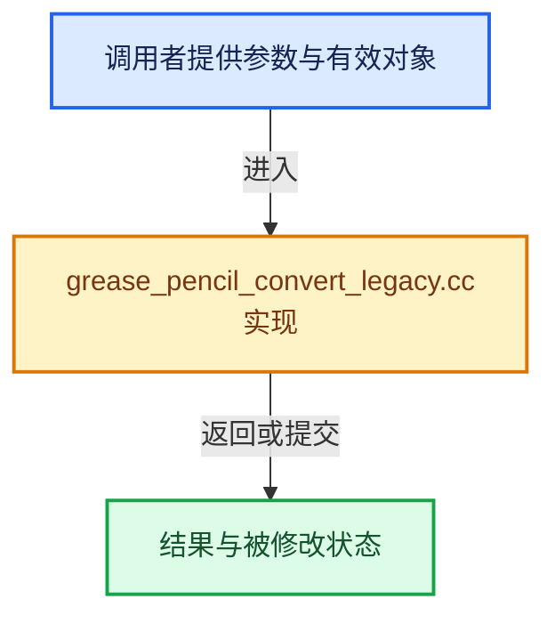

# 实现依赖专题：source/blender/blenkernel/intern/grease_pencil_convert_legacy.cc

[方向导航](README.md) · [符号索引](../%E7%AC%A6%E5%8F%B7%E4%BE%9D%E8%B5%96%E4%B8%8E%E5%AE%9E%E7%8E%B0%E7%B4%A2%E5%BC%95.md)

本专题从正文实际调用进入，集中保存共享实现。函数有稳定锚点，可从调用处直接跳到对应完整函数；递归与互相调用通过回链组织。

## 本文件的实现关系

```mermaid
flowchart LR
  F0["blender::bke::greasepencil::convert::AnimDataConvertor::is_valid"]:::abstraction
  F1["blender::bke::greasepencil::convert::AnimDataConvertor::legacy_fcurves_is_valid_for_root_path"]:::compute
  F2["blender::bke::greasepencil::convert::AnimDataConvertor::animation_fcurve_is_valid"]:::compute
  F3["blender::bke::greasepencil::convert::AnimDataConvertor::fcurve_foreach_in_action"]:::compute
  F4["blender::bke::greasepencil::convert::AnimDataConvertor::fcurve_foreach_in_listbase"]:::compute
  F5["blender::bke::greasepencil::convert::AnimDataConvertor::nla_strip_fcurve_foreach"]:::compute
  F6["blender::bke::greasepencil::convert::AnimDataConvertor::animdata_fcurve_foreach"]:::compute
  F7["blender::bke::greasepencil::convert::AnimDataConvertor::source_has_animation_to_convert"]:::compute
  F2 -->|"显式调用"| F0
  F2 -->|"显式调用"| F1
  F5 -->|"显式调用"| F3
  F5 -->|"显式调用"| F5
  F6 -->|"显式调用"| F3
  F6 -->|"显式调用"| F4
  F6 -->|"显式调用"| F5
  F7 -->|"显式调用"| F0
  F7 -->|"显式调用"| F2
  F7 -->|"显式调用"| F6
  classDef input fill:#DBEAFE,stroke:#2563EB,color:#172554,stroke-width:2px;
  classDef data fill:#CFFAFE,stroke:#0891B2,color:#164E63,stroke-width:2px;
  classDef abstraction fill:#EDE9FE,stroke:#7C3AED,color:#3B0764,stroke-width:2px;
  classDef compute fill:#FEF3C7,stroke:#D97706,color:#78350F,stroke-width:2px;
  classDef result fill:#DCFCE7,stroke:#16A34A,color:#14532D,stroke-width:2px;
  classDef error fill:#FEE2E2,stroke:#DC2626,color:#7F1D1D,stroke-width:2px;
```






## 完整成员与函数实现

<a id="f-73f02d756a5f8ccc"></a>

### `blender::bke::greasepencil::convert::AnimDataConvertor::is_valid`

实现位置：[source/blender/blenkernel/intern/grease_pencil_convert_legacy.cc](../../../../../source/blender/blenkernel/intern/grease_pencil_convert_legacy.cc) · L232—L235。

**教学注释版**

<!-- annotated:c5346a7bd3faeb -->

```cpp
  bool is_valid() const
  {
    return this->animdata_src != nullptr;
  }
```

<details>
<summary>核对原始源码：source/blender/blenkernel/intern/grease_pencil_convert_legacy.cc · L232—L235</summary>

<!-- original:c5346a7bd3faeb:source/blender/blenkernel/intern/grease_pencil_convert_legacy.cc:232:235 -->

```cpp
  bool is_valid() const
  {
    return this->animdata_src != nullptr;
  }
```

</details>

**结果出口**

- `return this->animdata_src != nullptr;`

**继续追踪实现**

本实现没有需要继续展开的显式调用；检查返回表达式、对象转换和调用者前置条件。

<a id="f-96c37dcd726d9cbe"></a>

### `blender::bke::greasepencil::convert::AnimDataConvertor::legacy_fcurves_is_valid_for_root_path`

实现位置：[source/blender/blenkernel/intern/grease_pencil_convert_legacy.cc](../../../../../source/blender/blenkernel/intern/grease_pencil_convert_legacy.cc) · L238—L245。

接口参数：

- `FCurve &fcurve`
- `StringRefNull legacy_root_path`

**教学注释版**

<!-- annotated:dcf92ce1393953 -->

```cpp
  bool legacy_fcurves_is_valid_for_root_path(FCurve &fcurve, StringRefNull legacy_root_path) const
  {
    const StringRefNull rna_path = fcurve.rna_path();
    if (!rna_path.startswith(legacy_root_path)) {
      return false;
    }
    return true;
  }
```

<details>
<summary>核对原始源码：source/blender/blenkernel/intern/grease_pencil_convert_legacy.cc · L238—L245</summary>

<!-- original:dcf92ce1393953:source/blender/blenkernel/intern/grease_pencil_convert_legacy.cc:238:245 -->

```cpp
  bool legacy_fcurves_is_valid_for_root_path(FCurve &fcurve, StringRefNull legacy_root_path) const
  {
    const StringRefNull rna_path = fcurve.rna_path();
    if (!rna_path.startswith(legacy_root_path)) {
      return false;
    }
    return true;
  }
```

</details>

**结果出口**

- `return false;`
- `return true;`

**继续追踪实现**

- `fcurve.rna_path` → [blender::FCurve::rna_path · L189](%E4%BE%9D%E8%B5%96-fcurve-593e2e.md#f-b3be61588d36ab9c)。
- `rna_path.startswith` → [blender::StringRefBase::startswith · L269](../01-%E5%9F%BA%E7%A1%80%E5%AE%B9%E5%99%A8%E4%B8%8E%E7%8E%B0%E4%BB%A3CPP/15-StringRef%E5%AD%97%E7%AC%A6%E4%B8%B2%E8%A7%86%E5%9B%BE.md#f-78237ccfe249bfa5)。

<a id="f-fa1552e77314840f"></a>

### `blender::bke::greasepencil::convert::AnimDataConvertor::animation_fcurve_is_valid`

实现位置：[source/blender/blenkernel/intern/grease_pencil_convert_legacy.cc](../../../../../source/blender/blenkernel/intern/grease_pencil_convert_legacy.cc) · L251—L267。

接口参数：

- `bAction *owner_action`
- `FCurve &fcurve`

**教学注释版**

<!-- annotated:9d49701d9ce324 -->

```cpp
  bool animation_fcurve_is_valid(bAction *owner_action, FCurve &fcurve) const
  {
    if (!this->is_valid()) {
      return false;
    }
    /* Only take into account drivers (nullptr `action_owner`), and Actions directly assigned
     * to the animdata, not the NLA ones. */
    if (owner_action &&
        !ELEM(owner_action, this->animdata_src->action, this->animdata_src->tmpact))
    {
      return false;
    }
    if (!legacy_fcurves_is_valid_for_root_path(fcurve, this->root_path_src)) {
      return false;
    }
    return true;
  }
```

<details>
<summary>核对原始源码：source/blender/blenkernel/intern/grease_pencil_convert_legacy.cc · L251—L267</summary>

<!-- original:9d49701d9ce324:source/blender/blenkernel/intern/grease_pencil_convert_legacy.cc:251:267 -->

```cpp
  bool animation_fcurve_is_valid(bAction *owner_action, FCurve &fcurve) const
  {
    if (!this->is_valid()) {
      return false;
    }
    /* Only take into account drivers (nullptr `action_owner`), and Actions directly assigned
     * to the animdata, not the NLA ones. */
    if (owner_action &&
        !ELEM(owner_action, this->animdata_src->action, this->animdata_src->tmpact))
    {
      return false;
    }
    if (!legacy_fcurves_is_valid_for_root_path(fcurve, this->root_path_src)) {
      return false;
    }
    return true;
  }
```

</details>

**结果出口**

- `return false;`
- `return true;`

**继续追踪实现**

- `this->is_valid` → [blender::bke::greasepencil::convert::AnimDataConvertor::is_valid · L232](%E4%BE%9D%E8%B5%96-grease_pencil_convert_legacy-d3d41f.md#f-73f02d756a5f8ccc)。
- `ELEM` → [ELEM · L88](%E4%BE%9D%E8%B5%96-GHOST_utildefines-34b996.md#m-d28724a15928)；[ELEM · L135](../01-%E5%9F%BA%E7%A1%80%E5%AE%B9%E5%99%A8%E4%B8%8E%E7%8E%B0%E4%BB%A3CPP/%E4%BE%9D%E8%B5%96-BLI_utildefines-293a0a.md#m-d6572de7cae0)。宏定义由构建条件选择。
- `legacy_fcurves_is_valid_for_root_path` → [blender::bke::greasepencil::convert::AnimDataConvertor::legacy_fcurves_is_valid_for_root_path · L238](%E4%BE%9D%E8%B5%96-grease_pencil_convert_legacy-d3d41f.md#f-96c37dcd726d9cbe)。

<a id="f-c6fa96ba48e4c770"></a>

### `blender::bke::greasepencil::convert::AnimDataConvertor::fcurve_foreach_in_action`

实现位置：[source/blender/blenkernel/intern/grease_pencil_convert_legacy.cc](../../../../../source/blender/blenkernel/intern/grease_pencil_convert_legacy.cc) · L271—L280。

接口参数：

- `bAction *owner_action`
- `FunctionRef<FCurveCallback> callback`

**教学注释版**

<!-- annotated:09663996e3cdaf -->

```cpp
  bool fcurve_foreach_in_action(bAction *owner_action, FunctionRef<FCurveCallback> callback) const
  {
    bool is_changed = false;
    animrig::foreach_fcurve_in_action(owner_action->wrap(), [&](FCurve &fcurve) {
      const bool local_is_changed = callback(owner_action, fcurve);
      is_changed = is_changed || local_is_changed;
    });

    return is_changed;
  }
```

<details>
<summary>核对原始源码：source/blender/blenkernel/intern/grease_pencil_convert_legacy.cc · L271—L280</summary>

<!-- original:09663996e3cdaf:source/blender/blenkernel/intern/grease_pencil_convert_legacy.cc:271:280 -->

```cpp
  bool fcurve_foreach_in_action(bAction *owner_action, FunctionRef<FCurveCallback> callback) const
  {
    bool is_changed = false;
    animrig::foreach_fcurve_in_action(owner_action->wrap(), [&](FCurve &fcurve) {
      const bool local_is_changed = callback(owner_action, fcurve);
      is_changed = is_changed || local_is_changed;
    });

    return is_changed;
  }
```

</details>

**沿实际写入检查状态**

- `is_changed = is_changed || local_is_changed;`

**结果出口**

- `return is_changed;`

**继续追踪实现**

- `animrig::foreach_fcurve_in_action` → [blender::animrig::foreach_fcurve_in_action · L29](%E4%BE%9D%E8%B5%96-action_iterators-f53e91.md#f-c8bc900e55b3d458)。
- `owner_action->wrap` → [blender::bAction::wrap · L1929](%E4%BE%9D%E8%B5%96-ANIM_action-8e402f.md#f-f049614274fd7a45)；[blender::bAction::wrap · L1933](%E4%BE%9D%E8%B5%96-ANIM_action-8e402f.md#f-2d697d1983fd282f)。同名重载需按实参类型选择。
- `callback` → [调用协议](../%E6%A8%A1%E6%9D%BF%E5%AE%8F%E4%B8%8E%E5%8A%A8%E6%80%81%E5%88%86%E6%B4%BE%E5%8D%8F%E8%AE%AE.md)：局部可调用对象，须结合其初始化与捕获环境。调用位置L275。

<a id="f-445dfbd895348d0d"></a>

### `blender::bke::greasepencil::convert::AnimDataConvertor::fcurve_foreach_in_listbase`

实现位置：[source/blender/blenkernel/intern/grease_pencil_convert_legacy.cc](../../../../../source/blender/blenkernel/intern/grease_pencil_convert_legacy.cc) · L282—L291。

接口参数：

- `ListBaseT<FCurve> &fcurves`
- `FunctionRef<FCurveCallback> callback`

**教学注释版**

<!-- annotated:d6103179d3636e -->

```cpp
  bool fcurve_foreach_in_listbase(ListBaseT<FCurve> &fcurves,
                                  FunctionRef<FCurveCallback> callback) const
  {
    bool is_changed = false;
    for (FCurve &fcurve : fcurves) {
      const bool local_is_changed = callback(nullptr, fcurve);
      is_changed = is_changed || local_is_changed;
    }
    return is_changed;
  }
```

<details>
<summary>核对原始源码：source/blender/blenkernel/intern/grease_pencil_convert_legacy.cc · L282—L291</summary>

<!-- original:d6103179d3636e:source/blender/blenkernel/intern/grease_pencil_convert_legacy.cc:282:291 -->

```cpp
  bool fcurve_foreach_in_listbase(ListBaseT<FCurve> &fcurves,
                                  FunctionRef<FCurveCallback> callback) const
  {
    bool is_changed = false;
    for (FCurve &fcurve : fcurves) {
      const bool local_is_changed = callback(nullptr, fcurve);
      is_changed = is_changed || local_is_changed;
    }
    return is_changed;
  }
```

</details>

**沿实际写入检查状态**

- `is_changed = is_changed || local_is_changed;`

**结果出口**

- `return is_changed;`

**继续追踪实现**

- `callback` → [调用协议](../%E6%A8%A1%E6%9D%BF%E5%AE%8F%E4%B8%8E%E5%8A%A8%E6%80%81%E5%88%86%E6%B4%BE%E5%8D%8F%E8%AE%AE.md)：局部可调用对象，须结合其初始化与捕获环境。调用位置L287。

<a id="f-5b186b272f7b4d9c"></a>

### `blender::bke::greasepencil::convert::AnimDataConvertor::nla_strip_fcurve_foreach`

实现位置：[source/blender/blenkernel/intern/grease_pencil_convert_legacy.cc](../../../../../source/blender/blenkernel/intern/grease_pencil_convert_legacy.cc) · L293—L307。

接口参数：

- `NlaStrip &nla_strip`
- `FunctionRef<FCurveCallback> callback`

**教学注释版**

<!-- annotated:618af709371e20 -->

```cpp
  bool nla_strip_fcurve_foreach(NlaStrip &nla_strip, FunctionRef<FCurveCallback> callback) const
  {
    bool is_changed = false;
    if (nla_strip.act) {
      if (this->fcurve_foreach_in_action(nla_strip.act, callback)) {
        DEG_id_tag_update(&nla_strip.act->id, ID_RECALC_ANIMATION);
        is_changed = true;
      }
    }
    for (NlaStrip &nla_strip_children : nla_strip.strips) {
      const bool local_is_changed = this->nla_strip_fcurve_foreach(nla_strip_children, callback);
      is_changed = is_changed || local_is_changed;
    }
    return is_changed;
  }
```

<details>
<summary>核对原始源码：source/blender/blenkernel/intern/grease_pencil_convert_legacy.cc · L293—L307</summary>

<!-- original:618af709371e20:source/blender/blenkernel/intern/grease_pencil_convert_legacy.cc:293:307 -->

```cpp
  bool nla_strip_fcurve_foreach(NlaStrip &nla_strip, FunctionRef<FCurveCallback> callback) const
  {
    bool is_changed = false;
    if (nla_strip.act) {
      if (this->fcurve_foreach_in_action(nla_strip.act, callback)) {
        DEG_id_tag_update(&nla_strip.act->id, ID_RECALC_ANIMATION);
        is_changed = true;
      }
    }
    for (NlaStrip &nla_strip_children : nla_strip.strips) {
      const bool local_is_changed = this->nla_strip_fcurve_foreach(nla_strip_children, callback);
      is_changed = is_changed || local_is_changed;
    }
    return is_changed;
  }
```

</details>

**沿实际写入检查状态**

- `is_changed = true;`
- `is_changed = is_changed || local_is_changed;`

**结果出口**

- `return is_changed;`

**继续追踪实现**

- `this->fcurve_foreach_in_action` → [blender::bke::greasepencil::convert::AnimDataConvertor::fcurve_foreach_in_action · L271](%E4%BE%9D%E8%B5%96-grease_pencil_convert_legacy-d3d41f.md#f-c6fa96ba48e4c770)。
- `DEG_id_tag_update` → [blender::DEG_id_tag_update · L844](../11-Depsgraph%E4%B8%8E%E5%B9%B6%E8%A1%8C%E4%BB%BB%E5%8A%A1%E7%B3%BB%E7%BB%9F/%E4%BE%9D%E8%B5%96-depsgraph_tag-d8b3c7.md#f-62d2949dd168bb81)。
- `this->nla_strip_fcurve_foreach` → [blender::bke::greasepencil::convert::AnimDataConvertor::nla_strip_fcurve_foreach · L293](%E4%BE%9D%E8%B5%96-grease_pencil_convert_legacy-d3d41f.md#f-5b186b272f7b4d9c)。

<a id="f-a7b0e4d2bc477b58"></a>

### `blender::bke::greasepencil::convert::AnimDataConvertor::animdata_fcurve_foreach`

实现位置：[source/blender/blenkernel/intern/grease_pencil_convert_legacy.cc](../../../../../source/blender/blenkernel/intern/grease_pencil_convert_legacy.cc) · L309—L344。

接口参数：

- `AnimData &anim_data`
- `FunctionRef<FCurveCallback> callback`

**教学注释版**

<!-- annotated:3961a9d86f7ce1 -->

```cpp
  bool animdata_fcurve_foreach(AnimData &anim_data, FunctionRef<FCurveCallback> callback) const
  {
    bool is_changed = false;
    if (anim_data.action) {
      if (this->fcurve_foreach_in_action(anim_data.action, callback)) {
        DEG_id_tag_update(&anim_data.action->id, ID_RECALC_ANIMATION);
        is_changed = true;
      }
    }
    if (anim_data.tmpact) {
      if (this->fcurve_foreach_in_action(anim_data.tmpact, callback)) {
        DEG_id_tag_update(&anim_data.tmpact->id, ID_RECALC_ANIMATION);
        is_changed = true;
      }
    }

    {
      const bool local_is_changed = this->fcurve_foreach_in_listbase(anim_data.drivers, callback);
      is_changed = is_changed || local_is_changed;
    }

    /* NOTE: New layered actions system can be ignored here, it did not exist together with GPv2.
     */

    if (this->skip_nla) {
      return is_changed;
    }

    for (NlaTrack &nla_track : anim_data.nla_tracks) {
      for (NlaStrip &nla_strip : nla_track.strips) {
        const bool local_is_changed = this->nla_strip_fcurve_foreach(nla_strip, callback);
        is_changed = is_changed || local_is_changed;
      }
    }
    return is_changed;
  }
```

<details>
<summary>核对原始源码：source/blender/blenkernel/intern/grease_pencil_convert_legacy.cc · L309—L344</summary>

<!-- original:3961a9d86f7ce1:source/blender/blenkernel/intern/grease_pencil_convert_legacy.cc:309:344 -->

```cpp
  bool animdata_fcurve_foreach(AnimData &anim_data, FunctionRef<FCurveCallback> callback) const
  {
    bool is_changed = false;
    if (anim_data.action) {
      if (this->fcurve_foreach_in_action(anim_data.action, callback)) {
        DEG_id_tag_update(&anim_data.action->id, ID_RECALC_ANIMATION);
        is_changed = true;
      }
    }
    if (anim_data.tmpact) {
      if (this->fcurve_foreach_in_action(anim_data.tmpact, callback)) {
        DEG_id_tag_update(&anim_data.tmpact->id, ID_RECALC_ANIMATION);
        is_changed = true;
      }
    }

    {
      const bool local_is_changed = this->fcurve_foreach_in_listbase(anim_data.drivers, callback);
      is_changed = is_changed || local_is_changed;
    }

    /* NOTE: New layered actions system can be ignored here, it did not exist together with GPv2.
     */

    if (this->skip_nla) {
      return is_changed;
    }

    for (NlaTrack &nla_track : anim_data.nla_tracks) {
      for (NlaStrip &nla_strip : nla_track.strips) {
        const bool local_is_changed = this->nla_strip_fcurve_foreach(nla_strip, callback);
        is_changed = is_changed || local_is_changed;
      }
    }
    return is_changed;
  }
```

</details>

**沿实际写入检查状态**

- `is_changed = true;`
- `is_changed = is_changed || local_is_changed;`

**结果出口**

- `return is_changed;`

**继续追踪实现**

- `this->fcurve_foreach_in_action` → [blender::bke::greasepencil::convert::AnimDataConvertor::fcurve_foreach_in_action · L271](%E4%BE%9D%E8%B5%96-grease_pencil_convert_legacy-d3d41f.md#f-c6fa96ba48e4c770)。
- `DEG_id_tag_update` → [blender::DEG_id_tag_update · L844](../11-Depsgraph%E4%B8%8E%E5%B9%B6%E8%A1%8C%E4%BB%BB%E5%8A%A1%E7%B3%BB%E7%BB%9F/%E4%BE%9D%E8%B5%96-depsgraph_tag-d8b3c7.md#f-62d2949dd168bb81)。
- `this->fcurve_foreach_in_listbase` → [blender::bke::greasepencil::convert::AnimDataConvertor::fcurve_foreach_in_listbase · L282](%E4%BE%9D%E8%B5%96-grease_pencil_convert_legacy-d3d41f.md#f-445dfbd895348d0d)。
- `this->nla_strip_fcurve_foreach` → [blender::bke::greasepencil::convert::AnimDataConvertor::nla_strip_fcurve_foreach · L293](%E4%BE%9D%E8%B5%96-grease_pencil_convert_legacy-d3d41f.md#f-5b186b272f7b4d9c)。

<a id="f-1e85a780692ed6b9"></a>

### `blender::bke::greasepencil::convert::AnimDataConvertor::source_has_animation_to_convert`

实现位置：[source/blender/blenkernel/intern/grease_pencil_convert_legacy.cc](../../../../../source/blender/blenkernel/intern/grease_pencil_convert_legacy.cc) · L398—L435。

**教学注释版**

<!-- annotated:4de59446c2b9a9 -->

```cpp
  bool source_has_animation_to_convert() const
  {
    if (!this->is_valid()) {
      return false;
    }

    if (id_src.id_type() != id_dst.id_type()) {
      return true;
    }

    bool has_animation = false;
    auto animation_detection_cb = [&](bAction *owner_action, FCurve &fcurve) -> bool {
      /* Early out if we already know that the target data is animated. */
      if (has_animation) {
        return false;
      }
      if (!this->animation_fcurve_is_valid(owner_action, fcurve)) {
        return false;
      }
      if (this->fcurve_convertors.is_empty()) {
        has_animation = true;
        return false;
      }
      const StringRefNull rna_path = fcurve.rna_path();
      for (const AnimDataFCurveConvertor &fcurve_convertor : this->fcurve_convertors) {
        const std::string rna_path_src = fmt::format(
            "{}{}", this->root_path_src, fcurve_convertor.relative_rna_path_src);
        if (rna_path == rna_path_src) {
          has_animation = true;
          return false;
        }
      }
      return false;
    };

    this->animdata_fcurve_foreach(*this->animdata_src, animation_detection_cb);
    return has_animation;
  }
```

<details>
<summary>核对原始源码：source/blender/blenkernel/intern/grease_pencil_convert_legacy.cc · L398—L435</summary>

<!-- original:4de59446c2b9a9:source/blender/blenkernel/intern/grease_pencil_convert_legacy.cc:398:435 -->

```cpp
  bool source_has_animation_to_convert() const
  {
    if (!this->is_valid()) {
      return false;
    }

    if (id_src.id_type() != id_dst.id_type()) {
      return true;
    }

    bool has_animation = false;
    auto animation_detection_cb = [&](bAction *owner_action, FCurve &fcurve) -> bool {
      /* Early out if we already know that the target data is animated. */
      if (has_animation) {
        return false;
      }
      if (!this->animation_fcurve_is_valid(owner_action, fcurve)) {
        return false;
      }
      if (this->fcurve_convertors.is_empty()) {
        has_animation = true;
        return false;
      }
      const StringRefNull rna_path = fcurve.rna_path();
      for (const AnimDataFCurveConvertor &fcurve_convertor : this->fcurve_convertors) {
        const std::string rna_path_src = fmt::format(
            "{}{}", this->root_path_src, fcurve_convertor.relative_rna_path_src);
        if (rna_path == rna_path_src) {
          has_animation = true;
          return false;
        }
      }
      return false;
    };

    this->animdata_fcurve_foreach(*this->animdata_src, animation_detection_cb);
    return has_animation;
  }
```

</details>

**沿实际写入检查状态**

- `has_animation = true;`

**结果出口**

- `return false;`
- `return true;`
- `return has_animation;`

**继续追踪实现**

- `this->is_valid` → [blender::bke::greasepencil::convert::AnimDataConvertor::is_valid · L232](%E4%BE%9D%E8%B5%96-grease_pencil_convert_legacy-d3d41f.md#f-73f02d756a5f8ccc)。
- `id_src.id_type` → [blender::ID::id_type · L544](%E4%BE%9D%E8%B5%96-DNA_ID-3eb091.md#f-ee8fe63f3948aa47)。
- `id_dst.id_type` → [blender::ID::id_type · L544](%E4%BE%9D%E8%B5%96-DNA_ID-3eb091.md#f-ee8fe63f3948aa47)。
- `this->animation_fcurve_is_valid` → [blender::bke::greasepencil::convert::AnimDataConvertor::animation_fcurve_is_valid · L251](%E4%BE%9D%E8%B5%96-grease_pencil_convert_legacy-d3d41f.md#f-fa1552e77314840f)。
- `this->fcurve_convertors.is_empty` → [调用协议](../%E6%A8%A1%E6%9D%BF%E5%AE%8F%E4%B8%8E%E5%8A%A8%E6%80%81%E5%88%86%E6%B4%BE%E5%8D%8F%E8%AE%AE.md)：接收对象类型依赖auto、返回值或模板实例；不按同名猜测目标。调用位置L417。
- `fcurve.rna_path` → [blender::FCurve::rna_path · L189](%E4%BE%9D%E8%B5%96-fcurve-593e2e.md#f-b3be61588d36ab9c)。
- `fmt::format` → [外部契约](https://fmt.dev/latest/api/)：按fmt接口的格式字符串与参数类型契约使用，格式化不改变被格式化对象的拥有关系。
- `this->animdata_fcurve_foreach` → [blender::bke::greasepencil::convert::AnimDataConvertor::animdata_fcurve_foreach · L309](%E4%BE%9D%E8%B5%96-grease_pencil_convert_legacy-d3d41f.md#f-a7b0e4d2bc477b58)。

<a id="f-2d40b28da3bc777a"></a>

### `blender::bke::greasepencil::convert::AnimDataConvertor::fcurves_convert`

实现位置：[source/blender/blenkernel/intern/grease_pencil_convert_legacy.cc](../../../../../source/blender/blenkernel/intern/grease_pencil_convert_legacy.cc) · L443—L513。

**教学注释版**

<!-- annotated:b7a779ed360c44 -->

```cpp
  void fcurves_convert()
  {
    if (!this->is_valid()) {
      return;
    }

    auto fcurve_convert_cb = [&](const AnimDataFCurveConvertor *fcurve_convertor,
                                 bAction *owner_action,
                                 FCurve &fcurve,
                                 const std::string &rna_path_dst) {
      fcurve.rna_path_set(rna_path_dst);
      if (fcurve_convertor && fcurve_convertor->convert_cb) {
        fcurve_convertor->convert_cb(fcurve);
      }
      this->has_changes = true;

      if (!this->is_transfer_between_ids) {
        return;
      }
      if (owner_action) {
        if (owner_action == this->animdata_src->action) {
          this->fcurves_from_src_main_action.append(&fcurve);
        }
        else if (owner_action == this->animdata_src->tmpact) {
          this->fcurves_from_src_tmp_action.append(&fcurve);
        }
      }
      else { /* Driver */
        this->fcurves_from_src_drivers.append(&fcurve);
      }
    };

    /* Update all FCurves which RNA path starts with the #root_path_src. */
    if (this->fcurve_convertors.is_empty()) {
      auto fcurve_root_path_convert_cb = [&](bAction *owner_action, FCurve &fcurve) -> bool {
        if (!legacy_fcurves_is_valid_for_root_path(fcurve, this->root_path_src)) {
          return false;
        }
        const StringRefNull rna_path = fcurve.rna_path();
        const std::string rna_path_dst = fmt::format(
            "{}{}", this->root_path_dst, rna_path.substr(int64_t(this->root_path_src.size())));
        fcurve_convert_cb(nullptr, owner_action, fcurve, rna_path_dst);
        return true;
      };

      this->animdata_fcurve_foreach(*(this->animdata_src), fcurve_root_path_convert_cb);
      return;
    }

    /* Update all FCurves which RNA path starts with the #root_path_src, and remains of the path
     * matches one of the entries in #fcurve_convertors. */
    auto fcurve_full_path_convert_cb = [&](bAction *owner_action, FCurve &fcurve) -> bool {
      if (!animation_fcurve_is_valid(owner_action, fcurve)) {
        return false;
      }
      const StringRefNull rna_path = fcurve.rna_path();
      for (const AnimDataFCurveConvertor &fcurve_convertor : this->fcurve_convertors) {
        const std::string rna_path_src = fmt::format(
            "{}{}", this->root_path_src, fcurve_convertor.relative_rna_path_src);
        if (rna_path == rna_path_src) {
          const std::string rna_path_dst = fmt::format(
              "{}{}", this->root_path_dst, fcurve_convertor.relative_rna_path_dst);
          fcurve_convert_cb(&fcurve_convertor, owner_action, fcurve, rna_path_dst);
          return true;
        }
      }
      return false;
    };

    this->animdata_fcurve_foreach(*(this->animdata_src), fcurve_full_path_convert_cb);
  }
```

<details>
<summary>核对原始源码：source/blender/blenkernel/intern/grease_pencil_convert_legacy.cc · L443—L513</summary>

<!-- original:b7a779ed360c44:source/blender/blenkernel/intern/grease_pencil_convert_legacy.cc:443:513 -->

```cpp
  void fcurves_convert()
  {
    if (!this->is_valid()) {
      return;
    }

    auto fcurve_convert_cb = [&](const AnimDataFCurveConvertor *fcurve_convertor,
                                 bAction *owner_action,
                                 FCurve &fcurve,
                                 const std::string &rna_path_dst) {
      fcurve.rna_path_set(rna_path_dst);
      if (fcurve_convertor && fcurve_convertor->convert_cb) {
        fcurve_convertor->convert_cb(fcurve);
      }
      this->has_changes = true;

      if (!this->is_transfer_between_ids) {
        return;
      }
      if (owner_action) {
        if (owner_action == this->animdata_src->action) {
          this->fcurves_from_src_main_action.append(&fcurve);
        }
        else if (owner_action == this->animdata_src->tmpact) {
          this->fcurves_from_src_tmp_action.append(&fcurve);
        }
      }
      else { /* Driver */
        this->fcurves_from_src_drivers.append(&fcurve);
      }
    };

    /* Update all FCurves which RNA path starts with the #root_path_src. */
    if (this->fcurve_convertors.is_empty()) {
      auto fcurve_root_path_convert_cb = [&](bAction *owner_action, FCurve &fcurve) -> bool {
        if (!legacy_fcurves_is_valid_for_root_path(fcurve, this->root_path_src)) {
          return false;
        }
        const StringRefNull rna_path = fcurve.rna_path();
        const std::string rna_path_dst = fmt::format(
            "{}{}", this->root_path_dst, rna_path.substr(int64_t(this->root_path_src.size())));
        fcurve_convert_cb(nullptr, owner_action, fcurve, rna_path_dst);
        return true;
      };

      this->animdata_fcurve_foreach(*(this->animdata_src), fcurve_root_path_convert_cb);
      return;
    }

    /* Update all FCurves which RNA path starts with the #root_path_src, and remains of the path
     * matches one of the entries in #fcurve_convertors. */
    auto fcurve_full_path_convert_cb = [&](bAction *owner_action, FCurve &fcurve) -> bool {
      if (!animation_fcurve_is_valid(owner_action, fcurve)) {
        return false;
      }
      const StringRefNull rna_path = fcurve.rna_path();
      for (const AnimDataFCurveConvertor &fcurve_convertor : this->fcurve_convertors) {
        const std::string rna_path_src = fmt::format(
            "{}{}", this->root_path_src, fcurve_convertor.relative_rna_path_src);
        if (rna_path == rna_path_src) {
          const std::string rna_path_dst = fmt::format(
              "{}{}", this->root_path_dst, fcurve_convertor.relative_rna_path_dst);
          fcurve_convert_cb(&fcurve_convertor, owner_action, fcurve, rna_path_dst);
          return true;
        }
      }
      return false;
    };

    this->animdata_fcurve_foreach(*(this->animdata_src), fcurve_full_path_convert_cb);
  }
```

</details>

**沿实际写入检查状态**

- `this->has_changes = true;`

**结果出口**

- `return false;`
- `return true;`

**继续追踪实现**

- `this->is_valid` → [blender::bke::greasepencil::convert::AnimDataConvertor::is_valid · L232](%E4%BE%9D%E8%B5%96-grease_pencil_convert_legacy-d3d41f.md#f-73f02d756a5f8ccc)。
- `fcurve.rna_path_set` → [blender::FCurve::rna_path_set · L174](%E4%BE%9D%E8%B5%96-fcurve-593e2e.md#f-3809806ab92b7a0f)。
- `fcurve_convertor->convert_cb` → [调用协议](../%E6%A8%A1%E6%9D%BF%E5%AE%8F%E4%B8%8E%E5%8A%A8%E6%80%81%E5%88%86%E6%B4%BE%E5%8D%8F%E8%AE%AE.md)：由接收对象具体类型或运行时策略提供实现。调用位置L455。
- `this->fcurves_from_src_main_action.append` → [调用协议](../%E6%A8%A1%E6%9D%BF%E5%AE%8F%E4%B8%8E%E5%8A%A8%E6%80%81%E5%88%86%E6%B4%BE%E5%8D%8F%E8%AE%AE.md)：接收对象类型依赖auto、返回值或模板实例；不按同名猜测目标。调用位置L464。
- `this->fcurves_from_src_tmp_action.append` → [调用协议](../%E6%A8%A1%E6%9D%BF%E5%AE%8F%E4%B8%8E%E5%8A%A8%E6%80%81%E5%88%86%E6%B4%BE%E5%8D%8F%E8%AE%AE.md)：接收对象类型依赖auto、返回值或模板实例；不按同名猜测目标。调用位置L467。
- `this->fcurves_from_src_drivers.append` → [调用协议](../%E6%A8%A1%E6%9D%BF%E5%AE%8F%E4%B8%8E%E5%8A%A8%E6%80%81%E5%88%86%E6%B4%BE%E5%8D%8F%E8%AE%AE.md)：接收对象类型依赖auto、返回值或模板实例；不按同名猜测目标。调用位置L471。
- `this->fcurve_convertors.is_empty` → [调用协议](../%E6%A8%A1%E6%9D%BF%E5%AE%8F%E4%B8%8E%E5%8A%A8%E6%80%81%E5%88%86%E6%B4%BE%E5%8D%8F%E8%AE%AE.md)：接收对象类型依赖auto、返回值或模板实例；不按同名猜测目标。调用位置L476。
- `legacy_fcurves_is_valid_for_root_path` → [blender::bke::greasepencil::convert::AnimDataConvertor::legacy_fcurves_is_valid_for_root_path · L238](%E4%BE%9D%E8%B5%96-grease_pencil_convert_legacy-d3d41f.md#f-96c37dcd726d9cbe)。
- `fcurve.rna_path` → [blender::FCurve::rna_path · L189](%E4%BE%9D%E8%B5%96-fcurve-593e2e.md#f-b3be61588d36ab9c)。
- `fmt::format` → [外部契约](https://fmt.dev/latest/api/)：按fmt接口的格式字符串与参数类型契约使用，格式化不改变被格式化对象的拥有关系。
- `rna_path.substr` → [调用协议](../%E6%A8%A1%E6%9D%BF%E5%AE%8F%E4%B8%8E%E5%8A%A8%E6%80%81%E5%88%86%E6%B4%BE%E5%8D%8F%E8%AE%AE.md)：由接收对象具体类型或运行时策略提供实现。调用位置L483。
- `this->root_path_src.size` → [调用协议](../%E6%A8%A1%E6%9D%BF%E5%AE%8F%E4%B8%8E%E5%8A%A8%E6%80%81%E5%88%86%E6%B4%BE%E5%8D%8F%E8%AE%AE.md)：接收对象类型依赖auto、返回值或模板实例；不按同名猜测目标。调用位置L483。
- `fcurve_convert_cb` → [调用协议](../%E6%A8%A1%E6%9D%BF%E5%AE%8F%E4%B8%8E%E5%8A%A8%E6%80%81%E5%88%86%E6%B4%BE%E5%8D%8F%E8%AE%AE.md)：局部可调用对象，须结合其初始化与捕获环境。调用位置L484。
- `this->animdata_fcurve_foreach` → [blender::bke::greasepencil::convert::AnimDataConvertor::animdata_fcurve_foreach · L309](%E4%BE%9D%E8%B5%96-grease_pencil_convert_legacy-d3d41f.md#f-a7b0e4d2bc477b58)。
- `animation_fcurve_is_valid` → [blender::bke::greasepencil::convert::AnimDataConvertor::animation_fcurve_is_valid · L251](%E4%BE%9D%E8%B5%96-grease_pencil_convert_legacy-d3d41f.md#f-fa1552e77314840f)。

<a id="f-751cd9de41f182fa"></a>

### `blender::bke::greasepencil::convert::AnimDataConvertor::fcurves_convert_finalize`

实现位置：[source/blender/blenkernel/intern/grease_pencil_convert_legacy.cc](../../../../../source/blender/blenkernel/intern/grease_pencil_convert_legacy.cc) · L525—L614。

**教学注释版**

<!-- annotated:3f225ab07d9841 -->

```cpp
  void fcurves_convert_finalize()
  {
    if (!this->is_valid()) {
      return;
    }

    if (&id_src == &id_dst) {
      if (this->has_changes) {
        DEG_id_tag_update(&this->id_src, ID_RECALC_ANIMATION);
        DEG_relations_tag_update(&this->conversion_data.bmain);
      }
      return;
    }

    if (this->fcurves_from_src_main_action.is_empty() &&
        this->fcurves_from_src_tmp_action.is_empty() && this->fcurves_from_src_drivers.is_empty())
    {
      return;
    }
    if (!this->animdata_dst) {
      this->animdata_dst = BKE_animdata_ensure_id(&this->id_dst);
    }

    auto fcurves_move = [&](bAction *action_dst,
                            const animrig::slot_handle_t slot_handle_dst,
                            bAction *action_src,
                            const Span<FCurve *> fcurves) {
      for (FCurve *fcurve : fcurves) {
        animrig::action_fcurve_move(
            action_dst->wrap(), slot_handle_dst, action_src->wrap(), *fcurve);
      }
    };

    auto fcurves_move_between_listbases = [&](ListBaseT<FCurve> &fcurves_dst,
                                              ListBaseT<FCurve> &fcurves_src,
                                              const Span<FCurve *> fcurves) {
      for (FCurve *fcurve : fcurves) {
        BLI_assert(BLI_findindex(&fcurves_src, fcurve) >= 0);
        BLI_remlink(&fcurves_src, fcurve);
        BLI_addtail(&fcurves_dst, fcurve);
      }
    };

    if (!this->fcurves_from_src_main_action.is_empty()) {
      if (!this->animdata_dst->action) {
        /* Create a new action. */
        animrig::Action &action = animrig::action_add(
            this->conversion_data.bmain,
            this->animdata_src->action ? this->animdata_src->action->id.name + 2 : nullptr);
        action.slot_add_for_id(this->id_dst);

        const bool ok = animrig::assign_action(&action, {this->id_dst, *this->animdata_dst});
        BLI_assert_msg(ok, "Expecting action assignment to work when converting Grease Pencil");
        UNUSED_VARS_NDEBUG(ok);
      }
      fcurves_move(this->animdata_dst->action,
                   this->animdata_dst->slot_handle,
                   this->animdata_src->action,
                   this->fcurves_from_src_main_action);
      this->fcurves_from_src_main_action.clear();
    }
    if (!this->fcurves_from_src_tmp_action.is_empty()) {
      if (!this->animdata_dst->tmpact) {
        /* Create a new tmpact. */
        animrig::Action &tmpact = animrig::action_add(
            this->conversion_data.bmain,
            this->animdata_src->tmpact ? this->animdata_src->tmpact->id.name + 2 : nullptr);
        tmpact.slot_add_for_id(this->id_dst);

        const bool ok = animrig::assign_tmpaction(&tmpact, {this->id_dst, *this->animdata_dst});
        BLI_assert_msg(ok, "Expecting tmpact assignment to work when converting Grease Pencil");
        UNUSED_VARS_NDEBUG(ok);
      }
      fcurves_move(this->animdata_dst->tmpact,
                   this->animdata_dst->tmp_slot_handle,
                   this->animdata_src->tmpact,
                   this->fcurves_from_src_tmp_action);
      this->fcurves_from_src_tmp_action.clear();
    }
    if (!this->fcurves_from_src_drivers.is_empty()) {
      fcurves_move_between_listbases(this->animdata_dst->drivers,
                                     this->animdata_src->drivers,
                                     this->fcurves_from_src_drivers);
      this->fcurves_from_src_drivers.clear();
    }

    DEG_id_tag_update(&this->id_dst, ID_RECALC_ANIMATION);
    DEG_id_tag_update(&this->id_src, ID_RECALC_ANIMATION);
    DEG_relations_tag_update(&this->conversion_data.bmain);
  }
```

<details>
<summary>核对原始源码：source/blender/blenkernel/intern/grease_pencil_convert_legacy.cc · L525—L614</summary>

<!-- original:3f225ab07d9841:source/blender/blenkernel/intern/grease_pencil_convert_legacy.cc:525:614 -->

```cpp
  void fcurves_convert_finalize()
  {
    if (!this->is_valid()) {
      return;
    }

    if (&id_src == &id_dst) {
      if (this->has_changes) {
        DEG_id_tag_update(&this->id_src, ID_RECALC_ANIMATION);
        DEG_relations_tag_update(&this->conversion_data.bmain);
      }
      return;
    }

    if (this->fcurves_from_src_main_action.is_empty() &&
        this->fcurves_from_src_tmp_action.is_empty() && this->fcurves_from_src_drivers.is_empty())
    {
      return;
    }
    if (!this->animdata_dst) {
      this->animdata_dst = BKE_animdata_ensure_id(&this->id_dst);
    }

    auto fcurves_move = [&](bAction *action_dst,
                            const animrig::slot_handle_t slot_handle_dst,
                            bAction *action_src,
                            const Span<FCurve *> fcurves) {
      for (FCurve *fcurve : fcurves) {
        animrig::action_fcurve_move(
            action_dst->wrap(), slot_handle_dst, action_src->wrap(), *fcurve);
      }
    };

    auto fcurves_move_between_listbases = [&](ListBaseT<FCurve> &fcurves_dst,
                                              ListBaseT<FCurve> &fcurves_src,
                                              const Span<FCurve *> fcurves) {
      for (FCurve *fcurve : fcurves) {
        BLI_assert(BLI_findindex(&fcurves_src, fcurve) >= 0);
        BLI_remlink(&fcurves_src, fcurve);
        BLI_addtail(&fcurves_dst, fcurve);
      }
    };

    if (!this->fcurves_from_src_main_action.is_empty()) {
      if (!this->animdata_dst->action) {
        /* Create a new action. */
        animrig::Action &action = animrig::action_add(
            this->conversion_data.bmain,
            this->animdata_src->action ? this->animdata_src->action->id.name + 2 : nullptr);
        action.slot_add_for_id(this->id_dst);

        const bool ok = animrig::assign_action(&action, {this->id_dst, *this->animdata_dst});
        BLI_assert_msg(ok, "Expecting action assignment to work when converting Grease Pencil");
        UNUSED_VARS_NDEBUG(ok);
      }
      fcurves_move(this->animdata_dst->action,
                   this->animdata_dst->slot_handle,
                   this->animdata_src->action,
                   this->fcurves_from_src_main_action);
      this->fcurves_from_src_main_action.clear();
    }
    if (!this->fcurves_from_src_tmp_action.is_empty()) {
      if (!this->animdata_dst->tmpact) {
        /* Create a new tmpact. */
        animrig::Action &tmpact = animrig::action_add(
            this->conversion_data.bmain,
            this->animdata_src->tmpact ? this->animdata_src->tmpact->id.name + 2 : nullptr);
        tmpact.slot_add_for_id(this->id_dst);

        const bool ok = animrig::assign_tmpaction(&tmpact, {this->id_dst, *this->animdata_dst});
        BLI_assert_msg(ok, "Expecting tmpact assignment to work when converting Grease Pencil");
        UNUSED_VARS_NDEBUG(ok);
      }
      fcurves_move(this->animdata_dst->tmpact,
                   this->animdata_dst->tmp_slot_handle,
                   this->animdata_src->tmpact,
                   this->fcurves_from_src_tmp_action);
      this->fcurves_from_src_tmp_action.clear();
    }
    if (!this->fcurves_from_src_drivers.is_empty()) {
      fcurves_move_between_listbases(this->animdata_dst->drivers,
                                     this->animdata_src->drivers,
                                     this->fcurves_from_src_drivers);
      this->fcurves_from_src_drivers.clear();
    }

    DEG_id_tag_update(&this->id_dst, ID_RECALC_ANIMATION);
    DEG_id_tag_update(&this->id_src, ID_RECALC_ANIMATION);
    DEG_relations_tag_update(&this->conversion_data.bmain);
  }
```

</details>

**沿实际写入检查状态**

- `this->animdata_dst = BKE_animdata_ensure_id(&this->id_dst);`

**继续追踪实现**

- `this->is_valid` → [blender::bke::greasepencil::convert::AnimDataConvertor::is_valid · L232](%E4%BE%9D%E8%B5%96-grease_pencil_convert_legacy-d3d41f.md#f-73f02d756a5f8ccc)。
- `DEG_id_tag_update` → [blender::DEG_id_tag_update · L844](../11-Depsgraph%E4%B8%8E%E5%B9%B6%E8%A1%8C%E4%BB%BB%E5%8A%A1%E7%B3%BB%E7%BB%9F/%E4%BE%9D%E8%B5%96-depsgraph_tag-d8b3c7.md#f-62d2949dd168bb81)。
- `DEG_relations_tag_update` → [blender::DEG_relations_tag_update · L350](../11-Depsgraph%E4%B8%8E%E5%B9%B6%E8%A1%8C%E4%BB%BB%E5%8A%A1%E7%B3%BB%E7%BB%9F/%E4%BE%9D%E8%B5%96-depsgraph_build-ea2fc8.md#f-2910c78540652980)。
- `this->fcurves_from_src_main_action.is_empty` → [调用协议](../%E6%A8%A1%E6%9D%BF%E5%AE%8F%E4%B8%8E%E5%8A%A8%E6%80%81%E5%88%86%E6%B4%BE%E5%8D%8F%E8%AE%AE.md)：接收对象类型依赖auto、返回值或模板实例；不按同名猜测目标。调用位置L539。
- `this->fcurves_from_src_tmp_action.is_empty` → [调用协议](../%E6%A8%A1%E6%9D%BF%E5%AE%8F%E4%B8%8E%E5%8A%A8%E6%80%81%E5%88%86%E6%B4%BE%E5%8D%8F%E8%AE%AE.md)：接收对象类型依赖auto、返回值或模板实例；不按同名猜测目标。调用位置L540。
- `this->fcurves_from_src_drivers.is_empty` → [调用协议](../%E6%A8%A1%E6%9D%BF%E5%AE%8F%E4%B8%8E%E5%8A%A8%E6%80%81%E5%88%86%E6%B4%BE%E5%8D%8F%E8%AE%AE.md)：接收对象类型依赖auto、返回值或模板实例；不按同名猜测目标。调用位置L540。
- `BKE_animdata_ensure_id` → [blender::BKE_animdata_ensure_id · L107](%E4%BE%9D%E8%B5%96-anim_data-56c81c.md#f-03c23566cd3e0251)。
- `animrig::action_fcurve_move` → [blender::animrig::action_fcurve_move · L2802](%E4%BE%9D%E8%B5%96-action-a70714.md#f-e36e2e32afe8b1bf)。
- `action_dst->wrap` → [blender::bAction::wrap · L1929](%E4%BE%9D%E8%B5%96-ANIM_action-8e402f.md#f-f049614274fd7a45)；[blender::bAction::wrap · L1933](%E4%BE%9D%E8%B5%96-ANIM_action-8e402f.md#f-2d697d1983fd282f)。同名重载需按实参类型选择。
- `action_src->wrap` → [blender::bAction::wrap · L1929](%E4%BE%9D%E8%B5%96-ANIM_action-8e402f.md#f-f049614274fd7a45)；[blender::bAction::wrap · L1933](%E4%BE%9D%E8%B5%96-ANIM_action-8e402f.md#f-2d697d1983fd282f)。同名重载需按实参类型选择。
- `BLI_assert` → [BLI_assert · L48](../01-%E5%9F%BA%E7%A1%80%E5%AE%B9%E5%99%A8%E4%B8%8E%E7%8E%B0%E4%BB%A3CPP/%E4%BE%9D%E8%B5%96-BLI_assert-cc98e8.md#m-57a88495704d)；[BLI_assert · L63](../01-%E5%9F%BA%E7%A1%80%E5%AE%B9%E5%99%A8%E4%B8%8E%E7%8E%B0%E4%BB%A3CPP/%E4%BE%9D%E8%B5%96-BLI_assert-cc98e8.md#m-d07050020cb5)。宏定义由构建条件选择。
- `BLI_findindex` → [blender::BLI_findindex · L593](../01-%E5%9F%BA%E7%A1%80%E5%AE%B9%E5%99%A8%E4%B8%8E%E7%8E%B0%E4%BB%A3CPP/%E4%BE%9D%E8%B5%96-listbase-2816d9.md#f-cb9036f12bd486b7)。
- `BLI_remlink` → [blender::BLI_remlink · L138](../01-%E5%9F%BA%E7%A1%80%E5%AE%B9%E5%99%A8%E4%B8%8E%E7%8E%B0%E4%BB%A3CPP/%E4%BE%9D%E8%B5%96-listbase-2816d9.md#f-120d80f281ca4cb7)。
- `BLI_addtail` → [blender::BLI_addtail · L118](../01-%E5%9F%BA%E7%A1%80%E5%AE%B9%E5%99%A8%E4%B8%8E%E7%8E%B0%E4%BB%A3CPP/%E4%BE%9D%E8%B5%96-listbase-2816d9.md#f-4fb027713fa3115b)。
- `animrig::action_add` → [blender::animrig::action_add · L1158](%E4%BE%9D%E8%B5%96-action-a70714.md#f-e6aeab66298c73f1)。
- `action.slot_add_for_id` → [blender::animrig::Action::slot_add_for_id · L530](%E4%BE%9D%E8%B5%96-action-a70714.md#f-f1c64a142cc00690)。
- `animrig::assign_action` → [blender::animrig::assign_action · L1166](%E4%BE%9D%E8%B5%96-action-a70714.md#f-55a18cb8e191d426)；[blender::animrig::assign_action · L1175](%E4%BE%9D%E8%B5%96-action-a70714.md#f-5a2c12d888fde844)。同名重载需按实参类型选择。
- `BLI_assert_msg` → [BLI_assert_msg · L55](../01-%E5%9F%BA%E7%A1%80%E5%AE%B9%E5%99%A8%E4%B8%8E%E7%8E%B0%E4%BB%A3CPP/%E4%BE%9D%E8%B5%96-BLI_assert-cc98e8.md#m-695eed20dceb)；[BLI_assert_msg · L64](../01-%E5%9F%BA%E7%A1%80%E5%AE%B9%E5%99%A8%E4%B8%8E%E7%8E%B0%E4%BB%A3CPP/%E4%BE%9D%E8%B5%96-BLI_assert-cc98e8.md#m-7de5563de4db)。宏定义由构建条件选择。
- `UNUSED_VARS_NDEBUG` → [UNUSED_VARS_NDEBUG · L526](../01-%E5%9F%BA%E7%A1%80%E5%AE%B9%E5%99%A8%E4%B8%8E%E7%8E%B0%E4%BB%A3CPP/%E4%BE%9D%E8%B5%96-BLI_utildefines-293a0a.md#m-fea439f7d366)；[UNUSED_VARS_NDEBUG · L528](../01-%E5%9F%BA%E7%A1%80%E5%AE%B9%E5%99%A8%E4%B8%8E%E7%8E%B0%E4%BB%A3CPP/%E4%BE%9D%E8%B5%96-BLI_utildefines-293a0a.md#m-a8f8cfac06c0)。宏定义由构建条件选择。
- `fcurves_move` → [调用协议](../%E6%A8%A1%E6%9D%BF%E5%AE%8F%E4%B8%8E%E5%8A%A8%E6%80%81%E5%88%86%E6%B4%BE%E5%8D%8F%E8%AE%AE.md)：局部可调用对象，须结合其初始化与捕获环境。调用位置L580。
- `this->fcurves_from_src_main_action.clear` → [调用协议](../%E6%A8%A1%E6%9D%BF%E5%AE%8F%E4%B8%8E%E5%8A%A8%E6%80%81%E5%88%86%E6%B4%BE%E5%8D%8F%E8%AE%AE.md)：接收对象类型依赖auto、返回值或模板实例；不按同名猜测目标。调用位置L584。
- `tmpact.slot_add_for_id` → [blender::animrig::Action::slot_add_for_id · L530](%E4%BE%9D%E8%B5%96-action-a70714.md#f-f1c64a142cc00690)。
- `animrig::assign_tmpaction` → [blender::animrig::assign_tmpaction · L1190](%E4%BE%9D%E8%B5%96-action-a70714.md#f-f9f6b9697fb263e1)。
- `this->fcurves_from_src_tmp_action.clear` → [调用协议](../%E6%A8%A1%E6%9D%BF%E5%AE%8F%E4%B8%8E%E5%8A%A8%E6%80%81%E5%88%86%E6%B4%BE%E5%8D%8F%E8%AE%AE.md)：接收对象类型依赖auto、返回值或模板实例；不按同名猜测目标。调用位置L602。
- `fcurves_move_between_listbases` → [调用协议](../%E6%A8%A1%E6%9D%BF%E5%AE%8F%E4%B8%8E%E5%8A%A8%E6%80%81%E5%88%86%E6%B4%BE%E5%8D%8F%E8%AE%AE.md)：局部可调用对象，须结合其初始化与捕获环境。调用位置L605。
- `this->fcurves_from_src_drivers.clear` → [调用协议](../%E6%A8%A1%E6%9D%BF%E5%AE%8F%E4%B8%8E%E5%8A%A8%E6%80%81%E5%88%86%E6%B4%BE%E5%8D%8F%E8%AE%AE.md)：接收对象类型依赖auto、返回值或模板实例；不按同名猜测目标。调用位置L608。

<a id="f-9e6cde0cac8ceec5"></a>

### `blender::bke::greasepencil::convert::find_used_vertex_groups`

实现位置：[source/blender/blenkernel/intern/grease_pencil_convert_legacy.cc](../../../../../source/blender/blenkernel/intern/grease_pencil_convert_legacy.cc) · L625—L661。

接口参数：

- `const bGPDframe &gpf`
- `const ListBaseT<bDeformGroup> &vertex_group_names`
- `const int num_vertex_groups`
- `ListBaseT<bDeformGroup> &r_vertex_group_names`
- `Array<int> &r_indices`

**教学注释版**

<!-- annotated:ff637e5286e6a0 -->

```cpp
static void find_used_vertex_groups(const bGPDframe &gpf,
                                    const ListBaseT<bDeformGroup> &vertex_group_names,
                                    const int num_vertex_groups,
                                    ListBaseT<bDeformGroup> &r_vertex_group_names,
                                    Array<int> &r_indices)
{
  Array<int> is_group_used(num_vertex_groups, false);
  for (bGPDstroke &gps : gpf.strokes) {
    if (!gps.dvert) {
      continue;
    }
    Span<MDeformVert> dverts = {gps.dvert, gps.totpoints};
    for (const MDeformVert &dvert : dverts) {
      for (const MDeformWeight &weight : Span<MDeformWeight>{dvert.dw, dvert.totweight}) {
        if (weight.def_nr >= num_vertex_groups) {
          /* Ignore invalid deform weight group indices. */
          continue;
        }
        is_group_used[weight.def_nr] = true;
      }
    }
  }
  r_vertex_group_names.clear_no_delete();
  // [讲解] r_indices.reinitialize：以新长度重建数组。
  r_indices.reinitialize(num_vertex_groups);
  int new_group_i = 0;

  for (const auto [old_group_i, def_group] : vertex_group_names.enumerate()) {
    if (!is_group_used[old_group_i]) {
      r_indices[old_group_i] = -1;
      continue;
    }
    r_indices[old_group_i] = new_group_i++;

    bDeformGroup *def_group_copy = MEM_dupalloc(&def_group);
    BLI_addtail(&r_vertex_group_names, def_group_copy);
  }
}
```

<details>
<summary>核对原始源码：source/blender/blenkernel/intern/grease_pencil_convert_legacy.cc · L625—L661</summary>

<!-- original:ff637e5286e6a0:source/blender/blenkernel/intern/grease_pencil_convert_legacy.cc:625:661 -->

```cpp
static void find_used_vertex_groups(const bGPDframe &gpf,
                                    const ListBaseT<bDeformGroup> &vertex_group_names,
                                    const int num_vertex_groups,
                                    ListBaseT<bDeformGroup> &r_vertex_group_names,
                                    Array<int> &r_indices)
{
  Array<int> is_group_used(num_vertex_groups, false);
  for (bGPDstroke &gps : gpf.strokes) {
    if (!gps.dvert) {
      continue;
    }
    Span<MDeformVert> dverts = {gps.dvert, gps.totpoints};
    for (const MDeformVert &dvert : dverts) {
      for (const MDeformWeight &weight : Span<MDeformWeight>{dvert.dw, dvert.totweight}) {
        if (weight.def_nr >= num_vertex_groups) {
          /* Ignore invalid deform weight group indices. */
          continue;
        }
        is_group_used[weight.def_nr] = true;
      }
    }
  }
  r_vertex_group_names.clear_no_delete();
  r_indices.reinitialize(num_vertex_groups);
  int new_group_i = 0;

  for (const auto [old_group_i, def_group] : vertex_group_names.enumerate()) {
    if (!is_group_used[old_group_i]) {
      r_indices[old_group_i] = -1;
      continue;
    }
    r_indices[old_group_i] = new_group_i++;

    bDeformGroup *def_group_copy = MEM_dupalloc(&def_group);
    BLI_addtail(&r_vertex_group_names, def_group_copy);
  }
}
```

</details>

**沿实际写入检查状态**

- `is_group_used[weight.def_nr] = true;`
- `r_indices[old_group_i] = -1;`
- `r_indices[old_group_i] = new_group_i++;`

**继续追踪实现**

- `r_vertex_group_names.clear_no_delete` → [blender::ListBaseT::clear_no_delete · L68](%E4%BE%9D%E8%B5%96-DNA_listBase-48dbc9.md#f-431defdf189ae643)。
- `r_indices.reinitialize` → [blender::Array::reinitialize · L430](../01-%E5%9F%BA%E7%A1%80%E5%AE%B9%E5%99%A8%E4%B8%8E%E7%8E%B0%E4%BB%A3CPP/08-Array%E5%A4%8D%E5%88%B6%E7%A7%BB%E5%8A%A8%E4%B8%8E%E9%94%80%E6%AF%81.md#f-3414f619e246b688)。
- `vertex_group_names.enumerate` → [blender::ListBaseT::enumerate · L152](%E4%BE%9D%E8%B5%96-DNA_listBase-48dbc9.md#f-73544c49caea6d30)；[blender::ListBaseT::enumerate · L157](%E4%BE%9D%E8%B5%96-DNA_listBase-48dbc9.md#f-b4ef4f7169c0afd0)。同名重载需按实参类型选择。
- `MEM_dupalloc` → [MEM_dupalloc · L627](../03-%E5%86%85%E5%AD%98%E5%88%86%E9%85%8D%E4%B8%8E%E8%BF%90%E8%A1%8C%E6%97%B6%E7%B1%BB%E5%9E%8B/%E4%BE%9D%E8%B5%96-MEM_guardedalloc-b54eca.md#f-78a72b71e3c57010)。
- `BLI_addtail` → [blender::BLI_addtail · L118](../01-%E5%9F%BA%E7%A1%80%E5%AE%B9%E5%99%A8%E4%B8%8E%E7%8E%B0%E4%BB%A3CPP/%E4%BE%9D%E8%B5%96-listbase-2816d9.md#f-4fb027713fa3115b)。

<a id="f-a5d99365172d98d1"></a>

### `blender::bke::greasepencil::convert::get_legacy_stroke_to_texture_matrix`

实现位置：[source/blender/blenkernel/intern/grease_pencil_convert_legacy.cc](../../../../../source/blender/blenkernel/intern/grease_pencil_convert_legacy.cc) · L666—L701。

接口参数：

- `const float2 uv_translation`
- `const float uv_rotation`
- `const float2 uv_scale`

**教学注释版**

<!-- annotated:b6eeec2031bfa5 -->

```cpp
static float3x2 get_legacy_stroke_to_texture_matrix(const float2 uv_translation,
                                                    const float uv_rotation,
                                                    const float2 uv_scale)
{
  /* Bounding box data. */
  const float2 minv = float2(-1.0f, -1.0f);
  const float2 maxv = float2(1.0f, 1.0f);
  /* Center of rotation. */
  const float2 center = float2(0.5f, 0.5f);

  const float2 uv_scale_inv = math::safe_rcp(uv_scale);
  const float2 diagonal = maxv - minv;
  const float sin_rotation = sin(uv_rotation);
  const float cos_rotation = cos(uv_rotation);
  const float2x2 rotation = float2x2(float2(cos_rotation, sin_rotation),
                                     float2(-sin_rotation, cos_rotation));

  float3x2 texture_matrix = float3x2::identity();

  /* Apply bounding box re-scaling. */
  texture_matrix[2] -= minv;
  texture_matrix = math::from_scale<float2x2>(1.0f / diagonal) * texture_matrix;

  /* Apply translation. */
  texture_matrix[2] += uv_translation;

  /* Apply rotation. */
  texture_matrix[2] -= center;
  texture_matrix = rotation * texture_matrix;
  texture_matrix[2] += center;

  /* Apply scale. */
  texture_matrix = math::from_scale<float2x2>(uv_scale_inv) * texture_matrix;

  return texture_matrix;
}
```

<details>
<summary>核对原始源码：source/blender/blenkernel/intern/grease_pencil_convert_legacy.cc · L666—L701</summary>

<!-- original:b6eeec2031bfa5:source/blender/blenkernel/intern/grease_pencil_convert_legacy.cc:666:701 -->

```cpp
static float3x2 get_legacy_stroke_to_texture_matrix(const float2 uv_translation,
                                                    const float uv_rotation,
                                                    const float2 uv_scale)
{
  /* Bounding box data. */
  const float2 minv = float2(-1.0f, -1.0f);
  const float2 maxv = float2(1.0f, 1.0f);
  /* Center of rotation. */
  const float2 center = float2(0.5f, 0.5f);

  const float2 uv_scale_inv = math::safe_rcp(uv_scale);
  const float2 diagonal = maxv - minv;
  const float sin_rotation = sin(uv_rotation);
  const float cos_rotation = cos(uv_rotation);
  const float2x2 rotation = float2x2(float2(cos_rotation, sin_rotation),
                                     float2(-sin_rotation, cos_rotation));

  float3x2 texture_matrix = float3x2::identity();

  /* Apply bounding box re-scaling. */
  texture_matrix[2] -= minv;
  texture_matrix = math::from_scale<float2x2>(1.0f / diagonal) * texture_matrix;

  /* Apply translation. */
  texture_matrix[2] += uv_translation;

  /* Apply rotation. */
  texture_matrix[2] -= center;
  texture_matrix = rotation * texture_matrix;
  texture_matrix[2] += center;

  /* Apply scale. */
  texture_matrix = math::from_scale<float2x2>(uv_scale_inv) * texture_matrix;

  return texture_matrix;
}
```

</details>

**沿实际写入检查状态**

- `texture_matrix[2] -= minv;`
- `texture_matrix = math::from_scale<float2x2>(1.0f / diagonal) * texture_matrix;`
- `texture_matrix[2] += uv_translation;`
- `texture_matrix[2] -= center;`
- `texture_matrix = rotation * texture_matrix;`
- `texture_matrix[2] += center;`
- `texture_matrix = math::from_scale<float2x2>(uv_scale_inv) * texture_matrix;`

**结果出口**

- `return texture_matrix;`

**继续追踪实现**

- `float2` → [float2::float2 · L45](%E4%BE%9D%E8%B5%96-sky_math-8091a6.md#f-04c2783f21f996aa)；[float2::float2 · L47](%E4%BE%9D%E8%B5%96-sky_math-8091a6.md#f-dba79c4c10e5ea46)；[float2::float2 · L49](%E4%BE%9D%E8%B5%96-sky_math-8091a6.md#f-920ca90efa37bf0b)；[float2::float2 · L51](%E4%BE%9D%E8%B5%96-sky_math-8091a6.md#f-4b3fbf848d719a63)；[float2::float2 · L53](%E4%BE%9D%E8%B5%96-sky_math-8091a6.md#f-9b2acd8475cc2843)；[float2::float2 · L55](%E4%BE%9D%E8%B5%96-sky_math-8091a6.md#f-1e9233a9a231be51)。同名重载需按实参类型选择。
- `math::safe_rcp` → [blender::math::safe_rcp · L412](../12-%E7%A9%BA%E9%97%B4%E6%95%B0%E6%8D%AE%E7%BB%93%E6%9E%84%E4%B8%8E%E5%87%A0%E4%BD%95%E7%AE%97%E6%B3%95/%E4%BE%9D%E8%B5%96-BLI_math_vector-906a87.md#f-2ab396fe1193778b)；[blender::math::safe_rcp · L168](../12-%E7%A9%BA%E9%97%B4%E6%95%B0%E6%8D%AE%E7%BB%93%E6%9E%84%E4%B8%8E%E5%87%A0%E4%BD%95%E7%AE%97%E6%B3%95/%E4%BE%9D%E8%B5%96-BLI_math_base-0728eb.md#f-f06a817fcc49e8a6)。同名重载需按实参类型选择。
- `sin` → [外部契约](https://eel.is/c++draft/)：这个边界按实际表达式及所属类型核对参数、返回值、寿命与失败行为。这里提供接口入口，不声称已解释该第三方版本的内部实现。
- `cos` → [外部契约](https://eel.is/c++draft/)：这个边界按实际表达式及所属类型核对参数、返回值、寿命与失败行为。这里提供接口入口，不声称已解释该第三方版本的内部实现。
- `float2x2` → [调用协议](../%E6%A8%A1%E6%9D%BF%E5%AE%8F%E4%B8%8E%E5%8A%A8%E6%80%81%E5%88%86%E6%B4%BE%E5%8D%8F%E8%AE%AE.md)：函数指针、局部可调用对象或未展开的宏；必须结合调用者环境。调用位置L680。
- `float3x2::identity` → [调用协议](../%E6%A8%A1%E6%9D%BF%E5%AE%8F%E4%B8%8E%E5%8A%A8%E6%80%81%E5%88%86%E6%B4%BE%E5%8D%8F%E8%AE%AE.md)：函数指针、局部可调用对象或未展开的宏；必须结合调用者环境。调用位置L683。
- `math::from_scale<float2x2>` → [调用协议](../%E6%A8%A1%E6%9D%BF%E5%AE%8F%E4%B8%8E%E5%8A%A8%E6%80%81%E5%88%86%E6%B4%BE%E5%8D%8F%E8%AE%AE.md)：函数指针、局部可调用对象或未展开的宏；必须结合调用者环境。调用位置L687。

<a id="f-a9aa70bb12a8fd4e"></a>

### `blender::bke::greasepencil::convert::get_legacy_layer_to_stroke_matrix`

实现位置：[source/blender/blenkernel/intern/grease_pencil_convert_legacy.cc](../../../../../source/blender/blenkernel/intern/grease_pencil_convert_legacy.cc) · L706—L742。

接口参数：

- `bGPDstroke *gps`

**教学注释版**

<!-- annotated:0b10670dc29f50 -->

```cpp
static float4x2 get_legacy_layer_to_stroke_matrix(bGPDstroke *gps)
{
  using namespace blender::math;

  const bGPDspoint *points = gps->points;
  const int totpoints = gps->totpoints;

  if (totpoints < 2) {
    return float4x2::identity();
  }

  const bGPDspoint *point0 = &points[0];
  const bGPDspoint *point1 = &points[1];
  const bGPDspoint *point3 = &points[int(totpoints * 0.75f)];

  const float3 pt0 = float3(point0->x, point0->y, point0->z);
  const float3 pt1 = float3(point1->x, point1->y, point1->z);
  const float3 pt3 = float3(point3->x, point3->y, point3->z);

  /* Local X axis (p0 -> p1) */
  const float3 local_x = normalize(pt1 - pt0);

  /* Point vector at 3/4 */
  const float3 local_3 = (totpoints == 2) ? (pt3 * 0.001f) - pt0 : pt3 - pt0;

  /* Vector orthogonal to polygon plane. */
  const float3 normal = cross(local_x, local_3);

  /* Local Y axis (cross to normal/x axis). */
  const float3 local_y = normalize(cross(normal, local_x));

  /* Get local space using first point as origin. */
  const float4x2 mat = transpose(
      float2x4(float4(local_x, -dot(pt0, local_x)), float4(local_y, -dot(pt0, local_y))));

  return mat;
}
```

<details>
<summary>核对原始源码：source/blender/blenkernel/intern/grease_pencil_convert_legacy.cc · L706—L742</summary>

<!-- original:0b10670dc29f50:source/blender/blenkernel/intern/grease_pencil_convert_legacy.cc:706:742 -->

```cpp
static float4x2 get_legacy_layer_to_stroke_matrix(bGPDstroke *gps)
{
  using namespace blender::math;

  const bGPDspoint *points = gps->points;
  const int totpoints = gps->totpoints;

  if (totpoints < 2) {
    return float4x2::identity();
  }

  const bGPDspoint *point0 = &points[0];
  const bGPDspoint *point1 = &points[1];
  const bGPDspoint *point3 = &points[int(totpoints * 0.75f)];

  const float3 pt0 = float3(point0->x, point0->y, point0->z);
  const float3 pt1 = float3(point1->x, point1->y, point1->z);
  const float3 pt3 = float3(point3->x, point3->y, point3->z);

  /* Local X axis (p0 -> p1) */
  const float3 local_x = normalize(pt1 - pt0);

  /* Point vector at 3/4 */
  const float3 local_3 = (totpoints == 2) ? (pt3 * 0.001f) - pt0 : pt3 - pt0;

  /* Vector orthogonal to polygon plane. */
  const float3 normal = cross(local_x, local_3);

  /* Local Y axis (cross to normal/x axis). */
  const float3 local_y = normalize(cross(normal, local_x));

  /* Get local space using first point as origin. */
  const float4x2 mat = transpose(
      float2x4(float4(local_x, -dot(pt0, local_x)), float4(local_y, -dot(pt0, local_y))));

  return mat;
}
```

</details>

**结果出口**

- `return float4x2::identity();`
- `return mat;`

**继续追踪实现**

- `float4x2::identity` → [调用协议](../%E6%A8%A1%E6%9D%BF%E5%AE%8F%E4%B8%8E%E5%8A%A8%E6%80%81%E5%88%86%E6%B4%BE%E5%8D%8F%E8%AE%AE.md)：函数指针、局部可调用对象或未展开的宏；必须结合调用者环境。调用位置L714。
- `float3` → [float3 · L641](%E4%BE%9D%E8%B5%96-smaa-b67bc2.md#m-0ea8254cfdb4)。宏定义由构建条件选择。
- `normalize` → [调用协议](../%E6%A8%A1%E6%9D%BF%E5%AE%8F%E4%B8%8E%E5%8A%A8%E6%80%81%E5%88%86%E6%B4%BE%E5%8D%8F%E8%AE%AE.md)：函数指针、局部可调用对象或未展开的宏；必须结合调用者环境。调用位置L726。
- `cross` → [调用协议](../%E6%A8%A1%E6%9D%BF%E5%AE%8F%E4%B8%8E%E5%8A%A8%E6%80%81%E5%88%86%E6%B4%BE%E5%8D%8F%E8%AE%AE.md)：函数指针、局部可调用对象或未展开的宏；必须结合调用者环境。调用位置L732。
- `transpose` → [调用协议](../%E6%A8%A1%E6%9D%BF%E5%AE%8F%E4%B8%8E%E5%8A%A8%E6%80%81%E5%88%86%E6%B4%BE%E5%8D%8F%E8%AE%AE.md)：函数指针、局部可调用对象或未展开的宏；必须结合调用者环境。调用位置L738。
- `float2x4` → [调用协议](../%E6%A8%A1%E6%9D%BF%E5%AE%8F%E4%B8%8E%E5%8A%A8%E6%80%81%E5%88%86%E6%B4%BE%E5%8D%8F%E8%AE%AE.md)：函数指针、局部可调用对象或未展开的宏；必须结合调用者环境。调用位置L739。
- `float4` → [float4 · L56](%E4%BE%9D%E8%B5%96-radial_tiling_shared-98abf9.md#m-f0908e385c5b)；[float4 · L60](../01-%E5%9F%BA%E7%A1%80%E5%AE%B9%E5%99%A8%E4%B8%8E%E7%8E%B0%E4%BB%A3CPP/%E4%BE%9D%E8%B5%96-radial_tiling_shared-7989a4.md#m-7962dcdc288b)；[float4 · L56](%E4%BE%9D%E8%B5%96-node_radial_tiling_shared-b14bc2.md#m-adb8e9e87775)；[float4 · L642](%E4%BE%9D%E8%B5%96-smaa-b67bc2.md#m-9362daaa821c)。宏定义由构建条件选择。
- `dot` → [调用协议](../%E6%A8%A1%E6%9D%BF%E5%AE%8F%E4%B8%8E%E5%8A%A8%E6%80%81%E5%88%86%E6%B4%BE%E5%8D%8F%E8%AE%AE.md)：函数指针、局部可调用对象或未展开的宏；必须结合调用者环境。调用位置L739。

<a id="f-2a10456cda342c35"></a>

### `blender::bke::greasepencil::convert::get_legacy_texture_matrix`

实现位置：[source/blender/blenkernel/intern/grease_pencil_convert_legacy.cc](../../../../../source/blender/blenkernel/intern/grease_pencil_convert_legacy.cc) · L744—L765。

接口参数：

- `bGPDstroke *gps`

**教学注释版**

<!-- annotated:0c334154db71ab -->

```cpp
static float4x2 get_legacy_texture_matrix(bGPDstroke *gps)
{
  const float3x2 texture_matrix = get_legacy_stroke_to_texture_matrix(
      float2(gps->uv_translation), gps->uv_rotation, float2(gps->uv_scale));

  const float4x2 strokemat = get_legacy_layer_to_stroke_matrix(gps);
  float4x3 strokemat4x3 = float4x3(strokemat);
  /*
   * We need the diagonal of ones to start from the bottom right instead top left to properly apply
   * the two matrices.
   *
   * i.e.
   *          # # # #              # # # #
   * We need  # # # #  Instead of  # # # #
   *          0 0 0 1              0 0 1 0
   *
   */
  strokemat4x3[2][2] = 0.0f;
  strokemat4x3[3][2] = 1.0f;

  return texture_matrix * strokemat4x3;
}
```

<details>
<summary>核对原始源码：source/blender/blenkernel/intern/grease_pencil_convert_legacy.cc · L744—L765</summary>

<!-- original:0c334154db71ab:source/blender/blenkernel/intern/grease_pencil_convert_legacy.cc:744:765 -->

```cpp
static float4x2 get_legacy_texture_matrix(bGPDstroke *gps)
{
  const float3x2 texture_matrix = get_legacy_stroke_to_texture_matrix(
      float2(gps->uv_translation), gps->uv_rotation, float2(gps->uv_scale));

  const float4x2 strokemat = get_legacy_layer_to_stroke_matrix(gps);
  float4x3 strokemat4x3 = float4x3(strokemat);
  /*
   * We need the diagonal of ones to start from the bottom right instead top left to properly apply
   * the two matrices.
   *
   * i.e.
   *          # # # #              # # # #
   * We need  # # # #  Instead of  # # # #
   *          0 0 0 1              0 0 1 0
   *
   */
  strokemat4x3[2][2] = 0.0f;
  strokemat4x3[3][2] = 1.0f;

  return texture_matrix * strokemat4x3;
}
```

</details>

**沿实际写入检查状态**

- `strokemat4x3[2][2] = 0.0f;`
- `strokemat4x3[3][2] = 1.0f;`

**结果出口**

- `return texture_matrix * strokemat4x3;`

**继续追踪实现**

- `get_legacy_stroke_to_texture_matrix` → [blender::bke::greasepencil::convert::get_legacy_stroke_to_texture_matrix · L666](%E4%BE%9D%E8%B5%96-grease_pencil_convert_legacy-d3d41f.md#f-a5d99365172d98d1)。
- `float2` → [float2::float2 · L45](%E4%BE%9D%E8%B5%96-sky_math-8091a6.md#f-04c2783f21f996aa)；[float2::float2 · L47](%E4%BE%9D%E8%B5%96-sky_math-8091a6.md#f-dba79c4c10e5ea46)；[float2::float2 · L49](%E4%BE%9D%E8%B5%96-sky_math-8091a6.md#f-920ca90efa37bf0b)；[float2::float2 · L51](%E4%BE%9D%E8%B5%96-sky_math-8091a6.md#f-4b3fbf848d719a63)；[float2::float2 · L53](%E4%BE%9D%E8%B5%96-sky_math-8091a6.md#f-9b2acd8475cc2843)；[float2::float2 · L55](%E4%BE%9D%E8%B5%96-sky_math-8091a6.md#f-1e9233a9a231be51)。同名重载需按实参类型选择。
- `get_legacy_layer_to_stroke_matrix` → [blender::bke::greasepencil::convert::get_legacy_layer_to_stroke_matrix · L706](%E4%BE%9D%E8%B5%96-grease_pencil_convert_legacy-d3d41f.md#f-a9aa70bb12a8fd4e)。
- `float4x3` → [调用协议](../%E6%A8%A1%E6%9D%BF%E5%AE%8F%E4%B8%8E%E5%8A%A8%E6%80%81%E5%88%86%E6%B4%BE%E5%8D%8F%E8%AE%AE.md)：函数指针、局部可调用对象或未展开的宏；必须结合调用者环境。调用位置L750。

<a id="f-1271f4dfcb7eaf74"></a>

### `blender::bke::greasepencil::convert::legacy_gpencil_frame_to_grease_pencil_drawing`

实现位置：[source/blender/blenkernel/intern/grease_pencil_convert_legacy.cc](../../../../../source/blender/blenkernel/intern/grease_pencil_convert_legacy.cc) · L767—L1002。

接口参数：

- `const bGPDframe &gpf`
- `const ListBaseT<bDeformGroup> &vertex_group_names`

**教学注释版**

<!-- annotated:dea542cdf780c8 -->

```cpp
static Drawing legacy_gpencil_frame_to_grease_pencil_drawing(
    const bGPDframe &gpf, const ListBaseT<bDeformGroup> &vertex_group_names)
{
  /* Create a new empty drawing. */
  Drawing drawing;

  /* Get the number of points, number of strokes and the offsets for each stroke. */
  Vector<int> offsets;
  Vector<int8_t> curve_types;
  // [讲解] offsets.append：在尾部建立新元素，必要时先扩大存储。
  offsets.append(0);
  int num_strokes = 0;
  int num_points = 0;
  bool has_bezier_stroke = false;
  for (bGPDstroke &gps : gpf.strokes) {
    /* Check for a valid edit curve. This is only the case when the `editcurve` exists and wasn't
     * tagged for a stroke update. This tag indicates that the stroke points have changed,
     * invalidating the edit curve. */
    if (gps.editcurve != nullptr && (gps.editcurve->flag & GP_CURVE_NEEDS_STROKE_UPDATE) == 0) {
      if (gps.editcurve->tot_curve_points == 0) {
        continue;
      }
      has_bezier_stroke = true;
      num_points += gps.editcurve->tot_curve_points;
      curve_types.append(CURVE_TYPE_BEZIER);
    }
    else {
      if (gps.totpoints == 0) {
        continue;
      }
      num_points += gps.totpoints;
      curve_types.append(CURVE_TYPE_POLY);
    }
    num_strokes++;
    offsets.append(num_points);
  }

  /* Return if the legacy frame contains no strokes (or zero points). */
  if (num_strokes == 0) {
    return drawing;
  }

  /* Resize the CurvesGeometry. */
  CurvesGeometry &curves = drawing.strokes_for_write();
  curves.resize(num_points, num_strokes);
  curves.offsets_for_write().copy_from(offsets);

  OffsetIndices<int> points_by_curve = curves.points_by_curve();
  MutableAttributeAccessor attributes = curves.attributes_for_write();

  if (!has_bezier_stroke) {
    /* All strokes are poly curves. */
    curves.fill_curve_types(CURVE_TYPE_POLY);
  }
  else {
    curves.curve_types_for_write().copy_from(curve_types);
    curves.update_curve_types();
  }

  /* Find used vertex groups in this drawing. */
  ListBaseT<bDeformGroup> stroke_vertex_group_names;
  Array<int> stroke_def_nr_map;
  const int num_vertex_groups = vertex_group_names.count();
  find_used_vertex_groups(
      gpf, vertex_group_names, num_vertex_groups, stroke_vertex_group_names, stroke_def_nr_map);
  BLI_assert(curves.vertex_group_names.is_empty());
  curves.vertex_group_names = stroke_vertex_group_names;
  const bool use_dverts = !curves.vertex_group_names.is_empty();

  /* Copy vertex weights and map the vertex group indices. */
  auto copy_dvert = [&](const MDeformVert &src_dvert, MDeformVert &dst_dvert) {
    dst_dvert = src_dvert;
    dst_dvert.dw = MEM_dupalloc(src_dvert.dw);
    const MutableSpan<MDeformWeight> vertex_weights = {dst_dvert.dw, dst_dvert.totweight};
    for (MDeformWeight &weight : vertex_weights) {
      if (weight.def_nr >= num_vertex_groups) {
        /* Ignore invalid deform weight group indices. */
        continue;
      }
      /* Map def_nr to the reduced vertex group list. */
      weight.def_nr = stroke_def_nr_map[weight.def_nr];
    }
  };

  /* Point Attributes. */
  MutableSpan<float3> positions = curves.positions_for_write();
  MutableSpan<float3> handle_positions_left = has_bezier_stroke ?
                                                  curves.handle_positions_left_for_write() :
                                                  MutableSpan<float3>();
  MutableSpan<float3> handle_positions_right = has_bezier_stroke ?
                                                   curves.handle_positions_right_for_write() :
                                                   MutableSpan<float3>();
  MutableSpan<float> radii = drawing.radii_for_write();
  MutableSpan<float> opacities = drawing.opacities_for_write();
  /* Note: Since we *know* the drawing are created from scratch, we assume that the following
   * `lookup_or_add_for_write_span` calls always return valid writers. */
  SpanAttributeWriter<float> delta_times = attributes.lookup_or_add_for_write_span<float>(
      "delta_time", AttrDomain::Point);
  SpanAttributeWriter<float> rotations = attributes.lookup_or_add_for_write_span<float>(
      "rotation", AttrDomain::Point);
  MutableSpan<ColorGeometry4f> vertex_colors = drawing.vertex_colors_for_write();
  SpanAttributeWriter<bool> selection = attributes.lookup_or_add_for_write_span<bool>(
      ".selection", AttrDomain::Point);
  MutableSpan<MDeformVert> dverts = use_dverts ? curves.wrap().deform_verts_for_write() :
                                                 MutableSpan<MDeformVert>();

  /* Curve Attributes. */
  SpanAttributeWriter<bool> stroke_cyclic = attributes.lookup_or_add_for_write_span<bool>(
      "cyclic", AttrDomain::Curve);
  SpanAttributeWriter<float> stroke_init_times = attributes.lookup_or_add_for_write_span<float>(
      "init_time", AttrDomain::Curve);
  SpanAttributeWriter<int8_t> stroke_start_caps = attributes.lookup_or_add_for_write_span<int8_t>(
      "start_cap", AttrDomain::Curve);
  SpanAttributeWriter<int8_t> stroke_end_caps = attributes.lookup_or_add_for_write_span<int8_t>(
      "end_cap", AttrDomain::Curve);
  SpanAttributeWriter<float> stroke_softness = attributes.lookup_or_add_for_write_span<float>(
      "softness", AttrDomain::Curve);
  SpanAttributeWriter<float> stroke_point_aspect_ratios =
      attributes.lookup_or_add_for_write_span<float>("aspect_ratio", AttrDomain::Curve);
  MutableSpan<ColorGeometry4f> stroke_fill_colors = drawing.fill_colors_for_write();
  SpanAttributeWriter<int> stroke_materials = attributes.lookup_or_add_for_write_span<int>(
      "material_index", AttrDomain::Curve);

  Array<float4x2> legacy_texture_matrices(num_strokes);

  int stroke_i = 0;
  for (bGPDstroke &gps : gpf.strokes) {
    /* In GPv2 strokes with 0 points could technically be represented. In `CurvesGeometry` this is
     * not the case and would be a bug. So we explicitly make sure to skip over strokes with no
     * points. */
    if (gps.totpoints == 0 || (gps.editcurve != nullptr && gps.editcurve->tot_curve_points == 0)) {
      continue;
    }

    stroke_cyclic.span[stroke_i] = (gps.flag & GP_STROKE_CYCLIC) != 0;
    /* Truncating time in ms to uint32 then we don't lose precision in lower bits. */
    const uint32_t clamped_init_time = uint32_t(
        // [讲解] std::numeric_limits<uint32_t>::max：按比较关系选取较大值。本讲解中的增长公式同时满足最低请求和几何增长；若保存返回引用，还需注意实参寿命。
        std::clamp(gps.inittime * 1e3, 0.0, double(std::numeric_limits<uint32_t>::max())));
    stroke_init_times.span[stroke_i] = float(clamped_init_time) / float(1e3);
    stroke_start_caps.span[stroke_i] = int8_t(gps.caps[0]);
    stroke_end_caps.span[stroke_i] = int8_t(gps.caps[1]);
    stroke_softness.span[stroke_i] = 1.0f - gps.hardness;
    stroke_point_aspect_ratios.span[stroke_i] = gps.aspect_ratio[0] /
                                                max_ff(gps.aspect_ratio[1], 1e-8);
    stroke_fill_colors[stroke_i] = ColorGeometry4f(gps.vert_color_fill);
    stroke_materials.span[stroke_i] = gps.mat_nr;

    const IndexRange points = points_by_curve[stroke_i];

    const float stroke_thickness = float(gps.thickness) * LEGACY_RADIUS_CONVERSION_FACTOR;
    // [讲解] positions.slice：建立原连续范围的子视图。
    MutableSpan<float3> dst_positions = positions.slice(points);
    MutableSpan<float3> dst_handle_positions_left = has_bezier_stroke ?
                                                        handle_positions_left.slice(points) :
                                                        MutableSpan<float3>();
    MutableSpan<float3> dst_handle_positions_right = has_bezier_stroke ?
                                                         handle_positions_right.slice(points) :
                                                         MutableSpan<float3>();
    MutableSpan<float> dst_radii = radii.slice(points);
    MutableSpan<float> dst_opacities = opacities.slice(points);
    MutableSpan<float> dst_deltatimes = delta_times.span.slice(points);
    MutableSpan<float> dst_rotations = rotations.span.slice(points);
    MutableSpan<ColorGeometry4f> dst_vertex_colors = vertex_colors.slice(points);
    MutableSpan<bool> dst_selection = selection.span.slice(points);
    MutableSpan<MDeformVert> dst_dverts = use_dverts ? dverts.slice(points) :
                                                       MutableSpan<MDeformVert>();

    if (curve_types[stroke_i] == CURVE_TYPE_POLY) {
      // [讲解] points.size：读取连续区间或分组的边界信息。
      BLI_assert(points.size() == gps.totpoints);
      const Span<bGPDspoint> src_points{gps.points, gps.totpoints};
      // [讲解] src_points.index_range：查询视图长度或生成对应有效索引区间。
      threading::parallel_for(src_points.index_range(), 4096, [&](const IndexRange range) {
        for (const int point_i : range) {
          const bGPDspoint &pt = src_points[point_i];
          dst_positions[point_i] = float3(pt.x, pt.y, pt.z);
          dst_radii[point_i] = stroke_thickness * pt.pressure;
          dst_opacities[point_i] = pt.strength;
          dst_deltatimes[point_i] = pt.time;
          dst_rotations[point_i] = pt.uv_rot;
          dst_vertex_colors[point_i] = ColorGeometry4f(pt.vert_color);
          dst_selection[point_i] = (pt.flag & GP_SPOINT_SELECT) != 0;
          if (use_dverts && gps.dvert) {
            copy_dvert(gps.dvert[point_i], dst_dverts[point_i]);
          }
        }
      });
    }
    else if (curve_types[stroke_i] == CURVE_TYPE_BEZIER) {
      BLI_assert(gps.editcurve != nullptr);
      BLI_assert(points.size() == gps.editcurve->tot_curve_points);
      Span<bGPDcurve_point> src_curve_points{gps.editcurve->curve_points,
                                             gps.editcurve->tot_curve_points};

      threading::parallel_for(src_curve_points.index_range(), 4096, [&](const IndexRange range) {
        for (const int point_i : range) {
          const bGPDcurve_point &cpt = src_curve_points[point_i];
          dst_positions[point_i] = float3(cpt.bezt.vec[1]);
          dst_handle_positions_left[point_i] = float3(cpt.bezt.vec[0]);
          dst_handle_positions_right[point_i] = float3(cpt.bezt.vec[2]);
          dst_radii[point_i] = stroke_thickness * cpt.pressure;
          dst_opacities[point_i] = cpt.strength;
          dst_rotations[point_i] = cpt.uv_rot;
          dst_vertex_colors[point_i] = ColorGeometry4f(cpt.vert_color);
          dst_selection[point_i] = (cpt.flag & GP_CURVE_POINT_SELECT) != 0;
          if (use_dverts && gps.dvert) {
            copy_dvert(gps.dvert[point_i], dst_dverts[point_i]);
          }
        }
      });
    }
    else {
      /* Unknown curve type. */
      BLI_assert_unreachable();
    }

    const float4x2 legacy_texture_matrix = get_legacy_texture_matrix(&gps);
    legacy_texture_matrices[stroke_i] = legacy_texture_matrix;

    stroke_i++;
  }

  /* Ensure that the normals are up to date. */
  curves.tag_normals_changed();
  // [讲解] legacy_texture_matrices.as_span：提供数组的借用访问入口。
  drawing.set_texture_matrices(legacy_texture_matrices.as_span(), curves.curves_range());

  delta_times.finish();
  rotations.finish();
  selection.finish();

  stroke_cyclic.finish();
  stroke_init_times.finish();
  stroke_start_caps.finish();
  stroke_end_caps.finish();
  stroke_softness.finish();
  stroke_point_aspect_ratios.finish();
  stroke_materials.finish();

  return drawing;
}
```

<details>
<summary>核对原始源码：source/blender/blenkernel/intern/grease_pencil_convert_legacy.cc · L767—L1002</summary>

<!-- original:dea542cdf780c8:source/blender/blenkernel/intern/grease_pencil_convert_legacy.cc:767:1002 -->

```cpp
static Drawing legacy_gpencil_frame_to_grease_pencil_drawing(
    const bGPDframe &gpf, const ListBaseT<bDeformGroup> &vertex_group_names)
{
  /* Create a new empty drawing. */
  Drawing drawing;

  /* Get the number of points, number of strokes and the offsets for each stroke. */
  Vector<int> offsets;
  Vector<int8_t> curve_types;
  offsets.append(0);
  int num_strokes = 0;
  int num_points = 0;
  bool has_bezier_stroke = false;
  for (bGPDstroke &gps : gpf.strokes) {
    /* Check for a valid edit curve. This is only the case when the `editcurve` exists and wasn't
     * tagged for a stroke update. This tag indicates that the stroke points have changed,
     * invalidating the edit curve. */
    if (gps.editcurve != nullptr && (gps.editcurve->flag & GP_CURVE_NEEDS_STROKE_UPDATE) == 0) {
      if (gps.editcurve->tot_curve_points == 0) {
        continue;
      }
      has_bezier_stroke = true;
      num_points += gps.editcurve->tot_curve_points;
      curve_types.append(CURVE_TYPE_BEZIER);
    }
    else {
      if (gps.totpoints == 0) {
        continue;
      }
      num_points += gps.totpoints;
      curve_types.append(CURVE_TYPE_POLY);
    }
    num_strokes++;
    offsets.append(num_points);
  }

  /* Return if the legacy frame contains no strokes (or zero points). */
  if (num_strokes == 0) {
    return drawing;
  }

  /* Resize the CurvesGeometry. */
  CurvesGeometry &curves = drawing.strokes_for_write();
  curves.resize(num_points, num_strokes);
  curves.offsets_for_write().copy_from(offsets);

  OffsetIndices<int> points_by_curve = curves.points_by_curve();
  MutableAttributeAccessor attributes = curves.attributes_for_write();

  if (!has_bezier_stroke) {
    /* All strokes are poly curves. */
    curves.fill_curve_types(CURVE_TYPE_POLY);
  }
  else {
    curves.curve_types_for_write().copy_from(curve_types);
    curves.update_curve_types();
  }

  /* Find used vertex groups in this drawing. */
  ListBaseT<bDeformGroup> stroke_vertex_group_names;
  Array<int> stroke_def_nr_map;
  const int num_vertex_groups = vertex_group_names.count();
  find_used_vertex_groups(
      gpf, vertex_group_names, num_vertex_groups, stroke_vertex_group_names, stroke_def_nr_map);
  BLI_assert(curves.vertex_group_names.is_empty());
  curves.vertex_group_names = stroke_vertex_group_names;
  const bool use_dverts = !curves.vertex_group_names.is_empty();

  /* Copy vertex weights and map the vertex group indices. */
  auto copy_dvert = [&](const MDeformVert &src_dvert, MDeformVert &dst_dvert) {
    dst_dvert = src_dvert;
    dst_dvert.dw = MEM_dupalloc(src_dvert.dw);
    const MutableSpan<MDeformWeight> vertex_weights = {dst_dvert.dw, dst_dvert.totweight};
    for (MDeformWeight &weight : vertex_weights) {
      if (weight.def_nr >= num_vertex_groups) {
        /* Ignore invalid deform weight group indices. */
        continue;
      }
      /* Map def_nr to the reduced vertex group list. */
      weight.def_nr = stroke_def_nr_map[weight.def_nr];
    }
  };

  /* Point Attributes. */
  MutableSpan<float3> positions = curves.positions_for_write();
  MutableSpan<float3> handle_positions_left = has_bezier_stroke ?
                                                  curves.handle_positions_left_for_write() :
                                                  MutableSpan<float3>();
  MutableSpan<float3> handle_positions_right = has_bezier_stroke ?
                                                   curves.handle_positions_right_for_write() :
                                                   MutableSpan<float3>();
  MutableSpan<float> radii = drawing.radii_for_write();
  MutableSpan<float> opacities = drawing.opacities_for_write();
  /* Note: Since we *know* the drawing are created from scratch, we assume that the following
   * `lookup_or_add_for_write_span` calls always return valid writers. */
  SpanAttributeWriter<float> delta_times = attributes.lookup_or_add_for_write_span<float>(
      "delta_time", AttrDomain::Point);
  SpanAttributeWriter<float> rotations = attributes.lookup_or_add_for_write_span<float>(
      "rotation", AttrDomain::Point);
  MutableSpan<ColorGeometry4f> vertex_colors = drawing.vertex_colors_for_write();
  SpanAttributeWriter<bool> selection = attributes.lookup_or_add_for_write_span<bool>(
      ".selection", AttrDomain::Point);
  MutableSpan<MDeformVert> dverts = use_dverts ? curves.wrap().deform_verts_for_write() :
                                                 MutableSpan<MDeformVert>();

  /* Curve Attributes. */
  SpanAttributeWriter<bool> stroke_cyclic = attributes.lookup_or_add_for_write_span<bool>(
      "cyclic", AttrDomain::Curve);
  SpanAttributeWriter<float> stroke_init_times = attributes.lookup_or_add_for_write_span<float>(
      "init_time", AttrDomain::Curve);
  SpanAttributeWriter<int8_t> stroke_start_caps = attributes.lookup_or_add_for_write_span<int8_t>(
      "start_cap", AttrDomain::Curve);
  SpanAttributeWriter<int8_t> stroke_end_caps = attributes.lookup_or_add_for_write_span<int8_t>(
      "end_cap", AttrDomain::Curve);
  SpanAttributeWriter<float> stroke_softness = attributes.lookup_or_add_for_write_span<float>(
      "softness", AttrDomain::Curve);
  SpanAttributeWriter<float> stroke_point_aspect_ratios =
      attributes.lookup_or_add_for_write_span<float>("aspect_ratio", AttrDomain::Curve);
  MutableSpan<ColorGeometry4f> stroke_fill_colors = drawing.fill_colors_for_write();
  SpanAttributeWriter<int> stroke_materials = attributes.lookup_or_add_for_write_span<int>(
      "material_index", AttrDomain::Curve);

  Array<float4x2> legacy_texture_matrices(num_strokes);

  int stroke_i = 0;
  for (bGPDstroke &gps : gpf.strokes) {
    /* In GPv2 strokes with 0 points could technically be represented. In `CurvesGeometry` this is
     * not the case and would be a bug. So we explicitly make sure to skip over strokes with no
     * points. */
    if (gps.totpoints == 0 || (gps.editcurve != nullptr && gps.editcurve->tot_curve_points == 0)) {
      continue;
    }

    stroke_cyclic.span[stroke_i] = (gps.flag & GP_STROKE_CYCLIC) != 0;
    /* Truncating time in ms to uint32 then we don't lose precision in lower bits. */
    const uint32_t clamped_init_time = uint32_t(
        std::clamp(gps.inittime * 1e3, 0.0, double(std::numeric_limits<uint32_t>::max())));
    stroke_init_times.span[stroke_i] = float(clamped_init_time) / float(1e3);
    stroke_start_caps.span[stroke_i] = int8_t(gps.caps[0]);
    stroke_end_caps.span[stroke_i] = int8_t(gps.caps[1]);
    stroke_softness.span[stroke_i] = 1.0f - gps.hardness;
    stroke_point_aspect_ratios.span[stroke_i] = gps.aspect_ratio[0] /
                                                max_ff(gps.aspect_ratio[1], 1e-8);
    stroke_fill_colors[stroke_i] = ColorGeometry4f(gps.vert_color_fill);
    stroke_materials.span[stroke_i] = gps.mat_nr;

    const IndexRange points = points_by_curve[stroke_i];

    const float stroke_thickness = float(gps.thickness) * LEGACY_RADIUS_CONVERSION_FACTOR;
    MutableSpan<float3> dst_positions = positions.slice(points);
    MutableSpan<float3> dst_handle_positions_left = has_bezier_stroke ?
                                                        handle_positions_left.slice(points) :
                                                        MutableSpan<float3>();
    MutableSpan<float3> dst_handle_positions_right = has_bezier_stroke ?
                                                         handle_positions_right.slice(points) :
                                                         MutableSpan<float3>();
    MutableSpan<float> dst_radii = radii.slice(points);
    MutableSpan<float> dst_opacities = opacities.slice(points);
    MutableSpan<float> dst_deltatimes = delta_times.span.slice(points);
    MutableSpan<float> dst_rotations = rotations.span.slice(points);
    MutableSpan<ColorGeometry4f> dst_vertex_colors = vertex_colors.slice(points);
    MutableSpan<bool> dst_selection = selection.span.slice(points);
    MutableSpan<MDeformVert> dst_dverts = use_dverts ? dverts.slice(points) :
                                                       MutableSpan<MDeformVert>();

    if (curve_types[stroke_i] == CURVE_TYPE_POLY) {
      BLI_assert(points.size() == gps.totpoints);
      const Span<bGPDspoint> src_points{gps.points, gps.totpoints};
      threading::parallel_for(src_points.index_range(), 4096, [&](const IndexRange range) {
        for (const int point_i : range) {
          const bGPDspoint &pt = src_points[point_i];
          dst_positions[point_i] = float3(pt.x, pt.y, pt.z);
          dst_radii[point_i] = stroke_thickness * pt.pressure;
          dst_opacities[point_i] = pt.strength;
          dst_deltatimes[point_i] = pt.time;
          dst_rotations[point_i] = pt.uv_rot;
          dst_vertex_colors[point_i] = ColorGeometry4f(pt.vert_color);
          dst_selection[point_i] = (pt.flag & GP_SPOINT_SELECT) != 0;
          if (use_dverts && gps.dvert) {
            copy_dvert(gps.dvert[point_i], dst_dverts[point_i]);
          }
        }
      });
    }
    else if (curve_types[stroke_i] == CURVE_TYPE_BEZIER) {
      BLI_assert(gps.editcurve != nullptr);
      BLI_assert(points.size() == gps.editcurve->tot_curve_points);
      Span<bGPDcurve_point> src_curve_points{gps.editcurve->curve_points,
                                             gps.editcurve->tot_curve_points};

      threading::parallel_for(src_curve_points.index_range(), 4096, [&](const IndexRange range) {
        for (const int point_i : range) {
          const bGPDcurve_point &cpt = src_curve_points[point_i];
          dst_positions[point_i] = float3(cpt.bezt.vec[1]);
          dst_handle_positions_left[point_i] = float3(cpt.bezt.vec[0]);
          dst_handle_positions_right[point_i] = float3(cpt.bezt.vec[2]);
          dst_radii[point_i] = stroke_thickness * cpt.pressure;
          dst_opacities[point_i] = cpt.strength;
          dst_rotations[point_i] = cpt.uv_rot;
          dst_vertex_colors[point_i] = ColorGeometry4f(cpt.vert_color);
          dst_selection[point_i] = (cpt.flag & GP_CURVE_POINT_SELECT) != 0;
          if (use_dverts && gps.dvert) {
            copy_dvert(gps.dvert[point_i], dst_dverts[point_i]);
          }
        }
      });
    }
    else {
      /* Unknown curve type. */
      BLI_assert_unreachable();
    }

    const float4x2 legacy_texture_matrix = get_legacy_texture_matrix(&gps);
    legacy_texture_matrices[stroke_i] = legacy_texture_matrix;

    stroke_i++;
  }

  /* Ensure that the normals are up to date. */
  curves.tag_normals_changed();
  drawing.set_texture_matrices(legacy_texture_matrices.as_span(), curves.curves_range());

  delta_times.finish();
  rotations.finish();
  selection.finish();

  stroke_cyclic.finish();
  stroke_init_times.finish();
  stroke_start_caps.finish();
  stroke_end_caps.finish();
  stroke_softness.finish();
  stroke_point_aspect_ratios.finish();
  stroke_materials.finish();

  return drawing;
}
```

</details>

**沿实际写入检查状态**

- `has_bezier_stroke = true;`
- `num_points += gps.editcurve->tot_curve_points;`
- `num_points += gps.totpoints;`
- `curves.vertex_group_names = stroke_vertex_group_names;`
- `dst_dvert = src_dvert;`
- `dst_dvert.dw = MEM_dupalloc(src_dvert.dw);`
- `weight.def_nr = stroke_def_nr_map[weight.def_nr];`
- `stroke_cyclic.span[stroke_i] = (gps.flag & GP_STROKE_CYCLIC) != 0;`
- `stroke_init_times.span[stroke_i] = float(clamped_init_time) / float(1e3);`
- `stroke_start_caps.span[stroke_i] = int8_t(gps.caps[0]);`
- `stroke_end_caps.span[stroke_i] = int8_t(gps.caps[1]);`
- `stroke_softness.span[stroke_i] = 1.0f - gps.hardness;`
- `stroke_point_aspect_ratios.span[stroke_i] = gps.aspect_ratio[0] /`
- `stroke_fill_colors[stroke_i] = ColorGeometry4f(gps.vert_color_fill);`
- `stroke_materials.span[stroke_i] = gps.mat_nr;`
- `dst_positions[point_i] = float3(pt.x, pt.y, pt.z);`
- `dst_radii[point_i] = stroke_thickness * pt.pressure;`
- `dst_opacities[point_i] = pt.strength;`
- `dst_deltatimes[point_i] = pt.time;`
- `dst_rotations[point_i] = pt.uv_rot;`
- `dst_vertex_colors[point_i] = ColorGeometry4f(pt.vert_color);`
- `dst_selection[point_i] = (pt.flag & GP_SPOINT_SELECT) != 0;`
- `dst_positions[point_i] = float3(cpt.bezt.vec[1]);`
- `dst_handle_positions_left[point_i] = float3(cpt.bezt.vec[0]);`
- `dst_handle_positions_right[point_i] = float3(cpt.bezt.vec[2]);`
- `dst_radii[point_i] = stroke_thickness * cpt.pressure;`
- `dst_opacities[point_i] = cpt.strength;`
- `dst_rotations[point_i] = cpt.uv_rot;`
- `dst_vertex_colors[point_i] = ColorGeometry4f(cpt.vert_color);`
- `dst_selection[point_i] = (cpt.flag & GP_CURVE_POINT_SELECT) != 0;`
- `legacy_texture_matrices[stroke_i] = legacy_texture_matrix;`

**结果出口**

- `return drawing;`

**继续追踪实现**

- `offsets.append` → [blender::Vector::append · L498](../01-%E5%9F%BA%E7%A1%80%E5%AE%B9%E5%99%A8%E4%B8%8E%E7%8E%B0%E4%BB%A3CPP/11-Vector%E6%8F%92%E5%85%A5%E5%88%A0%E9%99%A4%E4%B8%8E%E9%87%8D%E6%8E%92.md#f-5bde268a69e443ec)；[blender::Vector::append · L502](../01-%E5%9F%BA%E7%A1%80%E5%AE%B9%E5%99%A8%E4%B8%8E%E7%8E%B0%E4%BB%A3CPP/11-Vector%E6%8F%92%E5%85%A5%E5%88%A0%E9%99%A4%E4%B8%8E%E9%87%8D%E6%8E%92.md#f-591e0b15e6308532)。同名重载需按实参类型选择。
- `curve_types.append` → [blender::Vector::append · L498](../01-%E5%9F%BA%E7%A1%80%E5%AE%B9%E5%99%A8%E4%B8%8E%E7%8E%B0%E4%BB%A3CPP/11-Vector%E6%8F%92%E5%85%A5%E5%88%A0%E9%99%A4%E4%B8%8E%E9%87%8D%E6%8E%92.md#f-5bde268a69e443ec)；[blender::Vector::append · L502](../01-%E5%9F%BA%E7%A1%80%E5%AE%B9%E5%99%A8%E4%B8%8E%E7%8E%B0%E4%BB%A3CPP/11-Vector%E6%8F%92%E5%85%A5%E5%88%A0%E9%99%A4%E4%B8%8E%E9%87%8D%E6%8E%92.md#f-591e0b15e6308532)。同名重载需按实参类型选择。
- `drawing.strokes_for_write` → [blender::bke::greasepencil::Drawing::strokes_for_write · L1012](%E4%BE%9D%E8%B5%96-grease_pencil-f750d6.md#f-0649333785d0aa95)。
- `curves.resize` → [blender::bke::CurvesGeometry::resize · L1223](%E4%BE%9D%E8%B5%96-curves_geometry-ad7f9f.md#f-3075a8d29a1332c0)。
- `curves.offsets_for_write().copy_from` → [调用协议](../%E6%A8%A1%E6%9D%BF%E5%AE%8F%E4%B8%8E%E5%8A%A8%E6%80%81%E5%88%86%E6%B4%BE%E5%8D%8F%E8%AE%AE.md)：接收对象类型依赖auto、返回值或模板实例；不按同名猜测目标。调用位置L811。
- `curves.offsets_for_write` → [blender::bke::CurvesGeometry::offsets_for_write · L352](%E4%BE%9D%E8%B5%96-curves_geometry-ad7f9f.md#f-9ea1e4f36b216dd0)。
- `curves.points_by_curve` → [blender::bke::CurvesGeometry::points_by_curve · L1058](04-CurvesGeometry%E5%AD%98%E5%82%A8.md#f-a0416697e10ec205)。
- `curves.attributes_for_write` → [blender::bke::CurvesGeometry::attributes_for_write · L1913](%E4%BE%9D%E8%B5%96-curves_geometry-ad7f9f.md#f-4930091b34fa9663)。
- `curves.fill_curve_types` → [blender::bke::CurvesGeometry::fill_curve_types · L244](%E4%BE%9D%E8%B5%96-curves_geometry-ad7f9f.md#f-30f4cd01705c67bb)；[blender::bke::CurvesGeometry::fill_curve_types · L267](%E4%BE%9D%E8%B5%96-curves_geometry-ad7f9f.md#f-1683aedab3fa0c10)。同名重载需按实参类型选择。
- `curves.curve_types_for_write().copy_from` → [调用协议](../%E6%A8%A1%E6%9D%BF%E5%AE%8F%E4%B8%8E%E5%8A%A8%E6%80%81%E5%88%86%E6%B4%BE%E5%8D%8F%E8%AE%AE.md)：接收对象类型依赖auto、返回值或模板实例；不按同名猜测目标。调用位置L821。
- `curves.curve_types_for_write` → [blender::bke::CurvesGeometry::curve_types_for_write · L238](%E4%BE%9D%E8%B5%96-curves_geometry-ad7f9f.md#f-14c49257795f8879)。
- `curves.update_curve_types` → [blender::bke::CurvesGeometry::update_curve_types · L318](%E4%BE%9D%E8%B5%96-curves_geometry-ad7f9f.md#f-f7155d4f5776d2ad)。
- `vertex_group_names.count` → [blender::ListBaseT::count · L92](%E4%BE%9D%E8%B5%96-DNA_listBase-48dbc9.md#f-7d243d006ac4c693)。
- `find_used_vertex_groups` → [blender::bke::greasepencil::convert::find_used_vertex_groups · L625](%E4%BE%9D%E8%B5%96-grease_pencil_convert_legacy-d3d41f.md#f-9e6cde0cac8ceec5)。
- `BLI_assert` → [BLI_assert · L48](../01-%E5%9F%BA%E7%A1%80%E5%AE%B9%E5%99%A8%E4%B8%8E%E7%8E%B0%E4%BB%A3CPP/%E4%BE%9D%E8%B5%96-BLI_assert-cc98e8.md#m-57a88495704d)；[BLI_assert · L63](../01-%E5%9F%BA%E7%A1%80%E5%AE%B9%E5%99%A8%E4%B8%8E%E7%8E%B0%E4%BB%A3CPP/%E4%BE%9D%E8%B5%96-BLI_assert-cc98e8.md#m-d07050020cb5)。宏定义由构建条件选择。
- `curves.vertex_group_names.is_empty` → [调用协议](../%E6%A8%A1%E6%9D%BF%E5%AE%8F%E4%B8%8E%E5%8A%A8%E6%80%81%E5%88%86%E6%B4%BE%E5%8D%8F%E8%AE%AE.md)：接收对象类型依赖auto、返回值或模板实例；不按同名猜测目标。调用位置L831。
- `MEM_dupalloc` → [MEM_dupalloc · L627](../03-%E5%86%85%E5%AD%98%E5%88%86%E9%85%8D%E4%B8%8E%E8%BF%90%E8%A1%8C%E6%97%B6%E7%B1%BB%E5%9E%8B/%E4%BE%9D%E8%B5%96-MEM_guardedalloc-b54eca.md#f-78a72b71e3c57010)。
- `curves.positions_for_write` → [blender::bke::CurvesGeometry::positions_for_write · L328](%E4%BE%9D%E8%B5%96-curves_geometry-ad7f9f.md#f-30e013e651e830c3)。
- `curves.handle_positions_left_for_write` → [blender::bke::CurvesGeometry::handle_positions_left_for_write · L447](%E4%BE%9D%E8%B5%96-curves_geometry-ad7f9f.md#f-4d7ff017617d8d81)。
- `MutableSpan<float3>` → [blender::MutableSpan::MutableSpan · L462](../01-%E5%9F%BA%E7%A1%80%E5%AE%B9%E5%99%A8%E4%B8%8E%E7%8E%B0%E4%BB%A3CPP/06-MutableSpan%E5%8F%AF%E5%86%99%E8%A7%86%E5%9B%BE.md#f-0f07034aaffc3384)；[blender::MutableSpan::MutableSpan · L464](../01-%E5%9F%BA%E7%A1%80%E5%AE%B9%E5%99%A8%E4%B8%8E%E7%8E%B0%E4%BB%A3CPP/06-MutableSpan%E5%8F%AF%E5%86%99%E8%A7%86%E5%9B%BE.md#f-39977234ad0ce192)；[blender::MutableSpan::MutableSpan · L466](../01-%E5%9F%BA%E7%A1%80%E5%AE%B9%E5%99%A8%E4%B8%8E%E7%8E%B0%E4%BB%A3CPP/06-MutableSpan%E5%8F%AF%E5%86%99%E8%A7%86%E5%9B%BE.md#f-ee249b5042dd38aa)；[blender::MutableSpan::MutableSpan · L468](../01-%E5%9F%BA%E7%A1%80%E5%AE%B9%E5%99%A8%E4%B8%8E%E7%8E%B0%E4%BB%A3CPP/06-MutableSpan%E5%8F%AF%E5%86%99%E8%A7%86%E5%9B%BE.md#f-479c5f85921e531f)；[blender::MutableSpan::MutableSpan · L477](../01-%E5%9F%BA%E7%A1%80%E5%AE%B9%E5%99%A8%E4%B8%8E%E7%8E%B0%E4%BB%A3CPP/06-MutableSpan%E5%8F%AF%E5%86%99%E8%A7%86%E5%9B%BE.md#f-afcce5325e6f19e0)。同名重载需按实参类型选择。
- `curves.handle_positions_right_for_write` → [blender::bke::CurvesGeometry::handle_positions_right_for_write · L462](%E4%BE%9D%E8%B5%96-curves_geometry-ad7f9f.md#f-4e6c5f5a56ef86ec)。
- `drawing.radii_for_write` → [blender::bke::greasepencil::Drawing::radii_for_write · L1023](%E4%BE%9D%E8%B5%96-grease_pencil-f750d6.md#f-53b2a01d6a3079c0)。
- `drawing.opacities_for_write` → [blender::bke::greasepencil::Drawing::opacities_for_write · L1038](%E4%BE%9D%E8%B5%96-grease_pencil-f750d6.md#f-e9418de3657dd416)。
- `attributes.lookup_or_add_for_write_span<float>` → [blender::bke::MutableAttributeAccessor::lookup_or_add_for_write_span · L533](%E4%BE%9D%E8%B5%96-attribute_access-bceef3.md#f-c533eff1b9a4973e)。
- `drawing.vertex_colors_for_write` → [blender::bke::greasepencil::Drawing::vertex_colors_for_write · L1053](%E4%BE%9D%E8%B5%96-grease_pencil-f750d6.md#f-2d24b72934b99ac2)。
- `attributes.lookup_or_add_for_write_span<bool>` → [blender::bke::MutableAttributeAccessor::lookup_or_add_for_write_span · L533](%E4%BE%9D%E8%B5%96-attribute_access-bceef3.md#f-c533eff1b9a4973e)。
- `curves.wrap().deform_verts_for_write` → [调用协议](../%E6%A8%A1%E6%9D%BF%E5%AE%8F%E4%B8%8E%E5%8A%A8%E6%80%81%E5%88%86%E6%B4%BE%E5%8D%8F%E8%AE%AE.md)：接收对象类型依赖auto、返回值或模板实例；不按同名猜测目标。调用位置L869。
- `curves.wrap` → [blender::CurvesGeometry::wrap · L1190](04-CurvesGeometry%E5%AD%98%E5%82%A8.md#f-a7765d40348cc475)；[blender::CurvesGeometry::wrap · L1194](04-CurvesGeometry%E5%AD%98%E5%82%A8.md#f-0a1accc9d07df888)。同名重载需按实参类型选择。
- `MutableSpan<MDeformVert>` → [blender::MutableSpan::MutableSpan · L462](../01-%E5%9F%BA%E7%A1%80%E5%AE%B9%E5%99%A8%E4%B8%8E%E7%8E%B0%E4%BB%A3CPP/06-MutableSpan%E5%8F%AF%E5%86%99%E8%A7%86%E5%9B%BE.md#f-0f07034aaffc3384)；[blender::MutableSpan::MutableSpan · L464](../01-%E5%9F%BA%E7%A1%80%E5%AE%B9%E5%99%A8%E4%B8%8E%E7%8E%B0%E4%BB%A3CPP/06-MutableSpan%E5%8F%AF%E5%86%99%E8%A7%86%E5%9B%BE.md#f-39977234ad0ce192)；[blender::MutableSpan::MutableSpan · L466](../01-%E5%9F%BA%E7%A1%80%E5%AE%B9%E5%99%A8%E4%B8%8E%E7%8E%B0%E4%BB%A3CPP/06-MutableSpan%E5%8F%AF%E5%86%99%E8%A7%86%E5%9B%BE.md#f-ee249b5042dd38aa)；[blender::MutableSpan::MutableSpan · L468](../01-%E5%9F%BA%E7%A1%80%E5%AE%B9%E5%99%A8%E4%B8%8E%E7%8E%B0%E4%BB%A3CPP/06-MutableSpan%E5%8F%AF%E5%86%99%E8%A7%86%E5%9B%BE.md#f-479c5f85921e531f)；[blender::MutableSpan::MutableSpan · L477](../01-%E5%9F%BA%E7%A1%80%E5%AE%B9%E5%99%A8%E4%B8%8E%E7%8E%B0%E4%BB%A3CPP/06-MutableSpan%E5%8F%AF%E5%86%99%E8%A7%86%E5%9B%BE.md#f-afcce5325e6f19e0)。同名重载需按实参类型选择。
- `attributes.lookup_or_add_for_write_span<int8_t>` → [blender::bke::MutableAttributeAccessor::lookup_or_add_for_write_span · L533](%E4%BE%9D%E8%B5%96-attribute_access-bceef3.md#f-c533eff1b9a4973e)。
- `drawing.fill_colors_for_write` → [blender::bke::greasepencil::Drawing::fill_colors_for_write · L1069](%E4%BE%9D%E8%B5%96-grease_pencil-f750d6.md#f-c1670c8b77b029fa)。
- `attributes.lookup_or_add_for_write_span<int>` → [blender::bke::MutableAttributeAccessor::lookup_or_add_for_write_span · L533](%E4%BE%9D%E8%B5%96-attribute_access-bceef3.md#f-c533eff1b9a4973e)。
- `std::clamp` → [外部契约](https://eel.is/c++draft/)：这个边界按实际表达式及所属类型核对参数、返回值、寿命与失败行为。这里提供接口入口，不声称已解释该第三方版本的内部实现。
- `std::numeric_limits<uint32_t>::max` → [外部契约](https://eel.is/c++draft/alg.min.max)：按比较关系选取较大值。本讲解中的增长公式同时满足最低请求和几何增长；若保存返回引用，还需注意实参寿命。
- `max_ff` → [blender::max_ff · L325](../12-%E7%A9%BA%E9%97%B4%E6%95%B0%E6%8D%AE%E7%BB%93%E6%9E%84%E4%B8%8E%E5%87%A0%E4%BD%95%E7%AE%97%E6%B3%95/%E4%BE%9D%E8%B5%96-math_base_inline-546b00.md#f-05a351a3afd7dc2a)。
- `ColorGeometry4f` → [调用协议](../%E6%A8%A1%E6%9D%BF%E5%AE%8F%E4%B8%8E%E5%8A%A8%E6%80%81%E5%88%86%E6%B4%BE%E5%8D%8F%E8%AE%AE.md)：函数指针、局部可调用对象或未展开的宏；必须结合调用者环境。调用位置L910。
- `positions.slice` → [blender::MutableSpan::slice · L579](../01-%E5%9F%BA%E7%A1%80%E5%AE%B9%E5%99%A8%E4%B8%8E%E7%8E%B0%E4%BB%A3CPP/06-MutableSpan%E5%8F%AF%E5%86%99%E8%A7%86%E5%9B%BE.md#f-6808b4aefbf58808)；[blender::MutableSpan::slice · L587](../01-%E5%9F%BA%E7%A1%80%E5%AE%B9%E5%99%A8%E4%B8%8E%E7%8E%B0%E4%BB%A3CPP/06-MutableSpan%E5%8F%AF%E5%86%99%E8%A7%86%E5%9B%BE.md#f-c05b010821861e4f)。同名重载需按实参类型选择。
- `handle_positions_left.slice` → [blender::MutableSpan::slice · L579](../01-%E5%9F%BA%E7%A1%80%E5%AE%B9%E5%99%A8%E4%B8%8E%E7%8E%B0%E4%BB%A3CPP/06-MutableSpan%E5%8F%AF%E5%86%99%E8%A7%86%E5%9B%BE.md#f-6808b4aefbf58808)；[blender::MutableSpan::slice · L587](../01-%E5%9F%BA%E7%A1%80%E5%AE%B9%E5%99%A8%E4%B8%8E%E7%8E%B0%E4%BB%A3CPP/06-MutableSpan%E5%8F%AF%E5%86%99%E8%A7%86%E5%9B%BE.md#f-c05b010821861e4f)。同名重载需按实参类型选择。
- `handle_positions_right.slice` → [blender::MutableSpan::slice · L579](../01-%E5%9F%BA%E7%A1%80%E5%AE%B9%E5%99%A8%E4%B8%8E%E7%8E%B0%E4%BB%A3CPP/06-MutableSpan%E5%8F%AF%E5%86%99%E8%A7%86%E5%9B%BE.md#f-6808b4aefbf58808)；[blender::MutableSpan::slice · L587](../01-%E5%9F%BA%E7%A1%80%E5%AE%B9%E5%99%A8%E4%B8%8E%E7%8E%B0%E4%BB%A3CPP/06-MutableSpan%E5%8F%AF%E5%86%99%E8%A7%86%E5%9B%BE.md#f-c05b010821861e4f)。同名重载需按实参类型选择。
- `radii.slice` → [blender::MutableSpan::slice · L579](../01-%E5%9F%BA%E7%A1%80%E5%AE%B9%E5%99%A8%E4%B8%8E%E7%8E%B0%E4%BB%A3CPP/06-MutableSpan%E5%8F%AF%E5%86%99%E8%A7%86%E5%9B%BE.md#f-6808b4aefbf58808)；[blender::MutableSpan::slice · L587](../01-%E5%9F%BA%E7%A1%80%E5%AE%B9%E5%99%A8%E4%B8%8E%E7%8E%B0%E4%BB%A3CPP/06-MutableSpan%E5%8F%AF%E5%86%99%E8%A7%86%E5%9B%BE.md#f-c05b010821861e4f)。同名重载需按实参类型选择。
- `opacities.slice` → [blender::MutableSpan::slice · L579](../01-%E5%9F%BA%E7%A1%80%E5%AE%B9%E5%99%A8%E4%B8%8E%E7%8E%B0%E4%BB%A3CPP/06-MutableSpan%E5%8F%AF%E5%86%99%E8%A7%86%E5%9B%BE.md#f-6808b4aefbf58808)；[blender::MutableSpan::slice · L587](../01-%E5%9F%BA%E7%A1%80%E5%AE%B9%E5%99%A8%E4%B8%8E%E7%8E%B0%E4%BB%A3CPP/06-MutableSpan%E5%8F%AF%E5%86%99%E8%A7%86%E5%9B%BE.md#f-c05b010821861e4f)。同名重载需按实参类型选择。
- `delta_times.span.slice` → [调用协议](../%E6%A8%A1%E6%9D%BF%E5%AE%8F%E4%B8%8E%E5%8A%A8%E6%80%81%E5%88%86%E6%B4%BE%E5%8D%8F%E8%AE%AE.md)：接收对象类型依赖auto、返回值或模板实例；不按同名猜测目标。调用位置L925。
- `rotations.span.slice` → [调用协议](../%E6%A8%A1%E6%9D%BF%E5%AE%8F%E4%B8%8E%E5%8A%A8%E6%80%81%E5%88%86%E6%B4%BE%E5%8D%8F%E8%AE%AE.md)：接收对象类型依赖auto、返回值或模板实例；不按同名猜测目标。调用位置L926。
- `vertex_colors.slice` → [blender::MutableSpan::slice · L579](../01-%E5%9F%BA%E7%A1%80%E5%AE%B9%E5%99%A8%E4%B8%8E%E7%8E%B0%E4%BB%A3CPP/06-MutableSpan%E5%8F%AF%E5%86%99%E8%A7%86%E5%9B%BE.md#f-6808b4aefbf58808)；[blender::MutableSpan::slice · L587](../01-%E5%9F%BA%E7%A1%80%E5%AE%B9%E5%99%A8%E4%B8%8E%E7%8E%B0%E4%BB%A3CPP/06-MutableSpan%E5%8F%AF%E5%86%99%E8%A7%86%E5%9B%BE.md#f-c05b010821861e4f)。同名重载需按实参类型选择。
- `selection.span.slice` → [调用协议](../%E6%A8%A1%E6%9D%BF%E5%AE%8F%E4%B8%8E%E5%8A%A8%E6%80%81%E5%88%86%E6%B4%BE%E5%8D%8F%E8%AE%AE.md)：接收对象类型依赖auto、返回值或模板实例；不按同名猜测目标。调用位置L928。
- `dverts.slice` → [blender::MutableSpan::slice · L579](../01-%E5%9F%BA%E7%A1%80%E5%AE%B9%E5%99%A8%E4%B8%8E%E7%8E%B0%E4%BB%A3CPP/06-MutableSpan%E5%8F%AF%E5%86%99%E8%A7%86%E5%9B%BE.md#f-6808b4aefbf58808)；[blender::MutableSpan::slice · L587](../01-%E5%9F%BA%E7%A1%80%E5%AE%B9%E5%99%A8%E4%B8%8E%E7%8E%B0%E4%BB%A3CPP/06-MutableSpan%E5%8F%AF%E5%86%99%E8%A7%86%E5%9B%BE.md#f-c05b010821861e4f)。同名重载需按实参类型选择。
- `points.size` → [blender::IndexRange::size · L156](../01-%E5%9F%BA%E7%A1%80%E5%AE%B9%E5%99%A8%E4%B8%8E%E7%8E%B0%E4%BB%A3CPP/04-IndexRange%E8%BF%9E%E7%BB%AD%E6%95%B4%E6%95%B0%E5%8C%BA%E9%97%B4.md#f-05f66c3ebb2fdfec)。
- `threading::parallel_for` → [blender::threading::parallel_for · L68](../11-Depsgraph%E4%B8%8E%E5%B9%B6%E8%A1%8C%E4%BB%BB%E5%8A%A1%E7%B3%BB%E7%BB%9F/07-%E4%BB%BB%E5%8A%A1%E6%B1%A0%E4%B8%8ETBB%E6%8E%A5%E5%85%A5.md#f-838294754c24426c)。
- `src_points.index_range` → [blender::Span::index_range · L405](../01-%E5%9F%BA%E7%A1%80%E5%AE%B9%E5%99%A8%E4%B8%8E%E7%8E%B0%E4%BB%A3CPP/05-Span%E5%8F%AA%E8%AF%BB%E8%BF%9E%E7%BB%AD%E8%A7%86%E5%9B%BE.md#f-caaa9b06e13e53e0)。
- `float3` → [float3 · L641](%E4%BE%9D%E8%B5%96-smaa-b67bc2.md#m-0ea8254cfdb4)。宏定义由构建条件选择。
- `copy_dvert` → [调用协议](../%E6%A8%A1%E6%9D%BF%E5%AE%8F%E4%B8%8E%E5%8A%A8%E6%80%81%E5%88%86%E6%B4%BE%E5%8D%8F%E8%AE%AE.md)：局部可调用对象，须结合其初始化与捕获环境。调用位置L946。
- `src_curve_points.index_range` → [blender::Span::index_range · L405](../01-%E5%9F%BA%E7%A1%80%E5%AE%B9%E5%99%A8%E4%B8%8E%E7%8E%B0%E4%BB%A3CPP/05-Span%E5%8F%AA%E8%AF%BB%E8%BF%9E%E7%BB%AD%E8%A7%86%E5%9B%BE.md#f-caaa9b06e13e53e0)。
- `BLI_assert_unreachable` → [BLI_assert_unreachable · L77](../01-%E5%9F%BA%E7%A1%80%E5%AE%B9%E5%99%A8%E4%B8%8E%E7%8E%B0%E4%BB%A3CPP/%E4%BE%9D%E8%B5%96-BLI_assert-cc98e8.md#m-7a2d91a67d8e)。宏定义由构建条件选择。
- `get_legacy_texture_matrix` → [blender::bke::greasepencil::convert::get_legacy_texture_matrix · L744](%E4%BE%9D%E8%B5%96-grease_pencil_convert_legacy-d3d41f.md#f-2a10456cda342c35)。
- `curves.tag_normals_changed` → [blender::bke::CurvesGeometry::tag_normals_changed · L1266](%E4%BE%9D%E8%B5%96-curves_geometry-ad7f9f.md#f-5ef99c2a33c23c2a)。
- `drawing.set_texture_matrices` → [blender::bke::greasepencil::Drawing::set_texture_matrices · L927](%E4%BE%9D%E8%B5%96-grease_pencil-f750d6.md#f-0706932cf1275ed3)。
- `legacy_texture_matrices.as_span` → [blender::Array::as_span · L254](../01-%E5%9F%BA%E7%A1%80%E5%AE%B9%E5%99%A8%E4%B8%8E%E7%8E%B0%E4%BB%A3CPP/08-Array%E5%A4%8D%E5%88%B6%E7%A7%BB%E5%8A%A8%E4%B8%8E%E9%94%80%E6%AF%81.md#f-05fc77056a242032)。
- `curves.curves_range` → [blender::bke::CurvesGeometry::curves_range · L1023](04-CurvesGeometry%E5%AD%98%E5%82%A8.md#f-9aedfb1afc5ebcfb)。
- `delta_times.finish` → [blender::bke::SpanAttributeWriter::finish · L279](08-AttributeAccessor%E6%8E%A5%E5%8F%A3.md#f-585970a3b1bd4da4)。
- `rotations.finish` → [blender::bke::SpanAttributeWriter::finish · L279](08-AttributeAccessor%E6%8E%A5%E5%8F%A3.md#f-585970a3b1bd4da4)。
- `selection.finish` → [blender::bke::SpanAttributeWriter::finish · L279](08-AttributeAccessor%E6%8E%A5%E5%8F%A3.md#f-585970a3b1bd4da4)。
- `stroke_cyclic.finish` → [blender::bke::SpanAttributeWriter::finish · L279](08-AttributeAccessor%E6%8E%A5%E5%8F%A3.md#f-585970a3b1bd4da4)。
- `stroke_init_times.finish` → [blender::bke::SpanAttributeWriter::finish · L279](08-AttributeAccessor%E6%8E%A5%E5%8F%A3.md#f-585970a3b1bd4da4)。
- `stroke_start_caps.finish` → [blender::bke::SpanAttributeWriter::finish · L279](08-AttributeAccessor%E6%8E%A5%E5%8F%A3.md#f-585970a3b1bd4da4)。
- `stroke_end_caps.finish` → [blender::bke::SpanAttributeWriter::finish · L279](08-AttributeAccessor%E6%8E%A5%E5%8F%A3.md#f-585970a3b1bd4da4)。
- `stroke_softness.finish` → [blender::bke::SpanAttributeWriter::finish · L279](08-AttributeAccessor%E6%8E%A5%E5%8F%A3.md#f-585970a3b1bd4da4)。
- `stroke_point_aspect_ratios.finish` → [blender::bke::SpanAttributeWriter::finish · L279](08-AttributeAccessor%E6%8E%A5%E5%8F%A3.md#f-585970a3b1bd4da4)。
- `stroke_materials.finish` → [blender::bke::SpanAttributeWriter::finish · L279](08-AttributeAccessor%E6%8E%A5%E5%8F%A3.md#f-585970a3b1bd4da4)。

<a id="f-16a696519a47a853"></a>

### `blender::bke::greasepencil::convert::legacy_gpencil_to_grease_pencil`

实现位置：[source/blender/blenkernel/intern/grease_pencil_convert_legacy.cc](../../../../../source/blender/blenkernel/intern/grease_pencil_convert_legacy.cc) · L1004—L1163。

接口参数：

- `ConversionData &conversion_data`
- `GreasePencil &grease_pencil`
- `bGPdata &gpd`

**教学注释版**

<!-- annotated:5b256de28e6ad7 -->

```cpp
static void legacy_gpencil_to_grease_pencil(ConversionData &conversion_data,
                                            GreasePencil &grease_pencil,
                                            bGPdata &gpd)
{
  using namespace blender::bke::greasepencil;

  if (gpd.id.flag & ID_FLAG_FAKEUSER) {
    id_fake_user_set(&grease_pencil.id);
  }

  BLI_assert(!grease_pencil.id.properties);
  if (gpd.id.properties) {
    grease_pencil.id.properties = IDP_CopyProperty(gpd.id.properties);
    grease_pencil.id.system_properties = IDP_CopyProperty(gpd.id.properties);
  }

  /** Convert Grease Pencil data flag. */
  SET_FLAG_FROM_TEST(
      grease_pencil.flag, (gpd.flag & GP_DATA_EXPAND) != 0, GREASE_PENCIL_ANIM_CHANNEL_EXPANDED);
  SET_FLAG_FROM_TEST(grease_pencil.flag,
                     (gpd.flag & GP_DATA_AUTOLOCK_LAYERS) != 0,
                     GREASE_PENCIL_AUTOLOCK_LAYERS);
  SET_FLAG_FROM_TEST(
      grease_pencil.flag, (gpd.draw_mode == GP_DRAWMODE_3D), GREASE_PENCIL_STROKE_ORDER_3D);

  for (const auto [layer_idx, gpl] : gpd.layers.enumerate()) {
    /* Create a new layer. */
    Layer &new_layer = grease_pencil.add_layer(StringRefNull(gpl.info, STRNLEN(gpl.info)));

    /* Flags. */
    new_layer.set_visible((gpl.flag & GP_LAYER_HIDE) == 0);
    new_layer.set_locked((gpl.flag & GP_LAYER_LOCKED) != 0);
    new_layer.set_selected((gpl.flag & GP_LAYER_SELECT) != 0);
    SET_FLAG_FROM_TEST(
        new_layer.base.flag, (gpl.flag & GP_LAYER_FRAMELOCK) != 0, GP_LAYER_TREE_NODE_MUTE);
    SET_FLAG_FROM_TEST(
        new_layer.base.flag, (gpl.flag & GP_LAYER_USE_LIGHTS) != 0, GP_LAYER_TREE_NODE_USE_LIGHTS);
    SET_FLAG_FROM_TEST(new_layer.base.flag,
                       (gpl.onion_flag & GP_LAYER_ONIONSKIN) == 0,
                       GP_LAYER_TREE_NODE_HIDE_ONION_SKINNING);
    SET_FLAG_FROM_TEST(
        new_layer.base.flag, (gpl.flag & GP_LAYER_USE_MASK) == 0, GP_LAYER_TREE_NODE_HIDE_MASKS);

    /* Copy Dope-sheet channel color. */
    copy_v3_v3(new_layer.base.color, gpl.color);
    new_layer.blend_mode = GreasePencilLayerBlendMode(gpl.blend_mode);

    new_layer.parent = gpl.parent;
    new_layer.set_parent_bone_name(gpl.parsubstr);
    /* GPv2 parent inverse matrix is only valid when parent is set. */
    if (gpl.parent) {
      copy_m4_m4(new_layer.parentinv, gpl.inverse);
    }

    copy_v3_v3(new_layer.translation, gpl.location);
    copy_v3_v3(new_layer.rotation, gpl.rotation);
    copy_v3_v3(new_layer.scale, gpl.scale);

    new_layer.set_view_layer_name(gpl.viewlayername);
    SET_FLAG_FROM_TEST(new_layer.base.flag,
                       (gpl.flag & GP_LAYER_DISABLE_MASKS_IN_VIEWLAYER) != 0,
                       GP_LAYER_TREE_NODE_DISABLE_MASKS_IN_VIEWLAYER);

    /* Convert the layer masks. */
    for (bGPDlayer_Mask &mask : gpl.mask_layers) {
      LayerMask *new_mask = MEM_new<LayerMask>(__func__, mask.name);
      new_mask->flag = GreasePencilLayerMaskFlag(mask.flag);
      BLI_addtail(&new_layer.masks, new_mask);
    }
    new_layer.opacity = gpl.opacity;

    for (bGPDframe &gpf : gpl.frames) {
      Drawing *dst_drawing = grease_pencil.insert_frame(
          new_layer, gpf.framenum, 0, eBezTriple_KeyframeType(gpf.key_type));
      if (dst_drawing == nullptr) {
        /* Might fail because GPv2 technically allowed overlapping keyframes on the same frame
         * (very unlikely to occur in real world files). In GPv3, keyframes always have to be on
         * different frames. In this case we can't create a keyframe and have to skip it. */
        continue;
      }
      /* Convert the frame to a drawing. */
      *dst_drawing = legacy_gpencil_frame_to_grease_pencil_drawing(gpf, gpd.vertex_group_names);

      /* This frame was just inserted above, so it should always exist. */
      GreasePencilFrame &new_frame = *new_layer.frame_at(gpf.framenum);
      SET_FLAG_FROM_TEST(new_frame.flag, (gpf.flag & GP_FRAME_SELECT), GP_FRAME_SELECTED);
    }

    if ((gpl.flag & GP_LAYER_ACTIVE) != 0) {
      grease_pencil.set_active_layer(&new_layer);
    }
  }

  /* Second loop, to write to layer attributes after all layers were created. */
  MutableAttributeAccessor layer_attributes = grease_pencil.attributes_for_write();
  /* NOTE: Layer Adjustments like the tint and the radius offsets are deliberately ignored here!
   * These are converted to modifiers at the bottom of the stack to keep visual compatibility with
   * GPv2. */
  SpanAttributeWriter<int> layer_passes = layer_attributes.lookup_or_add_for_write_span<int>(
      "pass_index", bke::AttrDomain::Layer);

  for (const auto [layer_idx, gpl] : gpd.layers.enumerate()) {
    layer_passes.span[layer_idx] = int(gpl.pass_index);
  }

  layer_passes.finish();

  /* Copy vertex group names and settings. */
  BKE_defgroup_copy_list(&grease_pencil.vertex_group_names, &gpd.vertex_group_names);
  grease_pencil.vertex_group_active_index = gpd.vertex_group_active_index;

  /* Convert the onion skinning settings. */
  GreasePencilOnionSkinningSettings &settings = grease_pencil.onion_skinning_settings;
  settings.opacity = gpd.onion_factor;
  settings.mode = GreasePencilOnionSkinningMode(gpd.onion_mode);
  SET_FLAG_FROM_TEST(settings.flag,
                     ((gpd.onion_flag & GP_ONION_GHOST_PREVCOL) != 0 &&
                      (gpd.onion_flag & GP_ONION_GHOST_NEXTCOL) != 0),
                     GP_ONION_SKINNING_USE_CUSTOM_COLORS);
  SET_FLAG_FROM_TEST(
      settings.flag, (gpd.onion_flag & GP_ONION_FADE) != 0, GP_ONION_SKINNING_USE_FADE);
  SET_FLAG_FROM_TEST(
      settings.flag, (gpd.onion_flag & GP_ONION_LOOP) != 0, GP_ONION_SKINNING_SHOW_LOOP);
  /* Convert keytype filter to a bit flag. */
  if (gpd.onion_keytype == -1) {
    settings.filter = GREASE_PENCIL_ONION_SKINNING_FILTER_ALL;
  }
  else {
    settings.filter = GreasePencilOnionSkinningFilter(1 << gpd.onion_keytype);
  }
  settings.num_frames_before = gpd.gstep;
  settings.num_frames_after = gpd.gstep_next;
  copy_v3_v3(settings.color_before, gpd.gcolor_prev);
  copy_v3_v3(settings.color_after, gpd.gcolor_next);

  BKE_id_materials_copy(&conversion_data.bmain, &gpd.id, &grease_pencil.id);

  /* Copy animation data from legacy GP data.
   *
   * Note that currently, Actions IDs are not duplicated. They may be needed ultimately, but for
   * the time being, assuming invalid fcurves/drivers are fine here. */
  if (AnimData *gpd_animdata = BKE_animdata_from_id(&gpd.id)) {
    grease_pencil.adt = BKE_animdata_copy_in_lib(
        &conversion_data.bmain, gpd.id.lib, gpd_animdata, LIB_ID_COPY_DEFAULT);

    /* Some property was renamed between legacy GP layers and new GreasePencil ones. */
    AnimDataConvertor animdata_gpdata_transfer(
        conversion_data, grease_pencil.id, gpd.id, {{".location", ".translation"}});
    for (const Layer *layer_iter : grease_pencil.layers()) {
      /* Data comes from versioned GPv2 layers, which have a fixed max length. */
      char layer_name_esc[sizeof((bGPDlayer{}).info) * 2];
      BLI_str_escape(layer_name_esc, layer_iter->name().c_str(), sizeof(layer_name_esc));
      std::string layer_root_path = fmt::format("layers[\"{}\"]", layer_name_esc);
      animdata_gpdata_transfer.root_path_dst = layer_root_path;
      animdata_gpdata_transfer.root_path_src = layer_root_path;
      animdata_gpdata_transfer.fcurves_convert();
    }
    animdata_gpdata_transfer.fcurves_convert_finalize();
  }
}
```

<details>
<summary>核对原始源码：source/blender/blenkernel/intern/grease_pencil_convert_legacy.cc · L1004—L1163</summary>

<!-- original:5b256de28e6ad7:source/blender/blenkernel/intern/grease_pencil_convert_legacy.cc:1004:1163 -->

```cpp
static void legacy_gpencil_to_grease_pencil(ConversionData &conversion_data,
                                            GreasePencil &grease_pencil,
                                            bGPdata &gpd)
{
  using namespace blender::bke::greasepencil;

  if (gpd.id.flag & ID_FLAG_FAKEUSER) {
    id_fake_user_set(&grease_pencil.id);
  }

  BLI_assert(!grease_pencil.id.properties);
  if (gpd.id.properties) {
    grease_pencil.id.properties = IDP_CopyProperty(gpd.id.properties);
    grease_pencil.id.system_properties = IDP_CopyProperty(gpd.id.properties);
  }

  /** Convert Grease Pencil data flag. */
  SET_FLAG_FROM_TEST(
      grease_pencil.flag, (gpd.flag & GP_DATA_EXPAND) != 0, GREASE_PENCIL_ANIM_CHANNEL_EXPANDED);
  SET_FLAG_FROM_TEST(grease_pencil.flag,
                     (gpd.flag & GP_DATA_AUTOLOCK_LAYERS) != 0,
                     GREASE_PENCIL_AUTOLOCK_LAYERS);
  SET_FLAG_FROM_TEST(
      grease_pencil.flag, (gpd.draw_mode == GP_DRAWMODE_3D), GREASE_PENCIL_STROKE_ORDER_3D);

  for (const auto [layer_idx, gpl] : gpd.layers.enumerate()) {
    /* Create a new layer. */
    Layer &new_layer = grease_pencil.add_layer(StringRefNull(gpl.info, STRNLEN(gpl.info)));

    /* Flags. */
    new_layer.set_visible((gpl.flag & GP_LAYER_HIDE) == 0);
    new_layer.set_locked((gpl.flag & GP_LAYER_LOCKED) != 0);
    new_layer.set_selected((gpl.flag & GP_LAYER_SELECT) != 0);
    SET_FLAG_FROM_TEST(
        new_layer.base.flag, (gpl.flag & GP_LAYER_FRAMELOCK) != 0, GP_LAYER_TREE_NODE_MUTE);
    SET_FLAG_FROM_TEST(
        new_layer.base.flag, (gpl.flag & GP_LAYER_USE_LIGHTS) != 0, GP_LAYER_TREE_NODE_USE_LIGHTS);
    SET_FLAG_FROM_TEST(new_layer.base.flag,
                       (gpl.onion_flag & GP_LAYER_ONIONSKIN) == 0,
                       GP_LAYER_TREE_NODE_HIDE_ONION_SKINNING);
    SET_FLAG_FROM_TEST(
        new_layer.base.flag, (gpl.flag & GP_LAYER_USE_MASK) == 0, GP_LAYER_TREE_NODE_HIDE_MASKS);

    /* Copy Dope-sheet channel color. */
    copy_v3_v3(new_layer.base.color, gpl.color);
    new_layer.blend_mode = GreasePencilLayerBlendMode(gpl.blend_mode);

    new_layer.parent = gpl.parent;
    new_layer.set_parent_bone_name(gpl.parsubstr);
    /* GPv2 parent inverse matrix is only valid when parent is set. */
    if (gpl.parent) {
      copy_m4_m4(new_layer.parentinv, gpl.inverse);
    }

    copy_v3_v3(new_layer.translation, gpl.location);
    copy_v3_v3(new_layer.rotation, gpl.rotation);
    copy_v3_v3(new_layer.scale, gpl.scale);

    new_layer.set_view_layer_name(gpl.viewlayername);
    SET_FLAG_FROM_TEST(new_layer.base.flag,
                       (gpl.flag & GP_LAYER_DISABLE_MASKS_IN_VIEWLAYER) != 0,
                       GP_LAYER_TREE_NODE_DISABLE_MASKS_IN_VIEWLAYER);

    /* Convert the layer masks. */
    for (bGPDlayer_Mask &mask : gpl.mask_layers) {
      LayerMask *new_mask = MEM_new<LayerMask>(__func__, mask.name);
      new_mask->flag = GreasePencilLayerMaskFlag(mask.flag);
      BLI_addtail(&new_layer.masks, new_mask);
    }
    new_layer.opacity = gpl.opacity;

    for (bGPDframe &gpf : gpl.frames) {
      Drawing *dst_drawing = grease_pencil.insert_frame(
          new_layer, gpf.framenum, 0, eBezTriple_KeyframeType(gpf.key_type));
      if (dst_drawing == nullptr) {
        /* Might fail because GPv2 technically allowed overlapping keyframes on the same frame
         * (very unlikely to occur in real world files). In GPv3, keyframes always have to be on
         * different frames. In this case we can't create a keyframe and have to skip it. */
        continue;
      }
      /* Convert the frame to a drawing. */
      *dst_drawing = legacy_gpencil_frame_to_grease_pencil_drawing(gpf, gpd.vertex_group_names);

      /* This frame was just inserted above, so it should always exist. */
      GreasePencilFrame &new_frame = *new_layer.frame_at(gpf.framenum);
      SET_FLAG_FROM_TEST(new_frame.flag, (gpf.flag & GP_FRAME_SELECT), GP_FRAME_SELECTED);
    }

    if ((gpl.flag & GP_LAYER_ACTIVE) != 0) {
      grease_pencil.set_active_layer(&new_layer);
    }
  }

  /* Second loop, to write to layer attributes after all layers were created. */
  MutableAttributeAccessor layer_attributes = grease_pencil.attributes_for_write();
  /* NOTE: Layer Adjustments like the tint and the radius offsets are deliberately ignored here!
   * These are converted to modifiers at the bottom of the stack to keep visual compatibility with
   * GPv2. */
  SpanAttributeWriter<int> layer_passes = layer_attributes.lookup_or_add_for_write_span<int>(
      "pass_index", bke::AttrDomain::Layer);

  for (const auto [layer_idx, gpl] : gpd.layers.enumerate()) {
    layer_passes.span[layer_idx] = int(gpl.pass_index);
  }

  layer_passes.finish();

  /* Copy vertex group names and settings. */
  BKE_defgroup_copy_list(&grease_pencil.vertex_group_names, &gpd.vertex_group_names);
  grease_pencil.vertex_group_active_index = gpd.vertex_group_active_index;

  /* Convert the onion skinning settings. */
  GreasePencilOnionSkinningSettings &settings = grease_pencil.onion_skinning_settings;
  settings.opacity = gpd.onion_factor;
  settings.mode = GreasePencilOnionSkinningMode(gpd.onion_mode);
  SET_FLAG_FROM_TEST(settings.flag,
                     ((gpd.onion_flag & GP_ONION_GHOST_PREVCOL) != 0 &&
                      (gpd.onion_flag & GP_ONION_GHOST_NEXTCOL) != 0),
                     GP_ONION_SKINNING_USE_CUSTOM_COLORS);
  SET_FLAG_FROM_TEST(
      settings.flag, (gpd.onion_flag & GP_ONION_FADE) != 0, GP_ONION_SKINNING_USE_FADE);
  SET_FLAG_FROM_TEST(
      settings.flag, (gpd.onion_flag & GP_ONION_LOOP) != 0, GP_ONION_SKINNING_SHOW_LOOP);
  /* Convert keytype filter to a bit flag. */
  if (gpd.onion_keytype == -1) {
    settings.filter = GREASE_PENCIL_ONION_SKINNING_FILTER_ALL;
  }
  else {
    settings.filter = GreasePencilOnionSkinningFilter(1 << gpd.onion_keytype);
  }
  settings.num_frames_before = gpd.gstep;
  settings.num_frames_after = gpd.gstep_next;
  copy_v3_v3(settings.color_before, gpd.gcolor_prev);
  copy_v3_v3(settings.color_after, gpd.gcolor_next);

  BKE_id_materials_copy(&conversion_data.bmain, &gpd.id, &grease_pencil.id);

  /* Copy animation data from legacy GP data.
   *
   * Note that currently, Actions IDs are not duplicated. They may be needed ultimately, but for
   * the time being, assuming invalid fcurves/drivers are fine here. */
  if (AnimData *gpd_animdata = BKE_animdata_from_id(&gpd.id)) {
    grease_pencil.adt = BKE_animdata_copy_in_lib(
        &conversion_data.bmain, gpd.id.lib, gpd_animdata, LIB_ID_COPY_DEFAULT);

    /* Some property was renamed between legacy GP layers and new GreasePencil ones. */
    AnimDataConvertor animdata_gpdata_transfer(
        conversion_data, grease_pencil.id, gpd.id, {{".location", ".translation"}});
    for (const Layer *layer_iter : grease_pencil.layers()) {
      /* Data comes from versioned GPv2 layers, which have a fixed max length. */
      char layer_name_esc[sizeof((bGPDlayer{}).info) * 2];
      BLI_str_escape(layer_name_esc, layer_iter->name().c_str(), sizeof(layer_name_esc));
      std::string layer_root_path = fmt::format("layers[\"{}\"]", layer_name_esc);
      animdata_gpdata_transfer.root_path_dst = layer_root_path;
      animdata_gpdata_transfer.root_path_src = layer_root_path;
      animdata_gpdata_transfer.fcurves_convert();
    }
    animdata_gpdata_transfer.fcurves_convert_finalize();
  }
}
```

</details>

**沿实际写入检查状态**

- `grease_pencil.id.properties = IDP_CopyProperty(gpd.id.properties);`
- `grease_pencil.id.system_properties = IDP_CopyProperty(gpd.id.properties);`
- `new_layer.blend_mode = GreasePencilLayerBlendMode(gpl.blend_mode);`
- `new_layer.parent = gpl.parent;`
- `new_mask->flag = GreasePencilLayerMaskFlag(mask.flag);`
- `new_layer.opacity = gpl.opacity;`
- `layer_passes.span[layer_idx] = int(gpl.pass_index);`
- `grease_pencil.vertex_group_active_index = gpd.vertex_group_active_index;`
- `settings.opacity = gpd.onion_factor;`
- `settings.mode = GreasePencilOnionSkinningMode(gpd.onion_mode);`
- `settings.filter = GREASE_PENCIL_ONION_SKINNING_FILTER_ALL;`
- `settings.filter = GreasePencilOnionSkinningFilter(1 << gpd.onion_keytype);`
- `settings.num_frames_before = gpd.gstep;`
- `settings.num_frames_after = gpd.gstep_next;`
- `grease_pencil.adt = BKE_animdata_copy_in_lib(`
- `animdata_gpdata_transfer.root_path_dst = layer_root_path;`
- `animdata_gpdata_transfer.root_path_src = layer_root_path;`

**继续追踪实现**

- `id_fake_user_set` → [blender::id_fake_user_set · L471](%E4%BE%9D%E8%B5%96-lib_id-d4e6bd.md#f-b1cc5ae2024991f3)。
- `BLI_assert` → [BLI_assert · L48](../01-%E5%9F%BA%E7%A1%80%E5%AE%B9%E5%99%A8%E4%B8%8E%E7%8E%B0%E4%BB%A3CPP/%E4%BE%9D%E8%B5%96-BLI_assert-cc98e8.md#m-57a88495704d)；[BLI_assert · L63](../01-%E5%9F%BA%E7%A1%80%E5%AE%B9%E5%99%A8%E4%B8%8E%E7%8E%B0%E4%BB%A3CPP/%E4%BE%9D%E8%B5%96-BLI_assert-cc98e8.md#m-d07050020cb5)。宏定义由构建条件选择。
- `IDP_CopyProperty` → [blender::IDP_CopyProperty · L986](%E4%BE%9D%E8%B5%96-idprop-006c65.md#f-e78bbf56cd2a07bd)。
- `SET_FLAG_FROM_TEST` → [SET_FLAG_FROM_TEST · L557](../01-%E5%9F%BA%E7%A1%80%E5%AE%B9%E5%99%A8%E4%B8%8E%E7%8E%B0%E4%BB%A3CPP/%E4%BE%9D%E8%B5%96-BLI_utildefines-293a0a.md#m-8e0dc83e01a8)。宏定义由构建条件选择。
- `gpd.layers.enumerate` → [调用协议](../%E6%A8%A1%E6%9D%BF%E5%AE%8F%E4%B8%8E%E5%8A%A8%E6%80%81%E5%88%86%E6%B4%BE%E5%8D%8F%E8%AE%AE.md)：接收对象类型依赖auto、返回值或模板实例；不按同名猜测目标。调用位置L1029。
- `grease_pencil.add_layer` → [blender::GreasePencil::add_layer · L4162](%E4%BE%9D%E8%B5%96-grease_pencil-f750d6.md#f-5bd37c08d878b4e4)；[blender::GreasePencil::add_layer · L4185](%E4%BE%9D%E8%B5%96-grease_pencil-f750d6.md#f-09a4283ee0e08766)。同名重载需按实参类型选择。
- `StringRefNull` → [blender::StringRefNull::StringRefNull · L149](../01-%E5%9F%BA%E7%A1%80%E5%AE%B9%E5%99%A8%E4%B8%8E%E7%8E%B0%E4%BB%A3CPP/15-StringRef%E5%AD%97%E7%AC%A6%E4%B8%B2%E8%A7%86%E5%9B%BE.md#f-ebc6ee5f8fc16390)；[blender::StringRefNull::StringRefNull · L496](../01-%E5%9F%BA%E7%A1%80%E5%AE%B9%E5%99%A8%E4%B8%8E%E7%8E%B0%E4%BB%A3CPP/15-StringRef%E5%AD%97%E7%AC%A6%E4%B8%B2%E8%A7%86%E5%9B%BE.md#f-936c98fc0d9ae39e)；[blender::StringRefNull::StringRefNull · L502](../01-%E5%9F%BA%E7%A1%80%E5%AE%B9%E5%99%A8%E4%B8%8E%E7%8E%B0%E4%BB%A3CPP/15-StringRef%E5%AD%97%E7%AC%A6%E4%B8%B2%E8%A7%86%E5%9B%BE.md#f-cf03ac0c28007ee0)；[blender::StringRefNull::StringRefNull · L512](../01-%E5%9F%BA%E7%A1%80%E5%AE%B9%E5%99%A8%E4%B8%8E%E7%8E%B0%E4%BB%A3CPP/15-StringRef%E5%AD%97%E7%AC%A6%E4%B8%B2%E8%A7%86%E5%9B%BE.md#f-8a14273318bc57e1)；[blender::StringRefNull::StringRefNull · L523](../01-%E5%9F%BA%E7%A1%80%E5%AE%B9%E5%99%A8%E4%B8%8E%E7%8E%B0%E4%BB%A3CPP/15-StringRef%E5%AD%97%E7%AC%A6%E4%B8%B2%E8%A7%86%E5%9B%BE.md#f-e1cc63a4ff92775b)。同名重载需按实参类型选择。
- `STRNLEN` → [STRNLEN · L610](../01-%E5%9F%BA%E7%A1%80%E5%AE%B9%E5%99%A8%E4%B8%8E%E7%8E%B0%E4%BB%A3CPP/%E4%BE%9D%E8%B5%96-BLI_string-b43058.md#m-228853ce5f7f)。宏定义由构建条件选择。
- `new_layer.set_visible` → [blender::bke::greasepencil::TreeNode::set_visible · L892](%E4%BE%9D%E8%B5%96-BKE_grease_pencil-42a7a1.md#f-e277290f6841034a)。
- `new_layer.set_locked` → [blender::bke::greasepencil::TreeNode::set_locked · L901](%E4%BE%9D%E8%B5%96-BKE_grease_pencil-42a7a1.md#f-f33555ab61e735d7)。
- `new_layer.set_selected` → [调用协议](../%E6%A8%A1%E6%9D%BF%E5%AE%8F%E4%B8%8E%E5%8A%A8%E6%80%81%E5%88%86%E6%B4%BE%E5%8D%8F%E8%AE%AE.md)：由接收对象具体类型或运行时策略提供实现。调用位置L1036。
- `copy_v3_v3` → [调用协议](../%E6%A8%A1%E6%9D%BF%E5%AE%8F%E4%B8%8E%E5%8A%A8%E6%80%81%E5%88%86%E6%B4%BE%E5%8D%8F%E8%AE%AE.md)：函数指针、局部可调用对象或未展开的宏；必须结合调用者环境。调用位置L1048。
- `GreasePencilLayerBlendMode` → [blender::GreasePencilLayerBlendMode](%E4%BE%9D%E8%B5%96-DNA_grease_pencil_types-e5dab2.md#t-06d217a534ed)。
- `new_layer.set_parent_bone_name` → [blender::bke::greasepencil::Layer::set_parent_bone_name · L1953](%E4%BE%9D%E8%B5%96-grease_pencil-f750d6.md#f-e08ab9b1ac2d573f)。
- `copy_m4_m4` → [blender::copy_m4_m4 · L84](../12-%E7%A9%BA%E9%97%B4%E6%95%B0%E6%8D%AE%E7%BB%93%E6%9E%84%E4%B8%8E%E5%87%A0%E4%BD%95%E7%AE%97%E6%B3%95/%E4%BE%9D%E8%B5%96-math_matrix_c-004123.md#f-b4390cf8c94710f5)。
- `new_layer.set_view_layer_name` → [blender::bke::greasepencil::Layer::set_view_layer_name · L2001](%E4%BE%9D%E8%B5%96-grease_pencil-f750d6.md#f-1f4ca5c68b27b8ee)。
- `MEM_new<LayerMask>` → [MEM_new · L351](../03-%E5%86%85%E5%AD%98%E5%88%86%E9%85%8D%E4%B8%8E%E8%BF%90%E8%A1%8C%E6%97%B6%E7%B1%BB%E5%9E%8B/%E4%BE%9D%E8%B5%96-MEM_guardedalloc-b54eca.md#f-115f9b6784f89912)。
- `GreasePencilLayerMaskFlag` → [blender::GreasePencilLayerMaskFlag](%E4%BE%9D%E8%B5%96-DNA_grease_pencil_types-e5dab2.md#t-dec791859761)。
- `BLI_addtail` → [blender::BLI_addtail · L118](../01-%E5%9F%BA%E7%A1%80%E5%AE%B9%E5%99%A8%E4%B8%8E%E7%8E%B0%E4%BB%A3CPP/%E4%BE%9D%E8%B5%96-listbase-2816d9.md#f-4fb027713fa3115b)。
- `grease_pencil.insert_frame` → [blender::GreasePencil::insert_frame · L3416](%E4%BE%9D%E8%B5%96-grease_pencil-f750d6.md#f-b821db9f3d7be980)。
- `eBezTriple_KeyframeType` → [blender::eBezTriple_KeyframeType](%E4%BE%9D%E8%B5%96-DNA_curve_enums-dd6d52.md#t-cc9e594b0d3e)。
- `legacy_gpencil_frame_to_grease_pencil_drawing` → [blender::bke::greasepencil::convert::legacy_gpencil_frame_to_grease_pencil_drawing · L767](%E4%BE%9D%E8%B5%96-grease_pencil_convert_legacy-d3d41f.md#f-1271f4dfcb7eaf74)。
- `new_layer.frame_at` → [blender::bke::greasepencil::Layer::frame_at · L1805](%E4%BE%9D%E8%B5%96-grease_pencil-f750d6.md#f-edf8eedd1bd2e503)；[blender::bke::greasepencil::Layer::frame_at · L1825](%E4%BE%9D%E8%B5%96-grease_pencil-f750d6.md#f-b4e3356070c3145a)。同名重载需按实参类型选择。
- `grease_pencil.set_active_layer` → [blender::GreasePencil::set_active_layer · L4052](%E4%BE%9D%E8%B5%96-grease_pencil-f750d6.md#f-fddd8b8974095689)。
- `grease_pencil.attributes_for_write` → [blender::GreasePencil::attributes_for_write · L4784](%E4%BE%9D%E8%B5%96-grease_pencil-f750d6.md#f-3ed82dbf14228e1a)。
- `layer_attributes.lookup_or_add_for_write_span<int>` → [blender::bke::MutableAttributeAccessor::lookup_or_add_for_write_span · L533](%E4%BE%9D%E8%B5%96-attribute_access-bceef3.md#f-c533eff1b9a4973e)。
- `layer_passes.finish` → [blender::bke::SpanAttributeWriter::finish · L279](08-AttributeAccessor%E6%8E%A5%E5%8F%A3.md#f-585970a3b1bd4da4)。
- `BKE_defgroup_copy_list` → [blender::BKE_defgroup_copy_list · L75](%E4%BE%9D%E8%B5%96-deform-6949f4.md#f-abb39694bedcca18)。
- `GreasePencilOnionSkinningMode` → [blender::GreasePencilOnionSkinningMode](%E4%BE%9D%E8%B5%96-DNA_grease_pencil_types-e5dab2.md#t-e968f9cd7131)。
- `GreasePencilOnionSkinningFilter` → [blender::GreasePencilOnionSkinningFilter](%E4%BE%9D%E8%B5%96-DNA_grease_pencil_types-e5dab2.md#t-edda94d8540f)。
- `BKE_id_materials_copy` → [blender::BKE_id_materials_copy · L576](%E4%BE%9D%E8%B5%96-material-aea8ec.md#f-597c9a199fdac8d7)。
- `BKE_animdata_from_id` → [blender::BKE_animdata_from_id · L93](%E4%BE%9D%E8%B5%96-anim_data-56c81c.md#f-354e5421ff0a6c96)。
- `BKE_animdata_copy_in_lib` → [blender::BKE_animdata_copy_in_lib · L263](%E4%BE%9D%E8%B5%96-anim_data-56c81c.md#f-58f11f46cdc83f44)。
- `grease_pencil.layers` → [blender::GreasePencil::layers · L3983](%E4%BE%9D%E8%B5%96-grease_pencil-f750d6.md#f-15d64ed11a2babc0)。
- `BLI_str_escape` → [blender::BLI_str_escape · L335](../01-%E5%9F%BA%E7%A1%80%E5%AE%B9%E5%99%A8%E4%B8%8E%E7%8E%B0%E4%BB%A3CPP/%E4%BE%9D%E8%B5%96-string-1d986f.md#f-ade392f6fb397ef6)；[blender::BLI_str_escape · L366](../01-%E5%9F%BA%E7%A1%80%E5%AE%B9%E5%99%A8%E4%B8%8E%E7%8E%B0%E4%BB%A3CPP/%E4%BE%9D%E8%B5%96-string-1d986f.md#f-56725a2c129075c6)。同名重载需按实参类型选择。
- `layer_iter->name().c_str` → [调用协议](../%E6%A8%A1%E6%9D%BF%E5%AE%8F%E4%B8%8E%E5%8A%A8%E6%80%81%E5%88%86%E6%B4%BE%E5%8D%8F%E8%AE%AE.md)：接收对象类型依赖auto、返回值或模板实例；不按同名猜测目标。调用位置L1155。
- `layer_iter->name` → [调用协议](../%E6%A8%A1%E6%9D%BF%E5%AE%8F%E4%B8%8E%E5%8A%A8%E6%80%81%E5%88%86%E6%B4%BE%E5%8D%8F%E8%AE%AE.md)：接收对象类型依赖auto、返回值或模板实例；不按同名猜测目标。调用位置L1155。
- `fmt::format` → [外部契约](https://fmt.dev/latest/api/)：按fmt接口的格式字符串与参数类型契约使用，格式化不改变被格式化对象的拥有关系。
- `animdata_gpdata_transfer.fcurves_convert` → [blender::bke::greasepencil::convert::AnimDataConvertor::fcurves_convert · L443](%E4%BE%9D%E8%B5%96-grease_pencil_convert_legacy-d3d41f.md#f-2d40b28da3bc777a)。
- `animdata_gpdata_transfer.fcurves_convert_finalize` → [blender::bke::greasepencil::convert::AnimDataConvertor::fcurves_convert_finalize · L525](%E4%BE%9D%E8%B5%96-grease_pencil_convert_legacy-d3d41f.md#f-751cd9de41f182fa)。

<a id="f-67e0df5c4be19f1c"></a>

### `blender::bke::greasepencil::convert::offset_radius_node_tree_add`

实现位置：[source/blender/blenkernel/intern/grease_pencil_convert_legacy.cc](../../../../../source/blender/blenkernel/intern/grease_pencil_convert_legacy.cc) · L1166—L1270。

接口参数：

- `ConversionData &conversion_data`
- `Library *library`

**教学注释版**

<!-- annotated:8ae6e11ae6ebfb -->

```cpp
static bNodeTree *offset_radius_node_tree_add(ConversionData &conversion_data, Library *library)
{
  /* NOTE: DO NOT translate this ID name, it is used to find a potentially already existing
   * node-tree. */
  bNodeTree *group = bke::node_tree_add_in_lib(
      &conversion_data.bmain, library, OFFSET_RADIUS_NODETREE_NAME, "GeometryNodeTree");

  if (!group->geometry_node_asset_traits) {
    group->geometry_node_asset_traits = MEM_new<GeometryNodeAssetTraits>(__func__);
  }
  group->geometry_node_asset_traits->flag |= GEO_NODE_ASSET_MODIFIER;

  group->tree_interface.add_socket(
      DATA_("Geometry"), "", "NodeSocketGeometry", NODE_INTERFACE_SOCKET_INPUT, nullptr);
  group->tree_interface.add_socket(
      DATA_("Geometry"), "", "NodeSocketGeometry", NODE_INTERFACE_SOCKET_OUTPUT, nullptr);

  bNodeTreeInterfaceSocket *radius_offset = group->tree_interface.add_socket(
      DATA_("Offset"), "", "NodeSocketFloat", NODE_INTERFACE_SOCKET_INPUT, nullptr);
  auto &radius_offset_data = *static_cast<bNodeSocketValueFloat *>(radius_offset->socket_data);
  radius_offset_data.subtype = PROP_DISTANCE;
  radius_offset_data.min = -FLT_MAX;
  radius_offset_data.max = FLT_MAX;

  group->tree_interface.add_socket(
      DATA_("Layer"), "", "NodeSocketString", NODE_INTERFACE_SOCKET_INPUT, nullptr);

  bNode *group_output = bke::node_add_node(nullptr, *group, "NodeGroupOutput"_ustr);
  group_output->location[0] = 800;
  group_output->location[1] = 160;
  bNode *group_input = bke::node_add_node(nullptr, *group, "NodeGroupInput"_ustr);
  group_input->location[0] = 0;
  group_input->location[1] = 160;

  bNode *set_curve_radius = bke::node_add_node(nullptr, *group, "GeometryNodeSetCurveRadius"_ustr);
  set_curve_radius->location[0] = 600;
  set_curve_radius->location[1] = 160;
  bNode *named_layer_selection = bke::node_add_node(
      nullptr, *group, "GeometryNodeInputNamedLayerSelection"_ustr);
  named_layer_selection->location[0] = 200;
  named_layer_selection->location[1] = 100;
  bNode *input_radius = bke::node_add_node(nullptr, *group, "GeometryNodeInputRadius"_ustr);
  input_radius->location[0] = 0;
  input_radius->location[1] = 0;

  bNode *add = bke::node_add_node(nullptr, *group, "ShaderNodeMath"_ustr);
  add->custom1 = NODE_MATH_ADD;
  add->location[0] = 200;
  add->location[1] = 0;

  bNode *clamp_radius = bke::node_add_node(nullptr, *group, "ShaderNodeClamp"_ustr);
  clamp_radius->location[0] = 400;
  clamp_radius->location[1] = 0;
  bNodeSocket *sock_max = bke::node_find_socket(*clamp_radius, SOCK_IN, "Max"_ustr);
  static_cast<bNodeSocketValueFloat *>(sock_max->default_value)->value = FLT_MAX;

  bke::node_add_link(*group,
                     *group_input,
                     *bke::node_find_socket(*group_input, SOCK_OUT, "Socket_0"_ustr),
                     *set_curve_radius,
                     *bke::node_find_socket(*set_curve_radius, SOCK_IN, "Curve"_ustr));
  bke::node_add_link(*group,
                     *set_curve_radius,
                     *bke::node_find_socket(*set_curve_radius, SOCK_OUT, "Curve"_ustr),
                     *group_output,
                     *bke::node_find_socket(*group_output, SOCK_IN, "Socket_1"_ustr));

  bke::node_add_link(*group,
                     *group_input,
                     *bke::node_find_socket(*group_input, SOCK_OUT, "Socket_3"_ustr),
                     *named_layer_selection,
                     *bke::node_find_socket(*named_layer_selection, SOCK_IN, "Name"_ustr));
  bke::node_add_link(*group,
                     *named_layer_selection,
                     *bke::node_find_socket(*named_layer_selection, SOCK_OUT, "Selection"_ustr),
                     *set_curve_radius,
                     *bke::node_find_socket(*set_curve_radius, SOCK_IN, "Selection"_ustr));

  bke::node_add_link(*group,
                     *group_input,
                     *bke::node_find_socket(*group_input, SOCK_OUT, "Socket_2"_ustr),
                     *add,
                     *bke::node_find_socket(*add, SOCK_IN, "Value"_ustr));
  bke::node_add_link(*group,
                     *input_radius,
                     *bke::node_find_socket(*input_radius, SOCK_OUT, "Radius"_ustr),
                     *add,
                     *bke::node_find_socket(*add, SOCK_IN, "Value_001"_ustr));
  bke::node_add_link(*group,
                     *add,
                     *bke::node_find_socket(*add, SOCK_OUT, "Value"_ustr),
                     *clamp_radius,
                     *bke::node_find_socket(*clamp_radius, SOCK_IN, "Value"_ustr));
  bke::node_add_link(*group,
                     *clamp_radius,
                     *bke::node_find_socket(*clamp_radius, SOCK_OUT, "Result"_ustr),
                     *set_curve_radius,
                     *bke::node_find_socket(*set_curve_radius, SOCK_IN, "Radius"_ustr));

  for (bNode &node : group->nodes) {
    bke::node_set_selected(node, false);
  }

  return group;
}
```

<details>
<summary>核对原始源码：source/blender/blenkernel/intern/grease_pencil_convert_legacy.cc · L1166—L1270</summary>

<!-- original:8ae6e11ae6ebfb:source/blender/blenkernel/intern/grease_pencil_convert_legacy.cc:1166:1270 -->

```cpp
static bNodeTree *offset_radius_node_tree_add(ConversionData &conversion_data, Library *library)
{
  /* NOTE: DO NOT translate this ID name, it is used to find a potentially already existing
   * node-tree. */
  bNodeTree *group = bke::node_tree_add_in_lib(
      &conversion_data.bmain, library, OFFSET_RADIUS_NODETREE_NAME, "GeometryNodeTree");

  if (!group->geometry_node_asset_traits) {
    group->geometry_node_asset_traits = MEM_new<GeometryNodeAssetTraits>(__func__);
  }
  group->geometry_node_asset_traits->flag |= GEO_NODE_ASSET_MODIFIER;

  group->tree_interface.add_socket(
      DATA_("Geometry"), "", "NodeSocketGeometry", NODE_INTERFACE_SOCKET_INPUT, nullptr);
  group->tree_interface.add_socket(
      DATA_("Geometry"), "", "NodeSocketGeometry", NODE_INTERFACE_SOCKET_OUTPUT, nullptr);

  bNodeTreeInterfaceSocket *radius_offset = group->tree_interface.add_socket(
      DATA_("Offset"), "", "NodeSocketFloat", NODE_INTERFACE_SOCKET_INPUT, nullptr);
  auto &radius_offset_data = *static_cast<bNodeSocketValueFloat *>(radius_offset->socket_data);
  radius_offset_data.subtype = PROP_DISTANCE;
  radius_offset_data.min = -FLT_MAX;
  radius_offset_data.max = FLT_MAX;

  group->tree_interface.add_socket(
      DATA_("Layer"), "", "NodeSocketString", NODE_INTERFACE_SOCKET_INPUT, nullptr);

  bNode *group_output = bke::node_add_node(nullptr, *group, "NodeGroupOutput"_ustr);
  group_output->location[0] = 800;
  group_output->location[1] = 160;
  bNode *group_input = bke::node_add_node(nullptr, *group, "NodeGroupInput"_ustr);
  group_input->location[0] = 0;
  group_input->location[1] = 160;

  bNode *set_curve_radius = bke::node_add_node(nullptr, *group, "GeometryNodeSetCurveRadius"_ustr);
  set_curve_radius->location[0] = 600;
  set_curve_radius->location[1] = 160;
  bNode *named_layer_selection = bke::node_add_node(
      nullptr, *group, "GeometryNodeInputNamedLayerSelection"_ustr);
  named_layer_selection->location[0] = 200;
  named_layer_selection->location[1] = 100;
  bNode *input_radius = bke::node_add_node(nullptr, *group, "GeometryNodeInputRadius"_ustr);
  input_radius->location[0] = 0;
  input_radius->location[1] = 0;

  bNode *add = bke::node_add_node(nullptr, *group, "ShaderNodeMath"_ustr);
  add->custom1 = NODE_MATH_ADD;
  add->location[0] = 200;
  add->location[1] = 0;

  bNode *clamp_radius = bke::node_add_node(nullptr, *group, "ShaderNodeClamp"_ustr);
  clamp_radius->location[0] = 400;
  clamp_radius->location[1] = 0;
  bNodeSocket *sock_max = bke::node_find_socket(*clamp_radius, SOCK_IN, "Max"_ustr);
  static_cast<bNodeSocketValueFloat *>(sock_max->default_value)->value = FLT_MAX;

  bke::node_add_link(*group,
                     *group_input,
                     *bke::node_find_socket(*group_input, SOCK_OUT, "Socket_0"_ustr),
                     *set_curve_radius,
                     *bke::node_find_socket(*set_curve_radius, SOCK_IN, "Curve"_ustr));
  bke::node_add_link(*group,
                     *set_curve_radius,
                     *bke::node_find_socket(*set_curve_radius, SOCK_OUT, "Curve"_ustr),
                     *group_output,
                     *bke::node_find_socket(*group_output, SOCK_IN, "Socket_1"_ustr));

  bke::node_add_link(*group,
                     *group_input,
                     *bke::node_find_socket(*group_input, SOCK_OUT, "Socket_3"_ustr),
                     *named_layer_selection,
                     *bke::node_find_socket(*named_layer_selection, SOCK_IN, "Name"_ustr));
  bke::node_add_link(*group,
                     *named_layer_selection,
                     *bke::node_find_socket(*named_layer_selection, SOCK_OUT, "Selection"_ustr),
                     *set_curve_radius,
                     *bke::node_find_socket(*set_curve_radius, SOCK_IN, "Selection"_ustr));

  bke::node_add_link(*group,
                     *group_input,
                     *bke::node_find_socket(*group_input, SOCK_OUT, "Socket_2"_ustr),
                     *add,
                     *bke::node_find_socket(*add, SOCK_IN, "Value"_ustr));
  bke::node_add_link(*group,
                     *input_radius,
                     *bke::node_find_socket(*input_radius, SOCK_OUT, "Radius"_ustr),
                     *add,
                     *bke::node_find_socket(*add, SOCK_IN, "Value_001"_ustr));
  bke::node_add_link(*group,
                     *add,
                     *bke::node_find_socket(*add, SOCK_OUT, "Value"_ustr),
                     *clamp_radius,
                     *bke::node_find_socket(*clamp_radius, SOCK_IN, "Value"_ustr));
  bke::node_add_link(*group,
                     *clamp_radius,
                     *bke::node_find_socket(*clamp_radius, SOCK_OUT, "Result"_ustr),
                     *set_curve_radius,
                     *bke::node_find_socket(*set_curve_radius, SOCK_IN, "Radius"_ustr));

  for (bNode &node : group->nodes) {
    bke::node_set_selected(node, false);
  }

  return group;
}
```

</details>

**沿实际写入检查状态**

- `group->geometry_node_asset_traits = MEM_new<GeometryNodeAssetTraits>(__func__);`
- `group->geometry_node_asset_traits->flag |= GEO_NODE_ASSET_MODIFIER;`
- `radius_offset_data.subtype = PROP_DISTANCE;`
- `radius_offset_data.min = -FLT_MAX;`
- `radius_offset_data.max = FLT_MAX;`
- `group_output->location[0] = 800;`
- `group_output->location[1] = 160;`
- `group_input->location[0] = 0;`
- `group_input->location[1] = 160;`
- `set_curve_radius->location[0] = 600;`
- `set_curve_radius->location[1] = 160;`
- `named_layer_selection->location[0] = 200;`
- `named_layer_selection->location[1] = 100;`
- `input_radius->location[0] = 0;`
- `input_radius->location[1] = 0;`
- `add->custom1 = NODE_MATH_ADD;`
- `add->location[0] = 200;`
- `add->location[1] = 0;`
- `clamp_radius->location[0] = 400;`
- `clamp_radius->location[1] = 0;`

**结果出口**

- `return group;`

**继续追踪实现**

- `bke::node_tree_add_in_lib` → [blender::bke::node_tree_add_in_lib · L4997](%E4%BE%9D%E8%B5%96-node-89d753.md#f-d108d3ac3477400f)。
- `MEM_new<GeometryNodeAssetTraits>` → [MEM_new · L351](../03-%E5%86%85%E5%AD%98%E5%88%86%E9%85%8D%E4%B8%8E%E8%BF%90%E8%A1%8C%E6%97%B6%E7%B1%BB%E5%9E%8B/%E4%BE%9D%E8%B5%96-MEM_guardedalloc-b54eca.md#f-115f9b6784f89912)。
- `group->tree_interface.add_socket` → [调用协议](../%E6%A8%A1%E6%9D%BF%E5%AE%8F%E4%B8%8E%E5%8A%A8%E6%80%81%E5%88%86%E6%B4%BE%E5%8D%8F%E8%AE%AE.md)：接收对象类型依赖auto、返回值或模板实例；不按同名猜测目标。调用位置L1178。
- `DATA_` → [DATA_ · L52](%E4%BE%9D%E8%B5%96-BLT_translation-c89e58.md#m-178736083f83)。宏定义由构建条件选择。
- `bke::node_add_node` → [blender::bke::node_add_node · L4260](%E4%BE%9D%E8%B5%96-node-89d753.md#f-3ffbb7b6b6d5b74c)。
- `bke::node_find_socket` → [blender::bke::node_find_socket · L3036](%E4%BE%9D%E8%B5%96-node-89d753.md#f-cbf9dec71aff5b59)；[blender::bke::node_find_socket · L3047](%E4%BE%9D%E8%B5%96-node-89d753.md#f-4a7a677634b7fbd1)。同名重载需按实参类型选择。
- `bke::node_add_link` → [blender::bke::node_add_link · L4638](%E4%BE%9D%E8%B5%96-node-89d753.md#f-e4b0f883348f0d24)。
- `bke::node_set_selected` → [blender::bke::node_set_selected · L5455](%E4%BE%9D%E8%B5%96-node-89d753.md#f-cfbe7202b8559527)。

<a id="f-13c5af9522481c7c"></a>

### `blender::bke::greasepencil::convert::thickness_factor_to_modifier`

实现位置：[source/blender/blenkernel/intern/grease_pencil_convert_legacy.cc](../../../../../source/blender/blenkernel/intern/grease_pencil_convert_legacy.cc) · L1272—L1310。

接口参数：

- `ConversionData &conversion_data`
- `bGPdata &src_object_data`
- `Object &dst_object`

**教学注释版**

<!-- annotated:749be0ef6f74fd -->

```cpp
static void thickness_factor_to_modifier(ConversionData &conversion_data,
                                         bGPdata &src_object_data,
                                         Object &dst_object)
{
  AnimDataConvertor animdata_thickness_transfer(
      conversion_data, dst_object.id, src_object_data.id, {{"pixel_factor", ".thickness_factor"}});
  animdata_thickness_transfer.root_path_src = "";

  const float thickness_factor = src_object_data.pixfactor;
  const bool has_thickness_factor_animation =
      animdata_thickness_transfer.source_has_animation_to_convert();
  const bool has_thickness_factor = thickness_factor != 1.0f || has_thickness_factor_animation;

  if (!has_thickness_factor) {
    return;
  }

  ModifierData *md = BKE_modifier_new(eModifierType_GreasePencilThickness);
  GreasePencilThickModifierData *tmd = reinterpret_cast<GreasePencilThickModifierData *>(md);

  tmd->thickness_fac = thickness_factor;

  STRNCPY_UTF8(md->name, DATA_("Thickness"));
  BKE_modifier_unique_name(&dst_object.modifiers, md);

  BLI_addtail(&dst_object.modifiers, md);
  BKE_modifiers_persistent_uid_init(dst_object, *md);

  if (has_thickness_factor_animation) {
    char modifier_name_esc[MAX_NAME * 2];
    BLI_str_escape(modifier_name_esc, md->name, sizeof(modifier_name_esc));
    animdata_thickness_transfer.root_path_dst = fmt::format("modifiers[\"{}\"]",
                                                            modifier_name_esc);

    animdata_thickness_transfer.fcurves_convert();
  }

  animdata_thickness_transfer.fcurves_convert_finalize();
}
```

<details>
<summary>核对原始源码：source/blender/blenkernel/intern/grease_pencil_convert_legacy.cc · L1272—L1310</summary>

<!-- original:749be0ef6f74fd:source/blender/blenkernel/intern/grease_pencil_convert_legacy.cc:1272:1310 -->

```cpp
static void thickness_factor_to_modifier(ConversionData &conversion_data,
                                         bGPdata &src_object_data,
                                         Object &dst_object)
{
  AnimDataConvertor animdata_thickness_transfer(
      conversion_data, dst_object.id, src_object_data.id, {{"pixel_factor", ".thickness_factor"}});
  animdata_thickness_transfer.root_path_src = "";

  const float thickness_factor = src_object_data.pixfactor;
  const bool has_thickness_factor_animation =
      animdata_thickness_transfer.source_has_animation_to_convert();
  const bool has_thickness_factor = thickness_factor != 1.0f || has_thickness_factor_animation;

  if (!has_thickness_factor) {
    return;
  }

  ModifierData *md = BKE_modifier_new(eModifierType_GreasePencilThickness);
  GreasePencilThickModifierData *tmd = reinterpret_cast<GreasePencilThickModifierData *>(md);

  tmd->thickness_fac = thickness_factor;

  STRNCPY_UTF8(md->name, DATA_("Thickness"));
  BKE_modifier_unique_name(&dst_object.modifiers, md);

  BLI_addtail(&dst_object.modifiers, md);
  BKE_modifiers_persistent_uid_init(dst_object, *md);

  if (has_thickness_factor_animation) {
    char modifier_name_esc[MAX_NAME * 2];
    BLI_str_escape(modifier_name_esc, md->name, sizeof(modifier_name_esc));
    animdata_thickness_transfer.root_path_dst = fmt::format("modifiers[\"{}\"]",
                                                            modifier_name_esc);

    animdata_thickness_transfer.fcurves_convert();
  }

  animdata_thickness_transfer.fcurves_convert_finalize();
}
```

</details>

**沿实际写入检查状态**

- `animdata_thickness_transfer.root_path_src = "";`
- `tmd->thickness_fac = thickness_factor;`
- `animdata_thickness_transfer.root_path_dst = fmt::format("modifiers[\"{}\"]",`

**继续追踪实现**

- `animdata_thickness_transfer.source_has_animation_to_convert` → [blender::bke::greasepencil::convert::AnimDataConvertor::source_has_animation_to_convert · L398](%E4%BE%9D%E8%B5%96-grease_pencil_convert_legacy-d3d41f.md#f-1e85a780692ed6b9)。
- `BKE_modifier_new` → [blender::BKE_modifier_new · L169](%E4%BE%9D%E8%B5%96-modifier-ab0273.md#f-2cf62e2f18a9b71f)。
- `STRNCPY_UTF8` → [STRNCPY_UTF8 · L335](../01-%E5%9F%BA%E7%A1%80%E5%AE%B9%E5%99%A8%E4%B8%8E%E7%8E%B0%E4%BB%A3CPP/%E4%BE%9D%E8%B5%96-BLI_string_utf8-bcc961.md#m-222967f0ab6a)。宏定义由构建条件选择。
- `DATA_` → [DATA_ · L52](%E4%BE%9D%E8%B5%96-BLT_translation-c89e58.md#m-178736083f83)。宏定义由构建条件选择。
- `BKE_modifier_unique_name` → [blender::BKE_modifier_unique_name · L231](%E4%BE%9D%E8%B5%96-modifier-ab0273.md#f-bbd0fc56e175304e)。
- `BLI_addtail` → [blender::BLI_addtail · L118](../01-%E5%9F%BA%E7%A1%80%E5%AE%B9%E5%99%A8%E4%B8%8E%E7%8E%B0%E4%BB%A3CPP/%E4%BE%9D%E8%B5%96-listbase-2816d9.md#f-4fb027713fa3115b)。
- `BKE_modifiers_persistent_uid_init` → [blender::BKE_modifiers_persistent_uid_init · L1082](%E4%BE%9D%E8%B5%96-modifier-ab0273.md#f-2563e955d9b071aa)。
- `BLI_str_escape` → [blender::BLI_str_escape · L335](../01-%E5%9F%BA%E7%A1%80%E5%AE%B9%E5%99%A8%E4%B8%8E%E7%8E%B0%E4%BB%A3CPP/%E4%BE%9D%E8%B5%96-string-1d986f.md#f-ade392f6fb397ef6)；[blender::BLI_str_escape · L366](../01-%E5%9F%BA%E7%A1%80%E5%AE%B9%E5%99%A8%E4%B8%8E%E7%8E%B0%E4%BB%A3CPP/%E4%BE%9D%E8%B5%96-string-1d986f.md#f-56725a2c129075c6)。同名重载需按实参类型选择。
- `fmt::format` → [外部契约](https://fmt.dev/latest/api/)：按fmt接口的格式字符串与参数类型契约使用，格式化不改变被格式化对象的拥有关系。
- `animdata_thickness_transfer.fcurves_convert` → [blender::bke::greasepencil::convert::AnimDataConvertor::fcurves_convert · L443](%E4%BE%9D%E8%B5%96-grease_pencil_convert_legacy-d3d41f.md#f-2d40b28da3bc777a)。
- `animdata_thickness_transfer.fcurves_convert_finalize` → [blender::bke::greasepencil::convert::AnimDataConvertor::fcurves_convert_finalize · L525](%E4%BE%9D%E8%B5%96-grease_pencil_convert_legacy-d3d41f.md#f-751cd9de41f182fa)。

<a id="f-2941d295cec178d3"></a>

### `blender::bke::greasepencil::convert::legacy_object_thickness_modifier_thickness_anim`

实现位置：[source/blender/blenkernel/intern/grease_pencil_convert_legacy.cc](../../../../../source/blender/blenkernel/intern/grease_pencil_convert_legacy.cc) · L1332—L1365。

接口参数：

- `ConversionData &conversion_data`
- `Object &object`

**教学注释版**

<!-- annotated:2ba9ca91fd2086 -->

```cpp
static void legacy_object_thickness_modifier_thickness_anim(ConversionData &conversion_data,
                                                            Object &object)
{
  if (BKE_animdata_from_id(&object.id) == nullptr) {
    return;
  }

  /* NOTE: At this point, the animation was already transferred to the destination object. Now we
   * just need to convert the fcurve data to be in the right space. */
  AnimDataConvertor animdata_convert_thickness(
      conversion_data,
      object.id,
      object.id,
      {{".thickness", ".thickness", fcurve_convert_thickness_cb}});

  for (ModifierData &tmd : object.modifiers) {
    if (ModifierType(tmd.type) != eModifierType_GreasePencilThickness) {
      continue;
    }

    char modifier_name[MAX_NAME * 2];
    BLI_str_escape(modifier_name, tmd.name, sizeof(modifier_name));
    animdata_convert_thickness.root_path_src = fmt::format("modifiers[\"{}\"]", modifier_name);
    animdata_convert_thickness.root_path_dst = fmt::format("modifiers[\"{}\"]", modifier_name);

    if (!animdata_convert_thickness.source_has_animation_to_convert()) {
      continue;
    }
    animdata_convert_thickness.fcurves_convert();
  }

  animdata_convert_thickness.fcurves_convert_finalize();
  DEG_relations_tag_update(&conversion_data.bmain);
}
```

<details>
<summary>核对原始源码：source/blender/blenkernel/intern/grease_pencil_convert_legacy.cc · L1332—L1365</summary>

<!-- original:2ba9ca91fd2086:source/blender/blenkernel/intern/grease_pencil_convert_legacy.cc:1332:1365 -->

```cpp
static void legacy_object_thickness_modifier_thickness_anim(ConversionData &conversion_data,
                                                            Object &object)
{
  if (BKE_animdata_from_id(&object.id) == nullptr) {
    return;
  }

  /* NOTE: At this point, the animation was already transferred to the destination object. Now we
   * just need to convert the fcurve data to be in the right space. */
  AnimDataConvertor animdata_convert_thickness(
      conversion_data,
      object.id,
      object.id,
      {{".thickness", ".thickness", fcurve_convert_thickness_cb}});

  for (ModifierData &tmd : object.modifiers) {
    if (ModifierType(tmd.type) != eModifierType_GreasePencilThickness) {
      continue;
    }

    char modifier_name[MAX_NAME * 2];
    BLI_str_escape(modifier_name, tmd.name, sizeof(modifier_name));
    animdata_convert_thickness.root_path_src = fmt::format("modifiers[\"{}\"]", modifier_name);
    animdata_convert_thickness.root_path_dst = fmt::format("modifiers[\"{}\"]", modifier_name);

    if (!animdata_convert_thickness.source_has_animation_to_convert()) {
      continue;
    }
    animdata_convert_thickness.fcurves_convert();
  }

  animdata_convert_thickness.fcurves_convert_finalize();
  DEG_relations_tag_update(&conversion_data.bmain);
}
```

</details>

**沿实际写入检查状态**

- `animdata_convert_thickness.root_path_src = fmt::format("modifiers[\"{}\"]", modifier_name);`
- `animdata_convert_thickness.root_path_dst = fmt::format("modifiers[\"{}\"]", modifier_name);`

**继续追踪实现**

- `BKE_animdata_from_id` → [blender::BKE_animdata_from_id · L93](%E4%BE%9D%E8%B5%96-anim_data-56c81c.md#f-354e5421ff0a6c96)。
- `ModifierType` → [blender::ModifierType](%E4%BE%9D%E8%B5%96-DNA_modifier_types-56a227.md#t-319e36205f63)。
- `BLI_str_escape` → [blender::BLI_str_escape · L335](../01-%E5%9F%BA%E7%A1%80%E5%AE%B9%E5%99%A8%E4%B8%8E%E7%8E%B0%E4%BB%A3CPP/%E4%BE%9D%E8%B5%96-string-1d986f.md#f-ade392f6fb397ef6)；[blender::BLI_str_escape · L366](../01-%E5%9F%BA%E7%A1%80%E5%AE%B9%E5%99%A8%E4%B8%8E%E7%8E%B0%E4%BB%A3CPP/%E4%BE%9D%E8%B5%96-string-1d986f.md#f-56725a2c129075c6)。同名重载需按实参类型选择。
- `fmt::format` → [外部契约](https://fmt.dev/latest/api/)：按fmt接口的格式字符串与参数类型契约使用，格式化不改变被格式化对象的拥有关系。
- `animdata_convert_thickness.source_has_animation_to_convert` → [blender::bke::greasepencil::convert::AnimDataConvertor::source_has_animation_to_convert · L398](%E4%BE%9D%E8%B5%96-grease_pencil_convert_legacy-d3d41f.md#f-1e85a780692ed6b9)。
- `animdata_convert_thickness.fcurves_convert` → [blender::bke::greasepencil::convert::AnimDataConvertor::fcurves_convert · L443](%E4%BE%9D%E8%B5%96-grease_pencil_convert_legacy-d3d41f.md#f-2d40b28da3bc777a)。
- `animdata_convert_thickness.fcurves_convert_finalize` → [blender::bke::greasepencil::convert::AnimDataConvertor::fcurves_convert_finalize · L525](%E4%BE%9D%E8%B5%96-grease_pencil_convert_legacy-d3d41f.md#f-751cd9de41f182fa)。
- `DEG_relations_tag_update` → [blender::DEG_relations_tag_update · L350](../11-Depsgraph%E4%B8%8E%E5%B9%B6%E8%A1%8C%E4%BB%BB%E5%8A%A1%E7%B3%BB%E7%BB%9F/%E4%BE%9D%E8%B5%96-depsgraph_build-ea2fc8.md#f-2910c78540652980)。

<a id="f-be5da63993e91707"></a>

### `blender::bke::greasepencil::convert::layer_adjustments_to_modifiers`

实现位置：[source/blender/blenkernel/intern/grease_pencil_convert_legacy.cc](../../../../../source/blender/blenkernel/intern/grease_pencil_convert_legacy.cc) · L1367—L1504。

接口参数：

- `ConversionData &conversion_data`
- `bGPdata &src_object_data`
- `Object &dst_object`

**教学注释版**

<!-- annotated:959093c0e27bcb -->

```cpp
static void layer_adjustments_to_modifiers(ConversionData &conversion_data,
                                           bGPdata &src_object_data,
                                           Object &dst_object)
{
  /* Handling of animation here is a bit complex, since paths needs to be updated, but also
   * FCurves need to be transferred from legacy GPData animation to Object animation. */
  AnimDataConvertor animdata_tint_transfer(
      conversion_data,
      dst_object.id,
      src_object_data.id,
      {{".tint_color", ".color"}, {".tint_factor", ".factor"}});

  AnimDataConvertor animdata_thickness_transfer(
      conversion_data,
      dst_object.id,
      src_object_data.id,
      {{".line_change", "[\"Socket_2\"]", fcurve_convert_thickness_cb}});

  /* Replace layer adjustments with modifiers. */
  for (bGPDlayer &gpl : src_object_data.layers) {
    const float3 tint_color = float3(gpl.tintcolor);
    const float tint_factor = gpl.tintcolor[3];
    const int thickness_px = gpl.line_change;

    char layer_name_esc[sizeof(gpl.info) * 2];
    BLI_str_escape(layer_name_esc, gpl.info, sizeof(layer_name_esc));
    animdata_tint_transfer.root_path_src = fmt::format("layers[\"{}\"]", layer_name_esc);
    animdata_thickness_transfer.root_path_src = fmt::format("layers[\"{}\"]", layer_name_esc);

    const bool has_tint_adjustment_animation =
        animdata_tint_transfer.source_has_animation_to_convert();
    const bool has_thickness_adjustment_animation =
        animdata_thickness_transfer.source_has_animation_to_convert();

    /* If tint or thickness are animated, relevant modifiers also need to be created. */
    const bool has_tint_adjustment = tint_factor > 0.0f || has_tint_adjustment_animation;
    const bool has_thickness_adjustment = thickness_px != 0 || has_thickness_adjustment_animation;

    /* Tint adjustment. */
    if (has_tint_adjustment) {
      ModifierData *md = BKE_modifier_new(eModifierType_GreasePencilTint);
      GreasePencilTintModifierData *tmd = reinterpret_cast<GreasePencilTintModifierData *>(md);

      copy_v3_v3(tmd->color, tint_color);
      tmd->factor = tint_factor;
      STRNCPY_UTF8(tmd->influence.layer_name, gpl.info);

      char modifier_name[MAX_NAME];
      SNPRINTF_UTF8(modifier_name, "Tint %s", gpl.info);
      STRNCPY_UTF8(md->name, modifier_name);
      BKE_modifier_unique_name(&dst_object.modifiers, md);

      BLI_addtail(&dst_object.modifiers, md);
      BKE_modifiers_persistent_uid_init(dst_object, *md);

      if (has_tint_adjustment_animation) {
        char modifier_name_esc[MAX_NAME * 2];
        BLI_str_escape(modifier_name_esc, md->name, sizeof(modifier_name_esc));
        animdata_tint_transfer.root_path_dst = fmt::format("modifiers[\"{}\"]", modifier_name_esc);

        animdata_tint_transfer.fcurves_convert();
      }
    }
    /* Thickness adjustment. */
    if (has_thickness_adjustment) {
      /* Convert the "pixel" offset value into a radius value.
       * GPv2 used a conversion of 1 "px" = 0.001. */
      /* NOTE: this offset may be negative. */
      const float uniform_object_scale = math::average(float3(dst_object.scale));
      const float radius_offset = math::safe_divide(
          float(thickness_px) * LEGACY_RADIUS_CONVERSION_FACTOR, uniform_object_scale);

      const auto offset_radius_ntree_ensure = [&](Library *owner_library) {
        if (bNodeTree **ntree = conversion_data.offset_radius_ntree_by_library.lookup_ptr(
                owner_library))
        {
          /* Node tree has already been found/created for this versioning call. */
          return *ntree;
        }
        /* Try to find an existing group added by previous versioning to avoid adding duplicates.
         */
        for (bNodeTree &ntree_iter : conversion_data.bmain.nodetrees) {
          if (ntree_iter.id.lib != owner_library) {
            continue;
          }
          if (STREQ(ntree_iter.id.name + 2, OFFSET_RADIUS_NODETREE_NAME)) {
            conversion_data.offset_radius_ntree_by_library.add_new(owner_library, &ntree_iter);
            return &ntree_iter;
          }
        }
        bNodeTree *new_ntree = offset_radius_node_tree_add(conversion_data, owner_library);
        /* Remove the default user. The count is tracked manually when assigning to modifiers. */
        id_us_min(&new_ntree->id);
        conversion_data.offset_radius_ntree_by_library.add_new(owner_library, new_ntree);
        BKE_ntree_update_after_single_tree_change(conversion_data.bmain, *new_ntree);
        return new_ntree;
      };
      bNodeTree *offset_radius_node_tree = offset_radius_ntree_ensure(dst_object.id.lib);

      auto *md = reinterpret_cast<NodesModifierData *>(BKE_modifier_new(eModifierType_Nodes));

      char modifier_name[MAX_NAME];
      SNPRINTF_UTF8(modifier_name, "Thickness %s", gpl.info);
      STRNCPY_UTF8(md->modifier.name, modifier_name);
      BKE_modifier_unique_name(&dst_object.modifiers, &md->modifier);
      md->node_group = offset_radius_node_tree;

      BLI_addtail(&dst_object.modifiers, md);
      BKE_modifiers_persistent_uid_init(dst_object, md->modifier);

      md->settings_legacy.properties =
          bke::idprop::create_group("Nodes Modifier Settings").release();
      IDProperty *radius_offset_prop =
          bke::idprop::create(DATA_("Socket_2"), radius_offset).release();
      auto *ui_data = reinterpret_cast<IDPropertyUIDataFloat *>(
          IDP_ui_data_ensure(radius_offset_prop));
      ui_data->soft_min = 0.0;
      ui_data->base.rna_subtype = PROP_TRANSLATION;
      IDP_AddToGroup(md->settings_legacy.properties, radius_offset_prop);
      IDP_AddToGroup(md->settings_legacy.properties,
                     bke::idprop::create(DATA_("Socket_3"), gpl.info).release());

      if (has_thickness_adjustment_animation) {
        char modifier_name_esc[MAX_NAME * 2];
        BLI_str_escape(modifier_name_esc, md->modifier.name, sizeof(modifier_name_esc));
        animdata_thickness_transfer.root_path_dst = fmt::format("modifiers[\"{}\"]",
                                                                modifier_name_esc);

        animdata_thickness_transfer.fcurves_convert();
      }
    }
  }

  animdata_tint_transfer.fcurves_convert_finalize();
  animdata_thickness_transfer.fcurves_convert_finalize();

  DEG_relations_tag_update(&conversion_data.bmain);
}
```

<details>
<summary>核对原始源码：source/blender/blenkernel/intern/grease_pencil_convert_legacy.cc · L1367—L1504</summary>

<!-- original:959093c0e27bcb:source/blender/blenkernel/intern/grease_pencil_convert_legacy.cc:1367:1504 -->

```cpp
static void layer_adjustments_to_modifiers(ConversionData &conversion_data,
                                           bGPdata &src_object_data,
                                           Object &dst_object)
{
  /* Handling of animation here is a bit complex, since paths needs to be updated, but also
   * FCurves need to be transferred from legacy GPData animation to Object animation. */
  AnimDataConvertor animdata_tint_transfer(
      conversion_data,
      dst_object.id,
      src_object_data.id,
      {{".tint_color", ".color"}, {".tint_factor", ".factor"}});

  AnimDataConvertor animdata_thickness_transfer(
      conversion_data,
      dst_object.id,
      src_object_data.id,
      {{".line_change", "[\"Socket_2\"]", fcurve_convert_thickness_cb}});

  /* Replace layer adjustments with modifiers. */
  for (bGPDlayer &gpl : src_object_data.layers) {
    const float3 tint_color = float3(gpl.tintcolor);
    const float tint_factor = gpl.tintcolor[3];
    const int thickness_px = gpl.line_change;

    char layer_name_esc[sizeof(gpl.info) * 2];
    BLI_str_escape(layer_name_esc, gpl.info, sizeof(layer_name_esc));
    animdata_tint_transfer.root_path_src = fmt::format("layers[\"{}\"]", layer_name_esc);
    animdata_thickness_transfer.root_path_src = fmt::format("layers[\"{}\"]", layer_name_esc);

    const bool has_tint_adjustment_animation =
        animdata_tint_transfer.source_has_animation_to_convert();
    const bool has_thickness_adjustment_animation =
        animdata_thickness_transfer.source_has_animation_to_convert();

    /* If tint or thickness are animated, relevant modifiers also need to be created. */
    const bool has_tint_adjustment = tint_factor > 0.0f || has_tint_adjustment_animation;
    const bool has_thickness_adjustment = thickness_px != 0 || has_thickness_adjustment_animation;

    /* Tint adjustment. */
    if (has_tint_adjustment) {
      ModifierData *md = BKE_modifier_new(eModifierType_GreasePencilTint);
      GreasePencilTintModifierData *tmd = reinterpret_cast<GreasePencilTintModifierData *>(md);

      copy_v3_v3(tmd->color, tint_color);
      tmd->factor = tint_factor;
      STRNCPY_UTF8(tmd->influence.layer_name, gpl.info);

      char modifier_name[MAX_NAME];
      SNPRINTF_UTF8(modifier_name, "Tint %s", gpl.info);
      STRNCPY_UTF8(md->name, modifier_name);
      BKE_modifier_unique_name(&dst_object.modifiers, md);

      BLI_addtail(&dst_object.modifiers, md);
      BKE_modifiers_persistent_uid_init(dst_object, *md);

      if (has_tint_adjustment_animation) {
        char modifier_name_esc[MAX_NAME * 2];
        BLI_str_escape(modifier_name_esc, md->name, sizeof(modifier_name_esc));
        animdata_tint_transfer.root_path_dst = fmt::format("modifiers[\"{}\"]", modifier_name_esc);

        animdata_tint_transfer.fcurves_convert();
      }
    }
    /* Thickness adjustment. */
    if (has_thickness_adjustment) {
      /* Convert the "pixel" offset value into a radius value.
       * GPv2 used a conversion of 1 "px" = 0.001. */
      /* NOTE: this offset may be negative. */
      const float uniform_object_scale = math::average(float3(dst_object.scale));
      const float radius_offset = math::safe_divide(
          float(thickness_px) * LEGACY_RADIUS_CONVERSION_FACTOR, uniform_object_scale);

      const auto offset_radius_ntree_ensure = [&](Library *owner_library) {
        if (bNodeTree **ntree = conversion_data.offset_radius_ntree_by_library.lookup_ptr(
                owner_library))
        {
          /* Node tree has already been found/created for this versioning call. */
          return *ntree;
        }
        /* Try to find an existing group added by previous versioning to avoid adding duplicates.
         */
        for (bNodeTree &ntree_iter : conversion_data.bmain.nodetrees) {
          if (ntree_iter.id.lib != owner_library) {
            continue;
          }
          if (STREQ(ntree_iter.id.name + 2, OFFSET_RADIUS_NODETREE_NAME)) {
            conversion_data.offset_radius_ntree_by_library.add_new(owner_library, &ntree_iter);
            return &ntree_iter;
          }
        }
        bNodeTree *new_ntree = offset_radius_node_tree_add(conversion_data, owner_library);
        /* Remove the default user. The count is tracked manually when assigning to modifiers. */
        id_us_min(&new_ntree->id);
        conversion_data.offset_radius_ntree_by_library.add_new(owner_library, new_ntree);
        BKE_ntree_update_after_single_tree_change(conversion_data.bmain, *new_ntree);
        return new_ntree;
      };
      bNodeTree *offset_radius_node_tree = offset_radius_ntree_ensure(dst_object.id.lib);

      auto *md = reinterpret_cast<NodesModifierData *>(BKE_modifier_new(eModifierType_Nodes));

      char modifier_name[MAX_NAME];
      SNPRINTF_UTF8(modifier_name, "Thickness %s", gpl.info);
      STRNCPY_UTF8(md->modifier.name, modifier_name);
      BKE_modifier_unique_name(&dst_object.modifiers, &md->modifier);
      md->node_group = offset_radius_node_tree;

      BLI_addtail(&dst_object.modifiers, md);
      BKE_modifiers_persistent_uid_init(dst_object, md->modifier);

      md->settings_legacy.properties =
          bke::idprop::create_group("Nodes Modifier Settings").release();
      IDProperty *radius_offset_prop =
          bke::idprop::create(DATA_("Socket_2"), radius_offset).release();
      auto *ui_data = reinterpret_cast<IDPropertyUIDataFloat *>(
          IDP_ui_data_ensure(radius_offset_prop));
      ui_data->soft_min = 0.0;
      ui_data->base.rna_subtype = PROP_TRANSLATION;
      IDP_AddToGroup(md->settings_legacy.properties, radius_offset_prop);
      IDP_AddToGroup(md->settings_legacy.properties,
                     bke::idprop::create(DATA_("Socket_3"), gpl.info).release());

      if (has_thickness_adjustment_animation) {
        char modifier_name_esc[MAX_NAME * 2];
        BLI_str_escape(modifier_name_esc, md->modifier.name, sizeof(modifier_name_esc));
        animdata_thickness_transfer.root_path_dst = fmt::format("modifiers[\"{}\"]",
                                                                modifier_name_esc);

        animdata_thickness_transfer.fcurves_convert();
      }
    }
  }

  animdata_tint_transfer.fcurves_convert_finalize();
  animdata_thickness_transfer.fcurves_convert_finalize();

  DEG_relations_tag_update(&conversion_data.bmain);
}
```

</details>

**沿实际写入检查状态**

- `animdata_tint_transfer.root_path_src = fmt::format("layers[\"{}\"]", layer_name_esc);`
- `animdata_thickness_transfer.root_path_src = fmt::format("layers[\"{}\"]", layer_name_esc);`
- `tmd->factor = tint_factor;`
- `animdata_tint_transfer.root_path_dst = fmt::format("modifiers[\"{}\"]", modifier_name_esc);`
- `md->node_group = offset_radius_node_tree;`
- `md->settings_legacy.properties =`
- `ui_data->soft_min = 0.0;`
- `ui_data->base.rna_subtype = PROP_TRANSLATION;`
- `animdata_thickness_transfer.root_path_dst = fmt::format("modifiers[\"{}\"]",`

**结果出口**

- `return *ntree;`
- `return &ntree_iter;`
- `return new_ntree;`

**继续追踪实现**

- `float3` → [float3 · L641](%E4%BE%9D%E8%B5%96-smaa-b67bc2.md#m-0ea8254cfdb4)。宏定义由构建条件选择。
- `BLI_str_escape` → [blender::BLI_str_escape · L335](../01-%E5%9F%BA%E7%A1%80%E5%AE%B9%E5%99%A8%E4%B8%8E%E7%8E%B0%E4%BB%A3CPP/%E4%BE%9D%E8%B5%96-string-1d986f.md#f-ade392f6fb397ef6)；[blender::BLI_str_escape · L366](../01-%E5%9F%BA%E7%A1%80%E5%AE%B9%E5%99%A8%E4%B8%8E%E7%8E%B0%E4%BB%A3CPP/%E4%BE%9D%E8%B5%96-string-1d986f.md#f-56725a2c129075c6)。同名重载需按实参类型选择。
- `fmt::format` → [外部契约](https://fmt.dev/latest/api/)：按fmt接口的格式字符串与参数类型契约使用，格式化不改变被格式化对象的拥有关系。
- `animdata_tint_transfer.source_has_animation_to_convert` → [blender::bke::greasepencil::convert::AnimDataConvertor::source_has_animation_to_convert · L398](%E4%BE%9D%E8%B5%96-grease_pencil_convert_legacy-d3d41f.md#f-1e85a780692ed6b9)。
- `animdata_thickness_transfer.source_has_animation_to_convert` → [blender::bke::greasepencil::convert::AnimDataConvertor::source_has_animation_to_convert · L398](%E4%BE%9D%E8%B5%96-grease_pencil_convert_legacy-d3d41f.md#f-1e85a780692ed6b9)。
- `BKE_modifier_new` → [blender::BKE_modifier_new · L169](%E4%BE%9D%E8%B5%96-modifier-ab0273.md#f-2cf62e2f18a9b71f)。
- `copy_v3_v3` → [调用协议](../%E6%A8%A1%E6%9D%BF%E5%AE%8F%E4%B8%8E%E5%8A%A8%E6%80%81%E5%88%86%E6%B4%BE%E5%8D%8F%E8%AE%AE.md)：函数指针、局部可调用对象或未展开的宏；必须结合调用者环境。调用位置L1410。
- `STRNCPY_UTF8` → [STRNCPY_UTF8 · L335](../01-%E5%9F%BA%E7%A1%80%E5%AE%B9%E5%99%A8%E4%B8%8E%E7%8E%B0%E4%BB%A3CPP/%E4%BE%9D%E8%B5%96-BLI_string_utf8-bcc961.md#m-222967f0ab6a)。宏定义由构建条件选择。
- `SNPRINTF_UTF8` → [SNPRINTF_UTF8 · L340](../01-%E5%9F%BA%E7%A1%80%E5%AE%B9%E5%99%A8%E4%B8%8E%E7%8E%B0%E4%BB%A3CPP/%E4%BE%9D%E8%B5%96-BLI_string_utf8-bcc961.md#m-5e57d7a30c64)。宏定义由构建条件选择。
- `BKE_modifier_unique_name` → [blender::BKE_modifier_unique_name · L231](%E4%BE%9D%E8%B5%96-modifier-ab0273.md#f-bbd0fc56e175304e)。
- `BLI_addtail` → [blender::BLI_addtail · L118](../01-%E5%9F%BA%E7%A1%80%E5%AE%B9%E5%99%A8%E4%B8%8E%E7%8E%B0%E4%BB%A3CPP/%E4%BE%9D%E8%B5%96-listbase-2816d9.md#f-4fb027713fa3115b)。
- `BKE_modifiers_persistent_uid_init` → [blender::BKE_modifiers_persistent_uid_init · L1082](%E4%BE%9D%E8%B5%96-modifier-ab0273.md#f-2563e955d9b071aa)。
- `animdata_tint_transfer.fcurves_convert` → [blender::bke::greasepencil::convert::AnimDataConvertor::fcurves_convert · L443](%E4%BE%9D%E8%B5%96-grease_pencil_convert_legacy-d3d41f.md#f-2d40b28da3bc777a)。
- `math::average` → [blender::math::average · L729](../12-%E7%A9%BA%E9%97%B4%E6%95%B0%E6%8D%AE%E7%BB%93%E6%9E%84%E4%B8%8E%E5%87%A0%E4%BD%95%E7%AE%97%E6%B3%95/%E4%BE%9D%E8%B5%96-BLI_math_vector-906a87.md#f-8b2d40dce62f0d6a)。
- `math::safe_divide` → [blender::math::safe_divide · L341](../12-%E7%A9%BA%E9%97%B4%E6%95%B0%E6%8D%AE%E7%BB%93%E6%9E%84%E4%B8%8E%E5%87%A0%E4%BD%95%E7%AE%97%E6%B3%95/%E4%BE%9D%E8%B5%96-BLI_math_vector-906a87.md#f-ab8c82f9a578f2d4)；[blender::math::safe_divide · L351](../12-%E7%A9%BA%E9%97%B4%E6%95%B0%E6%8D%AE%E7%BB%93%E6%9E%84%E4%B8%8E%E5%87%A0%E4%BD%95%E7%AE%97%E6%B3%95/%E4%BE%9D%E8%B5%96-BLI_math_vector-906a87.md#f-0d22d4b64f9b5c0e)；[blender::math::safe_divide · L107](../12-%E7%A9%BA%E9%97%B4%E6%95%B0%E6%8D%AE%E7%BB%93%E6%9E%84%E4%B8%8E%E5%87%A0%E4%BD%95%E7%AE%97%E6%B3%95/%E4%BE%9D%E8%B5%96-BLI_math_base-0728eb.md#f-a81537b8ea4660b0)。同名重载需按实参类型选择。
- `conversion_data.offset_radius_ntree_by_library.lookup_ptr` → [调用协议](../%E6%A8%A1%E6%9D%BF%E5%AE%8F%E4%B8%8E%E5%8A%A8%E6%80%81%E5%88%86%E6%B4%BE%E5%8D%8F%E8%AE%AE.md)：接收对象类型依赖auto、返回值或模板实例；不按同名猜测目标。调用位置L1440。
- `STREQ` → [STREQ · L112](%E4%BE%9D%E8%B5%96-GHOST_utildefines-34b996.md#m-9549fb6aafd2)；[STREQ · L451](../01-%E5%9F%BA%E7%A1%80%E5%AE%B9%E5%99%A8%E4%B8%8E%E7%8E%B0%E4%BB%A3CPP/%E4%BE%9D%E8%B5%96-BLI_utildefines-293a0a.md#m-c7b745bcfad2)；[STREQ · L55](%E4%BE%9D%E8%B5%96-clog-a0bec8.md#m-96e78f386894)。宏定义由构建条件选择。
- `conversion_data.offset_radius_ntree_by_library.add_new` → [调用协议](../%E6%A8%A1%E6%9D%BF%E5%AE%8F%E4%B8%8E%E5%8A%A8%E6%80%81%E5%88%86%E6%B4%BE%E5%8D%8F%E8%AE%AE.md)：接收对象类型依赖auto、返回值或模板实例；不按同名猜测目标。调用位置L1453。
- `offset_radius_node_tree_add` → [blender::bke::greasepencil::convert::offset_radius_node_tree_add · L1166](%E4%BE%9D%E8%B5%96-grease_pencil_convert_legacy-d3d41f.md#f-67e0df5c4be19f1c)。
- `id_us_min` → [blender::id_us_min · L441](%E4%BE%9D%E8%B5%96-lib_id-d4e6bd.md#f-c5e5246a79962257)。
- `BKE_ntree_update_after_single_tree_change` → [blender::BKE_ntree_update_after_single_tree_change · L2421](%E4%BE%9D%E8%B5%96-node_tree_update-60230f.md#f-60cd3f41995f06e2)。
- `offset_radius_ntree_ensure` → [调用协议](../%E6%A8%A1%E6%9D%BF%E5%AE%8F%E4%B8%8E%E5%8A%A8%E6%80%81%E5%88%86%E6%B4%BE%E5%8D%8F%E8%AE%AE.md)：局部可调用对象，须结合其初始化与捕获环境。调用位置L1464。
- `bke::idprop::create_group("Nodes Modifier Settings").release` → [调用协议](../%E6%A8%A1%E6%9D%BF%E5%AE%8F%E4%B8%8E%E5%8A%A8%E6%80%81%E5%88%86%E6%B4%BE%E5%8D%8F%E8%AE%AE.md)：接收对象类型依赖auto、返回值或模板实例；不按同名猜测目标。调用位置L1478。
- `bke::idprop::create_group` → [blender::bke::idprop::create_group · L155](%E4%BE%9D%E8%B5%96-idprop_create-f89f51.md#f-b1e2d8bfd5654bc2)。
- `bke::idprop::create(DATA_("Socket_2"), radius_offset).release` → [调用协议](../%E6%A8%A1%E6%9D%BF%E5%AE%8F%E4%B8%8E%E5%8A%A8%E6%80%81%E5%88%86%E6%B4%BE%E5%8D%8F%E8%AE%AE.md)：接收对象类型依赖auto、返回值或模板实例；不按同名猜测目标。调用位置L1480。
- `bke::idprop::create` → [blender::bke::idprop::create · L21](%E4%BE%9D%E8%B5%96-idprop_create-f89f51.md#f-9f46f3367aea5850)；[blender::bke::idprop::create · L41](%E4%BE%9D%E8%B5%96-idprop_create-f89f51.md#f-fb8f0fd79ae0a7b2)；[blender::bke::idprop::create · L51](%E4%BE%9D%E8%B5%96-idprop_create-f89f51.md#f-3c724b83c1b70000)；[blender::bke::idprop::create · L61](%E4%BE%9D%E8%B5%96-idprop_create-f89f51.md#f-3e8bfbe29fbc5b06)；[blender::bke::idprop::create · L69](%E4%BE%9D%E8%B5%96-idprop_create-f89f51.md#f-da73ef629d404b53)；[blender::bke::idprop::create · L134](%E4%BE%9D%E8%B5%96-idprop_create-f89f51.md#f-db9e605ad4939d5d)；[blender::bke::idprop::create · L141](%E4%BE%9D%E8%B5%96-idprop_create-f89f51.md#f-1198c99845e5eb1f)；[blender::bke::idprop::create · L148](%E4%BE%9D%E8%B5%96-idprop_create-f89f51.md#f-d9cb1affee65ed50)。同名重载需按实参类型选择。
- `DATA_` → [DATA_ · L52](%E4%BE%9D%E8%B5%96-BLT_translation-c89e58.md#m-178736083f83)。宏定义由构建条件选择。
- `IDP_ui_data_ensure` → [blender::IDP_ui_data_ensure · L2034](%E4%BE%9D%E8%B5%96-idprop-006c65.md#f-51c9a7734f195280)。
- `IDP_AddToGroup` → [blender::IDP_AddToGroup · L788](%E4%BE%9D%E8%B5%96-idprop-006c65.md#f-35f2075430483def)。
- `bke::idprop::create(DATA_("Socket_3"), gpl.info).release` → [调用协议](../%E6%A8%A1%E6%9D%BF%E5%AE%8F%E4%B8%8E%E5%8A%A8%E6%80%81%E5%88%86%E6%B4%BE%E5%8D%8F%E8%AE%AE.md)：接收对象类型依赖auto、返回值或模板实例；不按同名猜测目标。调用位置L1487。
- `animdata_thickness_transfer.fcurves_convert` → [blender::bke::greasepencil::convert::AnimDataConvertor::fcurves_convert · L443](%E4%BE%9D%E8%B5%96-grease_pencil_convert_legacy-d3d41f.md#f-2d40b28da3bc777a)。
- `animdata_tint_transfer.fcurves_convert_finalize` → [blender::bke::greasepencil::convert::AnimDataConvertor::fcurves_convert_finalize · L525](%E4%BE%9D%E8%B5%96-grease_pencil_convert_legacy-d3d41f.md#f-751cd9de41f182fa)。
- `animdata_thickness_transfer.fcurves_convert_finalize` → [blender::bke::greasepencil::convert::AnimDataConvertor::fcurves_convert_finalize · L525](%E4%BE%9D%E8%B5%96-grease_pencil_convert_legacy-d3d41f.md#f-751cd9de41f182fa)。
- `DEG_relations_tag_update` → [blender::DEG_relations_tag_update · L350](../11-Depsgraph%E4%B8%8E%E5%B9%B6%E8%A1%8C%E4%BB%BB%E5%8A%A1%E7%B3%BB%E7%BB%9F/%E4%BE%9D%E8%B5%96-depsgraph_build-ea2fc8.md#f-2910c78540652980)。

<a id="f-d1f2b80d212ef27f"></a>

### `blender::bke::greasepencil::convert::legacy_object_modifier_common`

实现位置：[source/blender/blenkernel/intern/grease_pencil_convert_legacy.cc](../../../../../source/blender/blenkernel/intern/grease_pencil_convert_legacy.cc) · L1506—L1563。

接口参数：

- `ConversionData &conversion_data`
- `Object &object`
- `const ModifierType type`
- `GpencilModifierData &legacy_md`

**教学注释版**

<!-- annotated:bd034cb31e0009 -->

```cpp
static ModifierData &legacy_object_modifier_common(ConversionData &conversion_data,
                                                   Object &object,
                                                   const ModifierType type,
                                                   GpencilModifierData &legacy_md)
{
  /* TODO: Copy of most of #ed::object::modifier_add, this should be a BKE_modifiers function
   * actually. */
  const ModifierTypeInfo *mti = BKE_modifier_get_info(type);

  ModifierData &new_md = *BKE_modifier_new(type);

  if (mti->flags & eModifierTypeFlag_RequiresOriginalData) {
    ModifierData *md;
    for (md = object.modifiers.first();
         md && BKE_modifier_get_info(md->type)->type == ModifierTypeType::OnlyDeform;
         md = md->next)
    {
      ;
    }
    BLI_insertlinkbefore(&object.modifiers, md, &new_md);
  }
  else {
    BLI_addtail(&object.modifiers, &new_md);
  }

  /* Generate new persistent UID and best possible unique name. */
  BKE_modifiers_persistent_uid_init(object, new_md);
  if (legacy_md.name[0]) {
    STRNCPY_UTF8(new_md.name, legacy_md.name);
  }
  BKE_modifier_unique_name(&object.modifiers, &new_md);

  /* Handle common modifier data. */
  new_md.mode = ModifierMode(legacy_md.mode);
  new_md.flag |= ModifierFlag(int(legacy_md.flag) &
                              (eModifierFlag_OverrideLibrary_Local | eModifierFlag_Active));

  /* Attempt to copy UI state (panels) as best as possible. */
  new_md.ui_expand_flag = legacy_md.ui_expand_flag;

  /* Convert animation data if needed. */
  if (BKE_animdata_from_id(&object.id)) {
    AnimDataConvertor anim_convertor(conversion_data, object.id);

    char legacy_name_esc[MAX_NAME * 2];
    BLI_str_escape(legacy_name_esc, legacy_md.name, sizeof(legacy_name_esc));
    anim_convertor.root_path_src = fmt::format("grease_pencil_modifiers[\"{}\"]", legacy_name_esc);

    char new_name_esc[MAX_NAME * 2];
    BLI_str_escape(new_name_esc, new_md.name, sizeof(new_name_esc));
    anim_convertor.root_path_dst = fmt::format("modifiers[\"{}\"]", new_name_esc);

    anim_convertor.fcurves_convert();
    anim_convertor.fcurves_convert_finalize();
  }

  return new_md;
}
```

<details>
<summary>核对原始源码：source/blender/blenkernel/intern/grease_pencil_convert_legacy.cc · L1506—L1563</summary>

<!-- original:bd034cb31e0009:source/blender/blenkernel/intern/grease_pencil_convert_legacy.cc:1506:1563 -->

```cpp
static ModifierData &legacy_object_modifier_common(ConversionData &conversion_data,
                                                   Object &object,
                                                   const ModifierType type,
                                                   GpencilModifierData &legacy_md)
{
  /* TODO: Copy of most of #ed::object::modifier_add, this should be a BKE_modifiers function
   * actually. */
  const ModifierTypeInfo *mti = BKE_modifier_get_info(type);

  ModifierData &new_md = *BKE_modifier_new(type);

  if (mti->flags & eModifierTypeFlag_RequiresOriginalData) {
    ModifierData *md;
    for (md = object.modifiers.first();
         md && BKE_modifier_get_info(md->type)->type == ModifierTypeType::OnlyDeform;
         md = md->next)
    {
      ;
    }
    BLI_insertlinkbefore(&object.modifiers, md, &new_md);
  }
  else {
    BLI_addtail(&object.modifiers, &new_md);
  }

  /* Generate new persistent UID and best possible unique name. */
  BKE_modifiers_persistent_uid_init(object, new_md);
  if (legacy_md.name[0]) {
    STRNCPY_UTF8(new_md.name, legacy_md.name);
  }
  BKE_modifier_unique_name(&object.modifiers, &new_md);

  /* Handle common modifier data. */
  new_md.mode = ModifierMode(legacy_md.mode);
  new_md.flag |= ModifierFlag(int(legacy_md.flag) &
                              (eModifierFlag_OverrideLibrary_Local | eModifierFlag_Active));

  /* Attempt to copy UI state (panels) as best as possible. */
  new_md.ui_expand_flag = legacy_md.ui_expand_flag;

  /* Convert animation data if needed. */
  if (BKE_animdata_from_id(&object.id)) {
    AnimDataConvertor anim_convertor(conversion_data, object.id);

    char legacy_name_esc[MAX_NAME * 2];
    BLI_str_escape(legacy_name_esc, legacy_md.name, sizeof(legacy_name_esc));
    anim_convertor.root_path_src = fmt::format("grease_pencil_modifiers[\"{}\"]", legacy_name_esc);

    char new_name_esc[MAX_NAME * 2];
    BLI_str_escape(new_name_esc, new_md.name, sizeof(new_name_esc));
    anim_convertor.root_path_dst = fmt::format("modifiers[\"{}\"]", new_name_esc);

    anim_convertor.fcurves_convert();
    anim_convertor.fcurves_convert_finalize();
  }

  return new_md;
}
```

</details>

**沿实际写入检查状态**

- `md = md->next)`
- `new_md.mode = ModifierMode(legacy_md.mode);`
- `new_md.flag |= ModifierFlag(int(legacy_md.flag) &`
- `new_md.ui_expand_flag = legacy_md.ui_expand_flag;`
- `anim_convertor.root_path_src = fmt::format("grease_pencil_modifiers[\"{}\"]", legacy_name_esc);`
- `anim_convertor.root_path_dst = fmt::format("modifiers[\"{}\"]", new_name_esc);`

**结果出口**

- `return new_md;`

**继续追踪实现**

- `BKE_modifier_get_info` → [blender::BKE_modifier_get_info · L120](%E4%BE%9D%E8%B5%96-modifier-ab0273.md#f-88218d6d450f0291)。
- `BKE_modifier_new` → [blender::BKE_modifier_new · L169](%E4%BE%9D%E8%B5%96-modifier-ab0273.md#f-2cf62e2f18a9b71f)。
- `object.modifiers.first` → [调用协议](../%E6%A8%A1%E6%9D%BF%E5%AE%8F%E4%B8%8E%E5%8A%A8%E6%80%81%E5%88%86%E6%B4%BE%E5%8D%8F%E8%AE%AE.md)：接收对象类型依赖auto、返回值或模板实例；不按同名猜测目标。调用位置L1519。
- `BLI_insertlinkbefore` → [blender::BLI_insertlinkbefore · L378](../01-%E5%9F%BA%E7%A1%80%E5%AE%B9%E5%99%A8%E4%B8%8E%E7%8E%B0%E4%BB%A3CPP/%E4%BE%9D%E8%B5%96-listbase-2816d9.md#f-b9a49151feaf9c08)。
- `BLI_addtail` → [blender::BLI_addtail · L118](../01-%E5%9F%BA%E7%A1%80%E5%AE%B9%E5%99%A8%E4%B8%8E%E7%8E%B0%E4%BB%A3CPP/%E4%BE%9D%E8%B5%96-listbase-2816d9.md#f-4fb027713fa3115b)。
- `BKE_modifiers_persistent_uid_init` → [blender::BKE_modifiers_persistent_uid_init · L1082](%E4%BE%9D%E8%B5%96-modifier-ab0273.md#f-2563e955d9b071aa)。
- `STRNCPY_UTF8` → [STRNCPY_UTF8 · L335](../01-%E5%9F%BA%E7%A1%80%E5%AE%B9%E5%99%A8%E4%B8%8E%E7%8E%B0%E4%BB%A3CPP/%E4%BE%9D%E8%B5%96-BLI_string_utf8-bcc961.md#m-222967f0ab6a)。宏定义由构建条件选择。
- `BKE_modifier_unique_name` → [blender::BKE_modifier_unique_name · L231](%E4%BE%9D%E8%B5%96-modifier-ab0273.md#f-bbd0fc56e175304e)。
- `ModifierMode` → [blender::ModifierMode](%E4%BE%9D%E8%B5%96-DNA_modifier_types-56a227.md#t-2e244905d690)。
- `ModifierFlag` → [blender::ModifierFlag](%E4%BE%9D%E8%B5%96-DNA_modifier_types-56a227.md#t-2d61c95b741f)。
- `BKE_animdata_from_id` → [blender::BKE_animdata_from_id · L93](%E4%BE%9D%E8%B5%96-anim_data-56c81c.md#f-354e5421ff0a6c96)。
- `BLI_str_escape` → [blender::BLI_str_escape · L335](../01-%E5%9F%BA%E7%A1%80%E5%AE%B9%E5%99%A8%E4%B8%8E%E7%8E%B0%E4%BB%A3CPP/%E4%BE%9D%E8%B5%96-string-1d986f.md#f-ade392f6fb397ef6)；[blender::BLI_str_escape · L366](../01-%E5%9F%BA%E7%A1%80%E5%AE%B9%E5%99%A8%E4%B8%8E%E7%8E%B0%E4%BB%A3CPP/%E4%BE%9D%E8%B5%96-string-1d986f.md#f-56725a2c129075c6)。同名重载需按实参类型选择。
- `fmt::format` → [外部契约](https://fmt.dev/latest/api/)：按fmt接口的格式字符串与参数类型契约使用，格式化不改变被格式化对象的拥有关系。
- `anim_convertor.fcurves_convert` → [blender::bke::greasepencil::convert::AnimDataConvertor::fcurves_convert · L443](%E4%BE%9D%E8%B5%96-grease_pencil_convert_legacy-d3d41f.md#f-2d40b28da3bc777a)。
- `anim_convertor.fcurves_convert_finalize` → [blender::bke::greasepencil::convert::AnimDataConvertor::fcurves_convert_finalize · L525](%E4%BE%9D%E8%B5%96-grease_pencil_convert_legacy-d3d41f.md#f-751cd9de41f182fa)。

<a id="f-8c5ca3fdd40fadc4"></a>

### `blender::bke::greasepencil::convert::legacy_object_modifier_influence`

实现位置：[source/blender/blenkernel/intern/grease_pencil_convert_legacy.cc](../../../../../source/blender/blenkernel/intern/grease_pencil_convert_legacy.cc) · L1565—L1623。

接口参数：

- `GreasePencilModifierInfluenceData &influence`
- `StringRef layername`
- `const int layer_pass`
- `const bool invert_layer`
- `const bool invert_layer_pass`
- `Material **material`
- `const int material_pass`
- `const bool invert_material`
- `const bool invert_material_pass`
- `StringRef vertex_group_name`
- `const bool invert_vertex_group`
- `CurveMapping **custom_curve`
- `const bool use_custom_curve`

**教学注释版**

<!-- annotated:b56232edee9cd2 -->

```cpp
static void legacy_object_modifier_influence(GreasePencilModifierInfluenceData &influence,
                                             StringRef layername,
                                             const int layer_pass,
                                             const bool invert_layer,
                                             const bool invert_layer_pass,
                                             Material **material,
                                             const int material_pass,
                                             const bool invert_material,
                                             const bool invert_material_pass,
                                             StringRef vertex_group_name,
                                             const bool invert_vertex_group,
                                             CurveMapping **custom_curve,
                                             const bool use_custom_curve)
{
  influence.flag = GreasePencilModifierInfluenceFlag{};

  layername.copy_utf8_truncated(influence.layer_name);
  if (invert_layer) {
    influence.flag |= GREASE_PENCIL_INFLUENCE_INVERT_LAYER_FILTER;
  }
  influence.layer_pass = layer_pass;
  if (layer_pass > 0) {
    influence.flag |= GREASE_PENCIL_INFLUENCE_USE_LAYER_PASS_FILTER;
  }
  if (invert_layer_pass) {
    influence.flag |= GREASE_PENCIL_INFLUENCE_INVERT_LAYER_PASS_FILTER;
  }

  if (material) {
    influence.material = *material;
    *material = nullptr;
  }
  if (invert_material) {
    influence.flag |= GREASE_PENCIL_INFLUENCE_INVERT_MATERIAL_FILTER;
  }
  influence.material_pass = material_pass;
  if (material_pass > 0) {
    influence.flag |= GREASE_PENCIL_INFLUENCE_USE_MATERIAL_PASS_FILTER;
  }
  if (invert_material_pass) {
    influence.flag |= GREASE_PENCIL_INFLUENCE_INVERT_MATERIAL_PASS_FILTER;
  }

  vertex_group_name.copy_utf8_truncated(influence.vertex_group_name);
  if (invert_vertex_group) {
    influence.flag |= GREASE_PENCIL_INFLUENCE_INVERT_VERTEX_GROUP;
  }

  if (custom_curve) {
    if (influence.custom_curve) {
      BKE_curvemapping_free(influence.custom_curve);
    }
    influence.custom_curve = *custom_curve;
    *custom_curve = nullptr;
  }
  if (use_custom_curve) {
    influence.flag |= GREASE_PENCIL_INFLUENCE_USE_CUSTOM_CURVE;
  }
}
```

<details>
<summary>核对原始源码：source/blender/blenkernel/intern/grease_pencil_convert_legacy.cc · L1565—L1623</summary>

<!-- original:b56232edee9cd2:source/blender/blenkernel/intern/grease_pencil_convert_legacy.cc:1565:1623 -->

```cpp
static void legacy_object_modifier_influence(GreasePencilModifierInfluenceData &influence,
                                             StringRef layername,
                                             const int layer_pass,
                                             const bool invert_layer,
                                             const bool invert_layer_pass,
                                             Material **material,
                                             const int material_pass,
                                             const bool invert_material,
                                             const bool invert_material_pass,
                                             StringRef vertex_group_name,
                                             const bool invert_vertex_group,
                                             CurveMapping **custom_curve,
                                             const bool use_custom_curve)
{
  influence.flag = GreasePencilModifierInfluenceFlag{};

  layername.copy_utf8_truncated(influence.layer_name);
  if (invert_layer) {
    influence.flag |= GREASE_PENCIL_INFLUENCE_INVERT_LAYER_FILTER;
  }
  influence.layer_pass = layer_pass;
  if (layer_pass > 0) {
    influence.flag |= GREASE_PENCIL_INFLUENCE_USE_LAYER_PASS_FILTER;
  }
  if (invert_layer_pass) {
    influence.flag |= GREASE_PENCIL_INFLUENCE_INVERT_LAYER_PASS_FILTER;
  }

  if (material) {
    influence.material = *material;
    *material = nullptr;
  }
  if (invert_material) {
    influence.flag |= GREASE_PENCIL_INFLUENCE_INVERT_MATERIAL_FILTER;
  }
  influence.material_pass = material_pass;
  if (material_pass > 0) {
    influence.flag |= GREASE_PENCIL_INFLUENCE_USE_MATERIAL_PASS_FILTER;
  }
  if (invert_material_pass) {
    influence.flag |= GREASE_PENCIL_INFLUENCE_INVERT_MATERIAL_PASS_FILTER;
  }

  vertex_group_name.copy_utf8_truncated(influence.vertex_group_name);
  if (invert_vertex_group) {
    influence.flag |= GREASE_PENCIL_INFLUENCE_INVERT_VERTEX_GROUP;
  }

  if (custom_curve) {
    if (influence.custom_curve) {
      BKE_curvemapping_free(influence.custom_curve);
    }
    influence.custom_curve = *custom_curve;
    *custom_curve = nullptr;
  }
  if (use_custom_curve) {
    influence.flag |= GREASE_PENCIL_INFLUENCE_USE_CUSTOM_CURVE;
  }
}
```

</details>

**沿实际写入检查状态**

- `influence.flag = GreasePencilModifierInfluenceFlag{};`
- `influence.flag |= GREASE_PENCIL_INFLUENCE_INVERT_LAYER_FILTER;`
- `influence.layer_pass = layer_pass;`
- `influence.flag |= GREASE_PENCIL_INFLUENCE_USE_LAYER_PASS_FILTER;`
- `influence.flag |= GREASE_PENCIL_INFLUENCE_INVERT_LAYER_PASS_FILTER;`
- `influence.material = *material;`
- `influence.flag |= GREASE_PENCIL_INFLUENCE_INVERT_MATERIAL_FILTER;`
- `influence.material_pass = material_pass;`
- `influence.flag |= GREASE_PENCIL_INFLUENCE_USE_MATERIAL_PASS_FILTER;`
- `influence.flag |= GREASE_PENCIL_INFLUENCE_INVERT_MATERIAL_PASS_FILTER;`
- `influence.flag |= GREASE_PENCIL_INFLUENCE_INVERT_VERTEX_GROUP;`
- `influence.custom_curve = *custom_curve;`
- `influence.flag |= GREASE_PENCIL_INFLUENCE_USE_CUSTOM_CURVE;`

**继续追踪实现**

- `layername.copy_utf8_truncated` → [blender::StringRefBase::copy_utf8_truncated · L28](../01-%E5%9F%BA%E7%A1%80%E5%AE%B9%E5%99%A8%E4%B8%8E%E7%8E%B0%E4%BB%A3CPP/%E4%BE%9D%E8%B5%96-string_ref-ed6905.md#f-5d01486bac37768d)；[blender::StringRefBase::copy_utf8_truncated · L256](../01-%E5%9F%BA%E7%A1%80%E5%AE%B9%E5%99%A8%E4%B8%8E%E7%8E%B0%E4%BB%A3CPP/15-StringRef%E5%AD%97%E7%AC%A6%E4%B8%B2%E8%A7%86%E5%9B%BE.md#f-b2a0157cbe286321)。同名重载需按实参类型选择。
- `vertex_group_name.copy_utf8_truncated` → [blender::StringRefBase::copy_utf8_truncated · L28](../01-%E5%9F%BA%E7%A1%80%E5%AE%B9%E5%99%A8%E4%B8%8E%E7%8E%B0%E4%BB%A3CPP/%E4%BE%9D%E8%B5%96-string_ref-ed6905.md#f-5d01486bac37768d)；[blender::StringRefBase::copy_utf8_truncated · L256](../01-%E5%9F%BA%E7%A1%80%E5%AE%B9%E5%99%A8%E4%B8%8E%E7%8E%B0%E4%BB%A3CPP/15-StringRef%E5%AD%97%E7%AC%A6%E4%B8%B2%E8%A7%86%E5%9B%BE.md#f-b2a0157cbe286321)。同名重载需按实参类型选择。
- `BKE_curvemapping_free` → [blender::BKE_curvemapping_free · L135](%E4%BE%9D%E8%B5%96-colortools-8bc37a.md#f-8bede43499273823)。

<a id="f-24237169b6ff855b"></a>

### `blender::bke::greasepencil::convert::legacy_object_modifier_armature`

实现位置：[source/blender/blenkernel/intern/grease_pencil_convert_legacy.cc](../../../../../source/blender/blenkernel/intern/grease_pencil_convert_legacy.cc) · L1625—L1651。

接口参数：

- `ConversionData &conversion_data`
- `Object &object`
- `GpencilModifierData &legacy_md`

**教学注释版**

<!-- annotated:adaa89a2e8adc8 -->

```cpp
static void legacy_object_modifier_armature(ConversionData &conversion_data,
                                            Object &object,
                                            GpencilModifierData &legacy_md)
{
  ModifierData &md = legacy_object_modifier_common(
      conversion_data, object, eModifierType_GreasePencilArmature, legacy_md);
  auto &md_armature = reinterpret_cast<GreasePencilArmatureModifierData &>(md);
  auto &legacy_md_armature = reinterpret_cast<ArmatureGpencilModifierData &>(legacy_md);

  md_armature.object = legacy_md_armature.object;
  legacy_md_armature.object = nullptr;
  md_armature.deformflag = legacy_md_armature.deformflag;

  legacy_object_modifier_influence(md_armature.influence,
                                   "",
                                   0,
                                   false,
                                   false,
                                   nullptr,
                                   0,
                                   false,
                                   false,
                                   legacy_md_armature.vgname,
                                   legacy_md_armature.deformflag & ARM_DEF_INVERT_VGROUP,
                                   nullptr,
                                   false);
}
```

<details>
<summary>核对原始源码：source/blender/blenkernel/intern/grease_pencil_convert_legacy.cc · L1625—L1651</summary>

<!-- original:adaa89a2e8adc8:source/blender/blenkernel/intern/grease_pencil_convert_legacy.cc:1625:1651 -->

```cpp
static void legacy_object_modifier_armature(ConversionData &conversion_data,
                                            Object &object,
                                            GpencilModifierData &legacy_md)
{
  ModifierData &md = legacy_object_modifier_common(
      conversion_data, object, eModifierType_GreasePencilArmature, legacy_md);
  auto &md_armature = reinterpret_cast<GreasePencilArmatureModifierData &>(md);
  auto &legacy_md_armature = reinterpret_cast<ArmatureGpencilModifierData &>(legacy_md);

  md_armature.object = legacy_md_armature.object;
  legacy_md_armature.object = nullptr;
  md_armature.deformflag = legacy_md_armature.deformflag;

  legacy_object_modifier_influence(md_armature.influence,
                                   "",
                                   0,
                                   false,
                                   false,
                                   nullptr,
                                   0,
                                   false,
                                   false,
                                   legacy_md_armature.vgname,
                                   legacy_md_armature.deformflag & ARM_DEF_INVERT_VGROUP,
                                   nullptr,
                                   false);
}
```

</details>

**沿实际写入检查状态**

- `md_armature.object = legacy_md_armature.object;`
- `legacy_md_armature.object = nullptr;`
- `md_armature.deformflag = legacy_md_armature.deformflag;`

**继续追踪实现**

- `legacy_object_modifier_common` → [blender::bke::greasepencil::convert::legacy_object_modifier_common · L1506](%E4%BE%9D%E8%B5%96-grease_pencil_convert_legacy-d3d41f.md#f-d1f2b80d212ef27f)。
- `legacy_object_modifier_influence` → [blender::bke::greasepencil::convert::legacy_object_modifier_influence · L1565](%E4%BE%9D%E8%B5%96-grease_pencil_convert_legacy-d3d41f.md#f-8c5ca3fdd40fadc4)。

<a id="f-36670e9f41925a47"></a>

### `blender::bke::greasepencil::convert::legacy_object_modifier_array`

实现位置：[source/blender/blenkernel/intern/grease_pencil_convert_legacy.cc](../../../../../source/blender/blenkernel/intern/grease_pencil_convert_legacy.cc) · L1653—L1699。

接口参数：

- `ConversionData &conversion_data`
- `Object &object`
- `GpencilModifierData &legacy_md`

**教学注释版**

<!-- annotated:a2ccef97e5b49c -->

```cpp
static void legacy_object_modifier_array(ConversionData &conversion_data,
                                         Object &object,
                                         GpencilModifierData &legacy_md)
{
  ModifierData &md = legacy_object_modifier_common(
      conversion_data, object, eModifierType_GreasePencilArray, legacy_md);
  auto &md_array = reinterpret_cast<GreasePencilArrayModifierData &>(md);
  auto &legacy_md_array = reinterpret_cast<ArrayGpencilModifierData &>(legacy_md);

  md_array.object = legacy_md_array.object;
  legacy_md_array.object = nullptr;
  md_array.count = legacy_md_array.count;
  md_array.flag = GreasePencilArrayModifierFlag{};
  if (legacy_md_array.flag & GP_ARRAY_UNIFORM_RANDOM_SCALE) {
    md_array.flag |= MOD_GREASE_PENCIL_ARRAY_UNIFORM_RANDOM_SCALE;
  }
  if (legacy_md_array.flag & GP_ARRAY_USE_OB_OFFSET) {
    md_array.flag |= MOD_GREASE_PENCIL_ARRAY_USE_OB_OFFSET;
  }
  if (legacy_md_array.flag & GP_ARRAY_USE_OFFSET) {
    md_array.flag |= MOD_GREASE_PENCIL_ARRAY_USE_OFFSET;
  }
  if (legacy_md_array.flag & GP_ARRAY_USE_RELATIVE) {
    md_array.flag |= MOD_GREASE_PENCIL_ARRAY_USE_RELATIVE;
  }
  copy_v3_v3(md_array.offset, legacy_md_array.offset);
  copy_v3_v3(md_array.shift, legacy_md_array.shift);
  copy_v3_v3(md_array.rnd_offset, legacy_md_array.rnd_offset);
  copy_v3_v3(md_array.rnd_rot, legacy_md_array.rnd_rot);
  copy_v3_v3(md_array.rnd_scale, legacy_md_array.rnd_scale);
  md_array.seed = legacy_md_array.seed;
  md_array.mat_rpl = legacy_md_array.mat_rpl;

  legacy_object_modifier_influence(md_array.influence,
                                   legacy_md_array.layername,
                                   legacy_md_array.layer_pass,
                                   legacy_md_array.flag & GP_ARRAY_INVERT_LAYER,
                                   legacy_md_array.flag & GP_ARRAY_INVERT_LAYERPASS,
                                   &legacy_md_array.material,
                                   legacy_md_array.pass_index,
                                   legacy_md_array.flag & GP_ARRAY_INVERT_MATERIAL,
                                   legacy_md_array.flag & GP_ARRAY_INVERT_PASS,
                                   "",
                                   false,
                                   nullptr,
                                   false);
}
```

<details>
<summary>核对原始源码：source/blender/blenkernel/intern/grease_pencil_convert_legacy.cc · L1653—L1699</summary>

<!-- original:a2ccef97e5b49c:source/blender/blenkernel/intern/grease_pencil_convert_legacy.cc:1653:1699 -->

```cpp
static void legacy_object_modifier_array(ConversionData &conversion_data,
                                         Object &object,
                                         GpencilModifierData &legacy_md)
{
  ModifierData &md = legacy_object_modifier_common(
      conversion_data, object, eModifierType_GreasePencilArray, legacy_md);
  auto &md_array = reinterpret_cast<GreasePencilArrayModifierData &>(md);
  auto &legacy_md_array = reinterpret_cast<ArrayGpencilModifierData &>(legacy_md);

  md_array.object = legacy_md_array.object;
  legacy_md_array.object = nullptr;
  md_array.count = legacy_md_array.count;
  md_array.flag = GreasePencilArrayModifierFlag{};
  if (legacy_md_array.flag & GP_ARRAY_UNIFORM_RANDOM_SCALE) {
    md_array.flag |= MOD_GREASE_PENCIL_ARRAY_UNIFORM_RANDOM_SCALE;
  }
  if (legacy_md_array.flag & GP_ARRAY_USE_OB_OFFSET) {
    md_array.flag |= MOD_GREASE_PENCIL_ARRAY_USE_OB_OFFSET;
  }
  if (legacy_md_array.flag & GP_ARRAY_USE_OFFSET) {
    md_array.flag |= MOD_GREASE_PENCIL_ARRAY_USE_OFFSET;
  }
  if (legacy_md_array.flag & GP_ARRAY_USE_RELATIVE) {
    md_array.flag |= MOD_GREASE_PENCIL_ARRAY_USE_RELATIVE;
  }
  copy_v3_v3(md_array.offset, legacy_md_array.offset);
  copy_v3_v3(md_array.shift, legacy_md_array.shift);
  copy_v3_v3(md_array.rnd_offset, legacy_md_array.rnd_offset);
  copy_v3_v3(md_array.rnd_rot, legacy_md_array.rnd_rot);
  copy_v3_v3(md_array.rnd_scale, legacy_md_array.rnd_scale);
  md_array.seed = legacy_md_array.seed;
  md_array.mat_rpl = legacy_md_array.mat_rpl;

  legacy_object_modifier_influence(md_array.influence,
                                   legacy_md_array.layername,
                                   legacy_md_array.layer_pass,
                                   legacy_md_array.flag & GP_ARRAY_INVERT_LAYER,
                                   legacy_md_array.flag & GP_ARRAY_INVERT_LAYERPASS,
                                   &legacy_md_array.material,
                                   legacy_md_array.pass_index,
                                   legacy_md_array.flag & GP_ARRAY_INVERT_MATERIAL,
                                   legacy_md_array.flag & GP_ARRAY_INVERT_PASS,
                                   "",
                                   false,
                                   nullptr,
                                   false);
}
```

</details>

**沿实际写入检查状态**

- `md_array.object = legacy_md_array.object;`
- `legacy_md_array.object = nullptr;`
- `md_array.count = legacy_md_array.count;`
- `md_array.flag = GreasePencilArrayModifierFlag{};`
- `md_array.flag |= MOD_GREASE_PENCIL_ARRAY_UNIFORM_RANDOM_SCALE;`
- `md_array.flag |= MOD_GREASE_PENCIL_ARRAY_USE_OB_OFFSET;`
- `md_array.flag |= MOD_GREASE_PENCIL_ARRAY_USE_OFFSET;`
- `md_array.flag |= MOD_GREASE_PENCIL_ARRAY_USE_RELATIVE;`
- `md_array.seed = legacy_md_array.seed;`
- `md_array.mat_rpl = legacy_md_array.mat_rpl;`

**继续追踪实现**

- `legacy_object_modifier_common` → [blender::bke::greasepencil::convert::legacy_object_modifier_common · L1506](%E4%BE%9D%E8%B5%96-grease_pencil_convert_legacy-d3d41f.md#f-d1f2b80d212ef27f)。
- `copy_v3_v3` → [调用协议](../%E6%A8%A1%E6%9D%BF%E5%AE%8F%E4%B8%8E%E5%8A%A8%E6%80%81%E5%88%86%E6%B4%BE%E5%8D%8F%E8%AE%AE.md)：函数指针、局部可调用对象或未展开的宏；必须结合调用者环境。调用位置L1678。
- `legacy_object_modifier_influence` → [blender::bke::greasepencil::convert::legacy_object_modifier_influence · L1565](%E4%BE%9D%E8%B5%96-grease_pencil_convert_legacy-d3d41f.md#f-8c5ca3fdd40fadc4)。

<a id="f-daea369af9440527"></a>

### `blender::bke::greasepencil::convert::legacy_object_modifier_color`

实现位置：[source/blender/blenkernel/intern/grease_pencil_convert_legacy.cc](../../../../../source/blender/blenkernel/intern/grease_pencil_convert_legacy.cc) · L1701—L1739。

接口参数：

- `ConversionData &conversion_data`
- `Object &object`
- `GpencilModifierData &legacy_md`

**教学注释版**

<!-- annotated:369ac1a60d4f39 -->

```cpp
static void legacy_object_modifier_color(ConversionData &conversion_data,
                                         Object &object,
                                         GpencilModifierData &legacy_md)
{
  ModifierData &md = legacy_object_modifier_common(
      conversion_data, object, eModifierType_GreasePencilColor, legacy_md);
  auto &md_color = reinterpret_cast<GreasePencilColorModifierData &>(md);
  auto &legacy_md_color = reinterpret_cast<ColorGpencilModifierData &>(legacy_md);

  switch (eModifyColorGpencil_Flag(legacy_md_color.modify_color)) {
    case GP_MODIFY_COLOR_BOTH:
      md_color.color_mode = MOD_GREASE_PENCIL_COLOR_BOTH;
      break;
    case GP_MODIFY_COLOR_STROKE:
      md_color.color_mode = MOD_GREASE_PENCIL_COLOR_STROKE;
      break;
    case GP_MODIFY_COLOR_FILL:
      md_color.color_mode = MOD_GREASE_PENCIL_COLOR_FILL;
      break;
    case GP_MODIFY_COLOR_HARDNESS:
      md_color.color_mode = MOD_GREASE_PENCIL_COLOR_HARDNESS;
      break;
  }
  copy_v3_v3(md_color.hsv, legacy_md_color.hsv);

  legacy_object_modifier_influence(md_color.influence,
                                   legacy_md_color.layername,
                                   legacy_md_color.layer_pass,
                                   legacy_md_color.flag & GP_COLOR_INVERT_LAYER,
                                   legacy_md_color.flag & GP_COLOR_INVERT_LAYERPASS,
                                   &legacy_md_color.material,
                                   legacy_md_color.pass_index,
                                   legacy_md_color.flag & GP_COLOR_INVERT_MATERIAL,
                                   legacy_md_color.flag & GP_COLOR_INVERT_PASS,
                                   "",
                                   false,
                                   &legacy_md_color.curve_intensity,
                                   legacy_md_color.flag & GP_COLOR_CUSTOM_CURVE);
}
```

<details>
<summary>核对原始源码：source/blender/blenkernel/intern/grease_pencil_convert_legacy.cc · L1701—L1739</summary>

<!-- original:369ac1a60d4f39:source/blender/blenkernel/intern/grease_pencil_convert_legacy.cc:1701:1739 -->

```cpp
static void legacy_object_modifier_color(ConversionData &conversion_data,
                                         Object &object,
                                         GpencilModifierData &legacy_md)
{
  ModifierData &md = legacy_object_modifier_common(
      conversion_data, object, eModifierType_GreasePencilColor, legacy_md);
  auto &md_color = reinterpret_cast<GreasePencilColorModifierData &>(md);
  auto &legacy_md_color = reinterpret_cast<ColorGpencilModifierData &>(legacy_md);

  switch (eModifyColorGpencil_Flag(legacy_md_color.modify_color)) {
    case GP_MODIFY_COLOR_BOTH:
      md_color.color_mode = MOD_GREASE_PENCIL_COLOR_BOTH;
      break;
    case GP_MODIFY_COLOR_STROKE:
      md_color.color_mode = MOD_GREASE_PENCIL_COLOR_STROKE;
      break;
    case GP_MODIFY_COLOR_FILL:
      md_color.color_mode = MOD_GREASE_PENCIL_COLOR_FILL;
      break;
    case GP_MODIFY_COLOR_HARDNESS:
      md_color.color_mode = MOD_GREASE_PENCIL_COLOR_HARDNESS;
      break;
  }
  copy_v3_v3(md_color.hsv, legacy_md_color.hsv);

  legacy_object_modifier_influence(md_color.influence,
                                   legacy_md_color.layername,
                                   legacy_md_color.layer_pass,
                                   legacy_md_color.flag & GP_COLOR_INVERT_LAYER,
                                   legacy_md_color.flag & GP_COLOR_INVERT_LAYERPASS,
                                   &legacy_md_color.material,
                                   legacy_md_color.pass_index,
                                   legacy_md_color.flag & GP_COLOR_INVERT_MATERIAL,
                                   legacy_md_color.flag & GP_COLOR_INVERT_PASS,
                                   "",
                                   false,
                                   &legacy_md_color.curve_intensity,
                                   legacy_md_color.flag & GP_COLOR_CUSTOM_CURVE);
}
```

</details>

**沿实际写入检查状态**

- `md_color.color_mode = MOD_GREASE_PENCIL_COLOR_BOTH;`
- `md_color.color_mode = MOD_GREASE_PENCIL_COLOR_STROKE;`
- `md_color.color_mode = MOD_GREASE_PENCIL_COLOR_FILL;`
- `md_color.color_mode = MOD_GREASE_PENCIL_COLOR_HARDNESS;`

**继续追踪实现**

- `legacy_object_modifier_common` → [blender::bke::greasepencil::convert::legacy_object_modifier_common · L1506](%E4%BE%9D%E8%B5%96-grease_pencil_convert_legacy-d3d41f.md#f-d1f2b80d212ef27f)。
- `eModifyColorGpencil_Flag` → [blender::eModifyColorGpencil_Flag](%E4%BE%9D%E8%B5%96-DNA_grease_pencil_modifier_types-398d88.md#t-0b33b28cbe5e)。
- `copy_v3_v3` → [调用协议](../%E6%A8%A1%E6%9D%BF%E5%AE%8F%E4%B8%8E%E5%8A%A8%E6%80%81%E5%88%86%E6%B4%BE%E5%8D%8F%E8%AE%AE.md)：函数指针、局部可调用对象或未展开的宏；必须结合调用者环境。调用位置L1724。
- `legacy_object_modifier_influence` → [blender::bke::greasepencil::convert::legacy_object_modifier_influence · L1565](%E4%BE%9D%E8%B5%96-grease_pencil_convert_legacy-d3d41f.md#f-8c5ca3fdd40fadc4)。

<a id="f-6b4abe9ac08ddb1f"></a>

### `blender::bke::greasepencil::convert::legacy_object_modifier_dash`

实现位置：[source/blender/blenkernel/intern/grease_pencil_convert_legacy.cc](../../../../../source/blender/blenkernel/intern/grease_pencil_convert_legacy.cc) · L1741—L1784。

接口参数：

- `ConversionData &conversion_data`
- `Object &object`
- `GpencilModifierData &legacy_md`

**教学注释版**

<!-- annotated:d9195b0fa20496 -->

```cpp
static void legacy_object_modifier_dash(ConversionData &conversion_data,
                                        Object &object,
                                        GpencilModifierData &legacy_md)
{
  ModifierData &md = legacy_object_modifier_common(
      conversion_data, object, eModifierType_GreasePencilDash, legacy_md);
  auto &md_dash = reinterpret_cast<GreasePencilDashModifierData &>(md);
  auto &legacy_md_dash = reinterpret_cast<DashGpencilModifierData &>(legacy_md);

  md_dash.dash_offset = legacy_md_dash.dash_offset;
  md_dash.segment_active_index = legacy_md_dash.segment_active_index;
  md_dash.segments_num = legacy_md_dash.segments_len;
  MEM_SAFE_DELETE(md_dash.segments_array);
  md_dash.segments_array = MEM_new_array<GreasePencilDashModifierSegment>(
      legacy_md_dash.segments_len, __func__);
  for (const int i : IndexRange(md_dash.segments_num)) {
    GreasePencilDashModifierSegment &dst_segment = md_dash.segments_array[i];
    const DashGpencilModifierSegment &src_segment = legacy_md_dash.segments[i];
    STRNCPY(dst_segment.name, src_segment.name);
    dst_segment.flag = GreasePencilDashModifierFlag{};
    if (src_segment.flag & GP_DASH_USE_CYCLIC) {
      dst_segment.flag |= MOD_GREASE_PENCIL_DASH_USE_CYCLIC;
    }
    dst_segment.dash = src_segment.dash;
    dst_segment.gap = src_segment.gap;
    dst_segment.opacity = src_segment.opacity;
    dst_segment.radius = src_segment.radius;
    dst_segment.mat_nr = src_segment.mat_nr;
  }

  legacy_object_modifier_influence(md_dash.influence,
                                   legacy_md_dash.layername,
                                   legacy_md_dash.layer_pass,
                                   legacy_md_dash.flag & GP_DASH_INVERT_LAYER,
                                   legacy_md_dash.flag & GP_DASH_INVERT_LAYERPASS,
                                   &legacy_md_dash.material,
                                   legacy_md_dash.pass_index,
                                   legacy_md_dash.flag & GP_DASH_INVERT_MATERIAL,
                                   legacy_md_dash.flag & GP_DASH_INVERT_PASS,
                                   "",
                                   false,
                                   nullptr,
                                   false);
}
```

<details>
<summary>核对原始源码：source/blender/blenkernel/intern/grease_pencil_convert_legacy.cc · L1741—L1784</summary>

<!-- original:d9195b0fa20496:source/blender/blenkernel/intern/grease_pencil_convert_legacy.cc:1741:1784 -->

```cpp
static void legacy_object_modifier_dash(ConversionData &conversion_data,
                                        Object &object,
                                        GpencilModifierData &legacy_md)
{
  ModifierData &md = legacy_object_modifier_common(
      conversion_data, object, eModifierType_GreasePencilDash, legacy_md);
  auto &md_dash = reinterpret_cast<GreasePencilDashModifierData &>(md);
  auto &legacy_md_dash = reinterpret_cast<DashGpencilModifierData &>(legacy_md);

  md_dash.dash_offset = legacy_md_dash.dash_offset;
  md_dash.segment_active_index = legacy_md_dash.segment_active_index;
  md_dash.segments_num = legacy_md_dash.segments_len;
  MEM_SAFE_DELETE(md_dash.segments_array);
  md_dash.segments_array = MEM_new_array<GreasePencilDashModifierSegment>(
      legacy_md_dash.segments_len, __func__);
  for (const int i : IndexRange(md_dash.segments_num)) {
    GreasePencilDashModifierSegment &dst_segment = md_dash.segments_array[i];
    const DashGpencilModifierSegment &src_segment = legacy_md_dash.segments[i];
    STRNCPY(dst_segment.name, src_segment.name);
    dst_segment.flag = GreasePencilDashModifierFlag{};
    if (src_segment.flag & GP_DASH_USE_CYCLIC) {
      dst_segment.flag |= MOD_GREASE_PENCIL_DASH_USE_CYCLIC;
    }
    dst_segment.dash = src_segment.dash;
    dst_segment.gap = src_segment.gap;
    dst_segment.opacity = src_segment.opacity;
    dst_segment.radius = src_segment.radius;
    dst_segment.mat_nr = src_segment.mat_nr;
  }

  legacy_object_modifier_influence(md_dash.influence,
                                   legacy_md_dash.layername,
                                   legacy_md_dash.layer_pass,
                                   legacy_md_dash.flag & GP_DASH_INVERT_LAYER,
                                   legacy_md_dash.flag & GP_DASH_INVERT_LAYERPASS,
                                   &legacy_md_dash.material,
                                   legacy_md_dash.pass_index,
                                   legacy_md_dash.flag & GP_DASH_INVERT_MATERIAL,
                                   legacy_md_dash.flag & GP_DASH_INVERT_PASS,
                                   "",
                                   false,
                                   nullptr,
                                   false);
}
```

</details>

**沿实际写入检查状态**

- `md_dash.dash_offset = legacy_md_dash.dash_offset;`
- `md_dash.segment_active_index = legacy_md_dash.segment_active_index;`
- `md_dash.segments_num = legacy_md_dash.segments_len;`
- `md_dash.segments_array = MEM_new_array<GreasePencilDashModifierSegment>(`
- `dst_segment.flag = GreasePencilDashModifierFlag{};`
- `dst_segment.flag |= MOD_GREASE_PENCIL_DASH_USE_CYCLIC;`
- `dst_segment.dash = src_segment.dash;`
- `dst_segment.gap = src_segment.gap;`
- `dst_segment.opacity = src_segment.opacity;`
- `dst_segment.radius = src_segment.radius;`
- `dst_segment.mat_nr = src_segment.mat_nr;`

**继续追踪实现**

- `legacy_object_modifier_common` → [blender::bke::greasepencil::convert::legacy_object_modifier_common · L1506](%E4%BE%9D%E8%B5%96-grease_pencil_convert_legacy-d3d41f.md#f-d1f2b80d212ef27f)。
- `MEM_SAFE_DELETE` → [MEM_SAFE_DELETE · L436](../03-%E5%86%85%E5%AD%98%E5%88%86%E9%85%8D%E4%B8%8E%E8%BF%90%E8%A1%8C%E6%97%B6%E7%B1%BB%E5%9E%8B/%E4%BE%9D%E8%B5%96-MEM_guardedalloc-b54eca.md#m-eadb3bc5b902)。宏定义由构建条件选择。
- `MEM_new_array<GreasePencilDashModifierSegment>` → [MEM_new_array · L372](../03-%E5%86%85%E5%AD%98%E5%88%86%E9%85%8D%E4%B8%8E%E8%BF%90%E8%A1%8C%E6%97%B6%E7%B1%BB%E5%9E%8B/%E4%BE%9D%E8%B5%96-MEM_guardedalloc-b54eca.md#f-56b8fe3d391af460)。
- `IndexRange` → [blender::IndexRange](../01-%E5%9F%BA%E7%A1%80%E5%AE%B9%E5%99%A8%E4%B8%8E%E7%8E%B0%E4%BB%A3CPP/%E4%BE%9D%E8%B5%96-BLI_index_range-7d7cc5.md#t-caa3466d6776)；[blender::gpu::shader::parser::IndexRange](%E4%BE%9D%E8%B5%96-utils-06433d.md#t-82d2bd4ea71c)；[blender::IndexRange](%E4%BE%9D%E8%B5%96-DNA_node_types-6708b9.md#t-0448cc889d39)。
- `STRNCPY` → [blender::STRNCPY · L690](../01-%E5%9F%BA%E7%A1%80%E5%AE%B9%E5%99%A8%E4%B8%8E%E7%8E%B0%E4%BB%A3CPP/%E4%BE%9D%E8%B5%96-BLI_string-b43058.md#f-6b2d861724026be6)。
- `legacy_object_modifier_influence` → [blender::bke::greasepencil::convert::legacy_object_modifier_influence · L1565](%E4%BE%9D%E8%B5%96-grease_pencil_convert_legacy-d3d41f.md#f-8c5ca3fdd40fadc4)。

<a id="f-88765dba0027b776"></a>

### `blender::bke::greasepencil::convert::legacy_object_modifier_envelope`

实现位置：[source/blender/blenkernel/intern/grease_pencil_convert_legacy.cc](../../../../../source/blender/blenkernel/intern/grease_pencil_convert_legacy.cc) · L1786—L1825。

接口参数：

- `ConversionData &conversion_data`
- `Object &object`
- `GpencilModifierData &legacy_md`

**教学注释版**

<!-- annotated:72d6b5ac70493a -->

```cpp
static void legacy_object_modifier_envelope(ConversionData &conversion_data,
                                            Object &object,
                                            GpencilModifierData &legacy_md)
{
  ModifierData &md = legacy_object_modifier_common(
      conversion_data, object, eModifierType_GreasePencilEnvelope, legacy_md);
  auto &md_envelope = reinterpret_cast<GreasePencilEnvelopeModifierData &>(md);
  auto &legacy_md_envelope = reinterpret_cast<EnvelopeGpencilModifierData &>(legacy_md);

  switch (eEnvelopeGpencil_Mode(legacy_md_envelope.mode)) {
    case GP_ENVELOPE_DEFORM:
      md_envelope.mode = MOD_GREASE_PENCIL_ENVELOPE_DEFORM;
      break;
    case GP_ENVELOPE_SEGMENTS:
      md_envelope.mode = MOD_GREASE_PENCIL_ENVELOPE_SEGMENTS;
      break;
    case GP_ENVELOPE_FILLS:
      md_envelope.mode = MOD_GREASE_PENCIL_ENVELOPE_FILLS;
      break;
  }
  md_envelope.mat_nr = legacy_md_envelope.mat_nr;
  md_envelope.thickness = legacy_md_envelope.thickness;
  md_envelope.strength = legacy_md_envelope.strength;
  md_envelope.skip = legacy_md_envelope.skip;
  md_envelope.spread = legacy_md_envelope.spread;

  legacy_object_modifier_influence(md_envelope.influence,
                                   legacy_md_envelope.layername,
                                   legacy_md_envelope.layer_pass,
                                   legacy_md_envelope.flag & GP_ENVELOPE_INVERT_LAYER,
                                   legacy_md_envelope.flag & GP_ENVELOPE_INVERT_LAYERPASS,
                                   &legacy_md_envelope.material,
                                   legacy_md_envelope.pass_index,
                                   legacy_md_envelope.flag & GP_ENVELOPE_INVERT_MATERIAL,
                                   legacy_md_envelope.flag & GP_ENVELOPE_INVERT_PASS,
                                   legacy_md_envelope.vgname,
                                   legacy_md_envelope.flag & GP_ENVELOPE_INVERT_VGROUP,
                                   nullptr,
                                   false);
}
```

<details>
<summary>核对原始源码：source/blender/blenkernel/intern/grease_pencil_convert_legacy.cc · L1786—L1825</summary>

<!-- original:72d6b5ac70493a:source/blender/blenkernel/intern/grease_pencil_convert_legacy.cc:1786:1825 -->

```cpp
static void legacy_object_modifier_envelope(ConversionData &conversion_data,
                                            Object &object,
                                            GpencilModifierData &legacy_md)
{
  ModifierData &md = legacy_object_modifier_common(
      conversion_data, object, eModifierType_GreasePencilEnvelope, legacy_md);
  auto &md_envelope = reinterpret_cast<GreasePencilEnvelopeModifierData &>(md);
  auto &legacy_md_envelope = reinterpret_cast<EnvelopeGpencilModifierData &>(legacy_md);

  switch (eEnvelopeGpencil_Mode(legacy_md_envelope.mode)) {
    case GP_ENVELOPE_DEFORM:
      md_envelope.mode = MOD_GREASE_PENCIL_ENVELOPE_DEFORM;
      break;
    case GP_ENVELOPE_SEGMENTS:
      md_envelope.mode = MOD_GREASE_PENCIL_ENVELOPE_SEGMENTS;
      break;
    case GP_ENVELOPE_FILLS:
      md_envelope.mode = MOD_GREASE_PENCIL_ENVELOPE_FILLS;
      break;
  }
  md_envelope.mat_nr = legacy_md_envelope.mat_nr;
  md_envelope.thickness = legacy_md_envelope.thickness;
  md_envelope.strength = legacy_md_envelope.strength;
  md_envelope.skip = legacy_md_envelope.skip;
  md_envelope.spread = legacy_md_envelope.spread;

  legacy_object_modifier_influence(md_envelope.influence,
                                   legacy_md_envelope.layername,
                                   legacy_md_envelope.layer_pass,
                                   legacy_md_envelope.flag & GP_ENVELOPE_INVERT_LAYER,
                                   legacy_md_envelope.flag & GP_ENVELOPE_INVERT_LAYERPASS,
                                   &legacy_md_envelope.material,
                                   legacy_md_envelope.pass_index,
                                   legacy_md_envelope.flag & GP_ENVELOPE_INVERT_MATERIAL,
                                   legacy_md_envelope.flag & GP_ENVELOPE_INVERT_PASS,
                                   legacy_md_envelope.vgname,
                                   legacy_md_envelope.flag & GP_ENVELOPE_INVERT_VGROUP,
                                   nullptr,
                                   false);
}
```

</details>

**沿实际写入检查状态**

- `md_envelope.mode = MOD_GREASE_PENCIL_ENVELOPE_DEFORM;`
- `md_envelope.mode = MOD_GREASE_PENCIL_ENVELOPE_SEGMENTS;`
- `md_envelope.mode = MOD_GREASE_PENCIL_ENVELOPE_FILLS;`
- `md_envelope.mat_nr = legacy_md_envelope.mat_nr;`
- `md_envelope.thickness = legacy_md_envelope.thickness;`
- `md_envelope.strength = legacy_md_envelope.strength;`
- `md_envelope.skip = legacy_md_envelope.skip;`
- `md_envelope.spread = legacy_md_envelope.spread;`

**继续追踪实现**

- `legacy_object_modifier_common` → [blender::bke::greasepencil::convert::legacy_object_modifier_common · L1506](%E4%BE%9D%E8%B5%96-grease_pencil_convert_legacy-d3d41f.md#f-d1f2b80d212ef27f)。
- `eEnvelopeGpencil_Mode` → [blender::eEnvelopeGpencil_Mode](%E4%BE%9D%E8%B5%96-DNA_grease_pencil_modifier_types-398d88.md#t-1ba6437d5fc6)。
- `legacy_object_modifier_influence` → [blender::bke::greasepencil::convert::legacy_object_modifier_influence · L1565](%E4%BE%9D%E8%B5%96-grease_pencil_convert_legacy-d3d41f.md#f-8c5ca3fdd40fadc4)。

<a id="f-bddd2e755f351d93"></a>

### `blender::bke::greasepencil::convert::legacy_object_modifier_hook`

实现位置：[source/blender/blenkernel/intern/grease_pencil_convert_legacy.cc](../../../../../source/blender/blenkernel/intern/grease_pencil_convert_legacy.cc) · L1827—L1890。

接口参数：

- `ConversionData &conversion_data`
- `Object &object`
- `GpencilModifierData &legacy_md`

**教学注释版**

<!-- annotated:3312bac5307e49 -->

```cpp
static void legacy_object_modifier_hook(ConversionData &conversion_data,
                                        Object &object,
                                        GpencilModifierData &legacy_md)
{
  ModifierData &md = legacy_object_modifier_common(
      conversion_data, object, eModifierType_GreasePencilHook, legacy_md);
  auto &md_hook = reinterpret_cast<GreasePencilHookModifierData &>(md);
  auto &legacy_md_hook = reinterpret_cast<HookGpencilModifierData &>(legacy_md);

  md_hook.flag = GreasePencilHookFlag{};
  if (legacy_md_hook.flag & GP_HOOK_UNIFORM_SPACE) {
    md_hook.flag |= MOD_GREASE_PENCIL_HOOK_UNIFORM_SPACE;
  }
  switch (eHookGpencil_Falloff(legacy_md_hook.falloff_type)) {
    case eGPHook_Falloff_None:
      md_hook.falloff_type = MOD_GREASE_PENCIL_HOOK_Falloff_None;
      break;
    case eGPHook_Falloff_Curve:
      md_hook.falloff_type = MOD_GREASE_PENCIL_HOOK_Falloff_Curve;
      break;
    case eGPHook_Falloff_Sharp:
      md_hook.falloff_type = MOD_GREASE_PENCIL_HOOK_Falloff_Sharp;
      break;
    case eGPHook_Falloff_Smooth:
      md_hook.falloff_type = MOD_GREASE_PENCIL_HOOK_Falloff_Smooth;
      break;
    case eGPHook_Falloff_Root:
      md_hook.falloff_type = MOD_GREASE_PENCIL_HOOK_Falloff_Root;
      break;
    case eGPHook_Falloff_Linear:
      md_hook.falloff_type = MOD_GREASE_PENCIL_HOOK_Falloff_Linear;
      break;
    case eGPHook_Falloff_Const:
      md_hook.falloff_type = MOD_GREASE_PENCIL_HOOK_Falloff_Const;
      break;
    case eGPHook_Falloff_Sphere:
      md_hook.falloff_type = MOD_GREASE_PENCIL_HOOK_Falloff_Sphere;
      break;
    case eGPHook_Falloff_InvSquare:
      md_hook.falloff_type = MOD_GREASE_PENCIL_HOOK_Falloff_InvSquare;
      break;
  }
  md_hook.object = legacy_md_hook.object;
  legacy_md_hook.object = nullptr;
  STRNCPY(md_hook.subtarget, legacy_md_hook.subtarget);
  copy_m4_m4(md_hook.parentinv, legacy_md_hook.parentinv);
  copy_v3_v3(md_hook.cent, legacy_md_hook.cent);
  md_hook.falloff = legacy_md_hook.falloff;
  md_hook.force = legacy_md_hook.force;

  legacy_object_modifier_influence(md_hook.influence,
                                   legacy_md_hook.layername,
                                   legacy_md_hook.layer_pass,
                                   legacy_md_hook.flag & GP_HOOK_INVERT_LAYER,
                                   legacy_md_hook.flag & GP_HOOK_INVERT_LAYERPASS,
                                   &legacy_md_hook.material,
                                   legacy_md_hook.pass_index,
                                   legacy_md_hook.flag & GP_HOOK_INVERT_MATERIAL,
                                   legacy_md_hook.flag & GP_HOOK_INVERT_PASS,
                                   legacy_md_hook.vgname,
                                   legacy_md_hook.flag & GP_HOOK_INVERT_VGROUP,
                                   &legacy_md_hook.curfalloff,
                                   true);
}
```

<details>
<summary>核对原始源码：source/blender/blenkernel/intern/grease_pencil_convert_legacy.cc · L1827—L1890</summary>

<!-- original:3312bac5307e49:source/blender/blenkernel/intern/grease_pencil_convert_legacy.cc:1827:1890 -->

```cpp
static void legacy_object_modifier_hook(ConversionData &conversion_data,
                                        Object &object,
                                        GpencilModifierData &legacy_md)
{
  ModifierData &md = legacy_object_modifier_common(
      conversion_data, object, eModifierType_GreasePencilHook, legacy_md);
  auto &md_hook = reinterpret_cast<GreasePencilHookModifierData &>(md);
  auto &legacy_md_hook = reinterpret_cast<HookGpencilModifierData &>(legacy_md);

  md_hook.flag = GreasePencilHookFlag{};
  if (legacy_md_hook.flag & GP_HOOK_UNIFORM_SPACE) {
    md_hook.flag |= MOD_GREASE_PENCIL_HOOK_UNIFORM_SPACE;
  }
  switch (eHookGpencil_Falloff(legacy_md_hook.falloff_type)) {
    case eGPHook_Falloff_None:
      md_hook.falloff_type = MOD_GREASE_PENCIL_HOOK_Falloff_None;
      break;
    case eGPHook_Falloff_Curve:
      md_hook.falloff_type = MOD_GREASE_PENCIL_HOOK_Falloff_Curve;
      break;
    case eGPHook_Falloff_Sharp:
      md_hook.falloff_type = MOD_GREASE_PENCIL_HOOK_Falloff_Sharp;
      break;
    case eGPHook_Falloff_Smooth:
      md_hook.falloff_type = MOD_GREASE_PENCIL_HOOK_Falloff_Smooth;
      break;
    case eGPHook_Falloff_Root:
      md_hook.falloff_type = MOD_GREASE_PENCIL_HOOK_Falloff_Root;
      break;
    case eGPHook_Falloff_Linear:
      md_hook.falloff_type = MOD_GREASE_PENCIL_HOOK_Falloff_Linear;
      break;
    case eGPHook_Falloff_Const:
      md_hook.falloff_type = MOD_GREASE_PENCIL_HOOK_Falloff_Const;
      break;
    case eGPHook_Falloff_Sphere:
      md_hook.falloff_type = MOD_GREASE_PENCIL_HOOK_Falloff_Sphere;
      break;
    case eGPHook_Falloff_InvSquare:
      md_hook.falloff_type = MOD_GREASE_PENCIL_HOOK_Falloff_InvSquare;
      break;
  }
  md_hook.object = legacy_md_hook.object;
  legacy_md_hook.object = nullptr;
  STRNCPY(md_hook.subtarget, legacy_md_hook.subtarget);
  copy_m4_m4(md_hook.parentinv, legacy_md_hook.parentinv);
  copy_v3_v3(md_hook.cent, legacy_md_hook.cent);
  md_hook.falloff = legacy_md_hook.falloff;
  md_hook.force = legacy_md_hook.force;

  legacy_object_modifier_influence(md_hook.influence,
                                   legacy_md_hook.layername,
                                   legacy_md_hook.layer_pass,
                                   legacy_md_hook.flag & GP_HOOK_INVERT_LAYER,
                                   legacy_md_hook.flag & GP_HOOK_INVERT_LAYERPASS,
                                   &legacy_md_hook.material,
                                   legacy_md_hook.pass_index,
                                   legacy_md_hook.flag & GP_HOOK_INVERT_MATERIAL,
                                   legacy_md_hook.flag & GP_HOOK_INVERT_PASS,
                                   legacy_md_hook.vgname,
                                   legacy_md_hook.flag & GP_HOOK_INVERT_VGROUP,
                                   &legacy_md_hook.curfalloff,
                                   true);
}
```

</details>

**沿实际写入检查状态**

- `md_hook.flag = GreasePencilHookFlag{};`
- `md_hook.flag |= MOD_GREASE_PENCIL_HOOK_UNIFORM_SPACE;`
- `md_hook.falloff_type = MOD_GREASE_PENCIL_HOOK_Falloff_None;`
- `md_hook.falloff_type = MOD_GREASE_PENCIL_HOOK_Falloff_Curve;`
- `md_hook.falloff_type = MOD_GREASE_PENCIL_HOOK_Falloff_Sharp;`
- `md_hook.falloff_type = MOD_GREASE_PENCIL_HOOK_Falloff_Smooth;`
- `md_hook.falloff_type = MOD_GREASE_PENCIL_HOOK_Falloff_Root;`
- `md_hook.falloff_type = MOD_GREASE_PENCIL_HOOK_Falloff_Linear;`
- `md_hook.falloff_type = MOD_GREASE_PENCIL_HOOK_Falloff_Const;`
- `md_hook.falloff_type = MOD_GREASE_PENCIL_HOOK_Falloff_Sphere;`
- `md_hook.falloff_type = MOD_GREASE_PENCIL_HOOK_Falloff_InvSquare;`
- `md_hook.object = legacy_md_hook.object;`
- `legacy_md_hook.object = nullptr;`
- `md_hook.falloff = legacy_md_hook.falloff;`
- `md_hook.force = legacy_md_hook.force;`

**继续追踪实现**

- `legacy_object_modifier_common` → [blender::bke::greasepencil::convert::legacy_object_modifier_common · L1506](%E4%BE%9D%E8%B5%96-grease_pencil_convert_legacy-d3d41f.md#f-d1f2b80d212ef27f)。
- `eHookGpencil_Falloff` → [blender::eHookGpencil_Falloff](%E4%BE%9D%E8%B5%96-DNA_grease_pencil_modifier_types-398d88.md#t-006efb8e707a)。
- `STRNCPY` → [blender::STRNCPY · L690](../01-%E5%9F%BA%E7%A1%80%E5%AE%B9%E5%99%A8%E4%B8%8E%E7%8E%B0%E4%BB%A3CPP/%E4%BE%9D%E8%B5%96-BLI_string-b43058.md#f-6b2d861724026be6)。
- `copy_m4_m4` → [blender::copy_m4_m4 · L84](../12-%E7%A9%BA%E9%97%B4%E6%95%B0%E6%8D%AE%E7%BB%93%E6%9E%84%E4%B8%8E%E5%87%A0%E4%BD%95%E7%AE%97%E6%B3%95/%E4%BE%9D%E8%B5%96-math_matrix_c-004123.md#f-b4390cf8c94710f5)。
- `copy_v3_v3` → [调用协议](../%E6%A8%A1%E6%9D%BF%E5%AE%8F%E4%B8%8E%E5%8A%A8%E6%80%81%E5%88%86%E6%B4%BE%E5%8D%8F%E8%AE%AE.md)：函数指针、局部可调用对象或未展开的宏；必须结合调用者环境。调用位置L1873。
- `legacy_object_modifier_influence` → [blender::bke::greasepencil::convert::legacy_object_modifier_influence · L1565](%E4%BE%9D%E8%B5%96-grease_pencil_convert_legacy-d3d41f.md#f-8c5ca3fdd40fadc4)。

<a id="f-174c74b0672f43d4"></a>

### `blender::bke::greasepencil::convert::legacy_object_modifier_lattice`

实现位置：[source/blender/blenkernel/intern/grease_pencil_convert_legacy.cc](../../../../../source/blender/blenkernel/intern/grease_pencil_convert_legacy.cc) · L1892—L1918。

接口参数：

- `ConversionData &conversion_data`
- `Object &object`
- `GpencilModifierData &legacy_md`

**教学注释版**

<!-- annotated:d9fd421b60f6f5 -->

```cpp
static void legacy_object_modifier_lattice(ConversionData &conversion_data,
                                           Object &object,
                                           GpencilModifierData &legacy_md)
{
  ModifierData &md = legacy_object_modifier_common(
      conversion_data, object, eModifierType_GreasePencilLattice, legacy_md);
  auto &md_lattice = reinterpret_cast<GreasePencilLatticeModifierData &>(md);
  auto &legacy_md_lattice = reinterpret_cast<LatticeGpencilModifierData &>(legacy_md);

  md_lattice.object = legacy_md_lattice.object;
  legacy_md_lattice.object = nullptr;
  md_lattice.strength = legacy_md_lattice.strength;

  legacy_object_modifier_influence(md_lattice.influence,
                                   legacy_md_lattice.layername,
                                   legacy_md_lattice.layer_pass,
                                   legacy_md_lattice.flag & GP_LATTICE_INVERT_LAYER,
                                   legacy_md_lattice.flag & GP_LATTICE_INVERT_LAYERPASS,
                                   &legacy_md_lattice.material,
                                   legacy_md_lattice.pass_index,
                                   legacy_md_lattice.flag & GP_LATTICE_INVERT_MATERIAL,
                                   legacy_md_lattice.flag & GP_LATTICE_INVERT_PASS,
                                   legacy_md_lattice.vgname,
                                   legacy_md_lattice.flag & GP_LATTICE_INVERT_VGROUP,
                                   nullptr,
                                   false);
}
```

<details>
<summary>核对原始源码：source/blender/blenkernel/intern/grease_pencil_convert_legacy.cc · L1892—L1918</summary>

<!-- original:d9fd421b60f6f5:source/blender/blenkernel/intern/grease_pencil_convert_legacy.cc:1892:1918 -->

```cpp
static void legacy_object_modifier_lattice(ConversionData &conversion_data,
                                           Object &object,
                                           GpencilModifierData &legacy_md)
{
  ModifierData &md = legacy_object_modifier_common(
      conversion_data, object, eModifierType_GreasePencilLattice, legacy_md);
  auto &md_lattice = reinterpret_cast<GreasePencilLatticeModifierData &>(md);
  auto &legacy_md_lattice = reinterpret_cast<LatticeGpencilModifierData &>(legacy_md);

  md_lattice.object = legacy_md_lattice.object;
  legacy_md_lattice.object = nullptr;
  md_lattice.strength = legacy_md_lattice.strength;

  legacy_object_modifier_influence(md_lattice.influence,
                                   legacy_md_lattice.layername,
                                   legacy_md_lattice.layer_pass,
                                   legacy_md_lattice.flag & GP_LATTICE_INVERT_LAYER,
                                   legacy_md_lattice.flag & GP_LATTICE_INVERT_LAYERPASS,
                                   &legacy_md_lattice.material,
                                   legacy_md_lattice.pass_index,
                                   legacy_md_lattice.flag & GP_LATTICE_INVERT_MATERIAL,
                                   legacy_md_lattice.flag & GP_LATTICE_INVERT_PASS,
                                   legacy_md_lattice.vgname,
                                   legacy_md_lattice.flag & GP_LATTICE_INVERT_VGROUP,
                                   nullptr,
                                   false);
}
```

</details>

**沿实际写入检查状态**

- `md_lattice.object = legacy_md_lattice.object;`
- `legacy_md_lattice.object = nullptr;`
- `md_lattice.strength = legacy_md_lattice.strength;`

**继续追踪实现**

- `legacy_object_modifier_common` → [blender::bke::greasepencil::convert::legacy_object_modifier_common · L1506](%E4%BE%9D%E8%B5%96-grease_pencil_convert_legacy-d3d41f.md#f-d1f2b80d212ef27f)。
- `legacy_object_modifier_influence` → [blender::bke::greasepencil::convert::legacy_object_modifier_influence · L1565](%E4%BE%9D%E8%B5%96-grease_pencil_convert_legacy-d3d41f.md#f-8c5ca3fdd40fadc4)。

<a id="f-50298af8f7254b05"></a>

### `blender::bke::greasepencil::convert::legacy_object_modifier_length`

实现位置：[source/blender/blenkernel/intern/grease_pencil_convert_legacy.cc](../../../../../source/blender/blenkernel/intern/grease_pencil_convert_legacy.cc) · L1920—L1956。

接口参数：

- `ConversionData &conversion_data`
- `Object &object`
- `GpencilModifierData &legacy_md`

**教学注释版**

<!-- annotated:a4ca4598829c89 -->

```cpp
static void legacy_object_modifier_length(ConversionData &conversion_data,
                                          Object &object,
                                          GpencilModifierData &legacy_md)
{
  ModifierData &md = legacy_object_modifier_common(
      conversion_data, object, eModifierType_GreasePencilLength, legacy_md);
  auto &md_length = reinterpret_cast<GreasePencilLengthModifierData &>(md);
  auto &legacy_md_length = reinterpret_cast<LengthGpencilModifierData &>(legacy_md);

  md_length.flag = legacy_md_length.flag;
  md_length.start_fac = legacy_md_length.start_fac;
  md_length.end_fac = legacy_md_length.end_fac;
  md_length.rand_start_fac = legacy_md_length.rand_start_fac;
  md_length.rand_end_fac = legacy_md_length.rand_end_fac;
  md_length.rand_offset = legacy_md_length.rand_offset;
  md_length.overshoot_fac = legacy_md_length.overshoot_fac;
  md_length.seed = legacy_md_length.seed;
  md_length.step = legacy_md_length.step;
  md_length.mode = legacy_md_length.mode;
  md_length.point_density = legacy_md_length.point_density;
  md_length.segment_influence = legacy_md_length.segment_influence;
  md_length.max_angle = legacy_md_length.max_angle;

  legacy_object_modifier_influence(md_length.influence,
                                   legacy_md_length.layername,
                                   legacy_md_length.layer_pass,
                                   legacy_md_length.flag & GP_LENGTH_INVERT_LAYER,
                                   legacy_md_length.flag & GP_LENGTH_INVERT_LAYERPASS,
                                   &legacy_md_length.material,
                                   legacy_md_length.pass_index,
                                   legacy_md_length.flag & GP_LENGTH_INVERT_MATERIAL,
                                   legacy_md_length.flag & GP_LENGTH_INVERT_PASS,
                                   "",
                                   false,
                                   nullptr,
                                   false);
}
```

<details>
<summary>核对原始源码：source/blender/blenkernel/intern/grease_pencil_convert_legacy.cc · L1920—L1956</summary>

<!-- original:a4ca4598829c89:source/blender/blenkernel/intern/grease_pencil_convert_legacy.cc:1920:1956 -->

```cpp
static void legacy_object_modifier_length(ConversionData &conversion_data,
                                          Object &object,
                                          GpencilModifierData &legacy_md)
{
  ModifierData &md = legacy_object_modifier_common(
      conversion_data, object, eModifierType_GreasePencilLength, legacy_md);
  auto &md_length = reinterpret_cast<GreasePencilLengthModifierData &>(md);
  auto &legacy_md_length = reinterpret_cast<LengthGpencilModifierData &>(legacy_md);

  md_length.flag = legacy_md_length.flag;
  md_length.start_fac = legacy_md_length.start_fac;
  md_length.end_fac = legacy_md_length.end_fac;
  md_length.rand_start_fac = legacy_md_length.rand_start_fac;
  md_length.rand_end_fac = legacy_md_length.rand_end_fac;
  md_length.rand_offset = legacy_md_length.rand_offset;
  md_length.overshoot_fac = legacy_md_length.overshoot_fac;
  md_length.seed = legacy_md_length.seed;
  md_length.step = legacy_md_length.step;
  md_length.mode = legacy_md_length.mode;
  md_length.point_density = legacy_md_length.point_density;
  md_length.segment_influence = legacy_md_length.segment_influence;
  md_length.max_angle = legacy_md_length.max_angle;

  legacy_object_modifier_influence(md_length.influence,
                                   legacy_md_length.layername,
                                   legacy_md_length.layer_pass,
                                   legacy_md_length.flag & GP_LENGTH_INVERT_LAYER,
                                   legacy_md_length.flag & GP_LENGTH_INVERT_LAYERPASS,
                                   &legacy_md_length.material,
                                   legacy_md_length.pass_index,
                                   legacy_md_length.flag & GP_LENGTH_INVERT_MATERIAL,
                                   legacy_md_length.flag & GP_LENGTH_INVERT_PASS,
                                   "",
                                   false,
                                   nullptr,
                                   false);
}
```

</details>

**沿实际写入检查状态**

- `md_length.flag = legacy_md_length.flag;`
- `md_length.start_fac = legacy_md_length.start_fac;`
- `md_length.end_fac = legacy_md_length.end_fac;`
- `md_length.rand_start_fac = legacy_md_length.rand_start_fac;`
- `md_length.rand_end_fac = legacy_md_length.rand_end_fac;`
- `md_length.rand_offset = legacy_md_length.rand_offset;`
- `md_length.overshoot_fac = legacy_md_length.overshoot_fac;`
- `md_length.seed = legacy_md_length.seed;`
- `md_length.step = legacy_md_length.step;`
- `md_length.mode = legacy_md_length.mode;`
- `md_length.point_density = legacy_md_length.point_density;`
- `md_length.segment_influence = legacy_md_length.segment_influence;`
- `md_length.max_angle = legacy_md_length.max_angle;`

**继续追踪实现**

- `legacy_object_modifier_common` → [blender::bke::greasepencil::convert::legacy_object_modifier_common · L1506](%E4%BE%9D%E8%B5%96-grease_pencil_convert_legacy-d3d41f.md#f-d1f2b80d212ef27f)。
- `legacy_object_modifier_influence` → [blender::bke::greasepencil::convert::legacy_object_modifier_influence · L1565](%E4%BE%9D%E8%B5%96-grease_pencil_convert_legacy-d3d41f.md#f-8c5ca3fdd40fadc4)。

<a id="f-de9f1172852f8c95"></a>

### `blender::bke::greasepencil::convert::legacy_object_modifier_mirror`

实现位置：[source/blender/blenkernel/intern/grease_pencil_convert_legacy.cc](../../../../../source/blender/blenkernel/intern/grease_pencil_convert_legacy.cc) · L1958—L1993。

接口参数：

- `ConversionData &conversion_data`
- `Object &object`
- `GpencilModifierData &legacy_md`

**教学注释版**

<!-- annotated:1c90b3387ce16e -->

```cpp
static void legacy_object_modifier_mirror(ConversionData &conversion_data,
                                          Object &object,
                                          GpencilModifierData &legacy_md)
{
  ModifierData &md = legacy_object_modifier_common(
      conversion_data, object, eModifierType_GreasePencilMirror, legacy_md);
  auto &md_mirror = reinterpret_cast<GreasePencilMirrorModifierData &>(md);
  auto &legacy_md_mirror = reinterpret_cast<MirrorGpencilModifierData &>(legacy_md);

  md_mirror.object = legacy_md_mirror.object;
  legacy_md_mirror.object = nullptr;
  md_mirror.flag = GreasePencilMirrorModifierFlag{};
  if (legacy_md_mirror.flag & GP_MIRROR_AXIS_X) {
    md_mirror.flag |= MOD_GREASE_PENCIL_MIRROR_AXIS_X;
  }
  if (legacy_md_mirror.flag & GP_MIRROR_AXIS_Y) {
    md_mirror.flag |= MOD_GREASE_PENCIL_MIRROR_AXIS_Y;
  }
  if (legacy_md_mirror.flag & GP_MIRROR_AXIS_Z) {
    md_mirror.flag |= MOD_GREASE_PENCIL_MIRROR_AXIS_Z;
  }

  legacy_object_modifier_influence(md_mirror.influence,
                                   legacy_md_mirror.layername,
                                   legacy_md_mirror.layer_pass,
                                   legacy_md_mirror.flag & GP_MIRROR_INVERT_LAYER,
                                   legacy_md_mirror.flag & GP_MIRROR_INVERT_LAYERPASS,
                                   &legacy_md_mirror.material,
                                   legacy_md_mirror.pass_index,
                                   legacy_md_mirror.flag & GP_MIRROR_INVERT_MATERIAL,
                                   legacy_md_mirror.flag & GP_MIRROR_INVERT_PASS,
                                   "",
                                   false,
                                   nullptr,
                                   false);
}
```

<details>
<summary>核对原始源码：source/blender/blenkernel/intern/grease_pencil_convert_legacy.cc · L1958—L1993</summary>

<!-- original:1c90b3387ce16e:source/blender/blenkernel/intern/grease_pencil_convert_legacy.cc:1958:1993 -->

```cpp
static void legacy_object_modifier_mirror(ConversionData &conversion_data,
                                          Object &object,
                                          GpencilModifierData &legacy_md)
{
  ModifierData &md = legacy_object_modifier_common(
      conversion_data, object, eModifierType_GreasePencilMirror, legacy_md);
  auto &md_mirror = reinterpret_cast<GreasePencilMirrorModifierData &>(md);
  auto &legacy_md_mirror = reinterpret_cast<MirrorGpencilModifierData &>(legacy_md);

  md_mirror.object = legacy_md_mirror.object;
  legacy_md_mirror.object = nullptr;
  md_mirror.flag = GreasePencilMirrorModifierFlag{};
  if (legacy_md_mirror.flag & GP_MIRROR_AXIS_X) {
    md_mirror.flag |= MOD_GREASE_PENCIL_MIRROR_AXIS_X;
  }
  if (legacy_md_mirror.flag & GP_MIRROR_AXIS_Y) {
    md_mirror.flag |= MOD_GREASE_PENCIL_MIRROR_AXIS_Y;
  }
  if (legacy_md_mirror.flag & GP_MIRROR_AXIS_Z) {
    md_mirror.flag |= MOD_GREASE_PENCIL_MIRROR_AXIS_Z;
  }

  legacy_object_modifier_influence(md_mirror.influence,
                                   legacy_md_mirror.layername,
                                   legacy_md_mirror.layer_pass,
                                   legacy_md_mirror.flag & GP_MIRROR_INVERT_LAYER,
                                   legacy_md_mirror.flag & GP_MIRROR_INVERT_LAYERPASS,
                                   &legacy_md_mirror.material,
                                   legacy_md_mirror.pass_index,
                                   legacy_md_mirror.flag & GP_MIRROR_INVERT_MATERIAL,
                                   legacy_md_mirror.flag & GP_MIRROR_INVERT_PASS,
                                   "",
                                   false,
                                   nullptr,
                                   false);
}
```

</details>

**沿实际写入检查状态**

- `md_mirror.object = legacy_md_mirror.object;`
- `legacy_md_mirror.object = nullptr;`
- `md_mirror.flag = GreasePencilMirrorModifierFlag{};`
- `md_mirror.flag |= MOD_GREASE_PENCIL_MIRROR_AXIS_X;`
- `md_mirror.flag |= MOD_GREASE_PENCIL_MIRROR_AXIS_Y;`
- `md_mirror.flag |= MOD_GREASE_PENCIL_MIRROR_AXIS_Z;`

**继续追踪实现**

- `legacy_object_modifier_common` → [blender::bke::greasepencil::convert::legacy_object_modifier_common · L1506](%E4%BE%9D%E8%B5%96-grease_pencil_convert_legacy-d3d41f.md#f-d1f2b80d212ef27f)。
- `legacy_object_modifier_influence` → [blender::bke::greasepencil::convert::legacy_object_modifier_influence · L1565](%E4%BE%9D%E8%B5%96-grease_pencil_convert_legacy-d3d41f.md#f-8c5ca3fdd40fadc4)。

<a id="f-91a51b1fa5d8d913"></a>

### `blender::bke::greasepencil::convert::legacy_object_modifier_multiply`

实现位置：[source/blender/blenkernel/intern/grease_pencil_convert_legacy.cc](../../../../../source/blender/blenkernel/intern/grease_pencil_convert_legacy.cc) · L1995—L2030。

接口参数：

- `ConversionData &conversion_data`
- `Object &object`
- `GpencilModifierData &legacy_md`

**教学注释版**

<!-- annotated:404e61a49ae40a -->

```cpp
static void legacy_object_modifier_multiply(ConversionData &conversion_data,
                                            Object &object,
                                            GpencilModifierData &legacy_md)
{
  ModifierData &md = legacy_object_modifier_common(
      conversion_data, object, eModifierType_GreasePencilMultiply, legacy_md);
  auto &md_multiply = reinterpret_cast<GreasePencilMultiModifierData &>(md);
  auto &legacy_md_multiply = reinterpret_cast<MultiplyGpencilModifierData &>(legacy_md);

  md_multiply.flag = GreasePencilMultiplyModifierFlag{};
  if (legacy_md_multiply.flags & GP_MULTIPLY_ENABLE_FADING) {
    md_multiply.flag |= MOD_GREASE_PENCIL_MULTIPLY_ENABLE_FADING;
  }
  md_multiply.duplications = legacy_md_multiply.duplications;
  md_multiply.distance = legacy_md_multiply.distance;
  md_multiply.offset = legacy_md_multiply.offset;
  md_multiply.fading_center = legacy_md_multiply.fading_center;
  md_multiply.fading_thickness = legacy_md_multiply.fading_thickness;
  md_multiply.fading_opacity = legacy_md_multiply.fading_opacity;

  /* NOTE: This looks wrong, but GPv2 version uses Mirror modifier flags in its `flag` property
   * and own flags in its `flags` property. */
  legacy_object_modifier_influence(md_multiply.influence,
                                   legacy_md_multiply.layername,
                                   legacy_md_multiply.layer_pass,
                                   legacy_md_multiply.flag & GP_MIRROR_INVERT_LAYER,
                                   legacy_md_multiply.flag & GP_MIRROR_INVERT_LAYERPASS,
                                   &legacy_md_multiply.material,
                                   legacy_md_multiply.pass_index,
                                   legacy_md_multiply.flag & GP_MIRROR_INVERT_MATERIAL,
                                   legacy_md_multiply.flag & GP_MIRROR_INVERT_PASS,
                                   "",
                                   false,
                                   nullptr,
                                   false);
}
```

<details>
<summary>核对原始源码：source/blender/blenkernel/intern/grease_pencil_convert_legacy.cc · L1995—L2030</summary>

<!-- original:404e61a49ae40a:source/blender/blenkernel/intern/grease_pencil_convert_legacy.cc:1995:2030 -->

```cpp
static void legacy_object_modifier_multiply(ConversionData &conversion_data,
                                            Object &object,
                                            GpencilModifierData &legacy_md)
{
  ModifierData &md = legacy_object_modifier_common(
      conversion_data, object, eModifierType_GreasePencilMultiply, legacy_md);
  auto &md_multiply = reinterpret_cast<GreasePencilMultiModifierData &>(md);
  auto &legacy_md_multiply = reinterpret_cast<MultiplyGpencilModifierData &>(legacy_md);

  md_multiply.flag = GreasePencilMultiplyModifierFlag{};
  if (legacy_md_multiply.flags & GP_MULTIPLY_ENABLE_FADING) {
    md_multiply.flag |= MOD_GREASE_PENCIL_MULTIPLY_ENABLE_FADING;
  }
  md_multiply.duplications = legacy_md_multiply.duplications;
  md_multiply.distance = legacy_md_multiply.distance;
  md_multiply.offset = legacy_md_multiply.offset;
  md_multiply.fading_center = legacy_md_multiply.fading_center;
  md_multiply.fading_thickness = legacy_md_multiply.fading_thickness;
  md_multiply.fading_opacity = legacy_md_multiply.fading_opacity;

  /* NOTE: This looks wrong, but GPv2 version uses Mirror modifier flags in its `flag` property
   * and own flags in its `flags` property. */
  legacy_object_modifier_influence(md_multiply.influence,
                                   legacy_md_multiply.layername,
                                   legacy_md_multiply.layer_pass,
                                   legacy_md_multiply.flag & GP_MIRROR_INVERT_LAYER,
                                   legacy_md_multiply.flag & GP_MIRROR_INVERT_LAYERPASS,
                                   &legacy_md_multiply.material,
                                   legacy_md_multiply.pass_index,
                                   legacy_md_multiply.flag & GP_MIRROR_INVERT_MATERIAL,
                                   legacy_md_multiply.flag & GP_MIRROR_INVERT_PASS,
                                   "",
                                   false,
                                   nullptr,
                                   false);
}
```

</details>

**沿实际写入检查状态**

- `md_multiply.flag = GreasePencilMultiplyModifierFlag{};`
- `md_multiply.flag |= MOD_GREASE_PENCIL_MULTIPLY_ENABLE_FADING;`
- `md_multiply.duplications = legacy_md_multiply.duplications;`
- `md_multiply.distance = legacy_md_multiply.distance;`
- `md_multiply.offset = legacy_md_multiply.offset;`
- `md_multiply.fading_center = legacy_md_multiply.fading_center;`
- `md_multiply.fading_thickness = legacy_md_multiply.fading_thickness;`
- `md_multiply.fading_opacity = legacy_md_multiply.fading_opacity;`

**继续追踪实现**

- `legacy_object_modifier_common` → [blender::bke::greasepencil::convert::legacy_object_modifier_common · L1506](%E4%BE%9D%E8%B5%96-grease_pencil_convert_legacy-d3d41f.md#f-d1f2b80d212ef27f)。
- `legacy_object_modifier_influence` → [blender::bke::greasepencil::convert::legacy_object_modifier_influence · L1565](%E4%BE%9D%E8%B5%96-grease_pencil_convert_legacy-d3d41f.md#f-8c5ca3fdd40fadc4)。

<a id="f-823fa1c3e9050545"></a>

### `blender::bke::greasepencil::convert::legacy_object_modifier_noise`

实现位置：[source/blender/blenkernel/intern/grease_pencil_convert_legacy.cc](../../../../../source/blender/blenkernel/intern/grease_pencil_convert_legacy.cc) · L2032—L2065。

接口参数：

- `ConversionData &conversion_data`
- `Object &object`
- `GpencilModifierData &legacy_md`

**教学注释版**

<!-- annotated:92247b3c354e4f -->

```cpp
static void legacy_object_modifier_noise(ConversionData &conversion_data,
                                         Object &object,
                                         GpencilModifierData &legacy_md)
{
  ModifierData &md = legacy_object_modifier_common(
      conversion_data, object, eModifierType_GreasePencilNoise, legacy_md);
  auto &md_noise = reinterpret_cast<GreasePencilNoiseModifierData &>(md);
  auto &legacy_md_noise = reinterpret_cast<NoiseGpencilModifierData &>(legacy_md);

  md_noise.flag = legacy_md_noise.flag;
  md_noise.factor = legacy_md_noise.factor;
  md_noise.factor_strength = legacy_md_noise.factor_strength;
  md_noise.factor_thickness = legacy_md_noise.factor_thickness;
  md_noise.factor_uvs = legacy_md_noise.factor_uvs;
  md_noise.noise_scale = legacy_md_noise.noise_scale;
  md_noise.noise_offset = legacy_md_noise.noise_offset;
  md_noise.noise_mode = legacy_md_noise.noise_mode;
  md_noise.step = legacy_md_noise.step;
  md_noise.seed = legacy_md_noise.seed;

  legacy_object_modifier_influence(md_noise.influence,
                                   legacy_md_noise.layername,
                                   legacy_md_noise.layer_pass,
                                   legacy_md_noise.flag & GP_NOISE_INVERT_LAYER,
                                   legacy_md_noise.flag & GP_NOISE_INVERT_LAYERPASS,
                                   &legacy_md_noise.material,
                                   legacy_md_noise.pass_index,
                                   legacy_md_noise.flag & GP_NOISE_INVERT_MATERIAL,
                                   legacy_md_noise.flag & GP_NOISE_INVERT_PASS,
                                   legacy_md_noise.vgname,
                                   legacy_md_noise.flag & GP_NOISE_INVERT_VGROUP,
                                   &legacy_md_noise.curve_intensity,
                                   legacy_md_noise.flag & GP_NOISE_CUSTOM_CURVE);
}
```

<details>
<summary>核对原始源码：source/blender/blenkernel/intern/grease_pencil_convert_legacy.cc · L2032—L2065</summary>

<!-- original:92247b3c354e4f:source/blender/blenkernel/intern/grease_pencil_convert_legacy.cc:2032:2065 -->

```cpp
static void legacy_object_modifier_noise(ConversionData &conversion_data,
                                         Object &object,
                                         GpencilModifierData &legacy_md)
{
  ModifierData &md = legacy_object_modifier_common(
      conversion_data, object, eModifierType_GreasePencilNoise, legacy_md);
  auto &md_noise = reinterpret_cast<GreasePencilNoiseModifierData &>(md);
  auto &legacy_md_noise = reinterpret_cast<NoiseGpencilModifierData &>(legacy_md);

  md_noise.flag = legacy_md_noise.flag;
  md_noise.factor = legacy_md_noise.factor;
  md_noise.factor_strength = legacy_md_noise.factor_strength;
  md_noise.factor_thickness = legacy_md_noise.factor_thickness;
  md_noise.factor_uvs = legacy_md_noise.factor_uvs;
  md_noise.noise_scale = legacy_md_noise.noise_scale;
  md_noise.noise_offset = legacy_md_noise.noise_offset;
  md_noise.noise_mode = legacy_md_noise.noise_mode;
  md_noise.step = legacy_md_noise.step;
  md_noise.seed = legacy_md_noise.seed;

  legacy_object_modifier_influence(md_noise.influence,
                                   legacy_md_noise.layername,
                                   legacy_md_noise.layer_pass,
                                   legacy_md_noise.flag & GP_NOISE_INVERT_LAYER,
                                   legacy_md_noise.flag & GP_NOISE_INVERT_LAYERPASS,
                                   &legacy_md_noise.material,
                                   legacy_md_noise.pass_index,
                                   legacy_md_noise.flag & GP_NOISE_INVERT_MATERIAL,
                                   legacy_md_noise.flag & GP_NOISE_INVERT_PASS,
                                   legacy_md_noise.vgname,
                                   legacy_md_noise.flag & GP_NOISE_INVERT_VGROUP,
                                   &legacy_md_noise.curve_intensity,
                                   legacy_md_noise.flag & GP_NOISE_CUSTOM_CURVE);
}
```

</details>

**沿实际写入检查状态**

- `md_noise.flag = legacy_md_noise.flag;`
- `md_noise.factor = legacy_md_noise.factor;`
- `md_noise.factor_strength = legacy_md_noise.factor_strength;`
- `md_noise.factor_thickness = legacy_md_noise.factor_thickness;`
- `md_noise.factor_uvs = legacy_md_noise.factor_uvs;`
- `md_noise.noise_scale = legacy_md_noise.noise_scale;`
- `md_noise.noise_offset = legacy_md_noise.noise_offset;`
- `md_noise.noise_mode = legacy_md_noise.noise_mode;`
- `md_noise.step = legacy_md_noise.step;`
- `md_noise.seed = legacy_md_noise.seed;`

**继续追踪实现**

- `legacy_object_modifier_common` → [blender::bke::greasepencil::convert::legacy_object_modifier_common · L1506](%E4%BE%9D%E8%B5%96-grease_pencil_convert_legacy-d3d41f.md#f-d1f2b80d212ef27f)。
- `legacy_object_modifier_influence` → [blender::bke::greasepencil::convert::legacy_object_modifier_influence · L1565](%E4%BE%9D%E8%B5%96-grease_pencil_convert_legacy-d3d41f.md#f-8c5ca3fdd40fadc4)。

<a id="f-bb2e7650e2037b3a"></a>

### `blender::bke::greasepencil::convert::legacy_object_modifier_offset`

实现位置：[source/blender/blenkernel/intern/grease_pencil_convert_legacy.cc](../../../../../source/blender/blenkernel/intern/grease_pencil_convert_legacy.cc) · L2067—L2117。

接口参数：

- `ConversionData &conversion_data`
- `Object &object`
- `GpencilModifierData &legacy_md`

**教学注释版**

<!-- annotated:0a61154f249b78 -->

```cpp
static void legacy_object_modifier_offset(ConversionData &conversion_data,
                                          Object &object,
                                          GpencilModifierData &legacy_md)
{
  ModifierData &md = legacy_object_modifier_common(
      conversion_data, object, eModifierType_GreasePencilOffset, legacy_md);
  auto &md_offset = reinterpret_cast<GreasePencilOffsetModifierData &>(md);
  auto &legacy_md_offset = reinterpret_cast<OffsetGpencilModifierData &>(legacy_md);

  md_offset.flag = GreasePencilOffsetModifierFlag{};
  if (legacy_md_offset.flag & GP_OFFSET_UNIFORM_RANDOM_SCALE) {
    md_offset.flag |= MOD_GREASE_PENCIL_OFFSET_UNIFORM_RANDOM_SCALE;
  }
  switch (eOffsetGpencil_Mode(legacy_md_offset.mode)) {
    case GP_OFFSET_RANDOM:
      md_offset.offset_mode = MOD_GREASE_PENCIL_OFFSET_RANDOM;
      break;
    case GP_OFFSET_LAYER:
      md_offset.offset_mode = MOD_GREASE_PENCIL_OFFSET_LAYER;
      break;
    case GP_OFFSET_MATERIAL:
      md_offset.offset_mode = MOD_GREASE_PENCIL_OFFSET_MATERIAL;
      break;
    case GP_OFFSET_STROKE:
      md_offset.offset_mode = MOD_GREASE_PENCIL_OFFSET_STROKE;
      break;
  }
  copy_v3_v3(md_offset.loc, legacy_md_offset.loc);
  copy_v3_v3(md_offset.rot, legacy_md_offset.rot);
  copy_v3_v3(md_offset.scale, legacy_md_offset.scale);
  copy_v3_v3(md_offset.stroke_loc, legacy_md_offset.rnd_offset);
  copy_v3_v3(md_offset.stroke_rot, legacy_md_offset.rnd_rot);
  copy_v3_v3(md_offset.stroke_scale, legacy_md_offset.rnd_scale);
  md_offset.seed = legacy_md_offset.seed;
  md_offset.stroke_step = legacy_md_offset.stroke_step;
  md_offset.stroke_start_offset = legacy_md_offset.stroke_start_offset;

  legacy_object_modifier_influence(md_offset.influence,
                                   legacy_md_offset.layername,
                                   legacy_md_offset.layer_pass,
                                   legacy_md_offset.flag & GP_OFFSET_INVERT_LAYER,
                                   legacy_md_offset.flag & GP_OFFSET_INVERT_LAYERPASS,
                                   &legacy_md_offset.material,
                                   legacy_md_offset.pass_index,
                                   legacy_md_offset.flag & GP_OFFSET_INVERT_MATERIAL,
                                   legacy_md_offset.flag & GP_OFFSET_INVERT_PASS,
                                   legacy_md_offset.vgname,
                                   legacy_md_offset.flag & GP_OFFSET_INVERT_VGROUP,
                                   nullptr,
                                   false);
}
```

<details>
<summary>核对原始源码：source/blender/blenkernel/intern/grease_pencil_convert_legacy.cc · L2067—L2117</summary>

<!-- original:0a61154f249b78:source/blender/blenkernel/intern/grease_pencil_convert_legacy.cc:2067:2117 -->

```cpp
static void legacy_object_modifier_offset(ConversionData &conversion_data,
                                          Object &object,
                                          GpencilModifierData &legacy_md)
{
  ModifierData &md = legacy_object_modifier_common(
      conversion_data, object, eModifierType_GreasePencilOffset, legacy_md);
  auto &md_offset = reinterpret_cast<GreasePencilOffsetModifierData &>(md);
  auto &legacy_md_offset = reinterpret_cast<OffsetGpencilModifierData &>(legacy_md);

  md_offset.flag = GreasePencilOffsetModifierFlag{};
  if (legacy_md_offset.flag & GP_OFFSET_UNIFORM_RANDOM_SCALE) {
    md_offset.flag |= MOD_GREASE_PENCIL_OFFSET_UNIFORM_RANDOM_SCALE;
  }
  switch (eOffsetGpencil_Mode(legacy_md_offset.mode)) {
    case GP_OFFSET_RANDOM:
      md_offset.offset_mode = MOD_GREASE_PENCIL_OFFSET_RANDOM;
      break;
    case GP_OFFSET_LAYER:
      md_offset.offset_mode = MOD_GREASE_PENCIL_OFFSET_LAYER;
      break;
    case GP_OFFSET_MATERIAL:
      md_offset.offset_mode = MOD_GREASE_PENCIL_OFFSET_MATERIAL;
      break;
    case GP_OFFSET_STROKE:
      md_offset.offset_mode = MOD_GREASE_PENCIL_OFFSET_STROKE;
      break;
  }
  copy_v3_v3(md_offset.loc, legacy_md_offset.loc);
  copy_v3_v3(md_offset.rot, legacy_md_offset.rot);
  copy_v3_v3(md_offset.scale, legacy_md_offset.scale);
  copy_v3_v3(md_offset.stroke_loc, legacy_md_offset.rnd_offset);
  copy_v3_v3(md_offset.stroke_rot, legacy_md_offset.rnd_rot);
  copy_v3_v3(md_offset.stroke_scale, legacy_md_offset.rnd_scale);
  md_offset.seed = legacy_md_offset.seed;
  md_offset.stroke_step = legacy_md_offset.stroke_step;
  md_offset.stroke_start_offset = legacy_md_offset.stroke_start_offset;

  legacy_object_modifier_influence(md_offset.influence,
                                   legacy_md_offset.layername,
                                   legacy_md_offset.layer_pass,
                                   legacy_md_offset.flag & GP_OFFSET_INVERT_LAYER,
                                   legacy_md_offset.flag & GP_OFFSET_INVERT_LAYERPASS,
                                   &legacy_md_offset.material,
                                   legacy_md_offset.pass_index,
                                   legacy_md_offset.flag & GP_OFFSET_INVERT_MATERIAL,
                                   legacy_md_offset.flag & GP_OFFSET_INVERT_PASS,
                                   legacy_md_offset.vgname,
                                   legacy_md_offset.flag & GP_OFFSET_INVERT_VGROUP,
                                   nullptr,
                                   false);
}
```

</details>

**沿实际写入检查状态**

- `md_offset.flag = GreasePencilOffsetModifierFlag{};`
- `md_offset.flag |= MOD_GREASE_PENCIL_OFFSET_UNIFORM_RANDOM_SCALE;`
- `md_offset.offset_mode = MOD_GREASE_PENCIL_OFFSET_RANDOM;`
- `md_offset.offset_mode = MOD_GREASE_PENCIL_OFFSET_LAYER;`
- `md_offset.offset_mode = MOD_GREASE_PENCIL_OFFSET_MATERIAL;`
- `md_offset.offset_mode = MOD_GREASE_PENCIL_OFFSET_STROKE;`
- `md_offset.seed = legacy_md_offset.seed;`
- `md_offset.stroke_step = legacy_md_offset.stroke_step;`
- `md_offset.stroke_start_offset = legacy_md_offset.stroke_start_offset;`

**继续追踪实现**

- `legacy_object_modifier_common` → [blender::bke::greasepencil::convert::legacy_object_modifier_common · L1506](%E4%BE%9D%E8%B5%96-grease_pencil_convert_legacy-d3d41f.md#f-d1f2b80d212ef27f)。
- `eOffsetGpencil_Mode` → [blender::eOffsetGpencil_Mode](%E4%BE%9D%E8%B5%96-DNA_grease_pencil_modifier_types-398d88.md#t-452f3a8cce62)。
- `copy_v3_v3` → [调用协议](../%E6%A8%A1%E6%9D%BF%E5%AE%8F%E4%B8%8E%E5%8A%A8%E6%80%81%E5%88%86%E6%B4%BE%E5%8D%8F%E8%AE%AE.md)：函数指针、局部可调用对象或未展开的宏；必须结合调用者环境。调用位置L2094。
- `legacy_object_modifier_influence` → [blender::bke::greasepencil::convert::legacy_object_modifier_influence · L1565](%E4%BE%9D%E8%B5%96-grease_pencil_convert_legacy-d3d41f.md#f-8c5ca3fdd40fadc4)。

<a id="f-d4642cee06dbf26b"></a>

### `blender::bke::greasepencil::convert::legacy_object_modifier_opacity`

实现位置：[source/blender/blenkernel/intern/grease_pencil_convert_legacy.cc](../../../../../source/blender/blenkernel/intern/grease_pencil_convert_legacy.cc) · L2119—L2182。

接口参数：

- `ConversionData &conversion_data`
- `Object &object`
- `GpencilModifierData &legacy_md`

**教学注释版**

<!-- annotated:ae46eada0ce6cd -->

```cpp
static void legacy_object_modifier_opacity(ConversionData &conversion_data,
                                           Object &object,
                                           GpencilModifierData &legacy_md)
{
  ModifierData &md = legacy_object_modifier_common(
      conversion_data, object, eModifierType_GreasePencilOpacity, legacy_md);
  auto &md_opacity = reinterpret_cast<GreasePencilOpacityModifierData &>(md);
  auto &legacy_md_opacity = reinterpret_cast<OpacityGpencilModifierData &>(legacy_md);

  md_opacity.flag = GreasePencilOpacityModifierFlag{};
  if (legacy_md_opacity.flag & GP_OPACITY_NORMALIZE) {
    md_opacity.flag |= MOD_GREASE_PENCIL_OPACITY_USE_UNIFORM_OPACITY;
  }
  if (legacy_md_opacity.flag & GP_OPACITY_WEIGHT_FACTOR) {
    md_opacity.flag |= MOD_GREASE_PENCIL_OPACITY_USE_WEIGHT_AS_FACTOR;
  }
  switch (eModifyColorGpencil_Flag(legacy_md_opacity.modify_color)) {
    case GP_MODIFY_COLOR_BOTH:
      md_opacity.color_mode = MOD_GREASE_PENCIL_COLOR_BOTH;
      break;
    case GP_MODIFY_COLOR_STROKE:
      md_opacity.color_mode = MOD_GREASE_PENCIL_COLOR_STROKE;
      break;
    case GP_MODIFY_COLOR_FILL:
      md_opacity.color_mode = MOD_GREASE_PENCIL_COLOR_FILL;
      break;
    case GP_MODIFY_COLOR_HARDNESS:
      md_opacity.color_mode = MOD_GREASE_PENCIL_COLOR_HARDNESS;
      break;
  }
  md_opacity.color_factor = legacy_md_opacity.factor;
  md_opacity.hardness_factor = legacy_md_opacity.hardness;

  /* Account for animation on renamed properties. */
  char modifier_name[MAX_NAME * 2];
  BLI_str_escape(modifier_name, md.name, sizeof(modifier_name));
  AnimDataConvertor anim_convertor_factor(
      conversion_data, object.id, object.id, {{".factor", ".color_factor"}});
  anim_convertor_factor.root_path_src = fmt::format("modifiers[\"{}\"]", modifier_name);
  anim_convertor_factor.root_path_dst = fmt::format("modifiers[\"{}\"]", modifier_name);
  anim_convertor_factor.fcurves_convert();
  anim_convertor_factor.fcurves_convert_finalize();
  AnimDataConvertor anim_convertor_hardness(
      conversion_data, object.id, object.id, {{".hardness", ".hardness_factor"}});
  anim_convertor_hardness.root_path_src = fmt::format("modifiers[\"{}\"]", modifier_name);
  anim_convertor_hardness.root_path_dst = fmt::format("modifiers[\"{}\"]", modifier_name);
  anim_convertor_hardness.fcurves_convert();
  anim_convertor_hardness.fcurves_convert_finalize();
  DEG_relations_tag_update(&conversion_data.bmain);

  legacy_object_modifier_influence(md_opacity.influence,
                                   legacy_md_opacity.layername,
                                   legacy_md_opacity.layer_pass,
                                   legacy_md_opacity.flag & GP_OPACITY_INVERT_LAYER,
                                   legacy_md_opacity.flag & GP_OPACITY_INVERT_LAYERPASS,
                                   &legacy_md_opacity.material,
                                   legacy_md_opacity.pass_index,
                                   legacy_md_opacity.flag & GP_OPACITY_INVERT_MATERIAL,
                                   legacy_md_opacity.flag & GP_OPACITY_INVERT_PASS,
                                   legacy_md_opacity.vgname,
                                   legacy_md_opacity.flag & GP_OPACITY_INVERT_VGROUP,
                                   &legacy_md_opacity.curve_intensity,
                                   legacy_md_opacity.flag & GP_OPACITY_CUSTOM_CURVE);
}
```

<details>
<summary>核对原始源码：source/blender/blenkernel/intern/grease_pencil_convert_legacy.cc · L2119—L2182</summary>

<!-- original:ae46eada0ce6cd:source/blender/blenkernel/intern/grease_pencil_convert_legacy.cc:2119:2182 -->

```cpp
static void legacy_object_modifier_opacity(ConversionData &conversion_data,
                                           Object &object,
                                           GpencilModifierData &legacy_md)
{
  ModifierData &md = legacy_object_modifier_common(
      conversion_data, object, eModifierType_GreasePencilOpacity, legacy_md);
  auto &md_opacity = reinterpret_cast<GreasePencilOpacityModifierData &>(md);
  auto &legacy_md_opacity = reinterpret_cast<OpacityGpencilModifierData &>(legacy_md);

  md_opacity.flag = GreasePencilOpacityModifierFlag{};
  if (legacy_md_opacity.flag & GP_OPACITY_NORMALIZE) {
    md_opacity.flag |= MOD_GREASE_PENCIL_OPACITY_USE_UNIFORM_OPACITY;
  }
  if (legacy_md_opacity.flag & GP_OPACITY_WEIGHT_FACTOR) {
    md_opacity.flag |= MOD_GREASE_PENCIL_OPACITY_USE_WEIGHT_AS_FACTOR;
  }
  switch (eModifyColorGpencil_Flag(legacy_md_opacity.modify_color)) {
    case GP_MODIFY_COLOR_BOTH:
      md_opacity.color_mode = MOD_GREASE_PENCIL_COLOR_BOTH;
      break;
    case GP_MODIFY_COLOR_STROKE:
      md_opacity.color_mode = MOD_GREASE_PENCIL_COLOR_STROKE;
      break;
    case GP_MODIFY_COLOR_FILL:
      md_opacity.color_mode = MOD_GREASE_PENCIL_COLOR_FILL;
      break;
    case GP_MODIFY_COLOR_HARDNESS:
      md_opacity.color_mode = MOD_GREASE_PENCIL_COLOR_HARDNESS;
      break;
  }
  md_opacity.color_factor = legacy_md_opacity.factor;
  md_opacity.hardness_factor = legacy_md_opacity.hardness;

  /* Account for animation on renamed properties. */
  char modifier_name[MAX_NAME * 2];
  BLI_str_escape(modifier_name, md.name, sizeof(modifier_name));
  AnimDataConvertor anim_convertor_factor(
      conversion_data, object.id, object.id, {{".factor", ".color_factor"}});
  anim_convertor_factor.root_path_src = fmt::format("modifiers[\"{}\"]", modifier_name);
  anim_convertor_factor.root_path_dst = fmt::format("modifiers[\"{}\"]", modifier_name);
  anim_convertor_factor.fcurves_convert();
  anim_convertor_factor.fcurves_convert_finalize();
  AnimDataConvertor anim_convertor_hardness(
      conversion_data, object.id, object.id, {{".hardness", ".hardness_factor"}});
  anim_convertor_hardness.root_path_src = fmt::format("modifiers[\"{}\"]", modifier_name);
  anim_convertor_hardness.root_path_dst = fmt::format("modifiers[\"{}\"]", modifier_name);
  anim_convertor_hardness.fcurves_convert();
  anim_convertor_hardness.fcurves_convert_finalize();
  DEG_relations_tag_update(&conversion_data.bmain);

  legacy_object_modifier_influence(md_opacity.influence,
                                   legacy_md_opacity.layername,
                                   legacy_md_opacity.layer_pass,
                                   legacy_md_opacity.flag & GP_OPACITY_INVERT_LAYER,
                                   legacy_md_opacity.flag & GP_OPACITY_INVERT_LAYERPASS,
                                   &legacy_md_opacity.material,
                                   legacy_md_opacity.pass_index,
                                   legacy_md_opacity.flag & GP_OPACITY_INVERT_MATERIAL,
                                   legacy_md_opacity.flag & GP_OPACITY_INVERT_PASS,
                                   legacy_md_opacity.vgname,
                                   legacy_md_opacity.flag & GP_OPACITY_INVERT_VGROUP,
                                   &legacy_md_opacity.curve_intensity,
                                   legacy_md_opacity.flag & GP_OPACITY_CUSTOM_CURVE);
}
```

</details>

**沿实际写入检查状态**

- `md_opacity.flag = GreasePencilOpacityModifierFlag{};`
- `md_opacity.flag |= MOD_GREASE_PENCIL_OPACITY_USE_UNIFORM_OPACITY;`
- `md_opacity.flag |= MOD_GREASE_PENCIL_OPACITY_USE_WEIGHT_AS_FACTOR;`
- `md_opacity.color_mode = MOD_GREASE_PENCIL_COLOR_BOTH;`
- `md_opacity.color_mode = MOD_GREASE_PENCIL_COLOR_STROKE;`
- `md_opacity.color_mode = MOD_GREASE_PENCIL_COLOR_FILL;`
- `md_opacity.color_mode = MOD_GREASE_PENCIL_COLOR_HARDNESS;`
- `md_opacity.color_factor = legacy_md_opacity.factor;`
- `md_opacity.hardness_factor = legacy_md_opacity.hardness;`
- `anim_convertor_factor.root_path_src = fmt::format("modifiers[\"{}\"]", modifier_name);`
- `anim_convertor_factor.root_path_dst = fmt::format("modifiers[\"{}\"]", modifier_name);`
- `anim_convertor_hardness.root_path_src = fmt::format("modifiers[\"{}\"]", modifier_name);`
- `anim_convertor_hardness.root_path_dst = fmt::format("modifiers[\"{}\"]", modifier_name);`

**继续追踪实现**

- `legacy_object_modifier_common` → [blender::bke::greasepencil::convert::legacy_object_modifier_common · L1506](%E4%BE%9D%E8%B5%96-grease_pencil_convert_legacy-d3d41f.md#f-d1f2b80d212ef27f)。
- `eModifyColorGpencil_Flag` → [blender::eModifyColorGpencil_Flag](%E4%BE%9D%E8%B5%96-DNA_grease_pencil_modifier_types-398d88.md#t-0b33b28cbe5e)。
- `BLI_str_escape` → [blender::BLI_str_escape · L335](../01-%E5%9F%BA%E7%A1%80%E5%AE%B9%E5%99%A8%E4%B8%8E%E7%8E%B0%E4%BB%A3CPP/%E4%BE%9D%E8%B5%96-string-1d986f.md#f-ade392f6fb397ef6)；[blender::BLI_str_escape · L366](../01-%E5%9F%BA%E7%A1%80%E5%AE%B9%E5%99%A8%E4%B8%8E%E7%8E%B0%E4%BB%A3CPP/%E4%BE%9D%E8%B5%96-string-1d986f.md#f-56725a2c129075c6)。同名重载需按实参类型选择。
- `fmt::format` → [外部契约](https://fmt.dev/latest/api/)：按fmt接口的格式字符串与参数类型契约使用，格式化不改变被格式化对象的拥有关系。
- `anim_convertor_factor.fcurves_convert` → [blender::bke::greasepencil::convert::AnimDataConvertor::fcurves_convert · L443](%E4%BE%9D%E8%B5%96-grease_pencil_convert_legacy-d3d41f.md#f-2d40b28da3bc777a)。
- `anim_convertor_factor.fcurves_convert_finalize` → [blender::bke::greasepencil::convert::AnimDataConvertor::fcurves_convert_finalize · L525](%E4%BE%9D%E8%B5%96-grease_pencil_convert_legacy-d3d41f.md#f-751cd9de41f182fa)。
- `anim_convertor_hardness.fcurves_convert` → [blender::bke::greasepencil::convert::AnimDataConvertor::fcurves_convert · L443](%E4%BE%9D%E8%B5%96-grease_pencil_convert_legacy-d3d41f.md#f-2d40b28da3bc777a)。
- `anim_convertor_hardness.fcurves_convert_finalize` → [blender::bke::greasepencil::convert::AnimDataConvertor::fcurves_convert_finalize · L525](%E4%BE%9D%E8%B5%96-grease_pencil_convert_legacy-d3d41f.md#f-751cd9de41f182fa)。
- `DEG_relations_tag_update` → [blender::DEG_relations_tag_update · L350](../11-Depsgraph%E4%B8%8E%E5%B9%B6%E8%A1%8C%E4%BB%BB%E5%8A%A1%E7%B3%BB%E7%BB%9F/%E4%BE%9D%E8%B5%96-depsgraph_build-ea2fc8.md#f-2910c78540652980)。
- `legacy_object_modifier_influence` → [blender::bke::greasepencil::convert::legacy_object_modifier_influence · L1565](%E4%BE%9D%E8%B5%96-grease_pencil_convert_legacy-d3d41f.md#f-8c5ca3fdd40fadc4)。

<a id="f-401e4a2a2af05102"></a>

### `blender::bke::greasepencil::convert::legacy_object_modifier_outline`

实现位置：[source/blender/blenkernel/intern/grease_pencil_convert_legacy.cc](../../../../../source/blender/blenkernel/intern/grease_pencil_convert_legacy.cc) · L2184—L2218。

接口参数：

- `ConversionData &conversion_data`
- `Object &object`
- `GpencilModifierData &legacy_md`

**教学注释版**

<!-- annotated:16402e50da27a0 -->

```cpp
static void legacy_object_modifier_outline(ConversionData &conversion_data,
                                           Object &object,
                                           GpencilModifierData &legacy_md)
{
  ModifierData &md = legacy_object_modifier_common(
      conversion_data, object, eModifierType_GreasePencilOutline, legacy_md);
  auto &md_outline = reinterpret_cast<GreasePencilOutlineModifierData &>(md);
  auto &legacy_md_outline = reinterpret_cast<OutlineGpencilModifierData &>(legacy_md);

  md_outline.flag = GreasePencilOutlineModifierFlag{};
  if (legacy_md_outline.flag & GP_OUTLINE_KEEP_SHAPE) {
    md_outline.flag |= MOD_GREASE_PENCIL_OUTLINE_KEEP_SHAPE;
  }
  md_outline.object = legacy_md_outline.object;
  legacy_md_outline.object = nullptr;
  md_outline.outline_material = legacy_md_outline.outline_material;
  legacy_md_outline.outline_material = nullptr;
  md_outline.sample_length = legacy_md_outline.sample_length;
  md_outline.subdiv = legacy_md_outline.subdiv;
  md_outline.thickness = legacy_md_outline.thickness;

  legacy_object_modifier_influence(md_outline.influence,
                                   legacy_md_outline.layername,
                                   legacy_md_outline.layer_pass,
                                   legacy_md_outline.flag & GP_OUTLINE_INVERT_LAYER,
                                   legacy_md_outline.flag & GP_OUTLINE_INVERT_LAYERPASS,
                                   &legacy_md_outline.material,
                                   legacy_md_outline.pass_index,
                                   legacy_md_outline.flag & GP_OUTLINE_INVERT_MATERIAL,
                                   legacy_md_outline.flag & GP_OUTLINE_INVERT_PASS,
                                   "",
                                   false,
                                   nullptr,
                                   false);
}
```

<details>
<summary>核对原始源码：source/blender/blenkernel/intern/grease_pencil_convert_legacy.cc · L2184—L2218</summary>

<!-- original:16402e50da27a0:source/blender/blenkernel/intern/grease_pencil_convert_legacy.cc:2184:2218 -->

```cpp
static void legacy_object_modifier_outline(ConversionData &conversion_data,
                                           Object &object,
                                           GpencilModifierData &legacy_md)
{
  ModifierData &md = legacy_object_modifier_common(
      conversion_data, object, eModifierType_GreasePencilOutline, legacy_md);
  auto &md_outline = reinterpret_cast<GreasePencilOutlineModifierData &>(md);
  auto &legacy_md_outline = reinterpret_cast<OutlineGpencilModifierData &>(legacy_md);

  md_outline.flag = GreasePencilOutlineModifierFlag{};
  if (legacy_md_outline.flag & GP_OUTLINE_KEEP_SHAPE) {
    md_outline.flag |= MOD_GREASE_PENCIL_OUTLINE_KEEP_SHAPE;
  }
  md_outline.object = legacy_md_outline.object;
  legacy_md_outline.object = nullptr;
  md_outline.outline_material = legacy_md_outline.outline_material;
  legacy_md_outline.outline_material = nullptr;
  md_outline.sample_length = legacy_md_outline.sample_length;
  md_outline.subdiv = legacy_md_outline.subdiv;
  md_outline.thickness = legacy_md_outline.thickness;

  legacy_object_modifier_influence(md_outline.influence,
                                   legacy_md_outline.layername,
                                   legacy_md_outline.layer_pass,
                                   legacy_md_outline.flag & GP_OUTLINE_INVERT_LAYER,
                                   legacy_md_outline.flag & GP_OUTLINE_INVERT_LAYERPASS,
                                   &legacy_md_outline.material,
                                   legacy_md_outline.pass_index,
                                   legacy_md_outline.flag & GP_OUTLINE_INVERT_MATERIAL,
                                   legacy_md_outline.flag & GP_OUTLINE_INVERT_PASS,
                                   "",
                                   false,
                                   nullptr,
                                   false);
}
```

</details>

**沿实际写入检查状态**

- `md_outline.flag = GreasePencilOutlineModifierFlag{};`
- `md_outline.flag |= MOD_GREASE_PENCIL_OUTLINE_KEEP_SHAPE;`
- `md_outline.object = legacy_md_outline.object;`
- `legacy_md_outline.object = nullptr;`
- `md_outline.outline_material = legacy_md_outline.outline_material;`
- `legacy_md_outline.outline_material = nullptr;`
- `md_outline.sample_length = legacy_md_outline.sample_length;`
- `md_outline.subdiv = legacy_md_outline.subdiv;`
- `md_outline.thickness = legacy_md_outline.thickness;`

**继续追踪实现**

- `legacy_object_modifier_common` → [blender::bke::greasepencil::convert::legacy_object_modifier_common · L1506](%E4%BE%9D%E8%B5%96-grease_pencil_convert_legacy-d3d41f.md#f-d1f2b80d212ef27f)。
- `legacy_object_modifier_influence` → [blender::bke::greasepencil::convert::legacy_object_modifier_influence · L1565](%E4%BE%9D%E8%B5%96-grease_pencil_convert_legacy-d3d41f.md#f-8c5ca3fdd40fadc4)。

<a id="f-50f02afb5ef61c3e"></a>

### `blender::bke::greasepencil::convert::legacy_object_modifier_shrinkwrap`

实现位置：[source/blender/blenkernel/intern/grease_pencil_convert_legacy.cc](../../../../../source/blender/blenkernel/intern/grease_pencil_convert_legacy.cc) · L2220—L2262。

接口参数：

- `ConversionData &conversion_data`
- `Object &object`
- `GpencilModifierData &legacy_md`

**教学注释版**

<!-- annotated:475f1c770a3fe5 -->

```cpp
static void legacy_object_modifier_shrinkwrap(ConversionData &conversion_data,
                                              Object &object,
                                              GpencilModifierData &legacy_md)
{
  ModifierData &md = legacy_object_modifier_common(
      conversion_data, object, eModifierType_GreasePencilShrinkwrap, legacy_md);
  auto &md_shrinkwrap = reinterpret_cast<GreasePencilShrinkwrapModifierData &>(md);
  auto &legacy_md_shrinkwrap = reinterpret_cast<ShrinkwrapGpencilModifierData &>(legacy_md);

  /* Shrinkwrap enums and flags do not have named types. */
  /* MOD_SHRINKWRAP_NEAREST_SURFACE etc. */
  md_shrinkwrap.shrink_type = legacy_md_shrinkwrap.shrink_type;
  /* MOD_SHRINKWRAP_PROJECT_ALLOW_POS_DIR etc. */
  md_shrinkwrap.shrink_opts = legacy_md_shrinkwrap.shrink_opts;
  /* MOD_SHRINKWRAP_ON_SURFACE etc. */
  md_shrinkwrap.shrink_mode = legacy_md_shrinkwrap.shrink_mode;
  /* MOD_SHRINKWRAP_PROJECT_OVER_NORMAL etc. */
  md_shrinkwrap.proj_axis = legacy_md_shrinkwrap.proj_axis;

  md_shrinkwrap.target = legacy_md_shrinkwrap.target;
  legacy_md_shrinkwrap.target = nullptr;
  md_shrinkwrap.aux_target = legacy_md_shrinkwrap.aux_target;
  legacy_md_shrinkwrap.aux_target = nullptr;
  md_shrinkwrap.keep_dist = legacy_md_shrinkwrap.keep_dist;
  md_shrinkwrap.proj_limit = legacy_md_shrinkwrap.proj_limit;
  md_shrinkwrap.subsurf_levels = legacy_md_shrinkwrap.subsurf_levels;
  md_shrinkwrap.smooth_factor = legacy_md_shrinkwrap.smooth_factor;
  md_shrinkwrap.smooth_step = legacy_md_shrinkwrap.smooth_step;

  legacy_object_modifier_influence(md_shrinkwrap.influence,
                                   legacy_md_shrinkwrap.layername,
                                   legacy_md_shrinkwrap.layer_pass,
                                   legacy_md_shrinkwrap.flag & GP_SHRINKWRAP_INVERT_LAYER,
                                   legacy_md_shrinkwrap.flag & GP_SHRINKWRAP_INVERT_LAYERPASS,
                                   &legacy_md_shrinkwrap.material,
                                   legacy_md_shrinkwrap.pass_index,
                                   legacy_md_shrinkwrap.flag & GP_SHRINKWRAP_INVERT_MATERIAL,
                                   legacy_md_shrinkwrap.flag & GP_SHRINKWRAP_INVERT_PASS,
                                   legacy_md_shrinkwrap.vgname,
                                   legacy_md_shrinkwrap.flag & GP_SHRINKWRAP_INVERT_VGROUP,
                                   nullptr,
                                   false);
}
```

<details>
<summary>核对原始源码：source/blender/blenkernel/intern/grease_pencil_convert_legacy.cc · L2220—L2262</summary>

<!-- original:475f1c770a3fe5:source/blender/blenkernel/intern/grease_pencil_convert_legacy.cc:2220:2262 -->

```cpp
static void legacy_object_modifier_shrinkwrap(ConversionData &conversion_data,
                                              Object &object,
                                              GpencilModifierData &legacy_md)
{
  ModifierData &md = legacy_object_modifier_common(
      conversion_data, object, eModifierType_GreasePencilShrinkwrap, legacy_md);
  auto &md_shrinkwrap = reinterpret_cast<GreasePencilShrinkwrapModifierData &>(md);
  auto &legacy_md_shrinkwrap = reinterpret_cast<ShrinkwrapGpencilModifierData &>(legacy_md);

  /* Shrinkwrap enums and flags do not have named types. */
  /* MOD_SHRINKWRAP_NEAREST_SURFACE etc. */
  md_shrinkwrap.shrink_type = legacy_md_shrinkwrap.shrink_type;
  /* MOD_SHRINKWRAP_PROJECT_ALLOW_POS_DIR etc. */
  md_shrinkwrap.shrink_opts = legacy_md_shrinkwrap.shrink_opts;
  /* MOD_SHRINKWRAP_ON_SURFACE etc. */
  md_shrinkwrap.shrink_mode = legacy_md_shrinkwrap.shrink_mode;
  /* MOD_SHRINKWRAP_PROJECT_OVER_NORMAL etc. */
  md_shrinkwrap.proj_axis = legacy_md_shrinkwrap.proj_axis;

  md_shrinkwrap.target = legacy_md_shrinkwrap.target;
  legacy_md_shrinkwrap.target = nullptr;
  md_shrinkwrap.aux_target = legacy_md_shrinkwrap.aux_target;
  legacy_md_shrinkwrap.aux_target = nullptr;
  md_shrinkwrap.keep_dist = legacy_md_shrinkwrap.keep_dist;
  md_shrinkwrap.proj_limit = legacy_md_shrinkwrap.proj_limit;
  md_shrinkwrap.subsurf_levels = legacy_md_shrinkwrap.subsurf_levels;
  md_shrinkwrap.smooth_factor = legacy_md_shrinkwrap.smooth_factor;
  md_shrinkwrap.smooth_step = legacy_md_shrinkwrap.smooth_step;

  legacy_object_modifier_influence(md_shrinkwrap.influence,
                                   legacy_md_shrinkwrap.layername,
                                   legacy_md_shrinkwrap.layer_pass,
                                   legacy_md_shrinkwrap.flag & GP_SHRINKWRAP_INVERT_LAYER,
                                   legacy_md_shrinkwrap.flag & GP_SHRINKWRAP_INVERT_LAYERPASS,
                                   &legacy_md_shrinkwrap.material,
                                   legacy_md_shrinkwrap.pass_index,
                                   legacy_md_shrinkwrap.flag & GP_SHRINKWRAP_INVERT_MATERIAL,
                                   legacy_md_shrinkwrap.flag & GP_SHRINKWRAP_INVERT_PASS,
                                   legacy_md_shrinkwrap.vgname,
                                   legacy_md_shrinkwrap.flag & GP_SHRINKWRAP_INVERT_VGROUP,
                                   nullptr,
                                   false);
}
```

</details>

**沿实际写入检查状态**

- `md_shrinkwrap.shrink_type = legacy_md_shrinkwrap.shrink_type;`
- `md_shrinkwrap.shrink_opts = legacy_md_shrinkwrap.shrink_opts;`
- `md_shrinkwrap.shrink_mode = legacy_md_shrinkwrap.shrink_mode;`
- `md_shrinkwrap.proj_axis = legacy_md_shrinkwrap.proj_axis;`
- `md_shrinkwrap.target = legacy_md_shrinkwrap.target;`
- `legacy_md_shrinkwrap.target = nullptr;`
- `md_shrinkwrap.aux_target = legacy_md_shrinkwrap.aux_target;`
- `legacy_md_shrinkwrap.aux_target = nullptr;`
- `md_shrinkwrap.keep_dist = legacy_md_shrinkwrap.keep_dist;`
- `md_shrinkwrap.proj_limit = legacy_md_shrinkwrap.proj_limit;`
- `md_shrinkwrap.subsurf_levels = legacy_md_shrinkwrap.subsurf_levels;`
- `md_shrinkwrap.smooth_factor = legacy_md_shrinkwrap.smooth_factor;`
- `md_shrinkwrap.smooth_step = legacy_md_shrinkwrap.smooth_step;`

**继续追踪实现**

- `legacy_object_modifier_common` → [blender::bke::greasepencil::convert::legacy_object_modifier_common · L1506](%E4%BE%9D%E8%B5%96-grease_pencil_convert_legacy-d3d41f.md#f-d1f2b80d212ef27f)。
- `legacy_object_modifier_influence` → [blender::bke::greasepencil::convert::legacy_object_modifier_influence · L1565](%E4%BE%9D%E8%B5%96-grease_pencil_convert_legacy-d3d41f.md#f-8c5ca3fdd40fadc4)。

<a id="f-b3b71149cedbe40b"></a>

### `blender::bke::greasepencil::convert::legacy_object_modifier_smooth`

实现位置：[source/blender/blenkernel/intern/grease_pencil_convert_legacy.cc](../../../../../source/blender/blenkernel/intern/grease_pencil_convert_legacy.cc) · L2264—L2305。

接口参数：

- `ConversionData &conversion_data`
- `Object &object`
- `GpencilModifierData &legacy_md`

**教学注释版**

<!-- annotated:b236fd7493887f -->

```cpp
static void legacy_object_modifier_smooth(ConversionData &conversion_data,
                                          Object &object,
                                          GpencilModifierData &legacy_md)
{
  ModifierData &md = legacy_object_modifier_common(
      conversion_data, object, eModifierType_GreasePencilSmooth, legacy_md);
  auto &md_smooth = reinterpret_cast<GreasePencilSmoothModifierData &>(md);
  auto &legacy_md_smooth = reinterpret_cast<SmoothGpencilModifierData &>(legacy_md);

  md_smooth.flag = eGreasePencilSmooth_Flag{};
  if (legacy_md_smooth.flag & GP_SMOOTH_MOD_LOCATION) {
    md_smooth.flag |= MOD_GREASE_PENCIL_SMOOTH_MOD_LOCATION;
  }
  if (legacy_md_smooth.flag & GP_SMOOTH_MOD_STRENGTH) {
    md_smooth.flag |= MOD_GREASE_PENCIL_SMOOTH_MOD_STRENGTH;
  }
  if (legacy_md_smooth.flag & GP_SMOOTH_MOD_THICKNESS) {
    md_smooth.flag |= MOD_GREASE_PENCIL_SMOOTH_MOD_THICKNESS;
  }
  if (legacy_md_smooth.flag & GP_SMOOTH_MOD_UV) {
    md_smooth.flag |= MOD_GREASE_PENCIL_SMOOTH_MOD_UV;
  }
  if (legacy_md_smooth.flag & GP_SMOOTH_KEEP_SHAPE) {
    md_smooth.flag |= MOD_GREASE_PENCIL_SMOOTH_KEEP_SHAPE;
  }
  md_smooth.factor = legacy_md_smooth.factor;
  md_smooth.step = legacy_md_smooth.step;

  legacy_object_modifier_influence(md_smooth.influence,
                                   legacy_md_smooth.layername,
                                   legacy_md_smooth.layer_pass,
                                   legacy_md_smooth.flag & GP_SMOOTH_INVERT_LAYER,
                                   legacy_md_smooth.flag & GP_SMOOTH_INVERT_LAYERPASS,
                                   &legacy_md_smooth.material,
                                   legacy_md_smooth.pass_index,
                                   legacy_md_smooth.flag & GP_SMOOTH_INVERT_MATERIAL,
                                   legacy_md_smooth.flag & GP_SMOOTH_INVERT_PASS,
                                   legacy_md_smooth.vgname,
                                   legacy_md_smooth.flag & GP_SMOOTH_INVERT_VGROUP,
                                   &legacy_md_smooth.curve_intensity,
                                   legacy_md_smooth.flag & GP_SMOOTH_CUSTOM_CURVE);
}
```

<details>
<summary>核对原始源码：source/blender/blenkernel/intern/grease_pencil_convert_legacy.cc · L2264—L2305</summary>

<!-- original:b236fd7493887f:source/blender/blenkernel/intern/grease_pencil_convert_legacy.cc:2264:2305 -->

```cpp
static void legacy_object_modifier_smooth(ConversionData &conversion_data,
                                          Object &object,
                                          GpencilModifierData &legacy_md)
{
  ModifierData &md = legacy_object_modifier_common(
      conversion_data, object, eModifierType_GreasePencilSmooth, legacy_md);
  auto &md_smooth = reinterpret_cast<GreasePencilSmoothModifierData &>(md);
  auto &legacy_md_smooth = reinterpret_cast<SmoothGpencilModifierData &>(legacy_md);

  md_smooth.flag = eGreasePencilSmooth_Flag{};
  if (legacy_md_smooth.flag & GP_SMOOTH_MOD_LOCATION) {
    md_smooth.flag |= MOD_GREASE_PENCIL_SMOOTH_MOD_LOCATION;
  }
  if (legacy_md_smooth.flag & GP_SMOOTH_MOD_STRENGTH) {
    md_smooth.flag |= MOD_GREASE_PENCIL_SMOOTH_MOD_STRENGTH;
  }
  if (legacy_md_smooth.flag & GP_SMOOTH_MOD_THICKNESS) {
    md_smooth.flag |= MOD_GREASE_PENCIL_SMOOTH_MOD_THICKNESS;
  }
  if (legacy_md_smooth.flag & GP_SMOOTH_MOD_UV) {
    md_smooth.flag |= MOD_GREASE_PENCIL_SMOOTH_MOD_UV;
  }
  if (legacy_md_smooth.flag & GP_SMOOTH_KEEP_SHAPE) {
    md_smooth.flag |= MOD_GREASE_PENCIL_SMOOTH_KEEP_SHAPE;
  }
  md_smooth.factor = legacy_md_smooth.factor;
  md_smooth.step = legacy_md_smooth.step;

  legacy_object_modifier_influence(md_smooth.influence,
                                   legacy_md_smooth.layername,
                                   legacy_md_smooth.layer_pass,
                                   legacy_md_smooth.flag & GP_SMOOTH_INVERT_LAYER,
                                   legacy_md_smooth.flag & GP_SMOOTH_INVERT_LAYERPASS,
                                   &legacy_md_smooth.material,
                                   legacy_md_smooth.pass_index,
                                   legacy_md_smooth.flag & GP_SMOOTH_INVERT_MATERIAL,
                                   legacy_md_smooth.flag & GP_SMOOTH_INVERT_PASS,
                                   legacy_md_smooth.vgname,
                                   legacy_md_smooth.flag & GP_SMOOTH_INVERT_VGROUP,
                                   &legacy_md_smooth.curve_intensity,
                                   legacy_md_smooth.flag & GP_SMOOTH_CUSTOM_CURVE);
}
```

</details>

**沿实际写入检查状态**

- `md_smooth.flag = eGreasePencilSmooth_Flag{};`
- `md_smooth.flag |= MOD_GREASE_PENCIL_SMOOTH_MOD_LOCATION;`
- `md_smooth.flag |= MOD_GREASE_PENCIL_SMOOTH_MOD_STRENGTH;`
- `md_smooth.flag |= MOD_GREASE_PENCIL_SMOOTH_MOD_THICKNESS;`
- `md_smooth.flag |= MOD_GREASE_PENCIL_SMOOTH_MOD_UV;`
- `md_smooth.flag |= MOD_GREASE_PENCIL_SMOOTH_KEEP_SHAPE;`
- `md_smooth.factor = legacy_md_smooth.factor;`
- `md_smooth.step = legacy_md_smooth.step;`

**继续追踪实现**

- `legacy_object_modifier_common` → [blender::bke::greasepencil::convert::legacy_object_modifier_common · L1506](%E4%BE%9D%E8%B5%96-grease_pencil_convert_legacy-d3d41f.md#f-d1f2b80d212ef27f)。
- `legacy_object_modifier_influence` → [blender::bke::greasepencil::convert::legacy_object_modifier_influence · L1565](%E4%BE%9D%E8%B5%96-grease_pencil_convert_legacy-d3d41f.md#f-8c5ca3fdd40fadc4)。

<a id="f-99334a1e5e0d81e2"></a>

### `blender::bke::greasepencil::convert::legacy_object_modifier_subdiv`

实现位置：[source/blender/blenkernel/intern/grease_pencil_convert_legacy.cc](../../../../../source/blender/blenkernel/intern/grease_pencil_convert_legacy.cc) · L2307—L2339。

接口参数：

- `ConversionData &conversion_data`
- `Object &object`
- `GpencilModifierData &legacy_md`

**教学注释版**

<!-- annotated:9e4d89d17cf971 -->

```cpp
static void legacy_object_modifier_subdiv(ConversionData &conversion_data,
                                          Object &object,
                                          GpencilModifierData &legacy_md)
{
  ModifierData &md = legacy_object_modifier_common(
      conversion_data, object, eModifierType_GreasePencilSubdiv, legacy_md);
  auto &md_subdiv = reinterpret_cast<GreasePencilSubdivModifierData &>(md);
  auto &legacy_md_subdiv = reinterpret_cast<SubdivGpencilModifierData &>(legacy_md);

  switch (eSubdivGpencil_Type(legacy_md_subdiv.type)) {
    case GP_SUBDIV_CATMULL:
      md_subdiv.type = MOD_GREASE_PENCIL_SUBDIV_CATMULL;
      break;
    case GP_SUBDIV_SIMPLE:
      md_subdiv.type = MOD_GREASE_PENCIL_SUBDIV_SIMPLE;
      break;
  }
  md_subdiv.level = legacy_md_subdiv.level;

  legacy_object_modifier_influence(md_subdiv.influence,
                                   legacy_md_subdiv.layername,
                                   legacy_md_subdiv.layer_pass,
                                   legacy_md_subdiv.flag & GP_SUBDIV_INVERT_LAYER,
                                   legacy_md_subdiv.flag & GP_SUBDIV_INVERT_LAYERPASS,
                                   &legacy_md_subdiv.material,
                                   legacy_md_subdiv.pass_index,
                                   legacy_md_subdiv.flag & GP_SUBDIV_INVERT_MATERIAL,
                                   legacy_md_subdiv.flag & GP_SUBDIV_INVERT_PASS,
                                   "",
                                   false,
                                   nullptr,
                                   false);
}
```

<details>
<summary>核对原始源码：source/blender/blenkernel/intern/grease_pencil_convert_legacy.cc · L2307—L2339</summary>

<!-- original:9e4d89d17cf971:source/blender/blenkernel/intern/grease_pencil_convert_legacy.cc:2307:2339 -->

```cpp
static void legacy_object_modifier_subdiv(ConversionData &conversion_data,
                                          Object &object,
                                          GpencilModifierData &legacy_md)
{
  ModifierData &md = legacy_object_modifier_common(
      conversion_data, object, eModifierType_GreasePencilSubdiv, legacy_md);
  auto &md_subdiv = reinterpret_cast<GreasePencilSubdivModifierData &>(md);
  auto &legacy_md_subdiv = reinterpret_cast<SubdivGpencilModifierData &>(legacy_md);

  switch (eSubdivGpencil_Type(legacy_md_subdiv.type)) {
    case GP_SUBDIV_CATMULL:
      md_subdiv.type = MOD_GREASE_PENCIL_SUBDIV_CATMULL;
      break;
    case GP_SUBDIV_SIMPLE:
      md_subdiv.type = MOD_GREASE_PENCIL_SUBDIV_SIMPLE;
      break;
  }
  md_subdiv.level = legacy_md_subdiv.level;

  legacy_object_modifier_influence(md_subdiv.influence,
                                   legacy_md_subdiv.layername,
                                   legacy_md_subdiv.layer_pass,
                                   legacy_md_subdiv.flag & GP_SUBDIV_INVERT_LAYER,
                                   legacy_md_subdiv.flag & GP_SUBDIV_INVERT_LAYERPASS,
                                   &legacy_md_subdiv.material,
                                   legacy_md_subdiv.pass_index,
                                   legacy_md_subdiv.flag & GP_SUBDIV_INVERT_MATERIAL,
                                   legacy_md_subdiv.flag & GP_SUBDIV_INVERT_PASS,
                                   "",
                                   false,
                                   nullptr,
                                   false);
}
```

</details>

**沿实际写入检查状态**

- `md_subdiv.type = MOD_GREASE_PENCIL_SUBDIV_CATMULL;`
- `md_subdiv.type = MOD_GREASE_PENCIL_SUBDIV_SIMPLE;`
- `md_subdiv.level = legacy_md_subdiv.level;`

**继续追踪实现**

- `legacy_object_modifier_common` → [blender::bke::greasepencil::convert::legacy_object_modifier_common · L1506](%E4%BE%9D%E8%B5%96-grease_pencil_convert_legacy-d3d41f.md#f-d1f2b80d212ef27f)。
- `eSubdivGpencil_Type` → [blender::eSubdivGpencil_Type](%E4%BE%9D%E8%B5%96-DNA_grease_pencil_modifier_types-398d88.md#t-6fcbbbc5e3d3)。
- `legacy_object_modifier_influence` → [blender::bke::greasepencil::convert::legacy_object_modifier_influence · L1565](%E4%BE%9D%E8%B5%96-grease_pencil_convert_legacy-d3d41f.md#f-8c5ca3fdd40fadc4)。

<a id="f-2507fe4d3172f6d2"></a>

### `blender::bke::greasepencil::convert::legacy_object_modifier_texture`

实现位置：[source/blender/blenkernel/intern/grease_pencil_convert_legacy.cc](../../../../../source/blender/blenkernel/intern/grease_pencil_convert_legacy.cc) · L2341—L2390。

接口参数：

- `ConversionData &conversion_data`
- `Object &object`
- `GpencilModifierData &legacy_md`

**教学注释版**

<!-- annotated:9d68f48b84e290 -->

```cpp
static void legacy_object_modifier_texture(ConversionData &conversion_data,
                                           Object &object,
                                           GpencilModifierData &legacy_md)
{
  ModifierData &md = legacy_object_modifier_common(
      conversion_data, object, eModifierType_GreasePencilTexture, legacy_md);
  auto &md_texture = reinterpret_cast<GreasePencilTextureModifierData &>(md);
  auto &legacy_md_texture = reinterpret_cast<TextureGpencilModifierData &>(legacy_md);

  switch (eTextureGpencil_Mode(legacy_md_texture.mode)) {
    case STROKE:
      md_texture.mode = MOD_GREASE_PENCIL_TEXTURE_STROKE;
      break;
    case FILL:
      md_texture.mode = MOD_GREASE_PENCIL_TEXTURE_FILL;
      break;
    case STROKE_AND_FILL:
      md_texture.mode = MOD_GREASE_PENCIL_TEXTURE_STROKE_AND_FILL;
      break;
  }
  switch (eTextureGpencil_Fit(legacy_md_texture.fit_method)) {
    case GP_TEX_FIT_STROKE:
      md_texture.fit_method = MOD_GREASE_PENCIL_TEXTURE_FIT_STROKE;
      break;
    case GP_TEX_CONSTANT_LENGTH:
      md_texture.fit_method = MOD_GREASE_PENCIL_TEXTURE_CONSTANT_LENGTH;
      break;
  }
  md_texture.uv_offset = legacy_md_texture.uv_offset;
  md_texture.uv_scale = legacy_md_texture.uv_scale;
  md_texture.fill_rotation = legacy_md_texture.fill_rotation;
  copy_v2_v2(md_texture.fill_offset, legacy_md_texture.fill_offset);
  md_texture.fill_scale = legacy_md_texture.fill_scale;
  md_texture.layer_pass = legacy_md_texture.layer_pass;
  md_texture.alignment_rotation = legacy_md_texture.alignment_rotation;

  legacy_object_modifier_influence(md_texture.influence,
                                   legacy_md_texture.layername,
                                   legacy_md_texture.layer_pass,
                                   legacy_md_texture.flag & GP_TEX_INVERT_LAYER,
                                   legacy_md_texture.flag & GP_TEX_INVERT_LAYERPASS,
                                   &legacy_md_texture.material,
                                   legacy_md_texture.pass_index,
                                   legacy_md_texture.flag & GP_TEX_INVERT_MATERIAL,
                                   legacy_md_texture.flag & GP_TEX_INVERT_PASS,
                                   legacy_md_texture.vgname,
                                   legacy_md_texture.flag & GP_TEX_INVERT_VGROUP,
                                   nullptr,
                                   false);
}
```

<details>
<summary>核对原始源码：source/blender/blenkernel/intern/grease_pencil_convert_legacy.cc · L2341—L2390</summary>

<!-- original:9d68f48b84e290:source/blender/blenkernel/intern/grease_pencil_convert_legacy.cc:2341:2390 -->

```cpp
static void legacy_object_modifier_texture(ConversionData &conversion_data,
                                           Object &object,
                                           GpencilModifierData &legacy_md)
{
  ModifierData &md = legacy_object_modifier_common(
      conversion_data, object, eModifierType_GreasePencilTexture, legacy_md);
  auto &md_texture = reinterpret_cast<GreasePencilTextureModifierData &>(md);
  auto &legacy_md_texture = reinterpret_cast<TextureGpencilModifierData &>(legacy_md);

  switch (eTextureGpencil_Mode(legacy_md_texture.mode)) {
    case STROKE:
      md_texture.mode = MOD_GREASE_PENCIL_TEXTURE_STROKE;
      break;
    case FILL:
      md_texture.mode = MOD_GREASE_PENCIL_TEXTURE_FILL;
      break;
    case STROKE_AND_FILL:
      md_texture.mode = MOD_GREASE_PENCIL_TEXTURE_STROKE_AND_FILL;
      break;
  }
  switch (eTextureGpencil_Fit(legacy_md_texture.fit_method)) {
    case GP_TEX_FIT_STROKE:
      md_texture.fit_method = MOD_GREASE_PENCIL_TEXTURE_FIT_STROKE;
      break;
    case GP_TEX_CONSTANT_LENGTH:
      md_texture.fit_method = MOD_GREASE_PENCIL_TEXTURE_CONSTANT_LENGTH;
      break;
  }
  md_texture.uv_offset = legacy_md_texture.uv_offset;
  md_texture.uv_scale = legacy_md_texture.uv_scale;
  md_texture.fill_rotation = legacy_md_texture.fill_rotation;
  copy_v2_v2(md_texture.fill_offset, legacy_md_texture.fill_offset);
  md_texture.fill_scale = legacy_md_texture.fill_scale;
  md_texture.layer_pass = legacy_md_texture.layer_pass;
  md_texture.alignment_rotation = legacy_md_texture.alignment_rotation;

  legacy_object_modifier_influence(md_texture.influence,
                                   legacy_md_texture.layername,
                                   legacy_md_texture.layer_pass,
                                   legacy_md_texture.flag & GP_TEX_INVERT_LAYER,
                                   legacy_md_texture.flag & GP_TEX_INVERT_LAYERPASS,
                                   &legacy_md_texture.material,
                                   legacy_md_texture.pass_index,
                                   legacy_md_texture.flag & GP_TEX_INVERT_MATERIAL,
                                   legacy_md_texture.flag & GP_TEX_INVERT_PASS,
                                   legacy_md_texture.vgname,
                                   legacy_md_texture.flag & GP_TEX_INVERT_VGROUP,
                                   nullptr,
                                   false);
}
```

</details>

**沿实际写入检查状态**

- `md_texture.mode = MOD_GREASE_PENCIL_TEXTURE_STROKE;`
- `md_texture.mode = MOD_GREASE_PENCIL_TEXTURE_FILL;`
- `md_texture.mode = MOD_GREASE_PENCIL_TEXTURE_STROKE_AND_FILL;`
- `md_texture.fit_method = MOD_GREASE_PENCIL_TEXTURE_FIT_STROKE;`
- `md_texture.fit_method = MOD_GREASE_PENCIL_TEXTURE_CONSTANT_LENGTH;`
- `md_texture.uv_offset = legacy_md_texture.uv_offset;`
- `md_texture.uv_scale = legacy_md_texture.uv_scale;`
- `md_texture.fill_rotation = legacy_md_texture.fill_rotation;`
- `md_texture.fill_scale = legacy_md_texture.fill_scale;`
- `md_texture.layer_pass = legacy_md_texture.layer_pass;`
- `md_texture.alignment_rotation = legacy_md_texture.alignment_rotation;`

**继续追踪实现**

- `legacy_object_modifier_common` → [blender::bke::greasepencil::convert::legacy_object_modifier_common · L1506](%E4%BE%9D%E8%B5%96-grease_pencil_convert_legacy-d3d41f.md#f-d1f2b80d212ef27f)。
- `eTextureGpencil_Mode` → [blender::eTextureGpencil_Mode](%E4%BE%9D%E8%B5%96-DNA_grease_pencil_modifier_types-398d88.md#t-3449cf86c440)。
- `eTextureGpencil_Fit` → [blender::eTextureGpencil_Fit](%E4%BE%9D%E8%B5%96-DNA_modifier_enums-c5afd8.md#t-81e9c0cbefa9)。
- `copy_v2_v2` → [blender::copy_v2_v2 · L41](../12-%E7%A9%BA%E9%97%B4%E6%95%B0%E6%8D%AE%E7%BB%93%E6%9E%84%E4%B8%8E%E5%87%A0%E4%BD%95%E7%AE%97%E6%B3%95/%E4%BE%9D%E8%B5%96-math_vector_inline-0c8541.md#f-e736ee2dd71cd821)。
- `legacy_object_modifier_influence` → [blender::bke::greasepencil::convert::legacy_object_modifier_influence · L1565](%E4%BE%9D%E8%B5%96-grease_pencil_convert_legacy-d3d41f.md#f-8c5ca3fdd40fadc4)。

<a id="f-a7f2f591a690d282"></a>

### `blender::bke::greasepencil::convert::legacy_object_modifier_thickness`

实现位置：[source/blender/blenkernel/intern/grease_pencil_convert_legacy.cc](../../../../../source/blender/blenkernel/intern/grease_pencil_convert_legacy.cc) · L2392—L2424。

接口参数：

- `ConversionData &conversion_data`
- `Object &object`
- `GpencilModifierData &legacy_md`

**教学注释版**

<!-- annotated:496db142f6fd85 -->

```cpp
static void legacy_object_modifier_thickness(ConversionData &conversion_data,
                                             Object &object,
                                             GpencilModifierData &legacy_md)
{
  ModifierData &md = legacy_object_modifier_common(
      conversion_data, object, eModifierType_GreasePencilThickness, legacy_md);
  auto &md_thickness = reinterpret_cast<GreasePencilThickModifierData &>(md);
  auto &legacy_md_thickness = reinterpret_cast<ThickGpencilModifierData &>(legacy_md);

  md_thickness.flag = GreasePencilThicknessModifierFlag{};
  if (legacy_md_thickness.flag & GP_THICK_NORMALIZE) {
    md_thickness.flag |= MOD_GREASE_PENCIL_THICK_NORMALIZE;
  }
  if (legacy_md_thickness.flag & GP_THICK_WEIGHT_FACTOR) {
    md_thickness.flag |= MOD_GREASE_PENCIL_THICK_WEIGHT_FACTOR;
  }
  md_thickness.thickness_fac = legacy_md_thickness.thickness_fac;
  md_thickness.thickness = legacy_md_thickness.thickness * LEGACY_RADIUS_CONVERSION_FACTOR;

  legacy_object_modifier_influence(md_thickness.influence,
                                   legacy_md_thickness.layername,
                                   legacy_md_thickness.layer_pass,
                                   legacy_md_thickness.flag & GP_THICK_INVERT_LAYER,
                                   legacy_md_thickness.flag & GP_THICK_INVERT_LAYERPASS,
                                   &legacy_md_thickness.material,
                                   legacy_md_thickness.pass_index,
                                   legacy_md_thickness.flag & GP_THICK_INVERT_MATERIAL,
                                   legacy_md_thickness.flag & GP_THICK_INVERT_PASS,
                                   legacy_md_thickness.vgname,
                                   legacy_md_thickness.flag & GP_THICK_INVERT_VGROUP,
                                   &legacy_md_thickness.curve_thickness,
                                   legacy_md_thickness.flag & GP_THICK_CUSTOM_CURVE);
}
```

<details>
<summary>核对原始源码：source/blender/blenkernel/intern/grease_pencil_convert_legacy.cc · L2392—L2424</summary>

<!-- original:496db142f6fd85:source/blender/blenkernel/intern/grease_pencil_convert_legacy.cc:2392:2424 -->

```cpp
static void legacy_object_modifier_thickness(ConversionData &conversion_data,
                                             Object &object,
                                             GpencilModifierData &legacy_md)
{
  ModifierData &md = legacy_object_modifier_common(
      conversion_data, object, eModifierType_GreasePencilThickness, legacy_md);
  auto &md_thickness = reinterpret_cast<GreasePencilThickModifierData &>(md);
  auto &legacy_md_thickness = reinterpret_cast<ThickGpencilModifierData &>(legacy_md);

  md_thickness.flag = GreasePencilThicknessModifierFlag{};
  if (legacy_md_thickness.flag & GP_THICK_NORMALIZE) {
    md_thickness.flag |= MOD_GREASE_PENCIL_THICK_NORMALIZE;
  }
  if (legacy_md_thickness.flag & GP_THICK_WEIGHT_FACTOR) {
    md_thickness.flag |= MOD_GREASE_PENCIL_THICK_WEIGHT_FACTOR;
  }
  md_thickness.thickness_fac = legacy_md_thickness.thickness_fac;
  md_thickness.thickness = legacy_md_thickness.thickness * LEGACY_RADIUS_CONVERSION_FACTOR;

  legacy_object_modifier_influence(md_thickness.influence,
                                   legacy_md_thickness.layername,
                                   legacy_md_thickness.layer_pass,
                                   legacy_md_thickness.flag & GP_THICK_INVERT_LAYER,
                                   legacy_md_thickness.flag & GP_THICK_INVERT_LAYERPASS,
                                   &legacy_md_thickness.material,
                                   legacy_md_thickness.pass_index,
                                   legacy_md_thickness.flag & GP_THICK_INVERT_MATERIAL,
                                   legacy_md_thickness.flag & GP_THICK_INVERT_PASS,
                                   legacy_md_thickness.vgname,
                                   legacy_md_thickness.flag & GP_THICK_INVERT_VGROUP,
                                   &legacy_md_thickness.curve_thickness,
                                   legacy_md_thickness.flag & GP_THICK_CUSTOM_CURVE);
}
```

</details>

**沿实际写入检查状态**

- `md_thickness.flag = GreasePencilThicknessModifierFlag{};`
- `md_thickness.flag |= MOD_GREASE_PENCIL_THICK_NORMALIZE;`
- `md_thickness.flag |= MOD_GREASE_PENCIL_THICK_WEIGHT_FACTOR;`
- `md_thickness.thickness_fac = legacy_md_thickness.thickness_fac;`
- `md_thickness.thickness = legacy_md_thickness.thickness * LEGACY_RADIUS_CONVERSION_FACTOR;`

**继续追踪实现**

- `legacy_object_modifier_common` → [blender::bke::greasepencil::convert::legacy_object_modifier_common · L1506](%E4%BE%9D%E8%B5%96-grease_pencil_convert_legacy-d3d41f.md#f-d1f2b80d212ef27f)。
- `legacy_object_modifier_influence` → [blender::bke::greasepencil::convert::legacy_object_modifier_influence · L1565](%E4%BE%9D%E8%B5%96-grease_pencil_convert_legacy-d3d41f.md#f-8c5ca3fdd40fadc4)。

<a id="f-0c47e823fccaedd8"></a>

### `blender::bke::greasepencil::convert::legacy_object_modifier_time`

实现位置：[source/blender/blenkernel/intern/grease_pencil_convert_legacy.cc](../../../../../source/blender/blenkernel/intern/grease_pencil_convert_legacy.cc) · L2426—L2502。

接口参数：

- `ConversionData &conversion_data`
- `Object &object`
- `GpencilModifierData &legacy_md`

**教学注释版**

<!-- annotated:caa89ee2cf9936 -->

```cpp
static void legacy_object_modifier_time(ConversionData &conversion_data,
                                        Object &object,
                                        GpencilModifierData &legacy_md)
{
  ModifierData &md = legacy_object_modifier_common(
      conversion_data, object, eModifierType_GreasePencilTime, legacy_md);
  auto &md_time = reinterpret_cast<GreasePencilTimeModifierData &>(md);
  auto &legacy_md_time = reinterpret_cast<TimeGpencilModifierData &>(legacy_md);

  md_time.flag = GreasePencilTimeModifierFlag{};
  if (legacy_md_time.flag & GP_TIME_CUSTOM_RANGE) {
    md_time.flag |= MOD_GREASE_PENCIL_TIME_CUSTOM_RANGE;
  }
  if (legacy_md_time.flag & GP_TIME_KEEP_LOOP) {
    md_time.flag |= MOD_GREASE_PENCIL_TIME_KEEP_LOOP;
  }
  switch (eTimeGpencil_Mode(legacy_md_time.mode)) {
    case GP_TIME_MODE_NORMAL:
      md_time.mode = MOD_GREASE_PENCIL_TIME_MODE_NORMAL;
      break;
    case GP_TIME_MODE_REVERSE:
      md_time.mode = MOD_GREASE_PENCIL_TIME_MODE_REVERSE;
      break;
    case GP_TIME_MODE_FIX:
      md_time.mode = MOD_GREASE_PENCIL_TIME_MODE_FIX;
      break;
    case GP_TIME_MODE_PINGPONG:
      md_time.mode = MOD_GREASE_PENCIL_TIME_MODE_PINGPONG;
      break;
    case GP_TIME_MODE_CHAIN:
      md_time.mode = MOD_GREASE_PENCIL_TIME_MODE_CHAIN;
      break;
  }
  md_time.offset = legacy_md_time.offset;
  md_time.frame_scale = legacy_md_time.frame_scale;
  md_time.sfra = legacy_md_time.sfra;
  md_time.efra = legacy_md_time.efra;
  md_time.segment_active_index = legacy_md_time.segment_active_index;
  md_time.segments_num = legacy_md_time.segments_len;
  MEM_SAFE_DELETE(md_time.segments_array);
  md_time.segments_array = MEM_new_array<GreasePencilTimeModifierSegment>(
      legacy_md_time.segments_len, __func__);
  for (const int i : IndexRange(md_time.segments_num)) {
    GreasePencilTimeModifierSegment &dst_segment = md_time.segments_array[i];
    const TimeGpencilModifierSegment &src_segment = legacy_md_time.segments[i];
    STRNCPY(dst_segment.name, src_segment.name);
    switch (eTimeGpencil_Seg_Mode(src_segment.seg_mode)) {
      case GP_TIME_SEG_MODE_NORMAL:
        dst_segment.segment_mode = MOD_GREASE_PENCIL_TIME_SEG_MODE_NORMAL;
        break;
      case GP_TIME_SEG_MODE_REVERSE:
        dst_segment.segment_mode = MOD_GREASE_PENCIL_TIME_SEG_MODE_REVERSE;
        break;
      case GP_TIME_SEG_MODE_PINGPONG:
        dst_segment.segment_mode = MOD_GREASE_PENCIL_TIME_SEG_MODE_PINGPONG;
        break;
    }
    dst_segment.segment_start = src_segment.seg_start;
    dst_segment.segment_end = src_segment.seg_end;
    dst_segment.segment_repeat = src_segment.seg_repeat;
  }

  /* NOTE: GPv2 time modifier has a material pointer but it is unused. */
  legacy_object_modifier_influence(md_time.influence,
                                   legacy_md_time.layername,
                                   legacy_md_time.layer_pass,
                                   legacy_md_time.flag & GP_TIME_INVERT_LAYER,
                                   legacy_md_time.flag & GP_TIME_INVERT_LAYERPASS,
                                   nullptr,
                                   0,
                                   false,
                                   false,
                                   "",
                                   false,
                                   nullptr,
                                   false);
}
```

<details>
<summary>核对原始源码：source/blender/blenkernel/intern/grease_pencil_convert_legacy.cc · L2426—L2502</summary>

<!-- original:caa89ee2cf9936:source/blender/blenkernel/intern/grease_pencil_convert_legacy.cc:2426:2502 -->

```cpp
static void legacy_object_modifier_time(ConversionData &conversion_data,
                                        Object &object,
                                        GpencilModifierData &legacy_md)
{
  ModifierData &md = legacy_object_modifier_common(
      conversion_data, object, eModifierType_GreasePencilTime, legacy_md);
  auto &md_time = reinterpret_cast<GreasePencilTimeModifierData &>(md);
  auto &legacy_md_time = reinterpret_cast<TimeGpencilModifierData &>(legacy_md);

  md_time.flag = GreasePencilTimeModifierFlag{};
  if (legacy_md_time.flag & GP_TIME_CUSTOM_RANGE) {
    md_time.flag |= MOD_GREASE_PENCIL_TIME_CUSTOM_RANGE;
  }
  if (legacy_md_time.flag & GP_TIME_KEEP_LOOP) {
    md_time.flag |= MOD_GREASE_PENCIL_TIME_KEEP_LOOP;
  }
  switch (eTimeGpencil_Mode(legacy_md_time.mode)) {
    case GP_TIME_MODE_NORMAL:
      md_time.mode = MOD_GREASE_PENCIL_TIME_MODE_NORMAL;
      break;
    case GP_TIME_MODE_REVERSE:
      md_time.mode = MOD_GREASE_PENCIL_TIME_MODE_REVERSE;
      break;
    case GP_TIME_MODE_FIX:
      md_time.mode = MOD_GREASE_PENCIL_TIME_MODE_FIX;
      break;
    case GP_TIME_MODE_PINGPONG:
      md_time.mode = MOD_GREASE_PENCIL_TIME_MODE_PINGPONG;
      break;
    case GP_TIME_MODE_CHAIN:
      md_time.mode = MOD_GREASE_PENCIL_TIME_MODE_CHAIN;
      break;
  }
  md_time.offset = legacy_md_time.offset;
  md_time.frame_scale = legacy_md_time.frame_scale;
  md_time.sfra = legacy_md_time.sfra;
  md_time.efra = legacy_md_time.efra;
  md_time.segment_active_index = legacy_md_time.segment_active_index;
  md_time.segments_num = legacy_md_time.segments_len;
  MEM_SAFE_DELETE(md_time.segments_array);
  md_time.segments_array = MEM_new_array<GreasePencilTimeModifierSegment>(
      legacy_md_time.segments_len, __func__);
  for (const int i : IndexRange(md_time.segments_num)) {
    GreasePencilTimeModifierSegment &dst_segment = md_time.segments_array[i];
    const TimeGpencilModifierSegment &src_segment = legacy_md_time.segments[i];
    STRNCPY(dst_segment.name, src_segment.name);
    switch (eTimeGpencil_Seg_Mode(src_segment.seg_mode)) {
      case GP_TIME_SEG_MODE_NORMAL:
        dst_segment.segment_mode = MOD_GREASE_PENCIL_TIME_SEG_MODE_NORMAL;
        break;
      case GP_TIME_SEG_MODE_REVERSE:
        dst_segment.segment_mode = MOD_GREASE_PENCIL_TIME_SEG_MODE_REVERSE;
        break;
      case GP_TIME_SEG_MODE_PINGPONG:
        dst_segment.segment_mode = MOD_GREASE_PENCIL_TIME_SEG_MODE_PINGPONG;
        break;
    }
    dst_segment.segment_start = src_segment.seg_start;
    dst_segment.segment_end = src_segment.seg_end;
    dst_segment.segment_repeat = src_segment.seg_repeat;
  }

  /* NOTE: GPv2 time modifier has a material pointer but it is unused. */
  legacy_object_modifier_influence(md_time.influence,
                                   legacy_md_time.layername,
                                   legacy_md_time.layer_pass,
                                   legacy_md_time.flag & GP_TIME_INVERT_LAYER,
                                   legacy_md_time.flag & GP_TIME_INVERT_LAYERPASS,
                                   nullptr,
                                   0,
                                   false,
                                   false,
                                   "",
                                   false,
                                   nullptr,
                                   false);
}
```

</details>

**沿实际写入检查状态**

- `md_time.flag = GreasePencilTimeModifierFlag{};`
- `md_time.flag |= MOD_GREASE_PENCIL_TIME_CUSTOM_RANGE;`
- `md_time.flag |= MOD_GREASE_PENCIL_TIME_KEEP_LOOP;`
- `md_time.mode = MOD_GREASE_PENCIL_TIME_MODE_NORMAL;`
- `md_time.mode = MOD_GREASE_PENCIL_TIME_MODE_REVERSE;`
- `md_time.mode = MOD_GREASE_PENCIL_TIME_MODE_FIX;`
- `md_time.mode = MOD_GREASE_PENCIL_TIME_MODE_PINGPONG;`
- `md_time.mode = MOD_GREASE_PENCIL_TIME_MODE_CHAIN;`
- `md_time.offset = legacy_md_time.offset;`
- `md_time.frame_scale = legacy_md_time.frame_scale;`
- `md_time.sfra = legacy_md_time.sfra;`
- `md_time.efra = legacy_md_time.efra;`
- `md_time.segment_active_index = legacy_md_time.segment_active_index;`
- `md_time.segments_num = legacy_md_time.segments_len;`
- `md_time.segments_array = MEM_new_array<GreasePencilTimeModifierSegment>(`
- `dst_segment.segment_mode = MOD_GREASE_PENCIL_TIME_SEG_MODE_NORMAL;`
- `dst_segment.segment_mode = MOD_GREASE_PENCIL_TIME_SEG_MODE_REVERSE;`
- `dst_segment.segment_mode = MOD_GREASE_PENCIL_TIME_SEG_MODE_PINGPONG;`
- `dst_segment.segment_start = src_segment.seg_start;`
- `dst_segment.segment_end = src_segment.seg_end;`
- `dst_segment.segment_repeat = src_segment.seg_repeat;`

**继续追踪实现**

- `legacy_object_modifier_common` → [blender::bke::greasepencil::convert::legacy_object_modifier_common · L1506](%E4%BE%9D%E8%B5%96-grease_pencil_convert_legacy-d3d41f.md#f-d1f2b80d212ef27f)。
- `eTimeGpencil_Mode` → [blender::eTimeGpencil_Mode](%E4%BE%9D%E8%B5%96-DNA_grease_pencil_modifier_types-398d88.md#t-ec813cc58a12)。
- `MEM_SAFE_DELETE` → [MEM_SAFE_DELETE · L436](../03-%E5%86%85%E5%AD%98%E5%88%86%E9%85%8D%E4%B8%8E%E8%BF%90%E8%A1%8C%E6%97%B6%E7%B1%BB%E5%9E%8B/%E4%BE%9D%E8%B5%96-MEM_guardedalloc-b54eca.md#m-eadb3bc5b902)。宏定义由构建条件选择。
- `MEM_new_array<GreasePencilTimeModifierSegment>` → [MEM_new_array · L372](../03-%E5%86%85%E5%AD%98%E5%88%86%E9%85%8D%E4%B8%8E%E8%BF%90%E8%A1%8C%E6%97%B6%E7%B1%BB%E5%9E%8B/%E4%BE%9D%E8%B5%96-MEM_guardedalloc-b54eca.md#f-56b8fe3d391af460)。
- `IndexRange` → [blender::IndexRange](../01-%E5%9F%BA%E7%A1%80%E5%AE%B9%E5%99%A8%E4%B8%8E%E7%8E%B0%E4%BB%A3CPP/%E4%BE%9D%E8%B5%96-BLI_index_range-7d7cc5.md#t-caa3466d6776)；[blender::gpu::shader::parser::IndexRange](%E4%BE%9D%E8%B5%96-utils-06433d.md#t-82d2bd4ea71c)；[blender::IndexRange](%E4%BE%9D%E8%B5%96-DNA_node_types-6708b9.md#t-0448cc889d39)。
- `STRNCPY` → [blender::STRNCPY · L690](../01-%E5%9F%BA%E7%A1%80%E5%AE%B9%E5%99%A8%E4%B8%8E%E7%8E%B0%E4%BB%A3CPP/%E4%BE%9D%E8%B5%96-BLI_string-b43058.md#f-6b2d861724026be6)。
- `eTimeGpencil_Seg_Mode` → [blender::eTimeGpencil_Seg_Mode](%E4%BE%9D%E8%B5%96-DNA_grease_pencil_modifier_types-398d88.md#t-8560ef9d239e)。
- `legacy_object_modifier_influence` → [blender::bke::greasepencil::convert::legacy_object_modifier_influence · L1565](%E4%BE%9D%E8%B5%96-grease_pencil_convert_legacy-d3d41f.md#f-8c5ca3fdd40fadc4)。

<a id="f-431e039f59b72cf6"></a>

### `blender::bke::greasepencil::convert::legacy_object_modifier_tint`

实现位置：[source/blender/blenkernel/intern/grease_pencil_convert_legacy.cc](../../../../../source/blender/blenkernel/intern/grease_pencil_convert_legacy.cc) · L2504—L2558。

接口参数：

- `ConversionData &conversion_data`
- `Object &object`
- `GpencilModifierData &legacy_md`

**教学注释版**

<!-- annotated:30036ef7755cca -->

```cpp
static void legacy_object_modifier_tint(ConversionData &conversion_data,
                                        Object &object,
                                        GpencilModifierData &legacy_md)
{
  ModifierData &md = legacy_object_modifier_common(
      conversion_data, object, eModifierType_GreasePencilTint, legacy_md);
  auto &md_tint = reinterpret_cast<GreasePencilTintModifierData &>(md);
  auto &legacy_md_tint = reinterpret_cast<TintGpencilModifierData &>(legacy_md);

  md_tint.flag = GreasePencilTintModifierFlag{};
  if (legacy_md_tint.flag & GP_TINT_WEIGHT_FACTOR) {
    md_tint.flag |= MOD_GREASE_PENCIL_TINT_USE_WEIGHT_AS_FACTOR;
  }
  switch (eGp_Vertex_Mode(legacy_md_tint.mode)) {
    case GPPAINT_MODE_BOTH:
      md_tint.color_mode = MOD_GREASE_PENCIL_COLOR_BOTH;
      break;
    case GPPAINT_MODE_STROKE:
      md_tint.color_mode = MOD_GREASE_PENCIL_COLOR_STROKE;
      break;
    case GPPAINT_MODE_FILL:
      md_tint.color_mode = MOD_GREASE_PENCIL_COLOR_FILL;
      break;
  }
  switch (eTintGpencil_Type(legacy_md_tint.type)) {
    case GP_TINT_UNIFORM:
      md_tint.tint_mode = MOD_GREASE_PENCIL_TINT_UNIFORM;
      break;
    case GP_TINT_GRADIENT:
      md_tint.tint_mode = MOD_GREASE_PENCIL_TINT_GRADIENT;
      break;
  }
  md_tint.factor = legacy_md_tint.factor;
  md_tint.radius = legacy_md_tint.radius;
  copy_v3_v3(md_tint.color, legacy_md_tint.rgb);
  md_tint.object = legacy_md_tint.object;
  legacy_md_tint.object = nullptr;
  MEM_SAFE_DELETE(md_tint.color_ramp);
  md_tint.color_ramp = legacy_md_tint.colorband;
  legacy_md_tint.colorband = nullptr;

  legacy_object_modifier_influence(md_tint.influence,
                                   legacy_md_tint.layername,
                                   legacy_md_tint.layer_pass,
                                   legacy_md_tint.flag & GP_TINT_INVERT_LAYER,
                                   legacy_md_tint.flag & GP_TINT_INVERT_LAYERPASS,
                                   &legacy_md_tint.material,
                                   legacy_md_tint.pass_index,
                                   legacy_md_tint.flag & GP_TINT_INVERT_MATERIAL,
                                   legacy_md_tint.flag & GP_TINT_INVERT_PASS,
                                   legacy_md_tint.vgname,
                                   legacy_md_tint.flag & GP_TINT_INVERT_VGROUP,
                                   &legacy_md_tint.curve_intensity,
                                   legacy_md_tint.flag & GP_TINT_CUSTOM_CURVE);
}
```

<details>
<summary>核对原始源码：source/blender/blenkernel/intern/grease_pencil_convert_legacy.cc · L2504—L2558</summary>

<!-- original:30036ef7755cca:source/blender/blenkernel/intern/grease_pencil_convert_legacy.cc:2504:2558 -->

```cpp
static void legacy_object_modifier_tint(ConversionData &conversion_data,
                                        Object &object,
                                        GpencilModifierData &legacy_md)
{
  ModifierData &md = legacy_object_modifier_common(
      conversion_data, object, eModifierType_GreasePencilTint, legacy_md);
  auto &md_tint = reinterpret_cast<GreasePencilTintModifierData &>(md);
  auto &legacy_md_tint = reinterpret_cast<TintGpencilModifierData &>(legacy_md);

  md_tint.flag = GreasePencilTintModifierFlag{};
  if (legacy_md_tint.flag & GP_TINT_WEIGHT_FACTOR) {
    md_tint.flag |= MOD_GREASE_PENCIL_TINT_USE_WEIGHT_AS_FACTOR;
  }
  switch (eGp_Vertex_Mode(legacy_md_tint.mode)) {
    case GPPAINT_MODE_BOTH:
      md_tint.color_mode = MOD_GREASE_PENCIL_COLOR_BOTH;
      break;
    case GPPAINT_MODE_STROKE:
      md_tint.color_mode = MOD_GREASE_PENCIL_COLOR_STROKE;
      break;
    case GPPAINT_MODE_FILL:
      md_tint.color_mode = MOD_GREASE_PENCIL_COLOR_FILL;
      break;
  }
  switch (eTintGpencil_Type(legacy_md_tint.type)) {
    case GP_TINT_UNIFORM:
      md_tint.tint_mode = MOD_GREASE_PENCIL_TINT_UNIFORM;
      break;
    case GP_TINT_GRADIENT:
      md_tint.tint_mode = MOD_GREASE_PENCIL_TINT_GRADIENT;
      break;
  }
  md_tint.factor = legacy_md_tint.factor;
  md_tint.radius = legacy_md_tint.radius;
  copy_v3_v3(md_tint.color, legacy_md_tint.rgb);
  md_tint.object = legacy_md_tint.object;
  legacy_md_tint.object = nullptr;
  MEM_SAFE_DELETE(md_tint.color_ramp);
  md_tint.color_ramp = legacy_md_tint.colorband;
  legacy_md_tint.colorband = nullptr;

  legacy_object_modifier_influence(md_tint.influence,
                                   legacy_md_tint.layername,
                                   legacy_md_tint.layer_pass,
                                   legacy_md_tint.flag & GP_TINT_INVERT_LAYER,
                                   legacy_md_tint.flag & GP_TINT_INVERT_LAYERPASS,
                                   &legacy_md_tint.material,
                                   legacy_md_tint.pass_index,
                                   legacy_md_tint.flag & GP_TINT_INVERT_MATERIAL,
                                   legacy_md_tint.flag & GP_TINT_INVERT_PASS,
                                   legacy_md_tint.vgname,
                                   legacy_md_tint.flag & GP_TINT_INVERT_VGROUP,
                                   &legacy_md_tint.curve_intensity,
                                   legacy_md_tint.flag & GP_TINT_CUSTOM_CURVE);
}
```

</details>

**沿实际写入检查状态**

- `md_tint.flag = GreasePencilTintModifierFlag{};`
- `md_tint.flag |= MOD_GREASE_PENCIL_TINT_USE_WEIGHT_AS_FACTOR;`
- `md_tint.color_mode = MOD_GREASE_PENCIL_COLOR_BOTH;`
- `md_tint.color_mode = MOD_GREASE_PENCIL_COLOR_STROKE;`
- `md_tint.color_mode = MOD_GREASE_PENCIL_COLOR_FILL;`
- `md_tint.tint_mode = MOD_GREASE_PENCIL_TINT_UNIFORM;`
- `md_tint.tint_mode = MOD_GREASE_PENCIL_TINT_GRADIENT;`
- `md_tint.factor = legacy_md_tint.factor;`
- `md_tint.radius = legacy_md_tint.radius;`
- `md_tint.object = legacy_md_tint.object;`
- `legacy_md_tint.object = nullptr;`
- `md_tint.color_ramp = legacy_md_tint.colorband;`
- `legacy_md_tint.colorband = nullptr;`

**继续追踪实现**

- `legacy_object_modifier_common` → [blender::bke::greasepencil::convert::legacy_object_modifier_common · L1506](%E4%BE%9D%E8%B5%96-grease_pencil_convert_legacy-d3d41f.md#f-d1f2b80d212ef27f)。
- `eGp_Vertex_Mode` → [blender::eGp_Vertex_Mode](%E4%BE%9D%E8%B5%96-DNA_brush_enums-228235.md#t-255914efa391)。
- `eTintGpencil_Type` → [blender::eTintGpencil_Type](%E4%BE%9D%E8%B5%96-DNA_grease_pencil_modifier_types-398d88.md#t-2272e65aa3e5)。
- `copy_v3_v3` → [调用协议](../%E6%A8%A1%E6%9D%BF%E5%AE%8F%E4%B8%8E%E5%8A%A8%E6%80%81%E5%88%86%E6%B4%BE%E5%8D%8F%E8%AE%AE.md)：函数指针、局部可调用对象或未展开的宏；必须结合调用者环境。调用位置L2538。
- `MEM_SAFE_DELETE` → [MEM_SAFE_DELETE · L436](../03-%E5%86%85%E5%AD%98%E5%88%86%E9%85%8D%E4%B8%8E%E8%BF%90%E8%A1%8C%E6%97%B6%E7%B1%BB%E5%9E%8B/%E4%BE%9D%E8%B5%96-MEM_guardedalloc-b54eca.md#m-eadb3bc5b902)。宏定义由构建条件选择。
- `legacy_object_modifier_influence` → [blender::bke::greasepencil::convert::legacy_object_modifier_influence · L1565](%E4%BE%9D%E8%B5%96-grease_pencil_convert_legacy-d3d41f.md#f-8c5ca3fdd40fadc4)。

<a id="f-17b7c6fdf028f770"></a>

### `blender::bke::greasepencil::convert::legacy_object_modifier_weight_angle`

实现位置：[source/blender/blenkernel/intern/grease_pencil_convert_legacy.cc](../../../../../source/blender/blenkernel/intern/grease_pencil_convert_legacy.cc) · L2560—L2602。

接口参数：

- `ConversionData &conversion_data`
- `Object &object`
- `GpencilModifierData &legacy_md`

**教学注释版**

<!-- annotated:6bce452521a9f9 -->

```cpp
static void legacy_object_modifier_weight_angle(ConversionData &conversion_data,
                                                Object &object,
                                                GpencilModifierData &legacy_md)
{
  ModifierData &md = legacy_object_modifier_common(
      conversion_data, object, eModifierType_GreasePencilWeightAngle, legacy_md);
  auto &md_weight_angle = reinterpret_cast<GreasePencilWeightAngleModifierData &>(md);
  auto &legacy_md_weight_angle = reinterpret_cast<WeightAngleGpencilModifierData &>(legacy_md);

  md_weight_angle.flag = GreasePencilWeightAngleModifierFlag{};
  if (legacy_md_weight_angle.flag & GP_WEIGHT_MULTIPLY_DATA) {
    md_weight_angle.flag |= MOD_GREASE_PENCIL_WEIGHT_ANGLE_MULTIPLY_DATA;
  }
  if (legacy_md_weight_angle.flag & GP_WEIGHT_INVERT_OUTPUT) {
    md_weight_angle.flag |= MOD_GREASE_PENCIL_WEIGHT_ANGLE_INVERT_OUTPUT;
  }
  switch (eGpencilModifierSpace(legacy_md_weight_angle.space)) {
    case GP_SPACE_LOCAL:
      md_weight_angle.space = MOD_GREASE_PENCIL_WEIGHT_ANGLE_SPACE_LOCAL;
      break;
    case GP_SPACE_WORLD:
      md_weight_angle.space = MOD_GREASE_PENCIL_WEIGHT_ANGLE_SPACE_WORLD;
      break;
  }
  md_weight_angle.axis = legacy_md_weight_angle.axis;
  STRNCPY(md_weight_angle.target_vgname, legacy_md_weight_angle.target_vgname);
  md_weight_angle.min_weight = legacy_md_weight_angle.min_weight;
  md_weight_angle.angle = legacy_md_weight_angle.angle;

  legacy_object_modifier_influence(md_weight_angle.influence,
                                   legacy_md_weight_angle.layername,
                                   legacy_md_weight_angle.layer_pass,
                                   legacy_md_weight_angle.flag & GP_WEIGHT_INVERT_LAYER,
                                   legacy_md_weight_angle.flag & GP_WEIGHT_INVERT_LAYERPASS,
                                   &legacy_md_weight_angle.material,
                                   legacy_md_weight_angle.pass_index,
                                   legacy_md_weight_angle.flag & GP_WEIGHT_INVERT_MATERIAL,
                                   legacy_md_weight_angle.flag & GP_WEIGHT_INVERT_PASS,
                                   legacy_md_weight_angle.vgname,
                                   legacy_md_weight_angle.flag & GP_WEIGHT_INVERT_VGROUP,
                                   nullptr,
                                   false);
}
```

<details>
<summary>核对原始源码：source/blender/blenkernel/intern/grease_pencil_convert_legacy.cc · L2560—L2602</summary>

<!-- original:6bce452521a9f9:source/blender/blenkernel/intern/grease_pencil_convert_legacy.cc:2560:2602 -->

```cpp
static void legacy_object_modifier_weight_angle(ConversionData &conversion_data,
                                                Object &object,
                                                GpencilModifierData &legacy_md)
{
  ModifierData &md = legacy_object_modifier_common(
      conversion_data, object, eModifierType_GreasePencilWeightAngle, legacy_md);
  auto &md_weight_angle = reinterpret_cast<GreasePencilWeightAngleModifierData &>(md);
  auto &legacy_md_weight_angle = reinterpret_cast<WeightAngleGpencilModifierData &>(legacy_md);

  md_weight_angle.flag = GreasePencilWeightAngleModifierFlag{};
  if (legacy_md_weight_angle.flag & GP_WEIGHT_MULTIPLY_DATA) {
    md_weight_angle.flag |= MOD_GREASE_PENCIL_WEIGHT_ANGLE_MULTIPLY_DATA;
  }
  if (legacy_md_weight_angle.flag & GP_WEIGHT_INVERT_OUTPUT) {
    md_weight_angle.flag |= MOD_GREASE_PENCIL_WEIGHT_ANGLE_INVERT_OUTPUT;
  }
  switch (eGpencilModifierSpace(legacy_md_weight_angle.space)) {
    case GP_SPACE_LOCAL:
      md_weight_angle.space = MOD_GREASE_PENCIL_WEIGHT_ANGLE_SPACE_LOCAL;
      break;
    case GP_SPACE_WORLD:
      md_weight_angle.space = MOD_GREASE_PENCIL_WEIGHT_ANGLE_SPACE_WORLD;
      break;
  }
  md_weight_angle.axis = legacy_md_weight_angle.axis;
  STRNCPY(md_weight_angle.target_vgname, legacy_md_weight_angle.target_vgname);
  md_weight_angle.min_weight = legacy_md_weight_angle.min_weight;
  md_weight_angle.angle = legacy_md_weight_angle.angle;

  legacy_object_modifier_influence(md_weight_angle.influence,
                                   legacy_md_weight_angle.layername,
                                   legacy_md_weight_angle.layer_pass,
                                   legacy_md_weight_angle.flag & GP_WEIGHT_INVERT_LAYER,
                                   legacy_md_weight_angle.flag & GP_WEIGHT_INVERT_LAYERPASS,
                                   &legacy_md_weight_angle.material,
                                   legacy_md_weight_angle.pass_index,
                                   legacy_md_weight_angle.flag & GP_WEIGHT_INVERT_MATERIAL,
                                   legacy_md_weight_angle.flag & GP_WEIGHT_INVERT_PASS,
                                   legacy_md_weight_angle.vgname,
                                   legacy_md_weight_angle.flag & GP_WEIGHT_INVERT_VGROUP,
                                   nullptr,
                                   false);
}
```

</details>

**沿实际写入检查状态**

- `md_weight_angle.flag = GreasePencilWeightAngleModifierFlag{};`
- `md_weight_angle.flag |= MOD_GREASE_PENCIL_WEIGHT_ANGLE_MULTIPLY_DATA;`
- `md_weight_angle.flag |= MOD_GREASE_PENCIL_WEIGHT_ANGLE_INVERT_OUTPUT;`
- `md_weight_angle.space = MOD_GREASE_PENCIL_WEIGHT_ANGLE_SPACE_LOCAL;`
- `md_weight_angle.space = MOD_GREASE_PENCIL_WEIGHT_ANGLE_SPACE_WORLD;`
- `md_weight_angle.axis = legacy_md_weight_angle.axis;`
- `md_weight_angle.min_weight = legacy_md_weight_angle.min_weight;`
- `md_weight_angle.angle = legacy_md_weight_angle.angle;`

**继续追踪实现**

- `legacy_object_modifier_common` → [blender::bke::greasepencil::convert::legacy_object_modifier_common · L1506](%E4%BE%9D%E8%B5%96-grease_pencil_convert_legacy-d3d41f.md#f-d1f2b80d212ef27f)。
- `eGpencilModifierSpace` → [blender::eGpencilModifierSpace](%E4%BE%9D%E8%B5%96-DNA_grease_pencil_modifier_types-398d88.md#t-a87cc2976753)。
- `STRNCPY` → [blender::STRNCPY · L690](../01-%E5%9F%BA%E7%A1%80%E5%AE%B9%E5%99%A8%E4%B8%8E%E7%8E%B0%E4%BB%A3CPP/%E4%BE%9D%E8%B5%96-BLI_string-b43058.md#f-6b2d861724026be6)。
- `legacy_object_modifier_influence` → [blender::bke::greasepencil::convert::legacy_object_modifier_influence · L1565](%E4%BE%9D%E8%B5%96-grease_pencil_convert_legacy-d3d41f.md#f-8c5ca3fdd40fadc4)。

<a id="f-3b6ec8c0eb00d29d"></a>

### `blender::bke::greasepencil::convert::legacy_object_modifier_weight_proximity`

实现位置：[source/blender/blenkernel/intern/grease_pencil_convert_legacy.cc](../../../../../source/blender/blenkernel/intern/grease_pencil_convert_legacy.cc) · L2604—L2640。

接口参数：

- `ConversionData &conversion_data`
- `Object &object`
- `GpencilModifierData &legacy_md`

**教学注释版**

<!-- annotated:a83b29e4060235 -->

```cpp
static void legacy_object_modifier_weight_proximity(ConversionData &conversion_data,
                                                    Object &object,
                                                    GpencilModifierData &legacy_md)
{
  ModifierData &md = legacy_object_modifier_common(
      conversion_data, object, eModifierType_GreasePencilWeightProximity, legacy_md);
  auto &md_weight_prox = reinterpret_cast<GreasePencilWeightProximityModifierData &>(md);
  auto &legacy_md_weight_prox = reinterpret_cast<WeightProxGpencilModifierData &>(legacy_md);

  md_weight_prox.flag = GreasePencilWeightProximityFlag{};
  if (legacy_md_weight_prox.flag & GP_WEIGHT_MULTIPLY_DATA) {
    md_weight_prox.flag |= MOD_GREASE_PENCIL_WEIGHT_PROXIMITY_MULTIPLY_DATA;
  }
  if (legacy_md_weight_prox.flag & GP_WEIGHT_INVERT_OUTPUT) {
    md_weight_prox.flag |= MOD_GREASE_PENCIL_WEIGHT_PROXIMITY_INVERT_OUTPUT;
  }
  STRNCPY(md_weight_prox.target_vgname, legacy_md_weight_prox.target_vgname);
  md_weight_prox.min_weight = legacy_md_weight_prox.min_weight;
  md_weight_prox.dist_start = legacy_md_weight_prox.dist_start;
  md_weight_prox.dist_end = legacy_md_weight_prox.dist_end;
  md_weight_prox.object = legacy_md_weight_prox.object;
  legacy_md_weight_prox.object = nullptr;

  legacy_object_modifier_influence(md_weight_prox.influence,
                                   legacy_md_weight_prox.layername,
                                   legacy_md_weight_prox.layer_pass,
                                   legacy_md_weight_prox.flag & GP_WEIGHT_INVERT_LAYER,
                                   legacy_md_weight_prox.flag & GP_WEIGHT_INVERT_LAYERPASS,
                                   &legacy_md_weight_prox.material,
                                   legacy_md_weight_prox.pass_index,
                                   legacy_md_weight_prox.flag & GP_WEIGHT_INVERT_MATERIAL,
                                   legacy_md_weight_prox.flag & GP_WEIGHT_INVERT_PASS,
                                   legacy_md_weight_prox.vgname,
                                   legacy_md_weight_prox.flag & GP_WEIGHT_INVERT_VGROUP,
                                   nullptr,
                                   false);
}
```

<details>
<summary>核对原始源码：source/blender/blenkernel/intern/grease_pencil_convert_legacy.cc · L2604—L2640</summary>

<!-- original:a83b29e4060235:source/blender/blenkernel/intern/grease_pencil_convert_legacy.cc:2604:2640 -->

```cpp
static void legacy_object_modifier_weight_proximity(ConversionData &conversion_data,
                                                    Object &object,
                                                    GpencilModifierData &legacy_md)
{
  ModifierData &md = legacy_object_modifier_common(
      conversion_data, object, eModifierType_GreasePencilWeightProximity, legacy_md);
  auto &md_weight_prox = reinterpret_cast<GreasePencilWeightProximityModifierData &>(md);
  auto &legacy_md_weight_prox = reinterpret_cast<WeightProxGpencilModifierData &>(legacy_md);

  md_weight_prox.flag = GreasePencilWeightProximityFlag{};
  if (legacy_md_weight_prox.flag & GP_WEIGHT_MULTIPLY_DATA) {
    md_weight_prox.flag |= MOD_GREASE_PENCIL_WEIGHT_PROXIMITY_MULTIPLY_DATA;
  }
  if (legacy_md_weight_prox.flag & GP_WEIGHT_INVERT_OUTPUT) {
    md_weight_prox.flag |= MOD_GREASE_PENCIL_WEIGHT_PROXIMITY_INVERT_OUTPUT;
  }
  STRNCPY(md_weight_prox.target_vgname, legacy_md_weight_prox.target_vgname);
  md_weight_prox.min_weight = legacy_md_weight_prox.min_weight;
  md_weight_prox.dist_start = legacy_md_weight_prox.dist_start;
  md_weight_prox.dist_end = legacy_md_weight_prox.dist_end;
  md_weight_prox.object = legacy_md_weight_prox.object;
  legacy_md_weight_prox.object = nullptr;

  legacy_object_modifier_influence(md_weight_prox.influence,
                                   legacy_md_weight_prox.layername,
                                   legacy_md_weight_prox.layer_pass,
                                   legacy_md_weight_prox.flag & GP_WEIGHT_INVERT_LAYER,
                                   legacy_md_weight_prox.flag & GP_WEIGHT_INVERT_LAYERPASS,
                                   &legacy_md_weight_prox.material,
                                   legacy_md_weight_prox.pass_index,
                                   legacy_md_weight_prox.flag & GP_WEIGHT_INVERT_MATERIAL,
                                   legacy_md_weight_prox.flag & GP_WEIGHT_INVERT_PASS,
                                   legacy_md_weight_prox.vgname,
                                   legacy_md_weight_prox.flag & GP_WEIGHT_INVERT_VGROUP,
                                   nullptr,
                                   false);
}
```

</details>

**沿实际写入检查状态**

- `md_weight_prox.flag = GreasePencilWeightProximityFlag{};`
- `md_weight_prox.flag |= MOD_GREASE_PENCIL_WEIGHT_PROXIMITY_MULTIPLY_DATA;`
- `md_weight_prox.flag |= MOD_GREASE_PENCIL_WEIGHT_PROXIMITY_INVERT_OUTPUT;`
- `md_weight_prox.min_weight = legacy_md_weight_prox.min_weight;`
- `md_weight_prox.dist_start = legacy_md_weight_prox.dist_start;`
- `md_weight_prox.dist_end = legacy_md_weight_prox.dist_end;`
- `md_weight_prox.object = legacy_md_weight_prox.object;`
- `legacy_md_weight_prox.object = nullptr;`

**继续追踪实现**

- `legacy_object_modifier_common` → [blender::bke::greasepencil::convert::legacy_object_modifier_common · L1506](%E4%BE%9D%E8%B5%96-grease_pencil_convert_legacy-d3d41f.md#f-d1f2b80d212ef27f)。
- `STRNCPY` → [blender::STRNCPY · L690](../01-%E5%9F%BA%E7%A1%80%E5%AE%B9%E5%99%A8%E4%B8%8E%E7%8E%B0%E4%BB%A3CPP/%E4%BE%9D%E8%B5%96-BLI_string-b43058.md#f-6b2d861724026be6)。
- `legacy_object_modifier_influence` → [blender::bke::greasepencil::convert::legacy_object_modifier_influence · L1565](%E4%BE%9D%E8%B5%96-grease_pencil_convert_legacy-d3d41f.md#f-8c5ca3fdd40fadc4)。

<a id="f-23648bdcce5ae421"></a>

### `blender::bke::greasepencil::convert::legacy_object_modifier_lineart`

实现位置：[source/blender/blenkernel/intern/grease_pencil_convert_legacy.cc](../../../../../source/blender/blenkernel/intern/grease_pencil_convert_legacy.cc) · L2642—L2652。

接口参数：

- `ConversionData &conversion_data`
- `Object &object`
- `GpencilModifierData &legacy_md`

**教学注释版**

<!-- annotated:79dcf273b7c828 -->

```cpp
static void legacy_object_modifier_lineart(ConversionData &conversion_data,
                                           Object &object,
                                           GpencilModifierData &legacy_md)
{
  ModifierData &md = legacy_object_modifier_common(
      conversion_data, object, eModifierType_GreasePencilLineart, legacy_md);
  auto &md_lineart = reinterpret_cast<GreasePencilLineartModifierData &>(md);
  auto &legacy_md_lineart = reinterpret_cast<LineartGpencilModifierData &>(legacy_md);

  greasepencil::convert::lineart_wrap_v3(&legacy_md_lineart, &md_lineart);
}
```

<details>
<summary>核对原始源码：source/blender/blenkernel/intern/grease_pencil_convert_legacy.cc · L2642—L2652</summary>

<!-- original:79dcf273b7c828:source/blender/blenkernel/intern/grease_pencil_convert_legacy.cc:2642:2652 -->

```cpp
static void legacy_object_modifier_lineart(ConversionData &conversion_data,
                                           Object &object,
                                           GpencilModifierData &legacy_md)
{
  ModifierData &md = legacy_object_modifier_common(
      conversion_data, object, eModifierType_GreasePencilLineart, legacy_md);
  auto &md_lineart = reinterpret_cast<GreasePencilLineartModifierData &>(md);
  auto &legacy_md_lineart = reinterpret_cast<LineartGpencilModifierData &>(legacy_md);

  greasepencil::convert::lineart_wrap_v3(&legacy_md_lineart, &md_lineart);
}
```

</details>

**继续追踪实现**

- `legacy_object_modifier_common` → [blender::bke::greasepencil::convert::legacy_object_modifier_common · L1506](%E4%BE%9D%E8%B5%96-grease_pencil_convert_legacy-d3d41f.md#f-d1f2b80d212ef27f)。
- `greasepencil::convert::lineart_wrap_v3` → [blender::bke::greasepencil::convert::lineart_wrap_v3 · L3302](%E4%BE%9D%E8%B5%96-grease_pencil_convert_legacy-d3d41f.md#f-69040034a601e468)。

<a id="f-883e4cbbc8249b80"></a>

### `blender::bke::greasepencil::convert::legacy_object_modifier_build`

实现位置：[source/blender/blenkernel/intern/grease_pencil_convert_legacy.cc](../../../../../source/blender/blenkernel/intern/grease_pencil_convert_legacy.cc) · L2654—L2746。

接口参数：

- `ConversionData &conversion_data`
- `Object &object`
- `GpencilModifierData &legacy_md`

**教学注释版**

<!-- annotated:520b22b1382bf5 -->

```cpp
static void legacy_object_modifier_build(ConversionData &conversion_data,
                                         Object &object,
                                         GpencilModifierData &legacy_md)
{
  ModifierData &md = legacy_object_modifier_common(
      conversion_data, object, eModifierType_GreasePencilBuild, legacy_md);
  auto &md_build = reinterpret_cast<GreasePencilBuildModifierData &>(md);
  auto &legacy_md_build = reinterpret_cast<BuildGpencilModifierData &>(legacy_md);

  md_build.flag = GreasePencilBuildFlag{};
  if (legacy_md_build.flag & GP_BUILD_RESTRICT_TIME) {
    md_build.flag |= MOD_GREASE_PENCIL_BUILD_RESTRICT_TIME;
  }
  if (legacy_md_build.flag & GP_BUILD_USE_FADING) {
    md_build.flag |= MOD_GREASE_PENCIL_BUILD_USE_FADING;
  }

  switch (legacy_md_build.mode) {
    case GP_BUILD_MODE_ADDITIVE:
      md_build.mode = MOD_GREASE_PENCIL_BUILD_MODE_ADDITIVE;
      break;
    case GP_BUILD_MODE_CONCURRENT:
      md_build.mode = MOD_GREASE_PENCIL_BUILD_MODE_CONCURRENT;
      break;
    case GP_BUILD_MODE_SEQUENTIAL:
    default:
      md_build.mode = MOD_GREASE_PENCIL_BUILD_MODE_SEQUENTIAL;
      break;
  }

  switch (legacy_md_build.time_alignment) {
    default:
    case GP_BUILD_TIMEALIGN_START:
      md_build.time_alignment = MOD_GREASE_PENCIL_BUILD_TIMEALIGN_START;
      break;
    case GP_BUILD_TIMEALIGN_END:
      md_build.time_alignment = MOD_GREASE_PENCIL_BUILD_TIMEALIGN_END;
      break;
  }

  switch (legacy_md_build.time_mode) {
    default:
    case GP_BUILD_TIMEMODE_FRAMES:
      md_build.time_mode = MOD_GREASE_PENCIL_BUILD_TIMEMODE_FRAMES;
      break;
    case GP_BUILD_TIMEMODE_PERCENTAGE:
      md_build.time_mode = MOD_GREASE_PENCIL_BUILD_TIMEMODE_PERCENTAGE;
      break;
    case GP_BUILD_TIMEMODE_DRAWSPEED:
      md_build.time_mode = MOD_GREASE_PENCIL_BUILD_TIMEMODE_DRAWSPEED;
      break;
  }

  switch (legacy_md_build.transition) {
    default:
    case GP_BUILD_TRANSITION_GROW:
      md_build.transition = MOD_GREASE_PENCIL_BUILD_TRANSITION_GROW;
      break;
    case GP_BUILD_TRANSITION_SHRINK:
      md_build.transition = MOD_GREASE_PENCIL_BUILD_TRANSITION_SHRINK;
      break;
    case GP_BUILD_TRANSITION_VANISH:
      md_build.transition = MOD_GREASE_PENCIL_BUILD_TRANSITION_VANISH;
      break;
  }

  md_build.start_frame = legacy_md_build.start_frame;
  md_build.end_frame = legacy_md_build.end_frame;
  md_build.start_delay = legacy_md_build.start_delay;
  md_build.length = legacy_md_build.length;
  md_build.fade_fac = legacy_md_build.fade_fac;
  md_build.fade_opacity_strength = legacy_md_build.fade_opacity_strength;
  md_build.fade_thickness_strength = legacy_md_build.fade_thickness_strength;
  md_build.percentage_fac = legacy_md_build.percentage_fac;
  md_build.speed_fac = legacy_md_build.speed_fac;
  md_build.speed_maxgap = legacy_md_build.speed_maxgap;
  md_build.object = legacy_md_build.object;
  STRNCPY(md_build.target_vgname, legacy_md_build.target_vgname);

  legacy_object_modifier_influence(md_build.influence,
                                   legacy_md_build.layername,
                                   legacy_md_build.layer_pass,
                                   legacy_md_build.flag & GP_BUILD_INVERT_LAYER,
                                   legacy_md_build.flag & GP_BUILD_INVERT_LAYERPASS,
                                   &legacy_md_build.material,
                                   legacy_md_build.pass_index,
                                   false,
                                   legacy_md_build.flag & GP_BUILD_INVERT_PASS,
                                   legacy_md_build.target_vgname,
                                   false,
                                   nullptr,
                                   false);
}
```

<details>
<summary>核对原始源码：source/blender/blenkernel/intern/grease_pencil_convert_legacy.cc · L2654—L2746</summary>

<!-- original:520b22b1382bf5:source/blender/blenkernel/intern/grease_pencil_convert_legacy.cc:2654:2746 -->

```cpp
static void legacy_object_modifier_build(ConversionData &conversion_data,
                                         Object &object,
                                         GpencilModifierData &legacy_md)
{
  ModifierData &md = legacy_object_modifier_common(
      conversion_data, object, eModifierType_GreasePencilBuild, legacy_md);
  auto &md_build = reinterpret_cast<GreasePencilBuildModifierData &>(md);
  auto &legacy_md_build = reinterpret_cast<BuildGpencilModifierData &>(legacy_md);

  md_build.flag = GreasePencilBuildFlag{};
  if (legacy_md_build.flag & GP_BUILD_RESTRICT_TIME) {
    md_build.flag |= MOD_GREASE_PENCIL_BUILD_RESTRICT_TIME;
  }
  if (legacy_md_build.flag & GP_BUILD_USE_FADING) {
    md_build.flag |= MOD_GREASE_PENCIL_BUILD_USE_FADING;
  }

  switch (legacy_md_build.mode) {
    case GP_BUILD_MODE_ADDITIVE:
      md_build.mode = MOD_GREASE_PENCIL_BUILD_MODE_ADDITIVE;
      break;
    case GP_BUILD_MODE_CONCURRENT:
      md_build.mode = MOD_GREASE_PENCIL_BUILD_MODE_CONCURRENT;
      break;
    case GP_BUILD_MODE_SEQUENTIAL:
    default:
      md_build.mode = MOD_GREASE_PENCIL_BUILD_MODE_SEQUENTIAL;
      break;
  }

  switch (legacy_md_build.time_alignment) {
    default:
    case GP_BUILD_TIMEALIGN_START:
      md_build.time_alignment = MOD_GREASE_PENCIL_BUILD_TIMEALIGN_START;
      break;
    case GP_BUILD_TIMEALIGN_END:
      md_build.time_alignment = MOD_GREASE_PENCIL_BUILD_TIMEALIGN_END;
      break;
  }

  switch (legacy_md_build.time_mode) {
    default:
    case GP_BUILD_TIMEMODE_FRAMES:
      md_build.time_mode = MOD_GREASE_PENCIL_BUILD_TIMEMODE_FRAMES;
      break;
    case GP_BUILD_TIMEMODE_PERCENTAGE:
      md_build.time_mode = MOD_GREASE_PENCIL_BUILD_TIMEMODE_PERCENTAGE;
      break;
    case GP_BUILD_TIMEMODE_DRAWSPEED:
      md_build.time_mode = MOD_GREASE_PENCIL_BUILD_TIMEMODE_DRAWSPEED;
      break;
  }

  switch (legacy_md_build.transition) {
    default:
    case GP_BUILD_TRANSITION_GROW:
      md_build.transition = MOD_GREASE_PENCIL_BUILD_TRANSITION_GROW;
      break;
    case GP_BUILD_TRANSITION_SHRINK:
      md_build.transition = MOD_GREASE_PENCIL_BUILD_TRANSITION_SHRINK;
      break;
    case GP_BUILD_TRANSITION_VANISH:
      md_build.transition = MOD_GREASE_PENCIL_BUILD_TRANSITION_VANISH;
      break;
  }

  md_build.start_frame = legacy_md_build.start_frame;
  md_build.end_frame = legacy_md_build.end_frame;
  md_build.start_delay = legacy_md_build.start_delay;
  md_build.length = legacy_md_build.length;
  md_build.fade_fac = legacy_md_build.fade_fac;
  md_build.fade_opacity_strength = legacy_md_build.fade_opacity_strength;
  md_build.fade_thickness_strength = legacy_md_build.fade_thickness_strength;
  md_build.percentage_fac = legacy_md_build.percentage_fac;
  md_build.speed_fac = legacy_md_build.speed_fac;
  md_build.speed_maxgap = legacy_md_build.speed_maxgap;
  md_build.object = legacy_md_build.object;
  STRNCPY(md_build.target_vgname, legacy_md_build.target_vgname);

  legacy_object_modifier_influence(md_build.influence,
                                   legacy_md_build.layername,
                                   legacy_md_build.layer_pass,
                                   legacy_md_build.flag & GP_BUILD_INVERT_LAYER,
                                   legacy_md_build.flag & GP_BUILD_INVERT_LAYERPASS,
                                   &legacy_md_build.material,
                                   legacy_md_build.pass_index,
                                   false,
                                   legacy_md_build.flag & GP_BUILD_INVERT_PASS,
                                   legacy_md_build.target_vgname,
                                   false,
                                   nullptr,
                                   false);
}
```

</details>

**沿实际写入检查状态**

- `md_build.flag = GreasePencilBuildFlag{};`
- `md_build.flag |= MOD_GREASE_PENCIL_BUILD_RESTRICT_TIME;`
- `md_build.flag |= MOD_GREASE_PENCIL_BUILD_USE_FADING;`
- `md_build.mode = MOD_GREASE_PENCIL_BUILD_MODE_ADDITIVE;`
- `md_build.mode = MOD_GREASE_PENCIL_BUILD_MODE_CONCURRENT;`
- `md_build.mode = MOD_GREASE_PENCIL_BUILD_MODE_SEQUENTIAL;`
- `md_build.time_alignment = MOD_GREASE_PENCIL_BUILD_TIMEALIGN_START;`
- `md_build.time_alignment = MOD_GREASE_PENCIL_BUILD_TIMEALIGN_END;`
- `md_build.time_mode = MOD_GREASE_PENCIL_BUILD_TIMEMODE_FRAMES;`
- `md_build.time_mode = MOD_GREASE_PENCIL_BUILD_TIMEMODE_PERCENTAGE;`
- `md_build.time_mode = MOD_GREASE_PENCIL_BUILD_TIMEMODE_DRAWSPEED;`
- `md_build.transition = MOD_GREASE_PENCIL_BUILD_TRANSITION_GROW;`
- `md_build.transition = MOD_GREASE_PENCIL_BUILD_TRANSITION_SHRINK;`
- `md_build.transition = MOD_GREASE_PENCIL_BUILD_TRANSITION_VANISH;`
- `md_build.start_frame = legacy_md_build.start_frame;`
- `md_build.end_frame = legacy_md_build.end_frame;`
- `md_build.start_delay = legacy_md_build.start_delay;`
- `md_build.length = legacy_md_build.length;`
- `md_build.fade_fac = legacy_md_build.fade_fac;`
- `md_build.fade_opacity_strength = legacy_md_build.fade_opacity_strength;`
- `md_build.fade_thickness_strength = legacy_md_build.fade_thickness_strength;`
- `md_build.percentage_fac = legacy_md_build.percentage_fac;`
- `md_build.speed_fac = legacy_md_build.speed_fac;`
- `md_build.speed_maxgap = legacy_md_build.speed_maxgap;`
- `md_build.object = legacy_md_build.object;`

**继续追踪实现**

- `legacy_object_modifier_common` → [blender::bke::greasepencil::convert::legacy_object_modifier_common · L1506](%E4%BE%9D%E8%B5%96-grease_pencil_convert_legacy-d3d41f.md#f-d1f2b80d212ef27f)。
- `STRNCPY` → [blender::STRNCPY · L690](../01-%E5%9F%BA%E7%A1%80%E5%AE%B9%E5%99%A8%E4%B8%8E%E7%8E%B0%E4%BB%A3CPP/%E4%BE%9D%E8%B5%96-BLI_string-b43058.md#f-6b2d861724026be6)。
- `legacy_object_modifier_influence` → [blender::bke::greasepencil::convert::legacy_object_modifier_influence · L1565](%E4%BE%9D%E8%B5%96-grease_pencil_convert_legacy-d3d41f.md#f-8c5ca3fdd40fadc4)。

<a id="f-671ac07fc86b80b2"></a>

### `blender::bke::greasepencil::convert::legacy_object_modifier_simplify`

实现位置：[source/blender/blenkernel/intern/grease_pencil_convert_legacy.cc](../../../../../source/blender/blenkernel/intern/grease_pencil_convert_legacy.cc) · L2748—L2791。

接口参数：

- `ConversionData &conversion_data`
- `Object &object`
- `GpencilModifierData &legacy_md`

**教学注释版**

<!-- annotated:43af0ebb067f8d -->

```cpp
static void legacy_object_modifier_simplify(ConversionData &conversion_data,
                                            Object &object,
                                            GpencilModifierData &legacy_md)
{
  ModifierData &md = legacy_object_modifier_common(
      conversion_data, object, eModifierType_GreasePencilSimplify, legacy_md);
  auto &md_simplify = reinterpret_cast<GreasePencilSimplifyModifierData &>(md);
  auto &legacy_md_simplify = reinterpret_cast<SimplifyGpencilModifierData &>(legacy_md);

  switch (legacy_md_simplify.mode) {
    case GP_SIMPLIFY_FIXED:
      md_simplify.mode = MOD_GREASE_PENCIL_SIMPLIFY_FIXED;
      break;
    case GP_SIMPLIFY_ADAPTIVE:
      md_simplify.mode = MOD_GREASE_PENCIL_SIMPLIFY_ADAPTIVE;
      break;
    case GP_SIMPLIFY_SAMPLE:
      md_simplify.mode = MOD_GREASE_PENCIL_SIMPLIFY_SAMPLE;
      break;
    case GP_SIMPLIFY_MERGE:
      md_simplify.mode = MOD_GREASE_PENCIL_SIMPLIFY_MERGE;
      break;
  }

  md_simplify.step = legacy_md_simplify.step;
  md_simplify.factor = legacy_md_simplify.factor;
  md_simplify.length = legacy_md_simplify.length;
  md_simplify.sharp_threshold = legacy_md_simplify.sharp_threshold;
  md_simplify.distance = legacy_md_simplify.distance;

  legacy_object_modifier_influence(md_simplify.influence,
                                   legacy_md_simplify.layername,
                                   legacy_md_simplify.layer_pass,
                                   legacy_md_simplify.flag & GP_SIMPLIFY_INVERT_LAYER,
                                   legacy_md_simplify.flag & GP_SIMPLIFY_INVERT_LAYERPASS,
                                   &legacy_md_simplify.material,
                                   legacy_md_simplify.pass_index,
                                   legacy_md_simplify.flag & GP_SIMPLIFY_INVERT_MATERIAL,
                                   legacy_md_simplify.flag & GP_SIMPLIFY_INVERT_PASS,
                                   "",
                                   false,
                                   nullptr,
                                   false);
}
```

<details>
<summary>核对原始源码：source/blender/blenkernel/intern/grease_pencil_convert_legacy.cc · L2748—L2791</summary>

<!-- original:43af0ebb067f8d:source/blender/blenkernel/intern/grease_pencil_convert_legacy.cc:2748:2791 -->

```cpp
static void legacy_object_modifier_simplify(ConversionData &conversion_data,
                                            Object &object,
                                            GpencilModifierData &legacy_md)
{
  ModifierData &md = legacy_object_modifier_common(
      conversion_data, object, eModifierType_GreasePencilSimplify, legacy_md);
  auto &md_simplify = reinterpret_cast<GreasePencilSimplifyModifierData &>(md);
  auto &legacy_md_simplify = reinterpret_cast<SimplifyGpencilModifierData &>(legacy_md);

  switch (legacy_md_simplify.mode) {
    case GP_SIMPLIFY_FIXED:
      md_simplify.mode = MOD_GREASE_PENCIL_SIMPLIFY_FIXED;
      break;
    case GP_SIMPLIFY_ADAPTIVE:
      md_simplify.mode = MOD_GREASE_PENCIL_SIMPLIFY_ADAPTIVE;
      break;
    case GP_SIMPLIFY_SAMPLE:
      md_simplify.mode = MOD_GREASE_PENCIL_SIMPLIFY_SAMPLE;
      break;
    case GP_SIMPLIFY_MERGE:
      md_simplify.mode = MOD_GREASE_PENCIL_SIMPLIFY_MERGE;
      break;
  }

  md_simplify.step = legacy_md_simplify.step;
  md_simplify.factor = legacy_md_simplify.factor;
  md_simplify.length = legacy_md_simplify.length;
  md_simplify.sharp_threshold = legacy_md_simplify.sharp_threshold;
  md_simplify.distance = legacy_md_simplify.distance;

  legacy_object_modifier_influence(md_simplify.influence,
                                   legacy_md_simplify.layername,
                                   legacy_md_simplify.layer_pass,
                                   legacy_md_simplify.flag & GP_SIMPLIFY_INVERT_LAYER,
                                   legacy_md_simplify.flag & GP_SIMPLIFY_INVERT_LAYERPASS,
                                   &legacy_md_simplify.material,
                                   legacy_md_simplify.pass_index,
                                   legacy_md_simplify.flag & GP_SIMPLIFY_INVERT_MATERIAL,
                                   legacy_md_simplify.flag & GP_SIMPLIFY_INVERT_PASS,
                                   "",
                                   false,
                                   nullptr,
                                   false);
}
```

</details>

**沿实际写入检查状态**

- `md_simplify.mode = MOD_GREASE_PENCIL_SIMPLIFY_FIXED;`
- `md_simplify.mode = MOD_GREASE_PENCIL_SIMPLIFY_ADAPTIVE;`
- `md_simplify.mode = MOD_GREASE_PENCIL_SIMPLIFY_SAMPLE;`
- `md_simplify.mode = MOD_GREASE_PENCIL_SIMPLIFY_MERGE;`
- `md_simplify.step = legacy_md_simplify.step;`
- `md_simplify.factor = legacy_md_simplify.factor;`
- `md_simplify.length = legacy_md_simplify.length;`
- `md_simplify.sharp_threshold = legacy_md_simplify.sharp_threshold;`
- `md_simplify.distance = legacy_md_simplify.distance;`

**继续追踪实现**

- `legacy_object_modifier_common` → [blender::bke::greasepencil::convert::legacy_object_modifier_common · L1506](%E4%BE%9D%E8%B5%96-grease_pencil_convert_legacy-d3d41f.md#f-d1f2b80d212ef27f)。
- `legacy_object_modifier_influence` → [blender::bke::greasepencil::convert::legacy_object_modifier_influence · L1565](%E4%BE%9D%E8%B5%96-grease_pencil_convert_legacy-d3d41f.md#f-8c5ca3fdd40fadc4)。

<a id="f-0ed6658a57236c56"></a>

### `blender::bke::greasepencil::convert::legacy_object_modifiers`

实现位置：[source/blender/blenkernel/intern/grease_pencil_convert_legacy.cc](../../../../../source/blender/blenkernel/intern/grease_pencil_convert_legacy.cc) · L2793—L2887。

接口参数：

- `ConversionData &conversion_data`
- `Object &object`

**教学注释版**

<!-- annotated:1be65c71426568 -->

```cpp
static void legacy_object_modifiers(ConversionData &conversion_data, Object &object)
{
  BLI_assert(object.modifiers.is_empty());

  while (GpencilModifierData *gpd_md = static_cast<GpencilModifierData *>(
             BLI_pophead(&object.greasepencil_modifiers)))
  {
    switch (gpd_md->type) {
      case eGpencilModifierType_None:
      case NUM_GREASEPENCIL_MODIFIER_TYPES:
        /* Unknown type, just ignore. */
        break;
      case eGpencilModifierType_Armature:
        legacy_object_modifier_armature(conversion_data, object, *gpd_md);
        break;
      case eGpencilModifierType_Array:
        legacy_object_modifier_array(conversion_data, object, *gpd_md);
        break;
      case eGpencilModifierType_Color:
        legacy_object_modifier_color(conversion_data, object, *gpd_md);
        break;
      case eGpencilModifierType_Dash:
        legacy_object_modifier_dash(conversion_data, object, *gpd_md);
        break;
      case eGpencilModifierType_Envelope:
        legacy_object_modifier_envelope(conversion_data, object, *gpd_md);
        break;
      case eGpencilModifierType_Hook:
        legacy_object_modifier_hook(conversion_data, object, *gpd_md);
        break;
      case eGpencilModifierType_Lattice:
        legacy_object_modifier_lattice(conversion_data, object, *gpd_md);
        break;
      case eGpencilModifierType_Length:
        legacy_object_modifier_length(conversion_data, object, *gpd_md);
        break;
      case eGpencilModifierType_Mirror:
        legacy_object_modifier_mirror(conversion_data, object, *gpd_md);
        break;
      case eGpencilModifierType_Multiply:
        legacy_object_modifier_multiply(conversion_data, object, *gpd_md);
        break;
      case eGpencilModifierType_Noise:
        legacy_object_modifier_noise(conversion_data, object, *gpd_md);
        break;
      case eGpencilModifierType_Offset:
        legacy_object_modifier_offset(conversion_data, object, *gpd_md);
        break;
      case eGpencilModifierType_Opacity:
        legacy_object_modifier_opacity(conversion_data, object, *gpd_md);
        break;
      case eGpencilModifierType_Outline:
        legacy_object_modifier_outline(conversion_data, object, *gpd_md);
        break;
      case eGpencilModifierType_Shrinkwrap:
        legacy_object_modifier_shrinkwrap(conversion_data, object, *gpd_md);
        break;
      case eGpencilModifierType_Smooth:
        legacy_object_modifier_smooth(conversion_data, object, *gpd_md);
        break;
      case eGpencilModifierType_Subdiv:
        legacy_object_modifier_subdiv(conversion_data, object, *gpd_md);
        break;
      case eGpencilModifierType_Texture:
        legacy_object_modifier_texture(conversion_data, object, *gpd_md);
        break;
      case eGpencilModifierType_Thick:
        legacy_object_modifier_thickness(conversion_data, object, *gpd_md);
        break;
      case eGpencilModifierType_Time:
        legacy_object_modifier_time(conversion_data, object, *gpd_md);
        break;
      case eGpencilModifierType_Tint:
        legacy_object_modifier_tint(conversion_data, object, *gpd_md);
        break;
      case eGpencilModifierType_WeightAngle:
        legacy_object_modifier_weight_angle(conversion_data, object, *gpd_md);
        break;
      case eGpencilModifierType_WeightProximity:
        legacy_object_modifier_weight_proximity(conversion_data, object, *gpd_md);
        break;
      case eGpencilModifierType_Lineart:
        legacy_object_modifier_lineart(conversion_data, object, *gpd_md);
        break;
      case eGpencilModifierType_Build:
        legacy_object_modifier_build(conversion_data, object, *gpd_md);
        break;
      case eGpencilModifierType_Simplify:
        legacy_object_modifier_simplify(conversion_data, object, *gpd_md);
        break;
    }

    BKE_grease_pencil_modifier_free_ex(gpd_md, 0);
  }
}
```

<details>
<summary>核对原始源码：source/blender/blenkernel/intern/grease_pencil_convert_legacy.cc · L2793—L2887</summary>

<!-- original:1be65c71426568:source/blender/blenkernel/intern/grease_pencil_convert_legacy.cc:2793:2887 -->

```cpp
static void legacy_object_modifiers(ConversionData &conversion_data, Object &object)
{
  BLI_assert(object.modifiers.is_empty());

  while (GpencilModifierData *gpd_md = static_cast<GpencilModifierData *>(
             BLI_pophead(&object.greasepencil_modifiers)))
  {
    switch (gpd_md->type) {
      case eGpencilModifierType_None:
      case NUM_GREASEPENCIL_MODIFIER_TYPES:
        /* Unknown type, just ignore. */
        break;
      case eGpencilModifierType_Armature:
        legacy_object_modifier_armature(conversion_data, object, *gpd_md);
        break;
      case eGpencilModifierType_Array:
        legacy_object_modifier_array(conversion_data, object, *gpd_md);
        break;
      case eGpencilModifierType_Color:
        legacy_object_modifier_color(conversion_data, object, *gpd_md);
        break;
      case eGpencilModifierType_Dash:
        legacy_object_modifier_dash(conversion_data, object, *gpd_md);
        break;
      case eGpencilModifierType_Envelope:
        legacy_object_modifier_envelope(conversion_data, object, *gpd_md);
        break;
      case eGpencilModifierType_Hook:
        legacy_object_modifier_hook(conversion_data, object, *gpd_md);
        break;
      case eGpencilModifierType_Lattice:
        legacy_object_modifier_lattice(conversion_data, object, *gpd_md);
        break;
      case eGpencilModifierType_Length:
        legacy_object_modifier_length(conversion_data, object, *gpd_md);
        break;
      case eGpencilModifierType_Mirror:
        legacy_object_modifier_mirror(conversion_data, object, *gpd_md);
        break;
      case eGpencilModifierType_Multiply:
        legacy_object_modifier_multiply(conversion_data, object, *gpd_md);
        break;
      case eGpencilModifierType_Noise:
        legacy_object_modifier_noise(conversion_data, object, *gpd_md);
        break;
      case eGpencilModifierType_Offset:
        legacy_object_modifier_offset(conversion_data, object, *gpd_md);
        break;
      case eGpencilModifierType_Opacity:
        legacy_object_modifier_opacity(conversion_data, object, *gpd_md);
        break;
      case eGpencilModifierType_Outline:
        legacy_object_modifier_outline(conversion_data, object, *gpd_md);
        break;
      case eGpencilModifierType_Shrinkwrap:
        legacy_object_modifier_shrinkwrap(conversion_data, object, *gpd_md);
        break;
      case eGpencilModifierType_Smooth:
        legacy_object_modifier_smooth(conversion_data, object, *gpd_md);
        break;
      case eGpencilModifierType_Subdiv:
        legacy_object_modifier_subdiv(conversion_data, object, *gpd_md);
        break;
      case eGpencilModifierType_Texture:
        legacy_object_modifier_texture(conversion_data, object, *gpd_md);
        break;
      case eGpencilModifierType_Thick:
        legacy_object_modifier_thickness(conversion_data, object, *gpd_md);
        break;
      case eGpencilModifierType_Time:
        legacy_object_modifier_time(conversion_data, object, *gpd_md);
        break;
      case eGpencilModifierType_Tint:
        legacy_object_modifier_tint(conversion_data, object, *gpd_md);
        break;
      case eGpencilModifierType_WeightAngle:
        legacy_object_modifier_weight_angle(conversion_data, object, *gpd_md);
        break;
      case eGpencilModifierType_WeightProximity:
        legacy_object_modifier_weight_proximity(conversion_data, object, *gpd_md);
        break;
      case eGpencilModifierType_Lineart:
        legacy_object_modifier_lineart(conversion_data, object, *gpd_md);
        break;
      case eGpencilModifierType_Build:
        legacy_object_modifier_build(conversion_data, object, *gpd_md);
        break;
      case eGpencilModifierType_Simplify:
        legacy_object_modifier_simplify(conversion_data, object, *gpd_md);
        break;
    }

    BKE_grease_pencil_modifier_free_ex(gpd_md, 0);
  }
}
```

</details>

**继续追踪实现**

- `BLI_assert` → [BLI_assert · L48](../01-%E5%9F%BA%E7%A1%80%E5%AE%B9%E5%99%A8%E4%B8%8E%E7%8E%B0%E4%BB%A3CPP/%E4%BE%9D%E8%B5%96-BLI_assert-cc98e8.md#m-57a88495704d)；[BLI_assert · L63](../01-%E5%9F%BA%E7%A1%80%E5%AE%B9%E5%99%A8%E4%B8%8E%E7%8E%B0%E4%BB%A3CPP/%E4%BE%9D%E8%B5%96-BLI_assert-cc98e8.md#m-d07050020cb5)。宏定义由构建条件选择。
- `object.modifiers.is_empty` → [调用协议](../%E6%A8%A1%E6%9D%BF%E5%AE%8F%E4%B8%8E%E5%8A%A8%E6%80%81%E5%88%86%E6%B4%BE%E5%8D%8F%E8%AE%AE.md)：接收对象类型依赖auto、返回值或模板实例；不按同名猜测目标。调用位置L2795。
- `BLI_pophead` → [blender::BLI_pophead · L259](../01-%E5%9F%BA%E7%A1%80%E5%AE%B9%E5%99%A8%E4%B8%8E%E7%8E%B0%E4%BB%A3CPP/%E4%BE%9D%E8%B5%96-listbase-2816d9.md#f-c1491382e532f81c)。
- `legacy_object_modifier_armature` → [blender::bke::greasepencil::convert::legacy_object_modifier_armature · L1625](%E4%BE%9D%E8%B5%96-grease_pencil_convert_legacy-d3d41f.md#f-24237169b6ff855b)。
- `legacy_object_modifier_array` → [blender::bke::greasepencil::convert::legacy_object_modifier_array · L1653](%E4%BE%9D%E8%B5%96-grease_pencil_convert_legacy-d3d41f.md#f-36670e9f41925a47)。
- `legacy_object_modifier_color` → [blender::bke::greasepencil::convert::legacy_object_modifier_color · L1701](%E4%BE%9D%E8%B5%96-grease_pencil_convert_legacy-d3d41f.md#f-daea369af9440527)。
- `legacy_object_modifier_dash` → [blender::bke::greasepencil::convert::legacy_object_modifier_dash · L1741](%E4%BE%9D%E8%B5%96-grease_pencil_convert_legacy-d3d41f.md#f-6b4abe9ac08ddb1f)。
- `legacy_object_modifier_envelope` → [blender::bke::greasepencil::convert::legacy_object_modifier_envelope · L1786](%E4%BE%9D%E8%B5%96-grease_pencil_convert_legacy-d3d41f.md#f-88765dba0027b776)。
- `legacy_object_modifier_hook` → [blender::bke::greasepencil::convert::legacy_object_modifier_hook · L1827](%E4%BE%9D%E8%B5%96-grease_pencil_convert_legacy-d3d41f.md#f-bddd2e755f351d93)。
- `legacy_object_modifier_lattice` → [blender::bke::greasepencil::convert::legacy_object_modifier_lattice · L1892](%E4%BE%9D%E8%B5%96-grease_pencil_convert_legacy-d3d41f.md#f-174c74b0672f43d4)。
- `legacy_object_modifier_length` → [blender::bke::greasepencil::convert::legacy_object_modifier_length · L1920](%E4%BE%9D%E8%B5%96-grease_pencil_convert_legacy-d3d41f.md#f-50298af8f7254b05)。
- `legacy_object_modifier_mirror` → [blender::bke::greasepencil::convert::legacy_object_modifier_mirror · L1958](%E4%BE%9D%E8%B5%96-grease_pencil_convert_legacy-d3d41f.md#f-de9f1172852f8c95)。
- `legacy_object_modifier_multiply` → [blender::bke::greasepencil::convert::legacy_object_modifier_multiply · L1995](%E4%BE%9D%E8%B5%96-grease_pencil_convert_legacy-d3d41f.md#f-91a51b1fa5d8d913)。
- `legacy_object_modifier_noise` → [blender::bke::greasepencil::convert::legacy_object_modifier_noise · L2032](%E4%BE%9D%E8%B5%96-grease_pencil_convert_legacy-d3d41f.md#f-823fa1c3e9050545)。
- `legacy_object_modifier_offset` → [blender::bke::greasepencil::convert::legacy_object_modifier_offset · L2067](%E4%BE%9D%E8%B5%96-grease_pencil_convert_legacy-d3d41f.md#f-bb2e7650e2037b3a)。
- `legacy_object_modifier_opacity` → [blender::bke::greasepencil::convert::legacy_object_modifier_opacity · L2119](%E4%BE%9D%E8%B5%96-grease_pencil_convert_legacy-d3d41f.md#f-d4642cee06dbf26b)。
- `legacy_object_modifier_outline` → [blender::bke::greasepencil::convert::legacy_object_modifier_outline · L2184](%E4%BE%9D%E8%B5%96-grease_pencil_convert_legacy-d3d41f.md#f-401e4a2a2af05102)。
- `legacy_object_modifier_shrinkwrap` → [blender::bke::greasepencil::convert::legacy_object_modifier_shrinkwrap · L2220](%E4%BE%9D%E8%B5%96-grease_pencil_convert_legacy-d3d41f.md#f-50f02afb5ef61c3e)。
- `legacy_object_modifier_smooth` → [blender::bke::greasepencil::convert::legacy_object_modifier_smooth · L2264](%E4%BE%9D%E8%B5%96-grease_pencil_convert_legacy-d3d41f.md#f-b3b71149cedbe40b)。
- `legacy_object_modifier_subdiv` → [blender::bke::greasepencil::convert::legacy_object_modifier_subdiv · L2307](%E4%BE%9D%E8%B5%96-grease_pencil_convert_legacy-d3d41f.md#f-99334a1e5e0d81e2)。
- `legacy_object_modifier_texture` → [blender::bke::greasepencil::convert::legacy_object_modifier_texture · L2341](%E4%BE%9D%E8%B5%96-grease_pencil_convert_legacy-d3d41f.md#f-2507fe4d3172f6d2)。
- `legacy_object_modifier_thickness` → [blender::bke::greasepencil::convert::legacy_object_modifier_thickness · L2392](%E4%BE%9D%E8%B5%96-grease_pencil_convert_legacy-d3d41f.md#f-a7f2f591a690d282)。
- `legacy_object_modifier_time` → [blender::bke::greasepencil::convert::legacy_object_modifier_time · L2426](%E4%BE%9D%E8%B5%96-grease_pencil_convert_legacy-d3d41f.md#f-0c47e823fccaedd8)。
- `legacy_object_modifier_tint` → [blender::bke::greasepencil::convert::legacy_object_modifier_tint · L2504](%E4%BE%9D%E8%B5%96-grease_pencil_convert_legacy-d3d41f.md#f-431e039f59b72cf6)。
- `legacy_object_modifier_weight_angle` → [blender::bke::greasepencil::convert::legacy_object_modifier_weight_angle · L2560](%E4%BE%9D%E8%B5%96-grease_pencil_convert_legacy-d3d41f.md#f-17b7c6fdf028f770)。
- `legacy_object_modifier_weight_proximity` → [blender::bke::greasepencil::convert::legacy_object_modifier_weight_proximity · L2604](%E4%BE%9D%E8%B5%96-grease_pencil_convert_legacy-d3d41f.md#f-3b6ec8c0eb00d29d)。
- `legacy_object_modifier_lineart` → [blender::bke::greasepencil::convert::legacy_object_modifier_lineart · L2642](%E4%BE%9D%E8%B5%96-grease_pencil_convert_legacy-d3d41f.md#f-23648bdcce5ae421)。
- `legacy_object_modifier_build` → [blender::bke::greasepencil::convert::legacy_object_modifier_build · L2654](%E4%BE%9D%E8%B5%96-grease_pencil_convert_legacy-d3d41f.md#f-883e4cbbc8249b80)。
- `legacy_object_modifier_simplify` → [blender::bke::greasepencil::convert::legacy_object_modifier_simplify · L2748](%E4%BE%9D%E8%B5%96-grease_pencil_convert_legacy-d3d41f.md#f-671ac07fc86b80b2)。
- `BKE_grease_pencil_modifier_free_ex` → [blender::BKE_grease_pencil_modifier_free_ex · L365](%E4%BE%9D%E8%B5%96-grease_pencil_modifiers-4584a5.md#f-6b63146ec372ea3e)。

<a id="f-75595add2d733bc2"></a>

### `blender::bke::greasepencil::convert::legacy_gpencil_sanitize_annotations`

实现位置：[source/blender/blenkernel/intern/grease_pencil_convert_legacy.cc](../../../../../source/blender/blenkernel/intern/grease_pencil_convert_legacy.cc) · L2906—L3045。

接口参数：

- `Main &bmain`

**教学注释版**

<!-- annotated:0f89b8ea5596a8 -->

```cpp
static void legacy_gpencil_sanitize_annotations(Main &bmain)
{
  /* Annotations mapping, keys are existing GPv2 IDs actually used as annotations, values are
   * either:
   *  - nullptr: this annotation is never used by any object, there was no need to duplicate it.
   *  - new GPv2 ID: this annotation was also used by objects, this is its new duplicated ID. */
  Map<bGPdata *, bGPdata *> annotations_gpv2;
  /* All legacy GPv2 data used by objects. */
  Set<bGPdata *> object_gpv2;

  /* Check all GP objects. */
  for (Object &object : bmain.objects) {
    if (object.type != OB_GPENCIL_LEGACY) {
      continue;
    }
    bGPdata *legacy_gpd = id_cast<bGPdata *>(object.data);
    if (!legacy_gpd) {
      continue;
    }
    if ((legacy_gpd->flag & GP_DATA_ANNOTATIONS) != 0) {
      legacy_gpd->flag &= ~GP_DATA_ANNOTATIONS;
    }
    // [讲解] object_gpv2.add：按哈希与相等关系加入键或键值。
    object_gpv2.add(legacy_gpd);
  }

  /* Detect all annotations currently used as such, and de-duplicate them if they are also used by
   * objects. */

  auto sanitize_gpv2_annotation = [&](bGPdata **legacy_gpd_p) {
    bGPdata *legacy_gpd = *legacy_gpd_p;
    if (!legacy_gpd) {
      return;
    }

    // [讲解] annotations_gpv2.lookup_or_add：把查找与缺失时创建合成一次操作。
    bGPdata *new_annotation_gpd = annotations_gpv2.lookup_or_add(legacy_gpd, nullptr);
    // [讲解] object_gpv2.contains：查询活项数量或键是否存在。
    if (!object_gpv2.contains(legacy_gpd)) {
      /* Legacy annotation GPv2 data not used by any object, just ensure that it is properly
       * tagged. */
      BLI_assert(!new_annotation_gpd);
      if ((legacy_gpd->flag & GP_DATA_ANNOTATIONS) == 0) {
        legacy_gpd->flag |= GP_DATA_ANNOTATIONS;
      }
      return;
    }

    /* Legacy GP data also used by objects. Create the duplicate of legacy GPv2 data for
     * annotations, if not yet done. */
    if (!new_annotation_gpd) {
      new_annotation_gpd = reinterpret_cast<bGPdata *>(BKE_id_copy_in_lib(&bmain,
                                                                          legacy_gpd->id.lib,
                                                                          &legacy_gpd->id,
                                                                          std::nullopt,
                                                                          nullptr,
                                                                          LIB_ID_COPY_DEFAULT));
      new_annotation_gpd->flag |= GP_DATA_ANNOTATIONS;
      id_us_min(&new_annotation_gpd->id);
      annotations_gpv2.add_overwrite(legacy_gpd, new_annotation_gpd);
    }

    /* Assign the annotation duplicate ID to the annotation pointer. */
    BLI_assert(new_annotation_gpd->flag & GP_DATA_ANNOTATIONS);
    id_us_min(&legacy_gpd->id);
    *legacy_gpd_p = new_annotation_gpd;
    id_us_plus_no_lib(&new_annotation_gpd->id);
  };

  for (Scene &scene : bmain.scenes) {
    sanitize_gpv2_annotation(&scene.gpd);
  }

  ID *id_iter;
  FOREACH_MAIN_ID_BEGIN (&bmain, id_iter) {
    if (bNodeTree *node_tree = bke::node_tree_from_id(id_iter)) {
      sanitize_gpv2_annotation(&node_tree->gpd);
    }
  }
  FOREACH_MAIN_ID_END;
  for (bNodeTree &node_tree : bmain.nodetrees) {
    sanitize_gpv2_annotation(&node_tree.gpd);
  }

  for (MovieClip &movie_clip : bmain.movieclips) {
    sanitize_gpv2_annotation(&movie_clip.gpd);

    for (MovieTrackingObject &mvc_tracking_object : movie_clip.tracking.objects) {
      for (MovieTrackingTrack &mvc_track : mvc_tracking_object.tracks) {
        sanitize_gpv2_annotation(&mvc_track.gpd);
      }
      for (MovieTrackingPlaneTrack &mvc_plane_track : mvc_tracking_object.plane_tracks) {
        for (int i = 0; i < mvc_plane_track.point_tracksnr; i++) {
          sanitize_gpv2_annotation(&mvc_plane_track.point_tracks[i]->gpd);
        }
      }
    }
  }

  for (bScreen &screen : bmain.screens) {
    for (ScrArea &area : screen.areabase) {
      for (SpaceLink &space_link : area.spacedata) {
        switch (eSpace_Type(space_link.spacetype)) {
          case SPACE_SEQ: {
            SpaceSeq *space_sequencer = reinterpret_cast<SpaceSeq *>(&space_link);
            sanitize_gpv2_annotation(&space_sequencer->gpd);
            break;
          }
          case SPACE_IMAGE: {
            SpaceImage *space_image = reinterpret_cast<SpaceImage *>(&space_link);
            sanitize_gpv2_annotation(&space_image->gpd);
            break;
          }
          case SPACE_NODE: {
            SpaceNode *space_node = reinterpret_cast<SpaceNode *>(&space_link);
            sanitize_gpv2_annotation(&space_node->gpd);
            break;
          }
          case SPACE_EMPTY:
          case SPACE_VIEW3D:
            /* #View3D.gpd is deprecated and can be ignored here. */
          case SPACE_GRAPH:
          case SPACE_OUTLINER:
          case SPACE_PROPERTIES:
          case SPACE_FILE:
          case SPACE_INFO:
          case SPACE_TEXT:
          case SPACE_ACTION:
          case SPACE_NLA:
          case SPACE_SCRIPT:
          case SPACE_CONSOLE:
          case SPACE_USERPREF:
          case SPACE_CLIP:
          case SPACE_TOPBAR:
          case SPACE_STATUSBAR:
          case SPACE_SPREADSHEET:
          case SPACE_PROJECT:
            break;
        }
      }
    }
  }
}
```

<details>
<summary>核对原始源码：source/blender/blenkernel/intern/grease_pencil_convert_legacy.cc · L2906—L3045</summary>

<!-- original:0f89b8ea5596a8:source/blender/blenkernel/intern/grease_pencil_convert_legacy.cc:2906:3045 -->

```cpp
static void legacy_gpencil_sanitize_annotations(Main &bmain)
{
  /* Annotations mapping, keys are existing GPv2 IDs actually used as annotations, values are
   * either:
   *  - nullptr: this annotation is never used by any object, there was no need to duplicate it.
   *  - new GPv2 ID: this annotation was also used by objects, this is its new duplicated ID. */
  Map<bGPdata *, bGPdata *> annotations_gpv2;
  /* All legacy GPv2 data used by objects. */
  Set<bGPdata *> object_gpv2;

  /* Check all GP objects. */
  for (Object &object : bmain.objects) {
    if (object.type != OB_GPENCIL_LEGACY) {
      continue;
    }
    bGPdata *legacy_gpd = id_cast<bGPdata *>(object.data);
    if (!legacy_gpd) {
      continue;
    }
    if ((legacy_gpd->flag & GP_DATA_ANNOTATIONS) != 0) {
      legacy_gpd->flag &= ~GP_DATA_ANNOTATIONS;
    }
    object_gpv2.add(legacy_gpd);
  }

  /* Detect all annotations currently used as such, and de-duplicate them if they are also used by
   * objects. */

  auto sanitize_gpv2_annotation = [&](bGPdata **legacy_gpd_p) {
    bGPdata *legacy_gpd = *legacy_gpd_p;
    if (!legacy_gpd) {
      return;
    }

    bGPdata *new_annotation_gpd = annotations_gpv2.lookup_or_add(legacy_gpd, nullptr);
    if (!object_gpv2.contains(legacy_gpd)) {
      /* Legacy annotation GPv2 data not used by any object, just ensure that it is properly
       * tagged. */
      BLI_assert(!new_annotation_gpd);
      if ((legacy_gpd->flag & GP_DATA_ANNOTATIONS) == 0) {
        legacy_gpd->flag |= GP_DATA_ANNOTATIONS;
      }
      return;
    }

    /* Legacy GP data also used by objects. Create the duplicate of legacy GPv2 data for
     * annotations, if not yet done. */
    if (!new_annotation_gpd) {
      new_annotation_gpd = reinterpret_cast<bGPdata *>(BKE_id_copy_in_lib(&bmain,
                                                                          legacy_gpd->id.lib,
                                                                          &legacy_gpd->id,
                                                                          std::nullopt,
                                                                          nullptr,
                                                                          LIB_ID_COPY_DEFAULT));
      new_annotation_gpd->flag |= GP_DATA_ANNOTATIONS;
      id_us_min(&new_annotation_gpd->id);
      annotations_gpv2.add_overwrite(legacy_gpd, new_annotation_gpd);
    }

    /* Assign the annotation duplicate ID to the annotation pointer. */
    BLI_assert(new_annotation_gpd->flag & GP_DATA_ANNOTATIONS);
    id_us_min(&legacy_gpd->id);
    *legacy_gpd_p = new_annotation_gpd;
    id_us_plus_no_lib(&new_annotation_gpd->id);
  };

  for (Scene &scene : bmain.scenes) {
    sanitize_gpv2_annotation(&scene.gpd);
  }

  ID *id_iter;
  FOREACH_MAIN_ID_BEGIN (&bmain, id_iter) {
    if (bNodeTree *node_tree = bke::node_tree_from_id(id_iter)) {
      sanitize_gpv2_annotation(&node_tree->gpd);
    }
  }
  FOREACH_MAIN_ID_END;
  for (bNodeTree &node_tree : bmain.nodetrees) {
    sanitize_gpv2_annotation(&node_tree.gpd);
  }

  for (MovieClip &movie_clip : bmain.movieclips) {
    sanitize_gpv2_annotation(&movie_clip.gpd);

    for (MovieTrackingObject &mvc_tracking_object : movie_clip.tracking.objects) {
      for (MovieTrackingTrack &mvc_track : mvc_tracking_object.tracks) {
        sanitize_gpv2_annotation(&mvc_track.gpd);
      }
      for (MovieTrackingPlaneTrack &mvc_plane_track : mvc_tracking_object.plane_tracks) {
        for (int i = 0; i < mvc_plane_track.point_tracksnr; i++) {
          sanitize_gpv2_annotation(&mvc_plane_track.point_tracks[i]->gpd);
        }
      }
    }
  }

  for (bScreen &screen : bmain.screens) {
    for (ScrArea &area : screen.areabase) {
      for (SpaceLink &space_link : area.spacedata) {
        switch (eSpace_Type(space_link.spacetype)) {
          case SPACE_SEQ: {
            SpaceSeq *space_sequencer = reinterpret_cast<SpaceSeq *>(&space_link);
            sanitize_gpv2_annotation(&space_sequencer->gpd);
            break;
          }
          case SPACE_IMAGE: {
            SpaceImage *space_image = reinterpret_cast<SpaceImage *>(&space_link);
            sanitize_gpv2_annotation(&space_image->gpd);
            break;
          }
          case SPACE_NODE: {
            SpaceNode *space_node = reinterpret_cast<SpaceNode *>(&space_link);
            sanitize_gpv2_annotation(&space_node->gpd);
            break;
          }
          case SPACE_EMPTY:
          case SPACE_VIEW3D:
            /* #View3D.gpd is deprecated and can be ignored here. */
          case SPACE_GRAPH:
          case SPACE_OUTLINER:
          case SPACE_PROPERTIES:
          case SPACE_FILE:
          case SPACE_INFO:
          case SPACE_TEXT:
          case SPACE_ACTION:
          case SPACE_NLA:
          case SPACE_SCRIPT:
          case SPACE_CONSOLE:
          case SPACE_USERPREF:
          case SPACE_CLIP:
          case SPACE_TOPBAR:
          case SPACE_STATUSBAR:
          case SPACE_SPREADSHEET:
          case SPACE_PROJECT:
            break;
        }
      }
    }
  }
}
```

</details>

**沿实际写入检查状态**

- `legacy_gpd->flag &= ~GP_DATA_ANNOTATIONS;`
- `legacy_gpd->flag |= GP_DATA_ANNOTATIONS;`
- `new_annotation_gpd = reinterpret_cast<bGPdata *>(BKE_id_copy_in_lib(&bmain,`
- `new_annotation_gpd->flag |= GP_DATA_ANNOTATIONS;`

**继续追踪实现**

- `id_cast<bGPdata *>` → [blender::id_cast · L1417](%E4%BE%9D%E8%B5%96-DNA_ID-3eb091.md#f-6c8ac6412850ac5a)。
- `object_gpv2.add` → [blender::Set::add · L248](../02-%E5%93%88%E5%B8%8C%E8%A1%A8%E4%B8%8E%E5%85%B3%E8%81%94%E6%95%B0%E6%8D%AE%E7%BB%93%E6%9E%84/08-Set%E4%B8%8E%E9%9B%86%E5%90%88%E8%AF%AD%E4%B9%89.md#f-c7498809c2327fba)；[blender::Set::add · L252](../02-%E5%93%88%E5%B8%8C%E8%A1%A8%E4%B8%8E%E5%85%B3%E8%81%94%E6%95%B0%E6%8D%AE%E7%BB%93%E6%9E%84/08-Set%E4%B8%8E%E9%9B%86%E5%90%88%E8%AF%AD%E4%B9%89.md#f-e3ac8d1c52c03c2b)。同名重载需按实参类型选择。
- `annotations_gpv2.lookup_or_add` → [blender::Map::lookup_or_add · L588](../02-%E5%93%88%E5%B8%8C%E8%A1%A8%E4%B8%8E%E5%85%B3%E8%81%94%E6%95%B0%E6%8D%AE%E7%BB%93%E6%9E%84/05-Map%E6%8F%92%E5%85%A5%E4%B8%8E%E5%9B%9E%E8%B0%83.md#f-c419897675e1c232)；[blender::Map::lookup_or_add · L592](../02-%E5%93%88%E5%B8%8C%E8%A1%A8%E4%B8%8E%E5%85%B3%E8%81%94%E6%95%B0%E6%8D%AE%E7%BB%93%E6%9E%84/05-Map%E6%8F%92%E5%85%A5%E4%B8%8E%E5%9B%9E%E8%B0%83.md#f-85b5fa3f7399794c)；[blender::Map::lookup_or_add · L596](../02-%E5%93%88%E5%B8%8C%E8%A1%A8%E4%B8%8E%E5%85%B3%E8%81%94%E6%95%B0%E6%8D%AE%E7%BB%93%E6%9E%84/05-Map%E6%8F%92%E5%85%A5%E4%B8%8E%E5%9B%9E%E8%B0%83.md#f-45a386e54e052059)；[blender::Map::lookup_or_add · L600](../02-%E5%93%88%E5%B8%8C%E8%A1%A8%E4%B8%8E%E5%85%B3%E8%81%94%E6%95%B0%E6%8D%AE%E7%BB%93%E6%9E%84/05-Map%E6%8F%92%E5%85%A5%E4%B8%8E%E5%9B%9E%E8%B0%83.md#f-fee760b21dfabceb)。同名重载需按实参类型选择。
- `object_gpv2.contains` → [blender::Set::contains · L310](../02-%E5%93%88%E5%B8%8C%E8%A1%A8%E4%B8%8E%E5%85%B3%E8%81%94%E6%95%B0%E6%8D%AE%E7%BB%93%E6%9E%84/08-Set%E4%B8%8E%E9%9B%86%E5%90%88%E8%AF%AD%E4%B9%89.md#f-af7099799494350e)。
- `BLI_assert` → [BLI_assert · L48](../01-%E5%9F%BA%E7%A1%80%E5%AE%B9%E5%99%A8%E4%B8%8E%E7%8E%B0%E4%BB%A3CPP/%E4%BE%9D%E8%B5%96-BLI_assert-cc98e8.md#m-57a88495704d)；[BLI_assert · L63](../01-%E5%9F%BA%E7%A1%80%E5%AE%B9%E5%99%A8%E4%B8%8E%E7%8E%B0%E4%BB%A3CPP/%E4%BE%9D%E8%B5%96-BLI_assert-cc98e8.md#m-d07050020cb5)。宏定义由构建条件选择。
- `BKE_id_copy_in_lib` → [blender::BKE_id_copy_in_lib · L749](%E4%BE%9D%E8%B5%96-lib_id-d4e6bd.md#f-1ed32b930b96ebb2)。
- `id_us_min` → [blender::id_us_min · L441](%E4%BE%9D%E8%B5%96-lib_id-d4e6bd.md#f-c5e5246a79962257)。
- `annotations_gpv2.add_overwrite` → [blender::Map::add_overwrite · L325](../02-%E5%93%88%E5%B8%8C%E8%A1%A8%E4%B8%8E%E5%85%B3%E8%81%94%E6%95%B0%E6%8D%AE%E7%BB%93%E6%9E%84/04-Map%E6%9F%A5%E6%89%BE%E4%B8%8E%E9%94%AE%E8%AE%BF%E9%97%AE.md#f-e340706c503570c8)；[blender::Map::add_overwrite · L329](../02-%E5%93%88%E5%B8%8C%E8%A1%A8%E4%B8%8E%E5%85%B3%E8%81%94%E6%95%B0%E6%8D%AE%E7%BB%93%E6%9E%84/04-Map%E6%9F%A5%E6%89%BE%E4%B8%8E%E9%94%AE%E8%AE%BF%E9%97%AE.md#f-33b468b72fd66944)；[blender::Map::add_overwrite · L333](../02-%E5%93%88%E5%B8%8C%E8%A1%A8%E4%B8%8E%E5%85%B3%E8%81%94%E6%95%B0%E6%8D%AE%E7%BB%93%E6%9E%84/04-Map%E6%9F%A5%E6%89%BE%E4%B8%8E%E9%94%AE%E8%AE%BF%E9%97%AE.md#f-d91cbf0ab4beeb7f)；[blender::Map::add_overwrite · L337](../02-%E5%93%88%E5%B8%8C%E8%A1%A8%E4%B8%8E%E5%85%B3%E8%81%94%E6%95%B0%E6%8D%AE%E7%BB%93%E6%9E%84/04-Map%E6%9F%A5%E6%89%BE%E4%B8%8E%E9%94%AE%E8%AE%BF%E9%97%AE.md#f-7e2b93551ab3f253)。同名重载需按实参类型选择。
- `id_us_plus_no_lib` → [blender::id_us_plus_no_lib · L417](%E4%BE%9D%E8%B5%96-lib_id-d4e6bd.md#f-eb98cf0a1e8edddd)。
- `sanitize_gpv2_annotation` → [调用协议](../%E6%A8%A1%E6%9D%BF%E5%AE%8F%E4%B8%8E%E5%8A%A8%E6%80%81%E5%88%86%E6%B4%BE%E5%8D%8F%E8%AE%AE.md)：局部可调用对象，须结合其初始化与捕获环境。调用位置L2973。
- `FOREACH_MAIN_ID_BEGIN` → [FOREACH_MAIN_ID_BEGIN · L726](%E4%BE%9D%E8%B5%96-BKE_main-626d8f.md#m-66b3928ce408)。宏定义由构建条件选择。
- `bke::node_tree_from_id` → [blender::bke::node_tree_from_id · L5337](%E4%BE%9D%E8%B5%96-node-89d753.md#f-9bb7511df53d8493)。
- `eSpace_Type` → [blender::eSpace_Type](%E4%BE%9D%E8%B5%96-DNA_space_enums-4e70fa.md#t-5ea20cb9d0ce)。

<a id="f-f75cae5e33ae5097"></a>

### `blender::bke::greasepencil::convert::legacy_gpencil_object`

实现位置：[source/blender/blenkernel/intern/grease_pencil_convert_legacy.cc](../../../../../source/blender/blenkernel/intern/grease_pencil_convert_legacy.cc) · L3047—L3085。

接口参数：

- `ConversionData &conversion_data`
- `Object &object`

**教学注释版**

<!-- annotated:b03f87000ec4f1 -->

```cpp
static void legacy_gpencil_object(ConversionData &conversion_data, Object &object)
{
  BLI_assert((GS(object.data->name) == ID_GD_LEGACY));

  bGPdata *gpd = id_cast<bGPdata *>(object.data);

  GreasePencil *new_grease_pencil = conversion_data.legacy_to_greasepencil_data.lookup_default(
      gpd, nullptr);
  const bool do_gpencil_data_conversion = (new_grease_pencil == nullptr);

  if (!new_grease_pencil) {
    new_grease_pencil = BKE_id_new_in_lib<GreasePencil>(
        &conversion_data.bmain, gpd->id.lib, gpd->id.name + 2);
    id_us_min(&new_grease_pencil->id);
  }

  object.data = id_cast<ID *>(new_grease_pencil);
  object.type = OB_GREASE_PENCIL;

  /* NOTE: Could also use #BKE_id_free_us, to also free the legacy GP if not used anymore? */
  id_us_min(&gpd->id);
  id_us_plus(&new_grease_pencil->id);

  if (do_gpencil_data_conversion) {
    legacy_gpencil_to_grease_pencil(conversion_data, *new_grease_pencil, *gpd);
    conversion_data.legacy_to_greasepencil_data.add(gpd, new_grease_pencil);
  }

  legacy_object_modifiers(conversion_data, object);
  /* Convert the animation of the "uniform thickness" setting of the thickness modifier. */
  legacy_object_thickness_modifier_thickness_anim(conversion_data, object);

  /* Layer adjustments should be added after all other modifiers. */
  layer_adjustments_to_modifiers(conversion_data, *gpd, object);
  /* Thickness factor is applied after all other changes to the radii. */
  thickness_factor_to_modifier(conversion_data, *gpd, object);

  BKE_object_free_derived_caches(&object);
}
```

<details>
<summary>核对原始源码：source/blender/blenkernel/intern/grease_pencil_convert_legacy.cc · L3047—L3085</summary>

<!-- original:b03f87000ec4f1:source/blender/blenkernel/intern/grease_pencil_convert_legacy.cc:3047:3085 -->

```cpp
static void legacy_gpencil_object(ConversionData &conversion_data, Object &object)
{
  BLI_assert((GS(object.data->name) == ID_GD_LEGACY));

  bGPdata *gpd = id_cast<bGPdata *>(object.data);

  GreasePencil *new_grease_pencil = conversion_data.legacy_to_greasepencil_data.lookup_default(
      gpd, nullptr);
  const bool do_gpencil_data_conversion = (new_grease_pencil == nullptr);

  if (!new_grease_pencil) {
    new_grease_pencil = BKE_id_new_in_lib<GreasePencil>(
        &conversion_data.bmain, gpd->id.lib, gpd->id.name + 2);
    id_us_min(&new_grease_pencil->id);
  }

  object.data = id_cast<ID *>(new_grease_pencil);
  object.type = OB_GREASE_PENCIL;

  /* NOTE: Could also use #BKE_id_free_us, to also free the legacy GP if not used anymore? */
  id_us_min(&gpd->id);
  id_us_plus(&new_grease_pencil->id);

  if (do_gpencil_data_conversion) {
    legacy_gpencil_to_grease_pencil(conversion_data, *new_grease_pencil, *gpd);
    conversion_data.legacy_to_greasepencil_data.add(gpd, new_grease_pencil);
  }

  legacy_object_modifiers(conversion_data, object);
  /* Convert the animation of the "uniform thickness" setting of the thickness modifier. */
  legacy_object_thickness_modifier_thickness_anim(conversion_data, object);

  /* Layer adjustments should be added after all other modifiers. */
  layer_adjustments_to_modifiers(conversion_data, *gpd, object);
  /* Thickness factor is applied after all other changes to the radii. */
  thickness_factor_to_modifier(conversion_data, *gpd, object);

  BKE_object_free_derived_caches(&object);
}
```

</details>

**沿实际写入检查状态**

- `new_grease_pencil = BKE_id_new_in_lib<GreasePencil>(`
- `object.data = id_cast<ID *>(new_grease_pencil);`
- `object.type = OB_GREASE_PENCIL;`

**继续追踪实现**

- `BLI_assert` → [BLI_assert · L48](../01-%E5%9F%BA%E7%A1%80%E5%AE%B9%E5%99%A8%E4%B8%8E%E7%8E%B0%E4%BB%A3CPP/%E4%BE%9D%E8%B5%96-BLI_assert-cc98e8.md#m-57a88495704d)；[BLI_assert · L63](../01-%E5%9F%BA%E7%A1%80%E5%AE%B9%E5%99%A8%E4%B8%8E%E7%8E%B0%E4%BB%A3CPP/%E4%BE%9D%E8%B5%96-BLI_assert-cc98e8.md#m-d07050020cb5)。宏定义由构建条件选择。
- `GS` → [blender::GS · L410](%E4%BE%9D%E8%B5%96-DNA_ID-3eb091.md#f-c3ff509f79f21b05)。
- `id_cast<bGPdata *>` → [blender::id_cast · L1417](%E4%BE%9D%E8%B5%96-DNA_ID-3eb091.md#f-6c8ac6412850ac5a)。
- `conversion_data.legacy_to_greasepencil_data.lookup_default` → [调用协议](../%E6%A8%A1%E6%9D%BF%E5%AE%8F%E4%B8%8E%E5%8A%A8%E6%80%81%E5%88%86%E6%B4%BE%E5%8D%8F%E8%AE%AE.md)：接收对象类型依赖auto、返回值或模板实例；不按同名猜测目标。调用位置L3053。
- `BKE_id_new_in_lib<GreasePencil>` → [blender::BKE_id_new_in_lib · L1594](%E4%BE%9D%E8%B5%96-lib_id-d4e6bd.md#f-6e590513ab780cfd)。
- `id_us_min` → [blender::id_us_min · L441](%E4%BE%9D%E8%B5%96-lib_id-d4e6bd.md#f-c5e5246a79962257)。
- `id_cast<ID *>` → [blender::id_cast · L1417](%E4%BE%9D%E8%B5%96-DNA_ID-3eb091.md#f-6c8ac6412850ac5a)。
- `id_us_plus` → [blender::id_us_plus · L433](%E4%BE%9D%E8%B5%96-lib_id-d4e6bd.md#f-1b90ef7608c4f32e)。
- `legacy_gpencil_to_grease_pencil` → [blender::bke::greasepencil::convert::legacy_gpencil_to_grease_pencil · L1004](%E4%BE%9D%E8%B5%96-grease_pencil_convert_legacy-d3d41f.md#f-16a696519a47a853)。
- `conversion_data.legacy_to_greasepencil_data.add` → [调用协议](../%E6%A8%A1%E6%9D%BF%E5%AE%8F%E4%B8%8E%E5%8A%A8%E6%80%81%E5%88%86%E6%B4%BE%E5%8D%8F%E8%AE%AE.md)：接收对象类型依赖auto、返回值或模板实例；不按同名猜测目标。调用位置L3072。
- `legacy_object_modifiers` → [blender::bke::greasepencil::convert::legacy_object_modifiers · L2793](%E4%BE%9D%E8%B5%96-grease_pencil_convert_legacy-d3d41f.md#f-0ed6658a57236c56)。
- `legacy_object_thickness_modifier_thickness_anim` → [blender::bke::greasepencil::convert::legacy_object_thickness_modifier_thickness_anim · L1332](%E4%BE%9D%E8%B5%96-grease_pencil_convert_legacy-d3d41f.md#f-2941d295cec178d3)。
- `layer_adjustments_to_modifiers` → [blender::bke::greasepencil::convert::layer_adjustments_to_modifiers · L1367](%E4%BE%9D%E8%B5%96-grease_pencil_convert_legacy-d3d41f.md#f-be5da63993e91707)。
- `thickness_factor_to_modifier` → [blender::bke::greasepencil::convert::thickness_factor_to_modifier · L1272](%E4%BE%9D%E8%B5%96-grease_pencil_convert_legacy-d3d41f.md#f-13c5af9522481c7c)。
- `BKE_object_free_derived_caches` → [blender::BKE_object_free_derived_caches · L1810](%E4%BE%9D%E8%B5%96-object-843689.md#f-74071902e41326eb)。

<a id="f-187ea334e41a12b2"></a>

### `blender::bke::greasepencil::convert::legacy_main`

实现位置：[source/blender/blenkernel/intern/grease_pencil_convert_legacy.cc](../../../../../source/blender/blenkernel/intern/grease_pencil_convert_legacy.cc) · L3087—L3159。

接口参数：

- `Main &bmain`
- `BlendfileLinkAppendContext *lapp_context`
- `BlendFileReadReport &reports`

**教学注释版**

<!-- annotated:fa00fac0712df6 -->

```cpp
void legacy_main(Main &bmain,
                 BlendfileLinkAppendContext *lapp_context,
                 BlendFileReadReport &reports)
{
  ConversionData conversion_data(bmain, lapp_context);

  /* Ensure that annotations are fully separated from object usages of legacy GPv2 data. */
  legacy_gpencil_sanitize_annotations(bmain);

  for (Object &object : bmain.objects) {
    if (object.type != OB_GPENCIL_LEGACY) {
      continue;
    }
    legacy_gpencil_object(conversion_data, object);
  }

  /* Potential other usages of legacy bGPdata IDs also need to be remapped to their matching new
   * GreasePencil counterparts. */
  bke::id::IDRemapper gpd_remapper;
  /* Allow remapping from legacy bGPdata IDs to new GreasePencil ones. */
  gpd_remapper.allow_idtype_mismatch = true;

  Set<GreasePencil *> new_grease_pencils;
  for (bGPdata &legacy_gpd : bmain.gpencils) {
    /* Annotations still use legacy `bGPdata`, these should not be converted. Call to
     * #legacy_gpencil_sanitize_annotations above ensured to fully separate annotations from object
     * legacy grease pencil. */
    if ((legacy_gpd.flag & GP_DATA_ANNOTATIONS) != 0) {
      continue;
    }
    GreasePencil *new_grease_pencil = conversion_data.legacy_to_greasepencil_data.lookup_default(
        &legacy_gpd, nullptr);
    if (!new_grease_pencil) {
      new_grease_pencil = BKE_id_new_in_lib<GreasePencil>(
          &bmain, legacy_gpd.id.lib, legacy_gpd.id.name + 2);
      id_us_min(&new_grease_pencil->id);
      legacy_gpencil_to_grease_pencil(conversion_data, *new_grease_pencil, legacy_gpd);
      conversion_data.legacy_to_greasepencil_data.add(&legacy_gpd, new_grease_pencil);
    }
    // [讲解] new_grease_pencils.add：按哈希与相等关系加入键或键值。
    new_grease_pencils.add(new_grease_pencil);
    gpd_remapper.add(&legacy_gpd.id, &new_grease_pencil->id);
  }

  BKE_libblock_remap_multiple(&bmain, gpd_remapper, ID_REMAP_ALLOW_IDTYPE_MISMATCH);

  /* !MAIN_VERSION_FILE_ATLEAST(new_bmain, 501, 24) */
  /* Convert all the material stroke/fill settings to geometry attributes. */
  bke::greasepencil::convert::material_stroke_fill_toggles_to_attributes(
      bmain, new_grease_pencils, reports);

  if (conversion_data.lapp_context) {
    BKE_blendfile_link_append_context_item_foreach(
        conversion_data.lapp_context,
        [&conversion_data](BlendfileLinkAppendContext *lapp_context,
                           BlendfileLinkAppendContextItem *item) -> bool {
          ID *item_new_id = BKE_blendfile_link_append_context_item_newid_get(lapp_context, item);
          if (!item_new_id || item_new_id->id_type() != ID_GD_LEGACY) {
            return true;
          }
          GreasePencil **item_grease_pencil =
              conversion_data.legacy_to_greasepencil_data.lookup_ptr(
                  reinterpret_cast<bGPdata *>(item_new_id));
          if (item_grease_pencil && *item_grease_pencil) {
            BKE_blendfile_link_append_context_item_newid_set(
                lapp_context, item, &(*item_grease_pencil)->id);
          }
          return true;
        },
        eBlendfileLinkAppendForeachItemFlag(
            BKE_BLENDFILE_LINK_APPEND_FOREACH_ITEM_FLAG_DO_DIRECT |
            BKE_BLENDFILE_LINK_APPEND_FOREACH_ITEM_FLAG_DO_INDIRECT));
  }
}
```

<details>
<summary>核对原始源码：source/blender/blenkernel/intern/grease_pencil_convert_legacy.cc · L3087—L3159</summary>

<!-- original:fa00fac0712df6:source/blender/blenkernel/intern/grease_pencil_convert_legacy.cc:3087:3159 -->

```cpp
void legacy_main(Main &bmain,
                 BlendfileLinkAppendContext *lapp_context,
                 BlendFileReadReport &reports)
{
  ConversionData conversion_data(bmain, lapp_context);

  /* Ensure that annotations are fully separated from object usages of legacy GPv2 data. */
  legacy_gpencil_sanitize_annotations(bmain);

  for (Object &object : bmain.objects) {
    if (object.type != OB_GPENCIL_LEGACY) {
      continue;
    }
    legacy_gpencil_object(conversion_data, object);
  }

  /* Potential other usages of legacy bGPdata IDs also need to be remapped to their matching new
   * GreasePencil counterparts. */
  bke::id::IDRemapper gpd_remapper;
  /* Allow remapping from legacy bGPdata IDs to new GreasePencil ones. */
  gpd_remapper.allow_idtype_mismatch = true;

  Set<GreasePencil *> new_grease_pencils;
  for (bGPdata &legacy_gpd : bmain.gpencils) {
    /* Annotations still use legacy `bGPdata`, these should not be converted. Call to
     * #legacy_gpencil_sanitize_annotations above ensured to fully separate annotations from object
     * legacy grease pencil. */
    if ((legacy_gpd.flag & GP_DATA_ANNOTATIONS) != 0) {
      continue;
    }
    GreasePencil *new_grease_pencil = conversion_data.legacy_to_greasepencil_data.lookup_default(
        &legacy_gpd, nullptr);
    if (!new_grease_pencil) {
      new_grease_pencil = BKE_id_new_in_lib<GreasePencil>(
          &bmain, legacy_gpd.id.lib, legacy_gpd.id.name + 2);
      id_us_min(&new_grease_pencil->id);
      legacy_gpencil_to_grease_pencil(conversion_data, *new_grease_pencil, legacy_gpd);
      conversion_data.legacy_to_greasepencil_data.add(&legacy_gpd, new_grease_pencil);
    }
    new_grease_pencils.add(new_grease_pencil);
    gpd_remapper.add(&legacy_gpd.id, &new_grease_pencil->id);
  }

  BKE_libblock_remap_multiple(&bmain, gpd_remapper, ID_REMAP_ALLOW_IDTYPE_MISMATCH);

  /* !MAIN_VERSION_FILE_ATLEAST(new_bmain, 501, 24) */
  /* Convert all the material stroke/fill settings to geometry attributes. */
  bke::greasepencil::convert::material_stroke_fill_toggles_to_attributes(
      bmain, new_grease_pencils, reports);

  if (conversion_data.lapp_context) {
    BKE_blendfile_link_append_context_item_foreach(
        conversion_data.lapp_context,
        [&conversion_data](BlendfileLinkAppendContext *lapp_context,
                           BlendfileLinkAppendContextItem *item) -> bool {
          ID *item_new_id = BKE_blendfile_link_append_context_item_newid_get(lapp_context, item);
          if (!item_new_id || item_new_id->id_type() != ID_GD_LEGACY) {
            return true;
          }
          GreasePencil **item_grease_pencil =
              conversion_data.legacy_to_greasepencil_data.lookup_ptr(
                  reinterpret_cast<bGPdata *>(item_new_id));
          if (item_grease_pencil && *item_grease_pencil) {
            BKE_blendfile_link_append_context_item_newid_set(
                lapp_context, item, &(*item_grease_pencil)->id);
          }
          return true;
        },
        eBlendfileLinkAppendForeachItemFlag(
            BKE_BLENDFILE_LINK_APPEND_FOREACH_ITEM_FLAG_DO_DIRECT |
            BKE_BLENDFILE_LINK_APPEND_FOREACH_ITEM_FLAG_DO_INDIRECT));
  }
}
```

</details>

**沿实际写入检查状态**

- `gpd_remapper.allow_idtype_mismatch = true;`
- `new_grease_pencil = BKE_id_new_in_lib<GreasePencil>(`

**结果出口**

- `return true;`

**继续追踪实现**

- `legacy_gpencil_sanitize_annotations` → [blender::bke::greasepencil::convert::legacy_gpencil_sanitize_annotations · L2906](%E4%BE%9D%E8%B5%96-grease_pencil_convert_legacy-d3d41f.md#f-75595add2d733bc2)。
- `legacy_gpencil_object` → [blender::bke::greasepencil::convert::legacy_gpencil_object · L3047](%E4%BE%9D%E8%B5%96-grease_pencil_convert_legacy-d3d41f.md#f-f75cae5e33ae5097)。
- `conversion_data.legacy_to_greasepencil_data.lookup_default` → [调用协议](../%E6%A8%A1%E6%9D%BF%E5%AE%8F%E4%B8%8E%E5%8A%A8%E6%80%81%E5%88%86%E6%B4%BE%E5%8D%8F%E8%AE%AE.md)：接收对象类型依赖auto、返回值或模板实例；不按同名猜测目标。调用位置L3117。
- `BKE_id_new_in_lib<GreasePencil>` → [blender::BKE_id_new_in_lib · L1594](%E4%BE%9D%E8%B5%96-lib_id-d4e6bd.md#f-6e590513ab780cfd)。
- `id_us_min` → [blender::id_us_min · L441](%E4%BE%9D%E8%B5%96-lib_id-d4e6bd.md#f-c5e5246a79962257)。
- `legacy_gpencil_to_grease_pencil` → [blender::bke::greasepencil::convert::legacy_gpencil_to_grease_pencil · L1004](%E4%BE%9D%E8%B5%96-grease_pencil_convert_legacy-d3d41f.md#f-16a696519a47a853)。
- `conversion_data.legacy_to_greasepencil_data.add` → [调用协议](../%E6%A8%A1%E6%9D%BF%E5%AE%8F%E4%B8%8E%E5%8A%A8%E6%80%81%E5%88%86%E6%B4%BE%E5%8D%8F%E8%AE%AE.md)：接收对象类型依赖auto、返回值或模板实例；不按同名猜测目标。调用位置L3124。
- `new_grease_pencils.add` → [blender::Set::add · L248](../02-%E5%93%88%E5%B8%8C%E8%A1%A8%E4%B8%8E%E5%85%B3%E8%81%94%E6%95%B0%E6%8D%AE%E7%BB%93%E6%9E%84/08-Set%E4%B8%8E%E9%9B%86%E5%90%88%E8%AF%AD%E4%B9%89.md#f-c7498809c2327fba)；[blender::Set::add · L252](../02-%E5%93%88%E5%B8%8C%E8%A1%A8%E4%B8%8E%E5%85%B3%E8%81%94%E6%95%B0%E6%8D%AE%E7%BB%93%E6%9E%84/08-Set%E4%B8%8E%E9%9B%86%E5%90%88%E8%AF%AD%E4%B9%89.md#f-e3ac8d1c52c03c2b)。同名重载需按实参类型选择。
- `gpd_remapper.add` → [blender::bke::id::IDRemapper::add · L17](%E4%BE%9D%E8%B5%96-lib_id_remapper-733436.md#f-8aa3e96df078a711)。
- `BKE_libblock_remap_multiple` → [blender::BKE_libblock_remap_multiple · L710](%E4%BE%9D%E8%B5%96-lib_remap-25f80e.md#f-163f6e2677832421)。
- `bke::greasepencil::convert::material_stroke_fill_toggles_to_attributes` → [blender::bke::greasepencil::convert::material_stroke_fill_toggles_to_attributes · L3260](%E4%BE%9D%E8%B5%96-grease_pencil_convert_legacy-d3d41f.md#f-49f87cc96b4b30ed)。
- `BKE_blendfile_link_append_context_item_foreach` → [blender::BKE_blendfile_link_append_context_item_foreach · L342](%E4%BE%9D%E8%B5%96-blendfile_link_append-c970f5.md#f-77b1a5eb5d068ea7)。
- `BKE_blendfile_link_append_context_item_newid_get` → [blender::BKE_blendfile_link_append_context_item_newid_get · L300](%E4%BE%9D%E8%B5%96-blendfile_link_append-c970f5.md#f-5edb3f4195ff9e68)。
- `item_new_id->id_type` → [blender::ID::id_type · L544](%E4%BE%9D%E8%B5%96-DNA_ID-3eb091.md#f-ee8fe63f3948aa47)。
- `conversion_data.legacy_to_greasepencil_data.lookup_ptr` → [调用协议](../%E6%A8%A1%E6%9D%BF%E5%AE%8F%E4%B8%8E%E5%8A%A8%E6%80%81%E5%88%86%E6%B4%BE%E5%8D%8F%E8%AE%AE.md)：接收对象类型依赖auto、返回值或模板实例；不按同名猜测目标。调用位置L3147。
- `BKE_blendfile_link_append_context_item_newid_set` → [blender::BKE_blendfile_link_append_context_item_newid_set · L308](%E4%BE%9D%E8%B5%96-blendfile_link_append-c970f5.md#f-5977db5e43af62fb)。
- `eBlendfileLinkAppendForeachItemFlag` → [blender::eBlendfileLinkAppendForeachItemFlag](%E4%BE%9D%E8%B5%96-BKE_blendfile_link_append-b4f1c8.md#t-613cb330f9aa)。

<a id="f-2102cfef62496c90"></a>

### `blender::bke::greasepencil::convert::convert_grease_pencil_drawing_material_stroke_fill_toggle_to_attributes`

实现位置：[source/blender/blenkernel/intern/grease_pencil_convert_legacy.cc](../../../../../source/blender/blenkernel/intern/grease_pencil_convert_legacy.cc) · L3161—L3258。

接口参数：

- `BlendFileReadReport &reports`
- `Object *object`
- `const StringRef layer_name`
- `const int frame_number`
- `greasepencil::Drawing &drawing`

**教学注释版**

<!-- annotated:0f6a9004d21717 -->

```cpp
static void convert_grease_pencil_drawing_material_stroke_fill_toggle_to_attributes(
    BlendFileReadReport &reports,
    Object *object,
    const StringRef layer_name,
    const int frame_number,
    greasepencil::Drawing &drawing)
{
  using namespace blender;
  CurvesGeometry &curves = drawing.strokes_for_write();
  if (curves.is_empty()) {
    return;
  }

  Array<bool> material_hides_stroke(curves.curves_num(), false);
  Array<bool> material_uses_fill(curves.curves_num(), false);
  const VArray<int> materials = *curves.attributes().lookup_or_default<int>(
      "material_index", AttrDomain::Curve, 0);
  threading::parallel_for(curves.curves_range(), 1024, [&](const IndexRange range) {
    for (const int curve_i : range) {
      const Material *material = BKE_object_material_get(object, materials[curve_i] + 1);
      if (!material) {
        continue;
      }
      BLI_assert(material->gp_style != nullptr);
      material_hides_stroke[curve_i] = (material->gp_style->flag & GP_MATERIAL_STROKE_SHOW) == 0;
      material_uses_fill[curve_i] = (material->gp_style->flag & GP_MATERIAL_FILL_SHOW) != 0;
    }
  });

  std::string layer_name_string(layer_name);

  MutableAttributeAccessor attributes = curves.attributes_for_write();
  /* Optimization: If all of the strokes are shown, don't create the attribute. */
  if (array_utils::booleans_mix_calc(VArray<bool>::from_span(material_hides_stroke)) !=
      array_utils::BooleanMix::AllFalse)
  {
    constexpr StringRefNull hide_stroke_name = "hide_stroke";
    /* Ensure that the name is not already taken. If so, rename the existing attribute and report a
     * warning. */
    if (attributes.contains(hide_stroke_name)) {
      Set<StringRefNull> names = attributes.all_names();
      std::string unique_name = BLI_uniquename_cb(
          // [讲解] names.contains：查询活项数量或键是否存在。
          [&](StringRef name) { return names.contains(StringRefNull(name)); },
          '.',
          hide_stroke_name);
      attributes.rename(hide_stroke_name, unique_name);
      BLO_reportf_wrap(
          &reports,
          RPT_WARNING,
          RPT_("Renamed attribute '%s' to '%s' in object '%s' on layer '%s' on frame %d!"),
          hide_stroke_name.c_str(),
          unique_name.c_str(),
          object->id.name + 2,
          layer_name_string.c_str(),
          frame_number);
    }
    SpanAttributeWriter hide_stroke = attributes.lookup_or_add_for_write_only_span<bool>(
        hide_stroke_name, AttrDomain::Curve);
    hide_stroke.span.copy_from(material_hides_stroke);
    hide_stroke.finish();
  }

  /* Optimization: If no fills are used in this drawing, don't create the attribute. */
  if (array_utils::booleans_mix_calc(VArray<bool>::from_span(material_uses_fill)) !=
      array_utils::BooleanMix::AllFalse)
  {
    constexpr StringRefNull fill_id_name = "fill_id";
    /* Ensure that the name is not already taken. If so, rename the existing attribute. */
    if (attributes.contains(fill_id_name)) {
      Set<StringRefNull> names = attributes.all_names();
      std::string unique_name = BLI_uniquename_cb(
          [&](StringRef name) { return names.contains(StringRefNull(name)); }, '.', fill_id_name);
      attributes.rename(fill_id_name, unique_name);
      BLO_reportf_wrap(
          &reports,
          RPT_WARNING,
          RPT_("Renamed attribute '%s' to '%s' in object '%s' on layer '%s' on frame %d!"),
          fill_id_name.c_str(),
          unique_name.c_str(),
          object->id.name + 2,
          layer_name_string.c_str(),
          frame_number);
    }
    SpanAttributeWriter fill_ids = attributes.lookup_or_add_for_write_only_span<int>(
        "fill_id", AttrDomain::Curve);
    int current_fill_id = 1;
    for (const int curve_i : curves.curves_range()) {
      if (material_uses_fill[curve_i]) {
        fill_ids.span[curve_i] = current_fill_id;
        current_fill_id++;
      }
      else {
        fill_ids.span[curve_i] = 0;
      }
    }
    fill_ids.finish();
  }
}
```

<details>
<summary>核对原始源码：source/blender/blenkernel/intern/grease_pencil_convert_legacy.cc · L3161—L3258</summary>

<!-- original:0f6a9004d21717:source/blender/blenkernel/intern/grease_pencil_convert_legacy.cc:3161:3258 -->

```cpp
static void convert_grease_pencil_drawing_material_stroke_fill_toggle_to_attributes(
    BlendFileReadReport &reports,
    Object *object,
    const StringRef layer_name,
    const int frame_number,
    greasepencil::Drawing &drawing)
{
  using namespace blender;
  CurvesGeometry &curves = drawing.strokes_for_write();
  if (curves.is_empty()) {
    return;
  }

  Array<bool> material_hides_stroke(curves.curves_num(), false);
  Array<bool> material_uses_fill(curves.curves_num(), false);
  const VArray<int> materials = *curves.attributes().lookup_or_default<int>(
      "material_index", AttrDomain::Curve, 0);
  threading::parallel_for(curves.curves_range(), 1024, [&](const IndexRange range) {
    for (const int curve_i : range) {
      const Material *material = BKE_object_material_get(object, materials[curve_i] + 1);
      if (!material) {
        continue;
      }
      BLI_assert(material->gp_style != nullptr);
      material_hides_stroke[curve_i] = (material->gp_style->flag & GP_MATERIAL_STROKE_SHOW) == 0;
      material_uses_fill[curve_i] = (material->gp_style->flag & GP_MATERIAL_FILL_SHOW) != 0;
    }
  });

  std::string layer_name_string(layer_name);

  MutableAttributeAccessor attributes = curves.attributes_for_write();
  /* Optimization: If all of the strokes are shown, don't create the attribute. */
  if (array_utils::booleans_mix_calc(VArray<bool>::from_span(material_hides_stroke)) !=
      array_utils::BooleanMix::AllFalse)
  {
    constexpr StringRefNull hide_stroke_name = "hide_stroke";
    /* Ensure that the name is not already taken. If so, rename the existing attribute and report a
     * warning. */
    if (attributes.contains(hide_stroke_name)) {
      Set<StringRefNull> names = attributes.all_names();
      std::string unique_name = BLI_uniquename_cb(
          [&](StringRef name) { return names.contains(StringRefNull(name)); },
          '.',
          hide_stroke_name);
      attributes.rename(hide_stroke_name, unique_name);
      BLO_reportf_wrap(
          &reports,
          RPT_WARNING,
          RPT_("Renamed attribute '%s' to '%s' in object '%s' on layer '%s' on frame %d!"),
          hide_stroke_name.c_str(),
          unique_name.c_str(),
          object->id.name + 2,
          layer_name_string.c_str(),
          frame_number);
    }
    SpanAttributeWriter hide_stroke = attributes.lookup_or_add_for_write_only_span<bool>(
        hide_stroke_name, AttrDomain::Curve);
    hide_stroke.span.copy_from(material_hides_stroke);
    hide_stroke.finish();
  }

  /* Optimization: If no fills are used in this drawing, don't create the attribute. */
  if (array_utils::booleans_mix_calc(VArray<bool>::from_span(material_uses_fill)) !=
      array_utils::BooleanMix::AllFalse)
  {
    constexpr StringRefNull fill_id_name = "fill_id";
    /* Ensure that the name is not already taken. If so, rename the existing attribute. */
    if (attributes.contains(fill_id_name)) {
      Set<StringRefNull> names = attributes.all_names();
      std::string unique_name = BLI_uniquename_cb(
          [&](StringRef name) { return names.contains(StringRefNull(name)); }, '.', fill_id_name);
      attributes.rename(fill_id_name, unique_name);
      BLO_reportf_wrap(
          &reports,
          RPT_WARNING,
          RPT_("Renamed attribute '%s' to '%s' in object '%s' on layer '%s' on frame %d!"),
          fill_id_name.c_str(),
          unique_name.c_str(),
          object->id.name + 2,
          layer_name_string.c_str(),
          frame_number);
    }
    SpanAttributeWriter fill_ids = attributes.lookup_or_add_for_write_only_span<int>(
        "fill_id", AttrDomain::Curve);
    int current_fill_id = 1;
    for (const int curve_i : curves.curves_range()) {
      if (material_uses_fill[curve_i]) {
        fill_ids.span[curve_i] = current_fill_id;
        current_fill_id++;
      }
      else {
        fill_ids.span[curve_i] = 0;
      }
    }
    fill_ids.finish();
  }
}
```

</details>

**沿实际写入检查状态**

- `material_hides_stroke[curve_i] = (material->gp_style->flag & GP_MATERIAL_STROKE_SHOW) == 0;`
- `material_uses_fill[curve_i] = (material->gp_style->flag & GP_MATERIAL_FILL_SHOW) != 0;`
- `fill_ids.span[curve_i] = current_fill_id;`
- `fill_ids.span[curve_i] = 0;`

**继续追踪实现**

- `drawing.strokes_for_write` → [blender::bke::greasepencil::Drawing::strokes_for_write · L1012](%E4%BE%9D%E8%B5%96-grease_pencil-f750d6.md#f-0649333785d0aa95)。
- `curves.is_empty` → [blender::bke::CurvesGeometry::is_empty · L1013](04-CurvesGeometry%E5%AD%98%E5%82%A8.md#f-4c323ef62c4b64ab)。
- `curves.curves_num` → [blender::bke::CurvesGeometry::curves_num · L1005](04-CurvesGeometry%E5%AD%98%E5%82%A8.md#f-eabb3f0e5d3c57be)。
- `curves.attributes().lookup_or_default<int>` → [调用协议](../%E6%A8%A1%E6%9D%BF%E5%AE%8F%E4%B8%8E%E5%8A%A8%E6%80%81%E5%88%86%E6%B4%BE%E5%8D%8F%E8%AE%AE.md)：接收对象类型依赖auto、返回值或模板实例；不按同名猜测目标。调用位置L3176。
- `curves.attributes` → [blender::bke::CurvesGeometry::attributes · L1908](%E4%BE%9D%E8%B5%96-curves_geometry-ad7f9f.md#f-8e24fbf758862a22)。
- `threading::parallel_for` → [blender::threading::parallel_for · L68](../11-Depsgraph%E4%B8%8E%E5%B9%B6%E8%A1%8C%E4%BB%BB%E5%8A%A1%E7%B3%BB%E7%BB%9F/07-%E4%BB%BB%E5%8A%A1%E6%B1%A0%E4%B8%8ETBB%E6%8E%A5%E5%85%A5.md#f-838294754c24426c)。
- `curves.curves_range` → [blender::bke::CurvesGeometry::curves_range · L1023](04-CurvesGeometry%E5%AD%98%E5%82%A8.md#f-9aedfb1afc5ebcfb)。
- `BKE_object_material_get` → [blender::BKE_object_material_get · L759](%E4%BE%9D%E8%B5%96-material-aea8ec.md#f-9e9ad276ccef84b3)。
- `BLI_assert` → [BLI_assert · L48](../01-%E5%9F%BA%E7%A1%80%E5%AE%B9%E5%99%A8%E4%B8%8E%E7%8E%B0%E4%BB%A3CPP/%E4%BE%9D%E8%B5%96-BLI_assert-cc98e8.md#m-57a88495704d)；[BLI_assert · L63](../01-%E5%9F%BA%E7%A1%80%E5%AE%B9%E5%99%A8%E4%B8%8E%E7%8E%B0%E4%BB%A3CPP/%E4%BE%9D%E8%B5%96-BLI_assert-cc98e8.md#m-d07050020cb5)。宏定义由构建条件选择。
- `curves.attributes_for_write` → [blender::bke::CurvesGeometry::attributes_for_write · L1913](%E4%BE%9D%E8%B5%96-curves_geometry-ad7f9f.md#f-4930091b34fa9663)。
- `array_utils::booleans_mix_calc` → [blender::array_utils::booleans_mix_calc · L387](07-%E5%88%86%E7%BB%84%E8%AE%BF%E9%97%AE%E4%B8%8E%E5%8F%8D%E5%90%91%E7%B4%A2%E5%BC%95.md#f-aa790c55b250b597)；[blender::array_utils::booleans_mix_calc · L296](../01-%E5%9F%BA%E7%A1%80%E5%AE%B9%E5%99%A8%E4%B8%8E%E7%8E%B0%E4%BB%A3CPP/%E4%BE%9D%E8%B5%96-array_utils-cbb70f.md#f-3283268137451a3a)。同名重载需按实参类型选择。
- `VArray<bool>::from_span` → [blender::GVArray::from_span · L895](../04-%E8%99%9A%E6%8B%9F%E6%95%B0%E7%BB%84%E4%B8%8E%E7%B4%A2%E5%BC%95%E9%80%89%E6%8B%A9/05-GVArray%E8%BF%90%E8%A1%8C%E6%97%B6%E7%B1%BB%E5%9E%8B.md#f-e8b978ca15febb67)；[blender::VArray::from_span · L768](../04-%E8%99%9A%E6%8B%9F%E6%95%B0%E7%BB%84%E4%B8%8E%E7%B4%A2%E5%BC%95%E9%80%89%E6%8B%A9/03-%E5%8D%95%E5%80%BC%E4%B8%8ESpan%E8%A1%A8%E7%A4%BA.md#f-d9cf90c7ec1493b6)。同名重载需按实参类型选择。
- `attributes.contains` → [调用协议](../%E6%A8%A1%E6%9D%BF%E5%AE%8F%E4%B8%8E%E5%8A%A8%E6%80%81%E5%88%86%E6%B4%BE%E5%8D%8F%E8%AE%AE.md)：由接收对象具体类型或运行时策略提供实现。调用位置L3200。
- `attributes.all_names` → [blender::bke::AttributeAccessor::all_names · L432](%E4%BE%9D%E8%B5%96-attribute_access-bceef3.md#f-1eaf279a9aba624e)。
- `BLI_uniquename_cb` → [blender::BLI_uniquename_cb · L421](../01-%E5%9F%BA%E7%A1%80%E5%AE%B9%E5%99%A8%E4%B8%8E%E7%8E%B0%E4%BB%A3CPP/%E4%BE%9D%E8%B5%96-string_utils-bbfe0c.md#f-651b82b9010ddef4)；[blender::BLI_uniquename_cb · L459](../01-%E5%9F%BA%E7%A1%80%E5%AE%B9%E5%99%A8%E4%B8%8E%E7%8E%B0%E4%BB%A3CPP/%E4%BE%9D%E8%B5%96-string_utils-bbfe0c.md#f-0e0b6725b5b90a92)。同名重载需按实参类型选择。
- `names.contains` → [blender::Set::contains · L310](../02-%E5%93%88%E5%B8%8C%E8%A1%A8%E4%B8%8E%E5%85%B3%E8%81%94%E6%95%B0%E6%8D%AE%E7%BB%93%E6%9E%84/08-Set%E4%B8%8E%E9%9B%86%E5%90%88%E8%AF%AD%E4%B9%89.md#f-af7099799494350e)。
- `StringRefNull` → [blender::StringRefNull::StringRefNull · L149](../01-%E5%9F%BA%E7%A1%80%E5%AE%B9%E5%99%A8%E4%B8%8E%E7%8E%B0%E4%BB%A3CPP/15-StringRef%E5%AD%97%E7%AC%A6%E4%B8%B2%E8%A7%86%E5%9B%BE.md#f-ebc6ee5f8fc16390)；[blender::StringRefNull::StringRefNull · L496](../01-%E5%9F%BA%E7%A1%80%E5%AE%B9%E5%99%A8%E4%B8%8E%E7%8E%B0%E4%BB%A3CPP/15-StringRef%E5%AD%97%E7%AC%A6%E4%B8%B2%E8%A7%86%E5%9B%BE.md#f-936c98fc0d9ae39e)；[blender::StringRefNull::StringRefNull · L502](../01-%E5%9F%BA%E7%A1%80%E5%AE%B9%E5%99%A8%E4%B8%8E%E7%8E%B0%E4%BB%A3CPP/15-StringRef%E5%AD%97%E7%AC%A6%E4%B8%B2%E8%A7%86%E5%9B%BE.md#f-cf03ac0c28007ee0)；[blender::StringRefNull::StringRefNull · L512](../01-%E5%9F%BA%E7%A1%80%E5%AE%B9%E5%99%A8%E4%B8%8E%E7%8E%B0%E4%BB%A3CPP/15-StringRef%E5%AD%97%E7%AC%A6%E4%B8%B2%E8%A7%86%E5%9B%BE.md#f-8a14273318bc57e1)；[blender::StringRefNull::StringRefNull · L523](../01-%E5%9F%BA%E7%A1%80%E5%AE%B9%E5%99%A8%E4%B8%8E%E7%8E%B0%E4%BB%A3CPP/15-StringRef%E5%AD%97%E7%AC%A6%E4%B8%B2%E8%A7%86%E5%9B%BE.md#f-e1cc63a4ff92775b)。同名重载需按实参类型选择。
- `attributes.rename` → [blender::bke::MutableAttributeAccessor::rename · L632](%E4%BE%9D%E8%B5%96-attribute_access-bceef3.md#f-70fd141d5f7bbf5e)；[blender::bke::MutableAttributeAccessor::rename · L641](%E4%BE%9D%E8%B5%96-attribute_access-bceef3.md#f-1dff3892cb67fb68)。同名重载需按实参类型选择。
- `BLO_reportf_wrap` → [blender::BLO_reportf_wrap · L228](%E4%BE%9D%E8%B5%96-readfile-05cc37.md#f-404ef4f090c5be59)。
- `RPT_` → [RPT_ · L51](%E4%BE%9D%E8%B5%96-BLT_translation-c89e58.md#m-c13f94a1a934)。宏定义由构建条件选择。
- `hide_stroke_name.c_str` → [blender::StringRefNull::c_str · L544](../01-%E5%9F%BA%E7%A1%80%E5%AE%B9%E5%99%A8%E4%B8%8E%E7%8E%B0%E4%BB%A3CPP/15-StringRef%E5%AD%97%E7%AC%A6%E4%B8%B2%E8%A7%86%E5%9B%BE.md#f-4a8bbfe1e6d00757)。
- `unique_name.c_str` → [外部契约](https://eel.is/c++draft/)：这个边界按实际表达式及所属类型核对参数、返回值、寿命与失败行为。这里提供接口入口，不声称已解释该第三方版本的内部实现。
- `layer_name_string.c_str` → [外部契约](https://eel.is/c++draft/)：这个边界按实际表达式及所属类型核对参数、返回值、寿命与失败行为。这里提供接口入口，不声称已解释该第三方版本的内部实现。
- `attributes.lookup_or_add_for_write_only_span<bool>` → [blender::bke::MutableAttributeAccessor::lookup_or_add_for_write_only_span · L546](%E4%BE%9D%E8%B5%96-attribute_access-bceef3.md#f-97af899f7983a038)。
- `hide_stroke.span.copy_from` → [调用协议](../%E6%A8%A1%E6%9D%BF%E5%AE%8F%E4%B8%8E%E5%8A%A8%E6%80%81%E5%88%86%E6%B4%BE%E5%8D%8F%E8%AE%AE.md)：接收对象类型依赖auto、返回值或模板实例；不按同名猜测目标。调用位置L3219。
- `hide_stroke.finish` → [blender::bke::SpanAttributeWriter::finish · L279](08-AttributeAccessor%E6%8E%A5%E5%8F%A3.md#f-585970a3b1bd4da4)。
- `fill_id_name.c_str` → [blender::StringRefNull::c_str · L544](../01-%E5%9F%BA%E7%A1%80%E5%AE%B9%E5%99%A8%E4%B8%8E%E7%8E%B0%E4%BB%A3CPP/15-StringRef%E5%AD%97%E7%AC%A6%E4%B8%B2%E8%A7%86%E5%9B%BE.md#f-4a8bbfe1e6d00757)。
- `attributes.lookup_or_add_for_write_only_span<int>` → [blender::bke::MutableAttributeAccessor::lookup_or_add_for_write_only_span · L546](%E4%BE%9D%E8%B5%96-attribute_access-bceef3.md#f-97af899f7983a038)。
- `fill_ids.finish` → [blender::bke::SpanAttributeWriter::finish · L279](08-AttributeAccessor%E6%8E%A5%E5%8F%A3.md#f-585970a3b1bd4da4)。

<a id="f-49f87cc96b4b30ed"></a>

### `blender::bke::greasepencil::convert::material_stroke_fill_toggles_to_attributes`

实现位置：[source/blender/blenkernel/intern/grease_pencil_convert_legacy.cc](../../../../../source/blender/blenkernel/intern/grease_pencil_convert_legacy.cc) · L3260—L3300。

接口参数：

- `Main &bmain`
- `const std::optional<Set<GreasePencil *>> &filter`
- `BlendFileReadReport &reports`

**教学注释版**

<!-- annotated:a9281fbcf1e951 -->

```cpp
void material_stroke_fill_toggles_to_attributes(Main &bmain,
                                                const std::optional<Set<GreasePencil *>> &filter,
                                                BlendFileReadReport &reports)
{
  using namespace blender;
  using namespace bke::greasepencil;
  if (filter && filter->is_empty()) {
    return;
  }
  /* NOTE: We ignore the edge cases where Grease Pencil data is reused in different objects.
   * This does break visual compatibility in the case where different objects use different
   * materials that use a different stroke/fill toggle state.
   * It seems too unusual for it to make sense to handle this in versioning. */
  Set<GreasePencil *> grease_pencils;
  for (Object &object : bmain.objects) {
    if (object.type != OB_GREASE_PENCIL) {
      continue;
    }
    GreasePencil *grease_pencil = id_cast<GreasePencil *>(object.data);
    if (filter && !filter->contains(grease_pencil)) {
      continue;
    }
    // [讲解] grease_pencils.add：按哈希与相等关系加入键或键值。
    if (grease_pencils.add(grease_pencil)) {
      for (Layer *layer : grease_pencil->layers_for_write()) {
        for (auto [frame_number, frame] : layer->frames().items()) {
          Drawing &drawing = *grease_pencil->get_drawing_at(*layer, frame_number);
          convert_grease_pencil_drawing_material_stroke_fill_toggle_to_attributes(
              reports, &object, layer->name(), frame_number, drawing);
        }
      }
    }
    else {
      BLO_reportf_wrap(&reports,
                       RPT_WARNING,
                       RPT_("Skipped versioning materials of object '%s' because '%s' was already "
                            "converted. Manual intervention might be required!"),
                       object.id.name + 2,
                       grease_pencil->id.name + 2);
    }
  }
}
```

<details>
<summary>核对原始源码：source/blender/blenkernel/intern/grease_pencil_convert_legacy.cc · L3260—L3300</summary>

<!-- original:a9281fbcf1e951:source/blender/blenkernel/intern/grease_pencil_convert_legacy.cc:3260:3300 -->

```cpp
void material_stroke_fill_toggles_to_attributes(Main &bmain,
                                                const std::optional<Set<GreasePencil *>> &filter,
                                                BlendFileReadReport &reports)
{
  using namespace blender;
  using namespace bke::greasepencil;
  if (filter && filter->is_empty()) {
    return;
  }
  /* NOTE: We ignore the edge cases where Grease Pencil data is reused in different objects.
   * This does break visual compatibility in the case where different objects use different
   * materials that use a different stroke/fill toggle state.
   * It seems too unusual for it to make sense to handle this in versioning. */
  Set<GreasePencil *> grease_pencils;
  for (Object &object : bmain.objects) {
    if (object.type != OB_GREASE_PENCIL) {
      continue;
    }
    GreasePencil *grease_pencil = id_cast<GreasePencil *>(object.data);
    if (filter && !filter->contains(grease_pencil)) {
      continue;
    }
    if (grease_pencils.add(grease_pencil)) {
      for (Layer *layer : grease_pencil->layers_for_write()) {
        for (auto [frame_number, frame] : layer->frames().items()) {
          Drawing &drawing = *grease_pencil->get_drawing_at(*layer, frame_number);
          convert_grease_pencil_drawing_material_stroke_fill_toggle_to_attributes(
              reports, &object, layer->name(), frame_number, drawing);
        }
      }
    }
    else {
      BLO_reportf_wrap(&reports,
                       RPT_WARNING,
                       RPT_("Skipped versioning materials of object '%s' because '%s' was already "
                            "converted. Manual intervention might be required!"),
                       object.id.name + 2,
                       grease_pencil->id.name + 2);
    }
  }
}
```

</details>

**继续追踪实现**

- `filter->is_empty` → [外部契约](https://eel.is/c++draft/)：这个边界按实际表达式及所属类型核对参数、返回值、寿命与失败行为。这里提供接口入口，不声称已解释该第三方版本的内部实现。
- `id_cast<GreasePencil *>` → [blender::id_cast · L1417](%E4%BE%9D%E8%B5%96-DNA_ID-3eb091.md#f-6c8ac6412850ac5a)。
- `filter->contains` → [外部契约](https://eel.is/c++draft/)：这个边界按实际表达式及所属类型核对参数、返回值、寿命与失败行为。这里提供接口入口，不声称已解释该第三方版本的内部实现。
- `grease_pencils.add` → [blender::Set::add · L248](../02-%E5%93%88%E5%B8%8C%E8%A1%A8%E4%B8%8E%E5%85%B3%E8%81%94%E6%95%B0%E6%8D%AE%E7%BB%93%E6%9E%84/08-Set%E4%B8%8E%E9%9B%86%E5%90%88%E8%AF%AD%E4%B9%89.md#f-c7498809c2327fba)；[blender::Set::add · L252](../02-%E5%93%88%E5%B8%8C%E8%A1%A8%E4%B8%8E%E5%85%B3%E8%81%94%E6%95%B0%E6%8D%AE%E7%BB%93%E6%9E%84/08-Set%E4%B8%8E%E9%9B%86%E5%90%88%E8%AF%AD%E4%B9%89.md#f-e3ac8d1c52c03c2b)。同名重载需按实参类型选择。
- `grease_pencil->layers_for_write` → [blender::GreasePencil::layers_for_write · L3989](%E4%BE%9D%E8%B5%96-grease_pencil-f750d6.md#f-8d19d3f84ede61d5)。
- `layer->frames().items` → [调用协议](../%E6%A8%A1%E6%9D%BF%E5%AE%8F%E4%B8%8E%E5%8A%A8%E6%80%81%E5%88%86%E6%B4%BE%E5%8D%8F%E8%AE%AE.md)：接收对象类型依赖auto、返回值或模板实例；不按同名猜测目标。调用位置L3284。
- `layer->frames` → [调用协议](../%E6%A8%A1%E6%9D%BF%E5%AE%8F%E4%B8%8E%E5%8A%A8%E6%80%81%E5%88%86%E6%B4%BE%E5%8D%8F%E8%AE%AE.md)：接收对象类型依赖auto、返回值或模板实例；不按同名猜测目标。调用位置L3284。
- `grease_pencil->get_drawing_at` → [blender::GreasePencil::get_drawing_at · L3814](%E4%BE%9D%E8%B5%96-grease_pencil-f750d6.md#f-c38643507419f9ee)；[blender::GreasePencil::get_drawing_at · L3834](%E4%BE%9D%E8%B5%96-grease_pencil-f750d6.md#f-42398964c13c6abb)。同名重载需按实参类型选择。
- `convert_grease_pencil_drawing_material_stroke_fill_toggle_to_attributes` → [blender::bke::greasepencil::convert::convert_grease_pencil_drawing_material_stroke_fill_toggle_to_attributes · L3161](%E4%BE%9D%E8%B5%96-grease_pencil_convert_legacy-d3d41f.md#f-2102cfef62496c90)。
- `layer->name` → [调用协议](../%E6%A8%A1%E6%9D%BF%E5%AE%8F%E4%B8%8E%E5%8A%A8%E6%80%81%E5%88%86%E6%B4%BE%E5%8D%8F%E8%AE%AE.md)：接收对象类型依赖auto、返回值或模板实例；不按同名猜测目标。调用位置L3287。
- `BLO_reportf_wrap` → [blender::BLO_reportf_wrap · L228](%E4%BE%9D%E8%B5%96-readfile-05cc37.md#f-404ef4f090c5be59)。
- `RPT_` → [RPT_ · L51](%E4%BE%9D%E8%B5%96-BLT_translation-c89e58.md#m-c13f94a1a934)。宏定义由构建条件选择。

<a id="f-69040034a601e468"></a>

### `blender::bke::greasepencil::convert::lineart_wrap_v3`

实现位置：[source/blender/blenkernel/intern/grease_pencil_convert_legacy.cc](../../../../../source/blender/blenkernel/intern/grease_pencil_convert_legacy.cc) · L3302—L3344。

接口参数：

- `const LineartGpencilModifierData *lmd_legacy`
- `GreasePencilLineartModifierData *lmd`

**教学注释版**

<!-- annotated:ce60f4e88e1d81 -->

```cpp
void lineart_wrap_v3(const LineartGpencilModifierData *lmd_legacy,
                     GreasePencilLineartModifierData *lmd)
{
  lmd->edge_types = lmd_legacy->edge_types;
  lmd->source_type = GreasePencilLineartModifierSource(lmd_legacy->source_type);
  lmd->use_multiple_levels = lmd_legacy->use_multiple_levels;
  lmd->level_start = lmd_legacy->level_start;
  lmd->level_end = lmd_legacy->level_end;
  lmd->source_camera = lmd_legacy->source_camera;
  lmd->light_contour_object = lmd_legacy->light_contour_object;
  lmd->source_object = lmd_legacy->source_object;
  lmd->source_collection = lmd_legacy->source_collection;
  lmd->target_material = lmd_legacy->target_material;
  STRNCPY(lmd->target_layer, lmd_legacy->target_layer);
  STRNCPY(lmd->source_vertex_group, lmd_legacy->source_vertex_group);
  STRNCPY(lmd->vgname, lmd_legacy->vgname);
  lmd->overscan = lmd_legacy->overscan;
  lmd->shadow_camera_fov = lmd_legacy->shadow_camera_fov;
  lmd->shadow_camera_size = lmd_legacy->shadow_camera_size;
  lmd->shadow_camera_near = lmd_legacy->shadow_camera_near;
  lmd->shadow_camera_far = lmd_legacy->shadow_camera_far;
  lmd->opacity = lmd_legacy->opacity;
  lmd->radius = float(lmd_legacy->thickness) * LEGACY_RADIUS_CONVERSION_FACTOR;
  lmd->mask_switches = eGreasePencilLineartMaskSwitches(lmd_legacy->mask_switches);
  lmd->material_mask_bits = lmd_legacy->material_mask_bits;
  lmd->intersection_mask = lmd_legacy->intersection_mask;
  lmd->shadow_selection = lmd_legacy->shadow_selection;
  lmd->silhouette_selection = lmd_legacy->silhouette_selection;
  lmd->crease_threshold = lmd_legacy->crease_threshold;
  lmd->angle_splitting_threshold = lmd_legacy->angle_splitting_threshold;
  lmd->chain_smooth_tolerance = lmd_legacy->chain_smooth_tolerance;
  lmd->chaining_image_threshold = lmd_legacy->chaining_image_threshold;
  lmd->calculation_flags = lmd_legacy->calculation_flags;
  lmd->flags = eGreasePencilLineartFlags(lmd_legacy->flags);
  lmd->stroke_depth_offset = lmd_legacy->stroke_depth_offset;
  lmd->level_start_override = lmd_legacy->level_start_override;
  lmd->level_end_override = lmd_legacy->level_end_override;
  lmd->edge_types_override = lmd_legacy->edge_types_override;
  lmd->shadow_selection_override = lmd_legacy->shadow_selection_override;
  lmd->shadow_use_silhouette_override = lmd_legacy->shadow_use_silhouette_override;
  lmd->cache = lmd_legacy->cache;
  lmd->la_data_ptr = lmd_legacy->la_data_ptr;
}
```

<details>
<summary>核对原始源码：source/blender/blenkernel/intern/grease_pencil_convert_legacy.cc · L3302—L3344</summary>

<!-- original:ce60f4e88e1d81:source/blender/blenkernel/intern/grease_pencil_convert_legacy.cc:3302:3344 -->

```cpp
void lineart_wrap_v3(const LineartGpencilModifierData *lmd_legacy,
                     GreasePencilLineartModifierData *lmd)
{
  lmd->edge_types = lmd_legacy->edge_types;
  lmd->source_type = GreasePencilLineartModifierSource(lmd_legacy->source_type);
  lmd->use_multiple_levels = lmd_legacy->use_multiple_levels;
  lmd->level_start = lmd_legacy->level_start;
  lmd->level_end = lmd_legacy->level_end;
  lmd->source_camera = lmd_legacy->source_camera;
  lmd->light_contour_object = lmd_legacy->light_contour_object;
  lmd->source_object = lmd_legacy->source_object;
  lmd->source_collection = lmd_legacy->source_collection;
  lmd->target_material = lmd_legacy->target_material;
  STRNCPY(lmd->target_layer, lmd_legacy->target_layer);
  STRNCPY(lmd->source_vertex_group, lmd_legacy->source_vertex_group);
  STRNCPY(lmd->vgname, lmd_legacy->vgname);
  lmd->overscan = lmd_legacy->overscan;
  lmd->shadow_camera_fov = lmd_legacy->shadow_camera_fov;
  lmd->shadow_camera_size = lmd_legacy->shadow_camera_size;
  lmd->shadow_camera_near = lmd_legacy->shadow_camera_near;
  lmd->shadow_camera_far = lmd_legacy->shadow_camera_far;
  lmd->opacity = lmd_legacy->opacity;
  lmd->radius = float(lmd_legacy->thickness) * LEGACY_RADIUS_CONVERSION_FACTOR;
  lmd->mask_switches = eGreasePencilLineartMaskSwitches(lmd_legacy->mask_switches);
  lmd->material_mask_bits = lmd_legacy->material_mask_bits;
  lmd->intersection_mask = lmd_legacy->intersection_mask;
  lmd->shadow_selection = lmd_legacy->shadow_selection;
  lmd->silhouette_selection = lmd_legacy->silhouette_selection;
  lmd->crease_threshold = lmd_legacy->crease_threshold;
  lmd->angle_splitting_threshold = lmd_legacy->angle_splitting_threshold;
  lmd->chain_smooth_tolerance = lmd_legacy->chain_smooth_tolerance;
  lmd->chaining_image_threshold = lmd_legacy->chaining_image_threshold;
  lmd->calculation_flags = lmd_legacy->calculation_flags;
  lmd->flags = eGreasePencilLineartFlags(lmd_legacy->flags);
  lmd->stroke_depth_offset = lmd_legacy->stroke_depth_offset;
  lmd->level_start_override = lmd_legacy->level_start_override;
  lmd->level_end_override = lmd_legacy->level_end_override;
  lmd->edge_types_override = lmd_legacy->edge_types_override;
  lmd->shadow_selection_override = lmd_legacy->shadow_selection_override;
  lmd->shadow_use_silhouette_override = lmd_legacy->shadow_use_silhouette_override;
  lmd->cache = lmd_legacy->cache;
  lmd->la_data_ptr = lmd_legacy->la_data_ptr;
}
```

</details>

**沿实际写入检查状态**

- `lmd->edge_types = lmd_legacy->edge_types;`
- `lmd->source_type = GreasePencilLineartModifierSource(lmd_legacy->source_type);`
- `lmd->use_multiple_levels = lmd_legacy->use_multiple_levels;`
- `lmd->level_start = lmd_legacy->level_start;`
- `lmd->level_end = lmd_legacy->level_end;`
- `lmd->source_camera = lmd_legacy->source_camera;`
- `lmd->light_contour_object = lmd_legacy->light_contour_object;`
- `lmd->source_object = lmd_legacy->source_object;`
- `lmd->source_collection = lmd_legacy->source_collection;`
- `lmd->target_material = lmd_legacy->target_material;`
- `lmd->overscan = lmd_legacy->overscan;`
- `lmd->shadow_camera_fov = lmd_legacy->shadow_camera_fov;`
- `lmd->shadow_camera_size = lmd_legacy->shadow_camera_size;`
- `lmd->shadow_camera_near = lmd_legacy->shadow_camera_near;`
- `lmd->shadow_camera_far = lmd_legacy->shadow_camera_far;`
- `lmd->opacity = lmd_legacy->opacity;`
- `lmd->radius = float(lmd_legacy->thickness) * LEGACY_RADIUS_CONVERSION_FACTOR;`
- `lmd->mask_switches = eGreasePencilLineartMaskSwitches(lmd_legacy->mask_switches);`
- `lmd->material_mask_bits = lmd_legacy->material_mask_bits;`
- `lmd->intersection_mask = lmd_legacy->intersection_mask;`
- `lmd->shadow_selection = lmd_legacy->shadow_selection;`
- `lmd->silhouette_selection = lmd_legacy->silhouette_selection;`
- `lmd->crease_threshold = lmd_legacy->crease_threshold;`
- `lmd->angle_splitting_threshold = lmd_legacy->angle_splitting_threshold;`
- `lmd->chain_smooth_tolerance = lmd_legacy->chain_smooth_tolerance;`
- `lmd->chaining_image_threshold = lmd_legacy->chaining_image_threshold;`
- `lmd->calculation_flags = lmd_legacy->calculation_flags;`
- `lmd->flags = eGreasePencilLineartFlags(lmd_legacy->flags);`
- `lmd->stroke_depth_offset = lmd_legacy->stroke_depth_offset;`
- `lmd->level_start_override = lmd_legacy->level_start_override;`
- `lmd->level_end_override = lmd_legacy->level_end_override;`
- `lmd->edge_types_override = lmd_legacy->edge_types_override;`
- `lmd->shadow_selection_override = lmd_legacy->shadow_selection_override;`
- `lmd->shadow_use_silhouette_override = lmd_legacy->shadow_use_silhouette_override;`
- `lmd->cache = lmd_legacy->cache;`
- `lmd->la_data_ptr = lmd_legacy->la_data_ptr;`

**继续追踪实现**

- `GreasePencilLineartModifierSource` → [blender::GreasePencilLineartModifierSource](%E4%BE%9D%E8%B5%96-DNA_modifier_types-56a227.md#t-8fc05296208d)。
- `STRNCPY` → [blender::STRNCPY · L690](../01-%E5%9F%BA%E7%A1%80%E5%AE%B9%E5%99%A8%E4%B8%8E%E7%8E%B0%E4%BB%A3CPP/%E4%BE%9D%E8%B5%96-BLI_string-b43058.md#f-6b2d861724026be6)。
- `eGreasePencilLineartMaskSwitches` → [blender::eGreasePencilLineartMaskSwitches](%E4%BE%9D%E8%B5%96-DNA_modifier_types-56a227.md#t-1d460dfcfd56)。
- `eGreasePencilLineartFlags` → [blender::eGreasePencilLineartFlags](%E4%BE%9D%E8%B5%96-DNA_modifier_types-56a227.md#t-0da9a1c75a94)。
