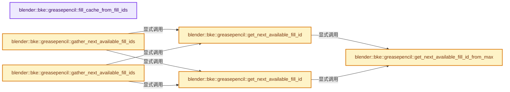

# 实现依赖专题：source/blender/blenkernel/intern/grease_pencil_fills.cc

[方向导航](README.md) · [符号索引](../%E7%AC%A6%E5%8F%B7%E4%BE%9D%E8%B5%96%E4%B8%8E%E5%AE%9E%E7%8E%B0%E7%B4%A2%E5%BC%95.md)

本专题从正文实际调用进入，集中保存共享实现。函数有稳定锚点，可从调用处直接跳到对应完整函数；递归与互相调用通过回链组织。

## 本文件的实现关系




## 完整成员与函数实现

<a id="f-c5e2a98b2a240b8e"></a>

### `blender::bke::greasepencil::fill_cache_from_fill_ids`

实现位置：[source/blender/blenkernel/intern/grease_pencil_fills.cc](../../../../../source/blender/blenkernel/intern/grease_pencil_fills.cc) · L19—L76。

接口参数：

- `const VArray<int> &fill_ids`

**教学注释版**

<!-- annotated:fe397d267fd872 -->

```cpp
std::optional<FillCache> fill_cache_from_fill_ids(const VArray<int> &fill_ids)
{
  if (!fill_ids || fill_ids.is_empty()) {
    return std::nullopt;
  }

  /* The size of each fill. */
  Vector<int> fill_sizes;
  /* Contains the curve indices for each fill. */
  Vector<Vector<int>> curve_indices_by_fill;
  /* Maps the fill id to the index in the #curve_indices_by_fill vector. */
  Map<int, int> fill_indexing;

  for (const int curve : fill_ids.index_range()) {
    const int fill_id = fill_ids[curve];

    /* Unfilled curves are skipped. */
    if (fill_id == 0) {
      continue;
    }

    /* Try adding new fill id to the map or update existing fill id info. */
    fill_indexing.add_or_modify(
        fill_id,
        [&](int *value) {
          // [讲解] fill_sizes.size：用end_减begin_得到活元素数量。
          *value = fill_sizes.size();
          // [讲解] fill_sizes.append：在尾部建立新元素，必要时先扩大存储。
          fill_sizes.append(1);
          curve_indices_by_fill.append(Vector<int>({curve}));
        },
        [&](const int *value) {
          const int fill_index = *value;
          fill_sizes[fill_index]++;
          curve_indices_by_fill[fill_index].append(curve);
        });
  }

  if (fill_sizes.is_empty()) {
    return std::nullopt;
  }

  fill_sizes.append(0);
  OffsetIndices<int> fill_offsets = offset_indices::accumulate_counts_to_offsets(fill_sizes);

  Vector<int> fill_map(fill_offsets.total_size());
  threading::parallel_for(fill_offsets.index_range(), 4096, [&](const IndexRange range) {
    for (const int fill_i : range) {
      const IndexRange fill_range = fill_offsets[fill_i];
      const Span<int> curve_indices = curve_indices_by_fill[fill_i].as_span();
      // [讲解] fill_map.as_mutable_span：构造对当前有效元素区间的借用视图。
      fill_map.as_mutable_span().slice(fill_range).copy_from(curve_indices);
    }
  });

  FillCache fill_cache;
  // [讲解] std::move：把表达式转换成可供移动重载选择的值类别；不保证真的移动，不结束源对象寿命，对const值可能选择复制。
  fill_cache.fill_map = std::move(fill_map);
  fill_cache.fill_offsets = std::move(fill_sizes);

  return fill_cache;
}
```

<details>
<summary>核对原始源码：source/blender/blenkernel/intern/grease_pencil_fills.cc · L19—L76</summary>

<!-- original:fe397d267fd872:source/blender/blenkernel/intern/grease_pencil_fills.cc:19:76 -->

```cpp
std::optional<FillCache> fill_cache_from_fill_ids(const VArray<int> &fill_ids)
{
  if (!fill_ids || fill_ids.is_empty()) {
    return std::nullopt;
  }

  /* The size of each fill. */
  Vector<int> fill_sizes;
  /* Contains the curve indices for each fill. */
  Vector<Vector<int>> curve_indices_by_fill;
  /* Maps the fill id to the index in the #curve_indices_by_fill vector. */
  Map<int, int> fill_indexing;

  for (const int curve : fill_ids.index_range()) {
    const int fill_id = fill_ids[curve];

    /* Unfilled curves are skipped. */
    if (fill_id == 0) {
      continue;
    }

    /* Try adding new fill id to the map or update existing fill id info. */
    fill_indexing.add_or_modify(
        fill_id,
        [&](int *value) {
          *value = fill_sizes.size();
          fill_sizes.append(1);
          curve_indices_by_fill.append(Vector<int>({curve}));
        },
        [&](const int *value) {
          const int fill_index = *value;
          fill_sizes[fill_index]++;
          curve_indices_by_fill[fill_index].append(curve);
        });
  }

  if (fill_sizes.is_empty()) {
    return std::nullopt;
  }

  fill_sizes.append(0);
  OffsetIndices<int> fill_offsets = offset_indices::accumulate_counts_to_offsets(fill_sizes);

  Vector<int> fill_map(fill_offsets.total_size());
  threading::parallel_for(fill_offsets.index_range(), 4096, [&](const IndexRange range) {
    for (const int fill_i : range) {
      const IndexRange fill_range = fill_offsets[fill_i];
      const Span<int> curve_indices = curve_indices_by_fill[fill_i].as_span();
      fill_map.as_mutable_span().slice(fill_range).copy_from(curve_indices);
    }
  });

  FillCache fill_cache;
  fill_cache.fill_map = std::move(fill_map);
  fill_cache.fill_offsets = std::move(fill_sizes);

  return fill_cache;
}
```

</details>

**沿实际写入检查状态**

- `fill_cache.fill_map = std::move(fill_map);`
- `fill_cache.fill_offsets = std::move(fill_sizes);`

**结果出口**

- `return std::nullopt;`
- `return fill_cache;`

**继续追踪实现**

- `fill_ids.is_empty` → [blender::bke::greasepencil::LayerGroup::is_empty · L2086](%E4%BE%9D%E8%B5%96-grease_pencil-f750d6.md#f-d730f81fae7c58ba)。
- `fill_ids.index_range` → [调用协议](../%E6%A8%A1%E6%9D%BF%E5%AE%8F%E4%B8%8E%E5%8A%A8%E6%80%81%E5%88%86%E6%B4%BE%E5%8D%8F%E8%AE%AE.md)：由接收对象具体类型或运行时策略提供实现。调用位置L32。
- `fill_indexing.add_or_modify` → [blender::Map::add_or_modify · L480](../02-%E5%93%88%E5%B8%8C%E8%A1%A8%E4%B8%8E%E5%85%B3%E8%81%94%E6%95%B0%E6%8D%AE%E7%BB%93%E6%9E%84/04-Map%E6%9F%A5%E6%89%BE%E4%B8%8E%E9%94%AE%E8%AE%BF%E9%97%AE.md#f-eb982d087ea50687)；[blender::Map::add_or_modify · L487](../02-%E5%93%88%E5%B8%8C%E8%A1%A8%E4%B8%8E%E5%85%B3%E8%81%94%E6%95%B0%E6%8D%AE%E7%BB%93%E6%9E%84/04-Map%E6%9F%A5%E6%89%BE%E4%B8%8E%E9%94%AE%E8%AE%BF%E9%97%AE.md#f-1811a186397c90d9)。同名重载需按实参类型选择。
- `fill_sizes.size` → [blender::Vector::size · L780](../01-%E5%9F%BA%E7%A1%80%E5%AE%B9%E5%99%A8%E4%B8%8E%E7%8E%B0%E4%BB%A3CPP/11-Vector%E6%8F%92%E5%85%A5%E5%88%A0%E9%99%A4%E4%B8%8E%E9%87%8D%E6%8E%92.md#f-714773731767349c)。
- `fill_sizes.append` → [blender::Vector::append · L498](../01-%E5%9F%BA%E7%A1%80%E5%AE%B9%E5%99%A8%E4%B8%8E%E7%8E%B0%E4%BB%A3CPP/11-Vector%E6%8F%92%E5%85%A5%E5%88%A0%E9%99%A4%E4%B8%8E%E9%87%8D%E6%8E%92.md#f-5bde268a69e443ec)；[blender::Vector::append · L502](../01-%E5%9F%BA%E7%A1%80%E5%AE%B9%E5%99%A8%E4%B8%8E%E7%8E%B0%E4%BB%A3CPP/11-Vector%E6%8F%92%E5%85%A5%E5%88%A0%E9%99%A4%E4%B8%8E%E9%87%8D%E6%8E%92.md#f-591e0b15e6308532)。同名重载需按实参类型选择。
- `curve_indices_by_fill.append` → [blender::Vector::append · L498](../01-%E5%9F%BA%E7%A1%80%E5%AE%B9%E5%99%A8%E4%B8%8E%E7%8E%B0%E4%BB%A3CPP/11-Vector%E6%8F%92%E5%85%A5%E5%88%A0%E9%99%A4%E4%B8%8E%E9%87%8D%E6%8E%92.md#f-5bde268a69e443ec)；[blender::Vector::append · L502](../01-%E5%9F%BA%E7%A1%80%E5%AE%B9%E5%99%A8%E4%B8%8E%E7%8E%B0%E4%BB%A3CPP/11-Vector%E6%8F%92%E5%85%A5%E5%88%A0%E9%99%A4%E4%B8%8E%E9%87%8D%E6%8E%92.md#f-591e0b15e6308532)。同名重载需按实参类型选择。
- `Vector<int>` → [KDL::Vector](%E4%BE%9D%E8%B5%96-traits-655f3e.md#t-3494ab227c7f)；[KDL::Vector](%E4%BE%9D%E8%B5%96-frames-531715.md#t-7db3cae4c06c)；[KDL::Vector](%E4%BE%9D%E8%B5%96-frames-531715.md#t-d9f123375f9e)；[blender::Vector](../01-%E5%9F%BA%E7%A1%80%E5%AE%B9%E5%99%A8%E4%B8%8E%E7%8E%B0%E4%BB%A3CPP/%E4%BE%9D%E8%B5%96-BLI_vector-c355b1.md#t-14451f176559)；[blender::nodes::decl::Vector](../09-LazyFunction%E4%B8%8E%E8%8A%82%E7%82%B9%E6%89%A7%E8%A1%8C%E6%9E%B6%E6%9E%84/%E4%BE%9D%E8%B5%96-NOD_socket_declarations-8d29c1.md#t-244cfac6be12)。
- `curve_indices_by_fill[fill_index].append` → [调用协议](../%E6%A8%A1%E6%9D%BF%E5%AE%8F%E4%B8%8E%E5%8A%A8%E6%80%81%E5%88%86%E6%B4%BE%E5%8D%8F%E8%AE%AE.md)：接收对象类型依赖auto、返回值或模板实例；不按同名猜测目标。调用位置L51。
- `fill_sizes.is_empty` → [blender::Vector::is_empty · L792](../01-%E5%9F%BA%E7%A1%80%E5%AE%B9%E5%99%A8%E4%B8%8E%E7%8E%B0%E4%BB%A3CPP/11-Vector%E6%8F%92%E5%85%A5%E5%88%A0%E9%99%A4%E4%B8%8E%E9%87%8D%E6%8E%92.md#f-937bbd9cb80bdcc8)。
- `offset_indices::accumulate_counts_to_offsets` → [blender::offset_indices::accumulate_counts_to_offsets · L24](05-%E9%82%BB%E6%8E%A5%E5%85%B3%E7%B3%BB%E4%B8%8E%E5%89%8D%E7%BC%80%E5%92%8C.md#f-cfa9fbd186afcdd5)。
- `fill_offsets.total_size` → [blender::offset_indices::OffsetIndices::total_size · L58](02-OffsetIndices%E5%AE%8C%E6%95%B4%E6%8E%A5%E5%8F%A3.md#f-c111ffdac7a19248)。
- `threading::parallel_for` → [blender::threading::parallel_for · L68](../11-Depsgraph%E4%B8%8E%E5%B9%B6%E8%A1%8C%E4%BB%BB%E5%8A%A1%E7%B3%BB%E7%BB%9F/07-%E4%BB%BB%E5%8A%A1%E6%B1%A0%E4%B8%8ETBB%E6%8E%A5%E5%85%A5.md#f-838294754c24426c)。
- `fill_offsets.index_range` → [blender::offset_indices::OffsetIndices::index_range · L77](02-OffsetIndices%E5%AE%8C%E6%95%B4%E6%8E%A5%E5%8F%A3.md#f-19b5ca1456de007d)。
- `curve_indices_by_fill[fill_i].as_span` → [调用协议](../%E6%A8%A1%E6%9D%BF%E5%AE%8F%E4%B8%8E%E5%8A%A8%E6%80%81%E5%88%86%E6%B4%BE%E5%8D%8F%E8%AE%AE.md)：接收对象类型依赖auto、返回值或模板实例；不按同名猜测目标。调用位置L66。
- `fill_map.as_mutable_span().slice(fill_range).copy_from` → [调用协议](../%E6%A8%A1%E6%9D%BF%E5%AE%8F%E4%B8%8E%E5%8A%A8%E6%80%81%E5%88%86%E6%B4%BE%E5%8D%8F%E8%AE%AE.md)：接收对象类型依赖auto、返回值或模板实例；不按同名猜测目标。调用位置L67。
- `fill_map.as_mutable_span().slice` → [调用协议](../%E6%A8%A1%E6%9D%BF%E5%AE%8F%E4%B8%8E%E5%8A%A8%E6%80%81%E5%88%86%E6%B4%BE%E5%8D%8F%E8%AE%AE.md)：接收对象类型依赖auto、返回值或模板实例；不按同名猜测目标。调用位置L67。
- `fill_map.as_mutable_span` → [blender::Vector::as_mutable_span · L395](../01-%E5%9F%BA%E7%A1%80%E5%AE%B9%E5%99%A8%E4%B8%8E%E7%8E%B0%E4%BB%A3CPP/10-Vector%E6%89%A9%E5%AE%B9%E4%B8%8E%E5%A2%9E%E9%95%BF.md#f-98b7994c0b2e3bae)。
- `std::move` → [外部契约](https://eel.is/c++draft/utility.forward)：把表达式转换成可供移动重载选择的值类别；不保证真的移动，不结束源对象寿命，对const值可能选择复制。

<a id="f-784c9815233ef915"></a>

### `blender::bke::greasepencil::get_next_available_fill_id_from_max`

实现位置：[source/blender/blenkernel/intern/grease_pencil_fills.cc](../../../../../source/blender/blenkernel/intern/grease_pencil_fills.cc) · L170—L175。

接口参数：

- `const int max_fill_id`

**教学注释版**

<!-- annotated:0c40ffa1ec9858 -->

```cpp
static int get_next_available_fill_id_from_max(const int max_fill_id)
{
  /* Make sure the fill ID is greater than zero. This avoids the issue of hitting an invalid fill
   * ID of zero when creating multiple IDs at once. */
  return max_fill_id <= 0 ? 1 : max_fill_id + 1;
}
```

<details>
<summary>核对原始源码：source/blender/blenkernel/intern/grease_pencil_fills.cc · L170—L175</summary>

<!-- original:0c40ffa1ec9858:source/blender/blenkernel/intern/grease_pencil_fills.cc:170:175 -->

```cpp
static int get_next_available_fill_id_from_max(const int max_fill_id)
{
  /* Make sure the fill ID is greater than zero. This avoids the issue of hitting an invalid fill
   * ID of zero when creating multiple IDs at once. */
  return max_fill_id <= 0 ? 1 : max_fill_id + 1;
}
```

</details>

**结果出口**

- `return max_fill_id <= 0 ? 1 : max_fill_id + 1;`

**继续追踪实现**

本实现没有需要继续展开的显式调用；检查返回表达式、对象转换和调用者前置条件。

<a id="f-319ae504a64ccb8a"></a>

### `blender::bke::greasepencil::get_next_available_fill_id`

实现位置：[source/blender/blenkernel/intern/grease_pencil_fills.cc](../../../../../source/blender/blenkernel/intern/grease_pencil_fills.cc) · L177—L183。

接口参数：

- `const Span<int> fill_ids`

**教学注释版**

<!-- annotated:0d07fbd6409170 -->

```cpp
int get_next_available_fill_id(const Span<int> fill_ids)
{
  if (std::optional<int64_t> max_i = array_utils::max_element_index(fill_ids)) {
    return get_next_available_fill_id_from_max(fill_ids[*max_i]);
  }
  return 1;
}
```

<details>
<summary>核对原始源码：source/blender/blenkernel/intern/grease_pencil_fills.cc · L177—L183</summary>

<!-- original:0d07fbd6409170:source/blender/blenkernel/intern/grease_pencil_fills.cc:177:183 -->

```cpp
int get_next_available_fill_id(const Span<int> fill_ids)
{
  if (std::optional<int64_t> max_i = array_utils::max_element_index(fill_ids)) {
    return get_next_available_fill_id_from_max(fill_ids[*max_i]);
  }
  return 1;
}
```

</details>

**结果出口**

- `return get_next_available_fill_id_from_max(fill_ids[*max_i]);`
- `return 1;`

**继续追踪实现**

- `array_utils::max_element_index` → [blender::array_utils::max_element_index · L477](07-%E5%88%86%E7%BB%84%E8%AE%BF%E9%97%AE%E4%B8%8E%E5%8F%8D%E5%90%91%E7%B4%A2%E5%BC%95.md#f-f316f6bf293c736a)；[blender::array_utils::max_element_index · L501](07-%E5%88%86%E7%BB%84%E8%AE%BF%E9%97%AE%E4%B8%8E%E5%8F%8D%E5%90%91%E7%B4%A2%E5%BC%95.md#f-8340f4a761328013)。同名重载需按实参类型选择。
- `get_next_available_fill_id_from_max` → [blender::bke::greasepencil::get_next_available_fill_id_from_max · L170](%E4%BE%9D%E8%B5%96-grease_pencil_fills-e96a03.md#f-784c9815233ef915)。

<a id="f-34990b05b7fa34de"></a>

### `blender::bke::greasepencil::get_next_available_fill_id`

实现位置：[source/blender/blenkernel/intern/grease_pencil_fills.cc](../../../../../source/blender/blenkernel/intern/grease_pencil_fills.cc) · L184—L190。

接口参数：

- `const VArray<int> &fill_ids`

**教学注释版**

<!-- annotated:c1ae3321f4f512 -->

```cpp
int get_next_available_fill_id(const VArray<int> &fill_ids)
{
  if (std::optional<int64_t> max_i = array_utils::max_element_index(fill_ids)) {
    return get_next_available_fill_id_from_max(fill_ids[*max_i]);
  }
  return 1;
}
```

<details>
<summary>核对原始源码：source/blender/blenkernel/intern/grease_pencil_fills.cc · L184—L190</summary>

<!-- original:c1ae3321f4f512:source/blender/blenkernel/intern/grease_pencil_fills.cc:184:190 -->

```cpp
int get_next_available_fill_id(const VArray<int> &fill_ids)
{
  if (std::optional<int64_t> max_i = array_utils::max_element_index(fill_ids)) {
    return get_next_available_fill_id_from_max(fill_ids[*max_i]);
  }
  return 1;
}
```

</details>

**结果出口**

- `return get_next_available_fill_id_from_max(fill_ids[*max_i]);`
- `return 1;`

**继续追踪实现**

- `array_utils::max_element_index` → [blender::array_utils::max_element_index · L477](07-%E5%88%86%E7%BB%84%E8%AE%BF%E9%97%AE%E4%B8%8E%E5%8F%8D%E5%90%91%E7%B4%A2%E5%BC%95.md#f-f316f6bf293c736a)；[blender::array_utils::max_element_index · L501](07-%E5%88%86%E7%BB%84%E8%AE%BF%E9%97%AE%E4%B8%8E%E5%8F%8D%E5%90%91%E7%B4%A2%E5%BC%95.md#f-8340f4a761328013)。同名重载需按实参类型选择。
- `get_next_available_fill_id_from_max` → [blender::bke::greasepencil::get_next_available_fill_id_from_max · L170](%E4%BE%9D%E8%B5%96-grease_pencil_fills-e96a03.md#f-784c9815233ef915)。

<a id="f-9c3c27c04326171d"></a>

### `blender::bke::greasepencil::gather_next_available_fill_ids`

实现位置：[source/blender/blenkernel/intern/grease_pencil_fills.cc](../../../../../source/blender/blenkernel/intern/grease_pencil_fills.cc) · L192—L196。

接口参数：

- `const VArray<int> &fill_ids`
- `MutableSpan<int> r_new_fill_ids`

**教学注释版**

<!-- annotated:3d01165ba58f3f -->

```cpp
void gather_next_available_fill_ids(const VArray<int> &fill_ids, MutableSpan<int> r_new_fill_ids)
{
  const int next_fill_id = get_next_available_fill_id(fill_ids);
  array_utils::fill_index_range(r_new_fill_ids, next_fill_id);
}
```

<details>
<summary>核对原始源码：source/blender/blenkernel/intern/grease_pencil_fills.cc · L192—L196</summary>

<!-- original:3d01165ba58f3f:source/blender/blenkernel/intern/grease_pencil_fills.cc:192:196 -->

```cpp
void gather_next_available_fill_ids(const VArray<int> &fill_ids, MutableSpan<int> r_new_fill_ids)
{
  const int next_fill_id = get_next_available_fill_id(fill_ids);
  array_utils::fill_index_range(r_new_fill_ids, next_fill_id);
}
```

</details>

**继续追踪实现**

- `get_next_available_fill_id` → [blender::bke::greasepencil::get_next_available_fill_id · L177](%E4%BE%9D%E8%B5%96-grease_pencil_fills-e96a03.md#f-319ae504a64ccb8a)；[blender::bke::greasepencil::get_next_available_fill_id · L184](%E4%BE%9D%E8%B5%96-grease_pencil_fills-e96a03.md#f-34990b05b7fa34de)。同名重载需按实参类型选择。
- `array_utils::fill_index_range` → [blender::array_utils::fill_index_range · L434](07-%E5%88%86%E7%BB%84%E8%AE%BF%E9%97%AE%E4%B8%8E%E5%8F%8D%E5%90%91%E7%B4%A2%E5%BC%95.md#f-f8128b104d76df0f)；[blender::array_utils::fill_index_range · L439](07-%E5%88%86%E7%BB%84%E8%AE%BF%E9%97%AE%E4%B8%8E%E5%8F%8D%E5%90%91%E7%B4%A2%E5%BC%95.md#f-95ca84458bfc7e7e)；[blender::array_utils::fill_index_range · L445](07-%E5%88%86%E7%BB%84%E8%AE%BF%E9%97%AE%E4%B8%8E%E5%8F%8D%E5%90%91%E7%B4%A2%E5%BC%95.md#f-c11b114c213cd61a)。同名重载需按实参类型选择。

<a id="f-beb67b2986e69e03"></a>

### `blender::bke::greasepencil::gather_next_available_fill_ids`

实现位置：[source/blender/blenkernel/intern/grease_pencil_fills.cc](../../../../../source/blender/blenkernel/intern/grease_pencil_fills.cc) · L197—L205。

接口参数：

- `const VArray<int> &fill_ids`
- `const IndexMask &curve_mask`
- `MutableSpan<int> r_new_fill_ids`

**教学注释版**

<!-- annotated:159c49d39e5f87 -->

```cpp
void gather_next_available_fill_ids(const VArray<int> &fill_ids,
                                    const IndexMask &curve_mask,
                                    MutableSpan<int> r_new_fill_ids)
{
  const int next_fill_id = get_next_available_fill_id(fill_ids);
  curve_mask.foreach_index(
      [&](const int index, const int pos) { r_new_fill_ids[index] = next_fill_id + pos; },
      exec_mode::grain_size(1024));
}
```

<details>
<summary>核对原始源码：source/blender/blenkernel/intern/grease_pencil_fills.cc · L197—L205</summary>

<!-- original:159c49d39e5f87:source/blender/blenkernel/intern/grease_pencil_fills.cc:197:205 -->

```cpp
void gather_next_available_fill_ids(const VArray<int> &fill_ids,
                                    const IndexMask &curve_mask,
                                    MutableSpan<int> r_new_fill_ids)
{
  const int next_fill_id = get_next_available_fill_id(fill_ids);
  curve_mask.foreach_index(
      [&](const int index, const int pos) { r_new_fill_ids[index] = next_fill_id + pos; },
      exec_mode::grain_size(1024));
}
```

</details>

**继续追踪实现**

- `get_next_available_fill_id` → [blender::bke::greasepencil::get_next_available_fill_id · L177](%E4%BE%9D%E8%B5%96-grease_pencil_fills-e96a03.md#f-319ae504a64ccb8a)；[blender::bke::greasepencil::get_next_available_fill_id · L184](%E4%BE%9D%E8%B5%96-grease_pencil_fills-e96a03.md#f-34990b05b7fa34de)。同名重载需按实参类型选择。
- `curve_mask.foreach_index` → [blender::index_mask::IndexMask::foreach_index · L855](../04-%E8%99%9A%E6%8B%9F%E6%95%B0%E7%BB%84%E4%B8%8E%E7%B4%A2%E5%BC%95%E9%80%89%E6%8B%A9/09-%E5%88%86%E6%AE%B5%E5%AD%98%E5%82%A8%E4%B8%8E%E9%81%8D%E5%8E%86.md#f-cd6cd317e2e2812c)。
- `exec_mode::grain_size` → [blender::exec_mode::grain_size · L79](../01-%E5%9F%BA%E7%A1%80%E5%AE%B9%E5%99%A8%E4%B8%8E%E7%8E%B0%E4%BB%A3CPP/%E4%BE%9D%E8%B5%96-BLI_execution_mode-1528fb.md#f-0b4fc2f9fa6e66e7)。
