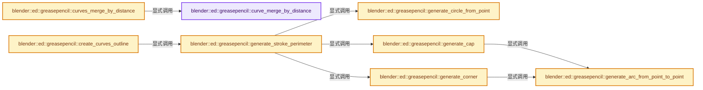
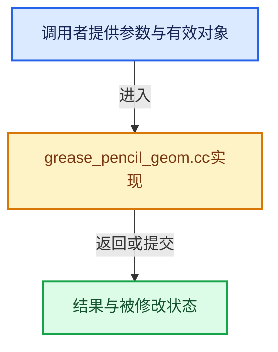

# 实现依赖专题：source/blender/editors/grease_pencil/intern/grease_pencil_geom.cc

[方向导航](README.md) · [符号索引](../%E7%AC%A6%E5%8F%B7%E4%BE%9D%E8%B5%96%E4%B8%8E%E5%AE%9E%E7%8E%B0%E7%B4%A2%E5%BC%95.md)

本专题从正文实际调用进入，集中保存共享实现。函数有稳定锚点，可从调用处直接跳到对应完整函数；递归与互相调用通过回链组织。

## 本文件的实现关系






## 完整成员与函数实现

<a id="f-50c0087b0b8e82b2"></a>

### `blender::ed::greasepencil::curve_merge_by_distance`

实现位置：[source/blender/editors/grease_pencil/intern/grease_pencil_geom.cc](../../../../../source/blender/editors/grease_pencil/intern/grease_pencil_geom.cc) · L181—L211。

接口参数：

- `const IndexRange points`
- `const Span<float> distances`
- `const IndexMask &selection`
- `const float merge_distance`
- `MutableSpan<int> r_merge_indices`

**教学注释版**

<!-- annotated:63f2ce75155437 -->

```cpp
int curve_merge_by_distance(const IndexRange points,
                            const Span<float> distances,
                            const IndexMask &selection,
                            const float merge_distance,
                            MutableSpan<int> r_merge_indices)
{
  /* We use a KDTree<float> here, because we can only merge neighboring points in the curves. */
  KDTree<float> *tree = kdtree_new<float>(selection.size());
  /* The selection is an IndexMask of the points just in this curve. */
  selection.foreach_index([&](const int64_t i, const int64_t pos) {
    // [讲解] points.first：读取范围两端的有效索引或值。
    kdtree_insert<float>(tree, pos, distances[i - points.first()]);
  });
  kdtree_balance<float>(tree);

  Array<int> selection_merge_indices(selection.size(), -1);
  const int duplicate_count = kdtree_calc_duplicates_fast<float>(
      // [讲解] selection_merge_indices.data：提供数组的借用访问入口。
      tree, merge_distance, false, selection_merge_indices.data());
  kdtree_free<float>(tree);

  array_utils::fill_index_range<int>(r_merge_indices);

  selection.foreach_index([&](const int src_index, const int pos) {
    const int merge_index = selection_merge_indices[pos];
    if (merge_index != -1) {
      const int src_merge_index = selection[merge_index] - points.first();
      r_merge_indices[src_index - points.first()] = src_merge_index;
    }
  });

  return duplicate_count;
}
```

<details>
<summary>核对原始源码：source/blender/editors/grease_pencil/intern/grease_pencil_geom.cc · L181—L211</summary>

<!-- original:63f2ce75155437:source/blender/editors/grease_pencil/intern/grease_pencil_geom.cc:181:211 -->

```cpp
int curve_merge_by_distance(const IndexRange points,
                            const Span<float> distances,
                            const IndexMask &selection,
                            const float merge_distance,
                            MutableSpan<int> r_merge_indices)
{
  /* We use a KDTree<float> here, because we can only merge neighboring points in the curves. */
  KDTree<float> *tree = kdtree_new<float>(selection.size());
  /* The selection is an IndexMask of the points just in this curve. */
  selection.foreach_index([&](const int64_t i, const int64_t pos) {
    kdtree_insert<float>(tree, pos, distances[i - points.first()]);
  });
  kdtree_balance<float>(tree);

  Array<int> selection_merge_indices(selection.size(), -1);
  const int duplicate_count = kdtree_calc_duplicates_fast<float>(
      tree, merge_distance, false, selection_merge_indices.data());
  kdtree_free<float>(tree);

  array_utils::fill_index_range<int>(r_merge_indices);

  selection.foreach_index([&](const int src_index, const int pos) {
    const int merge_index = selection_merge_indices[pos];
    if (merge_index != -1) {
      const int src_merge_index = selection[merge_index] - points.first();
      r_merge_indices[src_index - points.first()] = src_merge_index;
    }
  });

  return duplicate_count;
}
```

</details>

**结果出口**

- `return duplicate_count;`

**继续追踪实现**

- `kdtree_new<float>` → [blender::kdtree_new · L65](../12-%E7%A9%BA%E9%97%B4%E6%95%B0%E6%8D%AE%E7%BB%93%E6%9E%84%E4%B8%8E%E5%87%A0%E4%BD%95%E7%AE%97%E6%B3%95/%E4%BE%9D%E8%B5%96-BLI_kdtree-1fdadc.md#f-46a3316dfd09a49e)。
- `selection.size` → [blender::index_mask::IndexMask::size · L743](../04-%E8%99%9A%E6%8B%9F%E6%95%B0%E7%BB%84%E4%B8%8E%E7%B4%A2%E5%BC%95%E9%80%89%E6%8B%A9/09-%E5%88%86%E6%AE%B5%E5%AD%98%E5%82%A8%E4%B8%8E%E9%81%8D%E5%8E%86.md#f-0163b32abc9a0d9c)。
- `selection.foreach_index` → [blender::index_mask::IndexMask::foreach_index · L855](../04-%E8%99%9A%E6%8B%9F%E6%95%B0%E7%BB%84%E4%B8%8E%E7%B4%A2%E5%BC%95%E9%80%89%E6%8B%A9/09-%E5%88%86%E6%AE%B5%E5%AD%98%E5%82%A8%E4%B8%8E%E9%81%8D%E5%8E%86.md#f-cd6cd317e2e2812c)。
- `kdtree_insert<float>` → [blender::kdtree_insert · L95](../12-%E7%A9%BA%E9%97%B4%E6%95%B0%E6%8D%AE%E7%BB%93%E6%9E%84%E4%B8%8E%E5%87%A0%E4%BD%95%E7%AE%97%E6%B3%95/%E4%BE%9D%E8%B5%96-BLI_kdtree-1fdadc.md#f-ed9cb6449add9ae9)。
- `points.first` → [blender::IndexRange::first · L204](../01-%E5%9F%BA%E7%A1%80%E5%AE%B9%E5%99%A8%E4%B8%8E%E7%8E%B0%E4%BB%A3CPP/04-IndexRange%E8%BF%9E%E7%BB%AD%E6%95%B4%E6%95%B0%E5%8C%BA%E9%97%B4.md#f-ab443c94e531befa)。
- `kdtree_balance<float>` → [调用协议](../%E6%A8%A1%E6%9D%BF%E5%AE%8F%E4%B8%8E%E5%8A%A8%E6%80%81%E5%88%86%E6%B4%BE%E5%8D%8F%E8%AE%AE.md)：函数指针、局部可调用对象或未展开的宏；必须结合调用者环境。调用位置L193。
- `kdtree_calc_duplicates_fast<float>` → [blender::kdtree_calc_duplicates_fast · L722](../12-%E7%A9%BA%E9%97%B4%E6%95%B0%E6%8D%AE%E7%BB%93%E6%9E%84%E4%B8%8E%E5%87%A0%E4%BD%95%E7%AE%97%E6%B3%95/%E4%BE%9D%E8%B5%96-BLI_kdtree-1fdadc.md#f-921a28bb9645d7ab)。
- `selection_merge_indices.data` → [blender::Array::data · L323](../01-%E5%9F%BA%E7%A1%80%E5%AE%B9%E5%99%A8%E4%B8%8E%E7%8E%B0%E4%BB%A3CPP/08-Array%E5%A4%8D%E5%88%B6%E7%A7%BB%E5%8A%A8%E4%B8%8E%E9%94%80%E6%AF%81.md#f-95648c799002f4ba)；[blender::Array::data · L327](../01-%E5%9F%BA%E7%A1%80%E5%AE%B9%E5%99%A8%E4%B8%8E%E7%8E%B0%E4%BB%A3CPP/08-Array%E5%A4%8D%E5%88%B6%E7%A7%BB%E5%8A%A8%E4%B8%8E%E9%94%80%E6%AF%81.md#f-50c18301f8c40f9e)。同名重载需按实参类型选择。
- `kdtree_free<float>` → [blender::kdtree_free · L84](../12-%E7%A9%BA%E9%97%B4%E6%95%B0%E6%8D%AE%E7%BB%93%E6%9E%84%E4%B8%8E%E5%87%A0%E4%BD%95%E7%AE%97%E6%B3%95/%E4%BE%9D%E8%B5%96-BLI_kdtree-1fdadc.md#f-29e79484de22f4be)。
- `array_utils::fill_index_range<int>` → [blender::array_utils::fill_index_range · L434](07-%E5%88%86%E7%BB%84%E8%AE%BF%E9%97%AE%E4%B8%8E%E5%8F%8D%E5%90%91%E7%B4%A2%E5%BC%95.md#f-f8128b104d76df0f)；[blender::array_utils::fill_index_range · L439](07-%E5%88%86%E7%BB%84%E8%AE%BF%E9%97%AE%E4%B8%8E%E5%8F%8D%E5%90%91%E7%B4%A2%E5%BC%95.md#f-95ca84458bfc7e7e)；[blender::array_utils::fill_index_range · L445](07-%E5%88%86%E7%BB%84%E8%AE%BF%E9%97%AE%E4%B8%8E%E5%8F%8D%E5%90%91%E7%B4%A2%E5%BC%95.md#f-c11b114c213cd61a)。同名重载需按实参类型选择。

<a id="f-58afb70f4d9af36c"></a>

### `blender::ed::greasepencil::curves_merge_by_distance`

实现位置：[source/blender/editors/grease_pencil/intern/grease_pencil_geom.cc](../../../../../source/blender/editors/grease_pencil/intern/grease_pencil_geom.cc) · L213—L342。

接口参数：

- `const bke::CurvesGeometry &src_curves`
- `const float merge_distance`
- `const IndexMask &selection`
- `const bke::AttributeFilter &attribute_filter`

**教学注释版**

<!-- annotated:7fc0428c87d353 -->

```cpp
bke::CurvesGeometry curves_merge_by_distance(const bke::CurvesGeometry &src_curves,
                                             const float merge_distance,
                                             const IndexMask &selection,
                                             const bke::AttributeFilter &attribute_filter)
{
  /* NOTE: The code here is an adapted version of #geometry::point_merge_by_distance. */

  const int src_point_size = src_curves.points_num();
  if (src_point_size == 0) {
    return {};
  }
  const OffsetIndices<int> points_by_curve = src_curves.points_by_curve();
  const VArray<bool> cyclic = src_curves.cyclic();
  src_curves.ensure_evaluated_lengths();

  bke::CurvesGeometry dst_curves = bke::curves::copy_only_curve_domain(src_curves);

  BKE_defgroup_copy_list(&dst_curves.vertex_group_names, &src_curves.vertex_group_names);

  MutableSpan<int> dst_offsets = dst_curves.offsets_for_write();

  std::atomic<int> total_duplicate_count = 0;
  Array<Array<int>> merge_indices_per_curve(src_curves.curves_num());
  threading::parallel_for(src_curves.curves_range(), 512, [&](const IndexRange range) {
    for (const int curve_i : range) {
      const IndexRange points = points_by_curve[curve_i];
      // [讲解] points.size：读取连续区间或分组的边界信息。
      merge_indices_per_curve[curve_i].reinitialize(points.size());

      Array<float> distances_along_curve(points.size() + int(cyclic[curve_i]));
      distances_along_curve.first() = 0.0f;
      const Span<float> lengths = src_curves.evaluated_lengths_for_curve(curve_i, cyclic[curve_i]);
      // [讲解] distances_along_curve.as_mutable_span：提供数组的借用访问入口。
      distances_along_curve.as_mutable_span().drop_front(1).copy_from(lengths);

      MutableSpan<int> merge_indices = merge_indices_per_curve[curve_i].as_mutable_span();
      array_utils::fill_index_range<int>(merge_indices);

      const int duplicate_count = curve_merge_by_distance(points,
                                                          distances_along_curve,
                                                          selection.slice_content(points),
                                                          merge_distance,
                                                          merge_indices);
      /* Write the curve size. The counts will be accumulated to offsets below. */
      dst_offsets[curve_i] = points.size() - duplicate_count;
      total_duplicate_count += duplicate_count;
    }
  });

  const int dst_point_size = src_point_size - total_duplicate_count;
  dst_curves.resize(dst_point_size, src_curves.curves_num());
  offset_indices::accumulate_counts_to_offsets(dst_offsets);

  int merged_points = 0;
  Array<int> src_to_dst_indices(src_point_size);
  for (const int curve_i : src_curves.curves_range()) {
    const IndexRange points = points_by_curve[curve_i];
    const Span<int> merge_indices = merge_indices_per_curve[curve_i].as_span();
    for (const int i : points.index_range()) {
      // [讲解] points.start：读取连续区间或分组的边界信息。
      const int point_i = points.start() + i;
      src_to_dst_indices[point_i] = point_i - merged_points;
      if (merge_indices[i] != i) {
        merged_points++;
      }
    }
  }

  Array<int> point_merge_counts(dst_point_size, 0);
  for (const int curve_i : src_curves.curves_range()) {
    const IndexRange points = points_by_curve[curve_i];
    const Span<int> merge_indices = merge_indices_per_curve[curve_i].as_span();
    for (const int i : points.index_range()) {
      const int merge_index = merge_indices[i];
      const int point_src = points.start() + merge_index;
      const int dst_index = src_to_dst_indices[point_src];
      point_merge_counts[dst_index]++;
    }
  }

  Array<int> map_offsets_data(dst_point_size + 1);
  map_offsets_data.as_mutable_span().drop_back(1).copy_from(point_merge_counts);
  OffsetIndices<int> map_offsets = offset_indices::accumulate_counts_to_offsets(map_offsets_data);

  // [讲解] point_merge_counts.fill：对现有元素赋同一个值。
  point_merge_counts.fill(0);

  Array<int> merge_map_indices(src_point_size);
  for (const int curve_i : src_curves.curves_range()) {
    const IndexRange points = points_by_curve[curve_i];
    const Span<int> merge_indices = merge_indices_per_curve[curve_i].as_span();
    for (const int i : points.index_range()) {
      const int point_i = points.start() + i;
      const int merge_index = merge_indices[i];
      const int dst_index = src_to_dst_indices[points.start() + merge_index];
      merge_map_indices[map_offsets[dst_index].first() + point_merge_counts[dst_index]] = point_i;
      point_merge_counts[dst_index]++;
    }
  }

  bke::AttributeAccessor src_attributes = src_curves.attributes();
  bke::MutableAttributeAccessor dst_attributes = dst_curves.attributes_for_write();
  src_attributes.foreach_attribute([&](const bke::AttributeIter &iter) {
    if (attribute_filter.allow_skip(iter.name)) {
      return;
    }
    if (iter.domain != bke::AttrDomain::Point) {
      return;
    }
    bke::GAttributeReader src_attribute = iter.get();
    const CommonVArrayInfo info = src_attribute.varray.common_info();
    if (info.type == CommonVArrayInfo::Type::Single) {
      const bke::AttributeInitValue init(GPointer(src_attribute.varray.type(), info.data));
      if (dst_attributes.add(iter.name, iter.domain, iter.data_type, init)) {
        return;
      }
    }

    bke::GSpanAttributeWriter dst_attribute = dst_attributes.lookup_or_add_for_write_only_span(
        iter.name, bke::AttrDomain::Point, iter.data_type);
    bke::attribute_math::mix_groups(GVArraySpan(src_attribute.varray),
                                    map_offsets,
                                    merge_map_indices,
                                    std::nullopt,
                                    dst_attribute.span);
    dst_attribute.finish();
  });

  if (dst_curves.nurbs_has_custom_knots()) {
    bke::curves::nurbs::update_custom_knot_modes(
        dst_curves.curves_range(), NURBS_KNOT_MODE_NORMAL, NURBS_KNOT_MODE_NORMAL, dst_curves);
  }
  return dst_curves;
}
```

<details>
<summary>核对原始源码：source/blender/editors/grease_pencil/intern/grease_pencil_geom.cc · L213—L342</summary>

<!-- original:7fc0428c87d353:source/blender/editors/grease_pencil/intern/grease_pencil_geom.cc:213:342 -->

```cpp
bke::CurvesGeometry curves_merge_by_distance(const bke::CurvesGeometry &src_curves,
                                             const float merge_distance,
                                             const IndexMask &selection,
                                             const bke::AttributeFilter &attribute_filter)
{
  /* NOTE: The code here is an adapted version of #geometry::point_merge_by_distance. */

  const int src_point_size = src_curves.points_num();
  if (src_point_size == 0) {
    return {};
  }
  const OffsetIndices<int> points_by_curve = src_curves.points_by_curve();
  const VArray<bool> cyclic = src_curves.cyclic();
  src_curves.ensure_evaluated_lengths();

  bke::CurvesGeometry dst_curves = bke::curves::copy_only_curve_domain(src_curves);

  BKE_defgroup_copy_list(&dst_curves.vertex_group_names, &src_curves.vertex_group_names);

  MutableSpan<int> dst_offsets = dst_curves.offsets_for_write();

  std::atomic<int> total_duplicate_count = 0;
  Array<Array<int>> merge_indices_per_curve(src_curves.curves_num());
  threading::parallel_for(src_curves.curves_range(), 512, [&](const IndexRange range) {
    for (const int curve_i : range) {
      const IndexRange points = points_by_curve[curve_i];
      merge_indices_per_curve[curve_i].reinitialize(points.size());

      Array<float> distances_along_curve(points.size() + int(cyclic[curve_i]));
      distances_along_curve.first() = 0.0f;
      const Span<float> lengths = src_curves.evaluated_lengths_for_curve(curve_i, cyclic[curve_i]);
      distances_along_curve.as_mutable_span().drop_front(1).copy_from(lengths);

      MutableSpan<int> merge_indices = merge_indices_per_curve[curve_i].as_mutable_span();
      array_utils::fill_index_range<int>(merge_indices);

      const int duplicate_count = curve_merge_by_distance(points,
                                                          distances_along_curve,
                                                          selection.slice_content(points),
                                                          merge_distance,
                                                          merge_indices);
      /* Write the curve size. The counts will be accumulated to offsets below. */
      dst_offsets[curve_i] = points.size() - duplicate_count;
      total_duplicate_count += duplicate_count;
    }
  });

  const int dst_point_size = src_point_size - total_duplicate_count;
  dst_curves.resize(dst_point_size, src_curves.curves_num());
  offset_indices::accumulate_counts_to_offsets(dst_offsets);

  int merged_points = 0;
  Array<int> src_to_dst_indices(src_point_size);
  for (const int curve_i : src_curves.curves_range()) {
    const IndexRange points = points_by_curve[curve_i];
    const Span<int> merge_indices = merge_indices_per_curve[curve_i].as_span();
    for (const int i : points.index_range()) {
      const int point_i = points.start() + i;
      src_to_dst_indices[point_i] = point_i - merged_points;
      if (merge_indices[i] != i) {
        merged_points++;
      }
    }
  }

  Array<int> point_merge_counts(dst_point_size, 0);
  for (const int curve_i : src_curves.curves_range()) {
    const IndexRange points = points_by_curve[curve_i];
    const Span<int> merge_indices = merge_indices_per_curve[curve_i].as_span();
    for (const int i : points.index_range()) {
      const int merge_index = merge_indices[i];
      const int point_src = points.start() + merge_index;
      const int dst_index = src_to_dst_indices[point_src];
      point_merge_counts[dst_index]++;
    }
  }

  Array<int> map_offsets_data(dst_point_size + 1);
  map_offsets_data.as_mutable_span().drop_back(1).copy_from(point_merge_counts);
  OffsetIndices<int> map_offsets = offset_indices::accumulate_counts_to_offsets(map_offsets_data);

  point_merge_counts.fill(0);

  Array<int> merge_map_indices(src_point_size);
  for (const int curve_i : src_curves.curves_range()) {
    const IndexRange points = points_by_curve[curve_i];
    const Span<int> merge_indices = merge_indices_per_curve[curve_i].as_span();
    for (const int i : points.index_range()) {
      const int point_i = points.start() + i;
      const int merge_index = merge_indices[i];
      const int dst_index = src_to_dst_indices[points.start() + merge_index];
      merge_map_indices[map_offsets[dst_index].first() + point_merge_counts[dst_index]] = point_i;
      point_merge_counts[dst_index]++;
    }
  }

  bke::AttributeAccessor src_attributes = src_curves.attributes();
  bke::MutableAttributeAccessor dst_attributes = dst_curves.attributes_for_write();
  src_attributes.foreach_attribute([&](const bke::AttributeIter &iter) {
    if (attribute_filter.allow_skip(iter.name)) {
      return;
    }
    if (iter.domain != bke::AttrDomain::Point) {
      return;
    }
    bke::GAttributeReader src_attribute = iter.get();
    const CommonVArrayInfo info = src_attribute.varray.common_info();
    if (info.type == CommonVArrayInfo::Type::Single) {
      const bke::AttributeInitValue init(GPointer(src_attribute.varray.type(), info.data));
      if (dst_attributes.add(iter.name, iter.domain, iter.data_type, init)) {
        return;
      }
    }

    bke::GSpanAttributeWriter dst_attribute = dst_attributes.lookup_or_add_for_write_only_span(
        iter.name, bke::AttrDomain::Point, iter.data_type);
    bke::attribute_math::mix_groups(GVArraySpan(src_attribute.varray),
                                    map_offsets,
                                    merge_map_indices,
                                    std::nullopt,
                                    dst_attribute.span);
    dst_attribute.finish();
  });

  if (dst_curves.nurbs_has_custom_knots()) {
    bke::curves::nurbs::update_custom_knot_modes(
        dst_curves.curves_range(), NURBS_KNOT_MODE_NORMAL, NURBS_KNOT_MODE_NORMAL, dst_curves);
  }
  return dst_curves;
}
```

</details>

**沿实际写入检查状态**

- `dst_offsets[curve_i] = points.size() - duplicate_count;`
- `total_duplicate_count += duplicate_count;`
- `src_to_dst_indices[point_i] = point_i - merged_points;`

**结果出口**

- `return {};`
- `return dst_curves;`

**继续追踪实现**

- `src_curves.points_num` → [blender::bke::CurvesGeometry::points_num · L1001](04-CurvesGeometry%E5%AD%98%E5%82%A8.md#f-049421b1f643c700)。
- `src_curves.points_by_curve` → [blender::bke::CurvesGeometry::points_by_curve · L1058](04-CurvesGeometry%E5%AD%98%E5%82%A8.md#f-a0416697e10ec205)。
- `src_curves.cyclic` → [blender::bke::CurvesGeometry::cyclic · L362](%E4%BE%9D%E8%B5%96-curves_geometry-ad7f9f.md#f-ec08c2a1d6f3bfea)。
- `src_curves.ensure_evaluated_lengths` → [blender::bke::CurvesGeometry::ensure_evaluated_lengths · L1183](%E4%BE%9D%E8%B5%96-curves_geometry-ad7f9f.md#f-2e6e98abd3c59b14)。
- `bke::curves::copy_only_curve_domain` → [blender::bke::curves::copy_only_curve_domain · L71](%E4%BE%9D%E8%B5%96-curves_utils-29d2f5.md#f-84cdd2c91f50ea76)。
- `BKE_defgroup_copy_list` → [blender::BKE_defgroup_copy_list · L75](%E4%BE%9D%E8%B5%96-deform-6949f4.md#f-abb39694bedcca18)。
- `dst_curves.offsets_for_write` → [blender::bke::CurvesGeometry::offsets_for_write · L352](%E4%BE%9D%E8%B5%96-curves_geometry-ad7f9f.md#f-9ea1e4f36b216dd0)。
- `src_curves.curves_num` → [blender::bke::CurvesGeometry::curves_num · L1005](04-CurvesGeometry%E5%AD%98%E5%82%A8.md#f-eabb3f0e5d3c57be)。
- `threading::parallel_for` → [blender::threading::parallel_for · L68](../11-Depsgraph%E4%B8%8E%E5%B9%B6%E8%A1%8C%E4%BB%BB%E5%8A%A1%E7%B3%BB%E7%BB%9F/07-%E4%BB%BB%E5%8A%A1%E6%B1%A0%E4%B8%8ETBB%E6%8E%A5%E5%85%A5.md#f-838294754c24426c)。
- `src_curves.curves_range` → [blender::bke::CurvesGeometry::curves_range · L1023](04-CurvesGeometry%E5%AD%98%E5%82%A8.md#f-9aedfb1afc5ebcfb)。
- `merge_indices_per_curve[curve_i].reinitialize` → [调用协议](../%E6%A8%A1%E6%9D%BF%E5%AE%8F%E4%B8%8E%E5%8A%A8%E6%80%81%E5%88%86%E6%B4%BE%E5%8D%8F%E8%AE%AE.md)：接收对象类型依赖auto、返回值或模板实例；不按同名猜测目标。调用位置L239。
- `points.size` → [blender::IndexRange::size · L156](../01-%E5%9F%BA%E7%A1%80%E5%AE%B9%E5%99%A8%E4%B8%8E%E7%8E%B0%E4%BB%A3CPP/04-IndexRange%E8%BF%9E%E7%BB%AD%E6%95%B4%E6%95%B0%E5%8C%BA%E9%97%B4.md#f-05f66c3ebb2fdfec)。
- `distances_along_curve.first` → [blender::Array::first · L292](../01-%E5%9F%BA%E7%A1%80%E5%AE%B9%E5%99%A8%E4%B8%8E%E7%8E%B0%E4%BB%A3CPP/08-Array%E5%A4%8D%E5%88%B6%E7%A7%BB%E5%8A%A8%E4%B8%8E%E9%94%80%E6%AF%81.md#f-6342670317ce2cd2)；[blender::Array::first · L297](../01-%E5%9F%BA%E7%A1%80%E5%AE%B9%E5%99%A8%E4%B8%8E%E7%8E%B0%E4%BB%A3CPP/08-Array%E5%A4%8D%E5%88%B6%E7%A7%BB%E5%8A%A8%E4%B8%8E%E9%94%80%E6%AF%81.md#f-40adec4f230b5792)。同名重载需按实参类型选择。
- `src_curves.evaluated_lengths_for_curve` → [blender::bke::CurvesGeometry::evaluated_lengths_for_curve · L1088](04-CurvesGeometry%E5%AD%98%E5%82%A8.md#f-d88b56fe4968987d)。
- `distances_along_curve.as_mutable_span().drop_front(1).copy_from` → [调用协议](../%E6%A8%A1%E6%9D%BF%E5%AE%8F%E4%B8%8E%E5%8A%A8%E6%80%81%E5%88%86%E6%B4%BE%E5%8D%8F%E8%AE%AE.md)：接收对象类型依赖auto、返回值或模板实例；不按同名猜测目标。调用位置L244。
- `distances_along_curve.as_mutable_span().drop_front` → [调用协议](../%E6%A8%A1%E6%9D%BF%E5%AE%8F%E4%B8%8E%E5%8A%A8%E6%80%81%E5%88%86%E6%B4%BE%E5%8D%8F%E8%AE%AE.md)：接收对象类型依赖auto、返回值或模板实例；不按同名猜测目标。调用位置L244。
- `distances_along_curve.as_mutable_span` → [blender::Array::as_mutable_span · L259](../01-%E5%9F%BA%E7%A1%80%E5%AE%B9%E5%99%A8%E4%B8%8E%E7%8E%B0%E4%BB%A3CPP/08-Array%E5%A4%8D%E5%88%B6%E7%A7%BB%E5%8A%A8%E4%B8%8E%E9%94%80%E6%AF%81.md#f-4e91de9f1337c144)。
- `merge_indices_per_curve[curve_i].as_mutable_span` → [调用协议](../%E6%A8%A1%E6%9D%BF%E5%AE%8F%E4%B8%8E%E5%8A%A8%E6%80%81%E5%88%86%E6%B4%BE%E5%8D%8F%E8%AE%AE.md)：接收对象类型依赖auto、返回值或模板实例；不按同名猜测目标。调用位置L246。
- `array_utils::fill_index_range<int>` → [blender::array_utils::fill_index_range · L434](07-%E5%88%86%E7%BB%84%E8%AE%BF%E9%97%AE%E4%B8%8E%E5%8F%8D%E5%90%91%E7%B4%A2%E5%BC%95.md#f-f8128b104d76df0f)；[blender::array_utils::fill_index_range · L439](07-%E5%88%86%E7%BB%84%E8%AE%BF%E9%97%AE%E4%B8%8E%E5%8F%8D%E5%90%91%E7%B4%A2%E5%BC%95.md#f-95ca84458bfc7e7e)；[blender::array_utils::fill_index_range · L445](07-%E5%88%86%E7%BB%84%E8%AE%BF%E9%97%AE%E4%B8%8E%E5%8F%8D%E5%90%91%E7%B4%A2%E5%BC%95.md#f-c11b114c213cd61a)。同名重载需按实参类型选择。
- `curve_merge_by_distance` → [blender::ed::greasepencil::curve_merge_by_distance · L181](%E4%BE%9D%E8%B5%96-grease_pencil_geom-65edba.md#f-50c0087b0b8e82b2)。
- `selection.slice_content` → [blender::index_mask::IndexMask::slice_content · L160](../04-%E8%99%9A%E6%8B%9F%E6%95%B0%E7%BB%84%E4%B8%8E%E7%B4%A2%E5%BC%95%E9%80%89%E6%8B%A9/10-IndexMask%E6%9E%84%E5%BB%BA%E4%B8%8E%E5%B9%B6%E8%A1%8C.md#f-99e50e114a76b5d2)；[blender::index_mask::IndexMask::slice_content · L165](../04-%E8%99%9A%E6%8B%9F%E6%95%B0%E7%BB%84%E4%B8%8E%E7%B4%A2%E5%BC%95%E9%80%89%E6%8B%A9/10-IndexMask%E6%9E%84%E5%BB%BA%E4%B8%8E%E5%B9%B6%E8%A1%8C.md#f-bd843b5ad1f8db9a)。同名重载需按实参类型选择。
- `dst_curves.resize` → [blender::bke::CurvesGeometry::resize · L1223](%E4%BE%9D%E8%B5%96-curves_geometry-ad7f9f.md#f-3075a8d29a1332c0)。
- `offset_indices::accumulate_counts_to_offsets` → [blender::offset_indices::accumulate_counts_to_offsets · L24](05-%E9%82%BB%E6%8E%A5%E5%85%B3%E7%B3%BB%E4%B8%8E%E5%89%8D%E7%BC%80%E5%92%8C.md#f-cfa9fbd186afcdd5)。
- `merge_indices_per_curve[curve_i].as_span` → [调用协议](../%E6%A8%A1%E6%9D%BF%E5%AE%8F%E4%B8%8E%E5%8A%A8%E6%80%81%E5%88%86%E6%B4%BE%E5%8D%8F%E8%AE%AE.md)：接收对象类型依赖auto、返回值或模板实例；不按同名猜测目标。调用位置L268。
- `points.index_range` → [blender::IndexRange::index_range · L161](../01-%E5%9F%BA%E7%A1%80%E5%AE%B9%E5%99%A8%E4%B8%8E%E7%8E%B0%E4%BB%A3CPP/04-IndexRange%E8%BF%9E%E7%BB%AD%E6%95%B4%E6%95%B0%E5%8C%BA%E9%97%B4.md#f-fd83072b4b81bce5)。
- `points.start` → [blender::IndexRange::start · L243](../01-%E5%9F%BA%E7%A1%80%E5%AE%B9%E5%99%A8%E4%B8%8E%E7%8E%B0%E4%BB%A3CPP/04-IndexRange%E8%BF%9E%E7%BB%AD%E6%95%B4%E6%95%B0%E5%8C%BA%E9%97%B4.md#f-99d2195bd9cfd1f0)。
- `map_offsets_data.as_mutable_span().drop_back(1).copy_from` → [调用协议](../%E6%A8%A1%E6%9D%BF%E5%AE%8F%E4%B8%8E%E5%8A%A8%E6%80%81%E5%88%86%E6%B4%BE%E5%8D%8F%E8%AE%AE.md)：接收对象类型依赖auto、返回值或模板实例；不按同名猜测目标。调用位置L291。
- `map_offsets_data.as_mutable_span().drop_back` → [调用协议](../%E6%A8%A1%E6%9D%BF%E5%AE%8F%E4%B8%8E%E5%8A%A8%E6%80%81%E5%88%86%E6%B4%BE%E5%8D%8F%E8%AE%AE.md)：接收对象类型依赖auto、返回值或模板实例；不按同名猜测目标。调用位置L291。
- `map_offsets_data.as_mutable_span` → [blender::Array::as_mutable_span · L259](../01-%E5%9F%BA%E7%A1%80%E5%AE%B9%E5%99%A8%E4%B8%8E%E7%8E%B0%E4%BB%A3CPP/08-Array%E5%A4%8D%E5%88%B6%E7%A7%BB%E5%8A%A8%E4%B8%8E%E9%94%80%E6%AF%81.md#f-4e91de9f1337c144)。
- `point_merge_counts.fill` → [blender::Array::fill · L283](../01-%E5%9F%BA%E7%A1%80%E5%AE%B9%E5%99%A8%E4%B8%8E%E7%8E%B0%E4%BB%A3CPP/08-Array%E5%A4%8D%E5%88%B6%E7%A7%BB%E5%8A%A8%E4%B8%8E%E9%94%80%E6%AF%81.md#f-7c4a16a0c445ca41)。
- `map_offsets[dst_index].first` → [调用协议](../%E6%A8%A1%E6%9D%BF%E5%AE%8F%E4%B8%8E%E5%8A%A8%E6%80%81%E5%88%86%E6%B4%BE%E5%8D%8F%E8%AE%AE.md)：接收对象类型依赖auto、返回值或模板实例；不按同名猜测目标。调用位置L304。
- `src_curves.attributes` → [blender::bke::CurvesGeometry::attributes · L1908](%E4%BE%9D%E8%B5%96-curves_geometry-ad7f9f.md#f-8e24fbf758862a22)。
- `dst_curves.attributes_for_write` → [blender::bke::CurvesGeometry::attributes_for_write · L1913](%E4%BE%9D%E8%B5%96-curves_geometry-ad7f9f.md#f-4930091b34fa9663)。
- `src_attributes.foreach_attribute` → [blender::bke::AttributeAccessor::foreach_attribute · L687](08-AttributeAccessor%E6%8E%A5%E5%8F%A3.md#f-44723ac57e0d1fa4)。
- `attribute_filter.allow_skip` → [blender::bke::AttributeFilter::allow_skip · L49](../10-%E5%BC%95%E7%94%A8%E7%94%9F%E5%91%BD%E5%91%A8%E6%9C%9F%E4%B8%8EClosure/04-%E5%BC%95%E7%94%A8%E4%BC%A0%E6%92%AD%E4%B8%8E%E8%BF%87%E6%BB%A4.md#f-58a977257551e818)。
- `iter.get` → [blender::bke::AttributeIter::get · L408](%E4%BE%9D%E8%B5%96-attribute_access-bceef3.md#f-2c1e25e65fcbed9b)；[blender::bke::AttributeIter::get · L425](08-AttributeAccessor%E6%8E%A5%E5%8F%A3.md#f-96c11326ce251969)；[blender::bke::AttributeIter::get · L433](08-AttributeAccessor%E6%8E%A5%E5%8F%A3.md#f-cf743236e80abe49)；[blender::bke::AttributeIter::get · L438](08-AttributeAccessor%E6%8E%A5%E5%8F%A3.md#f-9aafba5d0c4d4d23)；[blender::bke::AttributeIter::get · L443](08-AttributeAccessor%E6%8E%A5%E5%8F%A3.md#f-bee09d0823c91cdb)。同名重载需按实参类型选择。
- `src_attribute.varray.common_info` → [调用协议](../%E6%A8%A1%E6%9D%BF%E5%AE%8F%E4%B8%8E%E5%8A%A8%E6%80%81%E5%88%86%E6%B4%BE%E5%8D%8F%E8%AE%AE.md)：接收对象类型依赖auto、返回值或模板实例；不按同名猜测目标。调用位置L319。
- `GPointer` → [blender::GPointer::GPointer · L93](../03-%E5%86%85%E5%AD%98%E5%88%86%E9%85%8D%E4%B8%8E%E8%BF%90%E8%A1%8C%E6%97%B6%E7%B1%BB%E5%9E%8B/12-%E5%BC%82%E6%9E%84%E5%80%BC%E5%AD%98%E5%82%A8%E5%AE%9E%E6%88%98.md#f-40f7a024c1e541df)；[blender::GPointer::GPointer · L95](../03-%E5%86%85%E5%AD%98%E5%88%86%E9%85%8D%E4%B8%8E%E8%BF%90%E8%A1%8C%E6%97%B6%E7%B1%BB%E5%9E%8B/12-%E5%BC%82%E6%9E%84%E5%80%BC%E5%AD%98%E5%82%A8%E5%AE%9E%E6%88%98.md#f-e981128b9c36f9ef)；[blender::GPointer::GPointer · L97](../03-%E5%86%85%E5%AD%98%E5%88%86%E9%85%8D%E4%B8%8E%E8%BF%90%E8%A1%8C%E6%97%B6%E7%B1%BB%E5%9E%8B/12-%E5%BC%82%E6%9E%84%E5%80%BC%E5%AD%98%E5%82%A8%E5%AE%9E%E6%88%98.md#f-5d3066175455aed0)；[blender::GPointer::GPointer · L103](../03-%E5%86%85%E5%AD%98%E5%88%86%E9%85%8D%E4%B8%8E%E8%BF%90%E8%A1%8C%E6%97%B6%E7%B1%BB%E5%9E%8B/12-%E5%BC%82%E6%9E%84%E5%80%BC%E5%AD%98%E5%82%A8%E5%AE%9E%E6%88%98.md#f-9194d11793ea4a06)；[blender::GPointer::GPointer · L105](../03-%E5%86%85%E5%AD%98%E5%88%86%E9%85%8D%E4%B8%8E%E8%BF%90%E8%A1%8C%E6%97%B6%E7%B1%BB%E5%9E%8B/12-%E5%BC%82%E6%9E%84%E5%80%BC%E5%AD%98%E5%82%A8%E5%AE%9E%E6%88%98.md#f-1a9887b65d37a9ca)。同名重载需按实参类型选择。
- `src_attribute.varray.type` → [调用协议](../%E6%A8%A1%E6%9D%BF%E5%AE%8F%E4%B8%8E%E5%8A%A8%E6%80%81%E5%88%86%E6%B4%BE%E5%8D%8F%E8%AE%AE.md)：接收对象类型依赖auto、返回值或模板实例；不按同名猜测目标。调用位置L321。
- `dst_attributes.add` → [blender::bke::MutableAttributeAccessor::add · L769](08-AttributeAccessor%E6%8E%A5%E5%8F%A3.md#f-5fa7f06d7e22891a)；[blender::bke::MutableAttributeAccessor::add · L785](08-AttributeAccessor%E6%8E%A5%E5%8F%A3.md#f-42998ceb23ada8cc)。同名重载需按实参类型选择。
- `dst_attributes.lookup_or_add_for_write_only_span` → [blender::bke::MutableAttributeAccessor::lookup_or_add_for_write_only_span · L546](%E4%BE%9D%E8%B5%96-attribute_access-bceef3.md#f-97af899f7983a038)；[blender::bke::MutableAttributeAccessor::lookup_or_add_for_write_only_span · L891](08-AttributeAccessor%E6%8E%A5%E5%8F%A3.md#f-ee8d09f75408ac4f)。同名重载需按实参类型选择。
- `bke::attribute_math::mix_groups` → [blender::bke::attribute_math::mix_groups · L290](%E4%BE%9D%E8%B5%96-attribute_math-ecaf96.md#f-049a79a9aa129b44)；[blender::bke::attribute_math::mix_groups · L327](%E4%BE%9D%E8%B5%96-attribute_math-ecaf96.md#f-be28245bea119bfd)；[blender::bke::attribute_math::mix_groups · L342](%E4%BE%9D%E8%B5%96-attribute_math-ecaf96.md#f-c57e6de692715e84)；[blender::bke::attribute_math::mix_groups · L352](%E4%BE%9D%E8%B5%96-attribute_math-ecaf96.md#f-dde639221bbf2e24)；[blender::bke::attribute_math::mix_groups · L905](%E4%BE%9D%E8%B5%96-BKE_attribute_math-ac7998.md#f-632fe461d8c4b06e)；[blender::bke::attribute_math::mix_groups · L912](%E4%BE%9D%E8%B5%96-BKE_attribute_math-ac7998.md#f-3d00f529c78c7fcd)。同名重载需按实参类型选择。
- `GVArraySpan` → [blender::GVArraySpan](../04-%E8%99%9A%E6%8B%9F%E6%95%B0%E7%BB%84%E4%B8%8E%E7%B4%A2%E5%BC%95%E9%80%89%E6%8B%A9/%E4%BE%9D%E8%B5%96-BLI_generic_virtual_array-626a4a.md#t-231ca0de7a32)。
- `dst_attribute.finish` → [blender::bke::GSpanAttributeWriter::finish · L372](08-AttributeAccessor%E6%8E%A5%E5%8F%A3.md#f-6e58c9c72c82f592)。
- `dst_curves.nurbs_has_custom_knots` → [blender::bke::CurvesGeometry::nurbs_has_custom_knots · L1009](04-CurvesGeometry%E5%AD%98%E5%82%A8.md#f-462177a6bae60d14)。
- `bke::curves::nurbs::update_custom_knot_modes` → [blender::bke::curves::nurbs::update_custom_knot_modes · L279](%E4%BE%9D%E8%B5%96-curves_utils-29d2f5.md#f-7285bc772668517a)。
- `dst_curves.curves_range` → [blender::bke::CurvesGeometry::curves_range · L1023](04-CurvesGeometry%E5%AD%98%E5%82%A8.md#f-9aedfb1afc5ebcfb)。

<a id="f-aa94ee86f5d25319"></a>

### `blender::ed::greasepencil::generate_circle_from_point`

实现位置：[source/blender/editors/grease_pencil/intern/grease_pencil_geom.cc](../../../../../source/blender/editors/grease_pencil/intern/grease_pencil_geom.cc) · L446—L469。

接口参数：

- `const float3 &pt`
- `const float radius`
- `const int corner_subdivisions`
- `const int src_point_index`
- `Vector<float3> &r_perimeter`
- `Vector<int> &r_src_indices`

**教学注释版**

<!-- annotated:61d1cfeaf39597 -->

```cpp
static void generate_circle_from_point(const float3 &pt,
                                       const float radius,
                                       const int corner_subdivisions,
                                       const int src_point_index,
                                       Vector<float3> &r_perimeter,
                                       Vector<int> &r_src_indices)
{
  /* Number of points is 2^(n+2) on a full circle (n=corner_subdivisions). */
  BLI_assert(corner_subdivisions >= 0);
  const int num_points = 1 << (corner_subdivisions + 2);
  const float delta_angle = 2 * M_PI / float(num_points);
  const float delta_cos = math::cos(delta_angle);
  const float delta_sin = math::sin(delta_angle);

  float3 vec = float3(radius, 0, 0);
  for ([[maybe_unused]] const int i : IndexRange(num_points)) {
    // [讲解] r_perimeter.append：在尾部建立新元素，必要时先扩大存储。
    r_perimeter.append(pt + vec);
    r_src_indices.append(src_point_index);

    const float x = delta_cos * vec.x - delta_sin * vec.y;
    const float y = delta_sin * vec.x + delta_cos * vec.y;
    vec = float3(x, y, 0.0f);
  }
}
```

<details>
<summary>核对原始源码：source/blender/editors/grease_pencil/intern/grease_pencil_geom.cc · L446—L469</summary>

<!-- original:61d1cfeaf39597:source/blender/editors/grease_pencil/intern/grease_pencil_geom.cc:446:469 -->

```cpp
static void generate_circle_from_point(const float3 &pt,
                                       const float radius,
                                       const int corner_subdivisions,
                                       const int src_point_index,
                                       Vector<float3> &r_perimeter,
                                       Vector<int> &r_src_indices)
{
  /* Number of points is 2^(n+2) on a full circle (n=corner_subdivisions). */
  BLI_assert(corner_subdivisions >= 0);
  const int num_points = 1 << (corner_subdivisions + 2);
  const float delta_angle = 2 * M_PI / float(num_points);
  const float delta_cos = math::cos(delta_angle);
  const float delta_sin = math::sin(delta_angle);

  float3 vec = float3(radius, 0, 0);
  for ([[maybe_unused]] const int i : IndexRange(num_points)) {
    r_perimeter.append(pt + vec);
    r_src_indices.append(src_point_index);

    const float x = delta_cos * vec.x - delta_sin * vec.y;
    const float y = delta_sin * vec.x + delta_cos * vec.y;
    vec = float3(x, y, 0.0f);
  }
}
```

</details>

**沿实际写入检查状态**

- `vec = float3(x, y, 0.0f);`

**继续追踪实现**

- `BLI_assert` → [BLI_assert · L48](../01-%E5%9F%BA%E7%A1%80%E5%AE%B9%E5%99%A8%E4%B8%8E%E7%8E%B0%E4%BB%A3CPP/%E4%BE%9D%E8%B5%96-BLI_assert-cc98e8.md#m-57a88495704d)；[BLI_assert · L63](../01-%E5%9F%BA%E7%A1%80%E5%AE%B9%E5%99%A8%E4%B8%8E%E7%8E%B0%E4%BB%A3CPP/%E4%BE%9D%E8%B5%96-BLI_assert-cc98e8.md#m-d07050020cb5)。宏定义由构建条件选择。
- `math::cos` → [外部契约](https://eel.is/c++draft/)：这个边界按实际表达式及所属类型核对参数、返回值、寿命与失败行为。这里提供接口入口，不声称已解释该第三方版本的内部实现。
- `math::sin` → [外部契约](https://eel.is/c++draft/)：这个边界按实际表达式及所属类型核对参数、返回值、寿命与失败行为。这里提供接口入口，不声称已解释该第三方版本的内部实现。
- `float3` → [float3 · L641](%E4%BE%9D%E8%B5%96-smaa-b67bc2.md#m-0ea8254cfdb4)。宏定义由构建条件选择。
- `IndexRange` → [blender::IndexRange](../01-%E5%9F%BA%E7%A1%80%E5%AE%B9%E5%99%A8%E4%B8%8E%E7%8E%B0%E4%BB%A3CPP/%E4%BE%9D%E8%B5%96-BLI_index_range-7d7cc5.md#t-caa3466d6776)；[blender::gpu::shader::parser::IndexRange](%E4%BE%9D%E8%B5%96-utils-06433d.md#t-82d2bd4ea71c)；[blender::IndexRange](%E4%BE%9D%E8%B5%96-DNA_node_types-6708b9.md#t-0448cc889d39)。
- `r_perimeter.append` → [blender::Vector::append · L498](../01-%E5%9F%BA%E7%A1%80%E5%AE%B9%E5%99%A8%E4%B8%8E%E7%8E%B0%E4%BB%A3CPP/11-Vector%E6%8F%92%E5%85%A5%E5%88%A0%E9%99%A4%E4%B8%8E%E9%87%8D%E6%8E%92.md#f-5bde268a69e443ec)；[blender::Vector::append · L502](../01-%E5%9F%BA%E7%A1%80%E5%AE%B9%E5%99%A8%E4%B8%8E%E7%8E%B0%E4%BB%A3CPP/11-Vector%E6%8F%92%E5%85%A5%E5%88%A0%E9%99%A4%E4%B8%8E%E9%87%8D%E6%8E%92.md#f-591e0b15e6308532)。同名重载需按实参类型选择。
- `r_src_indices.append` → [blender::Vector::append · L498](../01-%E5%9F%BA%E7%A1%80%E5%AE%B9%E5%99%A8%E4%B8%8E%E7%8E%B0%E4%BB%A3CPP/11-Vector%E6%8F%92%E5%85%A5%E5%88%A0%E9%99%A4%E4%B8%8E%E9%87%8D%E6%8E%92.md#f-5bde268a69e443ec)；[blender::Vector::append · L502](../01-%E5%9F%BA%E7%A1%80%E5%AE%B9%E5%99%A8%E4%B8%8E%E7%8E%B0%E4%BB%A3CPP/11-Vector%E6%8F%92%E5%85%A5%E5%88%A0%E9%99%A4%E4%B8%8E%E9%87%8D%E6%8E%92.md#f-591e0b15e6308532)。同名重载需按实参类型选择。

<a id="f-406f0750d3ca7130"></a>

### `blender::ed::greasepencil::generate_arc_from_point_to_point`

实现位置：[source/blender/editors/grease_pencil/intern/grease_pencil_geom.cc](../../../../../source/blender/editors/grease_pencil/intern/grease_pencil_geom.cc) · L472—L516。

接口参数：

- `const float3 &from`
- `const float3 &to`
- `const float3 &center_pt`
- `const int corner_subdivisions`
- `const int src_point_index`
- `Vector<float3> &r_perimeter`
- `Vector<int> &r_src_indices`

**教学注释版**

<!-- annotated:c8aa16ccfddc7e -->

```cpp
static void generate_arc_from_point_to_point(const float3 &from,
                                             const float3 &to,
                                             const float3 &center_pt,
                                             const int corner_subdivisions,
                                             const int src_point_index,
                                             Vector<float3> &r_perimeter,
                                             Vector<int> &r_src_indices)
{
  const float3 vec_from = from - center_pt;
  const float3 vec_to = to - center_pt;
  if (math::is_zero(vec_from) || math::is_zero(vec_to)) {
    // [讲解] r_perimeter.append：在尾部建立新元素，必要时先扩大存储。
    r_perimeter.append(center_pt);
    r_src_indices.append(src_point_index);
    return;
  }

  const float cos_angle = math::dot(vec_from.xy(), vec_to.xy());
  const float sin_angle = vec_from.x * vec_to.y - vec_from.y * vec_to.x;
  /* Compute angle in range [0, 2pi) so that the rotation is always counter-clockwise. */
  const float angle = math::atan2(-sin_angle, -cos_angle) + M_PI;

  /* Number of points is 2^(n+1) + 1 on half a circle (n=corner_subdivisions)
   * so we multiply by (angle / pi) to get the right amount of
   * points to insert. */
  const int num_full = (1 << (corner_subdivisions + 1)) + 1;
  const int num_points = num_full * math::abs(angle) / M_PI;
  if (num_points < 2) {
    r_perimeter.append(center_pt + vec_from);
    r_src_indices.append(src_point_index);
    return;
  }
  const float delta_angle = angle / float(num_points - 1);
  const float delta_cos = math::cos(delta_angle);
  const float delta_sin = math::sin(delta_angle);

  float3 vec = vec_from;
  for ([[maybe_unused]] const int i : IndexRange(num_points)) {
    r_perimeter.append(center_pt + vec);
    r_src_indices.append(src_point_index);

    const float x = delta_cos * vec.x - delta_sin * vec.y;
    const float y = delta_sin * vec.x + delta_cos * vec.y;
    vec = float3(x, y, 0.0f);
  }
}
```

<details>
<summary>核对原始源码：source/blender/editors/grease_pencil/intern/grease_pencil_geom.cc · L472—L516</summary>

<!-- original:c8aa16ccfddc7e:source/blender/editors/grease_pencil/intern/grease_pencil_geom.cc:472:516 -->

```cpp
static void generate_arc_from_point_to_point(const float3 &from,
                                             const float3 &to,
                                             const float3 &center_pt,
                                             const int corner_subdivisions,
                                             const int src_point_index,
                                             Vector<float3> &r_perimeter,
                                             Vector<int> &r_src_indices)
{
  const float3 vec_from = from - center_pt;
  const float3 vec_to = to - center_pt;
  if (math::is_zero(vec_from) || math::is_zero(vec_to)) {
    r_perimeter.append(center_pt);
    r_src_indices.append(src_point_index);
    return;
  }

  const float cos_angle = math::dot(vec_from.xy(), vec_to.xy());
  const float sin_angle = vec_from.x * vec_to.y - vec_from.y * vec_to.x;
  /* Compute angle in range [0, 2pi) so that the rotation is always counter-clockwise. */
  const float angle = math::atan2(-sin_angle, -cos_angle) + M_PI;

  /* Number of points is 2^(n+1) + 1 on half a circle (n=corner_subdivisions)
   * so we multiply by (angle / pi) to get the right amount of
   * points to insert. */
  const int num_full = (1 << (corner_subdivisions + 1)) + 1;
  const int num_points = num_full * math::abs(angle) / M_PI;
  if (num_points < 2) {
    r_perimeter.append(center_pt + vec_from);
    r_src_indices.append(src_point_index);
    return;
  }
  const float delta_angle = angle / float(num_points - 1);
  const float delta_cos = math::cos(delta_angle);
  const float delta_sin = math::sin(delta_angle);

  float3 vec = vec_from;
  for ([[maybe_unused]] const int i : IndexRange(num_points)) {
    r_perimeter.append(center_pt + vec);
    r_src_indices.append(src_point_index);

    const float x = delta_cos * vec.x - delta_sin * vec.y;
    const float y = delta_sin * vec.x + delta_cos * vec.y;
    vec = float3(x, y, 0.0f);
  }
}
```

</details>

**沿实际写入检查状态**

- `vec = float3(x, y, 0.0f);`

**继续追踪实现**

- `math::is_zero` → [blender::math::is_zero · L784](../12-%E7%A9%BA%E9%97%B4%E6%95%B0%E6%8D%AE%E7%BB%93%E6%9E%84%E4%B8%8E%E5%87%A0%E4%BD%95%E7%AE%97%E6%B3%95/%E4%BE%9D%E8%B5%96-BLI_math_vector-906a87.md#f-b05b3db842a9f17e)；[blender::math::is_zero · L108](../12-%E7%A9%BA%E9%97%B4%E6%95%B0%E6%8D%AE%E7%BB%93%E6%9E%84%E4%B8%8E%E5%87%A0%E4%BD%95%E7%AE%97%E6%B3%95/%E4%BE%9D%E8%B5%96-BLI_math_quaternion-cf105d.md#f-b97bee3fbc328c0d)；[blender::math::is_zero · L593](../12-%E7%A9%BA%E9%97%B4%E6%95%B0%E6%8D%AE%E7%BB%93%E6%9E%84%E4%B8%8E%E5%87%A0%E4%BD%95%E7%AE%97%E6%B3%95/%E4%BE%9D%E8%B5%96-BLI_math_matrix-b7b2b4.md#f-b879ac524126b464)；[blender::math::is_zero · L23](../12-%E7%A9%BA%E9%97%B4%E6%95%B0%E6%8D%AE%E7%BB%93%E6%9E%84%E4%B8%8E%E5%87%A0%E4%BD%95%E7%AE%97%E6%B3%95/%E4%BE%9D%E8%B5%96-BLI_math_base-0728eb.md#f-6fdcc74ca7338838)。同名重载需按实参类型选择。
- `r_perimeter.append` → [blender::Vector::append · L498](../01-%E5%9F%BA%E7%A1%80%E5%AE%B9%E5%99%A8%E4%B8%8E%E7%8E%B0%E4%BB%A3CPP/11-Vector%E6%8F%92%E5%85%A5%E5%88%A0%E9%99%A4%E4%B8%8E%E9%87%8D%E6%8E%92.md#f-5bde268a69e443ec)；[blender::Vector::append · L502](../01-%E5%9F%BA%E7%A1%80%E5%AE%B9%E5%99%A8%E4%B8%8E%E7%8E%B0%E4%BB%A3CPP/11-Vector%E6%8F%92%E5%85%A5%E5%88%A0%E9%99%A4%E4%B8%8E%E9%87%8D%E6%8E%92.md#f-591e0b15e6308532)。同名重载需按实参类型选择。
- `r_src_indices.append` → [blender::Vector::append · L498](../01-%E5%9F%BA%E7%A1%80%E5%AE%B9%E5%99%A8%E4%B8%8E%E7%8E%B0%E4%BB%A3CPP/11-Vector%E6%8F%92%E5%85%A5%E5%88%A0%E9%99%A4%E4%B8%8E%E9%87%8D%E6%8E%92.md#f-5bde268a69e443ec)；[blender::Vector::append · L502](../01-%E5%9F%BA%E7%A1%80%E5%AE%B9%E5%99%A8%E4%B8%8E%E7%8E%B0%E4%BB%A3CPP/11-Vector%E6%8F%92%E5%85%A5%E5%88%A0%E9%99%A4%E4%B8%8E%E9%87%8D%E6%8E%92.md#f-591e0b15e6308532)。同名重载需按实参类型选择。
- `math::dot` → [blender::math::dot · L430](../12-%E7%A9%BA%E9%97%B4%E6%95%B0%E6%8D%AE%E7%BB%93%E6%9E%84%E4%B8%8E%E5%87%A0%E4%BD%95%E7%AE%97%E6%B3%95/%E4%BE%9D%E8%B5%96-BLI_math_vector-906a87.md#f-6f0c6a081b107428)；[blender::math::dot · L198](../12-%E7%A9%BA%E9%97%B4%E6%95%B0%E6%8D%AE%E7%BB%93%E6%9E%84%E4%B8%8E%E5%87%A0%E4%BD%95%E7%AE%97%E6%B3%95/%E4%BE%9D%E8%B5%96-BLI_math_quaternion-cf105d.md#f-5b1ef457981dbc76)。同名重载需按实参类型选择。
- `vec_from.xy` → [blender::VecSwizzleFunc<T, 2>::xy · L29](../12-%E7%A9%BA%E9%97%B4%E6%95%B0%E6%8D%AE%E7%BB%93%E6%9E%84%E4%B8%8E%E5%87%A0%E4%BD%95%E7%AE%97%E6%B3%95/%E4%BE%9D%E8%B5%96-BLI_math_vector_swizzle-0f9c89.md#f-c250e5a9482f953e)。
- `vec_to.xy` → [blender::VecSwizzleFunc<T, 2>::xy · L29](../12-%E7%A9%BA%E9%97%B4%E6%95%B0%E6%8D%AE%E7%BB%93%E6%9E%84%E4%B8%8E%E5%87%A0%E4%BD%95%E7%AE%97%E6%B3%95/%E4%BE%9D%E8%B5%96-BLI_math_vector_swizzle-0f9c89.md#f-c250e5a9482f953e)。
- `math::atan2` → [blender::math::atan2 · L268](../12-%E7%A9%BA%E9%97%B4%E6%95%B0%E6%8D%AE%E7%BB%93%E6%9E%84%E4%B8%8E%E5%87%A0%E4%BD%95%E7%AE%97%E6%B3%95/%E4%BE%9D%E8%B5%96-BLI_math_base-0728eb.md#f-97a0b24e14551058)。
- `math::abs` → [blender::math::abs · L38](../12-%E7%A9%BA%E9%97%B4%E6%95%B0%E6%8D%AE%E7%BB%93%E6%9E%84%E4%B8%8E%E5%87%A0%E4%BD%95%E7%AE%97%E6%B3%95/%E4%BE%9D%E8%B5%96-BLI_math_vector-906a87.md#f-e755530125bc2198)；[blender::math::abs · L201](../12-%E7%A9%BA%E9%97%B4%E6%95%B0%E6%8D%AE%E7%BB%93%E6%9E%84%E4%B8%8E%E5%87%A0%E4%BD%95%E7%AE%97%E6%B3%95/%E4%BE%9D%E8%B5%96-BLI_math_basis_types-fc7090.md#f-a137ffce39989ffc)；[blender::math::abs · L33](../12-%E7%A9%BA%E9%97%B4%E6%95%B0%E6%8D%AE%E7%BB%93%E6%9E%84%E4%B8%8E%E5%87%A0%E4%BD%95%E7%AE%97%E6%B3%95/%E4%BE%9D%E8%B5%96-BLI_math_base-0728eb.md#f-a2c9c981f4e8420c)。同名重载需按实参类型选择。
- `math::cos` → [外部契约](https://eel.is/c++draft/)：这个边界按实际表达式及所属类型核对参数、返回值、寿命与失败行为。这里提供接口入口，不声称已解释该第三方版本的内部实现。
- `math::sin` → [外部契约](https://eel.is/c++draft/)：这个边界按实际表达式及所属类型核对参数、返回值、寿命与失败行为。这里提供接口入口，不声称已解释该第三方版本的内部实现。
- `IndexRange` → [blender::IndexRange](../01-%E5%9F%BA%E7%A1%80%E5%AE%B9%E5%99%A8%E4%B8%8E%E7%8E%B0%E4%BB%A3CPP/%E4%BE%9D%E8%B5%96-BLI_index_range-7d7cc5.md#t-caa3466d6776)；[blender::gpu::shader::parser::IndexRange](%E4%BE%9D%E8%B5%96-utils-06433d.md#t-82d2bd4ea71c)；[blender::IndexRange](%E4%BE%9D%E8%B5%96-DNA_node_types-6708b9.md#t-0448cc889d39)。
- `float3` → [float3 · L641](%E4%BE%9D%E8%B5%96-smaa-b67bc2.md#m-0ea8254cfdb4)。宏定义由构建条件选择。

<a id="f-b6f33664fe42e8ff"></a>

### `blender::ed::greasepencil::generate_cap`

实现位置：[source/blender/editors/grease_pencil/intern/grease_pencil_geom.cc](../../../../../source/blender/editors/grease_pencil/intern/grease_pencil_geom.cc) · L519—L549。

接口参数：

- `const float3 &point`
- `const float3 &tangent`
- `const float radius`
- `const int corner_subdivisions`
- `const eGPDstroke_Caps cap_type`
- `const int src_point_index`
- `Vector<float3> &r_perimeter`
- `Vector<int> &r_src_indices`

**教学注释版**

<!-- annotated:3970f81ac42ec2 -->

```cpp
static void generate_cap(const float3 &point,
                         const float3 &tangent,
                         const float radius,
                         const int corner_subdivisions,
                         const eGPDstroke_Caps cap_type,
                         const int src_point_index,
                         Vector<float3> &r_perimeter,
                         Vector<int> &r_src_indices)
{
  const float3 normal = math::normalize(float3{tangent.y, -tangent.x, 0.0f});
  switch (cap_type) {
    case GP_STROKE_CAP_ROUND:
      generate_arc_from_point_to_point(point - normal * radius,
                                       point + normal * radius,
                                       point,
                                       corner_subdivisions,
                                       src_point_index,
                                       r_perimeter,
                                       r_src_indices);
      break;
    case GP_STROKE_CAP_FLAT:
      // [讲解] r_perimeter.append：在尾部建立新元素，必要时先扩大存储。
      r_perimeter.append(point - normal * radius);
      r_src_indices.append(src_point_index);
      r_perimeter.append(point + normal * radius);
      r_src_indices.append(src_point_index);
      break;
    case GP_STROKE_CAP_MAX:
      BLI_assert_unreachable();
      break;
  }
}
```

<details>
<summary>核对原始源码：source/blender/editors/grease_pencil/intern/grease_pencil_geom.cc · L519—L549</summary>

<!-- original:3970f81ac42ec2:source/blender/editors/grease_pencil/intern/grease_pencil_geom.cc:519:549 -->

```cpp
static void generate_cap(const float3 &point,
                         const float3 &tangent,
                         const float radius,
                         const int corner_subdivisions,
                         const eGPDstroke_Caps cap_type,
                         const int src_point_index,
                         Vector<float3> &r_perimeter,
                         Vector<int> &r_src_indices)
{
  const float3 normal = math::normalize(float3{tangent.y, -tangent.x, 0.0f});
  switch (cap_type) {
    case GP_STROKE_CAP_ROUND:
      generate_arc_from_point_to_point(point - normal * radius,
                                       point + normal * radius,
                                       point,
                                       corner_subdivisions,
                                       src_point_index,
                                       r_perimeter,
                                       r_src_indices);
      break;
    case GP_STROKE_CAP_FLAT:
      r_perimeter.append(point - normal * radius);
      r_src_indices.append(src_point_index);
      r_perimeter.append(point + normal * radius);
      r_src_indices.append(src_point_index);
      break;
    case GP_STROKE_CAP_MAX:
      BLI_assert_unreachable();
      break;
  }
}
```

</details>

**继续追踪实现**

- `math::normalize` → [blender::math::normalize · L542](../12-%E7%A9%BA%E9%97%B4%E6%95%B0%E6%8D%AE%E7%BB%93%E6%9E%84%E4%B8%8E%E5%87%A0%E4%BD%95%E7%AE%97%E6%B3%95/%E4%BE%9D%E8%B5%96-BLI_math_vector-906a87.md#f-5bea914457e11f7f)；[blender::math::normalize · L258](../12-%E7%A9%BA%E9%97%B4%E6%95%B0%E6%8D%AE%E7%BB%93%E6%9E%84%E4%B8%8E%E5%87%A0%E4%BD%95%E7%AE%97%E6%B3%95/%E4%BE%9D%E8%B5%96-BLI_math_quaternion-cf105d.md#f-5bf6b351333e4054)；[blender::math::normalize · L450](../12-%E7%A9%BA%E9%97%B4%E6%95%B0%E6%8D%AE%E7%BB%93%E6%9E%84%E4%B8%8E%E5%87%A0%E4%BD%95%E7%AE%97%E6%B3%95/%E4%BE%9D%E8%B5%96-BLI_math_quaternion-cf105d.md#f-b852cee8f0cc9b6a)；[blender::math::normalize · L745](../12-%E7%A9%BA%E9%97%B4%E6%95%B0%E6%8D%AE%E7%BB%93%E6%9E%84%E4%B8%8E%E5%87%A0%E4%BD%95%E7%AE%97%E6%B3%95/%E4%BE%9D%E8%B5%96-BLI_math_matrix-b7b2b4.md#f-2235cb6f5ec7ff18)；[blender::math::normalize · L783](../12-%E7%A9%BA%E9%97%B4%E6%95%B0%E6%8D%AE%E7%BB%93%E6%9E%84%E4%B8%8E%E5%87%A0%E4%BD%95%E7%AE%97%E6%B3%95/%E4%BE%9D%E8%B5%96-BLI_math_matrix-b7b2b4.md#f-0386bc4ee9ac7425)。同名重载需按实参类型选择。
- `generate_arc_from_point_to_point` → [blender::ed::greasepencil::generate_arc_from_point_to_point · L472](%E4%BE%9D%E8%B5%96-grease_pencil_geom-65edba.md#f-406f0750d3ca7130)。
- `r_perimeter.append` → [blender::Vector::append · L498](../01-%E5%9F%BA%E7%A1%80%E5%AE%B9%E5%99%A8%E4%B8%8E%E7%8E%B0%E4%BB%A3CPP/11-Vector%E6%8F%92%E5%85%A5%E5%88%A0%E9%99%A4%E4%B8%8E%E9%87%8D%E6%8E%92.md#f-5bde268a69e443ec)；[blender::Vector::append · L502](../01-%E5%9F%BA%E7%A1%80%E5%AE%B9%E5%99%A8%E4%B8%8E%E7%8E%B0%E4%BB%A3CPP/11-Vector%E6%8F%92%E5%85%A5%E5%88%A0%E9%99%A4%E4%B8%8E%E9%87%8D%E6%8E%92.md#f-591e0b15e6308532)。同名重载需按实参类型选择。
- `r_src_indices.append` → [blender::Vector::append · L498](../01-%E5%9F%BA%E7%A1%80%E5%AE%B9%E5%99%A8%E4%B8%8E%E7%8E%B0%E4%BB%A3CPP/11-Vector%E6%8F%92%E5%85%A5%E5%88%A0%E9%99%A4%E4%B8%8E%E9%87%8D%E6%8E%92.md#f-5bde268a69e443ec)；[blender::Vector::append · L502](../01-%E5%9F%BA%E7%A1%80%E5%AE%B9%E5%99%A8%E4%B8%8E%E7%8E%B0%E4%BB%A3CPP/11-Vector%E6%8F%92%E5%85%A5%E5%88%A0%E9%99%A4%E4%B8%8E%E9%87%8D%E6%8E%92.md#f-591e0b15e6308532)。同名重载需按实参类型选择。
- `BLI_assert_unreachable` → [BLI_assert_unreachable · L77](../01-%E5%9F%BA%E7%A1%80%E5%AE%B9%E5%99%A8%E4%B8%8E%E7%8E%B0%E4%BB%A3CPP/%E4%BE%9D%E8%B5%96-BLI_assert-cc98e8.md#m-7a2d91a67d8e)。宏定义由构建条件选择。

<a id="f-6a26089eb2c80de4"></a>

### `blender::ed::greasepencil::generate_corner`

实现位置：[source/blender/editors/grease_pencil/intern/grease_pencil_geom.cc](../../../../../source/blender/editors/grease_pencil/intern/grease_pencil_geom.cc) · L554—L612。

接口参数：

- `const float3 &pt_a`
- `const float3 &pt_b`
- `const float3 &pt_c`
- `const float radius`
- `const float miter_limit_angle`
- `const int corner_subdivisions`
- `const int src_point_index`
- `Vector<float3> &r_perimeter`
- `Vector<int> &r_src_indices`

**教学注释版**

<!-- annotated:917155c531d4ff -->

```cpp
static void generate_corner(const float3 &pt_a,
                            const float3 &pt_b,
                            const float3 &pt_c,
                            const float radius,
                            const float miter_limit_angle,
                            const int corner_subdivisions,
                            const int src_point_index,
                            Vector<float3> &r_perimeter,
                            Vector<int> &r_src_indices)
{
  const float length = math::length(pt_c - pt_b);
  const float length_prev = math::length(pt_b - pt_a);
  const float2 tangent = math::normalize((pt_c - pt_b).xy());
  const float2 tangent_prev = math::normalize((pt_b - pt_a).xy());
  const float3 normal = {tangent.y, -tangent.x, 0.0f};
  const float3 normal_prev = {tangent_prev.y, -tangent_prev.x, 0.0f};

  const float sin_angle = tangent_prev.x * tangent.y - tangent_prev.y * tangent.x;
  /* Whether the corner is an inside or outside corner.
   * This determines whether an arc is added or a single miter point. */
  const bool is_outside_corner = (sin_angle >= 0.0f);
  if (is_outside_corner && miter_limit_angle <= GP_STROKE_MITER_ANGLE_ROUND) {
    generate_arc_from_point_to_point(pt_b + normal_prev * radius,
                                     pt_b + normal * radius,
                                     pt_b,
                                     corner_subdivisions,
                                     src_point_index,
                                     r_perimeter,
                                     r_src_indices);
    return;
  }

  const float2 avg_tangent = math::normalize(tangent_prev + tangent);
  const float3 miter = {avg_tangent.y, -avg_tangent.x, 0.0f};
  const float miter_invscale = math::dot(normal, miter);

  if (is_outside_corner) {
    const bool is_bevel = -math::dot(tangent, tangent_prev) > math::cos(miter_limit_angle);
    if (is_bevel) {
      // [讲解] r_perimeter.append：在尾部建立新元素，必要时先扩大存储。
      r_perimeter.append(pt_b + normal_prev * radius);
      r_perimeter.append(pt_b + normal * radius);
      r_src_indices.append_n_times(src_point_index, 2);
      return;
    }
    const float3 miter_point = pt_b + miter * radius / miter_invscale;
    r_perimeter.append(miter_point);
    r_src_indices.append(src_point_index);
    return;
  }

  /* Avoid division by tiny values for steep angles. */
  const float3 miter_point = (radius < length * miter_invscale &&
                              radius < length_prev * miter_invscale) ?
                                 pt_b + miter * radius / miter_invscale :
                                 pt_b + miter * radius;

  r_perimeter.append(miter_point);
  r_src_indices.append(src_point_index);
}
```

<details>
<summary>核对原始源码：source/blender/editors/grease_pencil/intern/grease_pencil_geom.cc · L554—L612</summary>

<!-- original:917155c531d4ff:source/blender/editors/grease_pencil/intern/grease_pencil_geom.cc:554:612 -->

```cpp
static void generate_corner(const float3 &pt_a,
                            const float3 &pt_b,
                            const float3 &pt_c,
                            const float radius,
                            const float miter_limit_angle,
                            const int corner_subdivisions,
                            const int src_point_index,
                            Vector<float3> &r_perimeter,
                            Vector<int> &r_src_indices)
{
  const float length = math::length(pt_c - pt_b);
  const float length_prev = math::length(pt_b - pt_a);
  const float2 tangent = math::normalize((pt_c - pt_b).xy());
  const float2 tangent_prev = math::normalize((pt_b - pt_a).xy());
  const float3 normal = {tangent.y, -tangent.x, 0.0f};
  const float3 normal_prev = {tangent_prev.y, -tangent_prev.x, 0.0f};

  const float sin_angle = tangent_prev.x * tangent.y - tangent_prev.y * tangent.x;
  /* Whether the corner is an inside or outside corner.
   * This determines whether an arc is added or a single miter point. */
  const bool is_outside_corner = (sin_angle >= 0.0f);
  if (is_outside_corner && miter_limit_angle <= GP_STROKE_MITER_ANGLE_ROUND) {
    generate_arc_from_point_to_point(pt_b + normal_prev * radius,
                                     pt_b + normal * radius,
                                     pt_b,
                                     corner_subdivisions,
                                     src_point_index,
                                     r_perimeter,
                                     r_src_indices);
    return;
  }

  const float2 avg_tangent = math::normalize(tangent_prev + tangent);
  const float3 miter = {avg_tangent.y, -avg_tangent.x, 0.0f};
  const float miter_invscale = math::dot(normal, miter);

  if (is_outside_corner) {
    const bool is_bevel = -math::dot(tangent, tangent_prev) > math::cos(miter_limit_angle);
    if (is_bevel) {
      r_perimeter.append(pt_b + normal_prev * radius);
      r_perimeter.append(pt_b + normal * radius);
      r_src_indices.append_n_times(src_point_index, 2);
      return;
    }
    const float3 miter_point = pt_b + miter * radius / miter_invscale;
    r_perimeter.append(miter_point);
    r_src_indices.append(src_point_index);
    return;
  }

  /* Avoid division by tiny values for steep angles. */
  const float3 miter_point = (radius < length * miter_invscale &&
                              radius < length_prev * miter_invscale) ?
                                 pt_b + miter * radius / miter_invscale :
                                 pt_b + miter * radius;

  r_perimeter.append(miter_point);
  r_src_indices.append(src_point_index);
}
```

</details>

**继续追踪实现**

- `math::length` → [调用协议](../%E6%A8%A1%E6%9D%BF%E5%AE%8F%E4%B8%8E%E5%8A%A8%E6%80%81%E5%88%86%E6%B4%BE%E5%8D%8F%E8%AE%AE.md)：局部可调用对象，须结合其初始化与捕获环境。调用位置L564。
- `math::normalize` → [blender::math::normalize · L542](../12-%E7%A9%BA%E9%97%B4%E6%95%B0%E6%8D%AE%E7%BB%93%E6%9E%84%E4%B8%8E%E5%87%A0%E4%BD%95%E7%AE%97%E6%B3%95/%E4%BE%9D%E8%B5%96-BLI_math_vector-906a87.md#f-5bea914457e11f7f)；[blender::math::normalize · L258](../12-%E7%A9%BA%E9%97%B4%E6%95%B0%E6%8D%AE%E7%BB%93%E6%9E%84%E4%B8%8E%E5%87%A0%E4%BD%95%E7%AE%97%E6%B3%95/%E4%BE%9D%E8%B5%96-BLI_math_quaternion-cf105d.md#f-5bf6b351333e4054)；[blender::math::normalize · L450](../12-%E7%A9%BA%E9%97%B4%E6%95%B0%E6%8D%AE%E7%BB%93%E6%9E%84%E4%B8%8E%E5%87%A0%E4%BD%95%E7%AE%97%E6%B3%95/%E4%BE%9D%E8%B5%96-BLI_math_quaternion-cf105d.md#f-b852cee8f0cc9b6a)；[blender::math::normalize · L745](../12-%E7%A9%BA%E9%97%B4%E6%95%B0%E6%8D%AE%E7%BB%93%E6%9E%84%E4%B8%8E%E5%87%A0%E4%BD%95%E7%AE%97%E6%B3%95/%E4%BE%9D%E8%B5%96-BLI_math_matrix-b7b2b4.md#f-2235cb6f5ec7ff18)；[blender::math::normalize · L783](../12-%E7%A9%BA%E9%97%B4%E6%95%B0%E6%8D%AE%E7%BB%93%E6%9E%84%E4%B8%8E%E5%87%A0%E4%BD%95%E7%AE%97%E6%B3%95/%E4%BE%9D%E8%B5%96-BLI_math_matrix-b7b2b4.md#f-0386bc4ee9ac7425)。同名重载需按实参类型选择。
- `(pt_c - pt_b).xy` → [调用协议](../%E6%A8%A1%E6%9D%BF%E5%AE%8F%E4%B8%8E%E5%8A%A8%E6%80%81%E5%88%86%E6%B4%BE%E5%8D%8F%E8%AE%AE.md)：接收对象类型依赖auto、返回值或模板实例；不按同名猜测目标。调用位置L566。
- `(pt_b - pt_a).xy` → [调用协议](../%E6%A8%A1%E6%9D%BF%E5%AE%8F%E4%B8%8E%E5%8A%A8%E6%80%81%E5%88%86%E6%B4%BE%E5%8D%8F%E8%AE%AE.md)：接收对象类型依赖auto、返回值或模板实例；不按同名猜测目标。调用位置L567。
- `generate_arc_from_point_to_point` → [blender::ed::greasepencil::generate_arc_from_point_to_point · L472](%E4%BE%9D%E8%B5%96-grease_pencil_geom-65edba.md#f-406f0750d3ca7130)。
- `math::dot` → [blender::math::dot · L430](../12-%E7%A9%BA%E9%97%B4%E6%95%B0%E6%8D%AE%E7%BB%93%E6%9E%84%E4%B8%8E%E5%87%A0%E4%BD%95%E7%AE%97%E6%B3%95/%E4%BE%9D%E8%B5%96-BLI_math_vector-906a87.md#f-6f0c6a081b107428)；[blender::math::dot · L198](../12-%E7%A9%BA%E9%97%B4%E6%95%B0%E6%8D%AE%E7%BB%93%E6%9E%84%E4%B8%8E%E5%87%A0%E4%BD%95%E7%AE%97%E6%B3%95/%E4%BE%9D%E8%B5%96-BLI_math_quaternion-cf105d.md#f-5b1ef457981dbc76)。同名重载需按实参类型选择。
- `math::cos` → [外部契约](https://eel.is/c++draft/)：这个边界按实际表达式及所属类型核对参数、返回值、寿命与失败行为。这里提供接口入口，不声称已解释该第三方版本的内部实现。
- `r_perimeter.append` → [blender::Vector::append · L498](../01-%E5%9F%BA%E7%A1%80%E5%AE%B9%E5%99%A8%E4%B8%8E%E7%8E%B0%E4%BB%A3CPP/11-Vector%E6%8F%92%E5%85%A5%E5%88%A0%E9%99%A4%E4%B8%8E%E9%87%8D%E6%8E%92.md#f-5bde268a69e443ec)；[blender::Vector::append · L502](../01-%E5%9F%BA%E7%A1%80%E5%AE%B9%E5%99%A8%E4%B8%8E%E7%8E%B0%E4%BB%A3CPP/11-Vector%E6%8F%92%E5%85%A5%E5%88%A0%E9%99%A4%E4%B8%8E%E9%87%8D%E6%8E%92.md#f-591e0b15e6308532)。同名重载需按实参类型选择。
- `r_src_indices.append_n_times` → [blender::Vector::append_n_times · L569](../01-%E5%9F%BA%E7%A1%80%E5%AE%B9%E5%99%A8%E4%B8%8E%E7%8E%B0%E4%BB%A3CPP/11-Vector%E6%8F%92%E5%85%A5%E5%88%A0%E9%99%A4%E4%B8%8E%E9%87%8D%E6%8E%92.md#f-8b696bc4bd1e57b2)。
- `r_src_indices.append` → [blender::Vector::append · L498](../01-%E5%9F%BA%E7%A1%80%E5%AE%B9%E5%99%A8%E4%B8%8E%E7%8E%B0%E4%BB%A3CPP/11-Vector%E6%8F%92%E5%85%A5%E5%88%A0%E9%99%A4%E4%B8%8E%E9%87%8D%E6%8E%92.md#f-5bde268a69e443ec)；[blender::Vector::append · L502](../01-%E5%9F%BA%E7%A1%80%E5%AE%B9%E5%99%A8%E4%B8%8E%E7%8E%B0%E4%BB%A3CPP/11-Vector%E6%8F%92%E5%85%A5%E5%88%A0%E9%99%A4%E4%B8%8E%E9%87%8D%E6%8E%92.md#f-591e0b15e6308532)。同名重载需按实参类型选择。

<a id="f-49c866de071a5a28"></a>

### `blender::ed::greasepencil::generate_stroke_perimeter`

实现位置：[source/blender/editors/grease_pencil/intern/grease_pencil_geom.cc](../../../../../source/blender/editors/grease_pencil/intern/grease_pencil_geom.cc) · L614—L740。

接口参数：

- `const Span<float3> all_positions`
- `const Span<float> all_radii`
- `const IndexRange points`
- `const int corner_subdivisions`
- `const bool is_cyclic`
- `const bool use_caps`
- `const eGPDstroke_Caps start_cap_type`
- `const eGPDstroke_Caps end_cap_type`
- `const VArray<float> miter_angles`
- `const float outline_offset`
- `Vector<float3> &r_perimeter`
- `Vector<int> &r_point_counts`
- `Vector<int> &r_point_indices`

**教学注释版**

<!-- annotated:3f3f58f8db356c -->

```cpp
static void generate_stroke_perimeter(const Span<float3> all_positions,
                                      const Span<float> all_radii,
                                      const IndexRange points,
                                      const int corner_subdivisions,
                                      const bool is_cyclic,
                                      const bool use_caps,
                                      const eGPDstroke_Caps start_cap_type,
                                      const eGPDstroke_Caps end_cap_type,
                                      const VArray<float> miter_angles,
                                      const float outline_offset,
                                      Vector<float3> &r_perimeter,
                                      Vector<int> &r_point_counts,
                                      Vector<int> &r_point_indices)
{
  // [讲解] all_positions.slice：建立原连续范围的子视图。
  const Span<float3> positions = all_positions.slice(points);
  // [讲解] points.size：读取连续区间或分组的边界信息。
  const int point_num = points.size();
  if (point_num == 0) {
    return;
  }
  if (point_num == 1) {
    /* Generate a circle for a single point. */
    const int perimeter_start = r_perimeter.size();
    // [讲解] points.first：读取范围两端的有效索引或值。
    const int point = points.first();
    // [讲解] std::max：按比较关系选取较大值。本讲解中的增长公式同时满足最低请求和几何增长；若保存返回引用，还需注意实参寿命。
    const float radius = std::max(all_radii[point] + outline_offset, 0.0f);
    generate_circle_from_point(
        positions.first(), radius, corner_subdivisions, point, r_perimeter, r_point_indices);
    const int perimeter_count = r_perimeter.size() - perimeter_start;
    if (perimeter_count > 0) {
      // [讲解] r_point_counts.append：在尾部建立新元素，必要时先扩大存储。
      r_point_counts.append(perimeter_count);
    }
    return;
  }

  auto add_corner = [&](const int a, const int b, const int c) {
    const int point = points[b];
    const float3 pt_a = positions[a];
    const float3 pt_b = positions[b];
    const float3 pt_c = positions[c];
    const float radius = std::max(all_radii[point] + outline_offset, 0.0f);
    const float miter_angle = miter_angles[point];
    generate_corner(pt_a,
                    pt_b,
                    pt_c,
                    radius,
                    miter_angle,
                    corner_subdivisions,
                    point,
                    r_perimeter,
                    r_point_indices);
  };
  auto add_cap = [&](const int center_i, const int next_i, const eGPDstroke_Caps cap_type) {
    const int point = points[center_i];
    const float3 &center = positions[center_i];
    const float3 dir = math::normalize(positions[next_i] - center);
    const float radius = std::max(all_radii[point] + outline_offset, 0.0f);
    generate_cap(
        center, dir, radius, corner_subdivisions, cap_type, point, r_perimeter, r_point_indices);
  };

  /* Creates a single cyclic curve with end caps. */
  if (use_caps) {
    /* Open curves generate a start and end cap and a connecting stroke on either side. */
    const int perimeter_start = r_perimeter.size();

    /* Start cap. */
    add_cap(0, 1, start_cap_type);

    /* Right perimeter half. */
    for (const int i : points.index_range().drop_front(1).drop_back(1)) {
      add_corner(i - 1, i, i + 1);
    }
    if (is_cyclic) {
      add_corner(point_num - 2, point_num - 1, 0);
    }

    /* End cap. */
    if (is_cyclic) {
      /* End point is same as start point. */
      add_cap(0, point_num - 1, end_cap_type);
    }
    else {
      /* End point is last point of the curve. */
      add_cap(point_num - 1, point_num - 2, end_cap_type);
    }

    /* Left perimeter half. */
    if (is_cyclic) {
      add_corner(0, point_num - 1, point_num - 2);
    }
    for (const int i : points.index_range().drop_front(1).drop_back(1)) {
      add_corner(point_num - i, point_num - i - 1, point_num - i - 2);
    }

    const int perimeter_count = r_perimeter.size() - perimeter_start;
    if (perimeter_count > 0) {
      r_point_counts.append(perimeter_count);
    }
  }
  else {
    /* Generate separate "inside" and an "outside" perimeter curves.
     * The distinction is arbitrary, called left/right here. */

    /* Right side perimeter. */
    const int left_perimeter_start = r_perimeter.size();
    add_corner(point_num - 1, 0, 1);
    for (const int i : points.index_range().drop_front(1).drop_back(1)) {
      add_corner(i - 1, i, i + 1);
    }
    add_corner(point_num - 2, point_num - 1, 0);
    const int left_perimeter_count = r_perimeter.size() - left_perimeter_start;
    if (left_perimeter_count > 0) {
      r_point_counts.append(left_perimeter_count);
    }

    /* Left side perimeter. */
    const int right_perimeter_start = r_perimeter.size();
    add_corner(0, point_num - 1, point_num - 2);
    for (const int i : points.index_range().drop_front(1).drop_back(1)) {
      add_corner(point_num - i, point_num - i - 1, point_num - i - 2);
    }
    add_corner(1, 0, point_num - 1);
    const int right_perimeter_count = r_perimeter.size() - right_perimeter_start;
    if (right_perimeter_count > 0) {
      r_point_counts.append(right_perimeter_count);
    }
  }
}
```

<details>
<summary>核对原始源码：source/blender/editors/grease_pencil/intern/grease_pencil_geom.cc · L614—L740</summary>

<!-- original:3f3f58f8db356c:source/blender/editors/grease_pencil/intern/grease_pencil_geom.cc:614:740 -->

```cpp
static void generate_stroke_perimeter(const Span<float3> all_positions,
                                      const Span<float> all_radii,
                                      const IndexRange points,
                                      const int corner_subdivisions,
                                      const bool is_cyclic,
                                      const bool use_caps,
                                      const eGPDstroke_Caps start_cap_type,
                                      const eGPDstroke_Caps end_cap_type,
                                      const VArray<float> miter_angles,
                                      const float outline_offset,
                                      Vector<float3> &r_perimeter,
                                      Vector<int> &r_point_counts,
                                      Vector<int> &r_point_indices)
{
  const Span<float3> positions = all_positions.slice(points);
  const int point_num = points.size();
  if (point_num == 0) {
    return;
  }
  if (point_num == 1) {
    /* Generate a circle for a single point. */
    const int perimeter_start = r_perimeter.size();
    const int point = points.first();
    const float radius = std::max(all_radii[point] + outline_offset, 0.0f);
    generate_circle_from_point(
        positions.first(), radius, corner_subdivisions, point, r_perimeter, r_point_indices);
    const int perimeter_count = r_perimeter.size() - perimeter_start;
    if (perimeter_count > 0) {
      r_point_counts.append(perimeter_count);
    }
    return;
  }

  auto add_corner = [&](const int a, const int b, const int c) {
    const int point = points[b];
    const float3 pt_a = positions[a];
    const float3 pt_b = positions[b];
    const float3 pt_c = positions[c];
    const float radius = std::max(all_radii[point] + outline_offset, 0.0f);
    const float miter_angle = miter_angles[point];
    generate_corner(pt_a,
                    pt_b,
                    pt_c,
                    radius,
                    miter_angle,
                    corner_subdivisions,
                    point,
                    r_perimeter,
                    r_point_indices);
  };
  auto add_cap = [&](const int center_i, const int next_i, const eGPDstroke_Caps cap_type) {
    const int point = points[center_i];
    const float3 &center = positions[center_i];
    const float3 dir = math::normalize(positions[next_i] - center);
    const float radius = std::max(all_radii[point] + outline_offset, 0.0f);
    generate_cap(
        center, dir, radius, corner_subdivisions, cap_type, point, r_perimeter, r_point_indices);
  };

  /* Creates a single cyclic curve with end caps. */
  if (use_caps) {
    /* Open curves generate a start and end cap and a connecting stroke on either side. */
    const int perimeter_start = r_perimeter.size();

    /* Start cap. */
    add_cap(0, 1, start_cap_type);

    /* Right perimeter half. */
    for (const int i : points.index_range().drop_front(1).drop_back(1)) {
      add_corner(i - 1, i, i + 1);
    }
    if (is_cyclic) {
      add_corner(point_num - 2, point_num - 1, 0);
    }

    /* End cap. */
    if (is_cyclic) {
      /* End point is same as start point. */
      add_cap(0, point_num - 1, end_cap_type);
    }
    else {
      /* End point is last point of the curve. */
      add_cap(point_num - 1, point_num - 2, end_cap_type);
    }

    /* Left perimeter half. */
    if (is_cyclic) {
      add_corner(0, point_num - 1, point_num - 2);
    }
    for (const int i : points.index_range().drop_front(1).drop_back(1)) {
      add_corner(point_num - i, point_num - i - 1, point_num - i - 2);
    }

    const int perimeter_count = r_perimeter.size() - perimeter_start;
    if (perimeter_count > 0) {
      r_point_counts.append(perimeter_count);
    }
  }
  else {
    /* Generate separate "inside" and an "outside" perimeter curves.
     * The distinction is arbitrary, called left/right here. */

    /* Right side perimeter. */
    const int left_perimeter_start = r_perimeter.size();
    add_corner(point_num - 1, 0, 1);
    for (const int i : points.index_range().drop_front(1).drop_back(1)) {
      add_corner(i - 1, i, i + 1);
    }
    add_corner(point_num - 2, point_num - 1, 0);
    const int left_perimeter_count = r_perimeter.size() - left_perimeter_start;
    if (left_perimeter_count > 0) {
      r_point_counts.append(left_perimeter_count);
    }

    /* Left side perimeter. */
    const int right_perimeter_start = r_perimeter.size();
    add_corner(0, point_num - 1, point_num - 2);
    for (const int i : points.index_range().drop_front(1).drop_back(1)) {
      add_corner(point_num - i, point_num - i - 1, point_num - i - 2);
    }
    add_corner(1, 0, point_num - 1);
    const int right_perimeter_count = r_perimeter.size() - right_perimeter_start;
    if (right_perimeter_count > 0) {
      r_point_counts.append(right_perimeter_count);
    }
  }
}
```

</details>

**继续追踪实现**

- `all_positions.slice` → [blender::Span::slice · L141](../01-%E5%9F%BA%E7%A1%80%E5%AE%B9%E5%99%A8%E4%B8%8E%E7%8E%B0%E4%BB%A3CPP/05-Span%E5%8F%AA%E8%AF%BB%E8%BF%9E%E7%BB%AD%E8%A7%86%E5%9B%BE.md#f-380a0e8fdcbd53cc)；[blender::Span::slice · L149](../01-%E5%9F%BA%E7%A1%80%E5%AE%B9%E5%99%A8%E4%B8%8E%E7%8E%B0%E4%BB%A3CPP/05-Span%E5%8F%AA%E8%AF%BB%E8%BF%9E%E7%BB%AD%E8%A7%86%E5%9B%BE.md#f-9b9c15e78dd54eec)。同名重载需按实参类型选择。
- `points.size` → [blender::IndexRange::size · L156](../01-%E5%9F%BA%E7%A1%80%E5%AE%B9%E5%99%A8%E4%B8%8E%E7%8E%B0%E4%BB%A3CPP/04-IndexRange%E8%BF%9E%E7%BB%AD%E6%95%B4%E6%95%B0%E5%8C%BA%E9%97%B4.md#f-05f66c3ebb2fdfec)。
- `r_perimeter.size` → [blender::Vector::size · L780](../01-%E5%9F%BA%E7%A1%80%E5%AE%B9%E5%99%A8%E4%B8%8E%E7%8E%B0%E4%BB%A3CPP/11-Vector%E6%8F%92%E5%85%A5%E5%88%A0%E9%99%A4%E4%B8%8E%E9%87%8D%E6%8E%92.md#f-714773731767349c)。
- `points.first` → [blender::IndexRange::first · L204](../01-%E5%9F%BA%E7%A1%80%E5%AE%B9%E5%99%A8%E4%B8%8E%E7%8E%B0%E4%BB%A3CPP/04-IndexRange%E8%BF%9E%E7%BB%AD%E6%95%B4%E6%95%B0%E5%8C%BA%E9%97%B4.md#f-ab443c94e531befa)。
- `std::max` → [外部契约](https://eel.is/c++draft/alg.min.max)：按比较关系选取较大值。本讲解中的增长公式同时满足最低请求和几何增长；若保存返回引用，还需注意实参寿命。
- `generate_circle_from_point` → [blender::ed::greasepencil::generate_circle_from_point · L446](%E4%BE%9D%E8%B5%96-grease_pencil_geom-65edba.md#f-aa94ee86f5d25319)。
- `positions.first` → [blender::Span::first · L319](../01-%E5%9F%BA%E7%A1%80%E5%AE%B9%E5%99%A8%E4%B8%8E%E7%8E%B0%E4%BB%A3CPP/05-Span%E5%8F%AA%E8%AF%BB%E8%BF%9E%E7%BB%AD%E8%A7%86%E5%9B%BE.md#f-d8c9bcc3e9757248)。
- `r_point_counts.append` → [blender::Vector::append · L498](../01-%E5%9F%BA%E7%A1%80%E5%AE%B9%E5%99%A8%E4%B8%8E%E7%8E%B0%E4%BB%A3CPP/11-Vector%E6%8F%92%E5%85%A5%E5%88%A0%E9%99%A4%E4%B8%8E%E9%87%8D%E6%8E%92.md#f-5bde268a69e443ec)；[blender::Vector::append · L502](../01-%E5%9F%BA%E7%A1%80%E5%AE%B9%E5%99%A8%E4%B8%8E%E7%8E%B0%E4%BB%A3CPP/11-Vector%E6%8F%92%E5%85%A5%E5%88%A0%E9%99%A4%E4%B8%8E%E9%87%8D%E6%8E%92.md#f-591e0b15e6308532)。同名重载需按实参类型选择。
- `generate_corner` → [blender::ed::greasepencil::generate_corner · L554](%E4%BE%9D%E8%B5%96-grease_pencil_geom-65edba.md#f-6a26089eb2c80de4)。
- `math::normalize` → [blender::math::normalize · L542](../12-%E7%A9%BA%E9%97%B4%E6%95%B0%E6%8D%AE%E7%BB%93%E6%9E%84%E4%B8%8E%E5%87%A0%E4%BD%95%E7%AE%97%E6%B3%95/%E4%BE%9D%E8%B5%96-BLI_math_vector-906a87.md#f-5bea914457e11f7f)；[blender::math::normalize · L258](../12-%E7%A9%BA%E9%97%B4%E6%95%B0%E6%8D%AE%E7%BB%93%E6%9E%84%E4%B8%8E%E5%87%A0%E4%BD%95%E7%AE%97%E6%B3%95/%E4%BE%9D%E8%B5%96-BLI_math_quaternion-cf105d.md#f-5bf6b351333e4054)；[blender::math::normalize · L450](../12-%E7%A9%BA%E9%97%B4%E6%95%B0%E6%8D%AE%E7%BB%93%E6%9E%84%E4%B8%8E%E5%87%A0%E4%BD%95%E7%AE%97%E6%B3%95/%E4%BE%9D%E8%B5%96-BLI_math_quaternion-cf105d.md#f-b852cee8f0cc9b6a)；[blender::math::normalize · L745](../12-%E7%A9%BA%E9%97%B4%E6%95%B0%E6%8D%AE%E7%BB%93%E6%9E%84%E4%B8%8E%E5%87%A0%E4%BD%95%E7%AE%97%E6%B3%95/%E4%BE%9D%E8%B5%96-BLI_math_matrix-b7b2b4.md#f-2235cb6f5ec7ff18)；[blender::math::normalize · L783](../12-%E7%A9%BA%E9%97%B4%E6%95%B0%E6%8D%AE%E7%BB%93%E6%9E%84%E4%B8%8E%E5%87%A0%E4%BD%95%E7%AE%97%E6%B3%95/%E4%BE%9D%E8%B5%96-BLI_math_matrix-b7b2b4.md#f-0386bc4ee9ac7425)。同名重载需按实参类型选择。
- `generate_cap` → [blender::ed::greasepencil::generate_cap · L519](%E4%BE%9D%E8%B5%96-grease_pencil_geom-65edba.md#f-b6f33664fe42e8ff)。
- `add_cap` → [调用协议](../%E6%A8%A1%E6%9D%BF%E5%AE%8F%E4%B8%8E%E5%8A%A8%E6%80%81%E5%88%86%E6%B4%BE%E5%8D%8F%E8%AE%AE.md)：局部可调用对象，须结合其初始化与捕获环境。调用位置L679。
- `points.index_range().drop_front(1).drop_back` → [调用协议](../%E6%A8%A1%E6%9D%BF%E5%AE%8F%E4%B8%8E%E5%8A%A8%E6%80%81%E5%88%86%E6%B4%BE%E5%8D%8F%E8%AE%AE.md)：接收对象类型依赖auto、返回值或模板实例；不按同名猜测目标。调用位置L682。
- `points.index_range().drop_front` → [调用协议](../%E6%A8%A1%E6%9D%BF%E5%AE%8F%E4%B8%8E%E5%8A%A8%E6%80%81%E5%88%86%E6%B4%BE%E5%8D%8F%E8%AE%AE.md)：接收对象类型依赖auto、返回值或模板实例；不按同名猜测目标。调用位置L682。
- `points.index_range` → [blender::IndexRange::index_range · L161](../01-%E5%9F%BA%E7%A1%80%E5%AE%B9%E5%99%A8%E4%B8%8E%E7%8E%B0%E4%BB%A3CPP/04-IndexRange%E8%BF%9E%E7%BB%AD%E6%95%B4%E6%95%B0%E5%8C%BA%E9%97%B4.md#f-fd83072b4b81bce5)。
- `add_corner` → [调用协议](../%E6%A8%A1%E6%9D%BF%E5%AE%8F%E4%B8%8E%E5%8A%A8%E6%80%81%E5%88%86%E6%B4%BE%E5%8D%8F%E8%AE%AE.md)：局部可调用对象，须结合其初始化与捕获环境。调用位置L683。

<a id="f-5c79508bdbfd437d"></a>

### `blender::ed::greasepencil::create_curves_outline`

实现位置：[source/blender/editors/grease_pencil/intern/grease_pencil_geom.cc](../../../../../source/blender/editors/grease_pencil/intern/grease_pencil_geom.cc) · L753—L927。

接口参数：

- `const bke::greasepencil::Drawing &drawing`
- `const IndexMask &strokes`
- `const float4x4 &transform`
- `const int corner_subdivisions`
- `const float outline_radius`
- `const float outline_offset`
- `const int material_index`

**教学注释版**

<!-- annotated:6735c3ecea5142 -->

```cpp
bke::CurvesGeometry create_curves_outline(const bke::greasepencil::Drawing &drawing,
                                          const IndexMask &strokes,
                                          const float4x4 &transform,
                                          const int corner_subdivisions,
                                          const float outline_radius,
                                          const float outline_offset,
                                          const int material_index)
{
  const bke::CurvesGeometry &src_curves = drawing.strokes();
  Span<float3> src_positions = src_curves.positions();
  bke::AttributeAccessor src_attributes = src_curves.attributes();
  const VArray<float> src_radii = drawing.radii();
  const VArray<bool> src_cyclic = *src_attributes.lookup_or_default(
      "cyclic", bke::AttrDomain::Curve, false);
  const VArray<int8_t> src_start_caps = *src_attributes.lookup_or_default<int8_t>(
      "start_cap", bke::AttrDomain::Curve, GP_STROKE_CAP_ROUND);
  const VArray<int8_t> src_end_caps = *src_attributes.lookup_or_default<int8_t>(
      "end_cap", bke::AttrDomain::Curve, GP_STROKE_CAP_ROUND);
  const VArray<int> src_material_index = *src_attributes.lookup_or_default(
      "material_index", bke::AttrDomain::Curve, 0);
  const VArray<float> miter_angles = *src_attributes.lookup_or_default<float>(
      "miter_angle", bke::AttrDomain::Point, GP_STROKE_MITER_ANGLE_ROUND);
  const VArray<int> src_fill_ids = *src_attributes.lookup_or_default(
      "fill_id", bke::AttrDomain::Curve, 0);

  /* Transform positions and radii. */
  // [讲解] src_positions.size：查询视图长度或生成对应有效索引区间。
  Array<float3> transformed_positions(src_positions.size());
  math::transform_points(src_positions, transform, transformed_positions);

  Array<float> transformed_radii(src_radii.size());
  const float scale = math::average(math::to_scale(transform));
  // [讲解] transformed_radii.index_range：查询固定有效长度及其索引范围。
  threading::parallel_for(transformed_radii.index_range(), 4096, [&](const IndexRange range) {
    for (const int i : range) {
      transformed_radii[i] = src_radii[i] * scale;
    }
  });

  const float4x4 transform_inv = math::invert(transform);
  threading::EnumerableThreadSpecific<PerimeterData> thread_data;
  strokes.foreach_index(
      [&](const int64_t curve_i) {
        PerimeterData &data = thread_data.local();

        const bool is_cyclic_curve = src_cyclic[curve_i];
        const bool use_caps = !is_cyclic_curve;

        const int prev_point_num = data.positions.size();
        const int prev_curve_num = data.point_counts.size();
        const IndexRange points = src_curves.points_by_curve()[curve_i];

        generate_stroke_perimeter(transformed_positions,
                                  transformed_radii,
                                  points,
                                  corner_subdivisions,
                                  is_cyclic_curve,
                                  use_caps,
                                  eGPDstroke_Caps(src_start_caps[curve_i]),
                                  eGPDstroke_Caps(src_end_caps[curve_i]),
                                  miter_angles,
                                  outline_offset,
                                  data.positions,
                                  data.point_counts,
                                  data.point_indices);

        /* Transform perimeter positions back into object space. */
        math::transform_points(transform_inv,
                               data.positions.as_mutable_span().drop_front(prev_point_num));

        data.curve_indices.append_n_times(curve_i, data.point_counts.size() - prev_curve_num);
      },
      exec_mode::grain_size(256));

  int dst_curve_num = 0;
  int dst_point_num = 0;
  for (const PerimeterData &data : thread_data) {
    BLI_assert(data.point_counts.size() == data.curve_indices.size());
    BLI_assert(data.positions.size() == data.point_indices.size());
    dst_curve_num += data.point_counts.size();
    dst_point_num += data.positions.size();
  }

  bke::CurvesGeometry dst_curves(dst_point_num, dst_curve_num);
  if (dst_point_num == 0 || dst_curve_num == 0) {
    return dst_curves;
  }

  bke::MutableAttributeAccessor dst_attributes = dst_curves.attributes_for_write();
  bke::SpanAttributeWriter<bool> dst_cyclic = dst_attributes.lookup_or_add_for_write_span<bool>(
      "cyclic", bke::AttrDomain::Curve);
  bke::SpanAttributeWriter<int> dst_material = dst_attributes.lookup_or_add_for_write_span<int>(
      "material_index", bke::AttrDomain::Curve);
  bke::SpanAttributeWriter<float> dst_radius = dst_attributes.lookup_or_add_for_write_span<float>(
      "radius", bke::AttrDomain::Point);
  bke::SpanAttributeWriter<int> dst_fill_ids = dst_attributes.lookup_or_add_for_write_span<int>(
      "fill_id", bke::AttrDomain::Curve);
  const MutableSpan<int> dst_offsets = dst_curves.offsets_for_write();
  const MutableSpan<float3> dst_positions = dst_curves.positions_for_write();
  /* Source indices for attribute mapping. */
  Array<int> dst_curve_map(dst_curve_num);
  Array<int> dst_point_map(dst_point_num);

  /* Start at `1` for the new geometry. */
  int fill_id_to_set = 1;
  Map<int, int> fill_src_id_to_dst_id;

  IndexRange curves;
  IndexRange points;
  for (const PerimeterData &data : thread_data) {
    curves = curves.after(data.point_counts.size());
    points = points.after(data.positions.size());

    /* Append curve data. */
    // [讲解] dst_curve_map.as_mutable_span：提供数组的借用访问入口。
    dst_curve_map.as_mutable_span().slice(curves).copy_from(data.curve_indices);
    /* Curve offsets are accumulated below. */
    // [讲解] dst_offsets.slice：建立原连续范围的子视图。
    dst_offsets.slice(curves).copy_from(data.point_counts);
    dst_cyclic.span.slice(curves).fill(true);
    if (material_index >= 0) {
      dst_material.span.slice(curves).fill(material_index);
    }
    else {
      for (const int i : curves.index_range()) {
        dst_material.span[curves[i]] = src_material_index[data.curve_indices[i]];
      }
    }

    for (const int i : curves.index_range()) {
      const int dst_curve_i = curves[i];
      const int src_curve_i = data.curve_indices[i];
      const int src_fill_id = src_fill_ids[src_curve_i];

      if (src_fill_id == 0) {
        dst_fill_ids.span[dst_curve_i] = fill_id_to_set;
        fill_id_to_set++;
      }
      else {
        if (const std::optional<int> dst_fill_id = fill_src_id_to_dst_id.lookup_try(src_fill_id)) {
          dst_fill_ids.span[dst_curve_i] = *dst_fill_id;
        }
        else {
          dst_fill_ids.span[dst_curve_i] = fill_id_to_set;
          // [讲解] fill_src_id_to_dst_id.add：按哈希与相等关系加入键或键值。
          fill_src_id_to_dst_id.add(src_fill_id, fill_id_to_set);
          fill_id_to_set++;
        }
      }
    }

    /* Append point data. */
    dst_positions.slice(points).copy_from(data.positions);
    dst_point_map.as_mutable_span().slice(points).copy_from(data.point_indices);
    dst_radius.span.slice(points).fill(outline_radius);
  }
  offset_indices::accumulate_counts_to_offsets(dst_curves.offsets_for_write());

  bke::gather_attributes(src_attributes,
                         bke::AttrDomain::Point,
                         bke::AttrDomain::Point,
                         bke::attribute_filter_from_skip_ref({"position", "radius"}),
                         dst_point_map,
                         dst_attributes);
  bke::gather_attributes(
      src_attributes,
      bke::AttrDomain::Curve,
      bke::AttrDomain::Curve,
      bke::attribute_filter_from_skip_ref({"cyclic", "material_index", "fill_id"}),
      dst_curve_map,
      dst_attributes);

  dst_cyclic.finish();
  dst_material.finish();
  dst_radius.finish();
  dst_fill_ids.finish();
  dst_curves.update_curve_types();

  return dst_curves;
}
```

<details>
<summary>核对原始源码：source/blender/editors/grease_pencil/intern/grease_pencil_geom.cc · L753—L927</summary>

<!-- original:6735c3ecea5142:source/blender/editors/grease_pencil/intern/grease_pencil_geom.cc:753:927 -->

```cpp
bke::CurvesGeometry create_curves_outline(const bke::greasepencil::Drawing &drawing,
                                          const IndexMask &strokes,
                                          const float4x4 &transform,
                                          const int corner_subdivisions,
                                          const float outline_radius,
                                          const float outline_offset,
                                          const int material_index)
{
  const bke::CurvesGeometry &src_curves = drawing.strokes();
  Span<float3> src_positions = src_curves.positions();
  bke::AttributeAccessor src_attributes = src_curves.attributes();
  const VArray<float> src_radii = drawing.radii();
  const VArray<bool> src_cyclic = *src_attributes.lookup_or_default(
      "cyclic", bke::AttrDomain::Curve, false);
  const VArray<int8_t> src_start_caps = *src_attributes.lookup_or_default<int8_t>(
      "start_cap", bke::AttrDomain::Curve, GP_STROKE_CAP_ROUND);
  const VArray<int8_t> src_end_caps = *src_attributes.lookup_or_default<int8_t>(
      "end_cap", bke::AttrDomain::Curve, GP_STROKE_CAP_ROUND);
  const VArray<int> src_material_index = *src_attributes.lookup_or_default(
      "material_index", bke::AttrDomain::Curve, 0);
  const VArray<float> miter_angles = *src_attributes.lookup_or_default<float>(
      "miter_angle", bke::AttrDomain::Point, GP_STROKE_MITER_ANGLE_ROUND);
  const VArray<int> src_fill_ids = *src_attributes.lookup_or_default(
      "fill_id", bke::AttrDomain::Curve, 0);

  /* Transform positions and radii. */
  Array<float3> transformed_positions(src_positions.size());
  math::transform_points(src_positions, transform, transformed_positions);

  Array<float> transformed_radii(src_radii.size());
  const float scale = math::average(math::to_scale(transform));
  threading::parallel_for(transformed_radii.index_range(), 4096, [&](const IndexRange range) {
    for (const int i : range) {
      transformed_radii[i] = src_radii[i] * scale;
    }
  });

  const float4x4 transform_inv = math::invert(transform);
  threading::EnumerableThreadSpecific<PerimeterData> thread_data;
  strokes.foreach_index(
      [&](const int64_t curve_i) {
        PerimeterData &data = thread_data.local();

        const bool is_cyclic_curve = src_cyclic[curve_i];
        const bool use_caps = !is_cyclic_curve;

        const int prev_point_num = data.positions.size();
        const int prev_curve_num = data.point_counts.size();
        const IndexRange points = src_curves.points_by_curve()[curve_i];

        generate_stroke_perimeter(transformed_positions,
                                  transformed_radii,
                                  points,
                                  corner_subdivisions,
                                  is_cyclic_curve,
                                  use_caps,
                                  eGPDstroke_Caps(src_start_caps[curve_i]),
                                  eGPDstroke_Caps(src_end_caps[curve_i]),
                                  miter_angles,
                                  outline_offset,
                                  data.positions,
                                  data.point_counts,
                                  data.point_indices);

        /* Transform perimeter positions back into object space. */
        math::transform_points(transform_inv,
                               data.positions.as_mutable_span().drop_front(prev_point_num));

        data.curve_indices.append_n_times(curve_i, data.point_counts.size() - prev_curve_num);
      },
      exec_mode::grain_size(256));

  int dst_curve_num = 0;
  int dst_point_num = 0;
  for (const PerimeterData &data : thread_data) {
    BLI_assert(data.point_counts.size() == data.curve_indices.size());
    BLI_assert(data.positions.size() == data.point_indices.size());
    dst_curve_num += data.point_counts.size();
    dst_point_num += data.positions.size();
  }

  bke::CurvesGeometry dst_curves(dst_point_num, dst_curve_num);
  if (dst_point_num == 0 || dst_curve_num == 0) {
    return dst_curves;
  }

  bke::MutableAttributeAccessor dst_attributes = dst_curves.attributes_for_write();
  bke::SpanAttributeWriter<bool> dst_cyclic = dst_attributes.lookup_or_add_for_write_span<bool>(
      "cyclic", bke::AttrDomain::Curve);
  bke::SpanAttributeWriter<int> dst_material = dst_attributes.lookup_or_add_for_write_span<int>(
      "material_index", bke::AttrDomain::Curve);
  bke::SpanAttributeWriter<float> dst_radius = dst_attributes.lookup_or_add_for_write_span<float>(
      "radius", bke::AttrDomain::Point);
  bke::SpanAttributeWriter<int> dst_fill_ids = dst_attributes.lookup_or_add_for_write_span<int>(
      "fill_id", bke::AttrDomain::Curve);
  const MutableSpan<int> dst_offsets = dst_curves.offsets_for_write();
  const MutableSpan<float3> dst_positions = dst_curves.positions_for_write();
  /* Source indices for attribute mapping. */
  Array<int> dst_curve_map(dst_curve_num);
  Array<int> dst_point_map(dst_point_num);

  /* Start at `1` for the new geometry. */
  int fill_id_to_set = 1;
  Map<int, int> fill_src_id_to_dst_id;

  IndexRange curves;
  IndexRange points;
  for (const PerimeterData &data : thread_data) {
    curves = curves.after(data.point_counts.size());
    points = points.after(data.positions.size());

    /* Append curve data. */
    dst_curve_map.as_mutable_span().slice(curves).copy_from(data.curve_indices);
    /* Curve offsets are accumulated below. */
    dst_offsets.slice(curves).copy_from(data.point_counts);
    dst_cyclic.span.slice(curves).fill(true);
    if (material_index >= 0) {
      dst_material.span.slice(curves).fill(material_index);
    }
    else {
      for (const int i : curves.index_range()) {
        dst_material.span[curves[i]] = src_material_index[data.curve_indices[i]];
      }
    }

    for (const int i : curves.index_range()) {
      const int dst_curve_i = curves[i];
      const int src_curve_i = data.curve_indices[i];
      const int src_fill_id = src_fill_ids[src_curve_i];

      if (src_fill_id == 0) {
        dst_fill_ids.span[dst_curve_i] = fill_id_to_set;
        fill_id_to_set++;
      }
      else {
        if (const std::optional<int> dst_fill_id = fill_src_id_to_dst_id.lookup_try(src_fill_id)) {
          dst_fill_ids.span[dst_curve_i] = *dst_fill_id;
        }
        else {
          dst_fill_ids.span[dst_curve_i] = fill_id_to_set;
          fill_src_id_to_dst_id.add(src_fill_id, fill_id_to_set);
          fill_id_to_set++;
        }
      }
    }

    /* Append point data. */
    dst_positions.slice(points).copy_from(data.positions);
    dst_point_map.as_mutable_span().slice(points).copy_from(data.point_indices);
    dst_radius.span.slice(points).fill(outline_radius);
  }
  offset_indices::accumulate_counts_to_offsets(dst_curves.offsets_for_write());

  bke::gather_attributes(src_attributes,
                         bke::AttrDomain::Point,
                         bke::AttrDomain::Point,
                         bke::attribute_filter_from_skip_ref({"position", "radius"}),
                         dst_point_map,
                         dst_attributes);
  bke::gather_attributes(
      src_attributes,
      bke::AttrDomain::Curve,
      bke::AttrDomain::Curve,
      bke::attribute_filter_from_skip_ref({"cyclic", "material_index", "fill_id"}),
      dst_curve_map,
      dst_attributes);

  dst_cyclic.finish();
  dst_material.finish();
  dst_radius.finish();
  dst_fill_ids.finish();
  dst_curves.update_curve_types();

  return dst_curves;
}
```

</details>

**沿实际写入检查状态**

- `transformed_radii[i] = src_radii[i] * scale;`
- `dst_curve_num += data.point_counts.size();`
- `dst_point_num += data.positions.size();`
- `curves = curves.after(data.point_counts.size());`
- `points = points.after(data.positions.size());`
- `dst_material.span[curves[i]] = src_material_index[data.curve_indices[i]];`
- `dst_fill_ids.span[dst_curve_i] = fill_id_to_set;`
- `dst_fill_ids.span[dst_curve_i] = *dst_fill_id;`

**结果出口**

- `return dst_curves;`

**继续追踪实现**

- `drawing.strokes` → [blender::bke::greasepencil::Drawing::strokes · L1007](%E4%BE%9D%E8%B5%96-grease_pencil-f750d6.md#f-59e6522a8e8ac409)。
- `src_curves.positions` → [blender::bke::CurvesGeometry::positions · L323](%E4%BE%9D%E8%B5%96-curves_geometry-ad7f9f.md#f-42ba586557e8ff18)。
- `src_curves.attributes` → [blender::bke::CurvesGeometry::attributes · L1908](%E4%BE%9D%E8%B5%96-curves_geometry-ad7f9f.md#f-8e24fbf758862a22)。
- `drawing.radii` → [blender::bke::greasepencil::Drawing::radii · L1017](%E4%BE%9D%E8%B5%96-grease_pencil-f750d6.md#f-ca404e4336ddab39)。
- `src_attributes.lookup_or_default` → [blender::bke::AttributeAccessor::lookup_or_default · L415](%E4%BE%9D%E8%B5%96-attribute_access-bceef3.md#f-a0cc3e316f1da4bd)；[blender::bke::AttributeAccessor::lookup_or_default · L643](08-AttributeAccessor%E6%8E%A5%E5%8F%A3.md#f-e3d2ed81ebe0af61)。同名重载需按实参类型选择。
- `src_attributes.lookup_or_default<int8_t>` → [blender::bke::AttributeAccessor::lookup_or_default · L415](%E4%BE%9D%E8%B5%96-attribute_access-bceef3.md#f-a0cc3e316f1da4bd)；[blender::bke::AttributeAccessor::lookup_or_default · L643](08-AttributeAccessor%E6%8E%A5%E5%8F%A3.md#f-e3d2ed81ebe0af61)。同名重载需按实参类型选择。
- `src_attributes.lookup_or_default<float>` → [blender::bke::AttributeAccessor::lookup_or_default · L415](%E4%BE%9D%E8%B5%96-attribute_access-bceef3.md#f-a0cc3e316f1da4bd)；[blender::bke::AttributeAccessor::lookup_or_default · L643](08-AttributeAccessor%E6%8E%A5%E5%8F%A3.md#f-e3d2ed81ebe0af61)。同名重载需按实参类型选择。
- `src_positions.size` → [blender::Span::size · L256](../01-%E5%9F%BA%E7%A1%80%E5%AE%B9%E5%99%A8%E4%B8%8E%E7%8E%B0%E4%BB%A3CPP/05-Span%E5%8F%AA%E8%AF%BB%E8%BF%9E%E7%BB%AD%E8%A7%86%E5%9B%BE.md#f-5f80fa006089c998)。
- `math::transform_points` → [blender::math::transform_points · L618](../12-%E7%A9%BA%E9%97%B4%E6%95%B0%E6%8D%AE%E7%BB%93%E6%9E%84%E4%B8%8E%E5%87%A0%E4%BD%95%E7%AE%97%E6%B3%95/%E4%BE%9D%E8%B5%96-math_matrix-d7d8ee.md#f-fea7092a41505676)；[blender::math::transform_points · L646](../12-%E7%A9%BA%E9%97%B4%E6%95%B0%E6%8D%AE%E7%BB%93%E6%9E%84%E4%B8%8E%E5%87%A0%E4%BD%95%E7%AE%97%E6%B3%95/%E4%BE%9D%E8%B5%96-math_matrix-d7d8ee.md#f-f77b7d3852a0cac9)。同名重载需按实参类型选择。
- `src_radii.size` → [调用协议](../%E6%A8%A1%E6%9D%BF%E5%AE%8F%E4%B8%8E%E5%8A%A8%E6%80%81%E5%88%86%E6%B4%BE%E5%8D%8F%E8%AE%AE.md)：由接收对象具体类型或运行时策略提供实现。调用位置L782。
- `math::average` → [blender::math::average · L729](../12-%E7%A9%BA%E9%97%B4%E6%95%B0%E6%8D%AE%E7%BB%93%E6%9E%84%E4%B8%8E%E5%87%A0%E4%BD%95%E7%AE%97%E6%B3%95/%E4%BE%9D%E8%B5%96-BLI_math_vector-906a87.md#f-8b2d40dce62f0d6a)。
- `math::to_scale` → [调用协议](../%E6%A8%A1%E6%9D%BF%E5%AE%8F%E4%B8%8E%E5%8A%A8%E6%80%81%E5%88%86%E6%B4%BE%E5%8D%8F%E8%AE%AE.md)：函数指针、局部可调用对象或未展开的宏；必须结合调用者环境。调用位置L783。
- `threading::parallel_for` → [blender::threading::parallel_for · L68](../11-Depsgraph%E4%B8%8E%E5%B9%B6%E8%A1%8C%E4%BB%BB%E5%8A%A1%E7%B3%BB%E7%BB%9F/07-%E4%BB%BB%E5%8A%A1%E6%B1%A0%E4%B8%8ETBB%E6%8E%A5%E5%85%A5.md#f-838294754c24426c)。
- `transformed_radii.index_range` → [blender::Array::index_range · L371](../01-%E5%9F%BA%E7%A1%80%E5%AE%B9%E5%99%A8%E4%B8%8E%E7%8E%B0%E4%BB%A3CPP/08-Array%E5%A4%8D%E5%88%B6%E7%A7%BB%E5%8A%A8%E4%B8%8E%E9%94%80%E6%AF%81.md#f-50a09e14742887a0)。
- `math::invert` → [blender::math::invert · L202](../12-%E7%A9%BA%E9%97%B4%E6%95%B0%E6%8D%AE%E7%BB%93%E6%9E%84%E4%B8%8E%E5%87%A0%E4%BD%95%E7%AE%97%E6%B3%95/%E4%BE%9D%E8%B5%96-math_matrix-d7d8ee.md#f-222be9a4cab433f5)；[blender::math::invert · L234](../12-%E7%A9%BA%E9%97%B4%E6%95%B0%E6%8D%AE%E7%BB%93%E6%9E%84%E4%B8%8E%E5%87%A0%E4%BD%95%E7%AE%97%E6%B3%95/%E4%BE%9D%E8%B5%96-BLI_math_quaternion-cf105d.md#f-7ba965075f461895)；[blender::math::invert · L648](../12-%E7%A9%BA%E9%97%B4%E6%95%B0%E6%8D%AE%E7%BB%93%E6%9E%84%E4%B8%8E%E5%87%A0%E4%BD%95%E7%AE%97%E6%B3%95/%E4%BE%9D%E8%B5%96-BLI_math_matrix-b7b2b4.md#f-2b50b5262b2a9121)；[blender::math::invert · L460](../12-%E7%A9%BA%E9%97%B4%E6%95%B0%E6%8D%AE%E7%BB%93%E6%9E%84%E4%B8%8E%E5%87%A0%E4%BD%95%E7%AE%97%E6%B3%95/%E4%BE%9D%E8%B5%96-BLI_math_basis_types-fc7090.md#f-76b56b37f151208d)。同名重载需按实参类型选择。
- `strokes.foreach_index` → [blender::index_mask::IndexMask::foreach_index · L855](../04-%E8%99%9A%E6%8B%9F%E6%95%B0%E7%BB%84%E4%B8%8E%E7%B4%A2%E5%BC%95%E9%80%89%E6%8B%A9/09-%E5%88%86%E6%AE%B5%E5%AD%98%E5%82%A8%E4%B8%8E%E9%81%8D%E5%8E%86.md#f-cd6cd317e2e2812c)。
- `thread_data.local` → [blender::threading::EnumerableThreadSpecific::local · L51](../01-%E5%9F%BA%E7%A1%80%E5%AE%B9%E5%99%A8%E4%B8%8E%E7%8E%B0%E4%BB%A3CPP/%E4%BE%9D%E8%B5%96-BLI_enumerable_thread_specific-ceb6f9.md#f-38c6c32570e94c93)；[blender::threading::EnumerableThreadSpecific::local · L87](../01-%E5%9F%BA%E7%A1%80%E5%AE%B9%E5%99%A8%E4%B8%8E%E7%8E%B0%E4%BB%A3CPP/%E4%BE%9D%E8%B5%96-BLI_enumerable_thread_specific-ceb6f9.md#f-3c8975467b7a35ba)。同名重载需按实参类型选择。
- `data.positions.size` → [调用协议](../%E6%A8%A1%E6%9D%BF%E5%AE%8F%E4%B8%8E%E5%8A%A8%E6%80%81%E5%88%86%E6%B4%BE%E5%8D%8F%E8%AE%AE.md)：接收对象类型依赖auto、返回值或模板实例；不按同名猜测目标。调用位置L799。
- `data.point_counts.size` → [调用协议](../%E6%A8%A1%E6%9D%BF%E5%AE%8F%E4%B8%8E%E5%8A%A8%E6%80%81%E5%88%86%E6%B4%BE%E5%8D%8F%E8%AE%AE.md)：接收对象类型依赖auto、返回值或模板实例；不按同名猜测目标。调用位置L800。
- `src_curves.points_by_curve` → [blender::bke::CurvesGeometry::points_by_curve · L1058](04-CurvesGeometry%E5%AD%98%E5%82%A8.md#f-a0416697e10ec205)。
- `generate_stroke_perimeter` → [blender::ed::greasepencil::generate_stroke_perimeter · L614](%E4%BE%9D%E8%B5%96-grease_pencil_geom-65edba.md#f-49c866de071a5a28)。
- `eGPDstroke_Caps` → [blender::eGPDstroke_Caps](%E4%BE%9D%E8%B5%96-DNA_gpencil_legacy_types-960c76.md#t-5cb1759b376b)。
- `data.positions.as_mutable_span().drop_front` → [调用协议](../%E6%A8%A1%E6%9D%BF%E5%AE%8F%E4%B8%8E%E5%8A%A8%E6%80%81%E5%88%86%E6%B4%BE%E5%8D%8F%E8%AE%AE.md)：接收对象类型依赖auto、返回值或模板实例；不按同名猜测目标。调用位置L819。
- `data.positions.as_mutable_span` → [调用协议](../%E6%A8%A1%E6%9D%BF%E5%AE%8F%E4%B8%8E%E5%8A%A8%E6%80%81%E5%88%86%E6%B4%BE%E5%8D%8F%E8%AE%AE.md)：接收对象类型依赖auto、返回值或模板实例；不按同名猜测目标。调用位置L819。
- `data.curve_indices.append_n_times` → [调用协议](../%E6%A8%A1%E6%9D%BF%E5%AE%8F%E4%B8%8E%E5%8A%A8%E6%80%81%E5%88%86%E6%B4%BE%E5%8D%8F%E8%AE%AE.md)：接收对象类型依赖auto、返回值或模板实例；不按同名猜测目标。调用位置L821。
- `exec_mode::grain_size` → [blender::exec_mode::grain_size · L79](../01-%E5%9F%BA%E7%A1%80%E5%AE%B9%E5%99%A8%E4%B8%8E%E7%8E%B0%E4%BB%A3CPP/%E4%BE%9D%E8%B5%96-BLI_execution_mode-1528fb.md#f-0b4fc2f9fa6e66e7)。
- `BLI_assert` → [BLI_assert · L48](../01-%E5%9F%BA%E7%A1%80%E5%AE%B9%E5%99%A8%E4%B8%8E%E7%8E%B0%E4%BB%A3CPP/%E4%BE%9D%E8%B5%96-BLI_assert-cc98e8.md#m-57a88495704d)；[BLI_assert · L63](../01-%E5%9F%BA%E7%A1%80%E5%AE%B9%E5%99%A8%E4%B8%8E%E7%8E%B0%E4%BB%A3CPP/%E4%BE%9D%E8%B5%96-BLI_assert-cc98e8.md#m-d07050020cb5)。宏定义由构建条件选择。
- `data.curve_indices.size` → [调用协议](../%E6%A8%A1%E6%9D%BF%E5%AE%8F%E4%B8%8E%E5%8A%A8%E6%80%81%E5%88%86%E6%B4%BE%E5%8D%8F%E8%AE%AE.md)：接收对象类型依赖auto、返回值或模板实例；不按同名猜测目标。调用位置L828。
- `data.point_indices.size` → [调用协议](../%E6%A8%A1%E6%9D%BF%E5%AE%8F%E4%B8%8E%E5%8A%A8%E6%80%81%E5%88%86%E6%B4%BE%E5%8D%8F%E8%AE%AE.md)：接收对象类型依赖auto、返回值或模板实例；不按同名猜测目标。调用位置L829。
- `dst_curves.attributes_for_write` → [blender::bke::CurvesGeometry::attributes_for_write · L1913](%E4%BE%9D%E8%B5%96-curves_geometry-ad7f9f.md#f-4930091b34fa9663)。
- `dst_attributes.lookup_or_add_for_write_span<bool>` → [blender::bke::MutableAttributeAccessor::lookup_or_add_for_write_span · L533](%E4%BE%9D%E8%B5%96-attribute_access-bceef3.md#f-c533eff1b9a4973e)；[blender::bke::MutableAttributeAccessor::lookup_or_add_for_write_span · L861](08-AttributeAccessor%E6%8E%A5%E5%8F%A3.md#f-aa4c0d5a61437381)。同名重载需按实参类型选择。
- `dst_attributes.lookup_or_add_for_write_span<int>` → [blender::bke::MutableAttributeAccessor::lookup_or_add_for_write_span · L533](%E4%BE%9D%E8%B5%96-attribute_access-bceef3.md#f-c533eff1b9a4973e)；[blender::bke::MutableAttributeAccessor::lookup_or_add_for_write_span · L861](08-AttributeAccessor%E6%8E%A5%E5%8F%A3.md#f-aa4c0d5a61437381)。同名重载需按实参类型选择。
- `dst_attributes.lookup_or_add_for_write_span<float>` → [blender::bke::MutableAttributeAccessor::lookup_or_add_for_write_span · L533](%E4%BE%9D%E8%B5%96-attribute_access-bceef3.md#f-c533eff1b9a4973e)；[blender::bke::MutableAttributeAccessor::lookup_or_add_for_write_span · L861](08-AttributeAccessor%E6%8E%A5%E5%8F%A3.md#f-aa4c0d5a61437381)。同名重载需按实参类型选择。
- `dst_curves.offsets_for_write` → [blender::bke::CurvesGeometry::offsets_for_write · L352](%E4%BE%9D%E8%B5%96-curves_geometry-ad7f9f.md#f-9ea1e4f36b216dd0)。
- `dst_curves.positions_for_write` → [blender::bke::CurvesGeometry::positions_for_write · L328](%E4%BE%9D%E8%B5%96-curves_geometry-ad7f9f.md#f-30e013e651e830c3)。
- `curves.after` → [blender::IndexRange::after · L185](../01-%E5%9F%BA%E7%A1%80%E5%AE%B9%E5%99%A8%E4%B8%8E%E7%8E%B0%E4%BB%A3CPP/04-IndexRange%E8%BF%9E%E7%BB%AD%E6%95%B4%E6%95%B0%E5%8C%BA%E9%97%B4.md#f-33b01201b3ef9092)。
- `points.after` → [blender::IndexRange::after · L185](../01-%E5%9F%BA%E7%A1%80%E5%AE%B9%E5%99%A8%E4%B8%8E%E7%8E%B0%E4%BB%A3CPP/04-IndexRange%E8%BF%9E%E7%BB%AD%E6%95%B4%E6%95%B0%E5%8C%BA%E9%97%B4.md#f-33b01201b3ef9092)。
- `dst_curve_map.as_mutable_span().slice(curves).copy_from` → [调用协议](../%E6%A8%A1%E6%9D%BF%E5%AE%8F%E4%B8%8E%E5%8A%A8%E6%80%81%E5%88%86%E6%B4%BE%E5%8D%8F%E8%AE%AE.md)：接收对象类型依赖auto、返回值或模板实例；不按同名猜测目标。调用位置L865。
- `dst_curve_map.as_mutable_span().slice` → [调用协议](../%E6%A8%A1%E6%9D%BF%E5%AE%8F%E4%B8%8E%E5%8A%A8%E6%80%81%E5%88%86%E6%B4%BE%E5%8D%8F%E8%AE%AE.md)：接收对象类型依赖auto、返回值或模板实例；不按同名猜测目标。调用位置L865。
- `dst_curve_map.as_mutable_span` → [blender::Array::as_mutable_span · L259](../01-%E5%9F%BA%E7%A1%80%E5%AE%B9%E5%99%A8%E4%B8%8E%E7%8E%B0%E4%BB%A3CPP/08-Array%E5%A4%8D%E5%88%B6%E7%A7%BB%E5%8A%A8%E4%B8%8E%E9%94%80%E6%AF%81.md#f-4e91de9f1337c144)。
- `dst_offsets.slice(curves).copy_from` → [调用协议](../%E6%A8%A1%E6%9D%BF%E5%AE%8F%E4%B8%8E%E5%8A%A8%E6%80%81%E5%88%86%E6%B4%BE%E5%8D%8F%E8%AE%AE.md)：接收对象类型依赖auto、返回值或模板实例；不按同名猜测目标。调用位置L867。
- `dst_offsets.slice` → [blender::MutableSpan::slice · L579](../01-%E5%9F%BA%E7%A1%80%E5%AE%B9%E5%99%A8%E4%B8%8E%E7%8E%B0%E4%BB%A3CPP/06-MutableSpan%E5%8F%AF%E5%86%99%E8%A7%86%E5%9B%BE.md#f-6808b4aefbf58808)；[blender::MutableSpan::slice · L587](../01-%E5%9F%BA%E7%A1%80%E5%AE%B9%E5%99%A8%E4%B8%8E%E7%8E%B0%E4%BB%A3CPP/06-MutableSpan%E5%8F%AF%E5%86%99%E8%A7%86%E5%9B%BE.md#f-c05b010821861e4f)。同名重载需按实参类型选择。
- `dst_cyclic.span.slice(curves).fill` → [调用协议](../%E6%A8%A1%E6%9D%BF%E5%AE%8F%E4%B8%8E%E5%8A%A8%E6%80%81%E5%88%86%E6%B4%BE%E5%8D%8F%E8%AE%AE.md)：接收对象类型依赖auto、返回值或模板实例；不按同名猜测目标。调用位置L868。
- `dst_cyclic.span.slice` → [调用协议](../%E6%A8%A1%E6%9D%BF%E5%AE%8F%E4%B8%8E%E5%8A%A8%E6%80%81%E5%88%86%E6%B4%BE%E5%8D%8F%E8%AE%AE.md)：接收对象类型依赖auto、返回值或模板实例；不按同名猜测目标。调用位置L868。
- `dst_material.span.slice(curves).fill` → [调用协议](../%E6%A8%A1%E6%9D%BF%E5%AE%8F%E4%B8%8E%E5%8A%A8%E6%80%81%E5%88%86%E6%B4%BE%E5%8D%8F%E8%AE%AE.md)：接收对象类型依赖auto、返回值或模板实例；不按同名猜测目标。调用位置L870。
- `dst_material.span.slice` → [调用协议](../%E6%A8%A1%E6%9D%BF%E5%AE%8F%E4%B8%8E%E5%8A%A8%E6%80%81%E5%88%86%E6%B4%BE%E5%8D%8F%E8%AE%AE.md)：接收对象类型依赖auto、返回值或模板实例；不按同名猜测目标。调用位置L870。
- `curves.index_range` → [blender::IndexRange::index_range · L161](../01-%E5%9F%BA%E7%A1%80%E5%AE%B9%E5%99%A8%E4%B8%8E%E7%8E%B0%E4%BB%A3CPP/04-IndexRange%E8%BF%9E%E7%BB%AD%E6%95%B4%E6%95%B0%E5%8C%BA%E9%97%B4.md#f-fd83072b4b81bce5)。
- `fill_src_id_to_dst_id.lookup_try` → [blender::Map::lookup_try · L531](../02-%E5%93%88%E5%B8%8C%E8%A1%A8%E4%B8%8E%E5%85%B3%E8%81%94%E6%95%B0%E6%8D%AE%E7%BB%93%E6%9E%84/04-Map%E6%9F%A5%E6%89%BE%E4%B8%8E%E9%94%AE%E8%AE%BF%E9%97%AE.md#f-665dd73b209925d1)。
- `fill_src_id_to_dst_id.add` → [blender::Map::add · L295](../02-%E5%93%88%E5%B8%8C%E8%A1%A8%E4%B8%8E%E5%85%B3%E8%81%94%E6%95%B0%E6%8D%AE%E7%BB%93%E6%9E%84/04-Map%E6%9F%A5%E6%89%BE%E4%B8%8E%E9%94%AE%E8%AE%BF%E9%97%AE.md#f-8d38101abf162f88)；[blender::Map::add · L299](../02-%E5%93%88%E5%B8%8C%E8%A1%A8%E4%B8%8E%E5%85%B3%E8%81%94%E6%95%B0%E6%8D%AE%E7%BB%93%E6%9E%84/04-Map%E6%9F%A5%E6%89%BE%E4%B8%8E%E9%94%AE%E8%AE%BF%E9%97%AE.md#f-1f59510cdfbd9f87)；[blender::Map::add · L303](../02-%E5%93%88%E5%B8%8C%E8%A1%A8%E4%B8%8E%E5%85%B3%E8%81%94%E6%95%B0%E6%8D%AE%E7%BB%93%E6%9E%84/04-Map%E6%9F%A5%E6%89%BE%E4%B8%8E%E9%94%AE%E8%AE%BF%E9%97%AE.md#f-645e0522347aa018)；[blender::Map::add · L307](../02-%E5%93%88%E5%B8%8C%E8%A1%A8%E4%B8%8E%E5%85%B3%E8%81%94%E6%95%B0%E6%8D%AE%E7%BB%93%E6%9E%84/04-Map%E6%9F%A5%E6%89%BE%E4%B8%8E%E9%94%AE%E8%AE%BF%E9%97%AE.md#f-03405db0730cedc0)。同名重载需按实参类型选择。
- `dst_positions.slice(points).copy_from` → [调用协议](../%E6%A8%A1%E6%9D%BF%E5%AE%8F%E4%B8%8E%E5%8A%A8%E6%80%81%E5%88%86%E6%B4%BE%E5%8D%8F%E8%AE%AE.md)：接收对象类型依赖auto、返回值或模板实例；不按同名猜测目标。调用位置L900。
- `dst_positions.slice` → [blender::MutableSpan::slice · L579](../01-%E5%9F%BA%E7%A1%80%E5%AE%B9%E5%99%A8%E4%B8%8E%E7%8E%B0%E4%BB%A3CPP/06-MutableSpan%E5%8F%AF%E5%86%99%E8%A7%86%E5%9B%BE.md#f-6808b4aefbf58808)；[blender::MutableSpan::slice · L587](../01-%E5%9F%BA%E7%A1%80%E5%AE%B9%E5%99%A8%E4%B8%8E%E7%8E%B0%E4%BB%A3CPP/06-MutableSpan%E5%8F%AF%E5%86%99%E8%A7%86%E5%9B%BE.md#f-c05b010821861e4f)。同名重载需按实参类型选择。
- `dst_point_map.as_mutable_span().slice(points).copy_from` → [调用协议](../%E6%A8%A1%E6%9D%BF%E5%AE%8F%E4%B8%8E%E5%8A%A8%E6%80%81%E5%88%86%E6%B4%BE%E5%8D%8F%E8%AE%AE.md)：接收对象类型依赖auto、返回值或模板实例；不按同名猜测目标。调用位置L901。
- `dst_point_map.as_mutable_span().slice` → [调用协议](../%E6%A8%A1%E6%9D%BF%E5%AE%8F%E4%B8%8E%E5%8A%A8%E6%80%81%E5%88%86%E6%B4%BE%E5%8D%8F%E8%AE%AE.md)：接收对象类型依赖auto、返回值或模板实例；不按同名猜测目标。调用位置L901。
- `dst_point_map.as_mutable_span` → [blender::Array::as_mutable_span · L259](../01-%E5%9F%BA%E7%A1%80%E5%AE%B9%E5%99%A8%E4%B8%8E%E7%8E%B0%E4%BB%A3CPP/08-Array%E5%A4%8D%E5%88%B6%E7%A7%BB%E5%8A%A8%E4%B8%8E%E9%94%80%E6%AF%81.md#f-4e91de9f1337c144)。
- `dst_radius.span.slice(points).fill` → [调用协议](../%E6%A8%A1%E6%9D%BF%E5%AE%8F%E4%B8%8E%E5%8A%A8%E6%80%81%E5%88%86%E6%B4%BE%E5%8D%8F%E8%AE%AE.md)：接收对象类型依赖auto、返回值或模板实例；不按同名猜测目标。调用位置L902。
- `dst_radius.span.slice` → [调用协议](../%E6%A8%A1%E6%9D%BF%E5%AE%8F%E4%B8%8E%E5%8A%A8%E6%80%81%E5%88%86%E6%B4%BE%E5%8D%8F%E8%AE%AE.md)：接收对象类型依赖auto、返回值或模板实例；不按同名猜测目标。调用位置L902。
- `offset_indices::accumulate_counts_to_offsets` → [blender::offset_indices::accumulate_counts_to_offsets · L24](05-%E9%82%BB%E6%8E%A5%E5%85%B3%E7%B3%BB%E4%B8%8E%E5%89%8D%E7%BC%80%E5%92%8C.md#f-cfa9fbd186afcdd5)。
- `bke::gather_attributes` → [blender::bke::gather_attributes · L443](%E4%BE%9D%E8%B5%96-mesh_remesh_voxel-ec8066.md#f-eccc321412f0e74a)；[blender::bke::gather_attributes · L708](%E4%BE%9D%E8%B5%96-attribute_access-bceef3.md#f-309a1e4720f70b4a)；[blender::bke::gather_attributes · L749](%E4%BE%9D%E8%B5%96-attribute_access-bceef3.md#f-79f80f052936884d)。同名重载需按实参类型选择。
- `bke::attribute_filter_from_skip_ref` → [blender::bke::attribute_filter_from_skip_ref · L66](../10-%E5%BC%95%E7%94%A8%E7%94%9F%E5%91%BD%E5%91%A8%E6%9C%9F%E4%B8%8EClosure/04-%E5%BC%95%E7%94%A8%E4%BC%A0%E6%92%AD%E4%B8%8E%E8%BF%87%E6%BB%A4.md#f-daf63eca081bf88f)；[blender::bke::attribute_filter_from_skip_ref · L77](../10-%E5%BC%95%E7%94%A8%E7%94%9F%E5%91%BD%E5%91%A8%E6%9C%9F%E4%B8%8EClosure/04-%E5%BC%95%E7%94%A8%E4%BC%A0%E6%92%AD%E4%B8%8E%E8%BF%87%E6%BB%A4.md#f-cec0791774e42016)。同名重载需按实参类型选择。
- `dst_cyclic.finish` → [blender::bke::SpanAttributeWriter::finish · L279](08-AttributeAccessor%E6%8E%A5%E5%8F%A3.md#f-585970a3b1bd4da4)。
- `dst_material.finish` → [blender::bke::SpanAttributeWriter::finish · L279](08-AttributeAccessor%E6%8E%A5%E5%8F%A3.md#f-585970a3b1bd4da4)。
- `dst_radius.finish` → [blender::bke::SpanAttributeWriter::finish · L279](08-AttributeAccessor%E6%8E%A5%E5%8F%A3.md#f-585970a3b1bd4da4)。
- `dst_fill_ids.finish` → [blender::bke::SpanAttributeWriter::finish · L279](08-AttributeAccessor%E6%8E%A5%E5%8F%A3.md#f-585970a3b1bd4da4)。
- `dst_curves.update_curve_types` → [blender::bke::CurvesGeometry::update_curve_types · L318](%E4%BE%9D%E8%B5%96-curves_geometry-ad7f9f.md#f-f7155d4f5776d2ad)。
