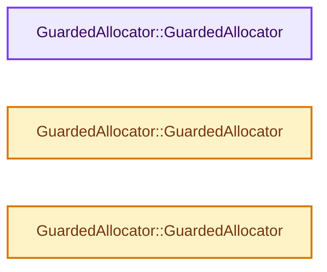

# 实现依赖专题：intern/cycles/util/guarded_allocator.h

[方向导航](README.md) · [符号索引](../%E7%AC%A6%E5%8F%B7%E4%BE%9D%E8%B5%96%E4%B8%8E%E5%AE%9E%E7%8E%B0%E7%B4%A2%E5%BC%95.md)

本专题从正文实际调用进入，集中保存共享实现。函数有稳定锚点，可从调用处直接跳到对应完整函数；递归与互相调用通过回链组织。

## 本文件的实现关系




## 相关类型布局与成员入口

<a id="t-bd9e0c3ccc92"></a>

### `GuardedAllocator`

原始声明：[intern/cycles/util/guarded_allocator.h](../../../../../intern/cycles/util/guarded_allocator.h) · L23—L139。

以下保留类的数据声明与编译条件，成员函数实现通过后面的精确链接阅读。

<!-- annotated:57b39342e521ae -->

```cpp
template<typename T> class GuardedAllocator {
 public:
  using size_type = size_t;
  using difference_type = ptrdiff_t;
  using pointer = T *;
  using const_pointer = const T *;
  using reference = T &;
  using const_reference = const T &;
  using value_type = T;

```

<details>
<summary>核对原始源码：intern/cycles/util/guarded_allocator.h · L23—L32</summary>

<!-- original:57b39342e521ae:intern/cycles/util/guarded_allocator.h:23:32 -->

```cpp
template<typename T> class GuardedAllocator {
 public:
  using size_type = size_t;
  using difference_type = ptrdiff_t;
  using pointer = T *;
  using const_pointer = const T *;
  using reference = T &;
  using const_reference = const T &;
  using value_type = T;

```

</details>

<!-- annotated:a86798d4ce1f1c -->

```cpp

```

<details>
<summary>核对原始源码：intern/cycles/util/guarded_allocator.h · L35—L35</summary>

<!-- original:a86798d4ce1f1c:intern/cycles/util/guarded_allocator.h:35:35 -->

```cpp

```

</details>

<!-- annotated:ae4aae8d70cf2b -->

```cpp

```

<details>
<summary>核对原始源码：intern/cycles/util/guarded_allocator.h · L60—L60</summary>

<!-- original:ae4aae8d70cf2b:intern/cycles/util/guarded_allocator.h:60:60 -->

```cpp

```

</details>

<!-- annotated:8bedd428f7aa16 -->

```cpp

```

<details>
<summary>核对原始源码：intern/cycles/util/guarded_allocator.h · L72—L72</summary>

<!-- original:8bedd428f7aa16:intern/cycles/util/guarded_allocator.h:72:72 -->

```cpp

```

</details>

<!-- annotated:461f4f9ffbedca -->

```cpp

```

<details>
<summary>核对原始源码：intern/cycles/util/guarded_allocator.h · L77—L77</summary>

<!-- original:461f4f9ffbedca:intern/cycles/util/guarded_allocator.h:77:77 -->

```cpp

```

</details>

<!-- annotated:15ee32c62d130e -->

```cpp

```

<details>
<summary>核对原始源码：intern/cycles/util/guarded_allocator.h · L82—L82</summary>

<!-- original:15ee32c62d130e:intern/cycles/util/guarded_allocator.h:82:82 -->

```cpp

```

</details>

<!-- annotated:e5b5cc146940ac -->

```cpp

```

<details>
<summary>核对原始源码：intern/cycles/util/guarded_allocator.h · L84—L84</summary>

<!-- original:e5b5cc146940ac:intern/cycles/util/guarded_allocator.h:84:84 -->

```cpp

```

</details>

<!-- annotated:1e8c40f61c316b -->

```cpp

  template<class U> struct rebind {
    using other = GuardedAllocator<U>;
  };

```

<details>
<summary>核对原始源码：intern/cycles/util/guarded_allocator.h · L89—L93</summary>

<!-- original:1e8c40f61c316b:intern/cycles/util/guarded_allocator.h:89:93 -->

```cpp

  template<class U> struct rebind {
    using other = GuardedAllocator<U>;
  };

```

</details>

<!-- annotated:5adc2b160bbf52 -->

```cpp

```

<details>
<summary>核对原始源码：intern/cycles/util/guarded_allocator.h · L95—L95</summary>

<!-- original:5adc2b160bbf52:intern/cycles/util/guarded_allocator.h:95:95 -->

```cpp

```

</details>

<!-- annotated:3a681bb9b63b10 -->

```cpp

```

<details>
<summary>核对原始源码：intern/cycles/util/guarded_allocator.h · L100—L100</summary>

<!-- original:3a681bb9b63b10:intern/cycles/util/guarded_allocator.h:100:100 -->

```cpp

```

</details>

<!-- annotated:6a17116f55713a -->

```cpp

#if defined(_MSC_VER) && _ITERATOR_DEBUG_LEVEL
  /* Welcome to the black magic here.
   *
   * The issue is that MSVC C++ allocates container proxy on any
   * vector initialization, including static vectors which don't
   * have any data yet. This leads to several issues:
   *
   * - Static objects initialization fiasco (global_stats from
   *   util_stats.h might not be initialized yet).
   * - If main() function changes allocator type (for example,
   *   this might happen with `blender --debug-memory`) nobody
   *   will know how to convert already allocated memory to a new
   *   guarded allocator.
   *
   * Here we work this around by making it so container proxy does
   * not use guarded allocation. A bit fragile, unfortunately.
   *
   * Note: _Container_proxy only exists when _ITERATOR_DEBUG_LEVEL != 0,
   * which is typically only in Debug builds with newer MSVC versions.
   */
  template<> struct rebind<std::_Container_proxy> {
    typedef std::allocator<std::_Container_proxy> other;
  };

```

<details>
<summary>核对原始源码：intern/cycles/util/guarded_allocator.h · L109—L133</summary>

<!-- original:6a17116f55713a:intern/cycles/util/guarded_allocator.h:109:133 -->

```cpp

#if defined(_MSC_VER) && _ITERATOR_DEBUG_LEVEL
  /* Welcome to the black magic here.
   *
   * The issue is that MSVC C++ allocates container proxy on any
   * vector initialization, including static vectors which don't
   * have any data yet. This leads to several issues:
   *
   * - Static objects initialization fiasco (global_stats from
   *   util_stats.h might not be initialized yet).
   * - If main() function changes allocator type (for example,
   *   this might happen with `blender --debug-memory`) nobody
   *   will know how to convert already allocated memory to a new
   *   guarded allocator.
   *
   * Here we work this around by making it so container proxy does
   * not use guarded allocation. A bit fragile, unfortunately.
   *
   * Note: _Container_proxy only exists when _ITERATOR_DEBUG_LEVEL != 0,
   * which is typically only in Debug builds with newer MSVC versions.
   */
  template<> struct rebind<std::_Container_proxy> {
    typedef std::allocator<std::_Container_proxy> other;
  };

```

</details>

<!-- annotated:720d4803799560 -->

```cpp
#endif
};
```

<details>
<summary>核对原始源码：intern/cycles/util/guarded_allocator.h · L138—L139</summary>

<!-- original:720d4803799560:intern/cycles/util/guarded_allocator.h:138:139 -->

```cpp
#endif
};
```

</details>

- [GuardedAllocator](%E4%BE%9D%E8%B5%96-guarded_allocator-e5a8cb.md#f-51d47bec28a5a3d7)
- [GuardedAllocator](%E4%BE%9D%E8%B5%96-guarded_allocator-e5a8cb.md#f-273011bbcaf915f8)
- [GuardedAllocator](%E4%BE%9D%E8%B5%96-guarded_allocator-e5a8cb.md#f-b240687baf719161)

## 完整成员与函数实现

<a id="f-51d47bec28a5a3d7"></a>

### `GuardedAllocator::GuardedAllocator`

实现位置：[intern/cycles/util/guarded_allocator.h](../../../../../intern/cycles/util/guarded_allocator.h) · L33—L33。

**教学注释版**

<!-- annotated:32e3857bf6b01f -->

```cpp
  GuardedAllocator() = default;
```

<details>
<summary>核对原始源码：intern/cycles/util/guarded_allocator.h · L33—L33</summary>

<!-- original:32e3857bf6b01f:intern/cycles/util/guarded_allocator.h:33:33 -->

```cpp
  GuardedAllocator() = default;
```

</details>

**继续追踪实现**

本实现没有需要继续展开的显式调用；检查返回表达式、对象转换和调用者前置条件。

<a id="f-273011bbcaf915f8"></a>

### `GuardedAllocator::GuardedAllocator`

实现位置：[intern/cycles/util/guarded_allocator.h](../../../../../intern/cycles/util/guarded_allocator.h) · L34—L34。

接口参数：

- `const GuardedAllocator &`

**教学注释版**

<!-- annotated:6ae8b35f38c987 -->

```cpp
  GuardedAllocator(const GuardedAllocator & /*unused*/) = default;
```

<details>
<summary>核对原始源码：intern/cycles/util/guarded_allocator.h · L34—L34</summary>

<!-- original:6ae8b35f38c987:intern/cycles/util/guarded_allocator.h:34:34 -->

```cpp
  GuardedAllocator(const GuardedAllocator & /*unused*/) = default;
```

</details>

**继续追踪实现**

本实现没有需要继续展开的显式调用；检查返回表达式、对象转换和调用者前置条件。

<a id="f-b240687baf719161"></a>

### `GuardedAllocator::GuardedAllocator`

实现位置：[intern/cycles/util/guarded_allocator.h](../../../../../intern/cycles/util/guarded_allocator.h) · L94—L94。

接口参数：

- `const GuardedAllocator<U> &`

**教学注释版**

<!-- annotated:3dc0606ad5b559 -->

```cpp
  template<class U> GuardedAllocator(const GuardedAllocator<U> & /*unused*/) {}
```

<details>
<summary>核对原始源码：intern/cycles/util/guarded_allocator.h · L94—L94</summary>

<!-- original:3dc0606ad5b559:intern/cycles/util/guarded_allocator.h:94:94 -->

```cpp
  template<class U> GuardedAllocator(const GuardedAllocator<U> & /*unused*/) {}
```

</details>

**继续追踪实现**

本实现没有需要继续展开的显式调用；检查返回表达式、对象转换和调用者前置条件。
