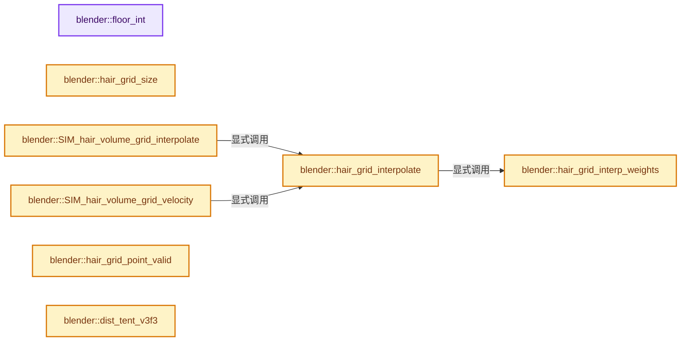
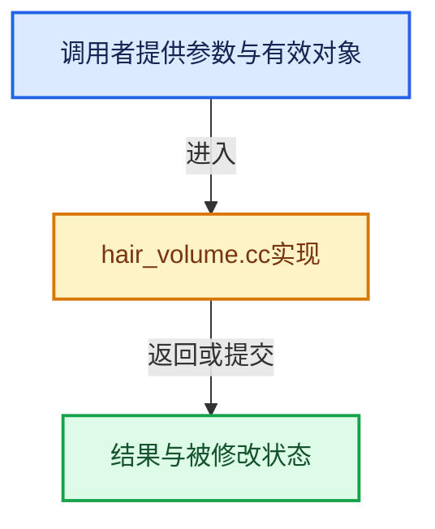

# 实现依赖专题：source/blender/simulation/intern/hair_volume.cc

[方向导航](README.md) · [符号索引](../%E7%AC%A6%E5%8F%B7%E4%BE%9D%E8%B5%96%E4%B8%8E%E5%AE%9E%E7%8E%B0%E7%B4%A2%E5%BC%95.md)

本专题从正文实际调用进入，集中保存共享实现。函数有稳定锚点，可从调用处直接跳到对应完整函数；递归与互相调用通过回链组织。

## 本文件的实现关系






<a id="m-56fe86ffd6f4"></a>

## 宏 `HAIR_GRID_INDEX_AXIS`

<!-- annotated:715143b377388c -->

```cpp
#define HAIR_GRID_INDEX_AXIS(vec, res, gmin, scale, axis) \
  min_ii(max_ii(int((vec[axis] - gmin[axis]) * scale), 0), res[axis] - 2)

```

<details>
<summary>核对原始源码：source/blender/simulation/intern/hair_volume.cc · L69—L71</summary>

<!-- original:715143b377388c:source/blender/simulation/intern/hair_volume.cc:69:71 -->

```cpp
#define HAIR_GRID_INDEX_AXIS(vec, res, gmin, scale, axis) \
  min_ii(max_ii(int((vec[axis] - gmin[axis]) * scale), 0), res[axis] - 2)

```

</details>

宏在预处理阶段展开，参数替换、重复求值和条件编译应直接从该定义检查。与普通函数不同，宏不会自动提供参数类型检查；构建配置选择哪个定义需结合外围条件。

## 完整成员与函数实现

<a id="f-afe371ed77eba708"></a>

### `blender::floor_int`

实现位置：[source/blender/simulation/intern/hair_volume.cc](../../../../../source/blender/simulation/intern/hair_volume.cc) · L39—L42。

接口参数：

- `float value`

**教学注释版**

<!-- annotated:ffd4bcf0ae41db -->

```cpp
BLI_INLINE int floor_int(float value)
{
  return value > 0.0f ? int(value) : int(value) - 1;
}
```

<details>
<summary>核对原始源码：source/blender/simulation/intern/hair_volume.cc · L39—L42</summary>

<!-- original:ffd4bcf0ae41db:source/blender/simulation/intern/hair_volume.cc:39:42 -->

```cpp
BLI_INLINE int floor_int(float value)
{
  return value > 0.0f ? int(value) : int(value) - 1;
}
```

</details>

**结果出口**

- `return value > 0.0f ? int(value) : int(value) - 1;`

**继续追踪实现**

本实现没有需要继续展开的显式调用；检查返回表达式、对象转换和调用者前置条件。

<a id="f-0fe09b0f471b0095"></a>

### `blender::hair_grid_size`

实现位置：[source/blender/simulation/intern/hair_volume.cc](../../../../../source/blender/simulation/intern/hair_volume.cc) · L49—L52。

接口参数：

- `const int res[3]`

**教学注释版**

<!-- annotated:5c8a5e22ad2216 -->

```cpp
BLI_INLINE int hair_grid_size(const int res[3])
{
  return res[0] * res[1] * res[2];
}
```

<details>
<summary>核对原始源码：source/blender/simulation/intern/hair_volume.cc · L49—L52</summary>

<!-- original:5c8a5e22ad2216:source/blender/simulation/intern/hair_volume.cc:49:52 -->

```cpp
BLI_INLINE int hair_grid_size(const int res[3])
{
  return res[0] * res[1] * res[2];
}
```

</details>

**结果出口**

- `return res[0] * res[1] * res[2];`

**继续追踪实现**

本实现没有需要继续展开的显式调用；检查返回表达式、对象转换和调用者前置条件。

<a id="f-f5ad5828e3f85883"></a>

### `blender::hair_grid_interp_weights`

实现位置：[source/blender/simulation/intern/hair_volume.cc](../../../../../source/blender/simulation/intern/hair_volume.cc) · L84—L105。

接口参数：

- `const int res[3]`
- `const float gmin[3]`
- `float scale`
- `const float vec[3]`
- `float uvw[3]`

**教学注释版**

<!-- annotated:256ea2f16d2c98 -->

```cpp
BLI_INLINE int hair_grid_interp_weights(
    const int res[3], const float gmin[3], float scale, const float vec[3], float uvw[3])
{
  int i, j, k, offset;

  i = HAIR_GRID_INDEX_AXIS(vec, res, gmin, scale, 0);
  j = HAIR_GRID_INDEX_AXIS(vec, res, gmin, scale, 1);
  k = HAIR_GRID_INDEX_AXIS(vec, res, gmin, scale, 2);
  offset = i + (j + k * res[1]) * res[0];

  uvw[0] = (vec[0] - gmin[0]) * scale - float(i);
  uvw[1] = (vec[1] - gmin[1]) * scale - float(j);
  uvw[2] = (vec[2] - gmin[2]) * scale - float(k);

#if 0
  BLI_assert(0.0f <= uvw[0] && uvw[0] <= 1.0001f);
  BLI_assert(0.0f <= uvw[1] && uvw[1] <= 1.0001f);
  BLI_assert(0.0f <= uvw[2] && uvw[2] <= 1.0001f);
#endif

  return offset;
}
```

<details>
<summary>核对原始源码：source/blender/simulation/intern/hair_volume.cc · L84—L105</summary>

<!-- original:256ea2f16d2c98:source/blender/simulation/intern/hair_volume.cc:84:105 -->

```cpp
BLI_INLINE int hair_grid_interp_weights(
    const int res[3], const float gmin[3], float scale, const float vec[3], float uvw[3])
{
  int i, j, k, offset;

  i = HAIR_GRID_INDEX_AXIS(vec, res, gmin, scale, 0);
  j = HAIR_GRID_INDEX_AXIS(vec, res, gmin, scale, 1);
  k = HAIR_GRID_INDEX_AXIS(vec, res, gmin, scale, 2);
  offset = i + (j + k * res[1]) * res[0];

  uvw[0] = (vec[0] - gmin[0]) * scale - float(i);
  uvw[1] = (vec[1] - gmin[1]) * scale - float(j);
  uvw[2] = (vec[2] - gmin[2]) * scale - float(k);

#if 0
  BLI_assert(0.0f <= uvw[0] && uvw[0] <= 1.0001f);
  BLI_assert(0.0f <= uvw[1] && uvw[1] <= 1.0001f);
  BLI_assert(0.0f <= uvw[2] && uvw[2] <= 1.0001f);
#endif

  return offset;
}
```

</details>

**沿实际写入检查状态**

- `i = HAIR_GRID_INDEX_AXIS(vec, res, gmin, scale, 0);`
- `j = HAIR_GRID_INDEX_AXIS(vec, res, gmin, scale, 1);`
- `k = HAIR_GRID_INDEX_AXIS(vec, res, gmin, scale, 2);`
- `offset = i + (j + k * res[1]) * res[0];`
- `uvw[0] = (vec[0] - gmin[0]) * scale - float(i);`
- `uvw[1] = (vec[1] - gmin[1]) * scale - float(j);`
- `uvw[2] = (vec[2] - gmin[2]) * scale - float(k);`

**结果出口**

- `return offset;`

**继续追踪实现**

- `HAIR_GRID_INDEX_AXIS` → [HAIR_GRID_INDEX_AXIS · L69](%E4%BE%9D%E8%B5%96-hair_volume-8dd8f5.md#m-56fe86ffd6f4)。宏定义由构建条件选择。
- `BLI_assert` → [BLI_assert · L48](../01-%E5%9F%BA%E7%A1%80%E5%AE%B9%E5%99%A8%E4%B8%8E%E7%8E%B0%E4%BB%A3CPP/%E4%BE%9D%E8%B5%96-BLI_assert-cc98e8.md#m-57a88495704d)；[BLI_assert · L63](../01-%E5%9F%BA%E7%A1%80%E5%AE%B9%E5%99%A8%E4%B8%8E%E7%8E%B0%E4%BB%A3CPP/%E4%BE%9D%E8%B5%96-BLI_assert-cc98e8.md#m-d07050020cb5)。宏定义由构建条件选择。

<a id="f-86b991e1ec13a3b0"></a>

### `blender::hair_grid_interpolate`

实现位置：[source/blender/simulation/intern/hair_volume.cc](../../../../../source/blender/simulation/intern/hair_volume.cc) · L107—L191。

接口参数：

- `const HairGridVert *grid`
- `const int res[3]`
- `const float gmin[3]`
- `float scale`
- `const float vec[3]`
- `float *density`
- `float velocity[3]`
- `float vel_smooth[3]`
- `float density_gradient[3]`
- `float velocity_gradient[3][3]`

**教学注释版**

<!-- annotated:da702f9cbc6376 -->

```cpp
BLI_INLINE void hair_grid_interpolate(const HairGridVert *grid,
                                      const int res[3],
                                      const float gmin[3],
                                      float scale,
                                      const float vec[3],
                                      float *density,
                                      float velocity[3],
                                      float vel_smooth[3],
                                      float density_gradient[3],
                                      float velocity_gradient[3][3])
{
  HairGridVert data[8];
  float uvw[3], muvw[3];
  int res2 = res[1] * res[0];
  int offset;

  offset = hair_grid_interp_weights(res, gmin, scale, vec, uvw);
  muvw[0] = 1.0f - uvw[0];
  muvw[1] = 1.0f - uvw[1];
  muvw[2] = 1.0f - uvw[2];

  data[0] = grid[offset];
  data[1] = grid[offset + 1];
  data[2] = grid[offset + res[0]];
  data[3] = grid[offset + res[0] + 1];
  data[4] = grid[offset + res2];
  data[5] = grid[offset + res2 + 1];
  data[6] = grid[offset + res2 + res[0]];
  data[7] = grid[offset + res2 + res[0] + 1];

  if (density) {
    *density = muvw[2] * (muvw[1] * (muvw[0] * data[0].density + uvw[0] * data[1].density) +
                          uvw[1] * (muvw[0] * data[2].density + uvw[0] * data[3].density)) +
               uvw[2] * (muvw[1] * (muvw[0] * data[4].density + uvw[0] * data[5].density) +
                         uvw[1] * (muvw[0] * data[6].density + uvw[0] * data[7].density));
  }

  if (velocity) {
    int k;
    for (k = 0; k < 3; k++) {
      velocity[k] = muvw[2] *
                        (muvw[1] * (muvw[0] * data[0].velocity[k] + uvw[0] * data[1].velocity[k]) +
                         uvw[1] * (muvw[0] * data[2].velocity[k] + uvw[0] * data[3].velocity[k])) +
                    uvw[2] *
                        (muvw[1] * (muvw[0] * data[4].velocity[k] + uvw[0] * data[5].velocity[k]) +
                         uvw[1] * (muvw[0] * data[6].velocity[k] + uvw[0] * data[7].velocity[k]));
    }
  }

  if (vel_smooth) {
    int k;
    for (k = 0; k < 3; k++) {
      vel_smooth[k] = muvw[2] * (muvw[1] * (muvw[0] * data[0].velocity_smooth[k] +
                                            uvw[0] * data[1].velocity_smooth[k]) +
                                 uvw[1] * (muvw[0] * data[2].velocity_smooth[k] +
                                           uvw[0] * data[3].velocity_smooth[k])) +
                      uvw[2] * (muvw[1] * (muvw[0] * data[4].velocity_smooth[k] +
                                           uvw[0] * data[5].velocity_smooth[k]) +
                                uvw[1] * (muvw[0] * data[6].velocity_smooth[k] +
                                          uvw[0] * data[7].velocity_smooth[k]));
    }
  }

  if (density_gradient) {
    density_gradient[0] = muvw[1] * muvw[2] * (data[0].density - data[1].density) +
                          uvw[1] * muvw[2] * (data[2].density - data[3].density) +
                          muvw[1] * uvw[2] * (data[4].density - data[5].density) +
                          uvw[1] * uvw[2] * (data[6].density - data[7].density);

    density_gradient[1] = muvw[2] * muvw[0] * (data[0].density - data[2].density) +
                          uvw[2] * muvw[0] * (data[4].density - data[6].density) +
                          muvw[2] * uvw[0] * (data[1].density - data[3].density) +
                          uvw[2] * uvw[0] * (data[5].density - data[7].density);

    density_gradient[2] = muvw[2] * muvw[0] * (data[0].density - data[4].density) +
                          uvw[2] * muvw[0] * (data[1].density - data[5].density) +
                          muvw[2] * uvw[0] * (data[2].density - data[6].density) +
                          uvw[2] * uvw[0] * (data[3].density - data[7].density);
  }

  if (velocity_gradient) {
    /* XXX TODO: */
    zero_m3(velocity_gradient);
  }
}
```

<details>
<summary>核对原始源码：source/blender/simulation/intern/hair_volume.cc · L107—L191</summary>

<!-- original:da702f9cbc6376:source/blender/simulation/intern/hair_volume.cc:107:191 -->

```cpp
BLI_INLINE void hair_grid_interpolate(const HairGridVert *grid,
                                      const int res[3],
                                      const float gmin[3],
                                      float scale,
                                      const float vec[3],
                                      float *density,
                                      float velocity[3],
                                      float vel_smooth[3],
                                      float density_gradient[3],
                                      float velocity_gradient[3][3])
{
  HairGridVert data[8];
  float uvw[3], muvw[3];
  int res2 = res[1] * res[0];
  int offset;

  offset = hair_grid_interp_weights(res, gmin, scale, vec, uvw);
  muvw[0] = 1.0f - uvw[0];
  muvw[1] = 1.0f - uvw[1];
  muvw[2] = 1.0f - uvw[2];

  data[0] = grid[offset];
  data[1] = grid[offset + 1];
  data[2] = grid[offset + res[0]];
  data[3] = grid[offset + res[0] + 1];
  data[4] = grid[offset + res2];
  data[5] = grid[offset + res2 + 1];
  data[6] = grid[offset + res2 + res[0]];
  data[7] = grid[offset + res2 + res[0] + 1];

  if (density) {
    *density = muvw[2] * (muvw[1] * (muvw[0] * data[0].density + uvw[0] * data[1].density) +
                          uvw[1] * (muvw[0] * data[2].density + uvw[0] * data[3].density)) +
               uvw[2] * (muvw[1] * (muvw[0] * data[4].density + uvw[0] * data[5].density) +
                         uvw[1] * (muvw[0] * data[6].density + uvw[0] * data[7].density));
  }

  if (velocity) {
    int k;
    for (k = 0; k < 3; k++) {
      velocity[k] = muvw[2] *
                        (muvw[1] * (muvw[0] * data[0].velocity[k] + uvw[0] * data[1].velocity[k]) +
                         uvw[1] * (muvw[0] * data[2].velocity[k] + uvw[0] * data[3].velocity[k])) +
                    uvw[2] *
                        (muvw[1] * (muvw[0] * data[4].velocity[k] + uvw[0] * data[5].velocity[k]) +
                         uvw[1] * (muvw[0] * data[6].velocity[k] + uvw[0] * data[7].velocity[k]));
    }
  }

  if (vel_smooth) {
    int k;
    for (k = 0; k < 3; k++) {
      vel_smooth[k] = muvw[2] * (muvw[1] * (muvw[0] * data[0].velocity_smooth[k] +
                                            uvw[0] * data[1].velocity_smooth[k]) +
                                 uvw[1] * (muvw[0] * data[2].velocity_smooth[k] +
                                           uvw[0] * data[3].velocity_smooth[k])) +
                      uvw[2] * (muvw[1] * (muvw[0] * data[4].velocity_smooth[k] +
                                           uvw[0] * data[5].velocity_smooth[k]) +
                                uvw[1] * (muvw[0] * data[6].velocity_smooth[k] +
                                          uvw[0] * data[7].velocity_smooth[k]));
    }
  }

  if (density_gradient) {
    density_gradient[0] = muvw[1] * muvw[2] * (data[0].density - data[1].density) +
                          uvw[1] * muvw[2] * (data[2].density - data[3].density) +
                          muvw[1] * uvw[2] * (data[4].density - data[5].density) +
                          uvw[1] * uvw[2] * (data[6].density - data[7].density);

    density_gradient[1] = muvw[2] * muvw[0] * (data[0].density - data[2].density) +
                          uvw[2] * muvw[0] * (data[4].density - data[6].density) +
                          muvw[2] * uvw[0] * (data[1].density - data[3].density) +
                          uvw[2] * uvw[0] * (data[5].density - data[7].density);

    density_gradient[2] = muvw[2] * muvw[0] * (data[0].density - data[4].density) +
                          uvw[2] * muvw[0] * (data[1].density - data[5].density) +
                          muvw[2] * uvw[0] * (data[2].density - data[6].density) +
                          uvw[2] * uvw[0] * (data[3].density - data[7].density);
  }

  if (velocity_gradient) {
    /* XXX TODO: */
    zero_m3(velocity_gradient);
  }
}
```

</details>

**沿实际写入检查状态**

- `offset = hair_grid_interp_weights(res, gmin, scale, vec, uvw);`
- `muvw[0] = 1.0f - uvw[0];`
- `muvw[1] = 1.0f - uvw[1];`
- `muvw[2] = 1.0f - uvw[2];`
- `data[0] = grid[offset];`
- `data[1] = grid[offset + 1];`
- `data[2] = grid[offset + res[0]];`
- `data[3] = grid[offset + res[0] + 1];`
- `data[4] = grid[offset + res2];`
- `data[5] = grid[offset + res2 + 1];`
- `data[6] = grid[offset + res2 + res[0]];`
- `data[7] = grid[offset + res2 + res[0] + 1];`
- `velocity[k] = muvw[2] *`
- `vel_smooth[k] = muvw[2] * (muvw[1] * (muvw[0] * data[0].velocity_smooth[k] +`
- `density_gradient[0] = muvw[1] * muvw[2] * (data[0].density - data[1].density) +`
- `density_gradient[1] = muvw[2] * muvw[0] * (data[0].density - data[2].density) +`
- `density_gradient[2] = muvw[2] * muvw[0] * (data[0].density - data[4].density) +`

**继续追踪实现**

- `hair_grid_interp_weights` → [blender::hair_grid_interp_weights · L84](%E4%BE%9D%E8%B5%96-hair_volume-8dd8f5.md#f-f5ad5828e3f85883)。
- `zero_m3` → [blender::zero_m3 · L30](../12-%E7%A9%BA%E9%97%B4%E6%95%B0%E6%8D%AE%E7%BB%93%E6%9E%84%E4%B8%8E%E5%87%A0%E4%BD%95%E7%AE%97%E6%B3%95/%E4%BE%9D%E8%B5%96-math_matrix_c-004123.md#f-f222ef9659a09668)。

<a id="f-109e76fb048f23dc"></a>

### `blender::SIM_hair_volume_grid_interpolate`

实现位置：[source/blender/simulation/intern/hair_volume.cc](../../../../../source/blender/simulation/intern/hair_volume.cc) · L232—L250。

接口参数：

- `HairGrid *grid`
- `const float x[3]`
- `float *density`
- `float velocity[3]`
- `float velocity_smooth[3]`
- `float density_gradient[3]`
- `float velocity_gradient[3][3]`

**教学注释版**

<!-- annotated:7ff2152a8883b3 -->

```cpp
void SIM_hair_volume_grid_interpolate(HairGrid *grid,
                                      const float x[3],
                                      float *density,
                                      float velocity[3],
                                      float velocity_smooth[3],
                                      float density_gradient[3],
                                      float velocity_gradient[3][3])
{
  hair_grid_interpolate(grid->verts,
                        grid->res,
                        grid->gmin,
                        grid->inv_cellsize,
                        x,
                        density,
                        velocity,
                        velocity_smooth,
                        density_gradient,
                        velocity_gradient);
}
```

<details>
<summary>核对原始源码：source/blender/simulation/intern/hair_volume.cc · L232—L250</summary>

<!-- original:7ff2152a8883b3:source/blender/simulation/intern/hair_volume.cc:232:250 -->

```cpp
void SIM_hair_volume_grid_interpolate(HairGrid *grid,
                                      const float x[3],
                                      float *density,
                                      float velocity[3],
                                      float velocity_smooth[3],
                                      float density_gradient[3],
                                      float velocity_gradient[3][3])
{
  hair_grid_interpolate(grid->verts,
                        grid->res,
                        grid->gmin,
                        grid->inv_cellsize,
                        x,
                        density,
                        velocity,
                        velocity_smooth,
                        density_gradient,
                        velocity_gradient);
}
```

</details>

**继续追踪实现**

- `hair_grid_interpolate` → [blender::hair_grid_interpolate · L107](%E4%BE%9D%E8%B5%96-hair_volume-8dd8f5.md#f-86b991e1ec13a3b0)。

<a id="f-7faa559f5aecbf24"></a>

### `blender::SIM_hair_volume_grid_velocity`

实现位置：[source/blender/simulation/intern/hair_volume.cc](../../../../../source/blender/simulation/intern/hair_volume.cc) · L252—L277。

接口参数：

- `HairGrid *grid`
- `const float x[3]`
- `const float v[3]`
- `float fluid_factor`
- `float r_v[3]`

**教学注释版**

<!-- annotated:bb7e48b7956cd6 -->

```cpp
void SIM_hair_volume_grid_velocity(
    HairGrid *grid, const float x[3], const float v[3], float fluid_factor, float r_v[3])
{
  float gdensity, gvelocity[3], gvel_smooth[3], ggrad[3], gvelgrad[3][3];
  float v_pic[3], v_flip[3];

  hair_grid_interpolate(grid->verts,
                        grid->res,
                        grid->gmin,
                        grid->inv_cellsize,
                        x,
                        &gdensity,
                        gvelocity,
                        gvel_smooth,
                        ggrad,
                        gvelgrad);

  /* velocity according to PIC method (Particle-in-Cell) */
  copy_v3_v3(v_pic, gvel_smooth);

  /* velocity according to FLIP method (Fluid-Implicit-Particle) */
  sub_v3_v3v3(v_flip, gvel_smooth, gvelocity);
  add_v3_v3(v_flip, v);

  interp_v3_v3v3(r_v, v_pic, v_flip, fluid_factor);
}
```

<details>
<summary>核对原始源码：source/blender/simulation/intern/hair_volume.cc · L252—L277</summary>

<!-- original:bb7e48b7956cd6:source/blender/simulation/intern/hair_volume.cc:252:277 -->

```cpp
void SIM_hair_volume_grid_velocity(
    HairGrid *grid, const float x[3], const float v[3], float fluid_factor, float r_v[3])
{
  float gdensity, gvelocity[3], gvel_smooth[3], ggrad[3], gvelgrad[3][3];
  float v_pic[3], v_flip[3];

  hair_grid_interpolate(grid->verts,
                        grid->res,
                        grid->gmin,
                        grid->inv_cellsize,
                        x,
                        &gdensity,
                        gvelocity,
                        gvel_smooth,
                        ggrad,
                        gvelgrad);

  /* velocity according to PIC method (Particle-in-Cell) */
  copy_v3_v3(v_pic, gvel_smooth);

  /* velocity according to FLIP method (Fluid-Implicit-Particle) */
  sub_v3_v3v3(v_flip, gvel_smooth, gvelocity);
  add_v3_v3(v_flip, v);

  interp_v3_v3v3(r_v, v_pic, v_flip, fluid_factor);
}
```

</details>

**继续追踪实现**

- `hair_grid_interpolate` → [blender::hair_grid_interpolate · L107](%E4%BE%9D%E8%B5%96-hair_volume-8dd8f5.md#f-86b991e1ec13a3b0)。
- `copy_v3_v3` → [blender::copy_v3_v3 · L47](../12-%E7%A9%BA%E9%97%B4%E6%95%B0%E6%8D%AE%E7%BB%93%E6%9E%84%E4%B8%8E%E5%87%A0%E4%BD%95%E7%AE%97%E6%B3%95/%E4%BE%9D%E8%B5%96-math_vector_inline-0c8541.md#f-037a0d5fa5060bd6)。
- `sub_v3_v3v3` → [blender::sub_v3_v3v3 · L360](../12-%E7%A9%BA%E9%97%B4%E6%95%B0%E6%8D%AE%E7%BB%93%E6%9E%84%E4%B8%8E%E5%87%A0%E4%BD%95%E7%AE%97%E6%B3%95/%E4%BE%9D%E8%B5%96-math_vector_inline-0c8541.md#f-23781c252db8b30c)。
- `add_v3_v3` → [blender::add_v3_v3 · L286](../12-%E7%A9%BA%E9%97%B4%E6%95%B0%E6%8D%AE%E7%BB%93%E6%9E%84%E4%B8%8E%E5%87%A0%E4%BD%95%E7%AE%97%E6%B3%95/%E4%BE%9D%E8%B5%96-math_vector_inline-0c8541.md#f-e7930c6fdefe462c)。
- `interp_v3_v3v3` → [blender::interp_v3_v3v3 · L41](../12-%E7%A9%BA%E9%97%B4%E6%95%B0%E6%8D%AE%E7%BB%93%E6%9E%84%E4%B8%8E%E5%87%A0%E4%BD%95%E7%AE%97%E6%B3%95/%E4%BE%9D%E8%B5%96-math_vector-5f35fa.md#f-18251c70c00824d7)。

<a id="f-56acfa982fe6af95"></a>

### `blender::hair_grid_point_valid`

实现位置：[source/blender/simulation/intern/hair_volume.cc](../../../../../source/blender/simulation/intern/hair_volume.cc) · L291—L295。

接口参数：

- `const float vec[3]`
- `const float gmin[3]`
- `const float gmax[3]`

**教学注释版**

<!-- annotated:bc7e9c29d836da -->

```cpp
BLI_INLINE bool hair_grid_point_valid(const float vec[3], const float gmin[3], const float gmax[3])
{
  return !(vec[0] < gmin[0] || vec[1] < gmin[1] || vec[2] < gmin[2] || vec[0] > gmax[0] ||
           vec[1] > gmax[1] || vec[2] > gmax[2]);
}
```

<details>
<summary>核对原始源码：source/blender/simulation/intern/hair_volume.cc · L291—L295</summary>

<!-- original:bc7e9c29d836da:source/blender/simulation/intern/hair_volume.cc:291:295 -->

```cpp
BLI_INLINE bool hair_grid_point_valid(const float vec[3], const float gmin[3], const float gmax[3])
{
  return !(vec[0] < gmin[0] || vec[1] < gmin[1] || vec[2] < gmin[2] || vec[0] > gmax[0] ||
           vec[1] > gmax[1] || vec[2] > gmax[2]);
}
```

</details>

**结果出口**

- `return !(vec[0] < gmin[0] || vec[1] < gmin[1] || vec[2] < gmin[2] || vec[0] > gmax[0] ||`

**继续追踪实现**

本实现没有需要继续展开的显式调用；检查返回表达式、对象转换和调用者前置条件。

<a id="f-5d0864a330d1bd0c"></a>

### `blender::dist_tent_v3f3`

实现位置：[source/blender/simulation/intern/hair_volume.cc](../../../../../source/blender/simulation/intern/hair_volume.cc) · L297—L301。

接口参数：

- `const float a[3]`
- `float x`
- `float y`
- `float z`

**教学注释版**

<!-- annotated:fe6e71d4a97af9 -->

```cpp
BLI_INLINE float dist_tent_v3f3(const float a[3], float x, float y, float z)
{
  float w = (1.0f - fabsf(a[0] - x)) * (1.0f - fabsf(a[1] - y)) * (1.0f - fabsf(a[2] - z));
  return w;
}
```

<details>
<summary>核对原始源码：source/blender/simulation/intern/hair_volume.cc · L297—L301</summary>

<!-- original:fe6e71d4a97af9:source/blender/simulation/intern/hair_volume.cc:297:301 -->

```cpp
BLI_INLINE float dist_tent_v3f3(const float a[3], float x, float y, float z)
{
  float w = (1.0f - fabsf(a[0] - x)) * (1.0f - fabsf(a[1] - y)) * (1.0f - fabsf(a[2] - z));
  return w;
}
```

</details>

**结果出口**

- `return w;`

**继续追踪实现**

- `fabsf` → [fabsf · L21](%E4%BE%9D%E8%B5%96-radial_tiling_shared-98abf9.md#m-02cc4c69cfb3)；[fabsf · L43](%E4%BE%9D%E8%B5%96-radial_tiling_shared-98abf9.md#m-04effe61803b)；[fabsf · L74](%E4%BE%9D%E8%B5%96-radial_tiling_shared-98abf9.md#m-927dd4eba7dc)；[fabsf · L25](../01-%E5%9F%BA%E7%A1%80%E5%AE%B9%E5%99%A8%E4%B8%8E%E7%8E%B0%E4%BB%A3CPP/%E4%BE%9D%E8%B5%96-radial_tiling_shared-7989a4.md#m-8348d6b3d08f)；[fabsf · L47](../01-%E5%9F%BA%E7%A1%80%E5%AE%B9%E5%99%A8%E4%B8%8E%E7%8E%B0%E4%BB%A3CPP/%E4%BE%9D%E8%B5%96-radial_tiling_shared-7989a4.md#m-13b7e0b6d84f)；[fabsf · L78](../01-%E5%9F%BA%E7%A1%80%E5%AE%B9%E5%99%A8%E4%B8%8E%E7%8E%B0%E4%BB%A3CPP/%E4%BE%9D%E8%B5%96-radial_tiling_shared-7989a4.md#m-326c83464a0d)；[fabsf · L21](%E4%BE%9D%E8%B5%96-node_radial_tiling_shared-b14bc2.md#m-7c3ee12fc119)；[fabsf · L43](%E4%BE%9D%E8%B5%96-node_radial_tiling_shared-b14bc2.md#m-9112db0e2dd1)；[fabsf · L74](%E4%BE%9D%E8%B5%96-node_radial_tiling_shared-b14bc2.md#m-ee4e61908a6f)；[fabsf · L167](%E4%BE%9D%E8%B5%96-compat-56205c.md#m-b039ee6c1601)；[fabsf · L265](%E4%BE%9D%E8%B5%96-compat-efe0e9.md#m-6b21869e9f3f)。宏定义由构建条件选择。

<a id="f-dc4124bfb4c8f40e"></a>

### `blender::hair_grid_weights`

实现位置：[source/blender/simulation/intern/hair_volume.cc](../../../../../source/blender/simulation/intern/hair_volume.cc) · L314—L341。

接口参数：

- `const int res[3]`
- `const float gmin[3]`
- `float scale`
- `const float vec[3]`
- `float weights[8]`

**教学注释版**

<!-- annotated:573114c8ac4fe2 -->

```cpp
BLI_INLINE int hair_grid_weights(
    const int res[3], const float gmin[3], float scale, const float vec[3], float weights[8])
{
  int i, j, k, offset;
  float uvw[3];

  i = HAIR_GRID_INDEX_AXIS(vec, res, gmin, scale, 0);
  j = HAIR_GRID_INDEX_AXIS(vec, res, gmin, scale, 1);
  k = HAIR_GRID_INDEX_AXIS(vec, res, gmin, scale, 2);
  offset = i + (j + k * res[1]) * res[0];

  uvw[0] = (vec[0] - gmin[0]) * scale;
  uvw[1] = (vec[1] - gmin[1]) * scale;
  uvw[2] = (vec[2] - gmin[2]) * scale;

  weights[0] = dist_tent_v3f3(uvw, float(i), float(j), float(k));
  weights[1] = dist_tent_v3f3(uvw, float(i + 1), float(j), float(k));
  weights[2] = dist_tent_v3f3(uvw, float(i), float(j + 1), float(k));
  weights[3] = dist_tent_v3f3(uvw, float(i + 1), float(j + 1), float(k));
  weights[4] = dist_tent_v3f3(uvw, float(i), float(j), float(k + 1));
  weights[5] = dist_tent_v3f3(uvw, float(i + 1), float(j), float(k + 1));
  weights[6] = dist_tent_v3f3(uvw, float(i), float(j + 1), float(k + 1));
  weights[7] = dist_tent_v3f3(uvw, float(i + 1), float(j + 1), float(k + 1));

  // BLI_assert(fabsf(weights_sum(weights) - 1.0f) < 0.0001f);

  return offset;
}
```

<details>
<summary>核对原始源码：source/blender/simulation/intern/hair_volume.cc · L314—L341</summary>

<!-- original:573114c8ac4fe2:source/blender/simulation/intern/hair_volume.cc:314:341 -->

```cpp
BLI_INLINE int hair_grid_weights(
    const int res[3], const float gmin[3], float scale, const float vec[3], float weights[8])
{
  int i, j, k, offset;
  float uvw[3];

  i = HAIR_GRID_INDEX_AXIS(vec, res, gmin, scale, 0);
  j = HAIR_GRID_INDEX_AXIS(vec, res, gmin, scale, 1);
  k = HAIR_GRID_INDEX_AXIS(vec, res, gmin, scale, 2);
  offset = i + (j + k * res[1]) * res[0];

  uvw[0] = (vec[0] - gmin[0]) * scale;
  uvw[1] = (vec[1] - gmin[1]) * scale;
  uvw[2] = (vec[2] - gmin[2]) * scale;

  weights[0] = dist_tent_v3f3(uvw, float(i), float(j), float(k));
  weights[1] = dist_tent_v3f3(uvw, float(i + 1), float(j), float(k));
  weights[2] = dist_tent_v3f3(uvw, float(i), float(j + 1), float(k));
  weights[3] = dist_tent_v3f3(uvw, float(i + 1), float(j + 1), float(k));
  weights[4] = dist_tent_v3f3(uvw, float(i), float(j), float(k + 1));
  weights[5] = dist_tent_v3f3(uvw, float(i + 1), float(j), float(k + 1));
  weights[6] = dist_tent_v3f3(uvw, float(i), float(j + 1), float(k + 1));
  weights[7] = dist_tent_v3f3(uvw, float(i + 1), float(j + 1), float(k + 1));

  // BLI_assert(fabsf(weights_sum(weights) - 1.0f) < 0.0001f);

  return offset;
}
```

</details>

**沿实际写入检查状态**

- `i = HAIR_GRID_INDEX_AXIS(vec, res, gmin, scale, 0);`
- `j = HAIR_GRID_INDEX_AXIS(vec, res, gmin, scale, 1);`
- `k = HAIR_GRID_INDEX_AXIS(vec, res, gmin, scale, 2);`
- `offset = i + (j + k * res[1]) * res[0];`
- `uvw[0] = (vec[0] - gmin[0]) * scale;`
- `uvw[1] = (vec[1] - gmin[1]) * scale;`
- `uvw[2] = (vec[2] - gmin[2]) * scale;`
- `weights[0] = dist_tent_v3f3(uvw, float(i), float(j), float(k));`
- `weights[1] = dist_tent_v3f3(uvw, float(i + 1), float(j), float(k));`
- `weights[2] = dist_tent_v3f3(uvw, float(i), float(j + 1), float(k));`
- `weights[3] = dist_tent_v3f3(uvw, float(i + 1), float(j + 1), float(k));`
- `weights[4] = dist_tent_v3f3(uvw, float(i), float(j), float(k + 1));`
- `weights[5] = dist_tent_v3f3(uvw, float(i + 1), float(j), float(k + 1));`
- `weights[6] = dist_tent_v3f3(uvw, float(i), float(j + 1), float(k + 1));`
- `weights[7] = dist_tent_v3f3(uvw, float(i + 1), float(j + 1), float(k + 1));`

**结果出口**

- `return offset;`

**继续追踪实现**

- `HAIR_GRID_INDEX_AXIS` → [HAIR_GRID_INDEX_AXIS · L69](%E4%BE%9D%E8%B5%96-hair_volume-8dd8f5.md#m-56fe86ffd6f4)。宏定义由构建条件选择。
- `dist_tent_v3f3` → [blender::dist_tent_v3f3 · L297](%E4%BE%9D%E8%B5%96-hair_volume-8dd8f5.md#f-5d0864a330d1bd0c)。

<a id="f-62ec88e8ef9b8135"></a>

### `blender::grid_to_world`

实现位置：[source/blender/simulation/intern/hair_volume.cc](../../../../../source/blender/simulation/intern/hair_volume.cc) · L343—L348。

接口参数：

- `HairGrid *grid`
- `float vecw[3]`
- `const float vec[3]`

**教学注释版**

<!-- annotated:014ea2ead55913 -->

```cpp
BLI_INLINE void grid_to_world(HairGrid *grid, float vecw[3], const float vec[3])
{
  copy_v3_v3(vecw, vec);
  mul_v3_fl(vecw, grid->cellsize);
  add_v3_v3(vecw, grid->gmin);
}
```

<details>
<summary>核对原始源码：source/blender/simulation/intern/hair_volume.cc · L343—L348</summary>

<!-- original:014ea2ead55913:source/blender/simulation/intern/hair_volume.cc:343:348 -->

```cpp
BLI_INLINE void grid_to_world(HairGrid *grid, float vecw[3], const float vec[3])
{
  copy_v3_v3(vecw, vec);
  mul_v3_fl(vecw, grid->cellsize);
  add_v3_v3(vecw, grid->gmin);
}
```

</details>

**继续追踪实现**

- `copy_v3_v3` → [blender::copy_v3_v3 · L47](../12-%E7%A9%BA%E9%97%B4%E6%95%B0%E6%8D%AE%E7%BB%93%E6%9E%84%E4%B8%8E%E5%87%A0%E4%BD%95%E7%AE%97%E6%B3%95/%E4%BE%9D%E8%B5%96-math_vector_inline-0c8541.md#f-037a0d5fa5060bd6)。
- `mul_v3_fl` → [blender::mul_v3_fl · L414](../12-%E7%A9%BA%E9%97%B4%E6%95%B0%E6%8D%AE%E7%BB%93%E6%9E%84%E4%B8%8E%E5%87%A0%E4%BD%95%E7%AE%97%E6%B3%95/%E4%BE%9D%E8%B5%96-math_vector_inline-0c8541.md#f-00165156a06d1224)。
- `add_v3_v3` → [blender::add_v3_v3 · L286](../12-%E7%A9%BA%E9%97%B4%E6%95%B0%E6%8D%AE%E7%BB%93%E6%9E%84%E4%B8%8E%E5%87%A0%E4%BD%95%E7%AE%97%E6%B3%95/%E4%BE%9D%E8%B5%96-math_vector_inline-0c8541.md#f-e7930c6fdefe462c)。

<a id="f-8950a672289dbae1"></a>

### `blender::SIM_hair_volume_add_vertex`

实现位置：[source/blender/simulation/intern/hair_volume.cc](../../../../../source/blender/simulation/intern/hair_volume.cc) · L350—L374。

接口参数：

- `HairGrid *grid`
- `const float x[3]`
- `const float v[3]`

**教学注释版**

<!-- annotated:289279e692004f -->

```cpp
void SIM_hair_volume_add_vertex(HairGrid *grid, const float x[3], const float v[3])
{
  const int res[3] = {grid->res[0], grid->res[1], grid->res[2]};
  float weights[8];
  int di, dj, dk;
  int offset;

  if (!hair_grid_point_valid(x, grid->gmin, grid->gmax)) {
    return;
  }

  offset = hair_grid_weights(res, grid->gmin, grid->inv_cellsize, x, weights);

  for (di = 0; di < 2; di++) {
    for (dj = 0; dj < 2; dj++) {
      for (dk = 0; dk < 2; dk++) {
        int voffset = offset + di + (dj + dk * res[1]) * res[0];
        int iw = di + dj * 2 + dk * 4;

        grid->verts[voffset].density += weights[iw];
        madd_v3_v3fl(grid->verts[voffset].velocity, v, weights[iw]);
      }
    }
  }
}
```

<details>
<summary>核对原始源码：source/blender/simulation/intern/hair_volume.cc · L350—L374</summary>

<!-- original:289279e692004f:source/blender/simulation/intern/hair_volume.cc:350:374 -->

```cpp
void SIM_hair_volume_add_vertex(HairGrid *grid, const float x[3], const float v[3])
{
  const int res[3] = {grid->res[0], grid->res[1], grid->res[2]};
  float weights[8];
  int di, dj, dk;
  int offset;

  if (!hair_grid_point_valid(x, grid->gmin, grid->gmax)) {
    return;
  }

  offset = hair_grid_weights(res, grid->gmin, grid->inv_cellsize, x, weights);

  for (di = 0; di < 2; di++) {
    for (dj = 0; dj < 2; dj++) {
      for (dk = 0; dk < 2; dk++) {
        int voffset = offset + di + (dj + dk * res[1]) * res[0];
        int iw = di + dj * 2 + dk * 4;

        grid->verts[voffset].density += weights[iw];
        madd_v3_v3fl(grid->verts[voffset].velocity, v, weights[iw]);
      }
    }
  }
}
```

</details>

**沿实际写入检查状态**

- `offset = hair_grid_weights(res, grid->gmin, grid->inv_cellsize, x, weights);`
- `grid->verts[voffset].density += weights[iw];`

**继续追踪实现**

- `hair_grid_point_valid` → [blender::hair_grid_point_valid · L291](%E4%BE%9D%E8%B5%96-hair_volume-8dd8f5.md#f-56acfa982fe6af95)。
- `hair_grid_weights` → [blender::hair_grid_weights · L314](%E4%BE%9D%E8%B5%96-hair_volume-8dd8f5.md#f-dc4124bfb4c8f40e)。
- `madd_v3_v3fl` → [blender::madd_v3_v3fl · L501](../12-%E7%A9%BA%E9%97%B4%E6%95%B0%E6%8D%AE%E7%BB%93%E6%9E%84%E4%B8%8E%E5%87%A0%E4%BD%95%E7%AE%97%E6%B3%95/%E4%BE%9D%E8%B5%96-math_vector_inline-0c8541.md#f-4f81667c5d595c80)。

<a id="f-84c22cd0e55c1f65"></a>

### `blender::major_axis_v3`

实现位置：[source/blender/simulation/intern/hair_volume.cc](../../../../../source/blender/simulation/intern/hair_volume.cc) · L403—L409。

接口参数：

- `const float v[3]`

**教学注释版**

<!-- annotated:e3adce2bd0a001 -->

```cpp
BLI_INLINE int major_axis_v3(const float v[3])
{
  const float a = fabsf(v[0]);
  const float b = fabsf(v[1]);
  const float c = fabsf(v[2]);
  return a > b ? (a > c ? 0 : 2) : (b > c ? 1 : 2);
}
```

<details>
<summary>核对原始源码：source/blender/simulation/intern/hair_volume.cc · L403—L409</summary>

<!-- original:e3adce2bd0a001:source/blender/simulation/intern/hair_volume.cc:403:409 -->

```cpp
BLI_INLINE int major_axis_v3(const float v[3])
{
  const float a = fabsf(v[0]);
  const float b = fabsf(v[1]);
  const float c = fabsf(v[2]);
  return a > b ? (a > c ? 0 : 2) : (b > c ? 1 : 2);
}
```

</details>

**结果出口**

- `return a > b ? (a > c ? 0 : 2) : (b > c ? 1 : 2);`

**继续追踪实现**

- `fabsf` → [fabsf · L21](%E4%BE%9D%E8%B5%96-radial_tiling_shared-98abf9.md#m-02cc4c69cfb3)；[fabsf · L43](%E4%BE%9D%E8%B5%96-radial_tiling_shared-98abf9.md#m-04effe61803b)；[fabsf · L74](%E4%BE%9D%E8%B5%96-radial_tiling_shared-98abf9.md#m-927dd4eba7dc)；[fabsf · L25](../01-%E5%9F%BA%E7%A1%80%E5%AE%B9%E5%99%A8%E4%B8%8E%E7%8E%B0%E4%BB%A3CPP/%E4%BE%9D%E8%B5%96-radial_tiling_shared-7989a4.md#m-8348d6b3d08f)；[fabsf · L47](../01-%E5%9F%BA%E7%A1%80%E5%AE%B9%E5%99%A8%E4%B8%8E%E7%8E%B0%E4%BB%A3CPP/%E4%BE%9D%E8%B5%96-radial_tiling_shared-7989a4.md#m-13b7e0b6d84f)；[fabsf · L78](../01-%E5%9F%BA%E7%A1%80%E5%AE%B9%E5%99%A8%E4%B8%8E%E7%8E%B0%E4%BB%A3CPP/%E4%BE%9D%E8%B5%96-radial_tiling_shared-7989a4.md#m-326c83464a0d)；[fabsf · L21](%E4%BE%9D%E8%B5%96-node_radial_tiling_shared-b14bc2.md#m-7c3ee12fc119)；[fabsf · L43](%E4%BE%9D%E8%B5%96-node_radial_tiling_shared-b14bc2.md#m-9112db0e2dd1)；[fabsf · L74](%E4%BE%9D%E8%B5%96-node_radial_tiling_shared-b14bc2.md#m-ee4e61908a6f)；[fabsf · L167](%E4%BE%9D%E8%B5%96-compat-56205c.md#m-b039ee6c1601)；[fabsf · L265](%E4%BE%9D%E8%B5%96-compat-efe0e9.md#m-6b21869e9f3f)。宏定义由构建条件选择。

<a id="f-45d81730f8ef87be"></a>

### `SIM_hair_volume_add_segment`

实现位置：[source/blender/simulation/intern/hair_volume.cc](../../../../../source/blender/simulation/intern/hair_volume.cc) · L492—L597。

接口参数：

- `HairGrid *grid`
- `const float x1[3]`
- `const float v1[3]`
- `const float x2[3]`
- `const float v2[3]`
- `const float x3[3]`
- `const float v3[3]`
- `const float x4[3]`
- `const float v4[3]`
- `const float dir1[3]`
- `const float dir2[3]`
- `const float dir3[3]`

**教学注释版**

<!-- annotated:b2717514b08f9f -->

```cpp
void SIM_hair_volume_add_segment(HairGrid *grid,
                                 const float x1[3],
                                 const float v1[3],
                                 const float x2[3],
                                 const float v2[3],
                                 const float x3[3],
                                 const float v3[3],
                                 const float x4[3],
                                 const float v4[3],
                                 const float dir1[3],
                                 const float dir2[3],
                                 const float dir3[3])
{
  const int res[3] = {grid->res[0], grid->res[1], grid->res[2]};

  /* find the primary direction from the major axis of the direction vector */
  const int axis0 = major_axis_v3(dir2);
  const int axis1 = (axis0 + 1) % 3;
  const int axis2 = (axis0 + 2) % 3;

  /* vertex buffer offset factors along cardinal axes */
  const int strides[3] = {1, res[0], res[0] * res[1]};
  const int stride0 = strides[axis0];
  const int stride1 = strides[axis1];
  const int stride2 = strides[axis2];

  /* increment of secondary directions per step in the primary direction
   * NOTE: we always go in the positive direction along axis0, so the sign can be inverted
   */
  const float inc1 = dir2[axis1] / dir2[axis0];
  const float inc2 = dir2[axis2] / dir2[axis0];

  /* start/end points, so increment along axis0 is always positive */
  const float *start = x2[axis0] < x3[axis0] ? x2 : x3;
  const float *end = x2[axis0] < x3[axis0] ? x3 : x2;
  const float start0 = start[axis0], start1 = start[axis1], start2 = start[axis2];
  const float end0 = end[axis0];

  /* range along primary direction */
  const int imin = max_ii(floor_int(start[axis0]) - 1, 0);
  const int imax = min_ii(floor_int(end[axis0]) + 2, res[axis0] - 1);

  float h = 0.0f;
  HairGridVert *vert0;
  float loc0[3];
  int j0, k0, j0_prev, k0_prev;
  int i;

  for (i = imin; i <= imax; i++) {
    float shift1, shift2; /* fraction of a full cell shift [0.0, 1.0) */
    int jmin, jmax, kmin, kmax;

    h = std::clamp(float(i), start0, end0);

    shift1 = start1 + (h - start0) * inc1;
    shift2 = start2 + (h - start0) * inc2;

    j0_prev = j0;
    j0 = floor_int(shift1);

    k0_prev = k0;
    k0 = floor_int(shift2);

    if (i > imin) {
      jmin = min_ii(j0, j0_prev);
      jmax = max_ii(j0, j0_prev);
      kmin = min_ii(k0, k0_prev);
      kmax = max_ii(k0, k0_prev);
    }
    else {
      jmin = jmax = j0;
      kmin = kmax = k0;
    }

    vert0 = grid->verts + i * stride0;
    loc0[axis0] = float(i);
    loc0[axis1] = 0.0f;
    loc0[axis2] = 0.0f;

    hair_volume_add_segment_2D(grid,
                               x1,
                               v1,
                               x2,
                               v2,
                               x3,
                               v3,
                               x4,
                               v4,
                               dir1,
                               dir2,
                               dir3,
                               res[axis1],
                               res[axis2],
                               jmin - 1,
                               jmax + 2,
                               kmin - 1,
                               kmax + 2,
                               vert0,
                               stride1,
                               stride2,
                               loc0,
                               axis1,
                               axis2,
                               i);
  }
}
```

<details>
<summary>核对原始源码：source/blender/simulation/intern/hair_volume.cc · L492—L597</summary>

<!-- original:b2717514b08f9f:source/blender/simulation/intern/hair_volume.cc:492:597 -->

```cpp
void SIM_hair_volume_add_segment(HairGrid *grid,
                                 const float x1[3],
                                 const float v1[3],
                                 const float x2[3],
                                 const float v2[3],
                                 const float x3[3],
                                 const float v3[3],
                                 const float x4[3],
                                 const float v4[3],
                                 const float dir1[3],
                                 const float dir2[3],
                                 const float dir3[3])
{
  const int res[3] = {grid->res[0], grid->res[1], grid->res[2]};

  /* find the primary direction from the major axis of the direction vector */
  const int axis0 = major_axis_v3(dir2);
  const int axis1 = (axis0 + 1) % 3;
  const int axis2 = (axis0 + 2) % 3;

  /* vertex buffer offset factors along cardinal axes */
  const int strides[3] = {1, res[0], res[0] * res[1]};
  const int stride0 = strides[axis0];
  const int stride1 = strides[axis1];
  const int stride2 = strides[axis2];

  /* increment of secondary directions per step in the primary direction
   * NOTE: we always go in the positive direction along axis0, so the sign can be inverted
   */
  const float inc1 = dir2[axis1] / dir2[axis0];
  const float inc2 = dir2[axis2] / dir2[axis0];

  /* start/end points, so increment along axis0 is always positive */
  const float *start = x2[axis0] < x3[axis0] ? x2 : x3;
  const float *end = x2[axis0] < x3[axis0] ? x3 : x2;
  const float start0 = start[axis0], start1 = start[axis1], start2 = start[axis2];
  const float end0 = end[axis0];

  /* range along primary direction */
  const int imin = max_ii(floor_int(start[axis0]) - 1, 0);
  const int imax = min_ii(floor_int(end[axis0]) + 2, res[axis0] - 1);

  float h = 0.0f;
  HairGridVert *vert0;
  float loc0[3];
  int j0, k0, j0_prev, k0_prev;
  int i;

  for (i = imin; i <= imax; i++) {
    float shift1, shift2; /* fraction of a full cell shift [0.0, 1.0) */
    int jmin, jmax, kmin, kmax;

    h = std::clamp(float(i), start0, end0);

    shift1 = start1 + (h - start0) * inc1;
    shift2 = start2 + (h - start0) * inc2;

    j0_prev = j0;
    j0 = floor_int(shift1);

    k0_prev = k0;
    k0 = floor_int(shift2);

    if (i > imin) {
      jmin = min_ii(j0, j0_prev);
      jmax = max_ii(j0, j0_prev);
      kmin = min_ii(k0, k0_prev);
      kmax = max_ii(k0, k0_prev);
    }
    else {
      jmin = jmax = j0;
      kmin = kmax = k0;
    }

    vert0 = grid->verts + i * stride0;
    loc0[axis0] = float(i);
    loc0[axis1] = 0.0f;
    loc0[axis2] = 0.0f;

    hair_volume_add_segment_2D(grid,
                               x1,
                               v1,
                               x2,
                               v2,
                               x3,
                               v3,
                               x4,
                               v4,
                               dir1,
                               dir2,
                               dir3,
                               res[axis1],
                               res[axis2],
                               jmin - 1,
                               jmax + 2,
                               kmin - 1,
                               kmax + 2,
                               vert0,
                               stride1,
                               stride2,
                               loc0,
                               axis1,
                               axis2,
                               i);
  }
}
```

</details>

**沿实际写入检查状态**

- `h = std::clamp(float(i), start0, end0);`
- `shift1 = start1 + (h - start0) * inc1;`
- `shift2 = start2 + (h - start0) * inc2;`
- `j0_prev = j0;`
- `j0 = floor_int(shift1);`
- `k0_prev = k0;`
- `k0 = floor_int(shift2);`
- `jmin = min_ii(j0, j0_prev);`
- `jmax = max_ii(j0, j0_prev);`
- `kmin = min_ii(k0, k0_prev);`
- `kmax = max_ii(k0, k0_prev);`
- `jmin = jmax = j0;`
- `kmin = kmax = k0;`
- `vert0 = grid->verts + i * stride0;`
- `loc0[axis0] = float(i);`
- `loc0[axis1] = 0.0f;`
- `loc0[axis2] = 0.0f;`

**继续追踪实现**

- `major_axis_v3` → [blender::major_axis_v3 · L403](%E4%BE%9D%E8%B5%96-hair_volume-8dd8f5.md#f-84c22cd0e55c1f65)。
- `max_ii` → [blender::max_ii · L368](../12-%E7%A9%BA%E9%97%B4%E6%95%B0%E6%8D%AE%E7%BB%93%E6%9E%84%E4%B8%8E%E5%87%A0%E4%BD%95%E7%AE%97%E6%B3%95/%E4%BE%9D%E8%B5%96-math_base_inline-546b00.md#f-c45aa7b373adb94c)。
- `floor_int` → [blender::floor_int · L39](%E4%BE%9D%E8%B5%96-hair_volume-8dd8f5.md#f-afe371ed77eba708)。
- `min_ii` → [blender::min_ii · L364](../12-%E7%A9%BA%E9%97%B4%E6%95%B0%E6%8D%AE%E7%BB%93%E6%9E%84%E4%B8%8E%E5%87%A0%E4%BD%95%E7%AE%97%E6%B3%95/%E4%BE%9D%E8%B5%96-math_base_inline-546b00.md#f-30336db35b2810b8)。
- `std::clamp` → [外部契约](https://eel.is/c++draft/)：这个边界按实际表达式及所属类型核对参数、返回值、寿命与失败行为。这里提供接口入口，不声称已解释该第三方版本的内部实现。
- `hair_volume_add_segment_2D` → [调用协议](../%E6%A8%A1%E6%9D%BF%E5%AE%8F%E4%B8%8E%E5%8A%A8%E6%80%81%E5%88%86%E6%B4%BE%E5%8D%8F%E8%AE%AE.md)：函数指针、局部可调用对象或未展开的宏；必须结合调用者环境。调用位置L571。

<a id="f-42f63abb4e600dae"></a>

### `hair_volume_eval_grid_vertex_sample`

实现位置：[source/blender/simulation/intern/hair_volume.cc](../../../../../source/blender/simulation/intern/hair_volume.cc) · L599—L617。

接口参数：

- `HairGridVert *vert`
- `const float loc[3]`
- `float radius`
- `float dist_scale`
- `const float x[3]`
- `const float v[3]`

**教学注释版**

<!-- annotated:914270264a5fd5 -->

```cpp
BLI_INLINE void hair_volume_eval_grid_vertex_sample(HairGridVert *vert,
                                                    const float loc[3],
                                                    float radius,
                                                    float dist_scale,
                                                    const float x[3],
                                                    const float v[3])
{
  float dist, weight;

  dist = len_v3v3(x, loc);

  weight = (radius - dist) * dist_scale;

  if (weight > 0.0f) {
    madd_v3_v3fl(vert->velocity, v, weight);
    vert->density += weight;
    vert->samples += 1;
  }
}
```

<details>
<summary>核对原始源码：source/blender/simulation/intern/hair_volume.cc · L599—L617</summary>

<!-- original:914270264a5fd5:source/blender/simulation/intern/hair_volume.cc:599:617 -->

```cpp
BLI_INLINE void hair_volume_eval_grid_vertex_sample(HairGridVert *vert,
                                                    const float loc[3],
                                                    float radius,
                                                    float dist_scale,
                                                    const float x[3],
                                                    const float v[3])
{
  float dist, weight;

  dist = len_v3v3(x, loc);

  weight = (radius - dist) * dist_scale;

  if (weight > 0.0f) {
    madd_v3_v3fl(vert->velocity, v, weight);
    vert->density += weight;
    vert->samples += 1;
  }
}
```

</details>

**沿实际写入检查状态**

- `dist = len_v3v3(x, loc);`
- `weight = (radius - dist) * dist_scale;`
- `vert->density += weight;`
- `vert->samples += 1;`

**继续追踪实现**

- `len_v3v3` → [blender::len_v3v3 · L826](../12-%E7%A9%BA%E9%97%B4%E6%95%B0%E6%8D%AE%E7%BB%93%E6%9E%84%E4%B8%8E%E5%87%A0%E4%BD%95%E7%AE%97%E6%B3%95/%E4%BE%9D%E8%B5%96-math_vector_inline-0c8541.md#f-c873370566848169)。
- `madd_v3_v3fl` → [blender::madd_v3_v3fl · L501](../12-%E7%A9%BA%E9%97%B4%E6%95%B0%E6%8D%AE%E7%BB%93%E6%9E%84%E4%B8%8E%E5%87%A0%E4%BD%95%E7%AE%97%E6%B3%95/%E4%BE%9D%E8%B5%96-math_vector_inline-0c8541.md#f-4f81667c5d595c80)。

<a id="f-24923b574326cd65"></a>

### `SIM_hair_volume_add_segment`

实现位置：[source/blender/simulation/intern/hair_volume.cc](../../../../../source/blender/simulation/intern/hair_volume.cc) · L619—L670。

接口参数：

- `HairGrid *grid`
- `const float /*x1*/[3]`
- `const float /*v1*/[3]`
- `const float x2[3]`
- `const float v2[3]`
- `const float x3[3]`
- `const float v3[3]`
- `const float /*x4*/[3]`
- `const float /*v4*/[3]`
- `const float /*dir1*/[3]`
- `const float /*dir2*/[3]`
- `const float /*dir3*/[3]`

**教学注释版**

<!-- annotated:fc3bdbdd653f1f -->

```cpp
void SIM_hair_volume_add_segment(HairGrid *grid,
                                 const float /*x1*/[3],
                                 const float /*v1*/[3],
                                 const float x2[3],
                                 const float v2[3],
                                 const float x3[3],
                                 const float v3[3],
                                 const float /*x4*/[3],
                                 const float /*v4*/[3],
                                 const float /*dir1*/[3],
                                 const float /*dir2*/[3],
                                 const float /*dir3*/[3])
{
  /* XXX simplified test implementation using a series of discrete sample along the segment,
   * instead of finding the closest point for all affected grid vertices. */

  const float radius = 1.5f;
  const float dist_scale = grid->inv_cellsize;

  const int res[3] = {grid->res[0], grid->res[1], grid->res[2]};
  const int stride[3] = {1, res[0], res[0] * res[1]};
  const int num_samples = 10;

  int s;

  for (s = 0; s < num_samples; s++) {
    float x[3], v[3];
    int i, j, k;

    float f = float(s) / float(num_samples - 1);
    interp_v3_v3v3(x, x2, x3, f);
    interp_v3_v3v3(v, v2, v3, f);

    int imin = max_ii(floor_int(x[0]) - 2, 0);
    int imax = min_ii(floor_int(x[0]) + 2, res[0] - 1);
    int jmin = max_ii(floor_int(x[1]) - 2, 0);
    int jmax = min_ii(floor_int(x[1]) + 2, res[1] - 1);
    int kmin = max_ii(floor_int(x[2]) - 2, 0);
    int kmax = min_ii(floor_int(x[2]) + 2, res[2] - 1);

    for (k = kmin; k <= kmax; k++) {
      for (j = jmin; j <= jmax; j++) {
        for (i = imin; i <= imax; i++) {
          float loc[3] = {float(i), float(j), float(k)};
          HairGridVert *vert = grid->verts + i * stride[0] + j * stride[1] + k * stride[2];

          hair_volume_eval_grid_vertex_sample(vert, loc, radius, dist_scale, x, v);
        }
      }
    }
  }
}
```

<details>
<summary>核对原始源码：source/blender/simulation/intern/hair_volume.cc · L619—L670</summary>

<!-- original:fc3bdbdd653f1f:source/blender/simulation/intern/hair_volume.cc:619:670 -->

```cpp
void SIM_hair_volume_add_segment(HairGrid *grid,
                                 const float /*x1*/[3],
                                 const float /*v1*/[3],
                                 const float x2[3],
                                 const float v2[3],
                                 const float x3[3],
                                 const float v3[3],
                                 const float /*x4*/[3],
                                 const float /*v4*/[3],
                                 const float /*dir1*/[3],
                                 const float /*dir2*/[3],
                                 const float /*dir3*/[3])
{
  /* XXX simplified test implementation using a series of discrete sample along the segment,
   * instead of finding the closest point for all affected grid vertices. */

  const float radius = 1.5f;
  const float dist_scale = grid->inv_cellsize;

  const int res[3] = {grid->res[0], grid->res[1], grid->res[2]};
  const int stride[3] = {1, res[0], res[0] * res[1]};
  const int num_samples = 10;

  int s;

  for (s = 0; s < num_samples; s++) {
    float x[3], v[3];
    int i, j, k;

    float f = float(s) / float(num_samples - 1);
    interp_v3_v3v3(x, x2, x3, f);
    interp_v3_v3v3(v, v2, v3, f);

    int imin = max_ii(floor_int(x[0]) - 2, 0);
    int imax = min_ii(floor_int(x[0]) + 2, res[0] - 1);
    int jmin = max_ii(floor_int(x[1]) - 2, 0);
    int jmax = min_ii(floor_int(x[1]) + 2, res[1] - 1);
    int kmin = max_ii(floor_int(x[2]) - 2, 0);
    int kmax = min_ii(floor_int(x[2]) + 2, res[2] - 1);

    for (k = kmin; k <= kmax; k++) {
      for (j = jmin; j <= jmax; j++) {
        for (i = imin; i <= imax; i++) {
          float loc[3] = {float(i), float(j), float(k)};
          HairGridVert *vert = grid->verts + i * stride[0] + j * stride[1] + k * stride[2];

          hair_volume_eval_grid_vertex_sample(vert, loc, radius, dist_scale, x, v);
        }
      }
    }
  }
}
```

</details>

**继续追踪实现**

- `interp_v3_v3v3` → [blender::interp_v3_v3v3 · L41](../12-%E7%A9%BA%E9%97%B4%E6%95%B0%E6%8D%AE%E7%BB%93%E6%9E%84%E4%B8%8E%E5%87%A0%E4%BD%95%E7%AE%97%E6%B3%95/%E4%BE%9D%E8%B5%96-math_vector-5f35fa.md#f-18251c70c00824d7)。
- `max_ii` → [blender::max_ii · L368](../12-%E7%A9%BA%E9%97%B4%E6%95%B0%E6%8D%AE%E7%BB%93%E6%9E%84%E4%B8%8E%E5%87%A0%E4%BD%95%E7%AE%97%E6%B3%95/%E4%BE%9D%E8%B5%96-math_base_inline-546b00.md#f-c45aa7b373adb94c)。
- `floor_int` → [blender::floor_int · L39](%E4%BE%9D%E8%B5%96-hair_volume-8dd8f5.md#f-afe371ed77eba708)。
- `min_ii` → [blender::min_ii · L364](../12-%E7%A9%BA%E9%97%B4%E6%95%B0%E6%8D%AE%E7%BB%93%E6%9E%84%E4%B8%8E%E5%87%A0%E4%BD%95%E7%AE%97%E6%B3%95/%E4%BE%9D%E8%B5%96-math_base_inline-546b00.md#f-30336db35b2810b8)。
- `hair_volume_eval_grid_vertex_sample` → [hair_volume_eval_grid_vertex_sample · L599](%E4%BE%9D%E8%B5%96-hair_volume-8dd8f5.md#f-42f63abb4e600dae)。

<a id="f-93cbdef7e777f5a5"></a>

### `SIM_hair_volume_normalize_vertex_grid`

实现位置：[source/blender/simulation/intern/hair_volume.cc](../../../../../source/blender/simulation/intern/hair_volume.cc) · L673—L683。

接口参数：

- `HairGrid *grid`

**教学注释版**

<!-- annotated:2e3ccfd19a9db4 -->

```cpp
void SIM_hair_volume_normalize_vertex_grid(HairGrid *grid)
{
  int i, size = hair_grid_size(grid->res);
  /* divide velocity with density */
  for (i = 0; i < size; i++) {
    float density = grid->verts[i].density;
    if (density > 0.0f) {
      mul_v3_fl(grid->verts[i].velocity, 1.0f / density);
    }
  }
}
```

<details>
<summary>核对原始源码：source/blender/simulation/intern/hair_volume.cc · L673—L683</summary>

<!-- original:2e3ccfd19a9db4:source/blender/simulation/intern/hair_volume.cc:673:683 -->

```cpp
void SIM_hair_volume_normalize_vertex_grid(HairGrid *grid)
{
  int i, size = hair_grid_size(grid->res);
  /* divide velocity with density */
  for (i = 0; i < size; i++) {
    float density = grid->verts[i].density;
    if (density > 0.0f) {
      mul_v3_fl(grid->verts[i].velocity, 1.0f / density);
    }
  }
}
```

</details>

**继续追踪实现**

- `hair_grid_size` → [blender::hair_grid_size · L49](%E4%BE%9D%E8%B5%96-hair_volume-8dd8f5.md#f-0fe09b0f471b0095)。
- `mul_v3_fl` → [blender::mul_v3_fl · L414](../12-%E7%A9%BA%E9%97%B4%E6%95%B0%E6%8D%AE%E7%BB%93%E6%9E%84%E4%B8%8E%E5%87%A0%E4%BD%95%E7%AE%97%E6%B3%95/%E4%BE%9D%E8%B5%96-math_vector_inline-0c8541.md#f-00165156a06d1224)。

<a id="f-8da8d9d40dcd21b2"></a>

### `hair_volume_density_divergence`

实现位置：[source/blender/simulation/intern/hair_volume.cc](../../../../../source/blender/simulation/intern/hair_volume.cc) · L692—L701。

接口参数：

- `float density`
- `float target_density`
- `float strength`

**教学注释版**

<!-- annotated:f03488c82ed8dd -->

```cpp
BLI_INLINE float hair_volume_density_divergence(float density,
                                                float target_density,
                                                float strength)
{
  if (density > density_threshold && density > target_density) {
    return strength * logf(target_density / density);
  }

  return 0.0f;
}
```

<details>
<summary>核对原始源码：source/blender/simulation/intern/hair_volume.cc · L692—L701</summary>

<!-- original:f03488c82ed8dd:source/blender/simulation/intern/hair_volume.cc:692:701 -->

```cpp
BLI_INLINE float hair_volume_density_divergence(float density,
                                                float target_density,
                                                float strength)
{
  if (density > density_threshold && density > target_density) {
    return strength * logf(target_density / density);
  }

  return 0.0f;
}
```

</details>

**结果出口**

- `return strength * logf(target_density / density);`
- `return 0.0f;`

**继续追踪实现**

- `logf` → [logf · L190](%E4%BE%9D%E8%B5%96-compat-56205c.md#m-f53da009c50d)；[logf · L292](%E4%BE%9D%E8%B5%96-compat-efe0e9.md#m-be890a2167de)；[logf · L97](%E4%BE%9D%E8%B5%96-compat-9e0a25.md#m-f421a8b23778)；[logf · L95](%E4%BE%9D%E8%B5%96-compat-e9eab7.md#m-3a440f80084c)。宏定义由构建条件选择。

<a id="f-e50b5b88fc8b8a1d"></a>

### `SIM_hair_volume_solve_divergence`

实现位置：[source/blender/simulation/intern/hair_volume.cc](../../../../../source/blender/simulation/intern/hair_volume.cc) · L703—L1027。

接口参数：

- `HairGrid *grid`
- `float`
- `float target_density`
- `float target_strength`

**教学注释版**

<!-- annotated:beda4d7b166744 -->

```cpp
bool SIM_hair_volume_solve_divergence(HairGrid *grid,
                                      float /*dt*/,
                                      float target_density,
                                      float target_strength)
{
  const float flowfac = grid->cellsize;
  const float inv_flowfac = 1.0f / grid->cellsize;

  // const int num_cells = hair_grid_size(grid->res);
  const int res[3] = {grid->res[0], grid->res[1], grid->res[2]};
  const int resA[3] = {grid->res[0] + 2, grid->res[1] + 2, grid->res[2] + 2};

  const int stride0 = 1;
  const int stride1 = grid->res[0];
  const int stride2 = grid->res[1] * grid->res[0];
  const int strideA0 = 1;
  const int strideA1 = grid->res[0] + 2;
  const int strideA2 = (grid->res[1] + 2) * (grid->res[0] + 2);

  const int num_cells = res[0] * res[1] * res[2];
  const int num_cellsA = (res[0] + 2) * (res[1] + 2) * (res[2] + 2);

  HairGridVert *vert_start = grid->verts - (stride0 + stride1 + stride2);
  HairGridVert *vert;
  int i, j, k;

#define MARGIN_i0 (i < 1)
#define MARGIN_j0 (j < 1)
#define MARGIN_k0 (k < 1)
#define MARGIN_i1 (i >= resA[0] - 1)
#define MARGIN_j1 (j >= resA[1] - 1)
#define MARGIN_k1 (k >= resA[2] - 1)

#define NEIGHBOR_MARGIN_i0 (i < 2)
#define NEIGHBOR_MARGIN_j0 (j < 2)
#define NEIGHBOR_MARGIN_k0 (k < 2)
#define NEIGHBOR_MARGIN_i1 (i >= resA[0] - 2)
#define NEIGHBOR_MARGIN_j1 (j >= resA[1] - 2)
#define NEIGHBOR_MARGIN_k1 (k >= resA[2] - 2)

  BLI_assert(num_cells >= 1);

  /* Calculate divergence */
  lVector B(num_cellsA);
  for (k = 0; k < resA[2]; k++) {
    for (j = 0; j < resA[1]; j++) {
      for (i = 0; i < resA[0]; i++) {
        int u = i * strideA0 + j * strideA1 + k * strideA2;
        bool is_margin = MARGIN_i0 || MARGIN_i1 || MARGIN_j0 || MARGIN_j1 || MARGIN_k0 ||
                         MARGIN_k1;

        if (is_margin) {
          B[u] = 0.0f;
          continue;
        }

        vert = vert_start + i * stride0 + j * stride1 + k * stride2;

        const float *v0 = vert->velocity;
        float dx = 0.0f, dy = 0.0f, dz = 0.0f;
        if (!NEIGHBOR_MARGIN_i0) {
          dx += v0[0] - (vert - stride0)->velocity[0];
        }
        if (!NEIGHBOR_MARGIN_i1) {
          dx += (vert + stride0)->velocity[0] - v0[0];
        }
        if (!NEIGHBOR_MARGIN_j0) {
          dy += v0[1] - (vert - stride1)->velocity[1];
        }
        if (!NEIGHBOR_MARGIN_j1) {
          dy += (vert + stride1)->velocity[1] - v0[1];
        }
        if (!NEIGHBOR_MARGIN_k0) {
          dz += v0[2] - (vert - stride2)->velocity[2];
        }
        if (!NEIGHBOR_MARGIN_k1) {
          dz += (vert + stride2)->velocity[2] - v0[2];
        }

        float divergence = -0.5f * flowfac * (dx + dy + dz);

        /* adjustment term for target density */
        float target = hair_volume_density_divergence(
            vert->density, target_density, target_strength);

        /* B vector contains the finite difference approximation of the velocity divergence.
         * NOTE: according to the discretized Navier-Stokes equation the RHS vector
         * and resulting pressure gradient should be multiplied by the (inverse) density;
         * however, this is already included in the weighting of hair velocities on the grid!
         */
        B[u] = divergence - target;

#if 0
        {
          float wloc[3], loc[3];
          float col0[3] = {0.0, 0.0, 0.0};
          float colp[3] = {0.0, 1.0, 1.0};
          float coln[3] = {1.0, 0.0, 1.0};
          float col[3];
          float fac;

          loc[0] = float(i - 1);
          loc[1] = float(j - 1);
          loc[2] = float(k - 1);
          grid_to_world(grid, wloc, loc);

          if (divergence > 0.0f) {
            fac = std::clamp(divergence * target_strength, 0.0, 1.0);
            interp_v3_v3v3(col, col0, colp, fac);
          }
          else {
            fac = std::clamp(-divergence * target_strength, 0.0, 1.0);
            interp_v3_v3v3(col, col0, coln, fac);
          }
          if (fac > 0.05f) {
            BKE_sim_debug_data_add_circle(
                grid->debug_data, wloc, 0.01f, col[0], col[1], col[2], "grid", 5522, i, j, k);
          }
        }
#endif
      }
    }
  }

  /* Main Poisson equation system:
   * This is derived from the discretization of the Poisson equation:
   *   `div(grad(p)) = div(v)`
   *
   * The finite difference approximation yields the linear equation system described here:
   * https://en.wikipedia.org/wiki/Discrete_Poisson_equation
   */
  lMatrix A(num_cellsA, num_cellsA);
  /* Reserve space for the base equation system (without boundary conditions).
   * Each column contains a factor 6 on the diagonal
   * and up to 6 factors -1 on other places.
   */
  A.reserve(Eigen::VectorXi::Constant(num_cellsA, 7));

  for (k = 0; k < resA[2]; k++) {
    for (j = 0; j < resA[1]; j++) {
      for (i = 0; i < resA[0]; i++) {
        int u = i * strideA0 + j * strideA1 + k * strideA2;
        bool is_margin = MARGIN_i0 || MARGIN_i1 || MARGIN_j0 || MARGIN_j1 || MARGIN_k0 ||
                         MARGIN_k1;

        vert = vert_start + i * stride0 + j * stride1 + k * stride2;
        if (!is_margin && vert->density > density_threshold) {
          int neighbors_lo = 0;
          int neighbors_hi = 0;
          int non_solid_neighbors = 0;
          int neighbor_lo_index[3];
          int neighbor_hi_index[3];
          int n;

          /* check for upper bounds in advance
           * to get the correct number of neighbors,
           * needed for the diagonal element
           */
          if (!NEIGHBOR_MARGIN_k0 && (vert - stride2)->density > density_threshold) {
            neighbor_lo_index[neighbors_lo++] = u - strideA2;
          }
          if (!NEIGHBOR_MARGIN_j0 && (vert - stride1)->density > density_threshold) {
            neighbor_lo_index[neighbors_lo++] = u - strideA1;
          }
          if (!NEIGHBOR_MARGIN_i0 && (vert - stride0)->density > density_threshold) {
            neighbor_lo_index[neighbors_lo++] = u - strideA0;
          }
          if (!NEIGHBOR_MARGIN_i1 && (vert + stride0)->density > density_threshold) {
            neighbor_hi_index[neighbors_hi++] = u + strideA0;
          }
          if (!NEIGHBOR_MARGIN_j1 && (vert + stride1)->density > density_threshold) {
            neighbor_hi_index[neighbors_hi++] = u + strideA1;
          }
          if (!NEIGHBOR_MARGIN_k1 && (vert + stride2)->density > density_threshold) {
            neighbor_hi_index[neighbors_hi++] = u + strideA2;
          }

          // int liquid_neighbors = neighbors_lo + neighbors_hi;
          non_solid_neighbors = 6;

          for (n = 0; n < neighbors_lo; n++) {
            A.insert(neighbor_lo_index[n], u) = -1.0f;
          }
          A.insert(u, u) = float(non_solid_neighbors);
          for (n = 0; n < neighbors_hi; n++) {
            A.insert(neighbor_hi_index[n], u) = -1.0f;
          }
        }
        else {
          A.insert(u, u) = 1.0f;
        }
      }
    }
  }

  ConjugateGradient cg;
  cg.setMaxIterations(100);
  cg.setTolerance(0.01f);

  cg.compute(A);

  lVector p = cg.solve(B);

  if (cg.info() == Eigen::Success) {
    /* Calculate velocity = grad(p) */
    for (k = 0; k < resA[2]; k++) {
      for (j = 0; j < resA[1]; j++) {
        for (i = 0; i < resA[0]; i++) {
          int u = i * strideA0 + j * strideA1 + k * strideA2;
          bool is_margin = MARGIN_i0 || MARGIN_i1 || MARGIN_j0 || MARGIN_j1 || MARGIN_k0 ||
                           MARGIN_k1;
          if (is_margin) {
            continue;
          }

          vert = vert_start + i * stride0 + j * stride1 + k * stride2;
          if (vert->density > density_threshold) {
            float p_left = p[u - strideA0];
            float p_right = p[u + strideA0];
            float p_down = p[u - strideA1];
            float p_up = p[u + strideA1];
            float p_bottom = p[u - strideA2];
            float p_top = p[u + strideA2];

            /* finite difference estimate of pressure gradient */
            float dvel[3];
            dvel[0] = p_right - p_left;
            dvel[1] = p_up - p_down;
            dvel[2] = p_top - p_bottom;
            mul_v3_fl(dvel, -0.5f * inv_flowfac);

            /* pressure gradient describes velocity delta */
            add_v3_v3v3(vert->velocity_smooth, vert->velocity, dvel);
          }
          else {
            zero_v3(vert->velocity_smooth);
          }
        }
      }
    }

#if 0
    {
      int axis = 0;
      float offset = 0.0f;

      int slice = (offset - grid->gmin[axis]) / grid->cellsize;

      for (k = 0; k < resA[2]; k++) {
        for (j = 0; j < resA[1]; j++) {
          for (i = 0; i < resA[0]; i++) {
            int u = i * strideA0 + j * strideA1 + k * strideA2;
            bool is_margin = MARGIN_i0 || MARGIN_i1 || MARGIN_j0 || MARGIN_j1 || MARGIN_k0 ||
                             MARGIN_k1;
            if (i != slice) {
              continue;
            }

            vert = vert_start + i * stride0 + j * stride1 + k * stride2;

            float wloc[3], loc[3];
            float col0[3] = {0.0, 0.0, 0.0};
            float colp[3] = {0.0, 1.0, 1.0};
            float coln[3] = {1.0, 0.0, 1.0};
            float col[3];
            float fac;

            loc[0] = float(i - 1);
            loc[1] = float(j - 1);
            loc[2] = float(k - 1);
            grid_to_world(grid, wloc, loc);

            float pressure = p[u];
            if (pressure > 0.0f) {
              fac = std::clamp(pressure * grid->debug1, 0.0, 1.0);
              interp_v3_v3v3(col, col0, colp, fac);
            }
            else {
              fac = std::clamp(-pressure * grid->debug1, 0.0, 1.0);
              interp_v3_v3v3(col, col0, coln, fac);
            }
            if (fac > 0.05f) {
              BKE_sim_debug_data_add_circle(
                  grid->debug_data, wloc, 0.01f, col[0], col[1], col[2], "grid", 5533, i, j, k);
            }

            if (!is_margin) {
              float dvel[3];
              sub_v3_v3v3(dvel, vert->velocity_smooth, vert->velocity);
#  if 0
              BKE_sim_debug_data_add_vector(
                  grid->debug_data, wloc, dvel, 1, 1, 1, "grid", 5566, i, j, k);
#  endif
            }

            if (!is_margin) {
              float d = std::clamp(vert->density * grid->debug2, 0.0f, 1.0f);
              float col0[3] = {0.3, 0.3, 0.3};
              float colp[3] = {0.0, 0.0, 1.0};
              float col[3];

              interp_v3_v3v3(col, col0, colp, d);
#  if 0
              if (d > 0.05f) {
                BKE_sim_debug_data_add_dot(
                    grid->debug_data, wloc, col[0], col[1], col[2], "grid", 5544, i, j, k);
              }
#  endif
            }
          }
        }
      }
    }
#endif

    return true;
  }

  /* Clear result in case of error */
  for (i = 0, vert = grid->verts; i < num_cells; i++, vert++) {
    zero_v3(vert->velocity_smooth);
  }

  return false;
}
```

<details>
<summary>核对原始源码：source/blender/simulation/intern/hair_volume.cc · L703—L1027</summary>

<!-- original:beda4d7b166744:source/blender/simulation/intern/hair_volume.cc:703:1027 -->

```cpp
bool SIM_hair_volume_solve_divergence(HairGrid *grid,
                                      float /*dt*/,
                                      float target_density,
                                      float target_strength)
{
  const float flowfac = grid->cellsize;
  const float inv_flowfac = 1.0f / grid->cellsize;

  // const int num_cells = hair_grid_size(grid->res);
  const int res[3] = {grid->res[0], grid->res[1], grid->res[2]};
  const int resA[3] = {grid->res[0] + 2, grid->res[1] + 2, grid->res[2] + 2};

  const int stride0 = 1;
  const int stride1 = grid->res[0];
  const int stride2 = grid->res[1] * grid->res[0];
  const int strideA0 = 1;
  const int strideA1 = grid->res[0] + 2;
  const int strideA2 = (grid->res[1] + 2) * (grid->res[0] + 2);

  const int num_cells = res[0] * res[1] * res[2];
  const int num_cellsA = (res[0] + 2) * (res[1] + 2) * (res[2] + 2);

  HairGridVert *vert_start = grid->verts - (stride0 + stride1 + stride2);
  HairGridVert *vert;
  int i, j, k;

#define MARGIN_i0 (i < 1)
#define MARGIN_j0 (j < 1)
#define MARGIN_k0 (k < 1)
#define MARGIN_i1 (i >= resA[0] - 1)
#define MARGIN_j1 (j >= resA[1] - 1)
#define MARGIN_k1 (k >= resA[2] - 1)

#define NEIGHBOR_MARGIN_i0 (i < 2)
#define NEIGHBOR_MARGIN_j0 (j < 2)
#define NEIGHBOR_MARGIN_k0 (k < 2)
#define NEIGHBOR_MARGIN_i1 (i >= resA[0] - 2)
#define NEIGHBOR_MARGIN_j1 (j >= resA[1] - 2)
#define NEIGHBOR_MARGIN_k1 (k >= resA[2] - 2)

  BLI_assert(num_cells >= 1);

  /* Calculate divergence */
  lVector B(num_cellsA);
  for (k = 0; k < resA[2]; k++) {
    for (j = 0; j < resA[1]; j++) {
      for (i = 0; i < resA[0]; i++) {
        int u = i * strideA0 + j * strideA1 + k * strideA2;
        bool is_margin = MARGIN_i0 || MARGIN_i1 || MARGIN_j0 || MARGIN_j1 || MARGIN_k0 ||
                         MARGIN_k1;

        if (is_margin) {
          B[u] = 0.0f;
          continue;
        }

        vert = vert_start + i * stride0 + j * stride1 + k * stride2;

        const float *v0 = vert->velocity;
        float dx = 0.0f, dy = 0.0f, dz = 0.0f;
        if (!NEIGHBOR_MARGIN_i0) {
          dx += v0[0] - (vert - stride0)->velocity[0];
        }
        if (!NEIGHBOR_MARGIN_i1) {
          dx += (vert + stride0)->velocity[0] - v0[0];
        }
        if (!NEIGHBOR_MARGIN_j0) {
          dy += v0[1] - (vert - stride1)->velocity[1];
        }
        if (!NEIGHBOR_MARGIN_j1) {
          dy += (vert + stride1)->velocity[1] - v0[1];
        }
        if (!NEIGHBOR_MARGIN_k0) {
          dz += v0[2] - (vert - stride2)->velocity[2];
        }
        if (!NEIGHBOR_MARGIN_k1) {
          dz += (vert + stride2)->velocity[2] - v0[2];
        }

        float divergence = -0.5f * flowfac * (dx + dy + dz);

        /* adjustment term for target density */
        float target = hair_volume_density_divergence(
            vert->density, target_density, target_strength);

        /* B vector contains the finite difference approximation of the velocity divergence.
         * NOTE: according to the discretized Navier-Stokes equation the RHS vector
         * and resulting pressure gradient should be multiplied by the (inverse) density;
         * however, this is already included in the weighting of hair velocities on the grid!
         */
        B[u] = divergence - target;

#if 0
        {
          float wloc[3], loc[3];
          float col0[3] = {0.0, 0.0, 0.0};
          float colp[3] = {0.0, 1.0, 1.0};
          float coln[3] = {1.0, 0.0, 1.0};
          float col[3];
          float fac;

          loc[0] = float(i - 1);
          loc[1] = float(j - 1);
          loc[2] = float(k - 1);
          grid_to_world(grid, wloc, loc);

          if (divergence > 0.0f) {
            fac = std::clamp(divergence * target_strength, 0.0, 1.0);
            interp_v3_v3v3(col, col0, colp, fac);
          }
          else {
            fac = std::clamp(-divergence * target_strength, 0.0, 1.0);
            interp_v3_v3v3(col, col0, coln, fac);
          }
          if (fac > 0.05f) {
            BKE_sim_debug_data_add_circle(
                grid->debug_data, wloc, 0.01f, col[0], col[1], col[2], "grid", 5522, i, j, k);
          }
        }
#endif
      }
    }
  }

  /* Main Poisson equation system:
   * This is derived from the discretization of the Poisson equation:
   *   `div(grad(p)) = div(v)`
   *
   * The finite difference approximation yields the linear equation system described here:
   * https://en.wikipedia.org/wiki/Discrete_Poisson_equation
   */
  lMatrix A(num_cellsA, num_cellsA);
  /* Reserve space for the base equation system (without boundary conditions).
   * Each column contains a factor 6 on the diagonal
   * and up to 6 factors -1 on other places.
   */
  A.reserve(Eigen::VectorXi::Constant(num_cellsA, 7));

  for (k = 0; k < resA[2]; k++) {
    for (j = 0; j < resA[1]; j++) {
      for (i = 0; i < resA[0]; i++) {
        int u = i * strideA0 + j * strideA1 + k * strideA2;
        bool is_margin = MARGIN_i0 || MARGIN_i1 || MARGIN_j0 || MARGIN_j1 || MARGIN_k0 ||
                         MARGIN_k1;

        vert = vert_start + i * stride0 + j * stride1 + k * stride2;
        if (!is_margin && vert->density > density_threshold) {
          int neighbors_lo = 0;
          int neighbors_hi = 0;
          int non_solid_neighbors = 0;
          int neighbor_lo_index[3];
          int neighbor_hi_index[3];
          int n;

          /* check for upper bounds in advance
           * to get the correct number of neighbors,
           * needed for the diagonal element
           */
          if (!NEIGHBOR_MARGIN_k0 && (vert - stride2)->density > density_threshold) {
            neighbor_lo_index[neighbors_lo++] = u - strideA2;
          }
          if (!NEIGHBOR_MARGIN_j0 && (vert - stride1)->density > density_threshold) {
            neighbor_lo_index[neighbors_lo++] = u - strideA1;
          }
          if (!NEIGHBOR_MARGIN_i0 && (vert - stride0)->density > density_threshold) {
            neighbor_lo_index[neighbors_lo++] = u - strideA0;
          }
          if (!NEIGHBOR_MARGIN_i1 && (vert + stride0)->density > density_threshold) {
            neighbor_hi_index[neighbors_hi++] = u + strideA0;
          }
          if (!NEIGHBOR_MARGIN_j1 && (vert + stride1)->density > density_threshold) {
            neighbor_hi_index[neighbors_hi++] = u + strideA1;
          }
          if (!NEIGHBOR_MARGIN_k1 && (vert + stride2)->density > density_threshold) {
            neighbor_hi_index[neighbors_hi++] = u + strideA2;
          }

          // int liquid_neighbors = neighbors_lo + neighbors_hi;
          non_solid_neighbors = 6;

          for (n = 0; n < neighbors_lo; n++) {
            A.insert(neighbor_lo_index[n], u) = -1.0f;
          }
          A.insert(u, u) = float(non_solid_neighbors);
          for (n = 0; n < neighbors_hi; n++) {
            A.insert(neighbor_hi_index[n], u) = -1.0f;
          }
        }
        else {
          A.insert(u, u) = 1.0f;
        }
      }
    }
  }

  ConjugateGradient cg;
  cg.setMaxIterations(100);
  cg.setTolerance(0.01f);

  cg.compute(A);

  lVector p = cg.solve(B);

  if (cg.info() == Eigen::Success) {
    /* Calculate velocity = grad(p) */
    for (k = 0; k < resA[2]; k++) {
      for (j = 0; j < resA[1]; j++) {
        for (i = 0; i < resA[0]; i++) {
          int u = i * strideA0 + j * strideA1 + k * strideA2;
          bool is_margin = MARGIN_i0 || MARGIN_i1 || MARGIN_j0 || MARGIN_j1 || MARGIN_k0 ||
                           MARGIN_k1;
          if (is_margin) {
            continue;
          }

          vert = vert_start + i * stride0 + j * stride1 + k * stride2;
          if (vert->density > density_threshold) {
            float p_left = p[u - strideA0];
            float p_right = p[u + strideA0];
            float p_down = p[u - strideA1];
            float p_up = p[u + strideA1];
            float p_bottom = p[u - strideA2];
            float p_top = p[u + strideA2];

            /* finite difference estimate of pressure gradient */
            float dvel[3];
            dvel[0] = p_right - p_left;
            dvel[1] = p_up - p_down;
            dvel[2] = p_top - p_bottom;
            mul_v3_fl(dvel, -0.5f * inv_flowfac);

            /* pressure gradient describes velocity delta */
            add_v3_v3v3(vert->velocity_smooth, vert->velocity, dvel);
          }
          else {
            zero_v3(vert->velocity_smooth);
          }
        }
      }
    }

#if 0
    {
      int axis = 0;
      float offset = 0.0f;

      int slice = (offset - grid->gmin[axis]) / grid->cellsize;

      for (k = 0; k < resA[2]; k++) {
        for (j = 0; j < resA[1]; j++) {
          for (i = 0; i < resA[0]; i++) {
            int u = i * strideA0 + j * strideA1 + k * strideA2;
            bool is_margin = MARGIN_i0 || MARGIN_i1 || MARGIN_j0 || MARGIN_j1 || MARGIN_k0 ||
                             MARGIN_k1;
            if (i != slice) {
              continue;
            }

            vert = vert_start + i * stride0 + j * stride1 + k * stride2;

            float wloc[3], loc[3];
            float col0[3] = {0.0, 0.0, 0.0};
            float colp[3] = {0.0, 1.0, 1.0};
            float coln[3] = {1.0, 0.0, 1.0};
            float col[3];
            float fac;

            loc[0] = float(i - 1);
            loc[1] = float(j - 1);
            loc[2] = float(k - 1);
            grid_to_world(grid, wloc, loc);

            float pressure = p[u];
            if (pressure > 0.0f) {
              fac = std::clamp(pressure * grid->debug1, 0.0, 1.0);
              interp_v3_v3v3(col, col0, colp, fac);
            }
            else {
              fac = std::clamp(-pressure * grid->debug1, 0.0, 1.0);
              interp_v3_v3v3(col, col0, coln, fac);
            }
            if (fac > 0.05f) {
              BKE_sim_debug_data_add_circle(
                  grid->debug_data, wloc, 0.01f, col[0], col[1], col[2], "grid", 5533, i, j, k);
            }

            if (!is_margin) {
              float dvel[3];
              sub_v3_v3v3(dvel, vert->velocity_smooth, vert->velocity);
#  if 0
              BKE_sim_debug_data_add_vector(
                  grid->debug_data, wloc, dvel, 1, 1, 1, "grid", 5566, i, j, k);
#  endif
            }

            if (!is_margin) {
              float d = std::clamp(vert->density * grid->debug2, 0.0f, 1.0f);
              float col0[3] = {0.3, 0.3, 0.3};
              float colp[3] = {0.0, 0.0, 1.0};
              float col[3];

              interp_v3_v3v3(col, col0, colp, d);
#  if 0
              if (d > 0.05f) {
                BKE_sim_debug_data_add_dot(
                    grid->debug_data, wloc, col[0], col[1], col[2], "grid", 5544, i, j, k);
              }
#  endif
            }
          }
        }
      }
    }
#endif

    return true;
  }

  /* Clear result in case of error */
  for (i = 0, vert = grid->verts; i < num_cells; i++, vert++) {
    zero_v3(vert->velocity_smooth);
  }

  return false;
}
```

</details>

**沿实际写入检查状态**

- `B[u] = 0.0f;`
- `vert = vert_start + i * stride0 + j * stride1 + k * stride2;`
- `dx += v0[0] - (vert - stride0)->velocity[0];`
- `dx += (vert + stride0)->velocity[0] - v0[0];`
- `dy += v0[1] - (vert - stride1)->velocity[1];`
- `dy += (vert + stride1)->velocity[1] - v0[1];`
- `dz += v0[2] - (vert - stride2)->velocity[2];`
- `dz += (vert + stride2)->velocity[2] - v0[2];`
- `B[u] = divergence - target;`
- `loc[0] = float(i - 1);`
- `loc[1] = float(j - 1);`
- `loc[2] = float(k - 1);`
- `fac = std::clamp(divergence * target_strength, 0.0, 1.0);`
- `fac = std::clamp(-divergence * target_strength, 0.0, 1.0);`
- `non_solid_neighbors = 6;`
- `dvel[0] = p_right - p_left;`
- `dvel[1] = p_up - p_down;`
- `dvel[2] = p_top - p_bottom;`
- `fac = std::clamp(pressure * grid->debug1, 0.0, 1.0);`
- `fac = std::clamp(-pressure * grid->debug1, 0.0, 1.0);`

**结果出口**

- `return true;`
- `return false;`

**继续追踪实现**

- `BLI_assert` → [BLI_assert · L48](../01-%E5%9F%BA%E7%A1%80%E5%AE%B9%E5%99%A8%E4%B8%8E%E7%8E%B0%E4%BB%A3CPP/%E4%BE%9D%E8%B5%96-BLI_assert-cc98e8.md#m-57a88495704d)；[BLI_assert · L63](../01-%E5%9F%BA%E7%A1%80%E5%AE%B9%E5%99%A8%E4%B8%8E%E7%8E%B0%E4%BB%A3CPP/%E4%BE%9D%E8%B5%96-BLI_assert-cc98e8.md#m-d07050020cb5)。宏定义由构建条件选择。
- `hair_volume_density_divergence` → [hair_volume_density_divergence · L692](%E4%BE%9D%E8%B5%96-hair_volume-8dd8f5.md#f-8da8d9d40dcd21b2)。
- `grid_to_world` → [blender::grid_to_world · L343](%E4%BE%9D%E8%B5%96-hair_volume-8dd8f5.md#f-62ec88e8ef9b8135)。
- `std::clamp` → [外部契约](https://eel.is/c++draft/)：这个边界按实际表达式及所属类型核对参数、返回值、寿命与失败行为。这里提供接口入口，不声称已解释该第三方版本的内部实现。
- `interp_v3_v3v3` → [blender::interp_v3_v3v3 · L41](../12-%E7%A9%BA%E9%97%B4%E6%95%B0%E6%8D%AE%E7%BB%93%E6%9E%84%E4%B8%8E%E5%87%A0%E4%BD%95%E7%AE%97%E6%B3%95/%E4%BE%9D%E8%B5%96-math_vector-5f35fa.md#f-18251c70c00824d7)。
- `BKE_sim_debug_data_add_circle` → [BKE_sim_debug_data_add_circle · L251](%E4%BE%9D%E8%B5%96-BKE_effect-aa7436.md#m-1adc53101d3d)。宏定义由构建条件选择。
- `A.reserve` → [reserve · L237](%E4%BE%9D%E8%B5%96-array-0b4e3f.md#f-b22b8cdc40d77c4f)。
- `Eigen::VectorXi::Constant` → [外部契约](https://eel.is/c++draft/)：这个边界按实际表达式及所属类型核对参数、返回值、寿命与失败行为。这里提供接口入口，不声称已解释该第三方版本的内部实现。
- `A.insert` → [MEM_CacheLimiterCClass::insert · L107](%E4%BE%9D%E8%B5%96-MEM_CacheLimiterC-Api-008d33.md#f-798ae83c1514ba41)；[insert · L31](%E4%BE%9D%E8%B5%96-binning-6d6f5c.md#f-a1df210183afbb93)。同名重载需按实参类型选择。
- `cg.setMaxIterations` → [调用协议](../%E6%A8%A1%E6%9D%BF%E5%AE%8F%E4%B8%8E%E5%8A%A8%E6%80%81%E5%88%86%E6%B4%BE%E5%8D%8F%E8%AE%AE.md)：由接收对象具体类型或运行时策略提供实现。调用位置L899。
- `cg.setTolerance` → [调用协议](../%E6%A8%A1%E6%9D%BF%E5%AE%8F%E4%B8%8E%E5%8A%A8%E6%80%81%E5%88%86%E6%B4%BE%E5%8D%8F%E8%AE%AE.md)：由接收对象具体类型或运行时策略提供实现。调用位置L900。
- `cg.compute` → [compute · L22](%E4%BE%9D%E8%B5%96-gpu_shader_cxx_attribute-d75f56.md#m-ea80b54273b2)。宏定义由构建条件选择。
- `cg.solve` → [调用协议](../%E6%A8%A1%E6%9D%BF%E5%AE%8F%E4%B8%8E%E5%8A%A8%E6%80%81%E5%88%86%E6%B4%BE%E5%8D%8F%E8%AE%AE.md)：由接收对象具体类型或运行时策略提供实现。调用位置L904。
- `cg.info` → [blender::nodes::SocketSearchData::info · L142](../09-LazyFunction%E4%B8%8E%E8%8A%82%E7%82%B9%E6%89%A7%E8%A1%8C%E6%9E%B6%E6%9E%84/%E4%BE%9D%E8%B5%96-geometry_nodes_caller_ui-ccd1aa.md#f-cff9f419020c1e90)。
- `mul_v3_fl` → [blender::mul_v3_fl · L414](../12-%E7%A9%BA%E9%97%B4%E6%95%B0%E6%8D%AE%E7%BB%93%E6%9E%84%E4%B8%8E%E5%87%A0%E4%BD%95%E7%AE%97%E6%B3%95/%E4%BE%9D%E8%B5%96-math_vector_inline-0c8541.md#f-00165156a06d1224)。
- `add_v3_v3v3` → [blender::add_v3_v3v3 · L300](../12-%E7%A9%BA%E9%97%B4%E6%95%B0%E6%8D%AE%E7%BB%93%E6%9E%84%E4%B8%8E%E5%87%A0%E4%BD%95%E7%AE%97%E6%B3%95/%E4%BE%9D%E8%B5%96-math_vector_inline-0c8541.md#f-7343b459d0d3db69)。
- `zero_v3` → [blender::zero_v3 · L26](../12-%E7%A9%BA%E9%97%B4%E6%95%B0%E6%8D%AE%E7%BB%93%E6%9E%84%E4%B8%8E%E5%87%A0%E4%BD%95%E7%AE%97%E6%B3%95/%E4%BE%9D%E8%B5%96-math_vector_inline-0c8541.md#f-13235b08fdecb098)。
- `sub_v3_v3v3` → [blender::sub_v3_v3v3 · L360](../12-%E7%A9%BA%E9%97%B4%E6%95%B0%E6%8D%AE%E7%BB%93%E6%9E%84%E4%B8%8E%E5%87%A0%E4%BD%95%E7%AE%97%E6%B3%95/%E4%BE%9D%E8%B5%96-math_vector_inline-0c8541.md#f-23781c252db8b30c)。
- `BKE_sim_debug_data_add_vector` → [BKE_sim_debug_data_add_vector · L264](%E4%BE%9D%E8%B5%96-BKE_effect-aa7436.md#m-d2afd0808e91)。宏定义由构建条件选择。
- `BKE_sim_debug_data_add_dot` → [BKE_sim_debug_data_add_dot · L244](%E4%BE%9D%E8%B5%96-BKE_effect-aa7436.md#m-29f834e20bcb)。宏定义由构建条件选择。

<a id="f-c2118c6aa68c3836"></a>

### `SIM_hair_volume_create_vertex_grid`

实现位置：[source/blender/simulation/intern/hair_volume.cc](../../../../../source/blender/simulation/intern/hair_volume.cc) · L1102—L1157。

接口参数：

- `float cellsize`
- `const float gmin[3]`
- `const float gmax[3]`

**教学注释版**

<!-- annotated:a7140110b26a5f -->

```cpp
HairGrid *SIM_hair_volume_create_vertex_grid(float cellsize,
                                             const float gmin[3],
                                             const float gmax[3])
{
  float scale;
  float extent[3];
  int resmin[3], resmax[3], res[3];
  float gmin_margin[3], gmax_margin[3];
  int size;
  HairGrid *grid;
  int i;

  /* sanity check */
  if (cellsize <= 0.0f) {
    cellsize = 1.0f;
  }
  scale = 1.0f / cellsize;

  sub_v3_v3v3(extent, gmax, gmin);
  for (i = 0; i < 3; i++) {
    resmin[i] = floor_int(gmin[i] * scale);
    resmax[i] = floor_int(gmax[i] * scale) + 1;

    /* add margin of 1 cell */
    resmin[i] -= 1;
    resmax[i] += 1;

    res[i] = resmax[i] - resmin[i] + 1;
    /* sanity check: avoid null-sized grid */
    if (res[i] < 4) {
      res[i] = 4;
      resmax[i] = resmin[i] + 4;
    }
    /* sanity check: avoid too large grid size */
    if (res[i] > MAX_HAIR_GRID_RES) {
      res[i] = MAX_HAIR_GRID_RES;
      resmax[i] = resmin[i] + MAX_HAIR_GRID_RES;
    }

    gmin_margin[i] = float(resmin[i]) * cellsize;
    gmax_margin[i] = float(resmax[i]) * cellsize;
  }
  size = hair_grid_size(res);

  grid = MEM_new_zeroed<HairGrid>("hair grid");
  grid->res[0] = res[0];
  grid->res[1] = res[1];
  grid->res[2] = res[2];
  copy_v3_v3(grid->gmin, gmin_margin);
  copy_v3_v3(grid->gmax, gmax_margin);
  grid->cellsize = cellsize;
  grid->inv_cellsize = scale;
  grid->verts = MEM_new_array_zeroed<HairGridVert>(size, "hair voxel data");

  return grid;
}
```

<details>
<summary>核对原始源码：source/blender/simulation/intern/hair_volume.cc · L1102—L1157</summary>

<!-- original:a7140110b26a5f:source/blender/simulation/intern/hair_volume.cc:1102:1157 -->

```cpp
HairGrid *SIM_hair_volume_create_vertex_grid(float cellsize,
                                             const float gmin[3],
                                             const float gmax[3])
{
  float scale;
  float extent[3];
  int resmin[3], resmax[3], res[3];
  float gmin_margin[3], gmax_margin[3];
  int size;
  HairGrid *grid;
  int i;

  /* sanity check */
  if (cellsize <= 0.0f) {
    cellsize = 1.0f;
  }
  scale = 1.0f / cellsize;

  sub_v3_v3v3(extent, gmax, gmin);
  for (i = 0; i < 3; i++) {
    resmin[i] = floor_int(gmin[i] * scale);
    resmax[i] = floor_int(gmax[i] * scale) + 1;

    /* add margin of 1 cell */
    resmin[i] -= 1;
    resmax[i] += 1;

    res[i] = resmax[i] - resmin[i] + 1;
    /* sanity check: avoid null-sized grid */
    if (res[i] < 4) {
      res[i] = 4;
      resmax[i] = resmin[i] + 4;
    }
    /* sanity check: avoid too large grid size */
    if (res[i] > MAX_HAIR_GRID_RES) {
      res[i] = MAX_HAIR_GRID_RES;
      resmax[i] = resmin[i] + MAX_HAIR_GRID_RES;
    }

    gmin_margin[i] = float(resmin[i]) * cellsize;
    gmax_margin[i] = float(resmax[i]) * cellsize;
  }
  size = hair_grid_size(res);

  grid = MEM_new_zeroed<HairGrid>("hair grid");
  grid->res[0] = res[0];
  grid->res[1] = res[1];
  grid->res[2] = res[2];
  copy_v3_v3(grid->gmin, gmin_margin);
  copy_v3_v3(grid->gmax, gmax_margin);
  grid->cellsize = cellsize;
  grid->inv_cellsize = scale;
  grid->verts = MEM_new_array_zeroed<HairGridVert>(size, "hair voxel data");

  return grid;
}
```

</details>

**沿实际写入检查状态**

- `cellsize = 1.0f;`
- `scale = 1.0f / cellsize;`
- `resmin[i] = floor_int(gmin[i] * scale);`
- `resmax[i] = floor_int(gmax[i] * scale) + 1;`
- `resmin[i] -= 1;`
- `resmax[i] += 1;`
- `res[i] = resmax[i] - resmin[i] + 1;`
- `res[i] = 4;`
- `resmax[i] = resmin[i] + 4;`
- `res[i] = MAX_HAIR_GRID_RES;`
- `resmax[i] = resmin[i] + MAX_HAIR_GRID_RES;`
- `gmin_margin[i] = float(resmin[i]) * cellsize;`
- `gmax_margin[i] = float(resmax[i]) * cellsize;`
- `size = hair_grid_size(res);`
- `grid = MEM_new_zeroed<HairGrid>("hair grid");`
- `grid->res[0] = res[0];`
- `grid->res[1] = res[1];`
- `grid->res[2] = res[2];`
- `grid->cellsize = cellsize;`
- `grid->inv_cellsize = scale;`
- `grid->verts = MEM_new_array_zeroed<HairGridVert>(size, "hair voxel data");`

**结果出口**

- `return grid;`

**继续追踪实现**

- `sub_v3_v3v3` → [blender::sub_v3_v3v3 · L360](../12-%E7%A9%BA%E9%97%B4%E6%95%B0%E6%8D%AE%E7%BB%93%E6%9E%84%E4%B8%8E%E5%87%A0%E4%BD%95%E7%AE%97%E6%B3%95/%E4%BE%9D%E8%B5%96-math_vector_inline-0c8541.md#f-23781c252db8b30c)。
- `floor_int` → [blender::floor_int · L39](%E4%BE%9D%E8%B5%96-hair_volume-8dd8f5.md#f-afe371ed77eba708)。
- `hair_grid_size` → [blender::hair_grid_size · L49](%E4%BE%9D%E8%B5%96-hair_volume-8dd8f5.md#f-0fe09b0f471b0095)。
- `MEM_new_zeroed<HairGrid>` → [MEM_new_zeroed · L550](../03-%E5%86%85%E5%AD%98%E5%88%86%E9%85%8D%E4%B8%8E%E8%BF%90%E8%A1%8C%E6%97%B6%E7%B1%BB%E5%9E%8B/%E4%BE%9D%E8%B5%96-MEM_guardedalloc-b54eca.md#f-eeb1e2a7f57dd231)；[MEM_new_zeroed · L114](../03-%E5%86%85%E5%AD%98%E5%88%86%E9%85%8D%E4%B8%8E%E8%BF%90%E8%A1%8C%E6%97%B6%E7%B1%BB%E5%9E%8B/%E4%BE%9D%E8%B5%96-mallocn-afdcd4.md#f-e04cf01c64c8b180)。同名重载需按实参类型选择。
- `copy_v3_v3` → [copy_v3_v3 · L828](%E4%BE%9D%E8%B5%96-math_float3-eb3e6f.md#f-5c67e0fefe437332)。
- `MEM_new_array_zeroed<HairGridVert>` → [MEM_new_array_zeroed · L566](../03-%E5%86%85%E5%AD%98%E5%88%86%E9%85%8D%E4%B8%8E%E8%BF%90%E8%A1%8C%E6%97%B6%E7%B1%BB%E5%9E%8B/%E4%BE%9D%E8%B5%96-MEM_guardedalloc-b54eca.md#f-3a0cf63fb5216500)；[MEM_new_array_zeroed · L119](../03-%E5%86%85%E5%AD%98%E5%88%86%E9%85%8D%E4%B8%8E%E8%BF%90%E8%A1%8C%E6%97%B6%E7%B1%BB%E5%9E%8B/%E4%BE%9D%E8%B5%96-mallocn-afdcd4.md#f-6825557da566fdbe)。同名重载需按实参类型选择。

<a id="f-7465a92737a6030b"></a>

### `SIM_hair_volume_free_vertex_grid`

实现位置：[source/blender/simulation/intern/hair_volume.cc](../../../../../source/blender/simulation/intern/hair_volume.cc) · L1159—L1167。

接口参数：

- `HairGrid *grid`

**教学注释版**

<!-- annotated:de5bc911ecac49 -->

```cpp
void SIM_hair_volume_free_vertex_grid(HairGrid *grid)
{
  if (grid) {
    if (grid->verts) {
      MEM_delete(grid->verts);
    }
    MEM_delete(grid);
  }
}
```

<details>
<summary>核对原始源码：source/blender/simulation/intern/hair_volume.cc · L1159—L1167</summary>

<!-- original:de5bc911ecac49:source/blender/simulation/intern/hair_volume.cc:1159:1167 -->

```cpp
void SIM_hair_volume_free_vertex_grid(HairGrid *grid)
{
  if (grid) {
    if (grid->verts) {
      MEM_delete(grid->verts);
    }
    MEM_delete(grid);
  }
}
```

</details>

**继续追踪实现**

- `MEM_delete` → [MEM_delete · L400](../03-%E5%86%85%E5%AD%98%E5%88%86%E9%85%8D%E4%B8%8E%E8%BF%90%E8%A1%8C%E6%97%B6%E7%B1%BB%E5%9E%8B/%E4%BE%9D%E8%B5%96-MEM_guardedalloc-b54eca.md#f-9049ffdd1682887c)。

<a id="f-9f1d955145853a2e"></a>

### `SIM_hair_volume_grid_geometry`

实现位置：[source/blender/simulation/intern/hair_volume.cc](../../../../../source/blender/simulation/intern/hair_volume.cc) · L1169—L1184。

接口参数：

- `HairGrid *grid`
- `float *cellsize`
- `int res[3]`
- `float gmin[3]`
- `float gmax[3]`

**教学注释版**

<!-- annotated:9733ad6401a89e -->

```cpp
void SIM_hair_volume_grid_geometry(
    HairGrid *grid, float *cellsize, int res[3], float gmin[3], float gmax[3])
{
  if (cellsize) {
    *cellsize = grid->cellsize;
  }
  if (res) {
    copy_v3_v3_int(res, grid->res);
  }
  if (gmin) {
    copy_v3_v3(gmin, grid->gmin);
  }
  if (gmax) {
    copy_v3_v3(gmax, grid->gmax);
  }
}
```

<details>
<summary>核对原始源码：source/blender/simulation/intern/hair_volume.cc · L1169—L1184</summary>

<!-- original:9733ad6401a89e:source/blender/simulation/intern/hair_volume.cc:1169:1184 -->

```cpp
void SIM_hair_volume_grid_geometry(
    HairGrid *grid, float *cellsize, int res[3], float gmin[3], float gmax[3])
{
  if (cellsize) {
    *cellsize = grid->cellsize;
  }
  if (res) {
    copy_v3_v3_int(res, grid->res);
  }
  if (gmin) {
    copy_v3_v3(gmin, grid->gmin);
  }
  if (gmax) {
    copy_v3_v3(gmax, grid->gmax);
  }
}
```

</details>

**继续追踪实现**

- `copy_v3_v3_int` → [blender::copy_v3_v3_int · L135](../12-%E7%A9%BA%E9%97%B4%E6%95%B0%E6%8D%AE%E7%BB%93%E6%9E%84%E4%B8%8E%E5%87%A0%E4%BD%95%E7%AE%97%E6%B3%95/%E4%BE%9D%E8%B5%96-math_vector_inline-0c8541.md#f-f2fe0c32e364418e)。
- `copy_v3_v3` → [copy_v3_v3 · L828](%E4%BE%9D%E8%B5%96-math_float3-eb3e6f.md#f-5c67e0fefe437332)。
