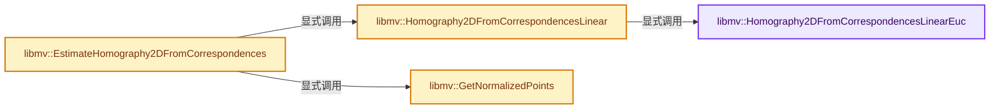
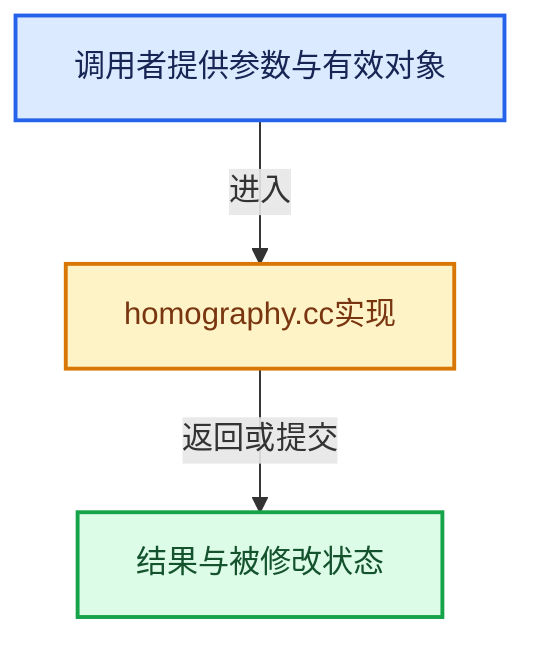

# 实现依赖专题：intern/libmv/libmv/multiview/homography.cc

[方向导航](README.md) · [符号索引](../%E7%AC%A6%E5%8F%B7%E4%BE%9D%E8%B5%96%E4%B8%8E%E5%AE%9E%E7%8E%B0%E7%B4%A2%E5%BC%95.md)

本专题从正文实际调用进入，集中保存共享实现。函数有稳定锚点，可从调用处直接跳到对应完整函数；递归与互相调用通过回链组织。

## 本文件的实现关系






## 完整成员与函数实现

<a id="f-5becb6cb5412d12d"></a>

### `libmv::Homography2DFromCorrespondencesLinearEuc`

实现位置：[intern/libmv/libmv/multiview/homography.cc](../../../../../intern/libmv/libmv/multiview/homography.cc) · L46—L91。

接口参数：

- `const Mat& x1`
- `const Mat& x2`
- `Mat3* H`
- `double expected_precision`

**教学注释版**

<!-- annotated:4693e9df9706bc -->

```cpp
static bool Homography2DFromCorrespondencesLinearEuc(
    const Mat& x1, const Mat& x2, Mat3* H, double expected_precision) {
  // [讲解] assert：检查开发者预期条件，配置可能关闭；不承担完整输入处理或自动修复。
  assert(2 == x1.rows());
  assert(4 <= x1.cols());
  assert(x1.rows() == x2.rows());
  assert(x1.cols() == x2.cols());

  int n = x1.cols();
  MatX8 L = Mat::Zero(n * 3, 8);
  Mat b = Mat::Zero(n * 3, 1);
  for (int i = 0; i < n; ++i) {
    int j = 3 * i;
    L(j, 0) = x1(0, i);              // a
    L(j, 1) = x1(1, i);              // b
    L(j, 2) = 1.0;                   // c
    L(j, 6) = -x2(0, i) * x1(0, i);  // g
    L(j, 7) = -x2(0, i) * x1(1, i);  // h
    b(j, 0) = x2(0, i);              // i

    ++j;
    L(j, 3) = x1(0, i);              // d
    L(j, 4) = x1(1, i);              // e
    L(j, 5) = 1.0;                   // f
    L(j, 6) = -x2(1, i) * x1(0, i);  // g
    L(j, 7) = -x2(1, i) * x1(1, i);  // h
    b(j, 0) = x2(1, i);              // i

    // This ensures better stability
    // TODO(julien) make a lite version without this 3rd set
    ++j;
    L(j, 0) = x2(1, i) * x1(0, i);   // a
    L(j, 1) = x2(1, i) * x1(1, i);   // b
    L(j, 2) = x2(1, i);              // c
    L(j, 3) = -x2(0, i) * x1(0, i);  // d
    L(j, 4) = -x2(0, i) * x1(1, i);  // e
    L(j, 5) = -x2(0, i);             // f
  }
  // Solve Lx=B
  Vec h = L.fullPivLu().solve(b);
  Homography2DNormalizedParameterization<double>::To(h, H);
  if ((L * h).isApprox(b, expected_precision)) {
    return true;
  } else {
    return false;
  }
}
```

<details>
<summary>核对原始源码：intern/libmv/libmv/multiview/homography.cc · L46—L91</summary>

<!-- original:4693e9df9706bc:intern/libmv/libmv/multiview/homography.cc:46:91 -->

```cpp
static bool Homography2DFromCorrespondencesLinearEuc(
    const Mat& x1, const Mat& x2, Mat3* H, double expected_precision) {
  assert(2 == x1.rows());
  assert(4 <= x1.cols());
  assert(x1.rows() == x2.rows());
  assert(x1.cols() == x2.cols());

  int n = x1.cols();
  MatX8 L = Mat::Zero(n * 3, 8);
  Mat b = Mat::Zero(n * 3, 1);
  for (int i = 0; i < n; ++i) {
    int j = 3 * i;
    L(j, 0) = x1(0, i);              // a
    L(j, 1) = x1(1, i);              // b
    L(j, 2) = 1.0;                   // c
    L(j, 6) = -x2(0, i) * x1(0, i);  // g
    L(j, 7) = -x2(0, i) * x1(1, i);  // h
    b(j, 0) = x2(0, i);              // i

    ++j;
    L(j, 3) = x1(0, i);              // d
    L(j, 4) = x1(1, i);              // e
    L(j, 5) = 1.0;                   // f
    L(j, 6) = -x2(1, i) * x1(0, i);  // g
    L(j, 7) = -x2(1, i) * x1(1, i);  // h
    b(j, 0) = x2(1, i);              // i

    // This ensures better stability
    // TODO(julien) make a lite version without this 3rd set
    ++j;
    L(j, 0) = x2(1, i) * x1(0, i);   // a
    L(j, 1) = x2(1, i) * x1(1, i);   // b
    L(j, 2) = x2(1, i);              // c
    L(j, 3) = -x2(0, i) * x1(0, i);  // d
    L(j, 4) = -x2(0, i) * x1(1, i);  // e
    L(j, 5) = -x2(0, i);             // f
  }
  // Solve Lx=B
  Vec h = L.fullPivLu().solve(b);
  Homography2DNormalizedParameterization<double>::To(h, H);
  if ((L * h).isApprox(b, expected_precision)) {
    return true;
  } else {
    return false;
  }
}
```

</details>

**结果出口**

- `return true;`
- `return false;`

**继续追踪实现**

- `assert` → [外部契约](https://eel.is/c++draft/assertions)：检查开发者预期条件，配置可能关闭；不承担完整输入处理或自动修复。
- `x1.rows` → [调用协议](../%E6%A8%A1%E6%9D%BF%E5%AE%8F%E4%B8%8E%E5%8A%A8%E6%80%81%E5%88%86%E6%B4%BE%E5%8D%8F%E8%AE%AE.md)：由接收对象具体类型或运行时策略提供实现。调用位置L48。
- `x1.cols` → [调用协议](../%E6%A8%A1%E6%9D%BF%E5%AE%8F%E4%B8%8E%E5%8A%A8%E6%80%81%E5%88%86%E6%B4%BE%E5%8D%8F%E8%AE%AE.md)：由接收对象具体类型或运行时策略提供实现。调用位置L49。
- `x2.rows` → [调用协议](../%E6%A8%A1%E6%9D%BF%E5%AE%8F%E4%B8%8E%E5%8A%A8%E6%80%81%E5%88%86%E6%B4%BE%E5%8D%8F%E8%AE%AE.md)：由接收对象具体类型或运行时策略提供实现。调用位置L50。
- `x2.cols` → [调用协议](../%E6%A8%A1%E6%9D%BF%E5%AE%8F%E4%B8%8E%E5%8A%A8%E6%80%81%E5%88%86%E6%B4%BE%E5%8D%8F%E8%AE%AE.md)：由接收对象具体类型或运行时策略提供实现。调用位置L51。
- `Mat::Zero` → [调用协议](../%E6%A8%A1%E6%9D%BF%E5%AE%8F%E4%B8%8E%E5%8A%A8%E6%80%81%E5%88%86%E6%B4%BE%E5%8D%8F%E8%AE%AE.md)：函数指针、局部可调用对象或未展开的宏；必须结合调用者环境。调用位置L54。
- `L` → [调用协议](../%E6%A8%A1%E6%9D%BF%E5%AE%8F%E4%B8%8E%E5%8A%A8%E6%80%81%E5%88%86%E6%B4%BE%E5%8D%8F%E8%AE%AE.md)：局部可调用对象，须结合其初始化与捕获环境。调用位置L58。
- `x1` → [调用协议](../%E6%A8%A1%E6%9D%BF%E5%AE%8F%E4%B8%8E%E5%8A%A8%E6%80%81%E5%88%86%E6%B4%BE%E5%8D%8F%E8%AE%AE.md)：局部可调用对象，须结合其初始化与捕获环境。调用位置L58。
- `x2` → [调用协议](../%E6%A8%A1%E6%9D%BF%E5%AE%8F%E4%B8%8E%E5%8A%A8%E6%80%81%E5%88%86%E6%B4%BE%E5%8D%8F%E8%AE%AE.md)：局部可调用对象，须结合其初始化与捕获环境。调用位置L61。
- `b` → [调用协议](../%E6%A8%A1%E6%9D%BF%E5%AE%8F%E4%B8%8E%E5%8A%A8%E6%80%81%E5%88%86%E6%B4%BE%E5%8D%8F%E8%AE%AE.md)：局部可调用对象，须结合其初始化与捕获环境。调用位置L63。
- `L.fullPivLu().solve` → [调用协议](../%E6%A8%A1%E6%9D%BF%E5%AE%8F%E4%B8%8E%E5%8A%A8%E6%80%81%E5%88%86%E6%B4%BE%E5%8D%8F%E8%AE%AE.md)：接收对象类型依赖auto、返回值或模板实例；不按同名猜测目标。调用位置L84。
- `L.fullPivLu` → [调用协议](../%E6%A8%A1%E6%9D%BF%E5%AE%8F%E4%B8%8E%E5%8A%A8%E6%80%81%E5%88%86%E6%B4%BE%E5%8D%8F%E8%AE%AE.md)：由接收对象具体类型或运行时策略提供实现。调用位置L84。
- `Homography2DNormalizedParameterization<double>::To` → [libmv::Homography2DNormalizedParameterization::To · L43](%E4%BE%9D%E8%B5%96-homography_parameterization-428227.md#f-99df946c9dc386b9)。
- `(L * h).isApprox` → [调用协议](../%E6%A8%A1%E6%9D%BF%E5%AE%8F%E4%B8%8E%E5%8A%A8%E6%80%81%E5%88%86%E6%B4%BE%E5%8D%8F%E8%AE%AE.md)：接收对象类型依赖auto、返回值或模板实例；不按同名猜测目标。调用位置L86。

<a id="f-e40d5a014391a0e1"></a>

### `libmv::Homography2DFromCorrespondencesLinear`

实现位置：[intern/libmv/libmv/multiview/homography.cc](../../../../../intern/libmv/libmv/multiview/homography.cc) · L103—L156。

接口参数：

- `const Mat& x1`
- `const Mat& x2`
- `Mat3* H`
- `double expected_precision`

**教学注释版**

<!-- annotated:7cb4240b3c2116 -->

```cpp
bool Homography2DFromCorrespondencesLinear(const Mat& x1,
                                           const Mat& x2,
                                           Mat3* H,
                                           double expected_precision) {
  if (x1.rows() == 2) {
    return Homography2DFromCorrespondencesLinearEuc(
        x1, x2, H, expected_precision);
  }
  // [讲解] assert：检查开发者预期条件，配置可能关闭；不承担完整输入处理或自动修复。
  assert(3 == x1.rows());
  assert(4 <= x1.cols());
  assert(x1.rows() == x2.rows());
  assert(x1.cols() == x2.cols());

  const int x = 0;
  const int y = 1;
  const int w = 2;
  int n = x1.cols();
  MatX8 L = Mat::Zero(n * 3, 8);
  Mat b = Mat::Zero(n * 3, 1);
  for (int i = 0; i < n; ++i) {
    int j = 3 * i;
    L(j, 0) = x2(w, i) * x1(x, i);   // a
    L(j, 1) = x2(w, i) * x1(y, i);   // b
    L(j, 2) = x2(w, i) * x1(w, i);   // c
    L(j, 6) = -x2(x, i) * x1(x, i);  // g
    L(j, 7) = -x2(x, i) * x1(y, i);  // h
    b(j, 0) = x2(x, i) * x1(w, i);

    ++j;
    L(j, 3) = x2(w, i) * x1(x, i);   // d
    L(j, 4) = x2(w, i) * x1(y, i);   // e
    L(j, 5) = x2(w, i) * x1(w, i);   // f
    L(j, 6) = -x2(y, i) * x1(x, i);  // g
    L(j, 7) = -x2(y, i) * x1(y, i);  // h
    b(j, 0) = x2(y, i) * x1(w, i);

    // This ensures better stability
    ++j;
    L(j, 0) = x2(y, i) * x1(x, i);   // a
    L(j, 1) = x2(y, i) * x1(y, i);   // b
    L(j, 2) = x2(y, i) * x1(w, i);   // c
    L(j, 3) = -x2(x, i) * x1(x, i);  // d
    L(j, 4) = -x2(x, i) * x1(y, i);  // e
    L(j, 5) = -x2(x, i) * x1(w, i);  // f
  }
  // Solve Lx=B
  Vec h = L.fullPivLu().solve(b);
  if ((L * h).isApprox(b, expected_precision)) {
    Homography2DNormalizedParameterization<double>::To(h, H);
    return true;
  } else {
    return false;
  }
}
```

<details>
<summary>核对原始源码：intern/libmv/libmv/multiview/homography.cc · L103—L156</summary>

<!-- original:7cb4240b3c2116:intern/libmv/libmv/multiview/homography.cc:103:156 -->

```cpp
bool Homography2DFromCorrespondencesLinear(const Mat& x1,
                                           const Mat& x2,
                                           Mat3* H,
                                           double expected_precision) {
  if (x1.rows() == 2) {
    return Homography2DFromCorrespondencesLinearEuc(
        x1, x2, H, expected_precision);
  }
  assert(3 == x1.rows());
  assert(4 <= x1.cols());
  assert(x1.rows() == x2.rows());
  assert(x1.cols() == x2.cols());

  const int x = 0;
  const int y = 1;
  const int w = 2;
  int n = x1.cols();
  MatX8 L = Mat::Zero(n * 3, 8);
  Mat b = Mat::Zero(n * 3, 1);
  for (int i = 0; i < n; ++i) {
    int j = 3 * i;
    L(j, 0) = x2(w, i) * x1(x, i);   // a
    L(j, 1) = x2(w, i) * x1(y, i);   // b
    L(j, 2) = x2(w, i) * x1(w, i);   // c
    L(j, 6) = -x2(x, i) * x1(x, i);  // g
    L(j, 7) = -x2(x, i) * x1(y, i);  // h
    b(j, 0) = x2(x, i) * x1(w, i);

    ++j;
    L(j, 3) = x2(w, i) * x1(x, i);   // d
    L(j, 4) = x2(w, i) * x1(y, i);   // e
    L(j, 5) = x2(w, i) * x1(w, i);   // f
    L(j, 6) = -x2(y, i) * x1(x, i);  // g
    L(j, 7) = -x2(y, i) * x1(y, i);  // h
    b(j, 0) = x2(y, i) * x1(w, i);

    // This ensures better stability
    ++j;
    L(j, 0) = x2(y, i) * x1(x, i);   // a
    L(j, 1) = x2(y, i) * x1(y, i);   // b
    L(j, 2) = x2(y, i) * x1(w, i);   // c
    L(j, 3) = -x2(x, i) * x1(x, i);  // d
    L(j, 4) = -x2(x, i) * x1(y, i);  // e
    L(j, 5) = -x2(x, i) * x1(w, i);  // f
  }
  // Solve Lx=B
  Vec h = L.fullPivLu().solve(b);
  if ((L * h).isApprox(b, expected_precision)) {
    Homography2DNormalizedParameterization<double>::To(h, H);
    return true;
  } else {
    return false;
  }
}
```

</details>

**结果出口**

- `return Homography2DFromCorrespondencesLinearEuc(`
- `return true;`
- `return false;`

**继续追踪实现**

- `x1.rows` → [调用协议](../%E6%A8%A1%E6%9D%BF%E5%AE%8F%E4%B8%8E%E5%8A%A8%E6%80%81%E5%88%86%E6%B4%BE%E5%8D%8F%E8%AE%AE.md)：由接收对象具体类型或运行时策略提供实现。调用位置L107。
- `Homography2DFromCorrespondencesLinearEuc` → [libmv::Homography2DFromCorrespondencesLinearEuc · L46](%E4%BE%9D%E8%B5%96-homography-9e018a.md#f-5becb6cb5412d12d)。
- `assert` → [外部契约](https://eel.is/c++draft/assertions)：检查开发者预期条件，配置可能关闭；不承担完整输入处理或自动修复。
- `x1.cols` → [调用协议](../%E6%A8%A1%E6%9D%BF%E5%AE%8F%E4%B8%8E%E5%8A%A8%E6%80%81%E5%88%86%E6%B4%BE%E5%8D%8F%E8%AE%AE.md)：由接收对象具体类型或运行时策略提供实现。调用位置L112。
- `x2.rows` → [调用协议](../%E6%A8%A1%E6%9D%BF%E5%AE%8F%E4%B8%8E%E5%8A%A8%E6%80%81%E5%88%86%E6%B4%BE%E5%8D%8F%E8%AE%AE.md)：由接收对象具体类型或运行时策略提供实现。调用位置L113。
- `x2.cols` → [调用协议](../%E6%A8%A1%E6%9D%BF%E5%AE%8F%E4%B8%8E%E5%8A%A8%E6%80%81%E5%88%86%E6%B4%BE%E5%8D%8F%E8%AE%AE.md)：由接收对象具体类型或运行时策略提供实现。调用位置L114。
- `Mat::Zero` → [调用协议](../%E6%A8%A1%E6%9D%BF%E5%AE%8F%E4%B8%8E%E5%8A%A8%E6%80%81%E5%88%86%E6%B4%BE%E5%8D%8F%E8%AE%AE.md)：函数指针、局部可调用对象或未展开的宏；必须结合调用者环境。调用位置L120。
- `L` → [调用协议](../%E6%A8%A1%E6%9D%BF%E5%AE%8F%E4%B8%8E%E5%8A%A8%E6%80%81%E5%88%86%E6%B4%BE%E5%8D%8F%E8%AE%AE.md)：局部可调用对象，须结合其初始化与捕获环境。调用位置L124。
- `x2` → [调用协议](../%E6%A8%A1%E6%9D%BF%E5%AE%8F%E4%B8%8E%E5%8A%A8%E6%80%81%E5%88%86%E6%B4%BE%E5%8D%8F%E8%AE%AE.md)：局部可调用对象，须结合其初始化与捕获环境。调用位置L124。
- `x1` → [调用协议](../%E6%A8%A1%E6%9D%BF%E5%AE%8F%E4%B8%8E%E5%8A%A8%E6%80%81%E5%88%86%E6%B4%BE%E5%8D%8F%E8%AE%AE.md)：局部可调用对象，须结合其初始化与捕获环境。调用位置L124。
- `b` → [调用协议](../%E6%A8%A1%E6%9D%BF%E5%AE%8F%E4%B8%8E%E5%8A%A8%E6%80%81%E5%88%86%E6%B4%BE%E5%8D%8F%E8%AE%AE.md)：局部可调用对象，须结合其初始化与捕获环境。调用位置L129。
- `L.fullPivLu().solve` → [调用协议](../%E6%A8%A1%E6%9D%BF%E5%AE%8F%E4%B8%8E%E5%8A%A8%E6%80%81%E5%88%86%E6%B4%BE%E5%8D%8F%E8%AE%AE.md)：接收对象类型依赖auto、返回值或模板实例；不按同名猜测目标。调用位置L149。
- `L.fullPivLu` → [调用协议](../%E6%A8%A1%E6%9D%BF%E5%AE%8F%E4%B8%8E%E5%8A%A8%E6%80%81%E5%88%86%E6%B4%BE%E5%8D%8F%E8%AE%AE.md)：由接收对象具体类型或运行时策略提供实现。调用位置L149。
- `(L * h).isApprox` → [调用协议](../%E6%A8%A1%E6%9D%BF%E5%AE%8F%E4%B8%8E%E5%8A%A8%E6%80%81%E5%88%86%E6%B4%BE%E5%8D%8F%E8%AE%AE.md)：接收对象类型依赖auto、返回值或模板实例；不按同名猜测目标。调用位置L150。
- `Homography2DNormalizedParameterization<double>::To` → [libmv::Homography2DNormalizedParameterization::To · L43](%E4%BE%9D%E8%B5%96-homography_parameterization-428227.md#f-99df946c9dc386b9)。

<a id="f-c4ab8e69dd2a223c"></a>

### `libmv::GetNormalizedPoints`

实现位置：[intern/libmv/libmv/multiview/homography.cc](../../../../../intern/libmv/libmv/multiview/homography.cc) · L167—L173。

接口参数：

- `const Mat& original_points`
- `Mat* normalized_points`
- `Mat3* normalization_matrix`

**教学注释版**

<!-- annotated:42e5e2f81babf8 -->

```cpp
void GetNormalizedPoints(const Mat& original_points,
                         Mat* normalized_points,
                         Mat3* normalization_matrix) {
  IsotropicPreconditionerFromPoints(original_points, normalization_matrix);
  ApplyTransformationToPoints(
      original_points, *normalization_matrix, normalized_points);
}
```

<details>
<summary>核对原始源码：intern/libmv/libmv/multiview/homography.cc · L167—L173</summary>

<!-- original:42e5e2f81babf8:intern/libmv/libmv/multiview/homography.cc:167:173 -->

```cpp
void GetNormalizedPoints(const Mat& original_points,
                         Mat* normalized_points,
                         Mat3* normalization_matrix) {
  IsotropicPreconditionerFromPoints(original_points, normalization_matrix);
  ApplyTransformationToPoints(
      original_points, *normalization_matrix, normalized_points);
}
```

</details>

**继续追踪实现**

- `IsotropicPreconditionerFromPoints` → [libmv::IsotropicPreconditionerFromPoints · L50](%E4%BE%9D%E8%B5%96-conditioning-d281d0.md#f-67b3e2b4a98fbfc4)。
- `ApplyTransformationToPoints` → [libmv::ApplyTransformationToPoints · L71](%E4%BE%9D%E8%B5%96-conditioning-d281d0.md#f-b7f6d24b0029a235)。

<a id="f-076b36b98f5f40b4"></a>

### `libmv::EstimateHomography2DFromCorrespondences`

实现位置：[intern/libmv/libmv/multiview/homography.cc](../../../../../intern/libmv/libmv/multiview/homography.cc) · L260—L331。

接口参数：

- `const Mat& x1`
- `const Mat& x2`
- `const EstimateHomographyOptions& options`
- `Mat3* H`

**教学注释版**

<!-- annotated:57400874f0f193 -->

```cpp
bool EstimateHomography2DFromCorrespondences(
    const Mat& x1,
    const Mat& x2,
    const EstimateHomographyOptions& options,
    Mat3* H) {
  // TODO(sergey): Support homogenous coordinates, not just euclidean.

  // [讲解] assert：检查开发者预期条件，配置可能关闭；不承担完整输入处理或自动修复。
  assert(2 == x1.rows());
  assert(4 <= x1.cols());
  assert(x1.rows() == x2.rows());
  assert(x1.cols() == x2.cols());

  Mat3 T1 = Mat3::Identity(), T2 = Mat3::Identity();

  // Step 1: Algebraic homography estimation.
  Mat x1_normalized, x2_normalized;

  if (options.use_normalization) {
    LG << "Estimating homography using normalization.";
    GetNormalizedPoints(x1, &x1_normalized, &T1);
    GetNormalizedPoints(x2, &x2_normalized, &T2);
  } else {
    x1_normalized = x1;
    x2_normalized = x2;
  }

  // Assume algebraic estimation always succeeds,
  Homography2DFromCorrespondencesLinear(x1_normalized, x2_normalized, H);

  // Denormalize the homography matrix.
  if (options.use_normalization) {
    *H = T2.inverse() * (*H) * T1;
  }

  LG << "Estimated matrix after algebraic estimation:\n" << *H;

  // Step 2: Refine matrix using Ceres minimizer.
  ceres::Problem problem;
  for (int i = 0; i < x1.cols(); i++) {
    HomographySymmetricGeometricCostFunctor*
        homography_symmetric_geometric_cost_function =
            new HomographySymmetricGeometricCostFunctor(x1.col(i), x2.col(i));

    problem.AddResidualBlock(
        new ceres::AutoDiffCostFunction<HomographySymmetricGeometricCostFunctor,
                                        4,  // num_residuals
                                        9>(
            homography_symmetric_geometric_cost_function),
        NULL,
        H->data());
  }

  // Configure the solve.
  ceres::Solver::Options solver_options;
  solver_options.linear_solver_type = ceres::DENSE_QR;
  solver_options.max_num_iterations = options.max_num_iterations;
  solver_options.update_state_every_iteration = true;

  // Terminate if the average symmetric distance is good enough.
  TerminationCheckingCallback callback(x1, x2, options, H);
  solver_options.callbacks.push_back(&callback);

  // Run the solve.
  ceres::Solver::Summary summary;
  ceres::Solve(solver_options, &problem, &summary);

  VLOG(1) << "Summary:\n" << summary.FullReport();

  LG << "Final refined matrix:\n" << *H;

  return summary.IsSolutionUsable();
}
```

<details>
<summary>核对原始源码：intern/libmv/libmv/multiview/homography.cc · L260—L331</summary>

<!-- original:57400874f0f193:intern/libmv/libmv/multiview/homography.cc:260:331 -->

```cpp
bool EstimateHomography2DFromCorrespondences(
    const Mat& x1,
    const Mat& x2,
    const EstimateHomographyOptions& options,
    Mat3* H) {
  // TODO(sergey): Support homogenous coordinates, not just euclidean.

  assert(2 == x1.rows());
  assert(4 <= x1.cols());
  assert(x1.rows() == x2.rows());
  assert(x1.cols() == x2.cols());

  Mat3 T1 = Mat3::Identity(), T2 = Mat3::Identity();

  // Step 1: Algebraic homography estimation.
  Mat x1_normalized, x2_normalized;

  if (options.use_normalization) {
    LG << "Estimating homography using normalization.";
    GetNormalizedPoints(x1, &x1_normalized, &T1);
    GetNormalizedPoints(x2, &x2_normalized, &T2);
  } else {
    x1_normalized = x1;
    x2_normalized = x2;
  }

  // Assume algebraic estimation always succeeds,
  Homography2DFromCorrespondencesLinear(x1_normalized, x2_normalized, H);

  // Denormalize the homography matrix.
  if (options.use_normalization) {
    *H = T2.inverse() * (*H) * T1;
  }

  LG << "Estimated matrix after algebraic estimation:\n" << *H;

  // Step 2: Refine matrix using Ceres minimizer.
  ceres::Problem problem;
  for (int i = 0; i < x1.cols(); i++) {
    HomographySymmetricGeometricCostFunctor*
        homography_symmetric_geometric_cost_function =
            new HomographySymmetricGeometricCostFunctor(x1.col(i), x2.col(i));

    problem.AddResidualBlock(
        new ceres::AutoDiffCostFunction<HomographySymmetricGeometricCostFunctor,
                                        4,  // num_residuals
                                        9>(
            homography_symmetric_geometric_cost_function),
        NULL,
        H->data());
  }

  // Configure the solve.
  ceres::Solver::Options solver_options;
  solver_options.linear_solver_type = ceres::DENSE_QR;
  solver_options.max_num_iterations = options.max_num_iterations;
  solver_options.update_state_every_iteration = true;

  // Terminate if the average symmetric distance is good enough.
  TerminationCheckingCallback callback(x1, x2, options, H);
  solver_options.callbacks.push_back(&callback);

  // Run the solve.
  ceres::Solver::Summary summary;
  ceres::Solve(solver_options, &problem, &summary);

  VLOG(1) << "Summary:\n" << summary.FullReport();

  LG << "Final refined matrix:\n" << *H;

  return summary.IsSolutionUsable();
}
```

</details>

**沿实际写入检查状态**

- `x1_normalized = x1;`
- `x2_normalized = x2;`
- `homography_symmetric_geometric_cost_function =`
- `solver_options.linear_solver_type = ceres::DENSE_QR;`
- `solver_options.max_num_iterations = options.max_num_iterations;`
- `solver_options.update_state_every_iteration = true;`

**结果出口**

- `return summary.IsSolutionUsable();`

**继续追踪实现**

- `assert` → [外部契约](https://eel.is/c++draft/assertions)：检查开发者预期条件，配置可能关闭；不承担完整输入处理或自动修复。
- `x1.rows` → [调用协议](../%E6%A8%A1%E6%9D%BF%E5%AE%8F%E4%B8%8E%E5%8A%A8%E6%80%81%E5%88%86%E6%B4%BE%E5%8D%8F%E8%AE%AE.md)：由接收对象具体类型或运行时策略提供实现。调用位置L267。
- `x1.cols` → [调用协议](../%E6%A8%A1%E6%9D%BF%E5%AE%8F%E4%B8%8E%E5%8A%A8%E6%80%81%E5%88%86%E6%B4%BE%E5%8D%8F%E8%AE%AE.md)：由接收对象具体类型或运行时策略提供实现。调用位置L268。
- `x2.rows` → [调用协议](../%E6%A8%A1%E6%9D%BF%E5%AE%8F%E4%B8%8E%E5%8A%A8%E6%80%81%E5%88%86%E6%B4%BE%E5%8D%8F%E8%AE%AE.md)：由接收对象具体类型或运行时策略提供实现。调用位置L269。
- `x2.cols` → [调用协议](../%E6%A8%A1%E6%9D%BF%E5%AE%8F%E4%B8%8E%E5%8A%A8%E6%80%81%E5%88%86%E6%B4%BE%E5%8D%8F%E8%AE%AE.md)：由接收对象具体类型或运行时策略提供实现。调用位置L270。
- `Mat3::Identity` → [调用协议](../%E6%A8%A1%E6%9D%BF%E5%AE%8F%E4%B8%8E%E5%8A%A8%E6%80%81%E5%88%86%E6%B4%BE%E5%8D%8F%E8%AE%AE.md)：函数指针、局部可调用对象或未展开的宏；必须结合调用者环境。调用位置L272。
- `GetNormalizedPoints` → [libmv::GetNormalizedPoints · L167](%E4%BE%9D%E8%B5%96-homography-9e018a.md#f-c4ab8e69dd2a223c)。
- `Homography2DFromCorrespondencesLinear` → [libmv::Homography2DFromCorrespondencesLinear · L103](%E4%BE%9D%E8%B5%96-homography-9e018a.md#f-e40d5a014391a0e1)。
- `T2.inverse` → [调用协议](../%E6%A8%A1%E6%9D%BF%E5%AE%8F%E4%B8%8E%E5%8A%A8%E6%80%81%E5%88%86%E6%B4%BE%E5%8D%8F%E8%AE%AE.md)：接收对象类型依赖auto、返回值或模板实例；不按同名猜测目标。调用位置L291。
- `x1.col` → [调用协议](../%E6%A8%A1%E6%9D%BF%E5%AE%8F%E4%B8%8E%E5%8A%A8%E6%80%81%E5%88%86%E6%B4%BE%E5%8D%8F%E8%AE%AE.md)：由接收对象具体类型或运行时策略提供实现。调用位置L301。
- `x2.col` → [调用协议](../%E6%A8%A1%E6%9D%BF%E5%AE%8F%E4%B8%8E%E5%8A%A8%E6%80%81%E5%88%86%E6%B4%BE%E5%8D%8F%E8%AE%AE.md)：由接收对象具体类型或运行时策略提供实现。调用位置L301。
- `problem.AddResidualBlock` → [调用协议](../%E6%A8%A1%E6%9D%BF%E5%AE%8F%E4%B8%8E%E5%8A%A8%E6%80%81%E5%88%86%E6%B4%BE%E5%8D%8F%E8%AE%AE.md)：由接收对象具体类型或运行时策略提供实现。调用位置L303。
- `H->data` → [调用协议](../%E6%A8%A1%E6%9D%BF%E5%AE%8F%E4%B8%8E%E5%8A%A8%E6%80%81%E5%88%86%E6%B4%BE%E5%8D%8F%E8%AE%AE.md)：由接收对象具体类型或运行时策略提供实现。调用位置L309。
- `solver_options.callbacks.push_back` → [调用协议](../%E6%A8%A1%E6%9D%BF%E5%AE%8F%E4%B8%8E%E5%8A%A8%E6%80%81%E5%88%86%E6%B4%BE%E5%8D%8F%E8%AE%AE.md)：接收对象类型依赖auto、返回值或模板实例；不按同名猜测目标。调用位置L320。
- `ceres::Solve` → [调用协议](../%E6%A8%A1%E6%9D%BF%E5%AE%8F%E4%B8%8E%E5%8A%A8%E6%80%81%E5%88%86%E6%B4%BE%E5%8D%8F%E8%AE%AE.md)：函数指针、局部可调用对象或未展开的宏；必须结合调用者环境。调用位置L324。
- `VLOG` → [调用协议](../%E6%A8%A1%E6%9D%BF%E5%AE%8F%E4%B8%8E%E5%8A%A8%E6%80%81%E5%88%86%E6%B4%BE%E5%8D%8F%E8%AE%AE.md)：函数指针、局部可调用对象或未展开的宏；必须结合调用者环境。调用位置L326。
- `summary.FullReport` → [调用协议](../%E6%A8%A1%E6%9D%BF%E5%AE%8F%E4%B8%8E%E5%8A%A8%E6%80%81%E5%88%86%E6%B4%BE%E5%8D%8F%E8%AE%AE.md)：由接收对象具体类型或运行时策略提供实现。调用位置L326。
- `summary.IsSolutionUsable` → [调用协议](../%E6%A8%A1%E6%9D%BF%E5%AE%8F%E4%B8%8E%E5%8A%A8%E6%80%81%E5%88%86%E6%B4%BE%E5%8D%8F%E8%AE%AE.md)：由接收对象具体类型或运行时策略提供实现。调用位置L330。
