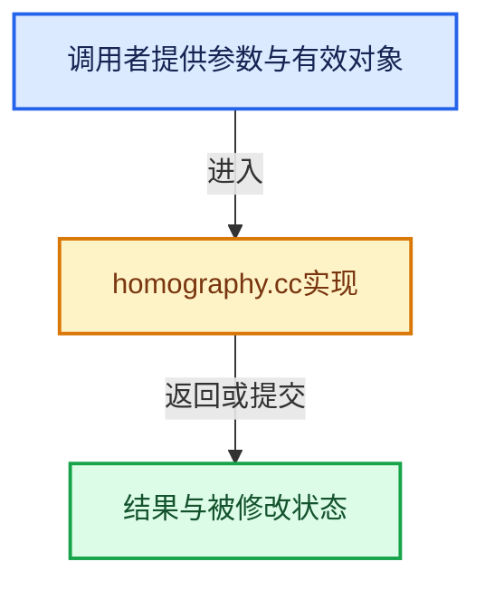

# 实现依赖专题：intern/libmv/intern/homography.cc

[方向导航](README.md) · [符号索引](../%E7%AC%A6%E5%8F%B7%E4%BE%9D%E8%B5%96%E4%B8%8E%E5%AE%9E%E7%8E%B0%E7%B4%A2%E5%BC%95.md)

本专题从正文实际调用进入，集中保存共享实现。函数有稳定锚点，可从调用处直接跳到对应完整函数；递归与互相调用通过回链组织。

## 本文件的实现关系





## 完整成员与函数实现

<a id="f-40b13e0b9aa6f182"></a>

### `libmv_homography2DFromCorrespondencesEuc`

实现位置：[intern/libmv/intern/homography.cc](../../../../../intern/libmv/intern/homography.cc) · L10—L35。

接口参数：

- `double (*x1)[2]`
- `double (*x2)[2]`
- `int num_points`
- `double H[3][3]`

**教学注释版**

<!-- annotated:cdd26fc1842f32 -->

```cpp
void libmv_homography2DFromCorrespondencesEuc(/* const */ double (*x1)[2],
                                              /* const */ double (*x2)[2],
                                              int num_points,
                                              double H[3][3]) {
  libmv::Mat x1_mat, x2_mat;
  libmv::Mat3 H_mat;

  x1_mat.resize(2, num_points);
  x2_mat.resize(2, num_points);

  for (int i = 0; i < num_points; i++) {
    x1_mat.col(i) = libmv::Vec2(x1[i][0], x1[i][1]);
    x2_mat.col(i) = libmv::Vec2(x2[i][0], x2[i][1]);
  }

  LG << "x1: " << x1_mat;
  LG << "x2: " << x2_mat;

  libmv::EstimateHomographyOptions options;
  libmv::EstimateHomography2DFromCorrespondences(
      x1_mat, x2_mat, options, &H_mat);

  LG << "H: " << H_mat;

  // [讲解] memcpy：复制字节，源与目标不应重叠。类型生命周期、对齐和可复制表示须由调用者证明，不是任意对象的复制构造。
  memcpy(H, H_mat.data(), 9 * sizeof(double));
}
```

<details>
<summary>核对原始源码：intern/libmv/intern/homography.cc · L10—L35</summary>

<!-- original:cdd26fc1842f32:intern/libmv/intern/homography.cc:10:35 -->

```cpp
void libmv_homography2DFromCorrespondencesEuc(/* const */ double (*x1)[2],
                                              /* const */ double (*x2)[2],
                                              int num_points,
                                              double H[3][3]) {
  libmv::Mat x1_mat, x2_mat;
  libmv::Mat3 H_mat;

  x1_mat.resize(2, num_points);
  x2_mat.resize(2, num_points);

  for (int i = 0; i < num_points; i++) {
    x1_mat.col(i) = libmv::Vec2(x1[i][0], x1[i][1]);
    x2_mat.col(i) = libmv::Vec2(x2[i][0], x2[i][1]);
  }

  LG << "x1: " << x1_mat;
  LG << "x2: " << x2_mat;

  libmv::EstimateHomographyOptions options;
  libmv::EstimateHomography2DFromCorrespondences(
      x1_mat, x2_mat, options, &H_mat);

  LG << "H: " << H_mat;

  memcpy(H, H_mat.data(), 9 * sizeof(double));
}
```

</details>

**继续追踪实现**

- `x1_mat.resize` → [resize · L54](%E4%BE%9D%E8%B5%96-unique_ptr_vector-b13772.md#f-3743c33da4ec7c8a)；[resize · L144](%E4%BE%9D%E8%B5%96-array-0b4e3f.md#f-a03f6991f6088933)；[resize · L169](%E4%BE%9D%E8%B5%96-array-0b4e3f.md#f-031c578bb8c60c70)；[PointCloud::resize · L98](%E4%BE%9D%E8%B5%96-pointcloud-ada28f.md#f-2bb9cba64d026563)；[ImageCacheStats::resize · L43](%E4%BE%9D%E8%B5%96-image_cache-2a529e.md#f-0ea6873c131155b4)；[Attribute::resize · L122](%E4%BE%9D%E8%B5%96-attribute-dd7b4e.md#f-62b6dd96d32875c0)；[Attribute::resize · L129](%E4%BE%9D%E8%B5%96-attribute-dd7b4e.md#f-048dccdac3da2b83)；[AttributeSet::resize · L1117](%E4%BE%9D%E8%B5%96-attribute-dd7b4e.md#f-4bccc92203def333)；[resize · L264](%E4%BE%9D%E8%B5%96-cycles_standalone-7f3bbe.md#f-4686ae81ed5216bd)。同名重载需按实参类型选择。
- `x2_mat.resize` → [调用协议](../%E6%A8%A1%E6%9D%BF%E5%AE%8F%E4%B8%8E%E5%8A%A8%E6%80%81%E5%88%86%E6%B4%BE%E5%8D%8F%E8%AE%AE.md)：接收对象类型依赖auto、返回值或模板实例；不按同名猜测目标。调用位置L18。
- `x1_mat.col` → [调用协议](../%E6%A8%A1%E6%9D%BF%E5%AE%8F%E4%B8%8E%E5%8A%A8%E6%80%81%E5%88%86%E6%B4%BE%E5%8D%8F%E8%AE%AE.md)：由接收对象具体类型或运行时策略提供实现。调用位置L21。
- `libmv::Vec2` → [Freestyle::Vec2::Vec2 · L278](%E4%BE%9D%E8%B5%96-VecMat-09b9c9.md#f-e0992110aa25b92a)；[Freestyle::Vec2::Vec2 · L280](%E4%BE%9D%E8%B5%96-VecMat-09b9c9.md#f-d88a57e4af5d25d7)；[Freestyle::Vec2::Vec2 · L282](%E4%BE%9D%E8%B5%96-VecMat-09b9c9.md#f-2271937e9313e6c4)；[Freestyle::Vec2::Vec2 · L284](%E4%BE%9D%E8%B5%96-VecMat-09b9c9.md#f-bff63ebe954f0177)；[Freestyle::Vec2::Vec2 · L286](%E4%BE%9D%E8%B5%96-VecMat-09b9c9.md#f-b28833246d8a3906)。同名重载需按实参类型选择。
- `x2_mat.col` → [调用协议](../%E6%A8%A1%E6%9D%BF%E5%AE%8F%E4%B8%8E%E5%8A%A8%E6%80%81%E5%88%86%E6%B4%BE%E5%8D%8F%E8%AE%AE.md)：接收对象类型依赖auto、返回值或模板实例；不按同名猜测目标。调用位置L22。
- `libmv::EstimateHomography2DFromCorrespondences` → [libmv::EstimateHomography2DFromCorrespondences · L260](%E4%BE%9D%E8%B5%96-homography-9e018a.md#f-076b36b98f5f40b4)。
- `memcpy` → [外部契约](https://eel.is/c++draft/cstring.syn)：复制字节，源与目标不应重叠。类型生命周期、对齐和可复制表示须由调用者证明，不是任意对象的复制构造。
- `H_mat.data` → [data · L201](%E4%BE%9D%E8%B5%96-array-0b4e3f.md#f-39af3495ae01b907)；[data · L206](%E4%BE%9D%E8%B5%96-array-0b4e3f.md#f-5d3c70b7e27b7334)。同名重载需按实参类型选择。
