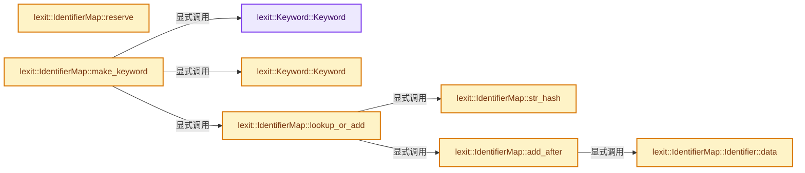
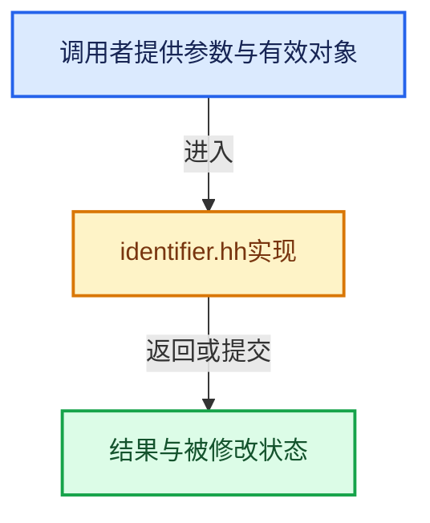

# 实现依赖专题：source/blender/gpu/shader_tool/lexit/identifier.hh

[方向导航](README.md) · [符号索引](../%E7%AC%A6%E5%8F%B7%E4%BE%9D%E8%B5%96%E4%B8%8E%E5%AE%9E%E7%8E%B0%E7%B4%A2%E5%BC%95.md)

本专题从正文实际调用进入，集中保存共享实现。函数有稳定锚点，可从调用处直接跳到对应完整函数；递归与互相调用通过回链组织。

## 本文件的实现关系






## 完整成员与函数实现

<a id="f-c62978503fba662f"></a>

### `lexit::Keyword::Keyword`

实现位置：[source/blender/gpu/shader_tool/lexit/identifier.hh](../../../../../source/blender/gpu/shader_tool/lexit/identifier.hh) · L72—L72。

**教学注释版**

<!-- annotated:be16362870f108 -->

```cpp
  Keyword() = default;
```

<details>
<summary>核对原始源码：source/blender/gpu/shader_tool/lexit/identifier.hh · L72—L72</summary>

<!-- original:be16362870f108:source/blender/gpu/shader_tool/lexit/identifier.hh:72:72 -->

```cpp
  Keyword() = default;
```

</details>

**继续追踪实现**

本实现没有需要继续展开的显式调用；检查返回表达式、对象转换和调用者前置条件。

<a id="f-107e478e3adfe4fb"></a>

### `lexit::Keyword::Keyword`

实现位置：[source/blender/gpu/shader_tool/lexit/identifier.hh](../../../../../source/blender/gpu/shader_tool/lexit/identifier.hh) · L74—L76。

接口参数：

- `std::string_view str`
- `TokenType type`
- `TokenAtom atom`

**教学注释版**

<!-- annotated:8debf41a0281db -->

```cpp
  Keyword(std::string_view str, TokenType type, TokenAtom atom) : str(str), type(type), atom(atom)
  {
  }
```

<details>
<summary>核对原始源码：source/blender/gpu/shader_tool/lexit/identifier.hh · L74—L76</summary>

<!-- original:8debf41a0281db:source/blender/gpu/shader_tool/lexit/identifier.hh:74:76 -->

```cpp
  Keyword(std::string_view str, TokenType type, TokenAtom atom) : str(str), type(type), atom(atom)
  {
  }
```

</details>

**继续追踪实现**

本实现没有需要继续展开的显式调用；检查返回表达式、对象转换和调用者前置条件。

<a id="f-8ea3418cc5db7f1a"></a>

### `lexit::IdentifierMap::Identifier::data`

实现位置：[source/blender/gpu/shader_tool/lexit/identifier.hh](../../../../../source/blender/gpu/shader_tool/lexit/identifier.hh) · L86—L89。

**教学注释版**

<!-- annotated:3e40713a6e50d2 -->

```cpp
    uint64_t *data() const
    {
      return (uint64_t *)(&hash + 1);
    }
```

<details>
<summary>核对原始源码：source/blender/gpu/shader_tool/lexit/identifier.hh · L86—L89</summary>

<!-- original:3e40713a6e50d2:source/blender/gpu/shader_tool/lexit/identifier.hh:86:89 -->

```cpp
    uint64_t *data() const
    {
      return (uint64_t *)(&hash + 1);
    }
```

</details>

**结果出口**

- `return (uint64_t *)(&hash + 1);`

**继续追踪实现**

本实现没有需要继续展开的显式调用；检查返回表达式、对象转换和调用者前置条件。

<a id="f-d4936a77bcd55ccc"></a>

### `lexit::IdentifierMap::reserve`

实现位置：[source/blender/gpu/shader_tool/lexit/identifier.hh](../../../../../source/blender/gpu/shader_tool/lexit/identifier.hh) · L119—L122。

接口参数：

- `int token_count`

**教学注释版**

<!-- annotated:6fb1c4119de904 -->

```cpp
  void reserve(int token_count)
  {
    // [讲解] identifier_buffer.reserve：确保可容纳至少min_capacity个元素；当前size和已有元素值不因容量请求本身而增加。
    identifier_buffer.reserve(token_count);
  }
```

<details>
<summary>核对原始源码：source/blender/gpu/shader_tool/lexit/identifier.hh · L119—L122</summary>

<!-- original:6fb1c4119de904:source/blender/gpu/shader_tool/lexit/identifier.hh:119:122 -->

```cpp
  void reserve(int token_count)
  {
    identifier_buffer.reserve(token_count);
  }
```

</details>

**继续追踪实现**

- `identifier_buffer.reserve` → [blender::Vector::reserve · L405](../01-%E5%9F%BA%E7%A1%80%E5%AE%B9%E5%99%A8%E4%B8%8E%E7%8E%B0%E4%BB%A3CPP/10-Vector%E6%89%A9%E5%AE%B9%E4%B8%8E%E5%A2%9E%E9%95%BF.md#f-4cf9c0f00e01102e)。

<a id="f-7fb97f95f2a984f4"></a>

### `lexit::IdentifierMap::str_hash`

实现位置：[source/blender/gpu/shader_tool/lexit/identifier.hh](../../../../../source/blender/gpu/shader_tool/lexit/identifier.hh) · L130—L138。

接口参数：

- `std::string_view s`

**教学注释版**

<!-- annotated:c0acb35ca1c8ac -->

```cpp
  static constexpr uint32_t str_hash(std::string_view s)
  {
    uint32_t hash = 5381;
    hash = ((hash << 5) + hash) + s.size();
    hash = ((hash << 5) + hash) + static_cast<uint8_t>(s[0]);
    hash = ((hash << 5) + hash) + static_cast<uint8_t>(s[s.size() / 2]);
    hash = ((hash << 5) + hash) + static_cast<uint8_t>(s.back());
    return static_cast<uint16_t>(hash);
  }
```

<details>
<summary>核对原始源码：source/blender/gpu/shader_tool/lexit/identifier.hh · L130—L138</summary>

<!-- original:c0acb35ca1c8ac:source/blender/gpu/shader_tool/lexit/identifier.hh:130:138 -->

```cpp
  static constexpr uint32_t str_hash(std::string_view s)
  {
    uint32_t hash = 5381;
    hash = ((hash << 5) + hash) + s.size();
    hash = ((hash << 5) + hash) + static_cast<uint8_t>(s[0]);
    hash = ((hash << 5) + hash) + static_cast<uint8_t>(s[s.size() / 2]);
    hash = ((hash << 5) + hash) + static_cast<uint8_t>(s.back());
    return static_cast<uint16_t>(hash);
  }
```

</details>

**沿实际写入检查状态**

- `hash = ((hash << 5) + hash) + s.size();`
- `hash = ((hash << 5) + hash) + static_cast<uint8_t>(s[0]);`
- `hash = ((hash << 5) + hash) + static_cast<uint8_t>(s[s.size() / 2]);`
- `hash = ((hash << 5) + hash) + static_cast<uint8_t>(s.back());`

**结果出口**

- `return static_cast<uint16_t>(hash);`

**继续追踪实现**

- `s.size` → [外部契约](https://eel.is/c++draft/)：这个边界按实际表达式及所属类型核对参数、返回值、寿命与失败行为。这里提供接口入口，不声称已解释该第三方版本的内部实现。
- `s.back` → [外部契约](https://eel.is/c++draft/)：这个边界按实际表达式及所属类型核对参数、返回值、寿命与失败行为。这里提供接口入口，不声称已解释该第三方版本的内部实现。

<a id="f-b87c4328f4f33bf0"></a>

### `lexit::IdentifierMap::lookup_or_add`

实现位置：[source/blender/gpu/shader_tool/lexit/identifier.hh](../../../../../source/blender/gpu/shader_tool/lexit/identifier.hh) · L140—L153。

接口参数：

- `StringT str`

**教学注释版**

<!-- annotated:d200f0ba4bed9a -->

```cpp
  template<typename StringT> INLINE_METHOD TokenAtom lookup_or_add(StringT str)
  {
    uint32_t hash = str_hash(str);
    uint16_t index = hash_table[hash & hash_table_index_mask];

    Identifier *id = nullptr;
    for (; index != 0xFFFFu; index = id->next) {
      id = &identifier_buffer[index];
      if (id->hash == hash && *id == str) [[likely]] {
        return index;
      }
    }
    return add_after(hash, str, id);
  }
```

<details>
<summary>核对原始源码：source/blender/gpu/shader_tool/lexit/identifier.hh · L140—L153</summary>

<!-- original:d200f0ba4bed9a:source/blender/gpu/shader_tool/lexit/identifier.hh:140:153 -->

```cpp
  template<typename StringT> INLINE_METHOD TokenAtom lookup_or_add(StringT str)
  {
    uint32_t hash = str_hash(str);
    uint16_t index = hash_table[hash & hash_table_index_mask];

    Identifier *id = nullptr;
    for (; index != 0xFFFFu; index = id->next) {
      id = &identifier_buffer[index];
      if (id->hash == hash && *id == str) [[likely]] {
        return index;
      }
    }
    return add_after(hash, str, id);
  }
```

</details>

**沿实际写入检查状态**

- `id = &identifier_buffer[index];`

**结果出口**

- `return index;`
- `return add_after(hash, str, id);`

**继续追踪实现**

- `str_hash` → [lexit::IdentifierMap::str_hash · L130](%E4%BE%9D%E8%B5%96-identifier-d49678.md#f-7fb97f95f2a984f4)。
- `add_after` → [lexit::IdentifierMap::add_after · L155](%E4%BE%9D%E8%B5%96-identifier-d49678.md#f-bfeedf146bb7145c)。

<a id="f-bfeedf146bb7145c"></a>

### `lexit::IdentifierMap::add_after`

实现位置：[source/blender/gpu/shader_tool/lexit/identifier.hh](../../../../../source/blender/gpu/shader_tool/lexit/identifier.hh) · L155—L183。

接口参数：

- `uint32_t hash`
- `std::string_view str`
- `Identifier *id = nullptr`

**教学注释版**

<!-- annotated:e5749354dc68ba -->

```cpp
  TokenAtom add_after(uint32_t hash, std::string_view str, Identifier *id = nullptr)
  {
    /* Cache miss. Add new. */
    // [讲解] identifier_buffer.size：用end_减begin_得到活元素数量。
    uint16_t new_index = identifier_buffer.size();
    if (id) {
      /* Update previous element in the list. */
      id->next = new_index;
    }
    else {
      /* Update entry in table. */
      hash_table[hash & hash_table_index_mask] = new_index;
    }

    {
      /* Fast malloc replacement. */
      int str_as_id_size = ((str.size() + (sizeof(Identifier) - 1)) / sizeof(Identifier));
      // [讲解] identifier_buffer.reserve：确保可容纳至少min_capacity个元素；当前size和已有元素值不因容量请求本身而增加。
      identifier_buffer.reserve(new_index + 1 + str_as_id_size);
      // [讲解] identifier_buffer.end：提供当前存储或有效范围的地址。
      Identifier &id = *identifier_buffer.end();
      identifier_buffer.increase_size_by_unchecked(1 + str_as_id_size);
      /* Construct new identifier. */
      id.next = 0xFFFFu;
      id.size = str.size();
      id.hash = hash;
      /* Zero the end of the memcpy for the fast comparison. */
      id.data()[((str.size() - 1) / sizeof(Identifier))] = 0;
      // [讲解] std::memcpy：复制字节，源与目标不应重叠。类型生命周期、对齐和可复制表示须由调用者证明，不是任意对象的复制构造。
      std::memcpy(id.data(), str.data(), str.size());
    }
    return new_index;
  }
```

<details>
<summary>核对原始源码：source/blender/gpu/shader_tool/lexit/identifier.hh · L155—L183</summary>

<!-- original:e5749354dc68ba:source/blender/gpu/shader_tool/lexit/identifier.hh:155:183 -->

```cpp
  TokenAtom add_after(uint32_t hash, std::string_view str, Identifier *id = nullptr)
  {
    /* Cache miss. Add new. */
    uint16_t new_index = identifier_buffer.size();
    if (id) {
      /* Update previous element in the list. */
      id->next = new_index;
    }
    else {
      /* Update entry in table. */
      hash_table[hash & hash_table_index_mask] = new_index;
    }

    {
      /* Fast malloc replacement. */
      int str_as_id_size = ((str.size() + (sizeof(Identifier) - 1)) / sizeof(Identifier));
      identifier_buffer.reserve(new_index + 1 + str_as_id_size);
      Identifier &id = *identifier_buffer.end();
      identifier_buffer.increase_size_by_unchecked(1 + str_as_id_size);
      /* Construct new identifier. */
      id.next = 0xFFFFu;
      id.size = str.size();
      id.hash = hash;
      /* Zero the end of the memcpy for the fast comparison. */
      id.data()[((str.size() - 1) / sizeof(Identifier))] = 0;
      std::memcpy(id.data(), str.data(), str.size());
    }
    return new_index;
  }
```

</details>

**沿实际写入检查状态**

- `id->next = new_index;`
- `id.next = 0xFFFFu;`
- `id.size = str.size();`
- `id.hash = hash;`

**结果出口**

- `return new_index;`

**继续追踪实现**

- `identifier_buffer.size` → [blender::Vector::size · L780](../01-%E5%9F%BA%E7%A1%80%E5%AE%B9%E5%99%A8%E4%B8%8E%E7%8E%B0%E4%BB%A3CPP/11-Vector%E6%8F%92%E5%85%A5%E5%88%A0%E9%99%A4%E4%B8%8E%E9%87%8D%E6%8E%92.md#f-714773731767349c)。
- `str.size` → [外部契约](https://eel.is/c++draft/)：这个边界按实际表达式及所属类型核对参数、返回值、寿命与失败行为。这里提供接口入口，不声称已解释该第三方版本的内部实现。
- `identifier_buffer.reserve` → [blender::Vector::reserve · L405](../01-%E5%9F%BA%E7%A1%80%E5%AE%B9%E5%99%A8%E4%B8%8E%E7%8E%B0%E4%BB%A3CPP/10-Vector%E6%89%A9%E5%AE%B9%E4%B8%8E%E5%A2%9E%E9%95%BF.md#f-4cf9c0f00e01102e)。
- `identifier_buffer.end` → [blender::Vector::end · L971](../01-%E5%9F%BA%E7%A1%80%E5%AE%B9%E5%99%A8%E4%B8%8E%E7%8E%B0%E4%BB%A3CPP/12-Vector%E5%BC%82%E5%B8%B8%E5%AE%89%E5%85%A8%E4%B8%8E%E8%BE%B9%E7%95%8C.md#f-8a6033745be8f712)；[blender::Vector::end · L980](../01-%E5%9F%BA%E7%A1%80%E5%AE%B9%E5%99%A8%E4%B8%8E%E7%8E%B0%E4%BB%A3CPP/12-Vector%E5%BC%82%E5%B8%B8%E5%AE%89%E5%85%A8%E4%B8%8E%E8%BE%B9%E7%95%8C.md#f-ebb3ada259887677)。同名重载需按实参类型选择。
- `identifier_buffer.increase_size_by_unchecked` → [blender::Vector::increase_size_by_unchecked · L583](../01-%E5%9F%BA%E7%A1%80%E5%AE%B9%E5%99%A8%E4%B8%8E%E7%8E%B0%E4%BB%A3CPP/11-Vector%E6%8F%92%E5%85%A5%E5%88%A0%E9%99%A4%E4%B8%8E%E9%87%8D%E6%8E%92.md#f-b53f66d936e54628)。
- `id.data` → [lexit::IdentifierMap::Identifier::data · L86](%E4%BE%9D%E8%B5%96-identifier-d49678.md#f-8ea3418cc5db7f1a)。
- `std::memcpy` → [外部契约](https://eel.is/c++draft/cstring.syn)：复制字节，源与目标不应重叠。类型生命周期、对齐和可复制表示须由调用者证明，不是任意对象的复制构造。
- `str.data` → [外部契约](https://eel.is/c++draft/)：这个边界按实际表达式及所属类型核对参数、返回值、寿命与失败行为。这里提供接口入口，不声称已解释该第三方版本的内部实现。

<a id="f-a52a81c19c9133aa"></a>

### `lexit::IdentifierMap::make_keyword`

实现位置：[source/blender/gpu/shader_tool/lexit/identifier.hh](../../../../../source/blender/gpu/shader_tool/lexit/identifier.hh) · L185—L188。

接口参数：

- `std::string_view str`
- `TokenType type`

**教学注释版**

<!-- annotated:9c1c03fd857145 -->

```cpp
  Keyword make_keyword(std::string_view str, TokenType type)
  {
    return Keyword(str, type, lookup_or_add(str));
  }
```

<details>
<summary>核对原始源码：source/blender/gpu/shader_tool/lexit/identifier.hh · L185—L188</summary>

<!-- original:9c1c03fd857145:source/blender/gpu/shader_tool/lexit/identifier.hh:185:188 -->

```cpp
  Keyword make_keyword(std::string_view str, TokenType type)
  {
    return Keyword(str, type, lookup_or_add(str));
  }
```

</details>

**结果出口**

- `return Keyword(str, type, lookup_or_add(str));`

**继续追踪实现**

- `Keyword` → [lexit::Keyword::Keyword · L72](%E4%BE%9D%E8%B5%96-identifier-d49678.md#f-c62978503fba662f)；[lexit::Keyword::Keyword · L74](%E4%BE%9D%E8%B5%96-identifier-d49678.md#f-107e478e3adfe4fb)。同名重载需按实参类型选择。
- `lookup_or_add` → [lexit::IdentifierMap::lookup_or_add · L140](%E4%BE%9D%E8%B5%96-identifier-d49678.md#f-b87c4328f4f33bf0)。
