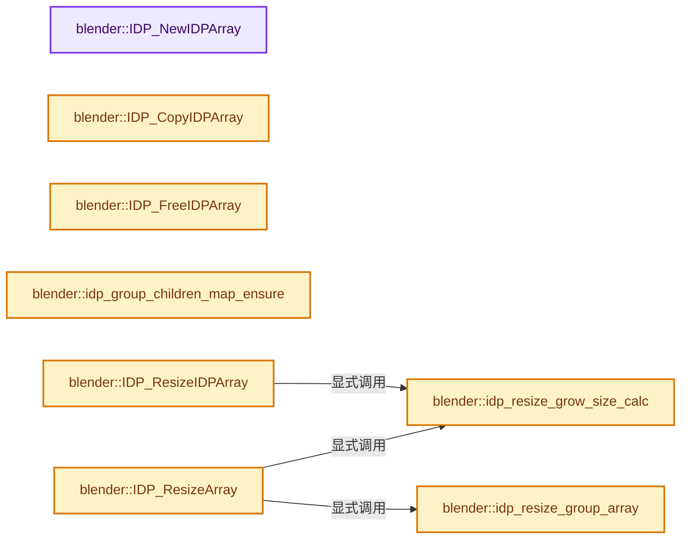
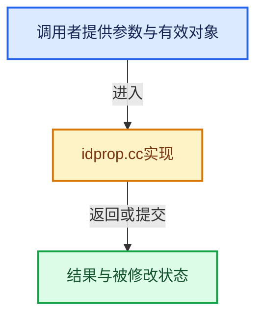

# 实现依赖专题：source/blender/blenkernel/intern/idprop.cc

[方向导航](README.md) · [符号索引](../%E7%AC%A6%E5%8F%B7%E4%BE%9D%E8%B5%96%E4%B8%8E%E5%AE%9E%E7%8E%B0%E7%B4%A2%E5%BC%95.md)

本专题从正文实际调用进入，集中保存共享实现。函数有稳定锚点，可从调用处直接跳到对应完整函数；递归与互相调用通过回链组织。

## 本文件的实现关系






<a id="m-2f5356486d1b"></a>

## 宏 `GETPROP`

<!-- annotated:49a3517188dea1 -->

```cpp
#define GETPROP(prop, i) &(IDP_property_array_get(prop)[i])

```

<details>
<summary>核对原始源码：source/blender/blenkernel/intern/idprop.cc · L102—L103</summary>

<!-- original:49a3517188dea1:source/blender/blenkernel/intern/idprop.cc:102:103 -->

```cpp
#define GETPROP(prop, i) &(IDP_property_array_get(prop)[i])

```

</details>

宏在预处理阶段展开，参数替换、重复求值和条件编译应直接从该定义检查。与普通函数不同，宏不会自动提供参数类型检查；构建配置选择哪个定义需结合外围条件。

## 完整成员与函数实现

<a id="f-38ed69bf6bcba8ff"></a>

### `blender::IDP_NewIDPArray`

实现位置：[source/blender/blenkernel/intern/idprop.cc](../../../../../source/blender/blenkernel/intern/idprop.cc) · L104—L112。

接口参数：

- `const StringRef name`

**教学注释版**

<!-- annotated:8efa51e51e5495 -->

```cpp
IDProperty *IDP_NewIDPArray(const StringRef name)
{
  IDProperty *prop = MEM_new<IDProperty>("IDProperty prop array");
  prop->type = IDP_IDPARRAY;
  prop->len = 0;
  name.copy_utf8_truncated(prop->name);

  return prop;
}
```

<details>
<summary>核对原始源码：source/blender/blenkernel/intern/idprop.cc · L104—L112</summary>

<!-- original:8efa51e51e5495:source/blender/blenkernel/intern/idprop.cc:104:112 -->

```cpp
IDProperty *IDP_NewIDPArray(const StringRef name)
{
  IDProperty *prop = MEM_new<IDProperty>("IDProperty prop array");
  prop->type = IDP_IDPARRAY;
  prop->len = 0;
  name.copy_utf8_truncated(prop->name);

  return prop;
}
```

</details>

**沿实际写入检查状态**

- `prop->type = IDP_IDPARRAY;`
- `prop->len = 0;`

**结果出口**

- `return prop;`

**继续追踪实现**

- `MEM_new<IDProperty>` → [MEM_new · L351](../03-%E5%86%85%E5%AD%98%E5%88%86%E9%85%8D%E4%B8%8E%E8%BF%90%E8%A1%8C%E6%97%B6%E7%B1%BB%E5%9E%8B/%E4%BE%9D%E8%B5%96-MEM_guardedalloc-b54eca.md#f-115f9b6784f89912)。
- `name.copy_utf8_truncated` → [blender::StringRefBase::copy_utf8_truncated · L28](../01-%E5%9F%BA%E7%A1%80%E5%AE%B9%E5%99%A8%E4%B8%8E%E7%8E%B0%E4%BB%A3CPP/%E4%BE%9D%E8%B5%96-string_ref-ed6905.md#f-5d01486bac37768d)；[blender::StringRefBase::copy_utf8_truncated · L256](../01-%E5%9F%BA%E7%A1%80%E5%AE%B9%E5%99%A8%E4%B8%8E%E7%8E%B0%E4%BB%A3CPP/15-StringRef%E5%AD%97%E7%AC%A6%E4%B8%B2%E8%A7%86%E5%9B%BE.md#f-b2a0157cbe286321)。同名重载需按实参类型选择。

<a id="f-1ee52d4551d2e238"></a>

### `blender::IDP_CopyIDPArray`

实现位置：[source/blender/blenkernel/intern/idprop.cc](../../../../../source/blender/blenkernel/intern/idprop.cc) · L114—L135。

接口参数：

- `const IDProperty *array`
- `const int flag`

**教学注释版**

<!-- annotated:c40e146d9b94f3 -->

```cpp
IDProperty *IDP_CopyIDPArray(const IDProperty *array, const int flag)
{
  /* don't use MEM_dupalloc because this may be part of an array */
  BLI_assert(array->type == IDP_IDPARRAY);

  IDProperty *narray = MEM_new<IDProperty>(__func__, *array);

  narray->data.pointer = MEM_dupalloc_void(array->data.pointer);
  for (int i = 0; i < narray->len; i++) {
    /* OK, the copy functions always allocate a new structure,
     * which doesn't work here.  instead, simply copy the
     * contents of the new structure into the array cell,
     * then free it.  this makes for more maintainable
     * code than simply re-implementing the copy functions
     * in this loop. */
    IDProperty *tmp = IDP_CopyProperty_ex(GETPROP(narray, i), flag);
    // [讲解] memcpy：复制字节，源与目标不应重叠。类型生命周期、对齐和可复制表示须由调用者证明，不是任意对象的复制构造。
    memcpy(GETPROP(narray, i), tmp, sizeof(IDProperty));
    MEM_delete(tmp);
  }

  return narray;
}
```

<details>
<summary>核对原始源码：source/blender/blenkernel/intern/idprop.cc · L114—L135</summary>

<!-- original:c40e146d9b94f3:source/blender/blenkernel/intern/idprop.cc:114:135 -->

```cpp
IDProperty *IDP_CopyIDPArray(const IDProperty *array, const int flag)
{
  /* don't use MEM_dupalloc because this may be part of an array */
  BLI_assert(array->type == IDP_IDPARRAY);

  IDProperty *narray = MEM_new<IDProperty>(__func__, *array);

  narray->data.pointer = MEM_dupalloc_void(array->data.pointer);
  for (int i = 0; i < narray->len; i++) {
    /* OK, the copy functions always allocate a new structure,
     * which doesn't work here.  instead, simply copy the
     * contents of the new structure into the array cell,
     * then free it.  this makes for more maintainable
     * code than simply re-implementing the copy functions
     * in this loop. */
    IDProperty *tmp = IDP_CopyProperty_ex(GETPROP(narray, i), flag);
    memcpy(GETPROP(narray, i), tmp, sizeof(IDProperty));
    MEM_delete(tmp);
  }

  return narray;
}
```

</details>

**沿实际写入检查状态**

- `narray->data.pointer = MEM_dupalloc_void(array->data.pointer);`

**结果出口**

- `return narray;`

**继续追踪实现**

- `BLI_assert` → [BLI_assert · L48](../01-%E5%9F%BA%E7%A1%80%E5%AE%B9%E5%99%A8%E4%B8%8E%E7%8E%B0%E4%BB%A3CPP/%E4%BE%9D%E8%B5%96-BLI_assert-cc98e8.md#m-57a88495704d)；[BLI_assert · L63](../01-%E5%9F%BA%E7%A1%80%E5%AE%B9%E5%99%A8%E4%B8%8E%E7%8E%B0%E4%BB%A3CPP/%E4%BE%9D%E8%B5%96-BLI_assert-cc98e8.md#m-d07050020cb5)。宏定义由构建条件选择。
- `MEM_new<IDProperty>` → [MEM_new · L351](../03-%E5%86%85%E5%AD%98%E5%88%86%E9%85%8D%E4%B8%8E%E8%BF%90%E8%A1%8C%E6%97%B6%E7%B1%BB%E5%9E%8B/%E4%BE%9D%E8%B5%96-MEM_guardedalloc-b54eca.md#f-115f9b6784f89912)。
- `MEM_dupalloc_void` → [MEM_dupalloc_void · L139](../03-%E5%86%85%E5%AD%98%E5%88%86%E9%85%8D%E4%B8%8E%E8%BF%90%E8%A1%8C%E6%97%B6%E7%B1%BB%E5%9E%8B/%E4%BE%9D%E8%B5%96-mallocn-afdcd4.md#f-7a16d9233cb67bd0)。
- `IDP_CopyProperty_ex` → [blender::IDP_CopyProperty_ex · L968](%E4%BE%9D%E8%B5%96-idprop-006c65.md#f-df4a72661231af0c)。
- `GETPROP` → [GETPROP · L102](%E4%BE%9D%E8%B5%96-idprop-006c65.md#m-2f5356486d1b)。宏定义由构建条件选择。
- `memcpy` → [外部契约](https://eel.is/c++draft/cstring.syn)：复制字节，源与目标不应重叠。类型生命周期、对齐和可复制表示须由调用者证明，不是任意对象的复制构造。
- `MEM_delete` → [MEM_delete · L400](../03-%E5%86%85%E5%AD%98%E5%88%86%E9%85%8D%E4%B8%8E%E8%BF%90%E8%A1%8C%E6%97%B6%E7%B1%BB%E5%9E%8B/%E4%BE%9D%E8%B5%96-MEM_guardedalloc-b54eca.md#f-9049ffdd1682887c)。

<a id="f-d00f3f5cfb169e65"></a>

### `blender::IDP_FreeIDPArray`

实现位置：[source/blender/blenkernel/intern/idprop.cc](../../../../../source/blender/blenkernel/intern/idprop.cc) · L137—L148。

接口参数：

- `IDProperty *prop`
- `const bool do_id_user`
- `const int recursion_depth`

**教学注释版**

<!-- annotated:4af2cacc177d74 -->

```cpp
static void IDP_FreeIDPArray(IDProperty *prop, const bool do_id_user, const int recursion_depth)
{
  BLI_assert(prop->type == IDP_IDPARRAY);

  for (int i = 0; i < prop->len; i++) {
    idp_free_property_content_recurse(GETPROP(prop, i), do_id_user, recursion_depth + 1);
  }

  if (prop->data.pointer) {
    MEM_delete(static_cast<IDProperty *>(prop->data.pointer));
  }
}
```

<details>
<summary>核对原始源码：source/blender/blenkernel/intern/idprop.cc · L137—L148</summary>

<!-- original:4af2cacc177d74:source/blender/blenkernel/intern/idprop.cc:137:148 -->

```cpp
static void IDP_FreeIDPArray(IDProperty *prop, const bool do_id_user, const int recursion_depth)
{
  BLI_assert(prop->type == IDP_IDPARRAY);

  for (int i = 0; i < prop->len; i++) {
    idp_free_property_content_recurse(GETPROP(prop, i), do_id_user, recursion_depth + 1);
  }

  if (prop->data.pointer) {
    MEM_delete(static_cast<IDProperty *>(prop->data.pointer));
  }
}
```

</details>

**继续追踪实现**

- `BLI_assert` → [BLI_assert · L48](../01-%E5%9F%BA%E7%A1%80%E5%AE%B9%E5%99%A8%E4%B8%8E%E7%8E%B0%E4%BB%A3CPP/%E4%BE%9D%E8%B5%96-BLI_assert-cc98e8.md#m-57a88495704d)；[BLI_assert · L63](../01-%E5%9F%BA%E7%A1%80%E5%AE%B9%E5%99%A8%E4%B8%8E%E7%8E%B0%E4%BB%A3CPP/%E4%BE%9D%E8%B5%96-BLI_assert-cc98e8.md#m-d07050020cb5)。宏定义由构建条件选择。
- `idp_free_property_content_recurse` → [blender::idp_free_property_content_recurse · L1346](%E4%BE%9D%E8%B5%96-idprop-006c65.md#f-464efbb2ac51a8ae)。
- `GETPROP` → [GETPROP · L102](%E4%BE%9D%E8%B5%96-idprop-006c65.md#m-2f5356486d1b)。宏定义由构建条件选择。
- `MEM_delete` → [MEM_delete · L400](../03-%E5%86%85%E5%AD%98%E5%88%86%E9%85%8D%E4%B8%8E%E8%BF%90%E8%A1%8C%E6%97%B6%E7%B1%BB%E5%9E%8B/%E4%BE%9D%E8%B5%96-MEM_guardedalloc-b54eca.md#f-9049ffdd1682887c)。

<a id="f-714f943f8bb7e84d"></a>

### `blender::idp_group_children_map_ensure`

实现位置：[source/blender/blenkernel/intern/idprop.cc](../../../../../source/blender/blenkernel/intern/idprop.cc) · L180—L186。

接口参数：

- `IDProperty &prop`

**教学注释版**

<!-- annotated:824afc1fb07afb -->

```cpp
static void idp_group_children_map_ensure(IDProperty &prop)
{
  BLI_assert(prop.type == IDP_GROUP);
  if (!prop.data.children_map) {
    prop.data.children_map = MEM_new<bke::idprop::IDPropertyGroupChildrenSet>(__func__);
  }
}
```

<details>
<summary>核对原始源码：source/blender/blenkernel/intern/idprop.cc · L180—L186</summary>

<!-- original:824afc1fb07afb:source/blender/blenkernel/intern/idprop.cc:180:186 -->

```cpp
static void idp_group_children_map_ensure(IDProperty &prop)
{
  BLI_assert(prop.type == IDP_GROUP);
  if (!prop.data.children_map) {
    prop.data.children_map = MEM_new<bke::idprop::IDPropertyGroupChildrenSet>(__func__);
  }
}
```

</details>

**沿实际写入检查状态**

- `prop.data.children_map = MEM_new<bke::idprop::IDPropertyGroupChildrenSet>(__func__);`

**继续追踪实现**

- `BLI_assert` → [BLI_assert · L48](../01-%E5%9F%BA%E7%A1%80%E5%AE%B9%E5%99%A8%E4%B8%8E%E7%8E%B0%E4%BB%A3CPP/%E4%BE%9D%E8%B5%96-BLI_assert-cc98e8.md#m-57a88495704d)；[BLI_assert · L63](../01-%E5%9F%BA%E7%A1%80%E5%AE%B9%E5%99%A8%E4%B8%8E%E7%8E%B0%E4%BB%A3CPP/%E4%BE%9D%E8%B5%96-BLI_assert-cc98e8.md#m-d07050020cb5)。宏定义由构建条件选择。
- `MEM_new<bke::idprop::IDPropertyGroupChildrenSet>` → [MEM_new · L351](../03-%E5%86%85%E5%AD%98%E5%88%86%E9%85%8D%E4%B8%8E%E8%BF%90%E8%A1%8C%E6%97%B6%E7%B1%BB%E5%9E%8B/%E4%BE%9D%E8%B5%96-MEM_guardedalloc-b54eca.md#f-115f9b6784f89912)。

<a id="f-308bd3cdd14abf4d"></a>

### `blender::idp_resize_grow_size_calc`

实现位置：[source/blender/blenkernel/intern/idprop.cc](../../../../../source/blender/blenkernel/intern/idprop.cc) · L188—L201。

接口参数：

- `const int newsize`

**教学注释版**

<!-- annotated:716fdda631e5f5 -->

```cpp
static int idp_resize_grow_size_calc(const int newsize)
{
  /* NOTE: This code comes from python, here's the corresponding comment. */
  /* This over-allocates proportional to the list size, making room
   * for additional growth. The over-allocation is mild, but is
   * enough to give linear-time amortized behavior over a long
   * sequence of appends() in the presence of a poorly-performing
   * system realloc().
   * The growth pattern is:  0, 4, 8, 16, 25, 35, 46, 58, 72, 88, ...
   */
  int64_t newsize_test = newsize;
  newsize_test = (newsize_test >> 3) + (newsize_test < 9 ? 3 : 6) + newsize_test;
  // [讲解] std::min<int64_t>：按比较关系选取较小值；截断范围时还需先满足非负和可表示范围，min本身不会证明边界安全。
  return int(std::min<int64_t>(newsize_test, std::numeric_limits<int>::max()));
}
```

<details>
<summary>核对原始源码：source/blender/blenkernel/intern/idprop.cc · L188—L201</summary>

<!-- original:716fdda631e5f5:source/blender/blenkernel/intern/idprop.cc:188:201 -->

```cpp
static int idp_resize_grow_size_calc(const int newsize)
{
  /* NOTE: This code comes from python, here's the corresponding comment. */
  /* This over-allocates proportional to the list size, making room
   * for additional growth. The over-allocation is mild, but is
   * enough to give linear-time amortized behavior over a long
   * sequence of appends() in the presence of a poorly-performing
   * system realloc().
   * The growth pattern is:  0, 4, 8, 16, 25, 35, 46, 58, 72, 88, ...
   */
  int64_t newsize_test = newsize;
  newsize_test = (newsize_test >> 3) + (newsize_test < 9 ? 3 : 6) + newsize_test;
  return int(std::min<int64_t>(newsize_test, std::numeric_limits<int>::max()));
}
```

</details>

**沿实际写入检查状态**

- `newsize_test = (newsize_test >> 3) + (newsize_test < 9 ? 3 : 6) + newsize_test;`

**结果出口**

- `return int(std::min<int64_t>(newsize_test, std::numeric_limits<int>::max()));`

**继续追踪实现**

- `std::min<int64_t>` → [外部契约](https://eel.is/c++draft/alg.min.max)：按比较关系选取较小值；截断范围时还需先满足非负和可表示范围，min本身不会证明边界安全。
- `std::numeric_limits<int>::max` → [外部契约](https://eel.is/c++draft/alg.min.max)：按比较关系选取较大值。本讲解中的增长公式同时满足最低请求和几何增长；若保存返回引用，还需注意实参寿命。

<a id="f-f96eeb5e2c2cb727"></a>

### `blender::IDP_ResizeIDPArray`

实现位置：[source/blender/blenkernel/intern/idprop.cc](../../../../../source/blender/blenkernel/intern/idprop.cc) · L203—L236。

接口参数：

- `IDProperty *prop`
- `int newlen`

**教学注释版**

<!-- annotated:1fb54e36f4d082 -->

```cpp
void IDP_ResizeIDPArray(IDProperty *prop, int newlen)
{
  BLI_assert(prop->type == IDP_IDPARRAY);

  /* first check if the array buffer size has room */
  if (newlen <= prop->totallen) {
    if (newlen < prop->len && prop->totallen - newlen < IDP_ARRAY_REALLOC_LIMIT) {
      for (int i = newlen; i < prop->len; i++) {
        IDP_ClearProperty(GETPROP(prop, i));
      }

      prop->len = newlen;
      return;
    }
    if (newlen >= prop->len) {
      prop->len = newlen;
      return;
    }
  }

  /* free trailing items */
  if (newlen < prop->len) {
    /* newlen is smaller */
    for (int i = newlen; i < prop->len; i++) {
      IDP_ClearProperty(GETPROP(prop, i));
    }
  }

  const int newsize = idp_resize_grow_size_calc(newlen);
  prop->data.pointer = MEM_realloc_zeroed(prop->data.pointer,
                                          sizeof(IDProperty) * size_t(newsize));
  prop->len = newlen;
  prop->totallen = newsize;
}
```

<details>
<summary>核对原始源码：source/blender/blenkernel/intern/idprop.cc · L203—L236</summary>

<!-- original:1fb54e36f4d082:source/blender/blenkernel/intern/idprop.cc:203:236 -->

```cpp
void IDP_ResizeIDPArray(IDProperty *prop, int newlen)
{
  BLI_assert(prop->type == IDP_IDPARRAY);

  /* first check if the array buffer size has room */
  if (newlen <= prop->totallen) {
    if (newlen < prop->len && prop->totallen - newlen < IDP_ARRAY_REALLOC_LIMIT) {
      for (int i = newlen; i < prop->len; i++) {
        IDP_ClearProperty(GETPROP(prop, i));
      }

      prop->len = newlen;
      return;
    }
    if (newlen >= prop->len) {
      prop->len = newlen;
      return;
    }
  }

  /* free trailing items */
  if (newlen < prop->len) {
    /* newlen is smaller */
    for (int i = newlen; i < prop->len; i++) {
      IDP_ClearProperty(GETPROP(prop, i));
    }
  }

  const int newsize = idp_resize_grow_size_calc(newlen);
  prop->data.pointer = MEM_realloc_zeroed(prop->data.pointer,
                                          sizeof(IDProperty) * size_t(newsize));
  prop->len = newlen;
  prop->totallen = newsize;
}
```

</details>

**沿实际写入检查状态**

- `prop->len = newlen;`
- `prop->data.pointer = MEM_realloc_zeroed(prop->data.pointer,`
- `prop->totallen = newsize;`

**继续追踪实现**

- `BLI_assert` → [BLI_assert · L48](../01-%E5%9F%BA%E7%A1%80%E5%AE%B9%E5%99%A8%E4%B8%8E%E7%8E%B0%E4%BB%A3CPP/%E4%BE%9D%E8%B5%96-BLI_assert-cc98e8.md#m-57a88495704d)；[BLI_assert · L63](../01-%E5%9F%BA%E7%A1%80%E5%AE%B9%E5%99%A8%E4%B8%8E%E7%8E%B0%E4%BB%A3CPP/%E4%BE%9D%E8%B5%96-BLI_assert-cc98e8.md#m-d07050020cb5)。宏定义由构建条件选择。
- `IDP_ClearProperty` → [blender::IDP_ClearProperty · L1408](%E4%BE%9D%E8%B5%96-idprop-006c65.md#f-82a42d1feb5b0d6a)。
- `GETPROP` → [GETPROP · L102](%E4%BE%9D%E8%B5%96-idprop-006c65.md#m-2f5356486d1b)。宏定义由构建条件选择。
- `idp_resize_grow_size_calc` → [blender::idp_resize_grow_size_calc · L188](%E4%BE%9D%E8%B5%96-idprop-006c65.md#f-308bd3cdd14abf4d)。
- `MEM_realloc_zeroed` → [MEM_realloc_zeroed · L119](../03-%E5%86%85%E5%AD%98%E5%88%86%E9%85%8D%E4%B8%8E%E8%BF%90%E8%A1%8C%E6%97%B6%E7%B1%BB%E5%9E%8B/%E4%BE%9D%E8%B5%96-MEM_guardedalloc-b54eca.md#m-db4054295a6d)。宏定义由构建条件选择。

<a id="f-c6faf018ff3b3f0d"></a>

### `blender::idp_resize_group_array`

实现位置：[source/blender/blenkernel/intern/idprop.cc](../../../../../source/blender/blenkernel/intern/idprop.cc) · L239—L261。

接口参数：

- `IDProperty *prop`
- `int newlen`
- `void *newarr`
- `const bool do_id_users`
- `const int recursion_depth`

**教学注释版**

<!-- annotated:728da400030de9 -->

```cpp
static void idp_resize_group_array(
    IDProperty *prop, int newlen, void *newarr, const bool do_id_users, const int recursion_depth)
{
  if (prop->subtype != IDP_GROUP) {
    return;
  }

  if (newlen >= prop->len) {
    /* bigger */
    IDProperty **array = static_cast<IDProperty **>(newarr);
    for (int a = prop->len; a < newlen; a++) {
      array[a] = bke::idprop::create_group("IDP_ResizeArray group").release();
    }
  }
  else {
    /* smaller */
    IDProperty **array = static_cast<IDProperty **>(prop->data.pointer);

    for (int a = newlen; a < prop->len; a++) {
      idp_free_property_recurse(array[a], do_id_users, recursion_depth + 1);
    }
  }
}
```

<details>
<summary>核对原始源码：source/blender/blenkernel/intern/idprop.cc · L239—L261</summary>

<!-- original:728da400030de9:source/blender/blenkernel/intern/idprop.cc:239:261 -->

```cpp
static void idp_resize_group_array(
    IDProperty *prop, int newlen, void *newarr, const bool do_id_users, const int recursion_depth)
{
  if (prop->subtype != IDP_GROUP) {
    return;
  }

  if (newlen >= prop->len) {
    /* bigger */
    IDProperty **array = static_cast<IDProperty **>(newarr);
    for (int a = prop->len; a < newlen; a++) {
      array[a] = bke::idprop::create_group("IDP_ResizeArray group").release();
    }
  }
  else {
    /* smaller */
    IDProperty **array = static_cast<IDProperty **>(prop->data.pointer);

    for (int a = newlen; a < prop->len; a++) {
      idp_free_property_recurse(array[a], do_id_users, recursion_depth + 1);
    }
  }
}
```

</details>

**沿实际写入检查状态**

- `array[a] = bke::idprop::create_group("IDP_ResizeArray group").release();`

**继续追踪实现**

- `bke::idprop::create_group("IDP_ResizeArray group").release` → [调用协议](../%E6%A8%A1%E6%9D%BF%E5%AE%8F%E4%B8%8E%E5%8A%A8%E6%80%81%E5%88%86%E6%B4%BE%E5%8D%8F%E8%AE%AE.md)：接收对象类型依赖auto、返回值或模板实例；不按同名猜测目标。调用位置L250。
- `bke::idprop::create_group` → [blender::bke::idprop::create_group · L155](%E4%BE%9D%E8%B5%96-idprop_create-f89f51.md#f-b1e2d8bfd5654bc2)。
- `idp_free_property_recurse` → [blender::idp_free_property_recurse · L1390](%E4%BE%9D%E8%B5%96-idprop-006c65.md#f-3dad49cbbf1e59a6)。

<a id="f-303e24b3c3a1e075"></a>

### `blender::IDP_ResizeArray`

实现位置：[source/blender/blenkernel/intern/idprop.cc](../../../../../source/blender/blenkernel/intern/idprop.cc) · L263—L288。

接口参数：

- `IDProperty *prop`
- `int newlen`

**教学注释版**

<!-- annotated:fd891556156320 -->

```cpp
void IDP_ResizeArray(IDProperty *prop, int newlen)
{
  const bool is_grow = newlen >= prop->len;

  /* first check if the array buffer size has room */
  if (newlen <= prop->totallen && prop->totallen - newlen < IDP_ARRAY_REALLOC_LIMIT) {
    idp_resize_group_array(prop, newlen, prop->data.pointer, true, 0);
    prop->len = newlen;
    return;
  }

  const int newsize = idp_resize_grow_size_calc(newlen);
  if (is_grow == false) {
    idp_resize_group_array(prop, newlen, prop->data.pointer, true, 0);
  }

  prop->data.pointer = MEM_realloc_zeroed(prop->data.pointer,
                                          idp_size_table[int(prop->subtype)] * size_t(newsize));

  if (is_grow == true) {
    idp_resize_group_array(prop, newlen, prop->data.pointer, true, 0);
  }

  prop->len = newlen;
  prop->totallen = newsize;
}
```

<details>
<summary>核对原始源码：source/blender/blenkernel/intern/idprop.cc · L263—L288</summary>

<!-- original:fd891556156320:source/blender/blenkernel/intern/idprop.cc:263:288 -->

```cpp
void IDP_ResizeArray(IDProperty *prop, int newlen)
{
  const bool is_grow = newlen >= prop->len;

  /* first check if the array buffer size has room */
  if (newlen <= prop->totallen && prop->totallen - newlen < IDP_ARRAY_REALLOC_LIMIT) {
    idp_resize_group_array(prop, newlen, prop->data.pointer, true, 0);
    prop->len = newlen;
    return;
  }

  const int newsize = idp_resize_grow_size_calc(newlen);
  if (is_grow == false) {
    idp_resize_group_array(prop, newlen, prop->data.pointer, true, 0);
  }

  prop->data.pointer = MEM_realloc_zeroed(prop->data.pointer,
                                          idp_size_table[int(prop->subtype)] * size_t(newsize));

  if (is_grow == true) {
    idp_resize_group_array(prop, newlen, prop->data.pointer, true, 0);
  }

  prop->len = newlen;
  prop->totallen = newsize;
}
```

</details>

**沿实际写入检查状态**

- `prop->len = newlen;`
- `prop->data.pointer = MEM_realloc_zeroed(prop->data.pointer,`
- `prop->totallen = newsize;`

**继续追踪实现**

- `idp_resize_group_array` → [blender::idp_resize_group_array · L239](%E4%BE%9D%E8%B5%96-idprop-006c65.md#f-c6faf018ff3b3f0d)。
- `idp_resize_grow_size_calc` → [blender::idp_resize_grow_size_calc · L188](%E4%BE%9D%E8%B5%96-idprop-006c65.md#f-308bd3cdd14abf4d)。
- `MEM_realloc_zeroed` → [MEM_realloc_zeroed · L119](../03-%E5%86%85%E5%AD%98%E5%88%86%E9%85%8D%E4%B8%8E%E8%BF%90%E8%A1%8C%E6%97%B6%E7%B1%BB%E5%9E%8B/%E4%BE%9D%E8%B5%96-MEM_guardedalloc-b54eca.md#m-db4054295a6d)。宏定义由构建条件选择。

<a id="f-42d5e77ab921d6b9"></a>

### `blender::IDP_FreeArray`

实现位置：[source/blender/blenkernel/intern/idprop.cc](../../../../../source/blender/blenkernel/intern/idprop.cc) · L290—L296。

接口参数：

- `IDProperty *prop`
- `const bool do_id_user`
- `const int recursion_depth`

**教学注释版**

<!-- annotated:935a838614afda -->

```cpp
static void IDP_FreeArray(IDProperty *prop, const bool do_id_user, const int recursion_depth)
{
  if (prop->data.pointer) {
    idp_resize_group_array(prop, 0, nullptr, do_id_user, recursion_depth);
    // [讲解] MEM_delete_void：以原始存储释放约定调用当前后端。
    MEM_delete_void(prop->data.pointer);
  }
}
```

<details>
<summary>核对原始源码：source/blender/blenkernel/intern/idprop.cc · L290—L296</summary>

<!-- original:935a838614afda:source/blender/blenkernel/intern/idprop.cc:290:296 -->

```cpp
static void IDP_FreeArray(IDProperty *prop, const bool do_id_user, const int recursion_depth)
{
  if (prop->data.pointer) {
    idp_resize_group_array(prop, 0, nullptr, do_id_user, recursion_depth);
    MEM_delete_void(prop->data.pointer);
  }
}
```

</details>

**继续追踪实现**

- `idp_resize_group_array` → [blender::idp_resize_group_array · L239](%E4%BE%9D%E8%B5%96-idprop-006c65.md#f-c6faf018ff3b3f0d)。
- `MEM_delete_void` → [MEM_delete_void · L647](../03-%E5%86%85%E5%AD%98%E5%88%86%E9%85%8D%E4%B8%8E%E8%BF%90%E8%A1%8C%E6%97%B6%E7%B1%BB%E5%9E%8B/%E4%BE%9D%E8%B5%96-MEM_guardedalloc-b54eca.md#f-642896c7c62ff8b9)；[MEM_delete_void · L109](../03-%E5%86%85%E5%AD%98%E5%88%86%E9%85%8D%E4%B8%8E%E8%BF%90%E8%A1%8C%E6%97%B6%E7%B1%BB%E5%9E%8B/%E4%BE%9D%E8%B5%96-mallocn-afdcd4.md#f-9a07b26421f2bee6)。同名重载需按实参类型选择。

<a id="f-c78302cf72be9d2e"></a>

### `blender::IDP_ui_data_copy`

实现位置：[source/blender/blenkernel/intern/idprop.cc](../../../../../source/blender/blenkernel/intern/idprop.cc) · L298—L351。

接口参数：

- `const IDProperty *prop`

**教学注释版**

<!-- annotated:2cec7a21b2de66 -->

```cpp
IDPropertyUIData *IDP_ui_data_copy(const IDProperty *prop)
{
  IDPropertyUIData *dst_ui_data = MEM_dupalloc(prop->ui_data);

  /* Copy extra type specific data. */
  switch (IDP_ui_data_type(prop)) {
    case IDP_UI_DATA_TYPE_STRING: {
      const IDPropertyUIDataString *src = reinterpret_cast<const IDPropertyUIDataString *>(
          prop->ui_data);
      IDPropertyUIDataString *dst = reinterpret_cast<IDPropertyUIDataString *>(dst_ui_data);
      dst->default_value = MEM_dupalloc(src->default_value);
      break;
    }
    case IDP_UI_DATA_TYPE_ID: {
      break;
    }
    case IDP_UI_DATA_TYPE_INT: {
      const IDPropertyUIDataInt *src = reinterpret_cast<const IDPropertyUIDataInt *>(
          prop->ui_data);
      IDPropertyUIDataInt *dst = reinterpret_cast<IDPropertyUIDataInt *>(dst_ui_data);
      dst->default_array = MEM_dupalloc(src->default_array);
      dst->enum_items = MEM_dupalloc(src->enum_items);
      for (const int64_t i : IndexRange(src->enum_items_num)) {
        const IDPropertyUIDataEnumItem &src_item = src->enum_items[i];
        IDPropertyUIDataEnumItem &dst_item = dst->enum_items[i];
        dst_item.identifier = BLI_strdup(src_item.identifier);
        dst_item.name = BLI_strdup_null(src_item.name);
        dst_item.description = BLI_strdup_null(src_item.description);
      }
      break;
    }
    case IDP_UI_DATA_TYPE_BOOLEAN: {
      const IDPropertyUIDataBool *src = reinterpret_cast<const IDPropertyUIDataBool *>(
          prop->ui_data);
      IDPropertyUIDataBool *dst = reinterpret_cast<IDPropertyUIDataBool *>(dst_ui_data);
      dst->default_array = MEM_dupalloc(src->default_array);
      break;
    }
    case IDP_UI_DATA_TYPE_FLOAT: {
      const IDPropertyUIDataFloat *src = reinterpret_cast<const IDPropertyUIDataFloat *>(
          prop->ui_data);
      IDPropertyUIDataFloat *dst = reinterpret_cast<IDPropertyUIDataFloat *>(dst_ui_data);
      dst->default_array = MEM_dupalloc(src->default_array);
      break;
    }
    case IDP_UI_DATA_TYPE_UNSUPPORTED: {
      break;
    }
  }

  dst_ui_data->description = MEM_dupalloc(prop->ui_data->description);

  return dst_ui_data;
}
```

<details>
<summary>核对原始源码：source/blender/blenkernel/intern/idprop.cc · L298—L351</summary>

<!-- original:2cec7a21b2de66:source/blender/blenkernel/intern/idprop.cc:298:351 -->

```cpp
IDPropertyUIData *IDP_ui_data_copy(const IDProperty *prop)
{
  IDPropertyUIData *dst_ui_data = MEM_dupalloc(prop->ui_data);

  /* Copy extra type specific data. */
  switch (IDP_ui_data_type(prop)) {
    case IDP_UI_DATA_TYPE_STRING: {
      const IDPropertyUIDataString *src = reinterpret_cast<const IDPropertyUIDataString *>(
          prop->ui_data);
      IDPropertyUIDataString *dst = reinterpret_cast<IDPropertyUIDataString *>(dst_ui_data);
      dst->default_value = MEM_dupalloc(src->default_value);
      break;
    }
    case IDP_UI_DATA_TYPE_ID: {
      break;
    }
    case IDP_UI_DATA_TYPE_INT: {
      const IDPropertyUIDataInt *src = reinterpret_cast<const IDPropertyUIDataInt *>(
          prop->ui_data);
      IDPropertyUIDataInt *dst = reinterpret_cast<IDPropertyUIDataInt *>(dst_ui_data);
      dst->default_array = MEM_dupalloc(src->default_array);
      dst->enum_items = MEM_dupalloc(src->enum_items);
      for (const int64_t i : IndexRange(src->enum_items_num)) {
        const IDPropertyUIDataEnumItem &src_item = src->enum_items[i];
        IDPropertyUIDataEnumItem &dst_item = dst->enum_items[i];
        dst_item.identifier = BLI_strdup(src_item.identifier);
        dst_item.name = BLI_strdup_null(src_item.name);
        dst_item.description = BLI_strdup_null(src_item.description);
      }
      break;
    }
    case IDP_UI_DATA_TYPE_BOOLEAN: {
      const IDPropertyUIDataBool *src = reinterpret_cast<const IDPropertyUIDataBool *>(
          prop->ui_data);
      IDPropertyUIDataBool *dst = reinterpret_cast<IDPropertyUIDataBool *>(dst_ui_data);
      dst->default_array = MEM_dupalloc(src->default_array);
      break;
    }
    case IDP_UI_DATA_TYPE_FLOAT: {
      const IDPropertyUIDataFloat *src = reinterpret_cast<const IDPropertyUIDataFloat *>(
          prop->ui_data);
      IDPropertyUIDataFloat *dst = reinterpret_cast<IDPropertyUIDataFloat *>(dst_ui_data);
      dst->default_array = MEM_dupalloc(src->default_array);
      break;
    }
    case IDP_UI_DATA_TYPE_UNSUPPORTED: {
      break;
    }
  }

  dst_ui_data->description = MEM_dupalloc(prop->ui_data->description);

  return dst_ui_data;
}
```

</details>

**沿实际写入检查状态**

- `dst->default_value = MEM_dupalloc(src->default_value);`
- `dst->default_array = MEM_dupalloc(src->default_array);`
- `dst->enum_items = MEM_dupalloc(src->enum_items);`
- `dst_item.identifier = BLI_strdup(src_item.identifier);`
- `dst_item.name = BLI_strdup_null(src_item.name);`
- `dst_item.description = BLI_strdup_null(src_item.description);`
- `dst_ui_data->description = MEM_dupalloc(prop->ui_data->description);`

**结果出口**

- `return dst_ui_data;`

**继续追踪实现**

- `MEM_dupalloc` → [MEM_dupalloc · L627](../03-%E5%86%85%E5%AD%98%E5%88%86%E9%85%8D%E4%B8%8E%E8%BF%90%E8%A1%8C%E6%97%B6%E7%B1%BB%E5%9E%8B/%E4%BE%9D%E8%B5%96-MEM_guardedalloc-b54eca.md#f-78a72b71e3c57010)。
- `IDP_ui_data_type` → [blender::IDP_ui_data_type · L1964](%E4%BE%9D%E8%B5%96-idprop-006c65.md#f-cb19896255b76760)。
- `IndexRange` → [blender::IndexRange](../01-%E5%9F%BA%E7%A1%80%E5%AE%B9%E5%99%A8%E4%B8%8E%E7%8E%B0%E4%BB%A3CPP/%E4%BE%9D%E8%B5%96-BLI_index_range-7d7cc5.md#t-caa3466d6776)；[blender::gpu::shader::parser::IndexRange](%E4%BE%9D%E8%B5%96-utils-06433d.md#t-82d2bd4ea71c)；[blender::IndexRange](%E4%BE%9D%E8%B5%96-DNA_node_types-6708b9.md#t-0448cc889d39)。
- `BLI_strdup` → [blender::BLI_strdup · L43](../01-%E5%9F%BA%E7%A1%80%E5%AE%B9%E5%99%A8%E4%B8%8E%E7%8E%B0%E4%BB%A3CPP/%E4%BE%9D%E8%B5%96-string-1d986f.md#f-7e6d5c696c20c0e1)。
- `BLI_strdup_null` → [blender::BLI_strdup_null · L48](../01-%E5%9F%BA%E7%A1%80%E5%AE%B9%E5%99%A8%E4%B8%8E%E7%8E%B0%E4%BB%A3CPP/%E4%BE%9D%E8%B5%96-string-1d986f.md#f-c1cd7c6336fe3fe0)。

<a id="f-f94ef906f86a7e0c"></a>

### `blender::idp_generic_copy`

实现位置：[source/blender/blenkernel/intern/idprop.cc](../../../../../source/blender/blenkernel/intern/idprop.cc) · L353—L368。

接口参数：

- `const IDProperty *prop`
- `const int`

**教学注释版**

<!-- annotated:d9e65f28300fcf -->

```cpp
static IDProperty *idp_generic_copy(const IDProperty *prop, const int /*flag*/)
{
  IDProperty *newp = MEM_new<IDProperty>(__func__);

  STRNCPY(newp->name, prop->name);
  newp->type = prop->type;
  newp->flag = prop->flag;
  newp->data.val = prop->data.val;
  newp->data.val2 = prop->data.val2;

  if (prop->ui_data != nullptr) {
    newp->ui_data = IDP_ui_data_copy(prop);
  }

  return newp;
}
```

<details>
<summary>核对原始源码：source/blender/blenkernel/intern/idprop.cc · L353—L368</summary>

<!-- original:d9e65f28300fcf:source/blender/blenkernel/intern/idprop.cc:353:368 -->

```cpp
static IDProperty *idp_generic_copy(const IDProperty *prop, const int /*flag*/)
{
  IDProperty *newp = MEM_new<IDProperty>(__func__);

  STRNCPY(newp->name, prop->name);
  newp->type = prop->type;
  newp->flag = prop->flag;
  newp->data.val = prop->data.val;
  newp->data.val2 = prop->data.val2;

  if (prop->ui_data != nullptr) {
    newp->ui_data = IDP_ui_data_copy(prop);
  }

  return newp;
}
```

</details>

**沿实际写入检查状态**

- `newp->type = prop->type;`
- `newp->flag = prop->flag;`
- `newp->data.val = prop->data.val;`
- `newp->data.val2 = prop->data.val2;`
- `newp->ui_data = IDP_ui_data_copy(prop);`

**结果出口**

- `return newp;`

**继续追踪实现**

- `MEM_new<IDProperty>` → [MEM_new · L351](../03-%E5%86%85%E5%AD%98%E5%88%86%E9%85%8D%E4%B8%8E%E8%BF%90%E8%A1%8C%E6%97%B6%E7%B1%BB%E5%9E%8B/%E4%BE%9D%E8%B5%96-MEM_guardedalloc-b54eca.md#f-115f9b6784f89912)。
- `STRNCPY` → [blender::STRNCPY · L690](../01-%E5%9F%BA%E7%A1%80%E5%AE%B9%E5%99%A8%E4%B8%8E%E7%8E%B0%E4%BB%A3CPP/%E4%BE%9D%E8%B5%96-BLI_string-b43058.md#f-6b2d861724026be6)。
- `IDP_ui_data_copy` → [blender::IDP_ui_data_copy · L298](%E4%BE%9D%E8%B5%96-idprop-006c65.md#f-c78302cf72be9d2e)。

<a id="f-0ea8a01fbd001f54"></a>

### `blender::IDP_CopyArray`

实现位置：[source/blender/blenkernel/intern/idprop.cc](../../../../../source/blender/blenkernel/intern/idprop.cc) · L370—L392。

接口参数：

- `const IDProperty *prop`
- `const int flag`

**教学注释版**

<!-- annotated:7df0c0c7e238ec -->

```cpp
static IDProperty *IDP_CopyArray(const IDProperty *prop, const int flag)
{
  BLI_assert(prop->type == IDP_ARRAY);
  IDProperty *newp = idp_generic_copy(prop, flag);

  if (prop->data.pointer) {
    newp->data.pointer = MEM_dupalloc_void(prop->data.pointer);

    if (prop->subtype == IDP_GROUP) {
      IDProperty **array = static_cast<IDProperty **>(newp->data.pointer);
      int a;

      for (a = 0; a < prop->len; a++) {
        array[a] = IDP_CopyProperty_ex(array[a], flag);
      }
    }
  }
  newp->len = prop->len;
  newp->subtype = prop->subtype;
  newp->totallen = prop->totallen;

  return newp;
}
```

<details>
<summary>核对原始源码：source/blender/blenkernel/intern/idprop.cc · L370—L392</summary>

<!-- original:7df0c0c7e238ec:source/blender/blenkernel/intern/idprop.cc:370:392 -->

```cpp
static IDProperty *IDP_CopyArray(const IDProperty *prop, const int flag)
{
  BLI_assert(prop->type == IDP_ARRAY);
  IDProperty *newp = idp_generic_copy(prop, flag);

  if (prop->data.pointer) {
    newp->data.pointer = MEM_dupalloc_void(prop->data.pointer);

    if (prop->subtype == IDP_GROUP) {
      IDProperty **array = static_cast<IDProperty **>(newp->data.pointer);
      int a;

      for (a = 0; a < prop->len; a++) {
        array[a] = IDP_CopyProperty_ex(array[a], flag);
      }
    }
  }
  newp->len = prop->len;
  newp->subtype = prop->subtype;
  newp->totallen = prop->totallen;

  return newp;
}
```

</details>

**沿实际写入检查状态**

- `newp->data.pointer = MEM_dupalloc_void(prop->data.pointer);`
- `array[a] = IDP_CopyProperty_ex(array[a], flag);`
- `newp->len = prop->len;`
- `newp->subtype = prop->subtype;`
- `newp->totallen = prop->totallen;`

**结果出口**

- `return newp;`

**继续追踪实现**

- `BLI_assert` → [BLI_assert · L48](../01-%E5%9F%BA%E7%A1%80%E5%AE%B9%E5%99%A8%E4%B8%8E%E7%8E%B0%E4%BB%A3CPP/%E4%BE%9D%E8%B5%96-BLI_assert-cc98e8.md#m-57a88495704d)；[BLI_assert · L63](../01-%E5%9F%BA%E7%A1%80%E5%AE%B9%E5%99%A8%E4%B8%8E%E7%8E%B0%E4%BB%A3CPP/%E4%BE%9D%E8%B5%96-BLI_assert-cc98e8.md#m-d07050020cb5)。宏定义由构建条件选择。
- `idp_generic_copy` → [blender::idp_generic_copy · L353](%E4%BE%9D%E8%B5%96-idprop-006c65.md#f-f94ef906f86a7e0c)。
- `MEM_dupalloc_void` → [MEM_dupalloc_void · L139](../03-%E5%86%85%E5%AD%98%E5%88%86%E9%85%8D%E4%B8%8E%E8%BF%90%E8%A1%8C%E6%97%B6%E7%B1%BB%E5%9E%8B/%E4%BE%9D%E8%B5%96-mallocn-afdcd4.md#f-7a16d9233cb67bd0)。
- `IDP_CopyProperty_ex` → [blender::IDP_CopyProperty_ex · L968](%E4%BE%9D%E8%B5%96-idprop-006c65.md#f-df4a72661231af0c)。

<a id="f-e0fc07b7dc59bac7"></a>

### `blender::IDP_NewStringMaxSize`

实现位置：[source/blender/blenkernel/intern/idprop.cc](../../../../../source/blender/blenkernel/intern/idprop.cc) · L400—L441。

接口参数：

- `const char *st`
- `const size_t st_maxncpy`
- `const StringRef name`
- `const eIDPropertyFlag flags`

**教学注释版**

<!-- annotated:61d60aa87c3f37 -->

```cpp
IDProperty *IDP_NewStringMaxSize(const char *st,
                                 const size_t st_maxncpy,
                                 const StringRef name,
                                 const eIDPropertyFlag flags)
{
  IDProperty *prop = MEM_new<IDProperty>("IDProperty string");

  if (st == nullptr) {
    prop->data.pointer = MEM_new_array_uninitialized<char>(DEFAULT_ALLOC_FOR_NULL_STRINGS,
                                                           "id property string 1");
    *IDP_string_get(prop) = '\0';
    prop->totallen = DEFAULT_ALLOC_FOR_NULL_STRINGS;
    prop->len = 1; /* nullptr string, has len of 1 to account for null byte. */
  }
  else {
    /* Include null terminator '\0'. */
    size_t stlen_bytes;
    if (st_maxncpy > 0) {
      BLI_strnlen_utf8_ex(st, st_maxncpy - 1, &stlen_bytes);
    }
    else {
      stlen_bytes = strlen(st);
    }
    const int stlen = int(stlen_bytes) + 1;

    prop->data.pointer = MEM_new_array_uninitialized<char>(size_t(stlen), "id property string 2");
    prop->len = prop->totallen = stlen;

    /* Ensured above, must always be true otherwise null terminator assignment will be invalid. */
    BLI_assert(stlen > 0);
    if (stlen > 1) {
      // [讲解] memcpy：复制字节，源与目标不应重叠。类型生命周期、对齐和可复制表示须由调用者证明，不是任意对象的复制构造。
      memcpy(prop->data.pointer, st, size_t(stlen));
    }
    IDP_string_get(prop)[stlen - 1] = '\0';
  }

  prop->type = IDP_STRING;
  name.copy_utf8_truncated(prop->name);
  prop->flag = flags;

  return prop;
}
```

<details>
<summary>核对原始源码：source/blender/blenkernel/intern/idprop.cc · L400—L441</summary>

<!-- original:61d60aa87c3f37:source/blender/blenkernel/intern/idprop.cc:400:441 -->

```cpp
IDProperty *IDP_NewStringMaxSize(const char *st,
                                 const size_t st_maxncpy,
                                 const StringRef name,
                                 const eIDPropertyFlag flags)
{
  IDProperty *prop = MEM_new<IDProperty>("IDProperty string");

  if (st == nullptr) {
    prop->data.pointer = MEM_new_array_uninitialized<char>(DEFAULT_ALLOC_FOR_NULL_STRINGS,
                                                           "id property string 1");
    *IDP_string_get(prop) = '\0';
    prop->totallen = DEFAULT_ALLOC_FOR_NULL_STRINGS;
    prop->len = 1; /* nullptr string, has len of 1 to account for null byte. */
  }
  else {
    /* Include null terminator '\0'. */
    size_t stlen_bytes;
    if (st_maxncpy > 0) {
      BLI_strnlen_utf8_ex(st, st_maxncpy - 1, &stlen_bytes);
    }
    else {
      stlen_bytes = strlen(st);
    }
    const int stlen = int(stlen_bytes) + 1;

    prop->data.pointer = MEM_new_array_uninitialized<char>(size_t(stlen), "id property string 2");
    prop->len = prop->totallen = stlen;

    /* Ensured above, must always be true otherwise null terminator assignment will be invalid. */
    BLI_assert(stlen > 0);
    if (stlen > 1) {
      memcpy(prop->data.pointer, st, size_t(stlen));
    }
    IDP_string_get(prop)[stlen - 1] = '\0';
  }

  prop->type = IDP_STRING;
  name.copy_utf8_truncated(prop->name);
  prop->flag = flags;

  return prop;
}
```

</details>

**沿实际写入检查状态**

- `prop->data.pointer = MEM_new_array_uninitialized<char>(DEFAULT_ALLOC_FOR_NULL_STRINGS,`
- `prop->totallen = DEFAULT_ALLOC_FOR_NULL_STRINGS;`
- `prop->len = 1; /* nullptr string, has len of 1 to account for null byte. */`
- `stlen_bytes = strlen(st);`
- `prop->data.pointer = MEM_new_array_uninitialized<char>(size_t(stlen), "id property string 2");`
- `prop->len = prop->totallen = stlen;`
- `prop->type = IDP_STRING;`
- `prop->flag = flags;`

**结果出口**

- `return prop;`

**继续追踪实现**

- `MEM_new<IDProperty>` → [MEM_new · L351](../03-%E5%86%85%E5%AD%98%E5%88%86%E9%85%8D%E4%B8%8E%E8%BF%90%E8%A1%8C%E6%97%B6%E7%B1%BB%E5%9E%8B/%E4%BE%9D%E8%B5%96-MEM_guardedalloc-b54eca.md#f-115f9b6784f89912)。
- `MEM_new_array_uninitialized<char>` → [MEM_new_array_uninitialized · L608](../03-%E5%86%85%E5%AD%98%E5%88%86%E9%85%8D%E4%B8%8E%E8%BF%90%E8%A1%8C%E6%97%B6%E7%B1%BB%E5%9E%8B/%E4%BE%9D%E8%B5%96-MEM_guardedalloc-b54eca.md#f-b7103eae8eb57b05)；[MEM_new_array_uninitialized · L129](../03-%E5%86%85%E5%AD%98%E5%88%86%E9%85%8D%E4%B8%8E%E8%BF%90%E8%A1%8C%E6%97%B6%E7%B1%BB%E5%9E%8B/%E4%BE%9D%E8%B5%96-mallocn-afdcd4.md#f-bf6ef4ddcfb6e5df)。同名重载需按实参类型选择。
- `IDP_string_get` → [IDP_string_get · L375](%E4%BE%9D%E8%B5%96-BKE_idprop-fe422c.md#m-bedef49dcb76)。宏定义由构建条件选择。
- `BLI_strnlen_utf8_ex` → [blender::BLI_strnlen_utf8_ex · L502](../01-%E5%9F%BA%E7%A1%80%E5%AE%B9%E5%99%A8%E4%B8%8E%E7%8E%B0%E4%BB%A3CPP/%E4%BE%9D%E8%B5%96-string_utf8-3c62ca.md#f-34bad4608dd19d65)。
- `strlen` → [外部契约](https://eel.is/c++draft/)：这个边界按实际表达式及所属类型核对参数、返回值、寿命与失败行为。这里提供接口入口，不声称已解释该第三方版本的内部实现。
- `BLI_assert` → [BLI_assert · L48](../01-%E5%9F%BA%E7%A1%80%E5%AE%B9%E5%99%A8%E4%B8%8E%E7%8E%B0%E4%BB%A3CPP/%E4%BE%9D%E8%B5%96-BLI_assert-cc98e8.md#m-57a88495704d)；[BLI_assert · L63](../01-%E5%9F%BA%E7%A1%80%E5%AE%B9%E5%99%A8%E4%B8%8E%E7%8E%B0%E4%BB%A3CPP/%E4%BE%9D%E8%B5%96-BLI_assert-cc98e8.md#m-d07050020cb5)。宏定义由构建条件选择。
- `memcpy` → [外部契约](https://eel.is/c++draft/cstring.syn)：复制字节，源与目标不应重叠。类型生命周期、对齐和可复制表示须由调用者证明，不是任意对象的复制构造。
- `name.copy_utf8_truncated` → [blender::StringRefBase::copy_utf8_truncated · L28](../01-%E5%9F%BA%E7%A1%80%E5%AE%B9%E5%99%A8%E4%B8%8E%E7%8E%B0%E4%BB%A3CPP/%E4%BE%9D%E8%B5%96-string_ref-ed6905.md#f-5d01486bac37768d)；[blender::StringRefBase::copy_utf8_truncated · L256](../01-%E5%9F%BA%E7%A1%80%E5%AE%B9%E5%99%A8%E4%B8%8E%E7%8E%B0%E4%BB%A3CPP/15-StringRef%E5%AD%97%E7%AC%A6%E4%B8%B2%E8%A7%86%E5%9B%BE.md#f-b2a0157cbe286321)。同名重载需按实参类型选择。

<a id="f-39d540bc70a11639"></a>

### `blender::IDP_NewString`

实现位置：[source/blender/blenkernel/intern/idprop.cc](../../../../../source/blender/blenkernel/intern/idprop.cc) · L443—L446。

接口参数：

- `const char *st`
- `const StringRef name`
- `const eIDPropertyFlag flags`

**教学注释版**

<!-- annotated:d307e7f486ef13 -->

```cpp
IDProperty *IDP_NewString(const char *st, const StringRef name, const eIDPropertyFlag flags)
{
  return IDP_NewStringMaxSize(st, 0, name, flags);
}
```

<details>
<summary>核对原始源码：source/blender/blenkernel/intern/idprop.cc · L443—L446</summary>

<!-- original:d307e7f486ef13:source/blender/blenkernel/intern/idprop.cc:443:446 -->

```cpp
IDProperty *IDP_NewString(const char *st, const StringRef name, const eIDPropertyFlag flags)
{
  return IDP_NewStringMaxSize(st, 0, name, flags);
}
```

</details>

**结果出口**

- `return IDP_NewStringMaxSize(st, 0, name, flags);`

**继续追踪实现**

- `IDP_NewStringMaxSize` → [blender::IDP_NewStringMaxSize · L400](%E4%BE%9D%E8%B5%96-idprop-006c65.md#f-e0fc07b7dc59bac7)。

<a id="f-66ec11be955d7f68"></a>

### `blender::IDP_NewString`

实现位置：[source/blender/blenkernel/intern/idprop.cc](../../../../../source/blender/blenkernel/intern/idprop.cc) · L448—L453。

接口参数：

- `const StringRef value`
- `const StringRef name`
- `const eIDPropertyFlag flags`

**教学注释版**

<!-- annotated:4d055abffac611 -->

```cpp
IDProperty *IDP_NewString(const StringRef value, const StringRef name, const eIDPropertyFlag flags)
{
  BLI_assert(value.size() >= 0);
  /* Adding one is needed for the null byte. */
  return IDP_NewStringMaxSize(value.data(), size_t(value.size()) + 1, name, flags);
}
```

<details>
<summary>核对原始源码：source/blender/blenkernel/intern/idprop.cc · L448—L453</summary>

<!-- original:4d055abffac611:source/blender/blenkernel/intern/idprop.cc:448:453 -->

```cpp
IDProperty *IDP_NewString(const StringRef value, const StringRef name, const eIDPropertyFlag flags)
{
  BLI_assert(value.size() >= 0);
  /* Adding one is needed for the null byte. */
  return IDP_NewStringMaxSize(value.data(), size_t(value.size()) + 1, name, flags);
}
```

</details>

**结果出口**

- `return IDP_NewStringMaxSize(value.data(), size_t(value.size()) + 1, name, flags);`

**继续追踪实现**

- `BLI_assert` → [BLI_assert · L48](../01-%E5%9F%BA%E7%A1%80%E5%AE%B9%E5%99%A8%E4%B8%8E%E7%8E%B0%E4%BB%A3CPP/%E4%BE%9D%E8%B5%96-BLI_assert-cc98e8.md#m-57a88495704d)；[BLI_assert · L63](../01-%E5%9F%BA%E7%A1%80%E5%AE%B9%E5%99%A8%E4%B8%8E%E7%8E%B0%E4%BB%A3CPP/%E4%BE%9D%E8%B5%96-BLI_assert-cc98e8.md#m-d07050020cb5)。宏定义由构建条件选择。
- `value.size` → [blender::MainAllIDsIterator::size · L1291](%E4%BE%9D%E8%B5%96-main-ffa8b3.md#f-520d1311c646452f)。
- `IDP_NewStringMaxSize` → [blender::IDP_NewStringMaxSize · L400](%E4%BE%9D%E8%B5%96-idprop-006c65.md#f-e0fc07b7dc59bac7)。
- `value.data` → [blender::StringRefBase::data · L209](../01-%E5%9F%BA%E7%A1%80%E5%AE%B9%E5%99%A8%E4%B8%8E%E7%8E%B0%E4%BB%A3CPP/15-StringRef%E5%AD%97%E7%AC%A6%E4%B8%B2%E8%A7%86%E5%9B%BE.md#f-cced1a1ccd124155)。

<a id="f-766c9d08ecac0d3a"></a>

### `blender::IDP_CopyString`

实现位置：[source/blender/blenkernel/intern/idprop.cc](../../../../../source/blender/blenkernel/intern/idprop.cc) · L455—L468。

接口参数：

- `const IDProperty *prop`
- `const int flag`

**教学注释版**

<!-- annotated:e7861bcb2940db -->

```cpp
static IDProperty *IDP_CopyString(const IDProperty *prop, const int flag)
{
  BLI_assert(prop->type == IDP_STRING);
  IDProperty *newp = idp_generic_copy(prop, flag);

  if (prop->data.pointer) {
    newp->data.pointer = MEM_dupalloc_void(prop->data.pointer);
  }
  newp->len = prop->len;
  newp->subtype = prop->subtype;
  newp->totallen = prop->totallen;

  return newp;
}
```

<details>
<summary>核对原始源码：source/blender/blenkernel/intern/idprop.cc · L455—L468</summary>

<!-- original:e7861bcb2940db:source/blender/blenkernel/intern/idprop.cc:455:468 -->

```cpp
static IDProperty *IDP_CopyString(const IDProperty *prop, const int flag)
{
  BLI_assert(prop->type == IDP_STRING);
  IDProperty *newp = idp_generic_copy(prop, flag);

  if (prop->data.pointer) {
    newp->data.pointer = MEM_dupalloc_void(prop->data.pointer);
  }
  newp->len = prop->len;
  newp->subtype = prop->subtype;
  newp->totallen = prop->totallen;

  return newp;
}
```

</details>

**沿实际写入检查状态**

- `newp->data.pointer = MEM_dupalloc_void(prop->data.pointer);`
- `newp->len = prop->len;`
- `newp->subtype = prop->subtype;`
- `newp->totallen = prop->totallen;`

**结果出口**

- `return newp;`

**继续追踪实现**

- `BLI_assert` → [BLI_assert · L48](../01-%E5%9F%BA%E7%A1%80%E5%AE%B9%E5%99%A8%E4%B8%8E%E7%8E%B0%E4%BB%A3CPP/%E4%BE%9D%E8%B5%96-BLI_assert-cc98e8.md#m-57a88495704d)；[BLI_assert · L63](../01-%E5%9F%BA%E7%A1%80%E5%AE%B9%E5%99%A8%E4%B8%8E%E7%8E%B0%E4%BB%A3CPP/%E4%BE%9D%E8%B5%96-BLI_assert-cc98e8.md#m-d07050020cb5)。宏定义由构建条件选择。
- `idp_generic_copy` → [blender::idp_generic_copy · L353](%E4%BE%9D%E8%B5%96-idprop-006c65.md#f-f94ef906f86a7e0c)。
- `MEM_dupalloc_void` → [MEM_dupalloc_void · L139](../03-%E5%86%85%E5%AD%98%E5%88%86%E9%85%8D%E4%B8%8E%E8%BF%90%E8%A1%8C%E6%97%B6%E7%B1%BB%E5%9E%8B/%E4%BE%9D%E8%B5%96-mallocn-afdcd4.md#f-7a16d9233cb67bd0)。

<a id="f-503b9763d50eedc6"></a>

### `blender::IDP_AssignStringMaxSize`

实现位置：[source/blender/blenkernel/intern/idprop.cc](../../../../../source/blender/blenkernel/intern/idprop.cc) · L470—L503。

接口参数：

- `IDProperty *prop`
- `const char *st`
- `const size_t st_maxncpy`

**教学注释版**

<!-- annotated:7169234b78b897 -->

```cpp
void IDP_AssignStringMaxSize(IDProperty *prop, const char *st, const size_t st_maxncpy)
{
  /* FIXME: This function is broken for bytes (in case there are null chars in it),
   * needs a dedicated function which takes directly the size of the byte buffer. */

  BLI_assert(prop->type == IDP_STRING);

  if (prop->subtype != IDP_STRING_SUB_BYTE) {
    /* Ensure strings remain valid UTF8. */
    size_t src_len;
    if (st_maxncpy > 0) {
      BLI_strnlen_utf8_ex(st, st_maxncpy - 1, &src_len);
    }
    else {
      src_len = strlen(st);
    }
    const int stlen = int(src_len) + 1;
    IDP_ResizeArray(prop, stlen);
    // [讲解] memcpy：复制字节，源与目标不应重叠。类型生命周期、对齐和可复制表示须由调用者证明，不是任意对象的复制构造。
    memcpy(prop->data.pointer, st, size_t(stlen));
    IDP_string_get(prop)[stlen - 1] = '\0';
    return;
  }

  const bool is_byte = prop->subtype == IDP_STRING_SUB_BYTE;
  const int stlen = int((st_maxncpy > 0) ? BLI_strnlen(st, st_maxncpy - 1) : strlen(st)) +
                    (is_byte ? 0 : 1);
  IDP_ResizeArray(prop, stlen);
  if (stlen > 0) {
    memcpy(prop->data.pointer, st, size_t(stlen));
    if (is_byte == false) {
      IDP_string_get(prop)[stlen - 1] = '\0';
    }
  }
}
```

<details>
<summary>核对原始源码：source/blender/blenkernel/intern/idprop.cc · L470—L503</summary>

<!-- original:7169234b78b897:source/blender/blenkernel/intern/idprop.cc:470:503 -->

```cpp
void IDP_AssignStringMaxSize(IDProperty *prop, const char *st, const size_t st_maxncpy)
{
  /* FIXME: This function is broken for bytes (in case there are null chars in it),
   * needs a dedicated function which takes directly the size of the byte buffer. */

  BLI_assert(prop->type == IDP_STRING);

  if (prop->subtype != IDP_STRING_SUB_BYTE) {
    /* Ensure strings remain valid UTF8. */
    size_t src_len;
    if (st_maxncpy > 0) {
      BLI_strnlen_utf8_ex(st, st_maxncpy - 1, &src_len);
    }
    else {
      src_len = strlen(st);
    }
    const int stlen = int(src_len) + 1;
    IDP_ResizeArray(prop, stlen);
    memcpy(prop->data.pointer, st, size_t(stlen));
    IDP_string_get(prop)[stlen - 1] = '\0';
    return;
  }

  const bool is_byte = prop->subtype == IDP_STRING_SUB_BYTE;
  const int stlen = int((st_maxncpy > 0) ? BLI_strnlen(st, st_maxncpy - 1) : strlen(st)) +
                    (is_byte ? 0 : 1);
  IDP_ResizeArray(prop, stlen);
  if (stlen > 0) {
    memcpy(prop->data.pointer, st, size_t(stlen));
    if (is_byte == false) {
      IDP_string_get(prop)[stlen - 1] = '\0';
    }
  }
}
```

</details>

**沿实际写入检查状态**

- `src_len = strlen(st);`

**继续追踪实现**

- `BLI_assert` → [BLI_assert · L48](../01-%E5%9F%BA%E7%A1%80%E5%AE%B9%E5%99%A8%E4%B8%8E%E7%8E%B0%E4%BB%A3CPP/%E4%BE%9D%E8%B5%96-BLI_assert-cc98e8.md#m-57a88495704d)；[BLI_assert · L63](../01-%E5%9F%BA%E7%A1%80%E5%AE%B9%E5%99%A8%E4%B8%8E%E7%8E%B0%E4%BB%A3CPP/%E4%BE%9D%E8%B5%96-BLI_assert-cc98e8.md#m-d07050020cb5)。宏定义由构建条件选择。
- `BLI_strnlen_utf8_ex` → [blender::BLI_strnlen_utf8_ex · L502](../01-%E5%9F%BA%E7%A1%80%E5%AE%B9%E5%99%A8%E4%B8%8E%E7%8E%B0%E4%BB%A3CPP/%E4%BE%9D%E8%B5%96-string_utf8-3c62ca.md#f-34bad4608dd19d65)。
- `strlen` → [外部契约](https://eel.is/c++draft/)：这个边界按实际表达式及所属类型核对参数、返回值、寿命与失败行为。这里提供接口入口，不声称已解释该第三方版本的内部实现。
- `IDP_ResizeArray` → [blender::IDP_ResizeArray · L263](%E4%BE%9D%E8%B5%96-idprop-006c65.md#f-303e24b3c3a1e075)。
- `memcpy` → [外部契约](https://eel.is/c++draft/cstring.syn)：复制字节，源与目标不应重叠。类型生命周期、对齐和可复制表示须由调用者证明，不是任意对象的复制构造。
- `IDP_string_get` → [IDP_string_get · L375](%E4%BE%9D%E8%B5%96-BKE_idprop-fe422c.md#m-bedef49dcb76)。宏定义由构建条件选择。
- `BLI_strnlen` → [blender::BLI_strnlen · L919](../01-%E5%9F%BA%E7%A1%80%E5%AE%B9%E5%99%A8%E4%B8%8E%E7%8E%B0%E4%BB%A3CPP/%E4%BE%9D%E8%B5%96-string-1d986f.md#f-137cab173af92dd4)。

<a id="f-2b677c94264b662d"></a>

### `blender::IDP_AssignString`

实现位置：[source/blender/blenkernel/intern/idprop.cc](../../../../../source/blender/blenkernel/intern/idprop.cc) · L505—L510。

接口参数：

- `IDProperty *prop`
- `const char *st`

**教学注释版**

<!-- annotated:e1cdbbf798e068 -->

```cpp
void IDP_AssignString(IDProperty *prop, const char *st)
{
  /* FIXME: Should never be called for `byte` subtype, needs an assert. */

  IDP_AssignStringMaxSize(prop, st, 0);
}
```

<details>
<summary>核对原始源码：source/blender/blenkernel/intern/idprop.cc · L505—L510</summary>

<!-- original:e1cdbbf798e068:source/blender/blenkernel/intern/idprop.cc:505:510 -->

```cpp
void IDP_AssignString(IDProperty *prop, const char *st)
{
  /* FIXME: Should never be called for `byte` subtype, needs an assert. */

  IDP_AssignStringMaxSize(prop, st, 0);
}
```

</details>

**继续追踪实现**

- `IDP_AssignStringMaxSize` → [blender::IDP_AssignStringMaxSize · L470](%E4%BE%9D%E8%B5%96-idprop-006c65.md#f-503b9763d50eedc6)。

<a id="f-e59e031d4cf822bd"></a>

### `blender::IDP_FreeString`

实现位置：[source/blender/blenkernel/intern/idprop.cc](../../../../../source/blender/blenkernel/intern/idprop.cc) · L512—L519。

接口参数：

- `IDProperty *prop`

**教学注释版**

<!-- annotated:d7397bd24db012 -->

```cpp
void IDP_FreeString(IDProperty *prop)
{
  BLI_assert(prop->type == IDP_STRING);

  if (prop->data.pointer) {
    MEM_delete(static_cast<char *>(prop->data.pointer));
  }
}
```

<details>
<summary>核对原始源码：source/blender/blenkernel/intern/idprop.cc · L512—L519</summary>

<!-- original:d7397bd24db012:source/blender/blenkernel/intern/idprop.cc:512:519 -->

```cpp
void IDP_FreeString(IDProperty *prop)
{
  BLI_assert(prop->type == IDP_STRING);

  if (prop->data.pointer) {
    MEM_delete(static_cast<char *>(prop->data.pointer));
  }
}
```

</details>

**继续追踪实现**

- `BLI_assert` → [BLI_assert · L48](../01-%E5%9F%BA%E7%A1%80%E5%AE%B9%E5%99%A8%E4%B8%8E%E7%8E%B0%E4%BB%A3CPP/%E4%BE%9D%E8%B5%96-BLI_assert-cc98e8.md#m-57a88495704d)；[BLI_assert · L63](../01-%E5%9F%BA%E7%A1%80%E5%AE%B9%E5%99%A8%E4%B8%8E%E7%8E%B0%E4%BB%A3CPP/%E4%BE%9D%E8%B5%96-BLI_assert-cc98e8.md#m-d07050020cb5)。宏定义由构建条件选择。
- `MEM_delete` → [MEM_delete · L400](../03-%E5%86%85%E5%AD%98%E5%88%86%E9%85%8D%E4%B8%8E%E8%BF%90%E8%A1%8C%E6%97%B6%E7%B1%BB%E5%9E%8B/%E4%BE%9D%E8%B5%96-MEM_guardedalloc-b54eca.md#f-9049ffdd1682887c)。

<a id="f-3c77d0f215b9f975"></a>

### `blender::IDP_EnumItemsFree`

实现位置：[source/blender/blenkernel/intern/idprop.cc](../../../../../source/blender/blenkernel/intern/idprop.cc) · L526—L535。

接口参数：

- `IDPropertyUIDataEnumItem *items`
- `const int items_num`

**教学注释版**

<!-- annotated:3022220c19a9b2 -->

```cpp
void IDP_EnumItemsFree(IDPropertyUIDataEnumItem *items, const int items_num)
{
  for (const int64_t i : IndexRange(items_num)) {
    IDPropertyUIDataEnumItem &item = items[i];
    MEM_SAFE_DELETE(item.identifier);
    MEM_SAFE_DELETE(item.name);
    MEM_SAFE_DELETE(item.description);
  }
  MEM_SAFE_DELETE(items);
}
```

<details>
<summary>核对原始源码：source/blender/blenkernel/intern/idprop.cc · L526—L535</summary>

<!-- original:3022220c19a9b2:source/blender/blenkernel/intern/idprop.cc:526:535 -->

```cpp
void IDP_EnumItemsFree(IDPropertyUIDataEnumItem *items, const int items_num)
{
  for (const int64_t i : IndexRange(items_num)) {
    IDPropertyUIDataEnumItem &item = items[i];
    MEM_SAFE_DELETE(item.identifier);
    MEM_SAFE_DELETE(item.name);
    MEM_SAFE_DELETE(item.description);
  }
  MEM_SAFE_DELETE(items);
}
```

</details>

**继续追踪实现**

- `IndexRange` → [blender::IndexRange](../01-%E5%9F%BA%E7%A1%80%E5%AE%B9%E5%99%A8%E4%B8%8E%E7%8E%B0%E4%BB%A3CPP/%E4%BE%9D%E8%B5%96-BLI_index_range-7d7cc5.md#t-caa3466d6776)；[blender::gpu::shader::parser::IndexRange](%E4%BE%9D%E8%B5%96-utils-06433d.md#t-82d2bd4ea71c)；[blender::IndexRange](%E4%BE%9D%E8%B5%96-DNA_node_types-6708b9.md#t-0448cc889d39)。
- `MEM_SAFE_DELETE` → [MEM_SAFE_DELETE · L436](../03-%E5%86%85%E5%AD%98%E5%88%86%E9%85%8D%E4%B8%8E%E8%BF%90%E8%A1%8C%E6%97%B6%E7%B1%BB%E5%9E%8B/%E4%BE%9D%E8%B5%96-MEM_guardedalloc-b54eca.md#m-eadb3bc5b902)。宏定义由构建条件选择。

<a id="f-323f5099c207156c"></a>

### `blender::IDP_int_ui_data_free_enum_items`

实现位置：[source/blender/blenkernel/intern/idprop.cc](../../../../../source/blender/blenkernel/intern/idprop.cc) · L537—L541。

接口参数：

- `IDPropertyUIDataInt *ui_data`

**教学注释版**

<!-- annotated:4539e6f773dbf3 -->

```cpp
static void IDP_int_ui_data_free_enum_items(IDPropertyUIDataInt *ui_data)
{
  IDP_EnumItemsFree(ui_data->enum_items, ui_data->enum_items_num);
  ui_data->enum_items = nullptr;
}
```

<details>
<summary>核对原始源码：source/blender/blenkernel/intern/idprop.cc · L537—L541</summary>

<!-- original:4539e6f773dbf3:source/blender/blenkernel/intern/idprop.cc:537:541 -->

```cpp
static void IDP_int_ui_data_free_enum_items(IDPropertyUIDataInt *ui_data)
{
  IDP_EnumItemsFree(ui_data->enum_items, ui_data->enum_items_num);
  ui_data->enum_items = nullptr;
}
```

</details>

**沿实际写入检查状态**

- `ui_data->enum_items = nullptr;`

**继续追踪实现**

- `IDP_EnumItemsFree` → [blender::IDP_EnumItemsFree · L526](%E4%BE%9D%E8%B5%96-idprop-006c65.md#f-3c77d0f215b9f975)。

<a id="f-c11755fe169a4e7f"></a>

### `blender::IDP_EnumItemFind`

实现位置：[source/blender/blenkernel/intern/idprop.cc](../../../../../source/blender/blenkernel/intern/idprop.cc) · L543—L556。

接口参数：

- `const IDProperty *prop`

**教学注释版**

<!-- annotated:75b05d1e73e212 -->

```cpp
const IDPropertyUIDataEnumItem *IDP_EnumItemFind(const IDProperty *prop)
{
  BLI_assert(prop->type == IDP_INT);
  const IDPropertyUIDataInt *ui_data = reinterpret_cast<const IDPropertyUIDataInt *>(
      prop->ui_data);

  const int value = IDP_int_get(prop);
  for (const IDPropertyUIDataEnumItem &item : Span(ui_data->enum_items, ui_data->enum_items_num)) {
    if (item.value == value) {
      return &item;
    }
  }
  return nullptr;
}
```

<details>
<summary>核对原始源码：source/blender/blenkernel/intern/idprop.cc · L543—L556</summary>

<!-- original:75b05d1e73e212:source/blender/blenkernel/intern/idprop.cc:543:556 -->

```cpp
const IDPropertyUIDataEnumItem *IDP_EnumItemFind(const IDProperty *prop)
{
  BLI_assert(prop->type == IDP_INT);
  const IDPropertyUIDataInt *ui_data = reinterpret_cast<const IDPropertyUIDataInt *>(
      prop->ui_data);

  const int value = IDP_int_get(prop);
  for (const IDPropertyUIDataEnumItem &item : Span(ui_data->enum_items, ui_data->enum_items_num)) {
    if (item.value == value) {
      return &item;
    }
  }
  return nullptr;
}
```

</details>

**结果出口**

- `return &item;`
- `return nullptr;`

**继续追踪实现**

- `BLI_assert` → [BLI_assert · L48](../01-%E5%9F%BA%E7%A1%80%E5%AE%B9%E5%99%A8%E4%B8%8E%E7%8E%B0%E4%BB%A3CPP/%E4%BE%9D%E8%B5%96-BLI_assert-cc98e8.md#m-57a88495704d)；[BLI_assert · L63](../01-%E5%9F%BA%E7%A1%80%E5%AE%B9%E5%99%A8%E4%B8%8E%E7%8E%B0%E4%BB%A3CPP/%E4%BE%9D%E8%B5%96-BLI_assert-cc98e8.md#m-d07050020cb5)。宏定义由构建条件选择。
- `IDP_int_get` → [IDP_int_get · L311](%E4%BE%9D%E8%B5%96-BKE_idprop-fe422c.md#m-921e5bc3f26e)。宏定义由构建条件选择。
- `Span` → [blender::Span · L214](../01-%E5%9F%BA%E7%A1%80%E5%AE%B9%E5%99%A8%E4%B8%8E%E7%8E%B0%E4%BB%A3CPP/15-StringRef%E5%AD%97%E7%AC%A6%E4%B8%B2%E8%A7%86%E5%9B%BE.md#f-eea723436ab634ed)。

<a id="f-f3bbe47df10b547d"></a>

### `blender::IDP_CopyID`

实现位置：[source/blender/blenkernel/intern/idprop.cc](../../../../../source/blender/blenkernel/intern/idprop.cc) · L603—L614。

接口参数：

- `const IDProperty *prop`
- `const int flag`

**教学注释版**

<!-- annotated:fdf9fbd1dc2883 -->

```cpp
static IDProperty *IDP_CopyID(const IDProperty *prop, const int flag)
{
  BLI_assert(prop->type == IDP_ID);
  IDProperty *newp = idp_generic_copy(prop, flag);

  newp->data.pointer = prop->data.pointer;
  if ((flag & LIB_ID_CREATE_NO_USER_REFCOUNT) == 0) {
    id_us_plus(IDP_ID_get(newp));
  }

  return newp;
}
```

<details>
<summary>核对原始源码：source/blender/blenkernel/intern/idprop.cc · L603—L614</summary>

<!-- original:fdf9fbd1dc2883:source/blender/blenkernel/intern/idprop.cc:603:614 -->

```cpp
static IDProperty *IDP_CopyID(const IDProperty *prop, const int flag)
{
  BLI_assert(prop->type == IDP_ID);
  IDProperty *newp = idp_generic_copy(prop, flag);

  newp->data.pointer = prop->data.pointer;
  if ((flag & LIB_ID_CREATE_NO_USER_REFCOUNT) == 0) {
    id_us_plus(IDP_ID_get(newp));
  }

  return newp;
}
```

</details>

**沿实际写入检查状态**

- `newp->data.pointer = prop->data.pointer;`

**结果出口**

- `return newp;`

**继续追踪实现**

- `BLI_assert` → [BLI_assert · L48](../01-%E5%9F%BA%E7%A1%80%E5%AE%B9%E5%99%A8%E4%B8%8E%E7%8E%B0%E4%BB%A3CPP/%E4%BE%9D%E8%B5%96-BLI_assert-cc98e8.md#m-57a88495704d)；[BLI_assert · L63](../01-%E5%9F%BA%E7%A1%80%E5%AE%B9%E5%99%A8%E4%B8%8E%E7%8E%B0%E4%BB%A3CPP/%E4%BE%9D%E8%B5%96-BLI_assert-cc98e8.md#m-d07050020cb5)。宏定义由构建条件选择。
- `idp_generic_copy` → [blender::idp_generic_copy · L353](%E4%BE%9D%E8%B5%96-idprop-006c65.md#f-f94ef906f86a7e0c)。
- `id_us_plus` → [blender::id_us_plus · L433](%E4%BE%9D%E8%B5%96-lib_id-d4e6bd.md#f-1b90ef7608c4f32e)。
- `IDP_ID_get` → [IDP_ID_get · L377](%E4%BE%9D%E8%B5%96-BKE_idprop-fe422c.md#m-e3b1c0302622)。宏定义由构建条件选择。

<a id="f-a0c772c1eace9f34"></a>

### `blender::IDP_AssignID`

实现位置：[source/blender/blenkernel/intern/idprop.cc](../../../../../source/blender/blenkernel/intern/idprop.cc) · L616—L631。

接口参数：

- `IDProperty *prop`
- `ID *id`
- `const int flag`

**教学注释版**

<!-- annotated:21712a45ad3010 -->

```cpp
void IDP_AssignID(IDProperty *prop, ID *id, const int flag)
{
  BLI_assert(prop->type == IDP_ID);
  /* Do not assign embedded IDs to IDProperties. */
  BLI_assert(!id || (id->flag & ID_FLAG_EMBEDDED_DATA) == 0);

  if ((flag & LIB_ID_CREATE_NO_USER_REFCOUNT) == 0 && IDP_ID_get(prop) != nullptr) {
    id_us_min(IDP_ID_get(prop));
  }

  prop->data.pointer = id;

  if ((flag & LIB_ID_CREATE_NO_USER_REFCOUNT) == 0) {
    id_us_plus(IDP_ID_get(prop));
  }
}
```

<details>
<summary>核对原始源码：source/blender/blenkernel/intern/idprop.cc · L616—L631</summary>

<!-- original:21712a45ad3010:source/blender/blenkernel/intern/idprop.cc:616:631 -->

```cpp
void IDP_AssignID(IDProperty *prop, ID *id, const int flag)
{
  BLI_assert(prop->type == IDP_ID);
  /* Do not assign embedded IDs to IDProperties. */
  BLI_assert(!id || (id->flag & ID_FLAG_EMBEDDED_DATA) == 0);

  if ((flag & LIB_ID_CREATE_NO_USER_REFCOUNT) == 0 && IDP_ID_get(prop) != nullptr) {
    id_us_min(IDP_ID_get(prop));
  }

  prop->data.pointer = id;

  if ((flag & LIB_ID_CREATE_NO_USER_REFCOUNT) == 0) {
    id_us_plus(IDP_ID_get(prop));
  }
}
```

</details>

**沿实际写入检查状态**

- `prop->data.pointer = id;`

**继续追踪实现**

- `BLI_assert` → [BLI_assert · L48](../01-%E5%9F%BA%E7%A1%80%E5%AE%B9%E5%99%A8%E4%B8%8E%E7%8E%B0%E4%BB%A3CPP/%E4%BE%9D%E8%B5%96-BLI_assert-cc98e8.md#m-57a88495704d)；[BLI_assert · L63](../01-%E5%9F%BA%E7%A1%80%E5%AE%B9%E5%99%A8%E4%B8%8E%E7%8E%B0%E4%BB%A3CPP/%E4%BE%9D%E8%B5%96-BLI_assert-cc98e8.md#m-d07050020cb5)。宏定义由构建条件选择。
- `IDP_ID_get` → [IDP_ID_get · L377](%E4%BE%9D%E8%B5%96-BKE_idprop-fe422c.md#m-e3b1c0302622)。宏定义由构建条件选择。
- `id_us_min` → [blender::id_us_min · L441](%E4%BE%9D%E8%B5%96-lib_id-d4e6bd.md#f-c5e5246a79962257)。
- `id_us_plus` → [blender::id_us_plus · L433](%E4%BE%9D%E8%B5%96-lib_id-d4e6bd.md#f-1b90ef7608c4f32e)。

<a id="f-54a3d068aede5d7e"></a>

### `blender::IDP_CopyGroup`

实现位置：[source/blender/blenkernel/intern/idprop.cc](../../../../../source/blender/blenkernel/intern/idprop.cc) · L642—L653。

接口参数：

- `const IDProperty *prop`
- `const int flag`

**教学注释版**

<!-- annotated:1fbc38f05499ba -->

```cpp
static IDProperty *IDP_CopyGroup(const IDProperty *prop, const int flag)
{
  BLI_assert(prop->type == IDP_GROUP);
  IDProperty *newp = idp_generic_copy(prop, flag);
  newp->subtype = prop->subtype;

  for (IDProperty &link : prop->data.group) {
    IDP_AddToGroup(newp, IDP_CopyProperty_ex(&link, flag));
  }

  return newp;
}
```

<details>
<summary>核对原始源码：source/blender/blenkernel/intern/idprop.cc · L642—L653</summary>

<!-- original:1fbc38f05499ba:source/blender/blenkernel/intern/idprop.cc:642:653 -->

```cpp
static IDProperty *IDP_CopyGroup(const IDProperty *prop, const int flag)
{
  BLI_assert(prop->type == IDP_GROUP);
  IDProperty *newp = idp_generic_copy(prop, flag);
  newp->subtype = prop->subtype;

  for (IDProperty &link : prop->data.group) {
    IDP_AddToGroup(newp, IDP_CopyProperty_ex(&link, flag));
  }

  return newp;
}
```

</details>

**沿实际写入检查状态**

- `newp->subtype = prop->subtype;`

**结果出口**

- `return newp;`

**继续追踪实现**

- `BLI_assert` → [BLI_assert · L48](../01-%E5%9F%BA%E7%A1%80%E5%AE%B9%E5%99%A8%E4%B8%8E%E7%8E%B0%E4%BB%A3CPP/%E4%BE%9D%E8%B5%96-BLI_assert-cc98e8.md#m-57a88495704d)；[BLI_assert · L63](../01-%E5%9F%BA%E7%A1%80%E5%AE%B9%E5%99%A8%E4%B8%8E%E7%8E%B0%E4%BB%A3CPP/%E4%BE%9D%E8%B5%96-BLI_assert-cc98e8.md#m-d07050020cb5)。宏定义由构建条件选择。
- `idp_generic_copy` → [blender::idp_generic_copy · L353](%E4%BE%9D%E8%B5%96-idprop-006c65.md#f-f94ef906f86a7e0c)。
- `IDP_AddToGroup` → [blender::IDP_AddToGroup · L788](%E4%BE%9D%E8%B5%96-idprop-006c65.md#f-35f2075430483def)。
- `IDP_CopyProperty_ex` → [blender::IDP_CopyProperty_ex · L968](%E4%BE%9D%E8%B5%96-idprop-006c65.md#f-df4a72661231af0c)。

<a id="f-5c45ca0b96383b65"></a>

### `blender::IDP_SyncGroupValues`

实现位置：[source/blender/blenkernel/intern/idprop.cc](../../../../../source/blender/blenkernel/intern/idprop.cc) · L655—L680。

接口参数：

- `IDProperty *dest`
- `const IDProperty *src`

**教学注释版**

<!-- annotated:7a25059d3ecc86 -->

```cpp
void IDP_SyncGroupValues(IDProperty *dest, const IDProperty *src)
{
  BLI_assert(dest->type == IDP_GROUP);
  BLI_assert(src->type == IDP_GROUP);

  for (IDProperty &prop : src->data.group) {
    IDProperty *other = IDP_GetPropertyFromGroup(dest, prop.name);
    if (other && prop.type == other->type) {
      switch (prop.type) {
        case IDP_INT:
        case IDP_FLOAT:
        case IDP_DOUBLE:
        case IDP_BOOLEAN:
          other->data = prop.data;
          break;
        case IDP_GROUP:
          IDP_SyncGroupValues(other, &prop);
          break;
        default: {
          IDP_ReplaceInGroup_ex(dest, IDP_CopyProperty(&prop), other, 0);
          break;
        }
      }
    }
  }
}
```

<details>
<summary>核对原始源码：source/blender/blenkernel/intern/idprop.cc · L655—L680</summary>

<!-- original:7a25059d3ecc86:source/blender/blenkernel/intern/idprop.cc:655:680 -->

```cpp
void IDP_SyncGroupValues(IDProperty *dest, const IDProperty *src)
{
  BLI_assert(dest->type == IDP_GROUP);
  BLI_assert(src->type == IDP_GROUP);

  for (IDProperty &prop : src->data.group) {
    IDProperty *other = IDP_GetPropertyFromGroup(dest, prop.name);
    if (other && prop.type == other->type) {
      switch (prop.type) {
        case IDP_INT:
        case IDP_FLOAT:
        case IDP_DOUBLE:
        case IDP_BOOLEAN:
          other->data = prop.data;
          break;
        case IDP_GROUP:
          IDP_SyncGroupValues(other, &prop);
          break;
        default: {
          IDP_ReplaceInGroup_ex(dest, IDP_CopyProperty(&prop), other, 0);
          break;
        }
      }
    }
  }
}
```

</details>

**沿实际写入检查状态**

- `other->data = prop.data;`

**继续追踪实现**

- `BLI_assert` → [BLI_assert · L48](../01-%E5%9F%BA%E7%A1%80%E5%AE%B9%E5%99%A8%E4%B8%8E%E7%8E%B0%E4%BB%A3CPP/%E4%BE%9D%E8%B5%96-BLI_assert-cc98e8.md#m-57a88495704d)；[BLI_assert · L63](../01-%E5%9F%BA%E7%A1%80%E5%AE%B9%E5%99%A8%E4%B8%8E%E7%8E%B0%E4%BB%A3CPP/%E4%BE%9D%E8%B5%96-BLI_assert-cc98e8.md#m-d07050020cb5)。宏定义由构建条件选择。
- `IDP_GetPropertyFromGroup` → [blender::IDP_GetPropertyFromGroup · L818](%E4%BE%9D%E8%B5%96-idprop-006c65.md#f-a8d678499d89359e)。
- `IDP_SyncGroupValues` → [blender::IDP_SyncGroupValues · L655](%E4%BE%9D%E8%B5%96-idprop-006c65.md#f-5c45ca0b96383b65)。
- `IDP_ReplaceInGroup_ex` → [blender::IDP_ReplaceInGroup_ex · L716](%E4%BE%9D%E8%B5%96-idprop-006c65.md#f-863bcf2b781f6e3f)。
- `IDP_CopyProperty` → [blender::IDP_CopyProperty · L986](%E4%BE%9D%E8%B5%96-idprop-006c65.md#f-e78bbf56cd2a07bd)。

<a id="f-f93723faae77bcd5"></a>

### `blender::IDP_ReplaceGroupInGroup`

实现位置：[source/blender/blenkernel/intern/idprop.cc](../../../../../source/blender/blenkernel/intern/idprop.cc) · L705—L714。

接口参数：

- `IDProperty *dest`
- `const IDProperty *src`

**教学注释版**

<!-- annotated:4264c89f1266e5 -->

```cpp
void IDP_ReplaceGroupInGroup(IDProperty *dest, const IDProperty *src)
{
  BLI_assert(dest->type == IDP_GROUP);
  BLI_assert(src->type == IDP_GROUP);

  for (IDProperty &prop : src->data.group) {
    IDProperty *old_dest_prop = IDP_GetPropertyFromGroup(dest, prop.name);
    IDP_ReplaceInGroup_ex(dest, IDP_CopyProperty(&prop), old_dest_prop, 0);
  }
}
```

<details>
<summary>核对原始源码：source/blender/blenkernel/intern/idprop.cc · L705—L714</summary>

<!-- original:4264c89f1266e5:source/blender/blenkernel/intern/idprop.cc:705:714 -->

```cpp
void IDP_ReplaceGroupInGroup(IDProperty *dest, const IDProperty *src)
{
  BLI_assert(dest->type == IDP_GROUP);
  BLI_assert(src->type == IDP_GROUP);

  for (IDProperty &prop : src->data.group) {
    IDProperty *old_dest_prop = IDP_GetPropertyFromGroup(dest, prop.name);
    IDP_ReplaceInGroup_ex(dest, IDP_CopyProperty(&prop), old_dest_prop, 0);
  }
}
```

</details>

**继续追踪实现**

- `BLI_assert` → [BLI_assert · L48](../01-%E5%9F%BA%E7%A1%80%E5%AE%B9%E5%99%A8%E4%B8%8E%E7%8E%B0%E4%BB%A3CPP/%E4%BE%9D%E8%B5%96-BLI_assert-cc98e8.md#m-57a88495704d)；[BLI_assert · L63](../01-%E5%9F%BA%E7%A1%80%E5%AE%B9%E5%99%A8%E4%B8%8E%E7%8E%B0%E4%BB%A3CPP/%E4%BE%9D%E8%B5%96-BLI_assert-cc98e8.md#m-d07050020cb5)。宏定义由构建条件选择。
- `IDP_GetPropertyFromGroup` → [blender::IDP_GetPropertyFromGroup · L818](%E4%BE%9D%E8%B5%96-idprop-006c65.md#f-a8d678499d89359e)。
- `IDP_ReplaceInGroup_ex` → [blender::IDP_ReplaceInGroup_ex · L716](%E4%BE%9D%E8%B5%96-idprop-006c65.md#f-863bcf2b781f6e3f)。
- `IDP_CopyProperty` → [blender::IDP_CopyProperty · L986](%E4%BE%9D%E8%B5%96-idprop-006c65.md#f-e78bbf56cd2a07bd)。

<a id="f-863bcf2b781f6e3f"></a>

### `blender::IDP_ReplaceInGroup_ex`

实现位置：[source/blender/blenkernel/intern/idprop.cc](../../../../../source/blender/blenkernel/intern/idprop.cc) · L716—L735。

接口参数：

- `IDProperty *group`
- `IDProperty *prop`
- `IDProperty *prop_exist`
- `const int flag`

**教学注释版**

<!-- annotated:c1b4fc33c5d0b8 -->

```cpp
void IDP_ReplaceInGroup_ex(IDProperty *group,
                           IDProperty *prop,
                           IDProperty *prop_exist,
                           const int flag)
{
  BLI_assert(group->type == IDP_GROUP);
  BLI_assert(prop_exist == IDP_GetPropertyFromGroup(group, prop->name));

  if (prop_exist != nullptr) {
    /* Insert the new property at the same position as the old one in the linked list. */
    BLI_insertlinkreplace(&group->data.group, prop_exist, prop);
    BLI_assert(group->data.children_map);
    group->data.children_map->children.remove_contained(prop_exist);
    group->data.children_map->children.add_new(prop);
    IDP_FreeProperty_ex(prop_exist, (flag & LIB_ID_CREATE_NO_USER_REFCOUNT) == 0);
  }
  else {
    IDP_AddToGroup(group, prop);
  }
}
```

<details>
<summary>核对原始源码：source/blender/blenkernel/intern/idprop.cc · L716—L735</summary>

<!-- original:c1b4fc33c5d0b8:source/blender/blenkernel/intern/idprop.cc:716:735 -->

```cpp
void IDP_ReplaceInGroup_ex(IDProperty *group,
                           IDProperty *prop,
                           IDProperty *prop_exist,
                           const int flag)
{
  BLI_assert(group->type == IDP_GROUP);
  BLI_assert(prop_exist == IDP_GetPropertyFromGroup(group, prop->name));

  if (prop_exist != nullptr) {
    /* Insert the new property at the same position as the old one in the linked list. */
    BLI_insertlinkreplace(&group->data.group, prop_exist, prop);
    BLI_assert(group->data.children_map);
    group->data.children_map->children.remove_contained(prop_exist);
    group->data.children_map->children.add_new(prop);
    IDP_FreeProperty_ex(prop_exist, (flag & LIB_ID_CREATE_NO_USER_REFCOUNT) == 0);
  }
  else {
    IDP_AddToGroup(group, prop);
  }
}
```

</details>

**继续追踪实现**

- `BLI_assert` → [BLI_assert · L48](../01-%E5%9F%BA%E7%A1%80%E5%AE%B9%E5%99%A8%E4%B8%8E%E7%8E%B0%E4%BB%A3CPP/%E4%BE%9D%E8%B5%96-BLI_assert-cc98e8.md#m-57a88495704d)；[BLI_assert · L63](../01-%E5%9F%BA%E7%A1%80%E5%AE%B9%E5%99%A8%E4%B8%8E%E7%8E%B0%E4%BB%A3CPP/%E4%BE%9D%E8%B5%96-BLI_assert-cc98e8.md#m-d07050020cb5)。宏定义由构建条件选择。
- `IDP_GetPropertyFromGroup` → [blender::IDP_GetPropertyFromGroup · L818](%E4%BE%9D%E8%B5%96-idprop-006c65.md#f-a8d678499d89359e)。
- `BLI_insertlinkreplace` → [blender::BLI_insertlinkreplace · L417](../01-%E5%9F%BA%E7%A1%80%E5%AE%B9%E5%99%A8%E4%B8%8E%E7%8E%B0%E4%BB%A3CPP/%E4%BE%9D%E8%B5%96-listbase-2816d9.md#f-72de346b2b873764)。
- `group->data.children_map->children.remove_contained` → [调用协议](../%E6%A8%A1%E6%9D%BF%E5%AE%8F%E4%B8%8E%E5%8A%A8%E6%80%81%E5%88%86%E6%B4%BE%E5%8D%8F%E8%AE%AE.md)：接收对象类型依赖auto、返回值或模板实例；不按同名猜测目标。调用位置L728。
- `group->data.children_map->children.add_new` → [调用协议](../%E6%A8%A1%E6%9D%BF%E5%AE%8F%E4%B8%8E%E5%8A%A8%E6%80%81%E5%88%86%E6%B4%BE%E5%8D%8F%E8%AE%AE.md)：接收对象类型依赖auto、返回值或模板实例；不按同名猜测目标。调用位置L729。
- `IDP_FreeProperty_ex` → [blender::IDP_FreeProperty_ex · L1398](%E4%BE%9D%E8%B5%96-idprop-006c65.md#f-4b1dc3efcf18b18c)。
- `IDP_AddToGroup` → [blender::IDP_AddToGroup · L788](%E4%BE%9D%E8%B5%96-idprop-006c65.md#f-35f2075430483def)。

<a id="f-0dc3c0fc939608e0"></a>

### `blender::IDP_ReplaceInGroup`

实现位置：[source/blender/blenkernel/intern/idprop.cc](../../../../../source/blender/blenkernel/intern/idprop.cc) · L737—L742。

接口参数：

- `IDProperty *group`
- `IDProperty *prop`

**教学注释版**

<!-- annotated:d2387185ea8641 -->

```cpp
void IDP_ReplaceInGroup(IDProperty *group, IDProperty *prop)
{
  IDProperty *prop_exist = IDP_GetPropertyFromGroup(group, prop->name);

  IDP_ReplaceInGroup_ex(group, prop, prop_exist, 0);
}
```

<details>
<summary>核对原始源码：source/blender/blenkernel/intern/idprop.cc · L737—L742</summary>

<!-- original:d2387185ea8641:source/blender/blenkernel/intern/idprop.cc:737:742 -->

```cpp
void IDP_ReplaceInGroup(IDProperty *group, IDProperty *prop)
{
  IDProperty *prop_exist = IDP_GetPropertyFromGroup(group, prop->name);

  IDP_ReplaceInGroup_ex(group, prop, prop_exist, 0);
}
```

</details>

**继续追踪实现**

- `IDP_GetPropertyFromGroup` → [blender::IDP_GetPropertyFromGroup · L818](%E4%BE%9D%E8%B5%96-idprop-006c65.md#f-a8d678499d89359e)。
- `IDP_ReplaceInGroup_ex` → [blender::IDP_ReplaceInGroup_ex · L716](%E4%BE%9D%E8%B5%96-idprop-006c65.md#f-863bcf2b781f6e3f)。

<a id="f-eb2281cad363702f"></a>

### `blender::IDP_MergeGroup_ex`

实现位置：[source/blender/blenkernel/intern/idprop.cc](../../../../../source/blender/blenkernel/intern/idprop.cc) · L744—L781。

接口参数：

- `IDProperty *dest`
- `const IDProperty *src`
- `const bool do_overwrite`
- `const int flag`

**教学注释版**

<!-- annotated:f9fca08a6ee416 -->

```cpp
void IDP_MergeGroup_ex(IDProperty *dest,
                       const IDProperty *src,
                       const bool do_overwrite,
                       const int flag)
{
  BLI_assert(dest->type == IDP_GROUP);
  BLI_assert(src->type == IDP_GROUP);

  if (do_overwrite) {
    for (IDProperty &prop : src->data.group) {
      if (prop.type == IDP_GROUP) {
        IDProperty *prop_exist = IDP_GetPropertyFromGroup(dest, prop.name);

        if (prop_exist != nullptr) {
          IDP_MergeGroup_ex(prop_exist, &prop, do_overwrite, flag);
          continue;
        }
      }

      IDProperty *copy = IDP_CopyProperty_ex(&prop, flag);
      IDP_ReplaceInGroup_ex(dest, copy, IDP_GetPropertyFromGroup(dest, copy->name), flag);
    }
  }
  else {
    for (IDProperty &prop : src->data.group) {
      IDProperty *prop_exist = IDP_GetPropertyFromGroup(dest, prop.name);
      if (prop_exist != nullptr) {
        if (prop.type == IDP_GROUP) {
          IDP_MergeGroup_ex(prop_exist, &prop, do_overwrite, flag);
          continue;
        }
      }
      else {
        IDP_AddToGroup(dest, IDP_CopyProperty_ex(&prop, flag));
      }
    }
  }
}
```

<details>
<summary>核对原始源码：source/blender/blenkernel/intern/idprop.cc · L744—L781</summary>

<!-- original:f9fca08a6ee416:source/blender/blenkernel/intern/idprop.cc:744:781 -->

```cpp
void IDP_MergeGroup_ex(IDProperty *dest,
                       const IDProperty *src,
                       const bool do_overwrite,
                       const int flag)
{
  BLI_assert(dest->type == IDP_GROUP);
  BLI_assert(src->type == IDP_GROUP);

  if (do_overwrite) {
    for (IDProperty &prop : src->data.group) {
      if (prop.type == IDP_GROUP) {
        IDProperty *prop_exist = IDP_GetPropertyFromGroup(dest, prop.name);

        if (prop_exist != nullptr) {
          IDP_MergeGroup_ex(prop_exist, &prop, do_overwrite, flag);
          continue;
        }
      }

      IDProperty *copy = IDP_CopyProperty_ex(&prop, flag);
      IDP_ReplaceInGroup_ex(dest, copy, IDP_GetPropertyFromGroup(dest, copy->name), flag);
    }
  }
  else {
    for (IDProperty &prop : src->data.group) {
      IDProperty *prop_exist = IDP_GetPropertyFromGroup(dest, prop.name);
      if (prop_exist != nullptr) {
        if (prop.type == IDP_GROUP) {
          IDP_MergeGroup_ex(prop_exist, &prop, do_overwrite, flag);
          continue;
        }
      }
      else {
        IDP_AddToGroup(dest, IDP_CopyProperty_ex(&prop, flag));
      }
    }
  }
}
```

</details>

**继续追踪实现**

- `BLI_assert` → [BLI_assert · L48](../01-%E5%9F%BA%E7%A1%80%E5%AE%B9%E5%99%A8%E4%B8%8E%E7%8E%B0%E4%BB%A3CPP/%E4%BE%9D%E8%B5%96-BLI_assert-cc98e8.md#m-57a88495704d)；[BLI_assert · L63](../01-%E5%9F%BA%E7%A1%80%E5%AE%B9%E5%99%A8%E4%B8%8E%E7%8E%B0%E4%BB%A3CPP/%E4%BE%9D%E8%B5%96-BLI_assert-cc98e8.md#m-d07050020cb5)。宏定义由构建条件选择。
- `IDP_GetPropertyFromGroup` → [blender::IDP_GetPropertyFromGroup · L818](%E4%BE%9D%E8%B5%96-idprop-006c65.md#f-a8d678499d89359e)。
- `IDP_MergeGroup_ex` → [blender::IDP_MergeGroup_ex · L744](%E4%BE%9D%E8%B5%96-idprop-006c65.md#f-eb2281cad363702f)。
- `IDP_CopyProperty_ex` → [blender::IDP_CopyProperty_ex · L968](%E4%BE%9D%E8%B5%96-idprop-006c65.md#f-df4a72661231af0c)。
- `IDP_ReplaceInGroup_ex` → [blender::IDP_ReplaceInGroup_ex · L716](%E4%BE%9D%E8%B5%96-idprop-006c65.md#f-863bcf2b781f6e3f)。
- `IDP_AddToGroup` → [blender::IDP_AddToGroup · L788](%E4%BE%9D%E8%B5%96-idprop-006c65.md#f-35f2075430483def)。

<a id="f-460c60c63bd3d127"></a>

### `blender::IDP_MergeGroup`

实现位置：[source/blender/blenkernel/intern/idprop.cc](../../../../../source/blender/blenkernel/intern/idprop.cc) · L783—L786。

接口参数：

- `IDProperty *dest`
- `const IDProperty *src`
- `const bool do_overwrite`

**教学注释版**

<!-- annotated:bafb01e277f13d -->

```cpp
void IDP_MergeGroup(IDProperty *dest, const IDProperty *src, const bool do_overwrite)
{
  IDP_MergeGroup_ex(dest, src, do_overwrite, 0);
}
```

<details>
<summary>核对原始源码：source/blender/blenkernel/intern/idprop.cc · L783—L786</summary>

<!-- original:bafb01e277f13d:source/blender/blenkernel/intern/idprop.cc:783:786 -->

```cpp
void IDP_MergeGroup(IDProperty *dest, const IDProperty *src, const bool do_overwrite)
{
  IDP_MergeGroup_ex(dest, src, do_overwrite, 0);
}
```

</details>

**继续追踪实现**

- `IDP_MergeGroup_ex` → [blender::IDP_MergeGroup_ex · L744](%E4%BE%9D%E8%B5%96-idprop-006c65.md#f-eb2281cad363702f)。

<a id="f-35f2075430483def"></a>

### `blender::IDP_AddToGroup`

实现位置：[source/blender/blenkernel/intern/idprop.cc](../../../../../source/blender/blenkernel/intern/idprop.cc) · L788—L799。

接口参数：

- `IDProperty *group`
- `IDProperty *prop`

**教学注释版**

<!-- annotated:25b88fd028f879 -->

```cpp
bool IDP_AddToGroup(IDProperty *group, IDProperty *prop)
{
  BLI_assert(group->type == IDP_GROUP);

  idp_group_children_map_ensure(*group);
  if (group->data.children_map->children.add(prop)) {
    group->len++;
    BLI_addtail(&group->data.group, prop);
    return true;
  }
  return false;
}
```

<details>
<summary>核对原始源码：source/blender/blenkernel/intern/idprop.cc · L788—L799</summary>

<!-- original:25b88fd028f879:source/blender/blenkernel/intern/idprop.cc:788:799 -->

```cpp
bool IDP_AddToGroup(IDProperty *group, IDProperty *prop)
{
  BLI_assert(group->type == IDP_GROUP);

  idp_group_children_map_ensure(*group);
  if (group->data.children_map->children.add(prop)) {
    group->len++;
    BLI_addtail(&group->data.group, prop);
    return true;
  }
  return false;
}
```

</details>

**结果出口**

- `return true;`
- `return false;`

**继续追踪实现**

- `BLI_assert` → [BLI_assert · L48](../01-%E5%9F%BA%E7%A1%80%E5%AE%B9%E5%99%A8%E4%B8%8E%E7%8E%B0%E4%BB%A3CPP/%E4%BE%9D%E8%B5%96-BLI_assert-cc98e8.md#m-57a88495704d)；[BLI_assert · L63](../01-%E5%9F%BA%E7%A1%80%E5%AE%B9%E5%99%A8%E4%B8%8E%E7%8E%B0%E4%BB%A3CPP/%E4%BE%9D%E8%B5%96-BLI_assert-cc98e8.md#m-d07050020cb5)。宏定义由构建条件选择。
- `idp_group_children_map_ensure` → [blender::idp_group_children_map_ensure · L180](%E4%BE%9D%E8%B5%96-idprop-006c65.md#f-714f943f8bb7e84d)。
- `group->data.children_map->children.add` → [调用协议](../%E6%A8%A1%E6%9D%BF%E5%AE%8F%E4%B8%8E%E5%8A%A8%E6%80%81%E5%88%86%E6%B4%BE%E5%8D%8F%E8%AE%AE.md)：接收对象类型依赖auto、返回值或模板实例；不按同名猜测目标。调用位置L793。
- `BLI_addtail` → [blender::BLI_addtail · L118](../01-%E5%9F%BA%E7%A1%80%E5%AE%B9%E5%99%A8%E4%B8%8E%E7%8E%B0%E4%BB%A3CPP/%E4%BE%9D%E8%B5%96-listbase-2816d9.md#f-4fb027713fa3115b)。

<a id="f-dc8976474aaee874"></a>

### `blender::IDP_RemoveFromGroup`

实现位置：[source/blender/blenkernel/intern/idprop.cc](../../../../../source/blender/blenkernel/intern/idprop.cc) · L801—L810。

接口参数：

- `IDProperty *group`
- `IDProperty *prop`

**教学注释版**

<!-- annotated:7e4f43682bd181 -->

```cpp
void IDP_RemoveFromGroup(IDProperty *group, IDProperty *prop)
{
  BLI_assert(group->type == IDP_GROUP);
  BLI_assert(BLI_findindex(&group->data.group, prop) != -1);

  group->len--;
  BLI_remlink(&group->data.group, prop);
  BLI_assert(group->data.children_map);
  group->data.children_map->children.remove_contained(prop);
}
```

<details>
<summary>核对原始源码：source/blender/blenkernel/intern/idprop.cc · L801—L810</summary>

<!-- original:7e4f43682bd181:source/blender/blenkernel/intern/idprop.cc:801:810 -->

```cpp
void IDP_RemoveFromGroup(IDProperty *group, IDProperty *prop)
{
  BLI_assert(group->type == IDP_GROUP);
  BLI_assert(BLI_findindex(&group->data.group, prop) != -1);

  group->len--;
  BLI_remlink(&group->data.group, prop);
  BLI_assert(group->data.children_map);
  group->data.children_map->children.remove_contained(prop);
}
```

</details>

**继续追踪实现**

- `BLI_assert` → [BLI_assert · L48](../01-%E5%9F%BA%E7%A1%80%E5%AE%B9%E5%99%A8%E4%B8%8E%E7%8E%B0%E4%BB%A3CPP/%E4%BE%9D%E8%B5%96-BLI_assert-cc98e8.md#m-57a88495704d)；[BLI_assert · L63](../01-%E5%9F%BA%E7%A1%80%E5%AE%B9%E5%99%A8%E4%B8%8E%E7%8E%B0%E4%BB%A3CPP/%E4%BE%9D%E8%B5%96-BLI_assert-cc98e8.md#m-d07050020cb5)。宏定义由构建条件选择。
- `BLI_findindex` → [blender::BLI_findindex · L593](../01-%E5%9F%BA%E7%A1%80%E5%AE%B9%E5%99%A8%E4%B8%8E%E7%8E%B0%E4%BB%A3CPP/%E4%BE%9D%E8%B5%96-listbase-2816d9.md#f-cb9036f12bd486b7)。
- `BLI_remlink` → [blender::BLI_remlink · L138](../01-%E5%9F%BA%E7%A1%80%E5%AE%B9%E5%99%A8%E4%B8%8E%E7%8E%B0%E4%BB%A3CPP/%E4%BE%9D%E8%B5%96-listbase-2816d9.md#f-120d80f281ca4cb7)。
- `group->data.children_map->children.remove_contained` → [调用协议](../%E6%A8%A1%E6%9D%BF%E5%AE%8F%E4%B8%8E%E5%8A%A8%E6%80%81%E5%88%86%E6%B4%BE%E5%8D%8F%E8%AE%AE.md)：接收对象类型依赖auto、返回值或模板实例；不按同名猜测目标。调用位置L809。

<a id="f-9d2ebd4c4f38d2fd"></a>

### `blender::IDP_FreeFromGroup`

实现位置：[source/blender/blenkernel/intern/idprop.cc](../../../../../source/blender/blenkernel/intern/idprop.cc) · L812—L816。

接口参数：

- `IDProperty *group`
- `IDProperty *prop`

**教学注释版**

<!-- annotated:2c1359f94db96b -->

```cpp
void IDP_FreeFromGroup(IDProperty *group, IDProperty *prop)
{
  IDP_RemoveFromGroup(group, prop);
  IDP_FreeProperty(prop);
}
```

<details>
<summary>核对原始源码：source/blender/blenkernel/intern/idprop.cc · L812—L816</summary>

<!-- original:2c1359f94db96b:source/blender/blenkernel/intern/idprop.cc:812:816 -->

```cpp
void IDP_FreeFromGroup(IDProperty *group, IDProperty *prop)
{
  IDP_RemoveFromGroup(group, prop);
  IDP_FreeProperty(prop);
}
```

</details>

**继续追踪实现**

- `IDP_RemoveFromGroup` → [blender::IDP_RemoveFromGroup · L801](%E4%BE%9D%E8%B5%96-idprop-006c65.md#f-dc8976474aaee874)。
- `IDP_FreeProperty` → [blender::IDP_FreeProperty · L1403](%E4%BE%9D%E8%B5%96-idprop-006c65.md#f-389134a630df1bed)。

<a id="f-a8d678499d89359e"></a>

### `blender::IDP_GetPropertyFromGroup`

实现位置：[source/blender/blenkernel/intern/idprop.cc](../../../../../source/blender/blenkernel/intern/idprop.cc) · L818—L829。

接口参数：

- `const IDProperty *prop`
- `const StringRef name`

**教学注释版**

<!-- annotated:b4ff0914f6694e -->

```cpp
IDProperty *IDP_GetPropertyFromGroup(const IDProperty *prop, const StringRef name)
{
  BLI_assert(prop->type == IDP_GROUP);
  if (prop->len == 0) {
    BLI_assert(prop->data.children_map == nullptr || prop->data.children_map->children.is_empty());
    return nullptr;
  }
  /* If there is at least one item, the map is expected to exist. */
  BLI_assert(prop->data.children_map);
  BLI_assert(prop->data.children_map->children.size() == prop->len);
  return prop->data.children_map->children.lookup_key_default_as(name, nullptr);
}
```

<details>
<summary>核对原始源码：source/blender/blenkernel/intern/idprop.cc · L818—L829</summary>

<!-- original:b4ff0914f6694e:source/blender/blenkernel/intern/idprop.cc:818:829 -->

```cpp
IDProperty *IDP_GetPropertyFromGroup(const IDProperty *prop, const StringRef name)
{
  BLI_assert(prop->type == IDP_GROUP);
  if (prop->len == 0) {
    BLI_assert(prop->data.children_map == nullptr || prop->data.children_map->children.is_empty());
    return nullptr;
  }
  /* If there is at least one item, the map is expected to exist. */
  BLI_assert(prop->data.children_map);
  BLI_assert(prop->data.children_map->children.size() == prop->len);
  return prop->data.children_map->children.lookup_key_default_as(name, nullptr);
}
```

</details>

**结果出口**

- `return nullptr;`
- `return prop->data.children_map->children.lookup_key_default_as(name, nullptr);`

**继续追踪实现**

- `BLI_assert` → [BLI_assert · L48](../01-%E5%9F%BA%E7%A1%80%E5%AE%B9%E5%99%A8%E4%B8%8E%E7%8E%B0%E4%BB%A3CPP/%E4%BE%9D%E8%B5%96-BLI_assert-cc98e8.md#m-57a88495704d)；[BLI_assert · L63](../01-%E5%9F%BA%E7%A1%80%E5%AE%B9%E5%99%A8%E4%B8%8E%E7%8E%B0%E4%BB%A3CPP/%E4%BE%9D%E8%B5%96-BLI_assert-cc98e8.md#m-d07050020cb5)。宏定义由构建条件选择。
- `prop->data.children_map->children.is_empty` → [调用协议](../%E6%A8%A1%E6%9D%BF%E5%AE%8F%E4%B8%8E%E5%8A%A8%E6%80%81%E5%88%86%E6%B4%BE%E5%8D%8F%E8%AE%AE.md)：接收对象类型依赖auto、返回值或模板实例；不按同名猜测目标。调用位置L822。
- `prop->data.children_map->children.size` → [调用协议](../%E6%A8%A1%E6%9D%BF%E5%AE%8F%E4%B8%8E%E5%8A%A8%E6%80%81%E5%88%86%E6%B4%BE%E5%8D%8F%E8%AE%AE.md)：接收对象类型依赖auto、返回值或模板实例；不按同名猜测目标。调用位置L827。
- `prop->data.children_map->children.lookup_key_default_as` → [调用协议](../%E6%A8%A1%E6%9D%BF%E5%AE%8F%E4%B8%8E%E5%8A%A8%E6%80%81%E5%88%86%E6%B4%BE%E5%8D%8F%E8%AE%AE.md)：接收对象类型依赖auto、返回值或模板实例；不按同名猜测目标。调用位置L828。

<a id="f-816338f061202619"></a>

### `blender::IDP_GetPropertyTypeFromGroup`

实现位置：[source/blender/blenkernel/intern/idprop.cc](../../../../../source/blender/blenkernel/intern/idprop.cc) · L839—L845。

接口参数：

- `const IDProperty *prop`
- `const StringRef name`
- `const char type`

**教学注释版**

<!-- annotated:d6025df546c429 -->

```cpp
IDProperty *IDP_GetPropertyTypeFromGroup(const IDProperty *prop,
                                         const StringRef name,
                                         const char type)
{
  IDProperty *idprop = IDP_GetPropertyFromGroup(prop, name);
  return (idprop && idprop->type == type) ? idprop : nullptr;
}
```

<details>
<summary>核对原始源码：source/blender/blenkernel/intern/idprop.cc · L839—L845</summary>

<!-- original:d6025df546c429:source/blender/blenkernel/intern/idprop.cc:839:845 -->

```cpp
IDProperty *IDP_GetPropertyTypeFromGroup(const IDProperty *prop,
                                         const StringRef name,
                                         const char type)
{
  IDProperty *idprop = IDP_GetPropertyFromGroup(prop, name);
  return (idprop && idprop->type == type) ? idprop : nullptr;
}
```

</details>

**结果出口**

- `return (idprop && idprop->type == type) ? idprop : nullptr;`

**继续追踪实现**

- `IDP_GetPropertyFromGroup` → [blender::IDP_GetPropertyFromGroup · L818](%E4%BE%9D%E8%B5%96-idprop-006c65.md#f-a8d678499d89359e)。

<a id="f-7150f81e68f248c8"></a>

### `blender::IDP_FreeGroup`

实现位置：[source/blender/blenkernel/intern/idprop.cc](../../../../../source/blender/blenkernel/intern/idprop.cc) · L851—L860。

接口参数：

- `IDProperty *prop`
- `const bool do_id_user`
- `const int recursion_depth`

**教学注释版**

<!-- annotated:0db323ad5aa82f -->

```cpp
static void IDP_FreeGroup(IDProperty *prop, const bool do_id_user, const int recursion_depth)
{
  BLI_assert(prop->type == IDP_GROUP);

  MEM_SAFE_DELETE(prop->data.children_map);
  for (IDProperty &loop : prop->data.group) {
    idp_free_property_content_recurse(&loop, do_id_user, recursion_depth + 1);
  }
  prop->data.group.free_no_destruct();
}
```

<details>
<summary>核对原始源码：source/blender/blenkernel/intern/idprop.cc · L851—L860</summary>

<!-- original:0db323ad5aa82f:source/blender/blenkernel/intern/idprop.cc:851:860 -->

```cpp
static void IDP_FreeGroup(IDProperty *prop, const bool do_id_user, const int recursion_depth)
{
  BLI_assert(prop->type == IDP_GROUP);

  MEM_SAFE_DELETE(prop->data.children_map);
  for (IDProperty &loop : prop->data.group) {
    idp_free_property_content_recurse(&loop, do_id_user, recursion_depth + 1);
  }
  prop->data.group.free_no_destruct();
}
```

</details>

**继续追踪实现**

- `BLI_assert` → [BLI_assert · L48](../01-%E5%9F%BA%E7%A1%80%E5%AE%B9%E5%99%A8%E4%B8%8E%E7%8E%B0%E4%BB%A3CPP/%E4%BE%9D%E8%B5%96-BLI_assert-cc98e8.md#m-57a88495704d)；[BLI_assert · L63](../01-%E5%9F%BA%E7%A1%80%E5%AE%B9%E5%99%A8%E4%B8%8E%E7%8E%B0%E4%BB%A3CPP/%E4%BE%9D%E8%B5%96-BLI_assert-cc98e8.md#m-d07050020cb5)。宏定义由构建条件选择。
- `MEM_SAFE_DELETE` → [MEM_SAFE_DELETE · L436](../03-%E5%86%85%E5%AD%98%E5%88%86%E9%85%8D%E4%B8%8E%E8%BF%90%E8%A1%8C%E6%97%B6%E7%B1%BB%E5%9E%8B/%E4%BE%9D%E8%B5%96-MEM_guardedalloc-b54eca.md#m-eadb3bc5b902)。宏定义由构建条件选择。
- `idp_free_property_content_recurse` → [blender::idp_free_property_content_recurse · L1346](%E4%BE%9D%E8%B5%96-idprop-006c65.md#f-464efbb2ac51a8ae)。
- `prop->data.group.free_no_destruct` → [调用协议](../%E6%A8%A1%E6%9D%BF%E5%AE%8F%E4%B8%8E%E5%8A%A8%E6%80%81%E5%88%86%E6%B4%BE%E5%8D%8F%E8%AE%AE.md)：接收对象类型依赖auto、返回值或模板实例；不按同名猜测目标。调用位置L859。

<a id="f-e466fb480cecb0bc"></a>

### `blender::IDP_coerce_to_int_or_zero`

实现位置：[source/blender/blenkernel/intern/idprop.cc](../../../../../source/blender/blenkernel/intern/idprop.cc) · L920—L934。

接口参数：

- `const IDProperty *prop`

**教学注释版**

<!-- annotated:b32a23003e805c -->

```cpp
int IDP_coerce_to_int_or_zero(const IDProperty *prop)
{
  switch (prop->type) {
    case IDP_INT:
      return IDP_int_get(prop);
    case IDP_DOUBLE:
      return int(IDP_double_get(prop));
    case IDP_FLOAT:
      return int(IDP_float_get(prop));
    case IDP_BOOLEAN:
      return int(IDP_bool_get(prop));
    default:
      return 0;
  }
}
```

<details>
<summary>核对原始源码：source/blender/blenkernel/intern/idprop.cc · L920—L934</summary>

<!-- original:b32a23003e805c:source/blender/blenkernel/intern/idprop.cc:920:934 -->

```cpp
int IDP_coerce_to_int_or_zero(const IDProperty *prop)
{
  switch (prop->type) {
    case IDP_INT:
      return IDP_int_get(prop);
    case IDP_DOUBLE:
      return int(IDP_double_get(prop));
    case IDP_FLOAT:
      return int(IDP_float_get(prop));
    case IDP_BOOLEAN:
      return int(IDP_bool_get(prop));
    default:
      return 0;
  }
}
```

</details>

**结果出口**

- `return IDP_int_get(prop);`
- `return int(IDP_double_get(prop));`
- `return int(IDP_float_get(prop));`
- `return int(IDP_bool_get(prop));`
- `return 0;`

**继续追踪实现**

- `IDP_int_get` → [IDP_int_get · L311](%E4%BE%9D%E8%B5%96-BKE_idprop-fe422c.md#m-921e5bc3f26e)。宏定义由构建条件选择。
- `IDP_double_get` → [IDP_double_get · L348](%E4%BE%9D%E8%B5%96-BKE_idprop-fe422c.md#m-f38831735afc)。宏定义由构建条件选择。
- `IDP_float_get` → [IDP_float_get · L339](%E4%BE%9D%E8%B5%96-BKE_idprop-fe422c.md#m-cc419e289062)。宏定义由构建条件选择。
- `IDP_bool_get` → [IDP_bool_get · L320](%E4%BE%9D%E8%B5%96-BKE_idprop-fe422c.md#m-27ca26d9570b)。宏定义由构建条件选择。

<a id="f-0e9c3599010937b8"></a>

### `blender::IDP_coerce_to_double_or_zero`

实现位置：[source/blender/blenkernel/intern/idprop.cc](../../../../../source/blender/blenkernel/intern/idprop.cc) · L936—L950。

接口参数：

- `const IDProperty *prop`

**教学注释版**

<!-- annotated:f791a49a63f4fd -->

```cpp
double IDP_coerce_to_double_or_zero(const IDProperty *prop)
{
  switch (prop->type) {
    case IDP_DOUBLE:
      return IDP_double_get(prop);
    case IDP_FLOAT:
      return double(IDP_float_get(prop));
    case IDP_INT:
      return double(IDP_int_get(prop));
    case IDP_BOOLEAN:
      return double(IDP_bool_get(prop));
    default:
      return 0.0;
  }
}
```

<details>
<summary>核对原始源码：source/blender/blenkernel/intern/idprop.cc · L936—L950</summary>

<!-- original:f791a49a63f4fd:source/blender/blenkernel/intern/idprop.cc:936:950 -->

```cpp
double IDP_coerce_to_double_or_zero(const IDProperty *prop)
{
  switch (prop->type) {
    case IDP_DOUBLE:
      return IDP_double_get(prop);
    case IDP_FLOAT:
      return double(IDP_float_get(prop));
    case IDP_INT:
      return double(IDP_int_get(prop));
    case IDP_BOOLEAN:
      return double(IDP_bool_get(prop));
    default:
      return 0.0;
  }
}
```

</details>

**结果出口**

- `return IDP_double_get(prop);`
- `return double(IDP_float_get(prop));`
- `return double(IDP_int_get(prop));`
- `return double(IDP_bool_get(prop));`
- `return 0.0;`

**继续追踪实现**

- `IDP_double_get` → [IDP_double_get · L348](%E4%BE%9D%E8%B5%96-BKE_idprop-fe422c.md#m-f38831735afc)。宏定义由构建条件选择。
- `IDP_float_get` → [IDP_float_get · L339](%E4%BE%9D%E8%B5%96-BKE_idprop-fe422c.md#m-cc419e289062)。宏定义由构建条件选择。
- `IDP_int_get` → [IDP_int_get · L311](%E4%BE%9D%E8%B5%96-BKE_idprop-fe422c.md#m-921e5bc3f26e)。宏定义由构建条件选择。
- `IDP_bool_get` → [IDP_bool_get · L320](%E4%BE%9D%E8%B5%96-BKE_idprop-fe422c.md#m-27ca26d9570b)。宏定义由构建条件选择。

<a id="f-aacd744673d3f950"></a>

### `blender::IDP_coerce_to_float_or_zero`

实现位置：[source/blender/blenkernel/intern/idprop.cc](../../../../../source/blender/blenkernel/intern/idprop.cc) · L952—L966。

接口参数：

- `const IDProperty *prop`

**教学注释版**

<!-- annotated:43b3476e5ae6b9 -->

```cpp
float IDP_coerce_to_float_or_zero(const IDProperty *prop)
{
  switch (prop->type) {
    case IDP_FLOAT:
      return IDP_float_get(prop);
    case IDP_DOUBLE:
      return float(IDP_double_get(prop));
    case IDP_INT:
      return float(IDP_int_get(prop));
    case IDP_BOOLEAN:
      return float(IDP_bool_get(prop));
    default:
      return 0.0f;
  }
}
```

<details>
<summary>核对原始源码：source/blender/blenkernel/intern/idprop.cc · L952—L966</summary>

<!-- original:43b3476e5ae6b9:source/blender/blenkernel/intern/idprop.cc:952:966 -->

```cpp
float IDP_coerce_to_float_or_zero(const IDProperty *prop)
{
  switch (prop->type) {
    case IDP_FLOAT:
      return IDP_float_get(prop);
    case IDP_DOUBLE:
      return float(IDP_double_get(prop));
    case IDP_INT:
      return float(IDP_int_get(prop));
    case IDP_BOOLEAN:
      return float(IDP_bool_get(prop));
    default:
      return 0.0f;
  }
}
```

</details>

**结果出口**

- `return IDP_float_get(prop);`
- `return float(IDP_double_get(prop));`
- `return float(IDP_int_get(prop));`
- `return float(IDP_bool_get(prop));`
- `return 0.0f;`

**继续追踪实现**

- `IDP_float_get` → [IDP_float_get · L339](%E4%BE%9D%E8%B5%96-BKE_idprop-fe422c.md#m-cc419e289062)。宏定义由构建条件选择。
- `IDP_double_get` → [IDP_double_get · L348](%E4%BE%9D%E8%B5%96-BKE_idprop-fe422c.md#m-f38831735afc)。宏定义由构建条件选择。
- `IDP_int_get` → [IDP_int_get · L311](%E4%BE%9D%E8%B5%96-BKE_idprop-fe422c.md#m-921e5bc3f26e)。宏定义由构建条件选择。
- `IDP_bool_get` → [IDP_bool_get · L320](%E4%BE%9D%E8%B5%96-BKE_idprop-fe422c.md#m-27ca26d9570b)。宏定义由构建条件选择。

<a id="f-df4a72661231af0c"></a>

### `blender::IDP_CopyProperty_ex`

实现位置：[source/blender/blenkernel/intern/idprop.cc](../../../../../source/blender/blenkernel/intern/idprop.cc) · L968—L984。

接口参数：

- `const IDProperty *prop`
- `const int flag`

**教学注释版**

<!-- annotated:6c67c97d6da05b -->

```cpp
IDProperty *IDP_CopyProperty_ex(const IDProperty *prop, const int flag)
{
  switch (prop->type) {
    case IDP_GROUP:
      return IDP_CopyGroup(prop, flag);
    case IDP_STRING:
      return IDP_CopyString(prop, flag);
    case IDP_ID:
      return IDP_CopyID(prop, flag);
    case IDP_ARRAY:
      return IDP_CopyArray(prop, flag);
    case IDP_IDPARRAY:
      return IDP_CopyIDPArray(prop, flag);
    default:
      return idp_generic_copy(prop, flag);
  }
}
```

<details>
<summary>核对原始源码：source/blender/blenkernel/intern/idprop.cc · L968—L984</summary>

<!-- original:6c67c97d6da05b:source/blender/blenkernel/intern/idprop.cc:968:984 -->

```cpp
IDProperty *IDP_CopyProperty_ex(const IDProperty *prop, const int flag)
{
  switch (prop->type) {
    case IDP_GROUP:
      return IDP_CopyGroup(prop, flag);
    case IDP_STRING:
      return IDP_CopyString(prop, flag);
    case IDP_ID:
      return IDP_CopyID(prop, flag);
    case IDP_ARRAY:
      return IDP_CopyArray(prop, flag);
    case IDP_IDPARRAY:
      return IDP_CopyIDPArray(prop, flag);
    default:
      return idp_generic_copy(prop, flag);
  }
}
```

</details>

**结果出口**

- `return IDP_CopyGroup(prop, flag);`
- `return IDP_CopyString(prop, flag);`
- `return IDP_CopyID(prop, flag);`
- `return IDP_CopyArray(prop, flag);`
- `return IDP_CopyIDPArray(prop, flag);`
- `return idp_generic_copy(prop, flag);`

**继续追踪实现**

- `IDP_CopyGroup` → [blender::IDP_CopyGroup · L642](%E4%BE%9D%E8%B5%96-idprop-006c65.md#f-54a3d068aede5d7e)。
- `IDP_CopyString` → [blender::IDP_CopyString · L455](%E4%BE%9D%E8%B5%96-idprop-006c65.md#f-766c9d08ecac0d3a)。
- `IDP_CopyID` → [blender::IDP_CopyID · L603](%E4%BE%9D%E8%B5%96-idprop-006c65.md#f-f3bbe47df10b547d)。
- `IDP_CopyArray` → [blender::IDP_CopyArray · L370](%E4%BE%9D%E8%B5%96-idprop-006c65.md#f-0ea8a01fbd001f54)。
- `IDP_CopyIDPArray` → [blender::IDP_CopyIDPArray · L114](%E4%BE%9D%E8%B5%96-idprop-006c65.md#f-1ee52d4551d2e238)。
- `idp_generic_copy` → [blender::idp_generic_copy · L353](%E4%BE%9D%E8%B5%96-idprop-006c65.md#f-f94ef906f86a7e0c)。

<a id="f-e78bbf56cd2a07bd"></a>

### `blender::IDP_CopyProperty`

实现位置：[source/blender/blenkernel/intern/idprop.cc](../../../../../source/blender/blenkernel/intern/idprop.cc) · L986—L989。

接口参数：

- `const IDProperty *prop`

**教学注释版**

<!-- annotated:a26bcd6b530dc2 -->

```cpp
IDProperty *IDP_CopyProperty(const IDProperty *prop)
{
  return IDP_CopyProperty_ex(prop, 0);
}
```

<details>
<summary>核对原始源码：source/blender/blenkernel/intern/idprop.cc · L986—L989</summary>

<!-- original:a26bcd6b530dc2:source/blender/blenkernel/intern/idprop.cc:986:989 -->

```cpp
IDProperty *IDP_CopyProperty(const IDProperty *prop)
{
  return IDP_CopyProperty_ex(prop, 0);
}
```

</details>

**结果出口**

- `return IDP_CopyProperty_ex(prop, 0);`

**继续追踪实现**

- `IDP_CopyProperty_ex` → [blender::IDP_CopyProperty_ex · L968](%E4%BE%9D%E8%B5%96-idprop-006c65.md#f-df4a72661231af0c)。

<a id="f-9d57288c074537c2"></a>

### `blender::IDP_GetProperties`

实现位置：[source/blender/blenkernel/intern/idprop.cc](../../../../../source/blender/blenkernel/intern/idprop.cc) · L1000—L1003。

接口参数：

- `ID *id`

**教学注释版**

<!-- annotated:74fa87e661b227 -->

```cpp
IDProperty *IDP_GetProperties(ID *id)
{
  return id->properties;
}
```

<details>
<summary>核对原始源码：source/blender/blenkernel/intern/idprop.cc · L1000—L1003</summary>

<!-- original:74fa87e661b227:source/blender/blenkernel/intern/idprop.cc:1000:1003 -->

```cpp
IDProperty *IDP_GetProperties(ID *id)
{
  return id->properties;
}
```

</details>

**结果出口**

- `return id->properties;`

**继续追踪实现**

本实现没有需要继续展开的显式调用；检查返回表达式、对象转换和调用者前置条件。

<a id="f-2794317d13ee9a2d"></a>

### `blender::IDP_ID_system_properties_get`

实现位置：[source/blender/blenkernel/intern/idprop.cc](../../../../../source/blender/blenkernel/intern/idprop.cc) · L1018—L1021。

接口参数：

- `ID *id`

**教学注释版**

<!-- annotated:2d014291951a02 -->

```cpp
IDProperty *IDP_ID_system_properties_get(ID *id)
{
  return id->system_properties;
}
```

<details>
<summary>核对原始源码：source/blender/blenkernel/intern/idprop.cc · L1018—L1021</summary>

<!-- original:2d014291951a02:source/blender/blenkernel/intern/idprop.cc:1018:1021 -->

```cpp
IDProperty *IDP_ID_system_properties_get(ID *id)
{
  return id->system_properties;
}
```

</details>

**结果出口**

- `return id->system_properties;`

**继续追踪实现**

本实现没有需要继续展开的显式调用；检查返回表达式、对象转换和调用者前置条件。

<a id="f-0f5c195e92cf3213"></a>

### `blender::IDP_EqualsProperties_ex`

实现位置：[source/blender/blenkernel/intern/idprop.cc](../../../../../source/blender/blenkernel/intern/idprop.cc) · L1036—L1125。

接口参数：

- `const IDProperty *prop1`
- `const IDProperty *prop2`
- `const bool is_strict`

**教学注释版**

<!-- annotated:6b2931737b1ead -->

```cpp
bool IDP_EqualsProperties_ex(const IDProperty *prop1,
                             const IDProperty *prop2,
                             const bool is_strict)
{
  if (prop1 == nullptr && prop2 == nullptr) {
    return true;
  }
  if (prop1 == nullptr || prop2 == nullptr) {
    return is_strict ? false : true;
  }
  if (prop1->type != prop2->type) {
    return false;
  }

  switch (prop1->type) {
    case IDP_INT:
      return (IDP_int_get(prop1) == IDP_int_get(prop2));
    case IDP_FLOAT:
#if !defined(NDEBUG) && defined(WITH_PYTHON)
    {
      float p1 = IDP_float_get(prop1);
      float p2 = IDP_float_get(prop2);
      if ((p1 != p2) && ((fabsf(p1 - p2) / max_ff(fabsf(p1), fabsf(p2))) < 0.001f)) {
        printf(
            "WARNING: Comparing two float properties that have nearly the same value (%f vs. "
            "%f)\n",
            p1,
            p2);
        printf("    p1: ");
        IDP_print(prop1);
        printf("    p2: ");
        IDP_print(prop2);
      }
    }
#endif
      return (IDP_float_get(prop1) == IDP_float_get(prop2));
    case IDP_DOUBLE:
      return (IDP_double_get(prop1) == IDP_double_get(prop2));
    case IDP_BOOLEAN:
      return (IDP_bool_get(prop1) == IDP_bool_get(prop2));
    case IDP_STRING: {
      return ((prop1->len == prop2->len) &&
              STREQLEN(IDP_string_get(prop1), IDP_string_get(prop2), size_t(prop1->len)));
    }
    case IDP_ARRAY:
      if (prop1->len == prop2->len && prop1->subtype == prop2->subtype) {
        return (memcmp(IDP_array_voidp_get(prop1),
                       IDP_array_voidp_get(prop2),
                       idp_size_table[int(prop1->subtype)] * size_t(prop1->len)) == 0);
      }
      return false;
    case IDP_GROUP: {
      if (is_strict && prop1->len != prop2->len) {
        return false;
      }

      for (const IDProperty &link1 : prop1->data.group) {
        const IDProperty *link2 = IDP_GetPropertyFromGroup(prop2, link1.name);

        if (!IDP_EqualsProperties_ex(&link1, link2, is_strict)) {
          return false;
        }
      }

      return true;
    }
    case IDP_IDPARRAY: {
      const IDProperty *array1 = IDP_property_array_get(prop1);
      const IDProperty *array2 = IDP_property_array_get(prop2);

      if (prop1->len != prop2->len) {
        return false;
      }

      for (int i = 0; i < prop1->len; i++) {
        if (!IDP_EqualsProperties_ex(&array1[i], &array2[i], is_strict)) {
          return false;
        }
      }
      return true;
    }
    case IDP_ID:
      return (IDP_ID_get(prop1) == IDP_ID_get(prop2));
    default:
      BLI_assert_unreachable();
      break;
  }

  return true;
}
```

<details>
<summary>核对原始源码：source/blender/blenkernel/intern/idprop.cc · L1036—L1125</summary>

<!-- original:6b2931737b1ead:source/blender/blenkernel/intern/idprop.cc:1036:1125 -->

```cpp
bool IDP_EqualsProperties_ex(const IDProperty *prop1,
                             const IDProperty *prop2,
                             const bool is_strict)
{
  if (prop1 == nullptr && prop2 == nullptr) {
    return true;
  }
  if (prop1 == nullptr || prop2 == nullptr) {
    return is_strict ? false : true;
  }
  if (prop1->type != prop2->type) {
    return false;
  }

  switch (prop1->type) {
    case IDP_INT:
      return (IDP_int_get(prop1) == IDP_int_get(prop2));
    case IDP_FLOAT:
#if !defined(NDEBUG) && defined(WITH_PYTHON)
    {
      float p1 = IDP_float_get(prop1);
      float p2 = IDP_float_get(prop2);
      if ((p1 != p2) && ((fabsf(p1 - p2) / max_ff(fabsf(p1), fabsf(p2))) < 0.001f)) {
        printf(
            "WARNING: Comparing two float properties that have nearly the same value (%f vs. "
            "%f)\n",
            p1,
            p2);
        printf("    p1: ");
        IDP_print(prop1);
        printf("    p2: ");
        IDP_print(prop2);
      }
    }
#endif
      return (IDP_float_get(prop1) == IDP_float_get(prop2));
    case IDP_DOUBLE:
      return (IDP_double_get(prop1) == IDP_double_get(prop2));
    case IDP_BOOLEAN:
      return (IDP_bool_get(prop1) == IDP_bool_get(prop2));
    case IDP_STRING: {
      return ((prop1->len == prop2->len) &&
              STREQLEN(IDP_string_get(prop1), IDP_string_get(prop2), size_t(prop1->len)));
    }
    case IDP_ARRAY:
      if (prop1->len == prop2->len && prop1->subtype == prop2->subtype) {
        return (memcmp(IDP_array_voidp_get(prop1),
                       IDP_array_voidp_get(prop2),
                       idp_size_table[int(prop1->subtype)] * size_t(prop1->len)) == 0);
      }
      return false;
    case IDP_GROUP: {
      if (is_strict && prop1->len != prop2->len) {
        return false;
      }

      for (const IDProperty &link1 : prop1->data.group) {
        const IDProperty *link2 = IDP_GetPropertyFromGroup(prop2, link1.name);

        if (!IDP_EqualsProperties_ex(&link1, link2, is_strict)) {
          return false;
        }
      }

      return true;
    }
    case IDP_IDPARRAY: {
      const IDProperty *array1 = IDP_property_array_get(prop1);
      const IDProperty *array2 = IDP_property_array_get(prop2);

      if (prop1->len != prop2->len) {
        return false;
      }

      for (int i = 0; i < prop1->len; i++) {
        if (!IDP_EqualsProperties_ex(&array1[i], &array2[i], is_strict)) {
          return false;
        }
      }
      return true;
    }
    case IDP_ID:
      return (IDP_ID_get(prop1) == IDP_ID_get(prop2));
    default:
      BLI_assert_unreachable();
      break;
  }

  return true;
}
```

</details>

**结果出口**

- `return true;`
- `return is_strict ? false : true;`
- `return false;`
- `return (IDP_int_get(prop1) == IDP_int_get(prop2));`
- `return (IDP_float_get(prop1) == IDP_float_get(prop2));`
- `return (IDP_double_get(prop1) == IDP_double_get(prop2));`
- `return (IDP_bool_get(prop1) == IDP_bool_get(prop2));`
- `return ((prop1->len == prop2->len) &&`
- `return (memcmp(IDP_array_voidp_get(prop1),`
- `return (IDP_ID_get(prop1) == IDP_ID_get(prop2));`

**继续追踪实现**

- `IDP_int_get` → [IDP_int_get · L311](%E4%BE%9D%E8%B5%96-BKE_idprop-fe422c.md#m-921e5bc3f26e)。宏定义由构建条件选择。
- `IDP_float_get` → [IDP_float_get · L339](%E4%BE%9D%E8%B5%96-BKE_idprop-fe422c.md#m-cc419e289062)。宏定义由构建条件选择。
- `fabsf` → [fabsf · L21](%E4%BE%9D%E8%B5%96-radial_tiling_shared-98abf9.md#m-02cc4c69cfb3)；[fabsf · L43](%E4%BE%9D%E8%B5%96-radial_tiling_shared-98abf9.md#m-04effe61803b)；[fabsf · L74](%E4%BE%9D%E8%B5%96-radial_tiling_shared-98abf9.md#m-927dd4eba7dc)；[fabsf · L25](../01-%E5%9F%BA%E7%A1%80%E5%AE%B9%E5%99%A8%E4%B8%8E%E7%8E%B0%E4%BB%A3CPP/%E4%BE%9D%E8%B5%96-radial_tiling_shared-7989a4.md#m-8348d6b3d08f)；[fabsf · L47](../01-%E5%9F%BA%E7%A1%80%E5%AE%B9%E5%99%A8%E4%B8%8E%E7%8E%B0%E4%BB%A3CPP/%E4%BE%9D%E8%B5%96-radial_tiling_shared-7989a4.md#m-13b7e0b6d84f)；[fabsf · L78](../01-%E5%9F%BA%E7%A1%80%E5%AE%B9%E5%99%A8%E4%B8%8E%E7%8E%B0%E4%BB%A3CPP/%E4%BE%9D%E8%B5%96-radial_tiling_shared-7989a4.md#m-326c83464a0d)；[fabsf · L21](%E4%BE%9D%E8%B5%96-node_radial_tiling_shared-b14bc2.md#m-7c3ee12fc119)；[fabsf · L43](%E4%BE%9D%E8%B5%96-node_radial_tiling_shared-b14bc2.md#m-9112db0e2dd1)；[fabsf · L74](%E4%BE%9D%E8%B5%96-node_radial_tiling_shared-b14bc2.md#m-ee4e61908a6f)；[fabsf · L167](%E4%BE%9D%E8%B5%96-compat-56205c.md#m-b039ee6c1601)；[fabsf · L265](%E4%BE%9D%E8%B5%96-compat-efe0e9.md#m-6b21869e9f3f)。宏定义由构建条件选择。
- `max_ff` → [blender::max_ff · L325](../12-%E7%A9%BA%E9%97%B4%E6%95%B0%E6%8D%AE%E7%BB%93%E6%9E%84%E4%B8%8E%E5%87%A0%E4%BD%95%E7%AE%97%E6%B3%95/%E4%BE%9D%E8%B5%96-math_base_inline-546b00.md#f-05a351a3afd7dc2a)。
- `printf` → [外部契约](https://eel.is/c++draft/)：这个边界按实际表达式及所属类型核对参数、返回值、寿命与失败行为。这里提供接口入口，不声称已解释该第三方版本的内部实现。
- `IDP_print` → [blender::IDP_print · L261](%E4%BE%9D%E8%B5%96-idprop_utils-f11117.md#f-e529bd123ffb3f84)。
- `IDP_double_get` → [IDP_double_get · L348](%E4%BE%9D%E8%B5%96-BKE_idprop-fe422c.md#m-f38831735afc)。宏定义由构建条件选择。
- `IDP_bool_get` → [IDP_bool_get · L320](%E4%BE%9D%E8%B5%96-BKE_idprop-fe422c.md#m-27ca26d9570b)。宏定义由构建条件选择。
- `STREQLEN` → [STREQLEN · L114](%E4%BE%9D%E8%B5%96-GHOST_utildefines-34b996.md#m-4c9fb75cc1d1)；[STREQLEN · L453](../01-%E5%9F%BA%E7%A1%80%E5%AE%B9%E5%99%A8%E4%B8%8E%E7%8E%B0%E4%BB%A3CPP/%E4%BE%9D%E8%B5%96-BLI_utildefines-293a0a.md#m-c74c1422ab62)；[STREQLEN · L56](%E4%BE%9D%E8%B5%96-clog-a0bec8.md#m-c4a18b1393b9)。宏定义由构建条件选择。
- `IDP_string_get` → [IDP_string_get · L375](%E4%BE%9D%E8%B5%96-BKE_idprop-fe422c.md#m-bedef49dcb76)。宏定义由构建条件选择。
- `memcmp` → [外部契约](https://eel.is/c++draft/)：这个边界按实际表达式及所属类型核对参数、返回值、寿命与失败行为。这里提供接口入口，不声称已解释该第三方版本的内部实现。
- `IDP_array_voidp_get` → [IDP_array_voidp_get · L362](%E4%BE%9D%E8%B5%96-BKE_idprop-fe422c.md#m-1dad2578c511)。宏定义由构建条件选择。
- `IDP_GetPropertyFromGroup` → [blender::IDP_GetPropertyFromGroup · L818](%E4%BE%9D%E8%B5%96-idprop-006c65.md#f-a8d678499d89359e)。
- `IDP_EqualsProperties_ex` → [blender::IDP_EqualsProperties_ex · L1036](%E4%BE%9D%E8%B5%96-idprop-006c65.md#f-0f5c195e92cf3213)。
- `IDP_property_array_get` → [IDP_property_array_get · L372](%E4%BE%9D%E8%B5%96-BKE_idprop-fe422c.md#m-726e461f0236)。宏定义由构建条件选择。
- `IDP_ID_get` → [IDP_ID_get · L377](%E4%BE%9D%E8%B5%96-BKE_idprop-fe422c.md#m-e3b1c0302622)。宏定义由构建条件选择。
- `BLI_assert_unreachable` → [BLI_assert_unreachable · L77](../01-%E5%9F%BA%E7%A1%80%E5%AE%B9%E5%99%A8%E4%B8%8E%E7%8E%B0%E4%BB%A3CPP/%E4%BE%9D%E8%B5%96-BLI_assert-cc98e8.md#m-7a2d91a67d8e)。宏定义由构建条件选择。

<a id="f-35f53ac9a036da49"></a>

### `blender::IDP_New`

实现位置：[source/blender/blenkernel/intern/idprop.cc](../../../../../source/blender/blenkernel/intern/idprop.cc) · L1132—L1238。

接口参数：

- `const char type`
- `const IDPropertyTemplate *val`
- `const StringRef name`
- `const eIDPropertyFlag flags`

**教学注释版**

<!-- annotated:f7f30409b99e03 -->

```cpp
IDProperty *IDP_New(const char type,
                    const IDPropertyTemplate *val,
                    const StringRef name,
                    const eIDPropertyFlag flags)
{
  IDProperty *prop = nullptr;

  switch (type) {
    case IDP_INT:
      prop = MEM_new<IDProperty>("IDProperty int");
      prop->data.val = val->i;
      break;
    case IDP_FLOAT:
      prop = MEM_new<IDProperty>("IDProperty float");
      *reinterpret_cast<float *>(&prop->data.val) = val->f;
      break;
    case IDP_DOUBLE:
      prop = MEM_new<IDProperty>("IDProperty double");
      *reinterpret_cast<double *>(&prop->data.val) = val->d;
      break;
    case IDP_BOOLEAN:
      prop = MEM_new<IDProperty>("IDProperty boolean");
      prop->data.val = bool(val->i);
      break;
    case IDP_ARRAY: {
      /* FIXME: This seems to be the only place in code allowing `IDP_GROUP` as subtype of an
       * `IDP_ARRAY`. This is most likely a mistake. `IDP_GROUP` array should be of type
       * `IDP_IDPARRAY`, as done e.g. in #idp_from_PySequence_Buffer in bpy API. */
      if (ELEM(val->array.type, IDP_FLOAT, IDP_INT, IDP_DOUBLE, IDP_GROUP, IDP_BOOLEAN)) {
        prop = MEM_new<IDProperty>("IDProperty array");
        prop->subtype = val->array.type;
        if (val->array.len) {
          prop->data.pointer = MEM_new_array_zeroed(
              size_t(val->array.len), idp_size_table[val->array.type], "id property array");
        }
        prop->len = prop->totallen = val->array.len;
        break;
      }
      CLOG_ERROR(&LOG, "bad array type.");
      return nullptr;
    }
    case IDP_STRING: {
      const char *st = val->string.str;

      prop = MEM_new<IDProperty>("IDProperty string");
      if (val->string.subtype == IDP_STRING_SUB_BYTE) {
        /* NOTE: Intentionally not null terminated. */
        if (st == nullptr) {
          prop->data.pointer = MEM_new_array_uninitialized<char>(DEFAULT_ALLOC_FOR_NULL_STRINGS,
                                                                 "id property string 1");
          *IDP_string_get(prop) = '\0';
          prop->totallen = DEFAULT_ALLOC_FOR_NULL_STRINGS;
          prop->len = 0;
        }
        else {
          prop->data.pointer = MEM_new_array_uninitialized<char>(size_t(val->string.len),
                                                                 "id property string 2");
          prop->len = prop->totallen = val->string.len;
          // [讲解] memcpy：复制字节，源与目标不应重叠。类型生命周期、对齐和可复制表示须由调用者证明，不是任意对象的复制构造。
          memcpy(prop->data.pointer, st, size_t(val->string.len));
        }
        prop->subtype = IDP_STRING_SUB_BYTE;
      }
      else {
        if (st == nullptr || val->string.len <= 1) {
          prop->data.pointer = MEM_new_array_uninitialized<char>(DEFAULT_ALLOC_FOR_NULL_STRINGS,
                                                                 "id property string 1");
          *IDP_string_get(prop) = '\0';
          prop->totallen = DEFAULT_ALLOC_FOR_NULL_STRINGS;
          /* nullptr string, has len of 1 to account for null byte. */
          prop->len = 1;
        }
        else {
          BLI_assert(int(val->string.len) <= int(strlen(st)) + 1);
          prop->data.pointer = MEM_new_array_uninitialized<char>(size_t(val->string.len),
                                                                 "id property string 3");
          memcpy(prop->data.pointer, st, size_t(val->string.len) - 1);
          IDP_string_get(prop)[val->string.len - 1] = '\0';
          prop->len = prop->totallen = val->string.len;
        }
        prop->subtype = IDP_STRING_SUB_UTF8;
      }
      break;
    }
    case IDP_GROUP: {
      /* Values are set properly by calloc. */
      prop = MEM_new<IDProperty>("IDProperty group");
      break;
    }
    case IDP_ID: {
      prop = MEM_new<IDProperty>("IDProperty datablock");
      prop->data.pointer = static_cast<void *>(val->id);
      prop->type = IDP_ID;
      id_us_plus(IDP_ID_get(prop));
      break;
    }
    default: {
      prop = MEM_new<IDProperty>("IDProperty array");
      break;
    }
  }

  prop->type = eIDPropertyType(type);
  name.copy_utf8_truncated(prop->name);
  prop->flag = flags;

  return prop;
}
```

<details>
<summary>核对原始源码：source/blender/blenkernel/intern/idprop.cc · L1132—L1238</summary>

<!-- original:f7f30409b99e03:source/blender/blenkernel/intern/idprop.cc:1132:1238 -->

```cpp
IDProperty *IDP_New(const char type,
                    const IDPropertyTemplate *val,
                    const StringRef name,
                    const eIDPropertyFlag flags)
{
  IDProperty *prop = nullptr;

  switch (type) {
    case IDP_INT:
      prop = MEM_new<IDProperty>("IDProperty int");
      prop->data.val = val->i;
      break;
    case IDP_FLOAT:
      prop = MEM_new<IDProperty>("IDProperty float");
      *reinterpret_cast<float *>(&prop->data.val) = val->f;
      break;
    case IDP_DOUBLE:
      prop = MEM_new<IDProperty>("IDProperty double");
      *reinterpret_cast<double *>(&prop->data.val) = val->d;
      break;
    case IDP_BOOLEAN:
      prop = MEM_new<IDProperty>("IDProperty boolean");
      prop->data.val = bool(val->i);
      break;
    case IDP_ARRAY: {
      /* FIXME: This seems to be the only place in code allowing `IDP_GROUP` as subtype of an
       * `IDP_ARRAY`. This is most likely a mistake. `IDP_GROUP` array should be of type
       * `IDP_IDPARRAY`, as done e.g. in #idp_from_PySequence_Buffer in bpy API. */
      if (ELEM(val->array.type, IDP_FLOAT, IDP_INT, IDP_DOUBLE, IDP_GROUP, IDP_BOOLEAN)) {
        prop = MEM_new<IDProperty>("IDProperty array");
        prop->subtype = val->array.type;
        if (val->array.len) {
          prop->data.pointer = MEM_new_array_zeroed(
              size_t(val->array.len), idp_size_table[val->array.type], "id property array");
        }
        prop->len = prop->totallen = val->array.len;
        break;
      }
      CLOG_ERROR(&LOG, "bad array type.");
      return nullptr;
    }
    case IDP_STRING: {
      const char *st = val->string.str;

      prop = MEM_new<IDProperty>("IDProperty string");
      if (val->string.subtype == IDP_STRING_SUB_BYTE) {
        /* NOTE: Intentionally not null terminated. */
        if (st == nullptr) {
          prop->data.pointer = MEM_new_array_uninitialized<char>(DEFAULT_ALLOC_FOR_NULL_STRINGS,
                                                                 "id property string 1");
          *IDP_string_get(prop) = '\0';
          prop->totallen = DEFAULT_ALLOC_FOR_NULL_STRINGS;
          prop->len = 0;
        }
        else {
          prop->data.pointer = MEM_new_array_uninitialized<char>(size_t(val->string.len),
                                                                 "id property string 2");
          prop->len = prop->totallen = val->string.len;
          memcpy(prop->data.pointer, st, size_t(val->string.len));
        }
        prop->subtype = IDP_STRING_SUB_BYTE;
      }
      else {
        if (st == nullptr || val->string.len <= 1) {
          prop->data.pointer = MEM_new_array_uninitialized<char>(DEFAULT_ALLOC_FOR_NULL_STRINGS,
                                                                 "id property string 1");
          *IDP_string_get(prop) = '\0';
          prop->totallen = DEFAULT_ALLOC_FOR_NULL_STRINGS;
          /* nullptr string, has len of 1 to account for null byte. */
          prop->len = 1;
        }
        else {
          BLI_assert(int(val->string.len) <= int(strlen(st)) + 1);
          prop->data.pointer = MEM_new_array_uninitialized<char>(size_t(val->string.len),
                                                                 "id property string 3");
          memcpy(prop->data.pointer, st, size_t(val->string.len) - 1);
          IDP_string_get(prop)[val->string.len - 1] = '\0';
          prop->len = prop->totallen = val->string.len;
        }
        prop->subtype = IDP_STRING_SUB_UTF8;
      }
      break;
    }
    case IDP_GROUP: {
      /* Values are set properly by calloc. */
      prop = MEM_new<IDProperty>("IDProperty group");
      break;
    }
    case IDP_ID: {
      prop = MEM_new<IDProperty>("IDProperty datablock");
      prop->data.pointer = static_cast<void *>(val->id);
      prop->type = IDP_ID;
      id_us_plus(IDP_ID_get(prop));
      break;
    }
    default: {
      prop = MEM_new<IDProperty>("IDProperty array");
      break;
    }
  }

  prop->type = eIDPropertyType(type);
  name.copy_utf8_truncated(prop->name);
  prop->flag = flags;

  return prop;
}
```

</details>

**沿实际写入检查状态**

- `prop = MEM_new<IDProperty>("IDProperty int");`
- `prop->data.val = val->i;`
- `prop = MEM_new<IDProperty>("IDProperty float");`
- `prop = MEM_new<IDProperty>("IDProperty double");`
- `prop = MEM_new<IDProperty>("IDProperty boolean");`
- `prop->data.val = bool(val->i);`
- `prop = MEM_new<IDProperty>("IDProperty array");`
- `prop->subtype = val->array.type;`
- `prop->data.pointer = MEM_new_array_zeroed(`
- `prop->len = prop->totallen = val->array.len;`
- `prop = MEM_new<IDProperty>("IDProperty string");`
- `prop->data.pointer = MEM_new_array_uninitialized<char>(DEFAULT_ALLOC_FOR_NULL_STRINGS,`
- `prop->totallen = DEFAULT_ALLOC_FOR_NULL_STRINGS;`
- `prop->len = 0;`
- `prop->data.pointer = MEM_new_array_uninitialized<char>(size_t(val->string.len),`
- `prop->len = prop->totallen = val->string.len;`
- `prop->subtype = IDP_STRING_SUB_BYTE;`
- `prop->len = 1;`
- `prop->subtype = IDP_STRING_SUB_UTF8;`
- `prop = MEM_new<IDProperty>("IDProperty group");`
- `prop = MEM_new<IDProperty>("IDProperty datablock");`
- `prop->data.pointer = static_cast<void *>(val->id);`
- `prop->type = IDP_ID;`
- `prop->type = eIDPropertyType(type);`
- `prop->flag = flags;`

**结果出口**

- `return nullptr;`
- `return prop;`

**继续追踪实现**

- `MEM_new<IDProperty>` → [MEM_new · L351](../03-%E5%86%85%E5%AD%98%E5%88%86%E9%85%8D%E4%B8%8E%E8%BF%90%E8%A1%8C%E6%97%B6%E7%B1%BB%E5%9E%8B/%E4%BE%9D%E8%B5%96-MEM_guardedalloc-b54eca.md#f-115f9b6784f89912)。
- `ELEM` → [ELEM · L88](%E4%BE%9D%E8%B5%96-GHOST_utildefines-34b996.md#m-d28724a15928)；[ELEM · L135](../01-%E5%9F%BA%E7%A1%80%E5%AE%B9%E5%99%A8%E4%B8%8E%E7%8E%B0%E4%BB%A3CPP/%E4%BE%9D%E8%B5%96-BLI_utildefines-293a0a.md#m-d6572de7cae0)。宏定义由构建条件选择。
- `MEM_new_array_zeroed` → [MEM_new_array_zeroed · L566](../03-%E5%86%85%E5%AD%98%E5%88%86%E9%85%8D%E4%B8%8E%E8%BF%90%E8%A1%8C%E6%97%B6%E7%B1%BB%E5%9E%8B/%E4%BE%9D%E8%B5%96-MEM_guardedalloc-b54eca.md#f-3a0cf63fb5216500)；[MEM_new_array_zeroed · L119](../03-%E5%86%85%E5%AD%98%E5%88%86%E9%85%8D%E4%B8%8E%E8%BF%90%E8%A1%8C%E6%97%B6%E7%B1%BB%E5%9E%8B/%E4%BE%9D%E8%B5%96-mallocn-afdcd4.md#f-6825557da566fdbe)。同名重载需按实参类型选择。
- `CLOG_ERROR` → [CLOG_ERROR · L188](%E4%BE%9D%E8%B5%96-CLG_log-e9051b.md#m-081575cdc8d0)。宏定义由构建条件选择。
- `MEM_new_array_uninitialized<char>` → [MEM_new_array_uninitialized · L608](../03-%E5%86%85%E5%AD%98%E5%88%86%E9%85%8D%E4%B8%8E%E8%BF%90%E8%A1%8C%E6%97%B6%E7%B1%BB%E5%9E%8B/%E4%BE%9D%E8%B5%96-MEM_guardedalloc-b54eca.md#f-b7103eae8eb57b05)；[MEM_new_array_uninitialized · L129](../03-%E5%86%85%E5%AD%98%E5%88%86%E9%85%8D%E4%B8%8E%E8%BF%90%E8%A1%8C%E6%97%B6%E7%B1%BB%E5%9E%8B/%E4%BE%9D%E8%B5%96-mallocn-afdcd4.md#f-bf6ef4ddcfb6e5df)。同名重载需按实参类型选择。
- `IDP_string_get` → [IDP_string_get · L375](%E4%BE%9D%E8%B5%96-BKE_idprop-fe422c.md#m-bedef49dcb76)。宏定义由构建条件选择。
- `memcpy` → [外部契约](https://eel.is/c++draft/cstring.syn)：复制字节，源与目标不应重叠。类型生命周期、对齐和可复制表示须由调用者证明，不是任意对象的复制构造。
- `BLI_assert` → [BLI_assert · L48](../01-%E5%9F%BA%E7%A1%80%E5%AE%B9%E5%99%A8%E4%B8%8E%E7%8E%B0%E4%BB%A3CPP/%E4%BE%9D%E8%B5%96-BLI_assert-cc98e8.md#m-57a88495704d)；[BLI_assert · L63](../01-%E5%9F%BA%E7%A1%80%E5%AE%B9%E5%99%A8%E4%B8%8E%E7%8E%B0%E4%BB%A3CPP/%E4%BE%9D%E8%B5%96-BLI_assert-cc98e8.md#m-d07050020cb5)。宏定义由构建条件选择。
- `strlen` → [外部契约](https://eel.is/c++draft/)：这个边界按实际表达式及所属类型核对参数、返回值、寿命与失败行为。这里提供接口入口，不声称已解释该第三方版本的内部实现。
- `id_us_plus` → [blender::id_us_plus · L433](%E4%BE%9D%E8%B5%96-lib_id-d4e6bd.md#f-1b90ef7608c4f32e)。
- `IDP_ID_get` → [IDP_ID_get · L377](%E4%BE%9D%E8%B5%96-BKE_idprop-fe422c.md#m-e3b1c0302622)。宏定义由构建条件选择。
- `eIDPropertyType` → [blender::eIDPropertyType](%E4%BE%9D%E8%B5%96-DNA_ID_enums-437b66.md#t-8634c1412885)。
- `name.copy_utf8_truncated` → [blender::StringRefBase::copy_utf8_truncated · L28](../01-%E5%9F%BA%E7%A1%80%E5%AE%B9%E5%99%A8%E4%B8%8E%E7%8E%B0%E4%BB%A3CPP/%E4%BE%9D%E8%B5%96-string_ref-ed6905.md#f-5d01486bac37768d)；[blender::StringRefBase::copy_utf8_truncated · L256](../01-%E5%9F%BA%E7%A1%80%E5%AE%B9%E5%99%A8%E4%B8%8E%E7%8E%B0%E4%BB%A3CPP/15-StringRef%E5%AD%97%E7%AC%A6%E4%B8%B2%E8%A7%86%E5%9B%BE.md#f-b2a0157cbe286321)。同名重载需按实参类型选择。

<a id="f-c3802eb21347676a"></a>

### `blender::ui_data_free`

实现位置：[source/blender/blenkernel/intern/idprop.cc](../../../../../source/blender/blenkernel/intern/idprop.cc) · L1303—L1338。

接口参数：

- `IDPropertyUIData *ui_data`
- `const eIDPropertyUIDataType type`

**教学注释版**

<!-- annotated:9d5199ec78e118 -->

```cpp
static void ui_data_free(IDPropertyUIData *ui_data, const eIDPropertyUIDataType type)
{
  switch (type) {
    case IDP_UI_DATA_TYPE_STRING: {
      IDPropertyUIDataString *ui_data_string = reinterpret_cast<IDPropertyUIDataString *>(ui_data);
      MEM_SAFE_DELETE(ui_data_string->default_value);
      break;
    }
    case IDP_UI_DATA_TYPE_ID: {
      break;
    }
    case IDP_UI_DATA_TYPE_INT: {
      IDPropertyUIDataInt *ui_data_int = reinterpret_cast<IDPropertyUIDataInt *>(ui_data);
      MEM_SAFE_DELETE(ui_data_int->default_array);
      IDP_int_ui_data_free_enum_items(ui_data_int);
      break;
    }
    case IDP_UI_DATA_TYPE_BOOLEAN: {
      IDPropertyUIDataBool *ui_data_bool = reinterpret_cast<IDPropertyUIDataBool *>(ui_data);
      MEM_SAFE_DELETE(ui_data_bool->default_array);
      break;
    }
    case IDP_UI_DATA_TYPE_FLOAT: {
      IDPropertyUIDataFloat *ui_data_float = reinterpret_cast<IDPropertyUIDataFloat *>(ui_data);
      MEM_SAFE_DELETE(ui_data_float->default_array);
      break;
    }
    case IDP_UI_DATA_TYPE_UNSUPPORTED: {
      break;
    }
  }

  MEM_SAFE_DELETE(ui_data->description);

  MEM_delete(ui_data);
}
```

<details>
<summary>核对原始源码：source/blender/blenkernel/intern/idprop.cc · L1303—L1338</summary>

<!-- original:9d5199ec78e118:source/blender/blenkernel/intern/idprop.cc:1303:1338 -->

```cpp
static void ui_data_free(IDPropertyUIData *ui_data, const eIDPropertyUIDataType type)
{
  switch (type) {
    case IDP_UI_DATA_TYPE_STRING: {
      IDPropertyUIDataString *ui_data_string = reinterpret_cast<IDPropertyUIDataString *>(ui_data);
      MEM_SAFE_DELETE(ui_data_string->default_value);
      break;
    }
    case IDP_UI_DATA_TYPE_ID: {
      break;
    }
    case IDP_UI_DATA_TYPE_INT: {
      IDPropertyUIDataInt *ui_data_int = reinterpret_cast<IDPropertyUIDataInt *>(ui_data);
      MEM_SAFE_DELETE(ui_data_int->default_array);
      IDP_int_ui_data_free_enum_items(ui_data_int);
      break;
    }
    case IDP_UI_DATA_TYPE_BOOLEAN: {
      IDPropertyUIDataBool *ui_data_bool = reinterpret_cast<IDPropertyUIDataBool *>(ui_data);
      MEM_SAFE_DELETE(ui_data_bool->default_array);
      break;
    }
    case IDP_UI_DATA_TYPE_FLOAT: {
      IDPropertyUIDataFloat *ui_data_float = reinterpret_cast<IDPropertyUIDataFloat *>(ui_data);
      MEM_SAFE_DELETE(ui_data_float->default_array);
      break;
    }
    case IDP_UI_DATA_TYPE_UNSUPPORTED: {
      break;
    }
  }

  MEM_SAFE_DELETE(ui_data->description);

  MEM_delete(ui_data);
}
```

</details>

**继续追踪实现**

- `MEM_SAFE_DELETE` → [MEM_SAFE_DELETE · L436](../03-%E5%86%85%E5%AD%98%E5%88%86%E9%85%8D%E4%B8%8E%E8%BF%90%E8%A1%8C%E6%97%B6%E7%B1%BB%E5%9E%8B/%E4%BE%9D%E8%B5%96-MEM_guardedalloc-b54eca.md#m-eadb3bc5b902)。宏定义由构建条件选择。
- `IDP_int_ui_data_free_enum_items` → [blender::IDP_int_ui_data_free_enum_items · L537](%E4%BE%9D%E8%B5%96-idprop-006c65.md#f-323f5099c207156c)。
- `MEM_delete` → [MEM_delete · L400](../03-%E5%86%85%E5%AD%98%E5%88%86%E9%85%8D%E4%B8%8E%E8%BF%90%E8%A1%8C%E6%97%B6%E7%B1%BB%E5%9E%8B/%E4%BE%9D%E8%B5%96-MEM_guardedalloc-b54eca.md#f-9049ffdd1682887c)。

<a id="f-1e3259ec8fac7e6f"></a>

### `blender::IDP_ui_data_free`

实现位置：[source/blender/blenkernel/intern/idprop.cc](../../../../../source/blender/blenkernel/intern/idprop.cc) · L1340—L1344。

接口参数：

- `IDProperty *prop`

**教学注释版**

<!-- annotated:adfeba17783676 -->

```cpp
void IDP_ui_data_free(IDProperty *prop)
{
  ui_data_free(prop->ui_data, IDP_ui_data_type(prop));
  prop->ui_data = nullptr;
}
```

<details>
<summary>核对原始源码：source/blender/blenkernel/intern/idprop.cc · L1340—L1344</summary>

<!-- original:adfeba17783676:source/blender/blenkernel/intern/idprop.cc:1340:1344 -->

```cpp
void IDP_ui_data_free(IDProperty *prop)
{
  ui_data_free(prop->ui_data, IDP_ui_data_type(prop));
  prop->ui_data = nullptr;
}
```

</details>

**沿实际写入检查状态**

- `prop->ui_data = nullptr;`

**继续追踪实现**

- `ui_data_free` → [blender::ui_data_free · L1303](%E4%BE%9D%E8%B5%96-idprop-006c65.md#f-c3802eb21347676a)。
- `IDP_ui_data_type` → [blender::IDP_ui_data_type · L1964](%E4%BE%9D%E8%B5%96-idprop-006c65.md#f-cb19896255b76760)。

<a id="f-464efbb2ac51a8ae"></a>

### `blender::idp_free_property_content_recurse`

实现位置：[source/blender/blenkernel/intern/idprop.cc](../../../../../source/blender/blenkernel/intern/idprop.cc) · L1346—L1388。

接口参数：

- `IDProperty *prop`
- `const bool do_id_user`
- `const int recursion_depth`

**教学注释版**

<!-- annotated:bac8542af08ddf -->

```cpp
static void idp_free_property_content_recurse(IDProperty *prop,
                                              const bool do_id_user,
                                              const int recursion_depth)
{
  if (recursion_depth > MAX_IDPROP_DEPTH_LEVEL) {
    CLOG_ERROR(&LOG,
               "Too deep level of IDProperties embedding detected (over %d levels), this is "
               "likely caused by a buggy script or add-on. The data in property '%s' will not "
               "be freed",
               MAX_IDPROP_DEPTH_LEVEL,
               prop->name);
    return;
  }

  switch (prop->type) {
    case IDP_INT:
    case IDP_FLOAT:
    case IDP_DOUBLE:
    case IDP_BOOLEAN:
      break;
    case IDP_ARRAY:
      IDP_FreeArray(prop, do_id_user, recursion_depth);
      break;
    case IDP_STRING:
      IDP_FreeString(prop);
      break;
    case IDP_GROUP:
      IDP_FreeGroup(prop, do_id_user, recursion_depth);
      break;
    case IDP_IDPARRAY:
      IDP_FreeIDPArray(prop, do_id_user, recursion_depth);
      break;
    case IDP_ID:
      if (do_id_user) {
        id_us_min(IDP_ID_get(prop));
      }
      break;
  }

  if (prop->ui_data != nullptr) {
    IDP_ui_data_free(prop);
  }
}
```

<details>
<summary>核对原始源码：source/blender/blenkernel/intern/idprop.cc · L1346—L1388</summary>

<!-- original:bac8542af08ddf:source/blender/blenkernel/intern/idprop.cc:1346:1388 -->

```cpp
static void idp_free_property_content_recurse(IDProperty *prop,
                                              const bool do_id_user,
                                              const int recursion_depth)
{
  if (recursion_depth > MAX_IDPROP_DEPTH_LEVEL) {
    CLOG_ERROR(&LOG,
               "Too deep level of IDProperties embedding detected (over %d levels), this is "
               "likely caused by a buggy script or add-on. The data in property '%s' will not "
               "be freed",
               MAX_IDPROP_DEPTH_LEVEL,
               prop->name);
    return;
  }

  switch (prop->type) {
    case IDP_INT:
    case IDP_FLOAT:
    case IDP_DOUBLE:
    case IDP_BOOLEAN:
      break;
    case IDP_ARRAY:
      IDP_FreeArray(prop, do_id_user, recursion_depth);
      break;
    case IDP_STRING:
      IDP_FreeString(prop);
      break;
    case IDP_GROUP:
      IDP_FreeGroup(prop, do_id_user, recursion_depth);
      break;
    case IDP_IDPARRAY:
      IDP_FreeIDPArray(prop, do_id_user, recursion_depth);
      break;
    case IDP_ID:
      if (do_id_user) {
        id_us_min(IDP_ID_get(prop));
      }
      break;
  }

  if (prop->ui_data != nullptr) {
    IDP_ui_data_free(prop);
  }
}
```

</details>

**继续追踪实现**

- `CLOG_ERROR` → [CLOG_ERROR · L188](%E4%BE%9D%E8%B5%96-CLG_log-e9051b.md#m-081575cdc8d0)。宏定义由构建条件选择。
- `IDP_FreeArray` → [blender::IDP_FreeArray · L290](%E4%BE%9D%E8%B5%96-idprop-006c65.md#f-42d5e77ab921d6b9)。
- `IDP_FreeString` → [blender::IDP_FreeString · L512](%E4%BE%9D%E8%B5%96-idprop-006c65.md#f-e59e031d4cf822bd)。
- `IDP_FreeGroup` → [blender::IDP_FreeGroup · L851](%E4%BE%9D%E8%B5%96-idprop-006c65.md#f-7150f81e68f248c8)。
- `IDP_FreeIDPArray` → [blender::IDP_FreeIDPArray · L137](%E4%BE%9D%E8%B5%96-idprop-006c65.md#f-d00f3f5cfb169e65)。
- `id_us_min` → [blender::id_us_min · L441](%E4%BE%9D%E8%B5%96-lib_id-d4e6bd.md#f-c5e5246a79962257)。
- `IDP_ID_get` → [IDP_ID_get · L377](%E4%BE%9D%E8%B5%96-BKE_idprop-fe422c.md#m-e3b1c0302622)。宏定义由构建条件选择。
- `IDP_ui_data_free` → [blender::IDP_ui_data_free · L1340](%E4%BE%9D%E8%B5%96-idprop-006c65.md#f-1e3259ec8fac7e6f)。

<a id="f-3dad49cbbf1e59a6"></a>

### `blender::idp_free_property_recurse`

实现位置：[source/blender/blenkernel/intern/idprop.cc](../../../../../source/blender/blenkernel/intern/idprop.cc) · L1390—L1396。

接口参数：

- `IDProperty *prop`
- `const bool do_id_user`
- `const int recursion_depth`

**教学注释版**

<!-- annotated:9420e41c507b4d -->

```cpp
static void idp_free_property_recurse(IDProperty *prop,
                                      const bool do_id_user,
                                      const int recursion_depth)
{
  idp_free_property_content_recurse(prop, do_id_user, recursion_depth);
  MEM_delete(prop);
}
```

<details>
<summary>核对原始源码：source/blender/blenkernel/intern/idprop.cc · L1390—L1396</summary>

<!-- original:9420e41c507b4d:source/blender/blenkernel/intern/idprop.cc:1390:1396 -->

```cpp
static void idp_free_property_recurse(IDProperty *prop,
                                      const bool do_id_user,
                                      const int recursion_depth)
{
  idp_free_property_content_recurse(prop, do_id_user, recursion_depth);
  MEM_delete(prop);
}
```

</details>

**继续追踪实现**

- `idp_free_property_content_recurse` → [blender::idp_free_property_content_recurse · L1346](%E4%BE%9D%E8%B5%96-idprop-006c65.md#f-464efbb2ac51a8ae)。
- `MEM_delete` → [MEM_delete · L400](../03-%E5%86%85%E5%AD%98%E5%88%86%E9%85%8D%E4%B8%8E%E8%BF%90%E8%A1%8C%E6%97%B6%E7%B1%BB%E5%9E%8B/%E4%BE%9D%E8%B5%96-MEM_guardedalloc-b54eca.md#f-9049ffdd1682887c)。

<a id="f-4b1dc3efcf18b18c"></a>

### `blender::IDP_FreeProperty_ex`

实现位置：[source/blender/blenkernel/intern/idprop.cc](../../../../../source/blender/blenkernel/intern/idprop.cc) · L1398—L1401。

接口参数：

- `IDProperty *prop`
- `const bool do_id_user`

**教学注释版**

<!-- annotated:cd19d484395675 -->

```cpp
void IDP_FreeProperty_ex(IDProperty *prop, const bool do_id_user)
{
  idp_free_property_recurse(prop, do_id_user, 0);
}
```

<details>
<summary>核对原始源码：source/blender/blenkernel/intern/idprop.cc · L1398—L1401</summary>

<!-- original:cd19d484395675:source/blender/blenkernel/intern/idprop.cc:1398:1401 -->

```cpp
void IDP_FreeProperty_ex(IDProperty *prop, const bool do_id_user)
{
  idp_free_property_recurse(prop, do_id_user, 0);
}
```

</details>

**继续追踪实现**

- `idp_free_property_recurse` → [blender::idp_free_property_recurse · L1390](%E4%BE%9D%E8%B5%96-idprop-006c65.md#f-3dad49cbbf1e59a6)。

<a id="f-389134a630df1bed"></a>

### `blender::IDP_FreeProperty`

实现位置：[source/blender/blenkernel/intern/idprop.cc](../../../../../source/blender/blenkernel/intern/idprop.cc) · L1403—L1406。

接口参数：

- `IDProperty *prop`

**教学注释版**

<!-- annotated:82dd31344723c6 -->

```cpp
void IDP_FreeProperty(IDProperty *prop)
{
  idp_free_property_recurse(prop, true, 0);
}
```

<details>
<summary>核对原始源码：source/blender/blenkernel/intern/idprop.cc · L1403—L1406</summary>

<!-- original:82dd31344723c6:source/blender/blenkernel/intern/idprop.cc:1403:1406 -->

```cpp
void IDP_FreeProperty(IDProperty *prop)
{
  idp_free_property_recurse(prop, true, 0);
}
```

</details>

**继续追踪实现**

- `idp_free_property_recurse` → [blender::idp_free_property_recurse · L1390](%E4%BE%9D%E8%B5%96-idprop-006c65.md#f-3dad49cbbf1e59a6)。

<a id="f-82a42d1feb5b0d6a"></a>

### `blender::IDP_ClearProperty`

实现位置：[source/blender/blenkernel/intern/idprop.cc](../../../../../source/blender/blenkernel/intern/idprop.cc) · L1408—L1413。

接口参数：

- `IDProperty *prop`

**教学注释版**

<!-- annotated:c872237a79227b -->

```cpp
void IDP_ClearProperty(IDProperty *prop)
{
  idp_free_property_content_recurse(prop, true, 0);
  prop->data.pointer = nullptr;
  prop->len = prop->totallen = 0;
}
```

<details>
<summary>核对原始源码：source/blender/blenkernel/intern/idprop.cc · L1408—L1413</summary>

<!-- original:c872237a79227b:source/blender/blenkernel/intern/idprop.cc:1408:1413 -->

```cpp
void IDP_ClearProperty(IDProperty *prop)
{
  idp_free_property_content_recurse(prop, true, 0);
  prop->data.pointer = nullptr;
  prop->len = prop->totallen = 0;
}
```

</details>

**沿实际写入检查状态**

- `prop->data.pointer = nullptr;`
- `prop->len = prop->totallen = 0;`

**继续追踪实现**

- `idp_free_property_content_recurse` → [blender::idp_free_property_content_recurse · L1346](%E4%BE%9D%E8%B5%96-idprop-006c65.md#f-464efbb2ac51a8ae)。

<a id="f-1f8d2683fbc24e55"></a>

### `blender::idp_foreach_property_recurse`

实现位置：[source/blender/blenkernel/intern/idprop.cc](../../../../../source/blender/blenkernel/intern/idprop.cc) · L1426—L1467。

接口参数：

- `IDProperty *id_property_root`
- `const int type_filter`
- `const int recursion_depth`
- `const FunctionRef<void(IDProperty *id_property)> callback`
- `IDProperty *id_property`

**教学注释版**

<!-- annotated:a2e37a1cade114 -->

```cpp
static void idp_foreach_property_recurse(IDProperty *id_property_root,
                                         const int type_filter,
                                         const int recursion_depth,
                                         const FunctionRef<void(IDProperty *id_property)> callback)
{
  if (!id_property_root) {
    return;
  }

  if (recursion_depth > MAX_IDPROP_DEPTH_LEVEL) {
    CLOG_ERROR(&LOG,
               "Too deep level of IDProperties embedding detected (over %d levels), this is "
               "likely caused by a buggy script or add-on. The data in property '%s' will not "
               "be processed further",
               MAX_IDPROP_DEPTH_LEVEL,
               id_property_root->name);
    return;
  }

  if (type_filter == 0 || (1 << id_property_root->type) & type_filter) {
    callback(id_property_root);
  }

  /* Recursive call into container types of ID properties. */
  switch (id_property_root->type) {
    case IDP_GROUP: {
      for (IDProperty &loop : id_property_root->data.group) {
        idp_foreach_property_recurse(&loop, type_filter, recursion_depth + 1, callback);
      }
      break;
    }
    case IDP_IDPARRAY: {
      IDProperty *loop = IDP_property_array_get(id_property_root);
      for (int i = 0; i < id_property_root->len; i++) {
        idp_foreach_property_recurse(&loop[i], type_filter, recursion_depth + 1, callback);
      }
      break;
    }
    default:
      break; /* Nothing to do here with other types of IDProperties... */
  }
}
```

<details>
<summary>核对原始源码：source/blender/blenkernel/intern/idprop.cc · L1426—L1467</summary>

<!-- original:a2e37a1cade114:source/blender/blenkernel/intern/idprop.cc:1426:1467 -->

```cpp
static void idp_foreach_property_recurse(IDProperty *id_property_root,
                                         const int type_filter,
                                         const int recursion_depth,
                                         const FunctionRef<void(IDProperty *id_property)> callback)
{
  if (!id_property_root) {
    return;
  }

  if (recursion_depth > MAX_IDPROP_DEPTH_LEVEL) {
    CLOG_ERROR(&LOG,
               "Too deep level of IDProperties embedding detected (over %d levels), this is "
               "likely caused by a buggy script or add-on. The data in property '%s' will not "
               "be processed further",
               MAX_IDPROP_DEPTH_LEVEL,
               id_property_root->name);
    return;
  }

  if (type_filter == 0 || (1 << id_property_root->type) & type_filter) {
    callback(id_property_root);
  }

  /* Recursive call into container types of ID properties. */
  switch (id_property_root->type) {
    case IDP_GROUP: {
      for (IDProperty &loop : id_property_root->data.group) {
        idp_foreach_property_recurse(&loop, type_filter, recursion_depth + 1, callback);
      }
      break;
    }
    case IDP_IDPARRAY: {
      IDProperty *loop = IDP_property_array_get(id_property_root);
      for (int i = 0; i < id_property_root->len; i++) {
        idp_foreach_property_recurse(&loop[i], type_filter, recursion_depth + 1, callback);
      }
      break;
    }
    default:
      break; /* Nothing to do here with other types of IDProperties... */
  }
}
```

</details>

**继续追踪实现**

- `CLOG_ERROR` → [CLOG_ERROR · L188](%E4%BE%9D%E8%B5%96-CLG_log-e9051b.md#m-081575cdc8d0)。宏定义由构建条件选择。
- `callback` → [调用协议](../%E6%A8%A1%E6%9D%BF%E5%AE%8F%E4%B8%8E%E5%8A%A8%E6%80%81%E5%88%86%E6%B4%BE%E5%8D%8F%E8%AE%AE.md)：局部可调用对象，须结合其初始化与捕获环境。调用位置L1446。
- `idp_foreach_property_recurse` → [blender::idp_foreach_property_recurse · L1426](%E4%BE%9D%E8%B5%96-idprop-006c65.md#f-1f8d2683fbc24e55)。
- `IDP_property_array_get` → [IDP_property_array_get · L372](%E4%BE%9D%E8%B5%96-BKE_idprop-fe422c.md#m-726e461f0236)。宏定义由构建条件选择。

<a id="f-63095cdb2dc834a9"></a>

### `blender::IDP_foreach_property`

实现位置：[source/blender/blenkernel/intern/idprop.cc](../../../../../source/blender/blenkernel/intern/idprop.cc) · L1469—L1474。

接口参数：

- `IDProperty *id_property_root`
- `const int type_filter`
- `const FunctionRef<void(IDProperty *id_property)> callback`
- `IDProperty *id_property`

**教学注释版**

<!-- annotated:c8f36770e1da45 -->

```cpp
void IDP_foreach_property(IDProperty *id_property_root,
                          const int type_filter,
                          const FunctionRef<void(IDProperty *id_property)> callback)
{
  idp_foreach_property_recurse(id_property_root, type_filter, 0, callback);
}
```

<details>
<summary>核对原始源码：source/blender/blenkernel/intern/idprop.cc · L1469—L1474</summary>

<!-- original:c8f36770e1da45:source/blender/blenkernel/intern/idprop.cc:1469:1474 -->

```cpp
void IDP_foreach_property(IDProperty *id_property_root,
                          const int type_filter,
                          const FunctionRef<void(IDProperty *id_property)> callback)
{
  idp_foreach_property_recurse(id_property_root, type_filter, 0, callback);
}
```

</details>

**继续追踪实现**

- `idp_foreach_property_recurse` → [blender::idp_foreach_property_recurse · L1426](%E4%BE%9D%E8%B5%96-idprop-006c65.md#f-1f8d2683fbc24e55)。

<a id="f-592f0046f016f5b7"></a>

### `blender::write_ui_data`

实现位置：[source/blender/blenkernel/intern/idprop.cc](../../../../../source/blender/blenkernel/intern/idprop.cc) · L1483—L1539。

接口参数：

- `const IDProperty *prop`
- `BlendWriter *writer`

**教学注释版**

<!-- annotated:494de64d8c4721 -->

```cpp
static void write_ui_data(const IDProperty *prop, BlendWriter *writer)
{
  IDPropertyUIData *ui_data = prop->ui_data;

  writer->write_string(ui_data->description);

  switch (IDP_ui_data_type(prop)) {
    case IDP_UI_DATA_TYPE_STRING: {
      IDPropertyUIDataString *ui_data_string = reinterpret_cast<IDPropertyUIDataString *>(ui_data);
      writer->write_string(ui_data_string->default_value);
      writer->write_struct_cast<IDPropertyUIDataString>(ui_data);
      break;
    }
    case IDP_UI_DATA_TYPE_ID: {
      writer->write_struct_cast<IDPropertyUIDataID>(ui_data);
      break;
    }
    case IDP_UI_DATA_TYPE_INT: {
      IDPropertyUIDataInt *ui_data_int = reinterpret_cast<IDPropertyUIDataInt *>(ui_data);
      if (prop->type == IDP_ARRAY) {
        writer->write_int32_array(uint(ui_data_int->default_array_len),
                                  static_cast<int32_t *>(ui_data_int->default_array));
      }
      writer->write_struct_array(ui_data_int->enum_items_num, ui_data_int->enum_items);
      for (const int64_t i : IndexRange(ui_data_int->enum_items_num)) {
        IDPropertyUIDataEnumItem &item = ui_data_int->enum_items[i];
        writer->write_string(item.identifier);
        writer->write_string(item.name);
        writer->write_string(item.description);
      }
      writer->write_struct_cast<IDPropertyUIDataInt>(ui_data);
      break;
    }
    case IDP_UI_DATA_TYPE_BOOLEAN: {
      IDPropertyUIDataBool *ui_data_bool = reinterpret_cast<IDPropertyUIDataBool *>(ui_data);
      if (prop->type == IDP_ARRAY) {
        writer->write_int8_array(uint(ui_data_bool->default_array_len),
                                 const_cast<const int8_t *>(ui_data_bool->default_array));
      }
      writer->write_struct_cast<IDPropertyUIDataBool>(ui_data);
      break;
    }
    case IDP_UI_DATA_TYPE_FLOAT: {
      IDPropertyUIDataFloat *ui_data_float = reinterpret_cast<IDPropertyUIDataFloat *>(ui_data);
      if (prop->type == IDP_ARRAY) {
        writer->write_double_array(uint(ui_data_float->default_array_len),
                                   ui_data_float->default_array);
      }
      writer->write_struct_cast<IDPropertyUIDataFloat>(ui_data);
      break;
    }
    case IDP_UI_DATA_TYPE_UNSUPPORTED: {
      BLI_assert_unreachable();
      break;
    }
  }
}
```

<details>
<summary>核对原始源码：source/blender/blenkernel/intern/idprop.cc · L1483—L1539</summary>

<!-- original:494de64d8c4721:source/blender/blenkernel/intern/idprop.cc:1483:1539 -->

```cpp
static void write_ui_data(const IDProperty *prop, BlendWriter *writer)
{
  IDPropertyUIData *ui_data = prop->ui_data;

  writer->write_string(ui_data->description);

  switch (IDP_ui_data_type(prop)) {
    case IDP_UI_DATA_TYPE_STRING: {
      IDPropertyUIDataString *ui_data_string = reinterpret_cast<IDPropertyUIDataString *>(ui_data);
      writer->write_string(ui_data_string->default_value);
      writer->write_struct_cast<IDPropertyUIDataString>(ui_data);
      break;
    }
    case IDP_UI_DATA_TYPE_ID: {
      writer->write_struct_cast<IDPropertyUIDataID>(ui_data);
      break;
    }
    case IDP_UI_DATA_TYPE_INT: {
      IDPropertyUIDataInt *ui_data_int = reinterpret_cast<IDPropertyUIDataInt *>(ui_data);
      if (prop->type == IDP_ARRAY) {
        writer->write_int32_array(uint(ui_data_int->default_array_len),
                                  static_cast<int32_t *>(ui_data_int->default_array));
      }
      writer->write_struct_array(ui_data_int->enum_items_num, ui_data_int->enum_items);
      for (const int64_t i : IndexRange(ui_data_int->enum_items_num)) {
        IDPropertyUIDataEnumItem &item = ui_data_int->enum_items[i];
        writer->write_string(item.identifier);
        writer->write_string(item.name);
        writer->write_string(item.description);
      }
      writer->write_struct_cast<IDPropertyUIDataInt>(ui_data);
      break;
    }
    case IDP_UI_DATA_TYPE_BOOLEAN: {
      IDPropertyUIDataBool *ui_data_bool = reinterpret_cast<IDPropertyUIDataBool *>(ui_data);
      if (prop->type == IDP_ARRAY) {
        writer->write_int8_array(uint(ui_data_bool->default_array_len),
                                 const_cast<const int8_t *>(ui_data_bool->default_array));
      }
      writer->write_struct_cast<IDPropertyUIDataBool>(ui_data);
      break;
    }
    case IDP_UI_DATA_TYPE_FLOAT: {
      IDPropertyUIDataFloat *ui_data_float = reinterpret_cast<IDPropertyUIDataFloat *>(ui_data);
      if (prop->type == IDP_ARRAY) {
        writer->write_double_array(uint(ui_data_float->default_array_len),
                                   ui_data_float->default_array);
      }
      writer->write_struct_cast<IDPropertyUIDataFloat>(ui_data);
      break;
    }
    case IDP_UI_DATA_TYPE_UNSUPPORTED: {
      BLI_assert_unreachable();
      break;
    }
  }
}
```

</details>

**继续追踪实现**

- `writer->write_string` → [blender::BlendWriter::write_string · L2357](%E4%BE%9D%E8%B5%96-writefile-3eb36f.md#f-3fd83db72afbdcbe)。
- `IDP_ui_data_type` → [blender::IDP_ui_data_type · L1964](%E4%BE%9D%E8%B5%96-idprop-006c65.md#f-cb19896255b76760)。
- `writer->write_struct_cast<IDPropertyUIDataString>` → [blender::BlendWriter::write_struct_cast · L242](%E4%BE%9D%E8%B5%96-BLO_read_write-a54308.md#f-9f4cdb61a752062e)。
- `writer->write_struct_cast<IDPropertyUIDataID>` → [blender::BlendWriter::write_struct_cast · L242](%E4%BE%9D%E8%B5%96-BLO_read_write-a54308.md#f-9f4cdb61a752062e)。
- `writer->write_int32_array` → [blender::BlendWriter::write_int32_array · L2319](%E4%BE%9D%E8%B5%96-writefile-3eb36f.md#f-c9f578dfe7ff0191)。
- `writer->write_struct_array` → [blender::BlendWriter::write_struct_array · L267](%E4%BE%9D%E8%B5%96-BLO_read_write-a54308.md#f-0dbd1649a1c88312)。
- `IndexRange` → [blender::IndexRange](../01-%E5%9F%BA%E7%A1%80%E5%AE%B9%E5%99%A8%E4%B8%8E%E7%8E%B0%E4%BB%A3CPP/%E4%BE%9D%E8%B5%96-BLI_index_range-7d7cc5.md#t-caa3466d6776)；[blender::gpu::shader::parser::IndexRange](%E4%BE%9D%E8%B5%96-utils-06433d.md#t-82d2bd4ea71c)；[blender::IndexRange](%E4%BE%9D%E8%B5%96-DNA_node_types-6708b9.md#t-0448cc889d39)。
- `writer->write_struct_cast<IDPropertyUIDataInt>` → [blender::BlendWriter::write_struct_cast · L242](%E4%BE%9D%E8%B5%96-BLO_read_write-a54308.md#f-9f4cdb61a752062e)。
- `writer->write_int8_array` → [blender::BlendWriter::write_int8_array · L2304](%E4%BE%9D%E8%B5%96-writefile-3eb36f.md#f-5eea8dd3a1631ac8)。
- `writer->write_struct_cast<IDPropertyUIDataBool>` → [blender::BlendWriter::write_struct_cast · L242](%E4%BE%9D%E8%B5%96-BLO_read_write-a54308.md#f-9f4cdb61a752062e)。
- `writer->write_double_array` → [blender::BlendWriter::write_double_array · L2334](%E4%BE%9D%E8%B5%96-writefile-3eb36f.md#f-421ca8347d382cf0)。
- `writer->write_struct_cast<IDPropertyUIDataFloat>` → [blender::BlendWriter::write_struct_cast · L242](%E4%BE%9D%E8%B5%96-BLO_read_write-a54308.md#f-9f4cdb61a752062e)。
- `BLI_assert_unreachable` → [BLI_assert_unreachable · L77](../01-%E5%9F%BA%E7%A1%80%E5%AE%B9%E5%99%A8%E4%B8%8E%E7%8E%B0%E4%BB%A3CPP/%E4%BE%9D%E8%B5%96-BLI_assert-cc98e8.md#m-7a2d91a67d8e)。宏定义由构建条件选择。

<a id="f-bd65e0ea92f770a4"></a>

### `blender::IDP_WriteArray`

实现位置：[source/blender/blenkernel/intern/idprop.cc](../../../../../source/blender/blenkernel/intern/idprop.cc) · L1541—L1577。

接口参数：

- `const IDProperty *prop`
- `BlendWriter *writer`
- `const int recursion_depth`

**教学注释版**

<!-- annotated:5e4c80d0ecd88d -->

```cpp
static void IDP_WriteArray(const IDProperty *prop, BlendWriter *writer, const int recursion_depth)
{
  /* Remember to set #IDProperty.totallen to len in the linking code! */
  if (prop->data.pointer) {
    /* Only write the actual data (`prop->len`), not the whole allocated buffer (`prop->totallen`).
     */
    switch (eIDPropertyType(prop->subtype)) {
      case IDP_GROUP: {
        writer->write_pointer_array(uint32_t(prop->len), prop->data.pointer);

        IDProperty **array = static_cast<IDProperty **>(prop->data.pointer);
        for (int i = 0; i < prop->len; i++) {
          idp_blend_write_recurse(writer, array[i], recursion_depth + 1);
        }
        break;
      }
      case IDP_DOUBLE:
        writer->write_double_array(uint32_t(prop->len), static_cast<double *>(prop->data.pointer));
        break;
      case IDP_INT:
        writer->write_int32_array(uint32_t(prop->len), static_cast<int *>(prop->data.pointer));
        break;
      case IDP_FLOAT:
        writer->write_float_array(uint32_t(prop->len), static_cast<float *>(prop->data.pointer));
        break;
      case IDP_BOOLEAN:
        writer->write_int8_array(uint32_t(prop->len), static_cast<int8_t *>(prop->data.pointer));
        break;
      case IDP_STRING:
      case IDP_ARRAY:
      case IDP_ID:
      case IDP_IDPARRAY:
        BLI_assert_unreachable();
        break;
    }
  }
}
```

<details>
<summary>核对原始源码：source/blender/blenkernel/intern/idprop.cc · L1541—L1577</summary>

<!-- original:5e4c80d0ecd88d:source/blender/blenkernel/intern/idprop.cc:1541:1577 -->

```cpp
static void IDP_WriteArray(const IDProperty *prop, BlendWriter *writer, const int recursion_depth)
{
  /* Remember to set #IDProperty.totallen to len in the linking code! */
  if (prop->data.pointer) {
    /* Only write the actual data (`prop->len`), not the whole allocated buffer (`prop->totallen`).
     */
    switch (eIDPropertyType(prop->subtype)) {
      case IDP_GROUP: {
        writer->write_pointer_array(uint32_t(prop->len), prop->data.pointer);

        IDProperty **array = static_cast<IDProperty **>(prop->data.pointer);
        for (int i = 0; i < prop->len; i++) {
          idp_blend_write_recurse(writer, array[i], recursion_depth + 1);
        }
        break;
      }
      case IDP_DOUBLE:
        writer->write_double_array(uint32_t(prop->len), static_cast<double *>(prop->data.pointer));
        break;
      case IDP_INT:
        writer->write_int32_array(uint32_t(prop->len), static_cast<int *>(prop->data.pointer));
        break;
      case IDP_FLOAT:
        writer->write_float_array(uint32_t(prop->len), static_cast<float *>(prop->data.pointer));
        break;
      case IDP_BOOLEAN:
        writer->write_int8_array(uint32_t(prop->len), static_cast<int8_t *>(prop->data.pointer));
        break;
      case IDP_STRING:
      case IDP_ARRAY:
      case IDP_ID:
      case IDP_IDPARRAY:
        BLI_assert_unreachable();
        break;
    }
  }
}
```

</details>

**继续追踪实现**

- `eIDPropertyType` → [blender::eIDPropertyType](%E4%BE%9D%E8%B5%96-DNA_ID_enums-437b66.md#t-8634c1412885)。
- `writer->write_pointer_array` → [blender::BlendWriter::write_pointer_array · L2344](%E4%BE%9D%E8%B5%96-writefile-3eb36f.md#f-cc1f2cbff41105e7)。
- `idp_blend_write_recurse` → [blender::idp_blend_write_recurse · L1669](%E4%BE%9D%E8%B5%96-idprop-006c65.md#f-28f3de38e7eb9d42)。
- `writer->write_double_array` → [blender::BlendWriter::write_double_array · L2334](%E4%BE%9D%E8%B5%96-writefile-3eb36f.md#f-421ca8347d382cf0)。
- `writer->write_int32_array` → [blender::BlendWriter::write_int32_array · L2319](%E4%BE%9D%E8%B5%96-writefile-3eb36f.md#f-c9f578dfe7ff0191)。
- `writer->write_float_array` → [blender::BlendWriter::write_float_array · L2329](%E4%BE%9D%E8%B5%96-writefile-3eb36f.md#f-566325287e562d57)。
- `writer->write_int8_array` → [blender::BlendWriter::write_int8_array · L2304](%E4%BE%9D%E8%B5%96-writefile-3eb36f.md#f-5eea8dd3a1631ac8)。
- `BLI_assert_unreachable` → [BLI_assert_unreachable · L77](../01-%E5%9F%BA%E7%A1%80%E5%AE%B9%E5%99%A8%E4%B8%8E%E7%8E%B0%E4%BB%A3CPP/%E4%BE%9D%E8%B5%96-BLI_assert-cc98e8.md#m-7a2d91a67d8e)。宏定义由构建条件选择。

<a id="f-bf1a03f46bee1a14"></a>

### `blender::IDP_WriteIDPArray`

实现位置：[source/blender/blenkernel/intern/idprop.cc](../../../../../source/blender/blenkernel/intern/idprop.cc) · L1579—L1622。

接口参数：

- `const IDProperty *prop`
- `BlendWriter *writer`
- `const int recursion_depth`

**教学注释版**

<!-- annotated:0b66478b1190f9 -->

```cpp
static void IDP_WriteIDPArray(const IDProperty *prop,
                              BlendWriter *writer,
                              const int recursion_depth)
{
  /* Remember to set #IDProperty.totallen to len in the linking code! */
  if (prop->data.pointer) {
    const IDProperty *array = static_cast<const IDProperty *>(prop->data.pointer);

    /* Recursion depth limit also needs to be handled here, as IDP arrays are written in a single
     * call, without going through a call to `idp_blend_write_recurse`. */
    if (recursion_depth > MAX_IDPROP_DEPTH_LEVEL_FOR_WRITE) {
      CLOG_ERROR(&LOG,
                 "Too deep level of IDProperties embedding detected (over %d levels), this is "
                 "likely caused by a buggy script or add-on. The data in property '%s' will not "
                 "be written in the blend-file or memfile undo step",
                 MAX_IDPROP_DEPTH_LEVEL_FOR_WRITE,
                 prop->name);
      IDProperty *empty_prop_idparray = IDP_NewIDPArray(prop->name);
      IDP_ResizeIDPArray(empty_prop_idparray, prop->len);

      IDProperty *empty_array = static_cast<IDProperty *>(empty_prop_idparray->data.pointer);
      for (int a = 0; a < empty_prop_idparray->len; a++) {
        empty_array[a].type = IDP_INT;
        empty_array[a].subtype = 0;
        IDP_int_set(&empty_array[a], 0);
        STRNCPY(empty_array[a].name, array[a].name);
      }

      writer->write_struct_array_at_address(
          empty_prop_idparray->len, prop->data.pointer, empty_array);
      for (int a = 0; a < empty_prop_idparray->len; a++) {
        IDP_WriteProperty_OnlyData(&empty_array[a], writer, recursion_depth + 1);
      }

      IDP_FreeProperty_ex(empty_prop_idparray, false);
      return;
    }

    writer->write_struct_array(prop->len, array);
    for (int a = 0; a < prop->len; a++) {
      IDP_WriteProperty_OnlyData(&array[a], writer, recursion_depth + 1);
    }
  }
}
```

<details>
<summary>核对原始源码：source/blender/blenkernel/intern/idprop.cc · L1579—L1622</summary>

<!-- original:0b66478b1190f9:source/blender/blenkernel/intern/idprop.cc:1579:1622 -->

```cpp
static void IDP_WriteIDPArray(const IDProperty *prop,
                              BlendWriter *writer,
                              const int recursion_depth)
{
  /* Remember to set #IDProperty.totallen to len in the linking code! */
  if (prop->data.pointer) {
    const IDProperty *array = static_cast<const IDProperty *>(prop->data.pointer);

    /* Recursion depth limit also needs to be handled here, as IDP arrays are written in a single
     * call, without going through a call to `idp_blend_write_recurse`. */
    if (recursion_depth > MAX_IDPROP_DEPTH_LEVEL_FOR_WRITE) {
      CLOG_ERROR(&LOG,
                 "Too deep level of IDProperties embedding detected (over %d levels), this is "
                 "likely caused by a buggy script or add-on. The data in property '%s' will not "
                 "be written in the blend-file or memfile undo step",
                 MAX_IDPROP_DEPTH_LEVEL_FOR_WRITE,
                 prop->name);
      IDProperty *empty_prop_idparray = IDP_NewIDPArray(prop->name);
      IDP_ResizeIDPArray(empty_prop_idparray, prop->len);

      IDProperty *empty_array = static_cast<IDProperty *>(empty_prop_idparray->data.pointer);
      for (int a = 0; a < empty_prop_idparray->len; a++) {
        empty_array[a].type = IDP_INT;
        empty_array[a].subtype = 0;
        IDP_int_set(&empty_array[a], 0);
        STRNCPY(empty_array[a].name, array[a].name);
      }

      writer->write_struct_array_at_address(
          empty_prop_idparray->len, prop->data.pointer, empty_array);
      for (int a = 0; a < empty_prop_idparray->len; a++) {
        IDP_WriteProperty_OnlyData(&empty_array[a], writer, recursion_depth + 1);
      }

      IDP_FreeProperty_ex(empty_prop_idparray, false);
      return;
    }

    writer->write_struct_array(prop->len, array);
    for (int a = 0; a < prop->len; a++) {
      IDP_WriteProperty_OnlyData(&array[a], writer, recursion_depth + 1);
    }
  }
}
```

</details>

**沿实际写入检查状态**

- `empty_array[a].type = IDP_INT;`
- `empty_array[a].subtype = 0;`

**继续追踪实现**

- `CLOG_ERROR` → [CLOG_ERROR · L188](%E4%BE%9D%E8%B5%96-CLG_log-e9051b.md#m-081575cdc8d0)。宏定义由构建条件选择。
- `IDP_NewIDPArray` → [blender::IDP_NewIDPArray · L104](%E4%BE%9D%E8%B5%96-idprop-006c65.md#f-38ed69bf6bcba8ff)。
- `IDP_ResizeIDPArray` → [blender::IDP_ResizeIDPArray · L203](%E4%BE%9D%E8%B5%96-idprop-006c65.md#f-f96eeb5e2c2cb727)。
- `IDP_int_set` → [IDP_int_set · L312](%E4%BE%9D%E8%B5%96-BKE_idprop-fe422c.md#m-e6029d8f612d)。宏定义由构建条件选择。
- `STRNCPY` → [blender::STRNCPY · L690](../01-%E5%9F%BA%E7%A1%80%E5%AE%B9%E5%99%A8%E4%B8%8E%E7%8E%B0%E4%BB%A3CPP/%E4%BE%9D%E8%B5%96-BLI_string-b43058.md#f-6b2d861724026be6)。
- `writer->write_struct_array_at_address` → [blender::BlendWriter::write_struct_array_at_address · L285](%E4%BE%9D%E8%B5%96-BLO_read_write-a54308.md#f-dd80985dc6c1b835)。
- `IDP_WriteProperty_OnlyData` → [blender::IDP_WriteProperty_OnlyData · L1640](%E4%BE%9D%E8%B5%96-idprop-006c65.md#f-1c61f010a69c8aea)。
- `IDP_FreeProperty_ex` → [blender::IDP_FreeProperty_ex · L1398](%E4%BE%9D%E8%B5%96-idprop-006c65.md#f-4b1dc3efcf18b18c)。
- `writer->write_struct_array` → [blender::BlendWriter::write_struct_array · L267](%E4%BE%9D%E8%B5%96-BLO_read_write-a54308.md#f-0dbd1649a1c88312)。

<a id="f-35305dd6ed02b2ba"></a>

### `blender::IDP_WriteString`

实现位置：[source/blender/blenkernel/intern/idprop.cc](../../../../../source/blender/blenkernel/intern/idprop.cc) · L1624—L1630。

接口参数：

- `const IDProperty *prop`
- `BlendWriter *writer`

**教学注释版**

<!-- annotated:1b3d33ac43cfd4 -->

```cpp
static void IDP_WriteString(const IDProperty *prop, BlendWriter *writer)
{
  /* Remember to set #IDProperty.totallen to len in the linking code! */
  /* Do not use #BlendWriter::write_string here, since 'bytes' sub-type of IDProperties may not be
   * null-terminated. */
  writer->write_char_array(uint(prop->len), static_cast<char *>(prop->data.pointer));
}
```

<details>
<summary>核对原始源码：source/blender/blenkernel/intern/idprop.cc · L1624—L1630</summary>

<!-- original:1b3d33ac43cfd4:source/blender/blenkernel/intern/idprop.cc:1624:1630 -->

```cpp
static void IDP_WriteString(const IDProperty *prop, BlendWriter *writer)
{
  /* Remember to set #IDProperty.totallen to len in the linking code! */
  /* Do not use #BlendWriter::write_string here, since 'bytes' sub-type of IDProperties may not be
   * null-terminated. */
  writer->write_char_array(uint(prop->len), static_cast<char *>(prop->data.pointer));
}
```

</details>

**继续追踪实现**

- `writer->write_char_array` → [blender::BlendWriter::write_char_array · L2299](%E4%BE%9D%E8%B5%96-writefile-3eb36f.md#f-18f11c85ee256180)。

<a id="f-7aef880c00660f90"></a>

### `blender::IDP_WriteGroup`

实现位置：[source/blender/blenkernel/intern/idprop.cc](../../../../../source/blender/blenkernel/intern/idprop.cc) · L1632—L1637。

接口参数：

- `const IDProperty *prop`
- `BlendWriter *writer`
- `const int recursion_depth`

**教学注释版**

<!-- annotated:bc16f2beb67269 -->

```cpp
static void IDP_WriteGroup(const IDProperty *prop, BlendWriter *writer, const int recursion_depth)
{
  for (IDProperty &loop : prop->data.group) {
    idp_blend_write_recurse(writer, &loop, recursion_depth + 1);
  }
}
```

<details>
<summary>核对原始源码：source/blender/blenkernel/intern/idprop.cc · L1632—L1637</summary>

<!-- original:bc16f2beb67269:source/blender/blenkernel/intern/idprop.cc:1632:1637 -->

```cpp
static void IDP_WriteGroup(const IDProperty *prop, BlendWriter *writer, const int recursion_depth)
{
  for (IDProperty &loop : prop->data.group) {
    idp_blend_write_recurse(writer, &loop, recursion_depth + 1);
  }
}
```

</details>

**继续追踪实现**

- `idp_blend_write_recurse` → [blender::idp_blend_write_recurse · L1669](%E4%BE%9D%E8%B5%96-idprop-006c65.md#f-28f3de38e7eb9d42)。

<a id="f-1c61f010a69c8aea"></a>

### `blender::IDP_WriteProperty_OnlyData`

实现位置：[source/blender/blenkernel/intern/idprop.cc](../../../../../source/blender/blenkernel/intern/idprop.cc) · L1640—L1667。

接口参数：

- `const IDProperty *prop`
- `BlendWriter *writer`
- `const int recursion_depth`

**教学注释版**

<!-- annotated:0661b050f55312 -->

```cpp
static void IDP_WriteProperty_OnlyData(const IDProperty *prop,
                                       BlendWriter *writer,
                                       const int recursion_depth)
{
  switch (prop->type) {
    case IDP_INT:
    case IDP_FLOAT:
    case IDP_DOUBLE:
    case IDP_BOOLEAN:
    case IDP_ID:
      break;
    case IDP_GROUP:
      IDP_WriteGroup(prop, writer, recursion_depth);
      break;
    case IDP_STRING:
      IDP_WriteString(prop, writer);
      break;
    case IDP_ARRAY:
      IDP_WriteArray(prop, writer, recursion_depth);
      break;
    case IDP_IDPARRAY:
      IDP_WriteIDPArray(prop, writer, recursion_depth);
      break;
  }
  if (prop->ui_data != nullptr) {
    write_ui_data(prop, writer);
  }
}
```

<details>
<summary>核对原始源码：source/blender/blenkernel/intern/idprop.cc · L1640—L1667</summary>

<!-- original:0661b050f55312:source/blender/blenkernel/intern/idprop.cc:1640:1667 -->

```cpp
static void IDP_WriteProperty_OnlyData(const IDProperty *prop,
                                       BlendWriter *writer,
                                       const int recursion_depth)
{
  switch (prop->type) {
    case IDP_INT:
    case IDP_FLOAT:
    case IDP_DOUBLE:
    case IDP_BOOLEAN:
    case IDP_ID:
      break;
    case IDP_GROUP:
      IDP_WriteGroup(prop, writer, recursion_depth);
      break;
    case IDP_STRING:
      IDP_WriteString(prop, writer);
      break;
    case IDP_ARRAY:
      IDP_WriteArray(prop, writer, recursion_depth);
      break;
    case IDP_IDPARRAY:
      IDP_WriteIDPArray(prop, writer, recursion_depth);
      break;
  }
  if (prop->ui_data != nullptr) {
    write_ui_data(prop, writer);
  }
}
```

</details>

**继续追踪实现**

- `IDP_WriteGroup` → [blender::IDP_WriteGroup · L1632](%E4%BE%9D%E8%B5%96-idprop-006c65.md#f-7aef880c00660f90)。
- `IDP_WriteString` → [blender::IDP_WriteString · L1624](%E4%BE%9D%E8%B5%96-idprop-006c65.md#f-35305dd6ed02b2ba)。
- `IDP_WriteArray` → [blender::IDP_WriteArray · L1541](%E4%BE%9D%E8%B5%96-idprop-006c65.md#f-bd65e0ea92f770a4)。
- `IDP_WriteIDPArray` → [blender::IDP_WriteIDPArray · L1579](%E4%BE%9D%E8%B5%96-idprop-006c65.md#f-bf1a03f46bee1a14)。
- `write_ui_data` → [blender::write_ui_data · L1483](%E4%BE%9D%E8%B5%96-idprop-006c65.md#f-592f0046f016f5b7)。

<a id="f-28f3de38e7eb9d42"></a>

### `blender::idp_blend_write_recurse`

实现位置：[source/blender/blenkernel/intern/idprop.cc](../../../../../source/blender/blenkernel/intern/idprop.cc) · L1669—L1694。

接口参数：

- `BlendWriter *writer`
- `const IDProperty *prop`
- `const int recursion_depth`

**教学注释版**

<!-- annotated:74881b0be29148 -->

```cpp
static void idp_blend_write_recurse(BlendWriter *writer,
                                    const IDProperty *prop,
                                    const int recursion_depth)
{
  if (recursion_depth > MAX_IDPROP_DEPTH_LEVEL_FOR_WRITE) {
    CLOG_ERROR(&LOG,
               "Too deep level of IDProperties embedding detected (over %d levels), this is "
               "likely caused by a buggy script or add-on. The data in property '%s' will not "
               "be written in the blend-file or memfile undo step",
               MAX_IDPROP_DEPTH_LEVEL_FOR_WRITE,
               prop->name);
    IDProperty empty_prop = {};
    empty_prop.type = IDP_INT;
    empty_prop.subtype = 0;
    IDP_int_set(&empty_prop, 0);
    STRNCPY(empty_prop.name, prop->name);
    writer->write_struct_at_address(prop, &empty_prop);
    IDP_WriteProperty_OnlyData(&empty_prop, writer, recursion_depth);
    return;
  }

  writer->write_struct(prop, [](BlendStructWriter<IDProperty> &struct_writer) {
    struct_writer.shallow_data.data.children_map = nullptr;
  });
  IDP_WriteProperty_OnlyData(prop, writer, recursion_depth);
}
```

<details>
<summary>核对原始源码：source/blender/blenkernel/intern/idprop.cc · L1669—L1694</summary>

<!-- original:74881b0be29148:source/blender/blenkernel/intern/idprop.cc:1669:1694 -->

```cpp
static void idp_blend_write_recurse(BlendWriter *writer,
                                    const IDProperty *prop,
                                    const int recursion_depth)
{
  if (recursion_depth > MAX_IDPROP_DEPTH_LEVEL_FOR_WRITE) {
    CLOG_ERROR(&LOG,
               "Too deep level of IDProperties embedding detected (over %d levels), this is "
               "likely caused by a buggy script or add-on. The data in property '%s' will not "
               "be written in the blend-file or memfile undo step",
               MAX_IDPROP_DEPTH_LEVEL_FOR_WRITE,
               prop->name);
    IDProperty empty_prop = {};
    empty_prop.type = IDP_INT;
    empty_prop.subtype = 0;
    IDP_int_set(&empty_prop, 0);
    STRNCPY(empty_prop.name, prop->name);
    writer->write_struct_at_address(prop, &empty_prop);
    IDP_WriteProperty_OnlyData(&empty_prop, writer, recursion_depth);
    return;
  }

  writer->write_struct(prop, [](BlendStructWriter<IDProperty> &struct_writer) {
    struct_writer.shallow_data.data.children_map = nullptr;
  });
  IDP_WriteProperty_OnlyData(prop, writer, recursion_depth);
}
```

</details>

**沿实际写入检查状态**

- `empty_prop.type = IDP_INT;`
- `empty_prop.subtype = 0;`
- `struct_writer.shallow_data.data.children_map = nullptr;`

**继续追踪实现**

- `CLOG_ERROR` → [CLOG_ERROR · L188](%E4%BE%9D%E8%B5%96-CLG_log-e9051b.md#m-081575cdc8d0)。宏定义由构建条件选择。
- `IDP_int_set` → [IDP_int_set · L312](%E4%BE%9D%E8%B5%96-BKE_idprop-fe422c.md#m-e6029d8f612d)。宏定义由构建条件选择。
- `STRNCPY` → [blender::STRNCPY · L690](../01-%E5%9F%BA%E7%A1%80%E5%AE%B9%E5%99%A8%E4%B8%8E%E7%8E%B0%E4%BB%A3CPP/%E4%BE%9D%E8%B5%96-BLI_string-b43058.md#f-6b2d861724026be6)。
- `writer->write_struct_at_address` → [blender::BlendWriter::write_struct_at_address · L249](%E4%BE%9D%E8%B5%96-BLO_read_write-a54308.md#f-46d7d1ad26f4b14d)。
- `IDP_WriteProperty_OnlyData` → [blender::IDP_WriteProperty_OnlyData · L1640](%E4%BE%9D%E8%B5%96-idprop-006c65.md#f-1c61f010a69c8aea)。
- `writer->write_struct` → [blender::BlendWriter::write_struct · L236](%E4%BE%9D%E8%B5%96-BLO_read_write-a54308.md#f-65ffd01269f4b779)。

<a id="f-6fff3964b602094e"></a>

### `blender::IDP_BlendWrite`

实现位置：[source/blender/blenkernel/intern/idprop.cc](../../../../../source/blender/blenkernel/intern/idprop.cc) · L1696—L1699。

接口参数：

- `BlendWriter *writer`
- `const IDProperty *prop`

**教学注释版**

<!-- annotated:1728d13eaa451c -->

```cpp
void IDP_BlendWrite(BlendWriter *writer, const IDProperty *prop)
{
  idp_blend_write_recurse(writer, prop, 0);
}
```

<details>
<summary>核对原始源码：source/blender/blenkernel/intern/idprop.cc · L1696—L1699</summary>

<!-- original:1728d13eaa451c:source/blender/blenkernel/intern/idprop.cc:1696:1699 -->

```cpp
void IDP_BlendWrite(BlendWriter *writer, const IDProperty *prop)
{
  idp_blend_write_recurse(writer, prop, 0);
}
```

</details>

**继续追踪实现**

- `idp_blend_write_recurse` → [blender::idp_blend_write_recurse · L1669](%E4%BE%9D%E8%B5%96-idprop-006c65.md#f-28f3de38e7eb9d42)。

<a id="f-cb19896255b76760"></a>

### `blender::IDP_ui_data_type`

实现位置：[source/blender/blenkernel/intern/idprop.cc](../../../../../source/blender/blenkernel/intern/idprop.cc) · L1964—L1984。

接口参数：

- `const IDProperty *prop`

**教学注释版**

<!-- annotated:e46a76c47dafab -->

```cpp
eIDPropertyUIDataType IDP_ui_data_type(const IDProperty *prop)
{
  if (prop->type == IDP_STRING) {
    return IDP_UI_DATA_TYPE_STRING;
  }
  if (prop->type == IDP_ID) {
    return IDP_UI_DATA_TYPE_ID;
  }
  if (prop->type == IDP_INT || (prop->type == IDP_ARRAY && prop->subtype == IDP_INT)) {
    return IDP_UI_DATA_TYPE_INT;
  }
  if (ELEM(prop->type, IDP_FLOAT, IDP_DOUBLE) ||
      (prop->type == IDP_ARRAY && ELEM(prop->subtype, IDP_FLOAT, IDP_DOUBLE)))
  {
    return IDP_UI_DATA_TYPE_FLOAT;
  }
  if (prop->type == IDP_BOOLEAN || (prop->type == IDP_ARRAY && prop->subtype == IDP_BOOLEAN)) {
    return IDP_UI_DATA_TYPE_BOOLEAN;
  }
  return IDP_UI_DATA_TYPE_UNSUPPORTED;
}
```

<details>
<summary>核对原始源码：source/blender/blenkernel/intern/idprop.cc · L1964—L1984</summary>

<!-- original:e46a76c47dafab:source/blender/blenkernel/intern/idprop.cc:1964:1984 -->

```cpp
eIDPropertyUIDataType IDP_ui_data_type(const IDProperty *prop)
{
  if (prop->type == IDP_STRING) {
    return IDP_UI_DATA_TYPE_STRING;
  }
  if (prop->type == IDP_ID) {
    return IDP_UI_DATA_TYPE_ID;
  }
  if (prop->type == IDP_INT || (prop->type == IDP_ARRAY && prop->subtype == IDP_INT)) {
    return IDP_UI_DATA_TYPE_INT;
  }
  if (ELEM(prop->type, IDP_FLOAT, IDP_DOUBLE) ||
      (prop->type == IDP_ARRAY && ELEM(prop->subtype, IDP_FLOAT, IDP_DOUBLE)))
  {
    return IDP_UI_DATA_TYPE_FLOAT;
  }
  if (prop->type == IDP_BOOLEAN || (prop->type == IDP_ARRAY && prop->subtype == IDP_BOOLEAN)) {
    return IDP_UI_DATA_TYPE_BOOLEAN;
  }
  return IDP_UI_DATA_TYPE_UNSUPPORTED;
}
```

</details>

**结果出口**

- `return IDP_UI_DATA_TYPE_STRING;`
- `return IDP_UI_DATA_TYPE_ID;`
- `return IDP_UI_DATA_TYPE_INT;`
- `return IDP_UI_DATA_TYPE_FLOAT;`
- `return IDP_UI_DATA_TYPE_BOOLEAN;`
- `return IDP_UI_DATA_TYPE_UNSUPPORTED;`

**继续追踪实现**

- `ELEM` → [ELEM · L88](%E4%BE%9D%E8%B5%96-GHOST_utildefines-34b996.md#m-d28724a15928)；[ELEM · L135](../01-%E5%9F%BA%E7%A1%80%E5%AE%B9%E5%99%A8%E4%B8%8E%E7%8E%B0%E4%BB%A3CPP/%E4%BE%9D%E8%B5%96-BLI_utildefines-293a0a.md#m-d6572de7cae0)。宏定义由构建条件选择。

<a id="f-ebcf91eb229adf0b"></a>

### `blender::IDP_ui_data_supported`

实现位置：[source/blender/blenkernel/intern/idprop.cc](../../../../../source/blender/blenkernel/intern/idprop.cc) · L1986—L1989。

接口参数：

- `const IDProperty *prop`

**教学注释版**

<!-- annotated:1033c1ba8f7c63 -->

```cpp
bool IDP_ui_data_supported(const IDProperty *prop)
{
  return IDP_ui_data_type(prop) != IDP_UI_DATA_TYPE_UNSUPPORTED;
}
```

<details>
<summary>核对原始源码：source/blender/blenkernel/intern/idprop.cc · L1986—L1989</summary>

<!-- original:1033c1ba8f7c63:source/blender/blenkernel/intern/idprop.cc:1986:1989 -->

```cpp
bool IDP_ui_data_supported(const IDProperty *prop)
{
  return IDP_ui_data_type(prop) != IDP_UI_DATA_TYPE_UNSUPPORTED;
}
```

</details>

**结果出口**

- `return IDP_ui_data_type(prop) != IDP_UI_DATA_TYPE_UNSUPPORTED;`

**继续追踪实现**

- `IDP_ui_data_type` → [blender::IDP_ui_data_type · L1964](%E4%BE%9D%E8%B5%96-idprop-006c65.md#f-cb19896255b76760)。

<a id="f-d845c85109d84732"></a>

### `blender::ui_data_alloc`

实现位置：[source/blender/blenkernel/intern/idprop.cc](../../../../../source/blender/blenkernel/intern/idprop.cc) · L1991—L2032。

接口参数：

- `const eIDPropertyUIDataType type`

**教学注释版**

<!-- annotated:2b1e7c82e84577 -->

```cpp
static IDPropertyUIData *ui_data_alloc(const eIDPropertyUIDataType type)
{
  switch (type) {
    case IDP_UI_DATA_TYPE_STRING: {
      IDPropertyUIDataString *ui_data = MEM_new<IDPropertyUIDataString>(__func__);
      return &ui_data->base;
    }
    case IDP_UI_DATA_TYPE_ID: {
      IDPropertyUIDataID *ui_data = MEM_new<IDPropertyUIDataID>(__func__);
      return &ui_data->base;
    }
    case IDP_UI_DATA_TYPE_INT: {
      IDPropertyUIDataInt *ui_data = MEM_new<IDPropertyUIDataInt>(__func__);
      ui_data->min = INT_MIN;
      ui_data->max = INT_MAX;
      ui_data->soft_min = INT_MIN;
      ui_data->soft_max = INT_MAX;
      ui_data->step = 1;
      return &ui_data->base;
    }
    case IDP_UI_DATA_TYPE_BOOLEAN: {
      IDPropertyUIDataBool *ui_data = MEM_new<IDPropertyUIDataBool>(__func__);
      return &ui_data->base;
    }
    case IDP_UI_DATA_TYPE_FLOAT: {
      IDPropertyUIDataFloat *ui_data = MEM_new<IDPropertyUIDataFloat>(__func__);
      ui_data->min = -FLT_MAX;
      ui_data->max = FLT_MAX;
      ui_data->soft_min = -FLT_MAX;
      ui_data->soft_max = FLT_MAX;
      ui_data->step = 1.0f;
      ui_data->precision = 3;
      return &ui_data->base;
    }
    case IDP_UI_DATA_TYPE_UNSUPPORTED: {
      /* UI data not supported for remaining types, this shouldn't be called in those cases. */
      BLI_assert_unreachable();
      break;
    }
  }
  return nullptr;
}
```

<details>
<summary>核对原始源码：source/blender/blenkernel/intern/idprop.cc · L1991—L2032</summary>

<!-- original:2b1e7c82e84577:source/blender/blenkernel/intern/idprop.cc:1991:2032 -->

```cpp
static IDPropertyUIData *ui_data_alloc(const eIDPropertyUIDataType type)
{
  switch (type) {
    case IDP_UI_DATA_TYPE_STRING: {
      IDPropertyUIDataString *ui_data = MEM_new<IDPropertyUIDataString>(__func__);
      return &ui_data->base;
    }
    case IDP_UI_DATA_TYPE_ID: {
      IDPropertyUIDataID *ui_data = MEM_new<IDPropertyUIDataID>(__func__);
      return &ui_data->base;
    }
    case IDP_UI_DATA_TYPE_INT: {
      IDPropertyUIDataInt *ui_data = MEM_new<IDPropertyUIDataInt>(__func__);
      ui_data->min = INT_MIN;
      ui_data->max = INT_MAX;
      ui_data->soft_min = INT_MIN;
      ui_data->soft_max = INT_MAX;
      ui_data->step = 1;
      return &ui_data->base;
    }
    case IDP_UI_DATA_TYPE_BOOLEAN: {
      IDPropertyUIDataBool *ui_data = MEM_new<IDPropertyUIDataBool>(__func__);
      return &ui_data->base;
    }
    case IDP_UI_DATA_TYPE_FLOAT: {
      IDPropertyUIDataFloat *ui_data = MEM_new<IDPropertyUIDataFloat>(__func__);
      ui_data->min = -FLT_MAX;
      ui_data->max = FLT_MAX;
      ui_data->soft_min = -FLT_MAX;
      ui_data->soft_max = FLT_MAX;
      ui_data->step = 1.0f;
      ui_data->precision = 3;
      return &ui_data->base;
    }
    case IDP_UI_DATA_TYPE_UNSUPPORTED: {
      /* UI data not supported for remaining types, this shouldn't be called in those cases. */
      BLI_assert_unreachable();
      break;
    }
  }
  return nullptr;
}
```

</details>

**沿实际写入检查状态**

- `ui_data->min = INT_MIN;`
- `ui_data->max = INT_MAX;`
- `ui_data->soft_min = INT_MIN;`
- `ui_data->soft_max = INT_MAX;`
- `ui_data->step = 1;`
- `ui_data->min = -FLT_MAX;`
- `ui_data->max = FLT_MAX;`
- `ui_data->soft_min = -FLT_MAX;`
- `ui_data->soft_max = FLT_MAX;`
- `ui_data->step = 1.0f;`
- `ui_data->precision = 3;`

**结果出口**

- `return &ui_data->base;`
- `return nullptr;`

**继续追踪实现**

- `MEM_new<IDPropertyUIDataString>` → [MEM_new · L351](../03-%E5%86%85%E5%AD%98%E5%88%86%E9%85%8D%E4%B8%8E%E8%BF%90%E8%A1%8C%E6%97%B6%E7%B1%BB%E5%9E%8B/%E4%BE%9D%E8%B5%96-MEM_guardedalloc-b54eca.md#f-115f9b6784f89912)。
- `MEM_new<IDPropertyUIDataID>` → [MEM_new · L351](../03-%E5%86%85%E5%AD%98%E5%88%86%E9%85%8D%E4%B8%8E%E8%BF%90%E8%A1%8C%E6%97%B6%E7%B1%BB%E5%9E%8B/%E4%BE%9D%E8%B5%96-MEM_guardedalloc-b54eca.md#f-115f9b6784f89912)。
- `MEM_new<IDPropertyUIDataInt>` → [MEM_new · L351](../03-%E5%86%85%E5%AD%98%E5%88%86%E9%85%8D%E4%B8%8E%E8%BF%90%E8%A1%8C%E6%97%B6%E7%B1%BB%E5%9E%8B/%E4%BE%9D%E8%B5%96-MEM_guardedalloc-b54eca.md#f-115f9b6784f89912)。
- `MEM_new<IDPropertyUIDataBool>` → [MEM_new · L351](../03-%E5%86%85%E5%AD%98%E5%88%86%E9%85%8D%E4%B8%8E%E8%BF%90%E8%A1%8C%E6%97%B6%E7%B1%BB%E5%9E%8B/%E4%BE%9D%E8%B5%96-MEM_guardedalloc-b54eca.md#f-115f9b6784f89912)。
- `MEM_new<IDPropertyUIDataFloat>` → [MEM_new · L351](../03-%E5%86%85%E5%AD%98%E5%88%86%E9%85%8D%E4%B8%8E%E8%BF%90%E8%A1%8C%E6%97%B6%E7%B1%BB%E5%9E%8B/%E4%BE%9D%E8%B5%96-MEM_guardedalloc-b54eca.md#f-115f9b6784f89912)。
- `BLI_assert_unreachable` → [BLI_assert_unreachable · L77](../01-%E5%9F%BA%E7%A1%80%E5%AE%B9%E5%99%A8%E4%B8%8E%E7%8E%B0%E4%BB%A3CPP/%E4%BE%9D%E8%B5%96-BLI_assert-cc98e8.md#m-7a2d91a67d8e)。宏定义由构建条件选择。

<a id="f-51c9a7734f195280"></a>

### `blender::IDP_ui_data_ensure`

实现位置：[source/blender/blenkernel/intern/idprop.cc](../../../../../source/blender/blenkernel/intern/idprop.cc) · L2034—L2041。

接口参数：

- `IDProperty *prop`

**教学注释版**

<!-- annotated:c816e7c69338ea -->

```cpp
IDPropertyUIData *IDP_ui_data_ensure(IDProperty *prop)
{
  if (prop->ui_data != nullptr) {
    return prop->ui_data;
  }
  prop->ui_data = ui_data_alloc(IDP_ui_data_type(prop));
  return prop->ui_data;
}
```

<details>
<summary>核对原始源码：source/blender/blenkernel/intern/idprop.cc · L2034—L2041</summary>

<!-- original:c816e7c69338ea:source/blender/blenkernel/intern/idprop.cc:2034:2041 -->

```cpp
IDPropertyUIData *IDP_ui_data_ensure(IDProperty *prop)
{
  if (prop->ui_data != nullptr) {
    return prop->ui_data;
  }
  prop->ui_data = ui_data_alloc(IDP_ui_data_type(prop));
  return prop->ui_data;
}
```

</details>

**沿实际写入检查状态**

- `prop->ui_data = ui_data_alloc(IDP_ui_data_type(prop));`

**结果出口**

- `return prop->ui_data;`

**继续追踪实现**

- `ui_data_alloc` → [blender::ui_data_alloc · L1991](%E4%BE%9D%E8%B5%96-idprop-006c65.md#f-d845c85109d84732)。
- `IDP_ui_data_type` → [blender::IDP_ui_data_type · L1964](%E4%BE%9D%E8%B5%96-idprop-006c65.md#f-cb19896255b76760)。
