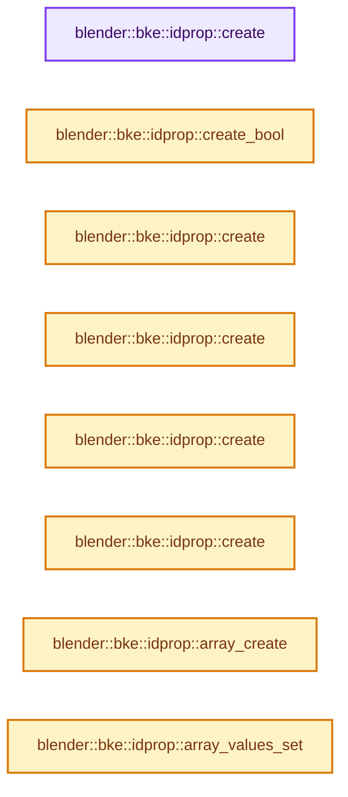
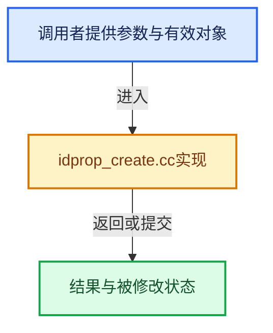

# 实现依赖专题：source/blender/blenkernel/intern/idprop_create.cc

[方向导航](README.md) · [符号索引](../%E7%AC%A6%E5%8F%B7%E4%BE%9D%E8%B5%96%E4%B8%8E%E5%AE%9E%E7%8E%B0%E7%B4%A2%E5%BC%95.md)

本专题从正文实际调用进入，集中保存共享实现。函数有稳定锚点，可从调用处直接跳到对应完整函数；递归与互相调用通过回链组织。

## 本文件的实现关系






## 完整成员与函数实现

<a id="f-9f46f3367aea5850"></a>

### `blender::bke::idprop::create`

实现位置：[source/blender/blenkernel/intern/idprop_create.cc](../../../../../source/blender/blenkernel/intern/idprop_create.cc) · L21—L29。

接口参数：

- `const StringRef prop_name`
- `int32_t value`
- `const eIDPropertyFlag flags`

**教学注释版**

<!-- annotated:b20b99c2f2a847 -->

```cpp
std::unique_ptr<IDProperty, IDPropertyDeleter> create(const StringRef prop_name,
                                                      int32_t value,
                                                      const eIDPropertyFlag flags)
{
  IDPropertyTemplate prop_template{0};
  prop_template.i = value;
  IDProperty *property = IDP_New(IDP_INT, &prop_template, prop_name, flags);
  return std::unique_ptr<IDProperty, IDPropertyDeleter>(property);
}
```

<details>
<summary>核对原始源码：source/blender/blenkernel/intern/idprop_create.cc · L21—L29</summary>

<!-- original:b20b99c2f2a847:source/blender/blenkernel/intern/idprop_create.cc:21:29 -->

```cpp
std::unique_ptr<IDProperty, IDPropertyDeleter> create(const StringRef prop_name,
                                                      int32_t value,
                                                      const eIDPropertyFlag flags)
{
  IDPropertyTemplate prop_template{0};
  prop_template.i = value;
  IDProperty *property = IDP_New(IDP_INT, &prop_template, prop_name, flags);
  return std::unique_ptr<IDProperty, IDPropertyDeleter>(property);
}
```

</details>

**沿实际写入检查状态**

- `prop_template.i = value;`

**结果出口**

- `return std::unique_ptr<IDProperty, IDPropertyDeleter>(property);`

**继续追踪实现**

- `IDP_New` → [blender::IDP_New · L1132](%E4%BE%9D%E8%B5%96-idprop-006c65.md#f-35f53ac9a036da49)。
- `std::unique_ptr<IDProperty, IDPropertyDeleter>` → [外部契约](https://eel.is/c++draft/)：这个边界按实际表达式及所属类型核对参数、返回值、寿命与失败行为。这里提供接口入口，不声称已解释该第三方版本的内部实现。

<a id="f-c50fa18bbe795d35"></a>

### `blender::bke::idprop::create_bool`

实现位置：[source/blender/blenkernel/intern/idprop_create.cc](../../../../../source/blender/blenkernel/intern/idprop_create.cc) · L31—L39。

接口参数：

- `const StringRef prop_name`
- `bool value`
- `const eIDPropertyFlag flags`

**教学注释版**

<!-- annotated:267ca317dcf07d -->

```cpp
std::unique_ptr<IDProperty, IDPropertyDeleter> create_bool(const StringRef prop_name,
                                                           bool value,
                                                           const eIDPropertyFlag flags)
{
  IDPropertyTemplate prop_template{0};
  prop_template.i = value;
  IDProperty *property = IDP_New(IDP_BOOLEAN, &prop_template, prop_name, flags);
  return std::unique_ptr<IDProperty, IDPropertyDeleter>(property);
}
```

<details>
<summary>核对原始源码：source/blender/blenkernel/intern/idprop_create.cc · L31—L39</summary>

<!-- original:267ca317dcf07d:source/blender/blenkernel/intern/idprop_create.cc:31:39 -->

```cpp
std::unique_ptr<IDProperty, IDPropertyDeleter> create_bool(const StringRef prop_name,
                                                           bool value,
                                                           const eIDPropertyFlag flags)
{
  IDPropertyTemplate prop_template{0};
  prop_template.i = value;
  IDProperty *property = IDP_New(IDP_BOOLEAN, &prop_template, prop_name, flags);
  return std::unique_ptr<IDProperty, IDPropertyDeleter>(property);
}
```

</details>

**沿实际写入检查状态**

- `prop_template.i = value;`

**结果出口**

- `return std::unique_ptr<IDProperty, IDPropertyDeleter>(property);`

**继续追踪实现**

- `IDP_New` → [blender::IDP_New · L1132](%E4%BE%9D%E8%B5%96-idprop-006c65.md#f-35f53ac9a036da49)。
- `std::unique_ptr<IDProperty, IDPropertyDeleter>` → [外部契约](https://eel.is/c++draft/)：这个边界按实际表达式及所属类型核对参数、返回值、寿命与失败行为。这里提供接口入口，不声称已解释该第三方版本的内部实现。

<a id="f-fb8f0fd79ae0a7b2"></a>

### `blender::bke::idprop::create`

实现位置：[source/blender/blenkernel/intern/idprop_create.cc](../../../../../source/blender/blenkernel/intern/idprop_create.cc) · L41—L49。

接口参数：

- `const StringRef prop_name`
- `float value`
- `const eIDPropertyFlag flags`

**教学注释版**

<!-- annotated:d1fff340644bfe -->

```cpp
std::unique_ptr<IDProperty, IDPropertyDeleter> create(const StringRef prop_name,
                                                      float value,
                                                      const eIDPropertyFlag flags)
{
  IDPropertyTemplate prop_template{0};
  prop_template.f = value;
  IDProperty *property = IDP_New(IDP_FLOAT, &prop_template, prop_name, flags);
  return std::unique_ptr<IDProperty, IDPropertyDeleter>(property);
}
```

<details>
<summary>核对原始源码：source/blender/blenkernel/intern/idprop_create.cc · L41—L49</summary>

<!-- original:d1fff340644bfe:source/blender/blenkernel/intern/idprop_create.cc:41:49 -->

```cpp
std::unique_ptr<IDProperty, IDPropertyDeleter> create(const StringRef prop_name,
                                                      float value,
                                                      const eIDPropertyFlag flags)
{
  IDPropertyTemplate prop_template{0};
  prop_template.f = value;
  IDProperty *property = IDP_New(IDP_FLOAT, &prop_template, prop_name, flags);
  return std::unique_ptr<IDProperty, IDPropertyDeleter>(property);
}
```

</details>

**沿实际写入检查状态**

- `prop_template.f = value;`

**结果出口**

- `return std::unique_ptr<IDProperty, IDPropertyDeleter>(property);`

**继续追踪实现**

- `IDP_New` → [blender::IDP_New · L1132](%E4%BE%9D%E8%B5%96-idprop-006c65.md#f-35f53ac9a036da49)。
- `std::unique_ptr<IDProperty, IDPropertyDeleter>` → [外部契约](https://eel.is/c++draft/)：这个边界按实际表达式及所属类型核对参数、返回值、寿命与失败行为。这里提供接口入口，不声称已解释该第三方版本的内部实现。

<a id="f-3c724b83c1b70000"></a>

### `blender::bke::idprop::create`

实现位置：[source/blender/blenkernel/intern/idprop_create.cc](../../../../../source/blender/blenkernel/intern/idprop_create.cc) · L51—L59。

接口参数：

- `const StringRef prop_name`
- `double value`
- `const eIDPropertyFlag flags`

**教学注释版**

<!-- annotated:40caead4190f19 -->

```cpp
std::unique_ptr<IDProperty, IDPropertyDeleter> create(const StringRef prop_name,
                                                      double value,
                                                      const eIDPropertyFlag flags)
{
  IDPropertyTemplate prop_template{0};
  prop_template.d = value;
  IDProperty *property = IDP_New(IDP_DOUBLE, &prop_template, prop_name, flags);
  return std::unique_ptr<IDProperty, IDPropertyDeleter>(property);
}
```

<details>
<summary>核对原始源码：source/blender/blenkernel/intern/idprop_create.cc · L51—L59</summary>

<!-- original:40caead4190f19:source/blender/blenkernel/intern/idprop_create.cc:51:59 -->

```cpp
std::unique_ptr<IDProperty, IDPropertyDeleter> create(const StringRef prop_name,
                                                      double value,
                                                      const eIDPropertyFlag flags)
{
  IDPropertyTemplate prop_template{0};
  prop_template.d = value;
  IDProperty *property = IDP_New(IDP_DOUBLE, &prop_template, prop_name, flags);
  return std::unique_ptr<IDProperty, IDPropertyDeleter>(property);
}
```

</details>

**沿实际写入检查状态**

- `prop_template.d = value;`

**结果出口**

- `return std::unique_ptr<IDProperty, IDPropertyDeleter>(property);`

**继续追踪实现**

- `IDP_New` → [blender::IDP_New · L1132](%E4%BE%9D%E8%B5%96-idprop-006c65.md#f-35f53ac9a036da49)。
- `std::unique_ptr<IDProperty, IDPropertyDeleter>` → [外部契约](https://eel.is/c++draft/)：这个边界按实际表达式及所属类型核对参数、返回值、寿命与失败行为。这里提供接口入口，不声称已解释该第三方版本的内部实现。

<a id="f-3e8bfbe29fbc5b06"></a>

### `blender::bke::idprop::create`

实现位置：[source/blender/blenkernel/intern/idprop_create.cc](../../../../../source/blender/blenkernel/intern/idprop_create.cc) · L61—L67。

接口参数：

- `const StringRef prop_name`
- `const StringRefNull value`
- `const eIDPropertyFlag flags`

**教学注释版**

<!-- annotated:eb15a793a42411 -->

```cpp
std::unique_ptr<IDProperty, IDPropertyDeleter> create(const StringRef prop_name,
                                                      const StringRefNull value,
                                                      const eIDPropertyFlag flags)
{
  IDProperty *property = IDP_NewString(value.c_str(), prop_name, flags);
  return std::unique_ptr<IDProperty, IDPropertyDeleter>(property);
}
```

<details>
<summary>核对原始源码：source/blender/blenkernel/intern/idprop_create.cc · L61—L67</summary>

<!-- original:eb15a793a42411:source/blender/blenkernel/intern/idprop_create.cc:61:67 -->

```cpp
std::unique_ptr<IDProperty, IDPropertyDeleter> create(const StringRef prop_name,
                                                      const StringRefNull value,
                                                      const eIDPropertyFlag flags)
{
  IDProperty *property = IDP_NewString(value.c_str(), prop_name, flags);
  return std::unique_ptr<IDProperty, IDPropertyDeleter>(property);
}
```

</details>

**结果出口**

- `return std::unique_ptr<IDProperty, IDPropertyDeleter>(property);`

**继续追踪实现**

- `IDP_NewString` → [blender::IDP_NewString · L443](%E4%BE%9D%E8%B5%96-idprop-006c65.md#f-39d540bc70a11639)；[blender::IDP_NewString · L448](%E4%BE%9D%E8%B5%96-idprop-006c65.md#f-66ec11be955d7f68)。同名重载需按实参类型选择。
- `value.c_str` → [blender::StringRefNull::c_str · L544](../01-%E5%9F%BA%E7%A1%80%E5%AE%B9%E5%99%A8%E4%B8%8E%E7%8E%B0%E4%BB%A3CPP/15-StringRef%E5%AD%97%E7%AC%A6%E4%B8%B2%E8%A7%86%E5%9B%BE.md#f-4a8bbfe1e6d00757)。
- `std::unique_ptr<IDProperty, IDPropertyDeleter>` → [外部契约](https://eel.is/c++draft/)：这个边界按实际表达式及所属类型核对参数、返回值、寿命与失败行为。这里提供接口入口，不声称已解释该第三方版本的内部实现。

<a id="f-da73ef629d404b53"></a>

### `blender::bke::idprop::create`

实现位置：[source/blender/blenkernel/intern/idprop_create.cc](../../../../../source/blender/blenkernel/intern/idprop_create.cc) · L69—L80。

接口参数：

- `const StringRef prop_name`
- `ID *value`
- `const eIDPropertyFlag flags`

**教学注释版**

<!-- annotated:7b9d2c242ab308 -->

```cpp
std::unique_ptr<IDProperty, IDPropertyDeleter> create(const StringRef prop_name,
                                                      ID *value,
                                                      const eIDPropertyFlag flags)
{
  /* Do not assign embedded IDs to IDProperties. */
  BLI_assert(!value || (value->flag & ID_FLAG_EMBEDDED_DATA) == 0);

  IDPropertyTemplate prop_template{0};
  prop_template.id = value;
  IDProperty *property = IDP_New(IDP_ID, &prop_template, prop_name, flags);
  return std::unique_ptr<IDProperty, IDPropertyDeleter>(property);
}
```

<details>
<summary>核对原始源码：source/blender/blenkernel/intern/idprop_create.cc · L69—L80</summary>

<!-- original:7b9d2c242ab308:source/blender/blenkernel/intern/idprop_create.cc:69:80 -->

```cpp
std::unique_ptr<IDProperty, IDPropertyDeleter> create(const StringRef prop_name,
                                                      ID *value,
                                                      const eIDPropertyFlag flags)
{
  /* Do not assign embedded IDs to IDProperties. */
  BLI_assert(!value || (value->flag & ID_FLAG_EMBEDDED_DATA) == 0);

  IDPropertyTemplate prop_template{0};
  prop_template.id = value;
  IDProperty *property = IDP_New(IDP_ID, &prop_template, prop_name, flags);
  return std::unique_ptr<IDProperty, IDPropertyDeleter>(property);
}
```

</details>

**沿实际写入检查状态**

- `prop_template.id = value;`

**结果出口**

- `return std::unique_ptr<IDProperty, IDPropertyDeleter>(property);`

**继续追踪实现**

- `BLI_assert` → [BLI_assert · L48](../01-%E5%9F%BA%E7%A1%80%E5%AE%B9%E5%99%A8%E4%B8%8E%E7%8E%B0%E4%BB%A3CPP/%E4%BE%9D%E8%B5%96-BLI_assert-cc98e8.md#m-57a88495704d)；[BLI_assert · L63](../01-%E5%9F%BA%E7%A1%80%E5%AE%B9%E5%99%A8%E4%B8%8E%E7%8E%B0%E4%BB%A3CPP/%E4%BE%9D%E8%B5%96-BLI_assert-cc98e8.md#m-d07050020cb5)。宏定义由构建条件选择。
- `IDP_New` → [blender::IDP_New · L1132](%E4%BE%9D%E8%B5%96-idprop-006c65.md#f-35f53ac9a036da49)。
- `std::unique_ptr<IDProperty, IDPropertyDeleter>` → [外部契约](https://eel.is/c++draft/)：这个边界按实际表达式及所属类型核对参数、返回值、寿命与失败行为。这里提供接口入口，不声称已解释该第三方版本的内部实现。

<a id="f-022eff6f313a4225"></a>

### `blender::bke::idprop::array_create`

实现位置：[source/blender/blenkernel/intern/idprop_create.cc](../../../../../source/blender/blenkernel/intern/idprop_create.cc) · L82—L92。

接口参数：

- `const StringRef prop_name`
- `eIDPropertyType subtype`
- `size_t array_len`
- `const eIDPropertyFlag flags`

**教学注释版**

<!-- annotated:3488d604e0d32b -->

```cpp
static std::unique_ptr<IDProperty, IDPropertyDeleter> array_create(const StringRef prop_name,
                                                                   eIDPropertyType subtype,
                                                                   size_t array_len,
                                                                   const eIDPropertyFlag flags)
{
  IDPropertyTemplate prop_template{0};
  prop_template.array.len = array_len;
  prop_template.array.type = subtype;
  IDProperty *property = IDP_New(IDP_ARRAY, &prop_template, prop_name, flags);
  return std::unique_ptr<IDProperty, IDPropertyDeleter>(property);
}
```

<details>
<summary>核对原始源码：source/blender/blenkernel/intern/idprop_create.cc · L82—L92</summary>

<!-- original:3488d604e0d32b:source/blender/blenkernel/intern/idprop_create.cc:82:92 -->

```cpp
static std::unique_ptr<IDProperty, IDPropertyDeleter> array_create(const StringRef prop_name,
                                                                   eIDPropertyType subtype,
                                                                   size_t array_len,
                                                                   const eIDPropertyFlag flags)
{
  IDPropertyTemplate prop_template{0};
  prop_template.array.len = array_len;
  prop_template.array.type = subtype;
  IDProperty *property = IDP_New(IDP_ARRAY, &prop_template, prop_name, flags);
  return std::unique_ptr<IDProperty, IDPropertyDeleter>(property);
}
```

</details>

**沿实际写入检查状态**

- `prop_template.array.len = array_len;`
- `prop_template.array.type = subtype;`

**结果出口**

- `return std::unique_ptr<IDProperty, IDPropertyDeleter>(property);`

**继续追踪实现**

- `IDP_New` → [blender::IDP_New · L1132](%E4%BE%9D%E8%B5%96-idprop-006c65.md#f-35f53ac9a036da49)。
- `std::unique_ptr<IDProperty, IDPropertyDeleter>` → [外部契约](https://eel.is/c++draft/)：这个边界按实际表达式及所属类型核对参数、返回值、寿命与失败行为。这里提供接口入口，不声称已解释该第三方版本的内部实现。

<a id="f-6d71758103bd6b7c"></a>

### `blender::bke::idprop::array_values_set`

实现位置：[source/blender/blenkernel/intern/idprop_create.cc](../../../../../source/blender/blenkernel/intern/idprop_create.cc) · L94—L102。

接口参数：

- `IDProperty *property`
- `const void *values`
- `size_t values_len`
- `size_t value_size`

**教学注释版**

<!-- annotated:a9411d5517e637 -->

```cpp
static void array_values_set(IDProperty *property,
                             const void *values,
                             size_t values_len,
                             size_t value_size)
{
  BLI_assert(values);
  BLI_assert(property->len == values_len);
  // [讲解] memcpy：复制字节，源与目标不应重叠。类型生命周期、对齐和可复制表示须由调用者证明，不是任意对象的复制构造。
  memcpy(IDP_array_voidp_get(property), values, values_len * value_size);
}
```

<details>
<summary>核对原始源码：source/blender/blenkernel/intern/idprop_create.cc · L94—L102</summary>

<!-- original:a9411d5517e637:source/blender/blenkernel/intern/idprop_create.cc:94:102 -->

```cpp
static void array_values_set(IDProperty *property,
                             const void *values,
                             size_t values_len,
                             size_t value_size)
{
  BLI_assert(values);
  BLI_assert(property->len == values_len);
  memcpy(IDP_array_voidp_get(property), values, values_len * value_size);
}
```

</details>

**继续追踪实现**

- `BLI_assert` → [BLI_assert · L48](../01-%E5%9F%BA%E7%A1%80%E5%AE%B9%E5%99%A8%E4%B8%8E%E7%8E%B0%E4%BB%A3CPP/%E4%BE%9D%E8%B5%96-BLI_assert-cc98e8.md#m-57a88495704d)；[BLI_assert · L63](../01-%E5%9F%BA%E7%A1%80%E5%AE%B9%E5%99%A8%E4%B8%8E%E7%8E%B0%E4%BB%A3CPP/%E4%BE%9D%E8%B5%96-BLI_assert-cc98e8.md#m-d07050020cb5)。宏定义由构建条件选择。
- `memcpy` → [外部契约](https://eel.is/c++draft/cstring.syn)：复制字节，源与目标不应重叠。类型生命周期、对齐和可复制表示须由调用者证明，不是任意对象的复制构造。
- `IDP_array_voidp_get` → [IDP_array_voidp_get · L362](%E4%BE%9D%E8%B5%96-BKE_idprop-fe422c.md#m-1dad2578c511)。宏定义由构建条件选择。

<a id="f-528d9bb634dbabd9"></a>

### `blender::bke::idprop::create_array`

实现位置：[source/blender/blenkernel/intern/idprop_create.cc](../../../../../source/blender/blenkernel/intern/idprop_create.cc) · L107—L132。

接口参数：

- `StringRef prop_name`
- `Span<PrimitiveType> values`
- `const eIDPropertyFlag flags`

**教学注释版**

<!-- annotated:1e6ebe8db18898 -->

```cpp
template<
    /** C-Primitive type of the array. Can be int32_t, float, double. */
    typename PrimitiveType,
    /** Sub-type of the #ID_ARRAY. Must match #PrimitiveType. */
    eIDPropertyType id_property_subtype>
std::unique_ptr<IDProperty, IDPropertyDeleter> create_array(StringRef prop_name,
                                                            Span<PrimitiveType> values,
                                                            const eIDPropertyFlag flags)
{
  static_assert(is_same_any_v<PrimitiveType, int32_t, float, double>,
                "Allowed values for PrimitiveType are int32_t, float and double.");
  static_assert(!std::is_same_v<PrimitiveType, int32_t> || id_property_subtype == IDP_INT,
                "PrimitiveType and id_property_type do not match (int32_t).");
  static_assert(!std::is_same_v<PrimitiveType, float> || id_property_subtype == IDP_FLOAT,
                "PrimitiveType and id_property_type do not match (float).");
  static_assert(!std::is_same_v<PrimitiveType, double> || id_property_subtype == IDP_DOUBLE,
                "PrimitiveType and id_property_type do not match (double).");

  // [讲解] values.size：查询视图长度或生成对应有效索引区间。
  const int64_t values_len = values.size();
  BLI_assert(values_len > 0);
  std::unique_ptr<IDProperty, IDPropertyDeleter> property = array_create(
      prop_name, id_property_subtype, values_len, flags);
  array_values_set(
      // [讲解] values.data：返回借用范围的地址。
      property.get(), static_cast<const void *>(values.data()), values_len, sizeof(PrimitiveType));
  return property;
}
```

<details>
<summary>核对原始源码：source/blender/blenkernel/intern/idprop_create.cc · L107—L132</summary>

<!-- original:1e6ebe8db18898:source/blender/blenkernel/intern/idprop_create.cc:107:132 -->

```cpp
template<
    /** C-Primitive type of the array. Can be int32_t, float, double. */
    typename PrimitiveType,
    /** Sub-type of the #ID_ARRAY. Must match #PrimitiveType. */
    eIDPropertyType id_property_subtype>
std::unique_ptr<IDProperty, IDPropertyDeleter> create_array(StringRef prop_name,
                                                            Span<PrimitiveType> values,
                                                            const eIDPropertyFlag flags)
{
  static_assert(is_same_any_v<PrimitiveType, int32_t, float, double>,
                "Allowed values for PrimitiveType are int32_t, float and double.");
  static_assert(!std::is_same_v<PrimitiveType, int32_t> || id_property_subtype == IDP_INT,
                "PrimitiveType and id_property_type do not match (int32_t).");
  static_assert(!std::is_same_v<PrimitiveType, float> || id_property_subtype == IDP_FLOAT,
                "PrimitiveType and id_property_type do not match (float).");
  static_assert(!std::is_same_v<PrimitiveType, double> || id_property_subtype == IDP_DOUBLE,
                "PrimitiveType and id_property_type do not match (double).");

  const int64_t values_len = values.size();
  BLI_assert(values_len > 0);
  std::unique_ptr<IDProperty, IDPropertyDeleter> property = array_create(
      prop_name, id_property_subtype, values_len, flags);
  array_values_set(
      property.get(), static_cast<const void *>(values.data()), values_len, sizeof(PrimitiveType));
  return property;
}
```

</details>

**结果出口**

- `return property;`

**继续追踪实现**

- `values.size` → [blender::Span::size · L256](../01-%E5%9F%BA%E7%A1%80%E5%AE%B9%E5%99%A8%E4%B8%8E%E7%8E%B0%E4%BB%A3CPP/05-Span%E5%8F%AA%E8%AF%BB%E8%BF%9E%E7%BB%AD%E8%A7%86%E5%9B%BE.md#f-5f80fa006089c998)。
- `BLI_assert` → [BLI_assert · L48](../01-%E5%9F%BA%E7%A1%80%E5%AE%B9%E5%99%A8%E4%B8%8E%E7%8E%B0%E4%BB%A3CPP/%E4%BE%9D%E8%B5%96-BLI_assert-cc98e8.md#m-57a88495704d)；[BLI_assert · L63](../01-%E5%9F%BA%E7%A1%80%E5%AE%B9%E5%99%A8%E4%B8%8E%E7%8E%B0%E4%BB%A3CPP/%E4%BE%9D%E8%B5%96-BLI_assert-cc98e8.md#m-d07050020cb5)。宏定义由构建条件选择。
- `array_create` → [blender::bke::idprop::array_create · L82](%E4%BE%9D%E8%B5%96-idprop_create-f89f51.md#f-022eff6f313a4225)。
- `array_values_set` → [blender::bke::idprop::array_values_set · L94](%E4%BE%9D%E8%B5%96-idprop_create-f89f51.md#f-6d71758103bd6b7c)。
- `property.get` → [外部契约](https://eel.is/c++draft/)：这个边界按实际表达式及所属类型核对参数、返回值、寿命与失败行为。这里提供接口入口，不声称已解释该第三方版本的内部实现。
- `values.data` → [blender::Span::data · L219](../01-%E5%9F%BA%E7%A1%80%E5%AE%B9%E5%99%A8%E4%B8%8E%E7%8E%B0%E4%BB%A3CPP/05-Span%E5%8F%AA%E8%AF%BB%E8%BF%9E%E7%BB%AD%E8%A7%86%E5%9B%BE.md#f-10c5889198935800)。

<a id="f-db9e605ad4939d5d"></a>

### `blender::bke::idprop::create`

实现位置：[source/blender/blenkernel/intern/idprop_create.cc](../../../../../source/blender/blenkernel/intern/idprop_create.cc) · L134—L139。

接口参数：

- `const StringRef prop_name`
- `Span<int32_t> values`
- `const eIDPropertyFlag flags`

**教学注释版**

<!-- annotated:ce37b2a05218b0 -->

```cpp
std::unique_ptr<IDProperty, IDPropertyDeleter> create(const StringRef prop_name,
                                                      Span<int32_t> values,
                                                      const eIDPropertyFlag flags)
{
  return create_array<int32_t, IDP_INT>(prop_name, values, flags);
}
```

<details>
<summary>核对原始源码：source/blender/blenkernel/intern/idprop_create.cc · L134—L139</summary>

<!-- original:ce37b2a05218b0:source/blender/blenkernel/intern/idprop_create.cc:134:139 -->

```cpp
std::unique_ptr<IDProperty, IDPropertyDeleter> create(const StringRef prop_name,
                                                      Span<int32_t> values,
                                                      const eIDPropertyFlag flags)
{
  return create_array<int32_t, IDP_INT>(prop_name, values, flags);
}
```

</details>

**结果出口**

- `return create_array<int32_t, IDP_INT>(prop_name, values, flags);`

**继续追踪实现**

- `create_array<int32_t, IDP_INT>` → [blender::bke::idprop::create_array · L107](%E4%BE%9D%E8%B5%96-idprop_create-f89f51.md#f-528d9bb634dbabd9)。

<a id="f-1198c99845e5eb1f"></a>

### `blender::bke::idprop::create`

实现位置：[source/blender/blenkernel/intern/idprop_create.cc](../../../../../source/blender/blenkernel/intern/idprop_create.cc) · L141—L146。

接口参数：

- `const StringRef prop_name`
- `Span<float> values`
- `const eIDPropertyFlag flags`

**教学注释版**

<!-- annotated:e2f62b4db0dec3 -->

```cpp
std::unique_ptr<IDProperty, IDPropertyDeleter> create(const StringRef prop_name,
                                                      Span<float> values,
                                                      const eIDPropertyFlag flags)
{
  return create_array<float, IDP_FLOAT>(prop_name, values, flags);
}
```

<details>
<summary>核对原始源码：source/blender/blenkernel/intern/idprop_create.cc · L141—L146</summary>

<!-- original:e2f62b4db0dec3:source/blender/blenkernel/intern/idprop_create.cc:141:146 -->

```cpp
std::unique_ptr<IDProperty, IDPropertyDeleter> create(const StringRef prop_name,
                                                      Span<float> values,
                                                      const eIDPropertyFlag flags)
{
  return create_array<float, IDP_FLOAT>(prop_name, values, flags);
}
```

</details>

**结果出口**

- `return create_array<float, IDP_FLOAT>(prop_name, values, flags);`

**继续追踪实现**

- `create_array<float, IDP_FLOAT>` → [blender::bke::idprop::create_array · L107](%E4%BE%9D%E8%B5%96-idprop_create-f89f51.md#f-528d9bb634dbabd9)。

<a id="f-d9cb1affee65ed50"></a>

### `blender::bke::idprop::create`

实现位置：[source/blender/blenkernel/intern/idprop_create.cc](../../../../../source/blender/blenkernel/intern/idprop_create.cc) · L148—L153。

接口参数：

- `const StringRef prop_name`
- `Span<double> values`
- `const eIDPropertyFlag flags`

**教学注释版**

<!-- annotated:8b83bd92baccf3 -->

```cpp
std::unique_ptr<IDProperty, IDPropertyDeleter> create(const StringRef prop_name,
                                                      Span<double> values,
                                                      const eIDPropertyFlag flags)
{
  return create_array<double, IDP_DOUBLE>(prop_name, values, flags);
}
```

<details>
<summary>核对原始源码：source/blender/blenkernel/intern/idprop_create.cc · L148—L153</summary>

<!-- original:8b83bd92baccf3:source/blender/blenkernel/intern/idprop_create.cc:148:153 -->

```cpp
std::unique_ptr<IDProperty, IDPropertyDeleter> create(const StringRef prop_name,
                                                      Span<double> values,
                                                      const eIDPropertyFlag flags)
{
  return create_array<double, IDP_DOUBLE>(prop_name, values, flags);
}
```

</details>

**结果出口**

- `return create_array<double, IDP_DOUBLE>(prop_name, values, flags);`

**继续追踪实现**

- `create_array<double, IDP_DOUBLE>` → [blender::bke::idprop::create_array · L107](%E4%BE%9D%E8%B5%96-idprop_create-f89f51.md#f-528d9bb634dbabd9)。

<a id="f-b1e2d8bfd5654bc2"></a>

### `blender::bke::idprop::create_group`

实现位置：[source/blender/blenkernel/intern/idprop_create.cc](../../../../../source/blender/blenkernel/intern/idprop_create.cc) · L155—L161。

接口参数：

- `const StringRef prop_name`
- `const eIDPropertyFlag flags`

**教学注释版**

<!-- annotated:ebeb1f8223804e -->

```cpp
std::unique_ptr<IDProperty, IDPropertyDeleter> create_group(const StringRef prop_name,
                                                            const eIDPropertyFlag flags)
{
  IDPropertyTemplate prop_template{0};
  IDProperty *property = IDP_New(IDP_GROUP, &prop_template, prop_name, flags);
  return std::unique_ptr<IDProperty, IDPropertyDeleter>(property);
}
```

<details>
<summary>核对原始源码：source/blender/blenkernel/intern/idprop_create.cc · L155—L161</summary>

<!-- original:ebeb1f8223804e:source/blender/blenkernel/intern/idprop_create.cc:155:161 -->

```cpp
std::unique_ptr<IDProperty, IDPropertyDeleter> create_group(const StringRef prop_name,
                                                            const eIDPropertyFlag flags)
{
  IDPropertyTemplate prop_template{0};
  IDProperty *property = IDP_New(IDP_GROUP, &prop_template, prop_name, flags);
  return std::unique_ptr<IDProperty, IDPropertyDeleter>(property);
}
```

</details>

**结果出口**

- `return std::unique_ptr<IDProperty, IDPropertyDeleter>(property);`

**继续追踪实现**

- `IDP_New` → [blender::IDP_New · L1132](%E4%BE%9D%E8%B5%96-idprop-006c65.md#f-35f53ac9a036da49)。
- `std::unique_ptr<IDProperty, IDPropertyDeleter>` → [外部契约](https://eel.is/c++draft/)：这个边界按实际表达式及所属类型核对参数、返回值、寿命与失败行为。这里提供接口入口，不声称已解释该第三方版本的内部实现。
