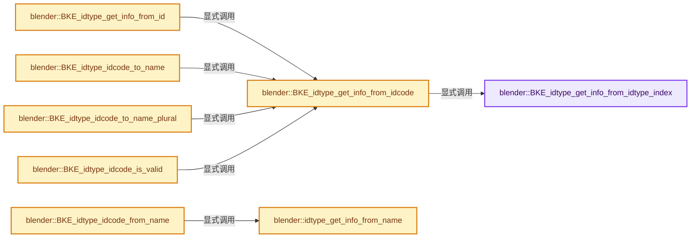
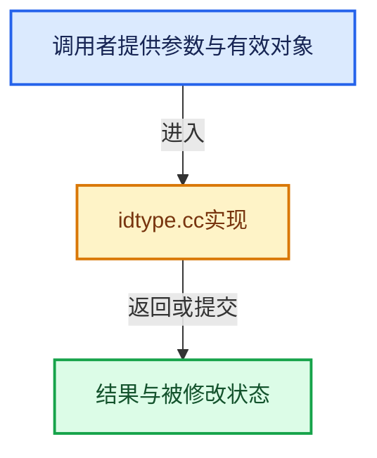

# 实现依赖专题：source/blender/blenkernel/intern/idtype.cc

[方向导航](README.md) · [符号索引](../%E7%AC%A6%E5%8F%B7%E4%BE%9D%E8%B5%96%E4%B8%8E%E5%AE%9E%E7%8E%B0%E7%B4%A2%E5%BC%95.md)

本专题从正文实际调用进入，集中保存共享实现。函数有稳定锚点，可从调用处直接跳到对应完整函数；递归与互相调用通过回链组织。

## 本文件的实现关系






## 完整成员与函数实现

<a id="f-2a965bf37682e9c9"></a>

### `blender::BKE_idtype_get_info_from_idtype_index`

实现位置：[source/blender/blenkernel/intern/idtype.cc](../../../../../source/blender/blenkernel/intern/idtype.cc) · L213—L225。

接口参数：

- `const int idtype_index`

**教学注释版**

<!-- annotated:d286987ea7d61d -->

```cpp
const IDTypeInfo *BKE_idtype_get_info_from_idtype_index(const int idtype_index)
{
  if (idtype_index >= 0 && idtype_index < int(id_types.size())) {
    const IDTypeInfo *id_type = id_types[size_t(idtype_index)];
    if (id_type && id_type->name[0] != '\0') {
      BLI_assert_msg(BKE_idtype_idcode_to_index(id_type->id_code) == idtype_index,
                     "Critical inconsistency in ID type information");
      return id_type;
    }
  }

  return nullptr;
}
```

<details>
<summary>核对原始源码：source/blender/blenkernel/intern/idtype.cc · L213—L225</summary>

<!-- original:d286987ea7d61d:source/blender/blenkernel/intern/idtype.cc:213:225 -->

```cpp
const IDTypeInfo *BKE_idtype_get_info_from_idtype_index(const int idtype_index)
{
  if (idtype_index >= 0 && idtype_index < int(id_types.size())) {
    const IDTypeInfo *id_type = id_types[size_t(idtype_index)];
    if (id_type && id_type->name[0] != '\0') {
      BLI_assert_msg(BKE_idtype_idcode_to_index(id_type->id_code) == idtype_index,
                     "Critical inconsistency in ID type information");
      return id_type;
    }
  }

  return nullptr;
}
```

</details>

**结果出口**

- `return id_type;`
- `return nullptr;`

**继续追踪实现**

- `id_types.size` → [调用协议](../%E6%A8%A1%E6%9D%BF%E5%AE%8F%E4%B8%8E%E5%8A%A8%E6%80%81%E5%88%86%E6%B4%BE%E5%8D%8F%E8%AE%AE.md)：接收对象类型依赖auto、返回值或模板实例；不按同名猜测目标。调用位置L215。
- `BLI_assert_msg` → [BLI_assert_msg · L55](../01-%E5%9F%BA%E7%A1%80%E5%AE%B9%E5%99%A8%E4%B8%8E%E7%8E%B0%E4%BB%A3CPP/%E4%BE%9D%E8%B5%96-BLI_assert-cc98e8.md#m-695eed20dceb)；[BLI_assert_msg · L64](../01-%E5%9F%BA%E7%A1%80%E5%AE%B9%E5%99%A8%E4%B8%8E%E7%8E%B0%E4%BB%A3CPP/%E4%BE%9D%E8%B5%96-BLI_assert-cc98e8.md#m-7de5563de4db)。宏定义由构建条件选择。
- `BKE_idtype_idcode_to_index` → [blender::BKE_idtype_idcode_to_index · L338](%E4%BE%9D%E8%B5%96-idtype-cbba99.md#f-ec4756d10e8e5ef0)。

<a id="f-3cf440a8f8dbe459"></a>

### `blender::BKE_idtype_get_info_from_idcode`

实现位置：[source/blender/blenkernel/intern/idtype.cc](../../../../../source/blender/blenkernel/intern/idtype.cc) · L227—L230。

接口参数：

- `const short id_code`

**教学注释版**

<!-- annotated:46f3f53052df5e -->

```cpp
const IDTypeInfo *BKE_idtype_get_info_from_idcode(const short id_code)
{
  return BKE_idtype_get_info_from_idtype_index(BKE_idtype_idcode_to_index(id_code));
}
```

<details>
<summary>核对原始源码：source/blender/blenkernel/intern/idtype.cc · L227—L230</summary>

<!-- original:46f3f53052df5e:source/blender/blenkernel/intern/idtype.cc:227:230 -->

```cpp
const IDTypeInfo *BKE_idtype_get_info_from_idcode(const short id_code)
{
  return BKE_idtype_get_info_from_idtype_index(BKE_idtype_idcode_to_index(id_code));
}
```

</details>

**结果出口**

- `return BKE_idtype_get_info_from_idtype_index(BKE_idtype_idcode_to_index(id_code));`

**继续追踪实现**

- `BKE_idtype_get_info_from_idtype_index` → [blender::BKE_idtype_get_info_from_idtype_index · L213](%E4%BE%9D%E8%B5%96-idtype-cbba99.md#f-2a965bf37682e9c9)。
- `BKE_idtype_idcode_to_index` → [blender::BKE_idtype_idcode_to_index · L338](%E4%BE%9D%E8%B5%96-idtype-cbba99.md#f-ec4756d10e8e5ef0)。

<a id="f-9b31985f4ea4750d"></a>

### `blender::BKE_idtype_get_info_from_id`

实现位置：[source/blender/blenkernel/intern/idtype.cc](../../../../../source/blender/blenkernel/intern/idtype.cc) · L232—L235。

接口参数：

- `const ID *id`

**教学注释版**

<!-- annotated:bedb161b847a53 -->

```cpp
const IDTypeInfo *BKE_idtype_get_info_from_id(const ID *id)
{
  return BKE_idtype_get_info_from_idcode(GS(id->name));
}
```

<details>
<summary>核对原始源码：source/blender/blenkernel/intern/idtype.cc · L232—L235</summary>

<!-- original:bedb161b847a53:source/blender/blenkernel/intern/idtype.cc:232:235 -->

```cpp
const IDTypeInfo *BKE_idtype_get_info_from_id(const ID *id)
{
  return BKE_idtype_get_info_from_idcode(GS(id->name));
}
```

</details>

**结果出口**

- `return BKE_idtype_get_info_from_idcode(GS(id->name));`

**继续追踪实现**

- `BKE_idtype_get_info_from_idcode` → [blender::BKE_idtype_get_info_from_idcode · L227](%E4%BE%9D%E8%B5%96-idtype-cbba99.md#f-3cf440a8f8dbe459)。
- `GS` → [blender::GS · L410](%E4%BE%9D%E8%B5%96-DNA_ID-3eb091.md#f-c3ff509f79f21b05)。

<a id="f-c26058ff6acb95d4"></a>

### `blender::idtype_get_info_from_name`

实现位置：[source/blender/blenkernel/intern/idtype.cc](../../../../../source/blender/blenkernel/intern/idtype.cc) · L237—L246。

接口参数：

- `const char *idtype_name`

**教学注释版**

<!-- annotated:ab93162b94bbfe -->

```cpp
static const IDTypeInfo *idtype_get_info_from_name(const char *idtype_name)
{
  for (const IDTypeInfo *id_type : id_types) {
    if (id_type && STREQ(idtype_name, id_type->name)) {
      return id_type;
    }
  }

  return nullptr;
}
```

<details>
<summary>核对原始源码：source/blender/blenkernel/intern/idtype.cc · L237—L246</summary>

<!-- original:ab93162b94bbfe:source/blender/blenkernel/intern/idtype.cc:237:246 -->

```cpp
static const IDTypeInfo *idtype_get_info_from_name(const char *idtype_name)
{
  for (const IDTypeInfo *id_type : id_types) {
    if (id_type && STREQ(idtype_name, id_type->name)) {
      return id_type;
    }
  }

  return nullptr;
}
```

</details>

**结果出口**

- `return id_type;`
- `return nullptr;`

**继续追踪实现**

- `STREQ` → [STREQ · L112](%E4%BE%9D%E8%B5%96-GHOST_utildefines-34b996.md#m-9549fb6aafd2)；[STREQ · L451](../01-%E5%9F%BA%E7%A1%80%E5%AE%B9%E5%99%A8%E4%B8%8E%E7%8E%B0%E4%BB%A3CPP/%E4%BE%9D%E8%B5%96-BLI_utildefines-293a0a.md#m-c7b745bcfad2)；[STREQ · L55](%E4%BE%9D%E8%B5%96-clog-a0bec8.md#m-96e78f386894)。宏定义由构建条件选择。

<a id="f-282fc9db6d5f0eb2"></a>

### `blender::BKE_idtype_idcode_to_name`

实现位置：[source/blender/blenkernel/intern/idtype.cc](../../../../../source/blender/blenkernel/intern/idtype.cc) · L261—L266。

接口参数：

- `const short idcode`

**教学注释版**

<!-- annotated:10e52a5d2df136 -->

```cpp
const char *BKE_idtype_idcode_to_name(const short idcode)
{
  const IDTypeInfo *id_type = BKE_idtype_get_info_from_idcode(idcode);
  BLI_assert(id_type != nullptr);
  return id_type != nullptr ? id_type->name : nullptr;
}
```

<details>
<summary>核对原始源码：source/blender/blenkernel/intern/idtype.cc · L261—L266</summary>

<!-- original:10e52a5d2df136:source/blender/blenkernel/intern/idtype.cc:261:266 -->

```cpp
const char *BKE_idtype_idcode_to_name(const short idcode)
{
  const IDTypeInfo *id_type = BKE_idtype_get_info_from_idcode(idcode);
  BLI_assert(id_type != nullptr);
  return id_type != nullptr ? id_type->name : nullptr;
}
```

</details>

**结果出口**

- `return id_type != nullptr ? id_type->name : nullptr;`

**继续追踪实现**

- `BKE_idtype_get_info_from_idcode` → [blender::BKE_idtype_get_info_from_idcode · L227](%E4%BE%9D%E8%B5%96-idtype-cbba99.md#f-3cf440a8f8dbe459)。
- `BLI_assert` → [BLI_assert · L48](../01-%E5%9F%BA%E7%A1%80%E5%AE%B9%E5%99%A8%E4%B8%8E%E7%8E%B0%E4%BB%A3CPP/%E4%BE%9D%E8%B5%96-BLI_assert-cc98e8.md#m-57a88495704d)；[BLI_assert · L63](../01-%E5%9F%BA%E7%A1%80%E5%AE%B9%E5%99%A8%E4%B8%8E%E7%8E%B0%E4%BB%A3CPP/%E4%BE%9D%E8%B5%96-BLI_assert-cc98e8.md#m-d07050020cb5)。宏定义由构建条件选择。

<a id="f-52880b295f558cdc"></a>

### `blender::BKE_idtype_idcode_to_name_plural`

实现位置：[source/blender/blenkernel/intern/idtype.cc](../../../../../source/blender/blenkernel/intern/idtype.cc) · L268—L273。

接口参数：

- `const short idcode`

**教学注释版**

<!-- annotated:33e54437986882 -->

```cpp
const char *BKE_idtype_idcode_to_name_plural(const short idcode)
{
  const IDTypeInfo *id_type = BKE_idtype_get_info_from_idcode(idcode);
  BLI_assert(id_type != nullptr);
  return id_type != nullptr ? id_type->name_plural : nullptr;
}
```

<details>
<summary>核对原始源码：source/blender/blenkernel/intern/idtype.cc · L268—L273</summary>

<!-- original:33e54437986882:source/blender/blenkernel/intern/idtype.cc:268:273 -->

```cpp
const char *BKE_idtype_idcode_to_name_plural(const short idcode)
{
  const IDTypeInfo *id_type = BKE_idtype_get_info_from_idcode(idcode);
  BLI_assert(id_type != nullptr);
  return id_type != nullptr ? id_type->name_plural : nullptr;
}
```

</details>

**结果出口**

- `return id_type != nullptr ? id_type->name_plural : nullptr;`

**继续追踪实现**

- `BKE_idtype_get_info_from_idcode` → [blender::BKE_idtype_get_info_from_idcode · L227](%E4%BE%9D%E8%B5%96-idtype-cbba99.md#f-3cf440a8f8dbe459)。
- `BLI_assert` → [BLI_assert · L48](../01-%E5%9F%BA%E7%A1%80%E5%AE%B9%E5%99%A8%E4%B8%8E%E7%8E%B0%E4%BB%A3CPP/%E4%BE%9D%E8%B5%96-BLI_assert-cc98e8.md#m-57a88495704d)；[BLI_assert · L63](../01-%E5%9F%BA%E7%A1%80%E5%AE%B9%E5%99%A8%E4%B8%8E%E7%8E%B0%E4%BB%A3CPP/%E4%BE%9D%E8%B5%96-BLI_assert-cc98e8.md#m-d07050020cb5)。宏定义由构建条件选择。

<a id="f-d24bc65992c49d98"></a>

### `blender::BKE_idtype_idcode_from_name`

实现位置：[source/blender/blenkernel/intern/idtype.cc](../../../../../source/blender/blenkernel/intern/idtype.cc) · L282—L287。

接口参数：

- `const char *idtype_name`

**教学注释版**

<!-- annotated:95047e7309fd2b -->

```cpp
short BKE_idtype_idcode_from_name(const char *idtype_name)
{
  const IDTypeInfo *id_type = idtype_get_info_from_name(idtype_name);
  BLI_assert(id_type);
  return id_type != nullptr ? id_type->id_code : 0;
}
```

<details>
<summary>核对原始源码：source/blender/blenkernel/intern/idtype.cc · L282—L287</summary>

<!-- original:95047e7309fd2b:source/blender/blenkernel/intern/idtype.cc:282:287 -->

```cpp
short BKE_idtype_idcode_from_name(const char *idtype_name)
{
  const IDTypeInfo *id_type = idtype_get_info_from_name(idtype_name);
  BLI_assert(id_type);
  return id_type != nullptr ? id_type->id_code : 0;
}
```

</details>

**结果出口**

- `return id_type != nullptr ? id_type->id_code : 0;`

**继续追踪实现**

- `idtype_get_info_from_name` → [blender::idtype_get_info_from_name · L237](%E4%BE%9D%E8%B5%96-idtype-cbba99.md#f-c26058ff6acb95d4)。
- `BLI_assert` → [BLI_assert · L48](../01-%E5%9F%BA%E7%A1%80%E5%AE%B9%E5%99%A8%E4%B8%8E%E7%8E%B0%E4%BB%A3CPP/%E4%BE%9D%E8%B5%96-BLI_assert-cc98e8.md#m-57a88495704d)；[BLI_assert · L63](../01-%E5%9F%BA%E7%A1%80%E5%AE%B9%E5%99%A8%E4%B8%8E%E7%8E%B0%E4%BB%A3CPP/%E4%BE%9D%E8%B5%96-BLI_assert-cc98e8.md#m-d07050020cb5)。宏定义由构建条件选择。

<a id="f-fa266119018a266a"></a>

### `blender::BKE_idtype_idcode_is_valid`

实现位置：[source/blender/blenkernel/intern/idtype.cc](../../../../../source/blender/blenkernel/intern/idtype.cc) · L302—L305。

接口参数：

- `const short idcode`

**教学注释版**

<!-- annotated:e992a2cb03f3bd -->

```cpp
bool BKE_idtype_idcode_is_valid(const short idcode)
{
  return BKE_idtype_get_info_from_idcode(idcode) != nullptr ? true : false;
}
```

<details>
<summary>核对原始源码：source/blender/blenkernel/intern/idtype.cc · L302—L305</summary>

<!-- original:e992a2cb03f3bd:source/blender/blenkernel/intern/idtype.cc:302:305 -->

```cpp
bool BKE_idtype_idcode_is_valid(const short idcode)
{
  return BKE_idtype_get_info_from_idcode(idcode) != nullptr ? true : false;
}
```

</details>

**结果出口**

- `return BKE_idtype_get_info_from_idcode(idcode) != nullptr ? true : false;`

**继续追踪实现**

- `BKE_idtype_get_info_from_idcode` → [blender::BKE_idtype_get_info_from_idcode · L227](%E4%BE%9D%E8%B5%96-idtype-cbba99.md#f-3cf440a8f8dbe459)。

<a id="f-1e2659e8f278ceeb"></a>

### `blender::BKE_idtype_idcode_is_linkable`

实现位置：[source/blender/blenkernel/intern/idtype.cc](../../../../../source/blender/blenkernel/intern/idtype.cc) · L307—L312。

接口参数：

- `const short idcode`

**教学注释版**

<!-- annotated:eb35e599b7349e -->

```cpp
bool BKE_idtype_idcode_is_linkable(const short idcode)
{
  const IDTypeInfo *id_type = BKE_idtype_get_info_from_idcode(idcode);
  BLI_assert(id_type != nullptr);
  return id_type != nullptr ? (id_type->flags & IDTYPE_FLAGS_NO_LIBLINKING) == 0 : false;
}
```

<details>
<summary>核对原始源码：source/blender/blenkernel/intern/idtype.cc · L307—L312</summary>

<!-- original:eb35e599b7349e:source/blender/blenkernel/intern/idtype.cc:307:312 -->

```cpp
bool BKE_idtype_idcode_is_linkable(const short idcode)
{
  const IDTypeInfo *id_type = BKE_idtype_get_info_from_idcode(idcode);
  BLI_assert(id_type != nullptr);
  return id_type != nullptr ? (id_type->flags & IDTYPE_FLAGS_NO_LIBLINKING) == 0 : false;
}
```

</details>

**结果出口**

- `return id_type != nullptr ? (id_type->flags & IDTYPE_FLAGS_NO_LIBLINKING) == 0 : false;`

**继续追踪实现**

- `BKE_idtype_get_info_from_idcode` → [blender::BKE_idtype_get_info_from_idcode · L227](%E4%BE%9D%E8%B5%96-idtype-cbba99.md#f-3cf440a8f8dbe459)。
- `BLI_assert` → [BLI_assert · L48](../01-%E5%9F%BA%E7%A1%80%E5%AE%B9%E5%99%A8%E4%B8%8E%E7%8E%B0%E4%BB%A3CPP/%E4%BE%9D%E8%B5%96-BLI_assert-cc98e8.md#m-57a88495704d)；[BLI_assert · L63](../01-%E5%9F%BA%E7%A1%80%E5%AE%B9%E5%99%A8%E4%B8%8E%E7%8E%B0%E4%BB%A3CPP/%E4%BE%9D%E8%B5%96-BLI_assert-cc98e8.md#m-d07050020cb5)。宏定义由构建条件选择。

<a id="f-ec4756d10e8e5ef0"></a>

### `blender::BKE_idtype_idcode_to_index`

实现位置：[source/blender/blenkernel/intern/idtype.cc](../../../../../source/blender/blenkernel/intern/idtype.cc) · L338—L394。

接口参数：

- `const short idcode`

**教学注释版**

<!-- annotated:77fb64743fe316 -->

```cpp
int BKE_idtype_idcode_to_index(const short idcode)
{
#define CASE_IDINDEX(_id) \
  case ID_##_id: \
    return INDEX_ID_##_id

  switch (ID_Type(idcode)) {
    CASE_IDINDEX(AC);
    CASE_IDINDEX(AR);
    CASE_IDINDEX(BR);
    CASE_IDINDEX(CA);
    CASE_IDINDEX(CF);
    CASE_IDINDEX(CU_LEGACY);
    CASE_IDINDEX(GD_LEGACY);
    CASE_IDINDEX(GP);
    CASE_IDINDEX(GR);
    CASE_IDINDEX(CV);
    CASE_IDINDEX(IM);
    CASE_IDINDEX(KE);
    CASE_IDINDEX(LA);
    CASE_IDINDEX(LI);
    CASE_IDINDEX(LS);
    CASE_IDINDEX(LT);
    CASE_IDINDEX(MA);
    CASE_IDINDEX(MB);
    CASE_IDINDEX(MC);
    CASE_IDINDEX(ME);
    CASE_IDINDEX(MSK);
    CASE_IDINDEX(NT);
    CASE_IDINDEX(OB);
    CASE_IDINDEX(PA);
    CASE_IDINDEX(PAL);
    CASE_IDINDEX(PC);
    CASE_IDINDEX(PT);
    CASE_IDINDEX(LP);
    CASE_IDINDEX(SCE);
    CASE_IDINDEX(SCR);
    CASE_IDINDEX(SPK);
    CASE_IDINDEX(SO);
    CASE_IDINDEX(TE);
    CASE_IDINDEX(TXT);
    CASE_IDINDEX(VF);
    CASE_IDINDEX(VO);
    CASE_IDINDEX(WM);
    CASE_IDINDEX(WO);
    CASE_IDINDEX(WS);
  }

  /* Special naughty boy... */
  if (idcode == ID_LINK_PLACEHOLDER) {
    return INDEX_ID_NULL;
  }

  return -1;

#undef CASE_IDINDEX
}
```

<details>
<summary>核对原始源码：source/blender/blenkernel/intern/idtype.cc · L338—L394</summary>

<!-- original:77fb64743fe316:source/blender/blenkernel/intern/idtype.cc:338:394 -->

```cpp
int BKE_idtype_idcode_to_index(const short idcode)
{
#define CASE_IDINDEX(_id) \
  case ID_##_id: \
    return INDEX_ID_##_id

  switch (ID_Type(idcode)) {
    CASE_IDINDEX(AC);
    CASE_IDINDEX(AR);
    CASE_IDINDEX(BR);
    CASE_IDINDEX(CA);
    CASE_IDINDEX(CF);
    CASE_IDINDEX(CU_LEGACY);
    CASE_IDINDEX(GD_LEGACY);
    CASE_IDINDEX(GP);
    CASE_IDINDEX(GR);
    CASE_IDINDEX(CV);
    CASE_IDINDEX(IM);
    CASE_IDINDEX(KE);
    CASE_IDINDEX(LA);
    CASE_IDINDEX(LI);
    CASE_IDINDEX(LS);
    CASE_IDINDEX(LT);
    CASE_IDINDEX(MA);
    CASE_IDINDEX(MB);
    CASE_IDINDEX(MC);
    CASE_IDINDEX(ME);
    CASE_IDINDEX(MSK);
    CASE_IDINDEX(NT);
    CASE_IDINDEX(OB);
    CASE_IDINDEX(PA);
    CASE_IDINDEX(PAL);
    CASE_IDINDEX(PC);
    CASE_IDINDEX(PT);
    CASE_IDINDEX(LP);
    CASE_IDINDEX(SCE);
    CASE_IDINDEX(SCR);
    CASE_IDINDEX(SPK);
    CASE_IDINDEX(SO);
    CASE_IDINDEX(TE);
    CASE_IDINDEX(TXT);
    CASE_IDINDEX(VF);
    CASE_IDINDEX(VO);
    CASE_IDINDEX(WM);
    CASE_IDINDEX(WO);
    CASE_IDINDEX(WS);
  }

  /* Special naughty boy... */
  if (idcode == ID_LINK_PLACEHOLDER) {
    return INDEX_ID_NULL;
  }

  return -1;

#undef CASE_IDINDEX
}
```

</details>

**结果出口**

- `return INDEX_ID_##_id`
- `return INDEX_ID_NULL;`
- `return -1;`

**继续追踪实现**

- `ID_Type` → [blender::ID_Type](%E4%BE%9D%E8%B5%96-WM_api-91d43b.md#t-a58f1911df5c)；[blender::ID_Type](%E4%BE%9D%E8%B5%96-DNA_ID_enums-437b66.md#t-4fa202c1cee5)。
- `CASE_IDINDEX` → [调用协议](../%E6%A8%A1%E6%9D%BF%E5%AE%8F%E4%B8%8E%E5%8A%A8%E6%80%81%E5%88%86%E6%B4%BE%E5%8D%8F%E8%AE%AE.md)：函数指针、局部可调用对象或未展开的宏；必须结合调用者环境。调用位置L345。

<a id="f-5c98326dfea14c8f"></a>

### `blender::BKE_idtype_index_to_idcode`

实现位置：[source/blender/blenkernel/intern/idtype.cc](../../../../../source/blender/blenkernel/intern/idtype.cc) · L451—L460。

接口参数：

- `const int idtype_index`

**教学注释版**

<!-- annotated:a654da5d0abfca -->

```cpp
short BKE_idtype_index_to_idcode(const int idtype_index)
{
  const IDTypeInfo *id_type = BKE_idtype_get_info_from_idtype_index(idtype_index);
  if (id_type) {
    return id_type->id_code;
  }

  BLI_assert_unreachable();
  return -1;
}
```

<details>
<summary>核对原始源码：source/blender/blenkernel/intern/idtype.cc · L451—L460</summary>

<!-- original:a654da5d0abfca:source/blender/blenkernel/intern/idtype.cc:451:460 -->

```cpp
short BKE_idtype_index_to_idcode(const int idtype_index)
{
  const IDTypeInfo *id_type = BKE_idtype_get_info_from_idtype_index(idtype_index);
  if (id_type) {
    return id_type->id_code;
  }

  BLI_assert_unreachable();
  return -1;
}
```

</details>

**结果出口**

- `return id_type->id_code;`
- `return -1;`

**继续追踪实现**

- `BKE_idtype_get_info_from_idtype_index` → [blender::BKE_idtype_get_info_from_idtype_index · L213](%E4%BE%9D%E8%B5%96-idtype-cbba99.md#f-2a965bf37682e9c9)。
- `BLI_assert_unreachable` → [BLI_assert_unreachable · L77](../01-%E5%9F%BA%E7%A1%80%E5%AE%B9%E5%99%A8%E4%B8%8E%E7%8E%B0%E4%BB%A3CPP/%E4%BE%9D%E8%B5%96-BLI_assert-cc98e8.md#m-7a2d91a67d8e)。宏定义由构建条件选择。

<a id="f-d2d93d068d2ffe47"></a>

### `blender::BKE_idtype_index_to_idfilter`

实现位置：[source/blender/blenkernel/intern/idtype.cc](../../../../../source/blender/blenkernel/intern/idtype.cc) · L462—L471。

接口参数：

- `const int idtype_index`

**教学注释版**

<!-- annotated:90c769b9883f83 -->

```cpp
uint64_t BKE_idtype_index_to_idfilter(const int idtype_index)
{
  const IDTypeInfo *id_type = BKE_idtype_get_info_from_idtype_index(idtype_index);
  if (id_type) {
    return id_type->id_filter;
  }

  BLI_assert_unreachable();
  return 0;
}
```

<details>
<summary>核对原始源码：source/blender/blenkernel/intern/idtype.cc · L462—L471</summary>

<!-- original:90c769b9883f83:source/blender/blenkernel/intern/idtype.cc:462:471 -->

```cpp
uint64_t BKE_idtype_index_to_idfilter(const int idtype_index)
{
  const IDTypeInfo *id_type = BKE_idtype_get_info_from_idtype_index(idtype_index);
  if (id_type) {
    return id_type->id_filter;
  }

  BLI_assert_unreachable();
  return 0;
}
```

</details>

**结果出口**

- `return id_type->id_filter;`
- `return 0;`

**继续追踪实现**

- `BKE_idtype_get_info_from_idtype_index` → [blender::BKE_idtype_get_info_from_idtype_index · L213](%E4%BE%9D%E8%B5%96-idtype-cbba99.md#f-2a965bf37682e9c9)。
- `BLI_assert_unreachable` → [BLI_assert_unreachable · L77](../01-%E5%9F%BA%E7%A1%80%E5%AE%B9%E5%99%A8%E4%B8%8E%E7%8E%B0%E4%BB%A3CPP/%E4%BE%9D%E8%B5%96-BLI_assert-cc98e8.md#m-7a2d91a67d8e)。宏定义由构建条件选择。

<a id="f-439e1b8ea6cc89df"></a>

### `blender::BKE_idtype_idcode_to_idfilter`

实现位置：[source/blender/blenkernel/intern/idtype.cc](../../../../../source/blender/blenkernel/intern/idtype.cc) · L473—L476。

接口参数：

- `const short idcode`

**教学注释版**

<!-- annotated:93d1e33a4b4e4a -->

```cpp
uint64_t BKE_idtype_idcode_to_idfilter(const short idcode)
{
  return BKE_idtype_index_to_idfilter(BKE_idtype_idcode_to_index(idcode));
}
```

<details>
<summary>核对原始源码：source/blender/blenkernel/intern/idtype.cc · L473—L476</summary>

<!-- original:93d1e33a4b4e4a:source/blender/blenkernel/intern/idtype.cc:473:476 -->

```cpp
uint64_t BKE_idtype_idcode_to_idfilter(const short idcode)
{
  return BKE_idtype_index_to_idfilter(BKE_idtype_idcode_to_index(idcode));
}
```

</details>

**结果出口**

- `return BKE_idtype_index_to_idfilter(BKE_idtype_idcode_to_index(idcode));`

**继续追踪实现**

- `BKE_idtype_index_to_idfilter` → [blender::BKE_idtype_index_to_idfilter · L462](%E4%BE%9D%E8%B5%96-idtype-cbba99.md#f-d2d93d068d2ffe47)。
- `BKE_idtype_idcode_to_index` → [blender::BKE_idtype_idcode_to_index · L338](%E4%BE%9D%E8%B5%96-idtype-cbba99.md#f-ec4756d10e8e5ef0)。

<a id="f-6615b57797bae0c6"></a>

### `blender::BKE_idtype_idcode_iter_step`

实现位置：[source/blender/blenkernel/intern/idtype.cc](../../../../../source/blender/blenkernel/intern/idtype.cc) · L483—L487。

接口参数：

- `int *idtype_index`

**教学注释版**

<!-- annotated:92361dd49851a8 -->

```cpp
short BKE_idtype_idcode_iter_step(int *idtype_index)
{
  return (*idtype_index < int(id_types.size())) ? BKE_idtype_index_to_idcode((*idtype_index)++) :
                                                  0;
}
```

<details>
<summary>核对原始源码：source/blender/blenkernel/intern/idtype.cc · L483—L487</summary>

<!-- original:92361dd49851a8:source/blender/blenkernel/intern/idtype.cc:483:487 -->

```cpp
short BKE_idtype_idcode_iter_step(int *idtype_index)
{
  return (*idtype_index < int(id_types.size())) ? BKE_idtype_index_to_idcode((*idtype_index)++) :
                                                  0;
}
```

</details>

**结果出口**

- `return (*idtype_index < int(id_types.size())) ? BKE_idtype_index_to_idcode((*idtype_index)++) :`

**继续追踪实现**

- `id_types.size` → [调用协议](../%E6%A8%A1%E6%9D%BF%E5%AE%8F%E4%B8%8E%E5%8A%A8%E6%80%81%E5%88%86%E6%B4%BE%E5%8D%8F%E8%AE%AE.md)：接收对象类型依赖auto、返回值或模板实例；不按同名猜测目标。调用位置L485。
- `BKE_idtype_index_to_idcode` → [blender::BKE_idtype_index_to_idcode · L451](%E4%BE%9D%E8%B5%96-idtype-cbba99.md#f-5c98326dfea14c8f)。

<a id="f-106f25b5a8a70eae"></a>

### `blender::BKE_idtype_id_foreach_cache`

实现位置：[source/blender/blenkernel/intern/idtype.cc](../../../../../source/blender/blenkernel/intern/idtype.cc) · L489—L521。

接口参数：

- `ID *id`
- `IDTypeForeachCacheFunctionCallback function_callback`
- `void *user_data`

**教学注释版**

<!-- annotated:040e5457f56494 -->

```cpp
void BKE_idtype_id_foreach_cache(ID *id,
                                 IDTypeForeachCacheFunctionCallback function_callback,
                                 void *user_data)
{
  const IDTypeInfo *type_info = BKE_idtype_get_info_from_id(id);
  if (type_info->foreach_cache != nullptr) {
    type_info->foreach_cache(id, function_callback, user_data);
  }

  /* Handle 'private IDs'. */
  bNodeTree *nodetree = bke::node_tree_from_id(id);
  if (nodetree != nullptr) {
    type_info = BKE_idtype_get_info_from_id(&nodetree->id);
    if (type_info == nullptr) {
      /* Very old .blend file seem to have empty names for their embedded node trees, see
       * `blo_do_versions_250()`. Assume those are node-trees then. */
      type_info = BKE_idtype_get_info_from_idcode(ID_NT);
    }
    if (type_info->foreach_cache != nullptr) {
      type_info->foreach_cache(&nodetree->id, function_callback, user_data);
    }
  }

  if (GS(id->name) == ID_SCE) {
    Scene *scene = id_cast<Scene *>(id);
    if (scene->master_collection != nullptr) {
      type_info = BKE_idtype_get_info_from_id(&scene->master_collection->id);
      if (type_info->foreach_cache != nullptr) {
        type_info->foreach_cache(&scene->master_collection->id, function_callback, user_data);
      }
    }
  }
}
```

<details>
<summary>核对原始源码：source/blender/blenkernel/intern/idtype.cc · L489—L521</summary>

<!-- original:040e5457f56494:source/blender/blenkernel/intern/idtype.cc:489:521 -->

```cpp
void BKE_idtype_id_foreach_cache(ID *id,
                                 IDTypeForeachCacheFunctionCallback function_callback,
                                 void *user_data)
{
  const IDTypeInfo *type_info = BKE_idtype_get_info_from_id(id);
  if (type_info->foreach_cache != nullptr) {
    type_info->foreach_cache(id, function_callback, user_data);
  }

  /* Handle 'private IDs'. */
  bNodeTree *nodetree = bke::node_tree_from_id(id);
  if (nodetree != nullptr) {
    type_info = BKE_idtype_get_info_from_id(&nodetree->id);
    if (type_info == nullptr) {
      /* Very old .blend file seem to have empty names for their embedded node trees, see
       * `blo_do_versions_250()`. Assume those are node-trees then. */
      type_info = BKE_idtype_get_info_from_idcode(ID_NT);
    }
    if (type_info->foreach_cache != nullptr) {
      type_info->foreach_cache(&nodetree->id, function_callback, user_data);
    }
  }

  if (GS(id->name) == ID_SCE) {
    Scene *scene = id_cast<Scene *>(id);
    if (scene->master_collection != nullptr) {
      type_info = BKE_idtype_get_info_from_id(&scene->master_collection->id);
      if (type_info->foreach_cache != nullptr) {
        type_info->foreach_cache(&scene->master_collection->id, function_callback, user_data);
      }
    }
  }
}
```

</details>

**沿实际写入检查状态**

- `type_info = BKE_idtype_get_info_from_id(&nodetree->id);`
- `type_info = BKE_idtype_get_info_from_idcode(ID_NT);`
- `type_info = BKE_idtype_get_info_from_id(&scene->master_collection->id);`

**继续追踪实现**

- `BKE_idtype_get_info_from_id` → [blender::BKE_idtype_get_info_from_id · L232](%E4%BE%9D%E8%B5%96-idtype-cbba99.md#f-9b31985f4ea4750d)。
- `type_info->foreach_cache` → [调用协议](../%E6%A8%A1%E6%9D%BF%E5%AE%8F%E4%B8%8E%E5%8A%A8%E6%80%81%E5%88%86%E6%B4%BE%E5%8D%8F%E8%AE%AE.md)：由接收对象具体类型或运行时策略提供实现。调用位置L495。
- `bke::node_tree_from_id` → [blender::bke::node_tree_from_id · L5337](%E4%BE%9D%E8%B5%96-node-89d753.md#f-9bb7511df53d8493)。
- `BKE_idtype_get_info_from_idcode` → [blender::BKE_idtype_get_info_from_idcode · L227](%E4%BE%9D%E8%B5%96-idtype-cbba99.md#f-3cf440a8f8dbe459)。
- `GS` → [blender::GS · L410](%E4%BE%9D%E8%B5%96-DNA_ID-3eb091.md#f-c3ff509f79f21b05)。
- `id_cast<Scene *>` → [blender::id_cast · L1417](%E4%BE%9D%E8%B5%96-DNA_ID-3eb091.md#f-6c8ac6412850ac5a)。
