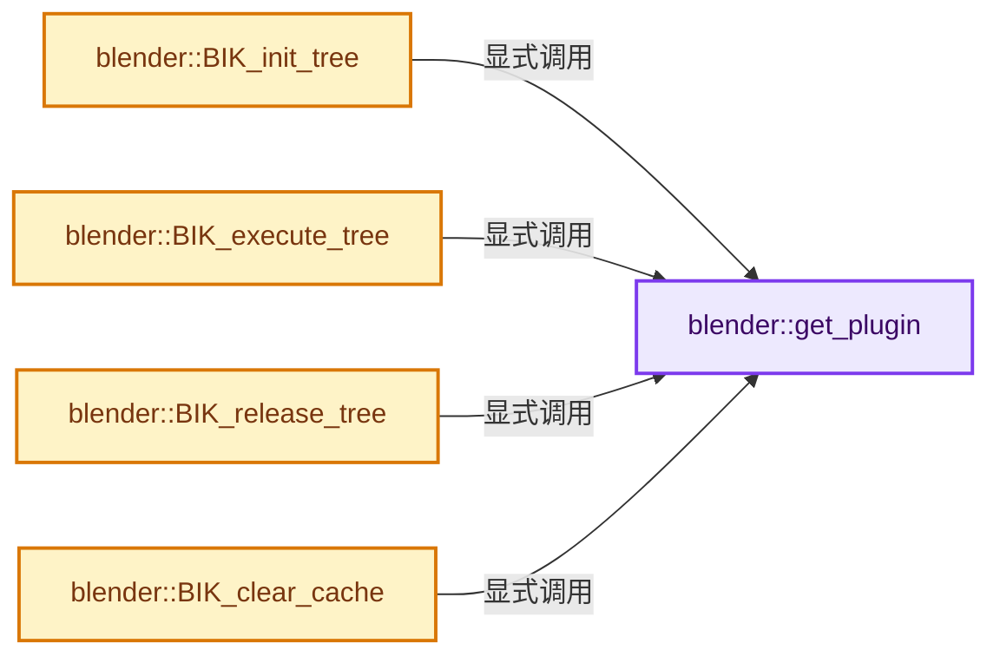
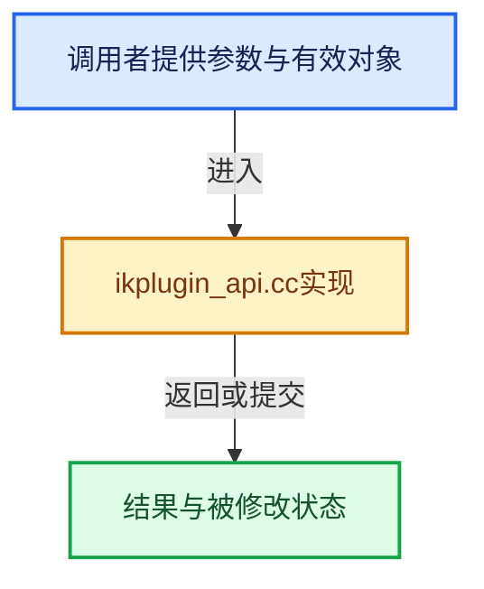

# 实现依赖专题：source/blender/ikplugin/intern/ikplugin_api.cc

[方向导航](README.md) · [符号索引](../%E7%AC%A6%E5%8F%B7%E4%BE%9D%E8%B5%96%E4%B8%8E%E5%AE%9E%E7%8E%B0%E7%B4%A2%E5%BC%95.md)

本专题从正文实际调用进入，集中保存共享实现。函数有稳定锚点，可从调用处直接跳到对应完整函数；递归与互相调用通过回链组织。

## 本文件的实现关系






## 完整成员与函数实现

<a id="f-2ef7a0fce5c77a68"></a>

### `blender::get_plugin`

实现位置：[source/blender/ikplugin/intern/ikplugin_api.cc](../../../../../source/blender/ikplugin/intern/ikplugin_api.cc) · L56—L63。

接口参数：

- `const bPose *pose`

**教学注释版**

<!-- annotated:5f5fa9a2dc4db0 -->

```cpp
static IKPlugin *get_plugin(const bPose *pose)
{
  if (!pose || pose->iksolver < 0 || pose->iksolver >= (ARRAY_SIZE(ikplugin_tab) - 1)) {
    return nullptr;
  }

  return &ikplugin_tab[pose->iksolver];
}
```

<details>
<summary>核对原始源码：source/blender/ikplugin/intern/ikplugin_api.cc · L56—L63</summary>

<!-- original:5f5fa9a2dc4db0:source/blender/ikplugin/intern/ikplugin_api.cc:56:63 -->

```cpp
static IKPlugin *get_plugin(const bPose *pose)
{
  if (!pose || pose->iksolver < 0 || pose->iksolver >= (ARRAY_SIZE(ikplugin_tab) - 1)) {
    return nullptr;
  }

  return &ikplugin_tab[pose->iksolver];
}
```

</details>

**结果出口**

- `return nullptr;`
- `return &ikplugin_tab[pose->iksolver];`

**继续追踪实现**

- `ARRAY_SIZE` → [blender::ARRAY_SIZE · L608](../01-%E5%9F%BA%E7%A1%80%E5%AE%B9%E5%99%A8%E4%B8%8E%E7%8E%B0%E4%BB%A3CPP/%E4%BE%9D%E8%B5%96-BLI_utildefines-293a0a.md#f-eaec3a7e47b85c7c)。

<a id="f-7b9a6fd9b1765701"></a>

### `blender::BIK_init_tree`

实现位置：[source/blender/ikplugin/intern/ikplugin_api.cc](../../../../../source/blender/ikplugin/intern/ikplugin_api.cc) · L68—L75。

接口参数：

- `Depsgraph *depsgraph`
- `Scene *scene`
- `Object *ob`
- `float ctime`

**教学注释版**

<!-- annotated:8c6027f99c4e2d -->

```cpp
void BIK_init_tree(Depsgraph *depsgraph, Scene *scene, Object *ob, float ctime)
{
  IKPlugin *plugin = get_plugin(ob->pose);

  if (plugin && plugin->initialize_tree_func) {
    plugin->initialize_tree_func(depsgraph, scene, ob, ctime);
  }
}
```

<details>
<summary>核对原始源码：source/blender/ikplugin/intern/ikplugin_api.cc · L68—L75</summary>

<!-- original:8c6027f99c4e2d:source/blender/ikplugin/intern/ikplugin_api.cc:68:75 -->

```cpp
void BIK_init_tree(Depsgraph *depsgraph, Scene *scene, Object *ob, float ctime)
{
  IKPlugin *plugin = get_plugin(ob->pose);

  if (plugin && plugin->initialize_tree_func) {
    plugin->initialize_tree_func(depsgraph, scene, ob, ctime);
  }
}
```

</details>

**继续追踪实现**

- `get_plugin` → [blender::get_plugin · L56](%E4%BE%9D%E8%B5%96-ikplugin_api-741851.md#f-2ef7a0fce5c77a68)。
- `plugin->initialize_tree_func` → [调用协议](../%E6%A8%A1%E6%9D%BF%E5%AE%8F%E4%B8%8E%E5%8A%A8%E6%80%81%E5%88%86%E6%B4%BE%E5%8D%8F%E8%AE%AE.md)：由接收对象具体类型或运行时策略提供实现。调用位置L73。

<a id="f-67bbaae87b3a2f4f"></a>

### `blender::BIK_execute_tree`

实现位置：[source/blender/ikplugin/intern/ikplugin_api.cc](../../../../../source/blender/ikplugin/intern/ikplugin_api.cc) · L77—L85。

接口参数：

- `Depsgraph *depsgraph`
- `Scene *scene`
- `Object *ob`
- `bPoseChannel *pchan`
- `float ctime`

**教学注释版**

<!-- annotated:1c16eef4acbcd4 -->

```cpp
void BIK_execute_tree(
    Depsgraph *depsgraph, Scene *scene, Object *ob, bPoseChannel *pchan, float ctime)
{
  IKPlugin *plugin = get_plugin(ob->pose);

  if (plugin && plugin->execute_tree_func) {
    plugin->execute_tree_func(depsgraph, scene, ob, pchan, ctime);
  }
}
```

<details>
<summary>核对原始源码：source/blender/ikplugin/intern/ikplugin_api.cc · L77—L85</summary>

<!-- original:1c16eef4acbcd4:source/blender/ikplugin/intern/ikplugin_api.cc:77:85 -->

```cpp
void BIK_execute_tree(
    Depsgraph *depsgraph, Scene *scene, Object *ob, bPoseChannel *pchan, float ctime)
{
  IKPlugin *plugin = get_plugin(ob->pose);

  if (plugin && plugin->execute_tree_func) {
    plugin->execute_tree_func(depsgraph, scene, ob, pchan, ctime);
  }
}
```

</details>

**继续追踪实现**

- `get_plugin` → [blender::get_plugin · L56](%E4%BE%9D%E8%B5%96-ikplugin_api-741851.md#f-2ef7a0fce5c77a68)。
- `plugin->execute_tree_func` → [调用协议](../%E6%A8%A1%E6%9D%BF%E5%AE%8F%E4%B8%8E%E5%8A%A8%E6%80%81%E5%88%86%E6%B4%BE%E5%8D%8F%E8%AE%AE.md)：由接收对象具体类型或运行时策略提供实现。调用位置L83。

<a id="f-9f2da2ea83278fe3"></a>

### `blender::BIK_release_tree`

实现位置：[source/blender/ikplugin/intern/ikplugin_api.cc](../../../../../source/blender/ikplugin/intern/ikplugin_api.cc) · L87—L94。

接口参数：

- `Scene *scene`
- `Object *ob`
- `float ctime`

**教学注释版**

<!-- annotated:11c2564701e393 -->

```cpp
void BIK_release_tree(Scene *scene, Object *ob, float ctime)
{
  IKPlugin *plugin = get_plugin(ob->pose);

  if (plugin && plugin->release_tree_func) {
    plugin->release_tree_func(scene, ob, ctime);
  }
}
```

<details>
<summary>核对原始源码：source/blender/ikplugin/intern/ikplugin_api.cc · L87—L94</summary>

<!-- original:11c2564701e393:source/blender/ikplugin/intern/ikplugin_api.cc:87:94 -->

```cpp
void BIK_release_tree(Scene *scene, Object *ob, float ctime)
{
  IKPlugin *plugin = get_plugin(ob->pose);

  if (plugin && plugin->release_tree_func) {
    plugin->release_tree_func(scene, ob, ctime);
  }
}
```

</details>

**继续追踪实现**

- `get_plugin` → [blender::get_plugin · L56](%E4%BE%9D%E8%B5%96-ikplugin_api-741851.md#f-2ef7a0fce5c77a68)。
- `plugin->release_tree_func` → [调用协议](../%E6%A8%A1%E6%9D%BF%E5%AE%8F%E4%B8%8E%E5%8A%A8%E6%80%81%E5%88%86%E6%B4%BE%E5%8D%8F%E8%AE%AE.md)：由接收对象具体类型或运行时策略提供实现。调用位置L92。

<a id="f-0709230fbb068d6a"></a>

### `blender::BIK_clear_cache`

实现位置：[source/blender/ikplugin/intern/ikplugin_api.cc](../../../../../source/blender/ikplugin/intern/ikplugin_api.cc) · L105—L112。

接口参数：

- `bPose *pose`

**教学注释版**

<!-- annotated:fd9d90e1b28899 -->

```cpp
void BIK_clear_cache(bPose *pose)
{
  IKPlugin *plugin = get_plugin(pose);

  if (plugin && plugin->clear_cache) {
    plugin->clear_cache(pose);
  }
}
```

<details>
<summary>核对原始源码：source/blender/ikplugin/intern/ikplugin_api.cc · L105—L112</summary>

<!-- original:fd9d90e1b28899:source/blender/ikplugin/intern/ikplugin_api.cc:105:112 -->

```cpp
void BIK_clear_cache(bPose *pose)
{
  IKPlugin *plugin = get_plugin(pose);

  if (plugin && plugin->clear_cache) {
    plugin->clear_cache(pose);
  }
}
```

</details>

**继续追踪实现**

- `get_plugin` → [blender::get_plugin · L56](%E4%BE%9D%E8%B5%96-ikplugin_api-741851.md#f-2ef7a0fce5c77a68)。
- `plugin->clear_cache` → [调用协议](../%E6%A8%A1%E6%9D%BF%E5%AE%8F%E4%B8%8E%E5%8A%A8%E6%80%81%E5%88%86%E6%B4%BE%E5%8D%8F%E8%AE%AE.md)：由接收对象具体类型或运行时策略提供实现。调用位置L110。
