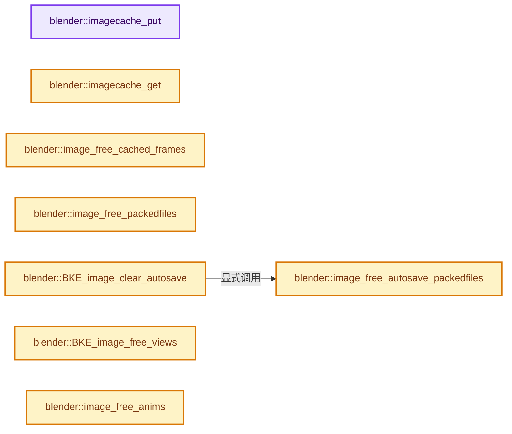
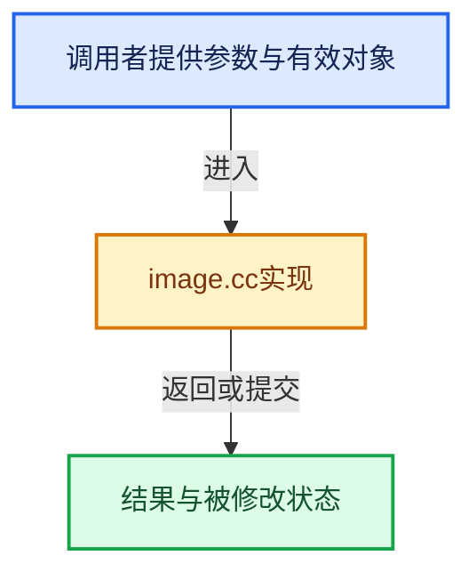

# 实现依赖专题：source/blender/blenkernel/intern/image.cc

[方向导航](README.md) · [符号索引](../%E7%AC%A6%E5%8F%B7%E4%BE%9D%E8%B5%96%E4%B8%8E%E5%AE%9E%E7%8E%B0%E7%B4%A2%E5%BC%95.md)

本专题从正文实际调用进入，集中保存共享实现。函数有稳定锚点，可从调用处直接跳到对应完整函数；递归与互相调用通过回链组织。

## 本文件的实现关系






## 完整成员与函数实现

<a id="f-71629a2ff80c48df"></a>

### `blender::imagecache_put`

实现位置：[source/blender/blenkernel/intern/image.cc](../../../../../source/blender/blenkernel/intern/image.cc) · L571—L587。

接口参数：

- `Image *image`
- `ImageCacheKey key`
- `ImBuf *ibuf`

**教学注释版**

<!-- annotated:8612b6d85bbcfc -->

```cpp
void imagecache_put(Image *image, ImageCacheKey key, ImBuf *ibuf)
{
  if (image->runtime->cache == nullptr) {
    // char cache_name[64];
    // SNPRINTF_UTF8(cache_name, "Image Datablock %s", image->id.name);

    image->runtime->cache = IMB_cache_create(
        "Image Datablock Cache", sizeof(ImageCacheKey), imagecache_hashhash, imagecache_hashcmp);
    IMB_cache_set_getdata_callback(image->runtime->cache, imagecache_keydata);
  }

  if (ibuf != nullptr) {
    ibuf->lastused = BLI_time_now_seconds_i();
  }

  IMB_cache_put(image->runtime->cache, &key, ibuf);
}
```

<details>
<summary>核对原始源码：source/blender/blenkernel/intern/image.cc · L571—L587</summary>

<!-- original:8612b6d85bbcfc:source/blender/blenkernel/intern/image.cc:571:587 -->

```cpp
void imagecache_put(Image *image, ImageCacheKey key, ImBuf *ibuf)
{
  if (image->runtime->cache == nullptr) {
    // char cache_name[64];
    // SNPRINTF_UTF8(cache_name, "Image Datablock %s", image->id.name);

    image->runtime->cache = IMB_cache_create(
        "Image Datablock Cache", sizeof(ImageCacheKey), imagecache_hashhash, imagecache_hashcmp);
    IMB_cache_set_getdata_callback(image->runtime->cache, imagecache_keydata);
  }

  if (ibuf != nullptr) {
    ibuf->lastused = BLI_time_now_seconds_i();
  }

  IMB_cache_put(image->runtime->cache, &key, ibuf);
}
```

</details>

**沿实际写入检查状态**

- `image->runtime->cache = IMB_cache_create(`
- `ibuf->lastused = BLI_time_now_seconds_i();`

**继续追踪实现**

- `IMB_cache_create` → [blender::IMB_cache_create · L270](%E4%BE%9D%E8%B5%96-cache-3c473c.md#f-7ad544796ea1c23b)。
- `IMB_cache_set_getdata_callback` → [blender::IMB_cache_set_getdata_callback · L294](%E4%BE%9D%E8%B5%96-cache-3c473c.md#f-e4978a2cf11af5d0)。
- `BLI_time_now_seconds_i` → [blender::BLI_time_now_seconds_i · L36](../01-%E5%9F%BA%E7%A1%80%E5%AE%B9%E5%99%A8%E4%B8%8E%E7%8E%B0%E4%BB%A3CPP/%E4%BE%9D%E8%B5%96-time-be4317.md#f-38db665188e3ded7)。
- `IMB_cache_put` → [blender::IMB_cache_put · L369](%E4%BE%9D%E8%B5%96-cache-3c473c.md#f-35b68f6e49743575)。

<a id="f-7a43596e3521862e"></a>

### `blender::imagecache_get`

实现位置：[source/blender/blenkernel/intern/image.cc](../../../../../source/blender/blenkernel/intern/image.cc) · L598—L609。

接口参数：

- `Image *image`
- `ImageCacheKey key`
- `bool *r_is_cached_empty`

**教学注释版**

<!-- annotated:9b3f775548583e -->

```cpp
static ImBuf *imagecache_get(Image *image, ImageCacheKey key, bool *r_is_cached_empty)
{
  if (image->runtime->cache) {
    ImBuf *ibuf = IMB_cache_get(image->runtime->cache, &key, r_is_cached_empty);
    if (ibuf != nullptr) {
      ibuf->lastused = BLI_time_now_seconds_i();
    }
    return ibuf;
  }

  return nullptr;
}
```

<details>
<summary>核对原始源码：source/blender/blenkernel/intern/image.cc · L598—L609</summary>

<!-- original:9b3f775548583e:source/blender/blenkernel/intern/image.cc:598:609 -->

```cpp
static ImBuf *imagecache_get(Image *image, ImageCacheKey key, bool *r_is_cached_empty)
{
  if (image->runtime->cache) {
    ImBuf *ibuf = IMB_cache_get(image->runtime->cache, &key, r_is_cached_empty);
    if (ibuf != nullptr) {
      ibuf->lastused = BLI_time_now_seconds_i();
    }
    return ibuf;
  }

  return nullptr;
}
```

</details>

**沿实际写入检查状态**

- `ibuf->lastused = BLI_time_now_seconds_i();`

**结果出口**

- `return ibuf;`
- `return nullptr;`

**继续追踪实现**

- `IMB_cache_get` → [blender::IMB_cache_get · L403](%E4%BE%9D%E8%B5%96-cache-3c473c.md#f-f8167da094e536a4)。
- `BLI_time_now_seconds_i` → [blender::BLI_time_now_seconds_i · L36](../01-%E5%9F%BA%E7%A1%80%E5%AE%B9%E5%99%A8%E4%B8%8E%E7%8E%B0%E4%BB%A3CPP/%E4%BE%9D%E8%B5%96-time-be4317.md#f-38db665188e3ded7)。

<a id="f-db69d7eca4eabd51"></a>

### `blender::image_free_cached_frames`

实现位置：[source/blender/blenkernel/intern/image.cc](../../../../../source/blender/blenkernel/intern/image.cc) · L617—L623。

接口参数：

- `Image *image`

**教学注释版**

<!-- annotated:8b453704bb9d34 -->

```cpp
static void image_free_cached_frames(Image *image)
{
  if (image->runtime->cache) {
    IMB_cache_free(image->runtime->cache);
    image->runtime->cache = nullptr;
  }
}
```

<details>
<summary>核对原始源码：source/blender/blenkernel/intern/image.cc · L617—L623</summary>

<!-- original:8b453704bb9d34:source/blender/blenkernel/intern/image.cc:617:623 -->

```cpp
static void image_free_cached_frames(Image *image)
{
  if (image->runtime->cache) {
    IMB_cache_free(image->runtime->cache);
    image->runtime->cache = nullptr;
  }
}
```

</details>

**沿实际写入检查状态**

- `image->runtime->cache = nullptr;`

**继续追踪实现**

- `IMB_cache_free` → [blender::IMB_cache_free · L446](%E4%BE%9D%E8%B5%96-cache-3c473c.md#f-51d00e69121ba8f2)。

<a id="f-af010eda1811250b"></a>

### `blender::image_free_packedfiles`

实现位置：[source/blender/blenkernel/intern/image.cc](../../../../../source/blender/blenkernel/intern/image.cc) · L625—L635。

接口参数：

- `Image *ima`

**教学注释版**

<!-- annotated:dad67ec6b2428d -->

```cpp
static void image_free_packedfiles(Image *ima)
{
  while (ima->packedfiles.last()) {
    ImagePackedFile *imapf = ima->packedfiles.last();
    if (imapf->packedfile) {
      BKE_packedfile_free(imapf->packedfile);
    }
    BLI_remlink(&ima->packedfiles, imapf);
    MEM_delete(imapf);
  }
}
```

<details>
<summary>核对原始源码：source/blender/blenkernel/intern/image.cc · L625—L635</summary>

<!-- original:dad67ec6b2428d:source/blender/blenkernel/intern/image.cc:625:635 -->

```cpp
static void image_free_packedfiles(Image *ima)
{
  while (ima->packedfiles.last()) {
    ImagePackedFile *imapf = ima->packedfiles.last();
    if (imapf->packedfile) {
      BKE_packedfile_free(imapf->packedfile);
    }
    BLI_remlink(&ima->packedfiles, imapf);
    MEM_delete(imapf);
  }
}
```

</details>

**继续追踪实现**

- `ima->packedfiles.last` → [调用协议](../%E6%A8%A1%E6%9D%BF%E5%AE%8F%E4%B8%8E%E5%8A%A8%E6%80%81%E5%88%86%E6%B4%BE%E5%8D%8F%E8%AE%AE.md)：接收对象类型依赖auto、返回值或模板实例；不按同名猜测目标。调用位置L627。
- `BKE_packedfile_free` → [blender::BKE_packedfile_free · L175](%E4%BE%9D%E8%B5%96-packedFile-564564.md#f-5228521c2c274fd1)。
- `BLI_remlink` → [blender::BLI_remlink · L138](../01-%E5%9F%BA%E7%A1%80%E5%AE%B9%E5%99%A8%E4%B8%8E%E7%8E%B0%E4%BB%A3CPP/%E4%BE%9D%E8%B5%96-listbase-2816d9.md#f-120d80f281ca4cb7)。
- `MEM_delete` → [MEM_delete · L400](../03-%E5%86%85%E5%AD%98%E5%88%86%E9%85%8D%E4%B8%8E%E8%BF%90%E8%A1%8C%E6%97%B6%E7%B1%BB%E5%9E%8B/%E4%BE%9D%E8%B5%96-MEM_guardedalloc-b54eca.md#f-9049ffdd1682887c)。

<a id="f-9f9de86c2ce7709e"></a>

### `blender::image_free_autosave_packedfiles`

实现位置：[source/blender/blenkernel/intern/image.cc](../../../../../source/blender/blenkernel/intern/image.cc) · L642—L652。

接口参数：

- `Image *ima`

**教学注释版**

<!-- annotated:d1604d70c4ada3 -->

```cpp
static void image_free_autosave_packedfiles(Image *ima)
{
  while (ima->autosave_packedfiles.last()) {
    ImagePackedFile *imapf = ima->autosave_packedfiles.last();
    if (imapf->packedfile) {
      BKE_packedfile_free(imapf->packedfile);
    }
    BLI_remlink(&ima->autosave_packedfiles, imapf);
    MEM_delete(imapf);
  }
}
```

<details>
<summary>核对原始源码：source/blender/blenkernel/intern/image.cc · L642—L652</summary>

<!-- original:d1604d70c4ada3:source/blender/blenkernel/intern/image.cc:642:652 -->

```cpp
static void image_free_autosave_packedfiles(Image *ima)
{
  while (ima->autosave_packedfiles.last()) {
    ImagePackedFile *imapf = ima->autosave_packedfiles.last();
    if (imapf->packedfile) {
      BKE_packedfile_free(imapf->packedfile);
    }
    BLI_remlink(&ima->autosave_packedfiles, imapf);
    MEM_delete(imapf);
  }
}
```

</details>

**继续追踪实现**

- `ima->autosave_packedfiles.last` → [调用协议](../%E6%A8%A1%E6%9D%BF%E5%AE%8F%E4%B8%8E%E5%8A%A8%E6%80%81%E5%88%86%E6%B4%BE%E5%8D%8F%E8%AE%AE.md)：接收对象类型依赖auto、返回值或模板实例；不按同名猜测目标。调用位置L644。
- `BKE_packedfile_free` → [blender::BKE_packedfile_free · L175](%E4%BE%9D%E8%B5%96-packedFile-564564.md#f-5228521c2c274fd1)。
- `BLI_remlink` → [blender::BLI_remlink · L138](../01-%E5%9F%BA%E7%A1%80%E5%AE%B9%E5%99%A8%E4%B8%8E%E7%8E%B0%E4%BB%A3CPP/%E4%BE%9D%E8%B5%96-listbase-2816d9.md#f-120d80f281ca4cb7)。
- `MEM_delete` → [MEM_delete · L400](../03-%E5%86%85%E5%AD%98%E5%88%86%E9%85%8D%E4%B8%8E%E8%BF%90%E8%A1%8C%E6%97%B6%E7%B1%BB%E5%9E%8B/%E4%BE%9D%E8%B5%96-MEM_guardedalloc-b54eca.md#f-9049ffdd1682887c)。

<a id="f-633e3e36087c5768"></a>

### `blender::BKE_image_clear_autosave`

实现位置：[source/blender/blenkernel/intern/image.cc](../../../../../source/blender/blenkernel/intern/image.cc) · L654—L658。

接口参数：

- `Image *ima`

**教学注释版**

<!-- annotated:77b3b60ffeaa11 -->

```cpp
void BKE_image_clear_autosave(Image *ima)
{
  image_free_autosave_packedfiles(ima);
  ima->flag &= ~IMA_AUTOSAVE_TEMPPACK;
}
```

<details>
<summary>核对原始源码：source/blender/blenkernel/intern/image.cc · L654—L658</summary>

<!-- original:77b3b60ffeaa11:source/blender/blenkernel/intern/image.cc:654:658 -->

```cpp
void BKE_image_clear_autosave(Image *ima)
{
  image_free_autosave_packedfiles(ima);
  ima->flag &= ~IMA_AUTOSAVE_TEMPPACK;
}
```

</details>

**沿实际写入检查状态**

- `ima->flag &= ~IMA_AUTOSAVE_TEMPPACK;`

**继续追踪实现**

- `image_free_autosave_packedfiles` → [blender::image_free_autosave_packedfiles · L642](%E4%BE%9D%E8%B5%96-image-4859ac.md#f-9f9de86c2ce7709e)。

<a id="f-a0b62b029ddcdb69"></a>

### `blender::BKE_image_free_views`

实现位置：[source/blender/blenkernel/intern/image.cc](../../../../../source/blender/blenkernel/intern/image.cc) · L660—L663。

接口参数：

- `Image *image`

**教学注释版**

<!-- annotated:1e287b17447e0e -->

```cpp
void BKE_image_free_views(Image *image)
{
  image->views.free_no_destruct();
}
```

<details>
<summary>核对原始源码：source/blender/blenkernel/intern/image.cc · L660—L663</summary>

<!-- original:1e287b17447e0e:source/blender/blenkernel/intern/image.cc:660:663 -->

```cpp
void BKE_image_free_views(Image *image)
{
  image->views.free_no_destruct();
}
```

</details>

**继续追踪实现**

- `image->views.free_no_destruct` → [调用协议](../%E6%A8%A1%E6%9D%BF%E5%AE%8F%E4%B8%8E%E5%8A%A8%E6%80%81%E5%88%86%E6%B4%BE%E5%8D%8F%E8%AE%AE.md)：接收对象类型依赖auto、返回值或模板实例；不按同名猜测目标。调用位置L662。

<a id="f-e2d3d00c2cfa9b96"></a>

### `blender::image_free_anims`

实现位置：[source/blender/blenkernel/intern/image.cc](../../../../../source/blender/blenkernel/intern/image.cc) · L665—L676。

接口参数：

- `Image *ima`

**教学注释版**

<!-- annotated:af3d1aeae82fb6 -->

```cpp
static void image_free_anims(Image *ima)
{
  while (ima->anims.last()) {
    ImageAnim *ia = ima->anims.last();
    if (ia->anim) {
      MOV_close(ia->anim);
      ia->anim = nullptr;
    }
    BLI_remlink(&ima->anims, ia);
    MEM_delete(ia);
  }
}
```

<details>
<summary>核对原始源码：source/blender/blenkernel/intern/image.cc · L665—L676</summary>

<!-- original:af3d1aeae82fb6:source/blender/blenkernel/intern/image.cc:665:676 -->

```cpp
static void image_free_anims(Image *ima)
{
  while (ima->anims.last()) {
    ImageAnim *ia = ima->anims.last();
    if (ia->anim) {
      MOV_close(ia->anim);
      ia->anim = nullptr;
    }
    BLI_remlink(&ima->anims, ia);
    MEM_delete(ia);
  }
}
```

</details>

**沿实际写入检查状态**

- `ia->anim = nullptr;`

**继续追踪实现**

- `ima->anims.last` → [调用协议](../%E6%A8%A1%E6%9D%BF%E5%AE%8F%E4%B8%8E%E5%8A%A8%E6%80%81%E5%88%86%E6%B4%BE%E5%8D%8F%E8%AE%AE.md)：接收对象类型依赖auto、返回值或模板实例；不按同名猜测目标。调用位置L667。
- `MOV_close` → [MOV_close · L70](%E4%BE%9D%E8%B5%96-movie_read-4cc1f5.md#f-3180d117d9011594)。
- `BLI_remlink` → [blender::BLI_remlink · L138](../01-%E5%9F%BA%E7%A1%80%E5%AE%B9%E5%99%A8%E4%B8%8E%E7%8E%B0%E4%BB%A3CPP/%E4%BE%9D%E8%B5%96-listbase-2816d9.md#f-120d80f281ca4cb7)。
- `MEM_delete` → [MEM_delete · L400](../03-%E5%86%85%E5%AD%98%E5%88%86%E9%85%8D%E4%B8%8E%E8%BF%90%E8%A1%8C%E6%97%B6%E7%B1%BB%E5%9E%8B/%E4%BE%9D%E8%B5%96-MEM_guardedalloc-b54eca.md#f-9049ffdd1682887c)。

<a id="f-ce09d9c690ea0b9a"></a>

### `blender::BKE_image_free_buffers_ex`

实现位置：[source/blender/blenkernel/intern/image.cc](../../../../../source/blender/blenkernel/intern/image.cc) · L678—L695。

接口参数：

- `Image *ima`
- `bool do_lock`

**教学注释版**

<!-- annotated:908a8561fb77fb -->

```cpp
void BKE_image_free_buffers_ex(Image *ima, bool do_lock)
{
  if (do_lock) {
    ima->runtime->cache_mutex.lock();
  }
  image_free_cached_frames(ima);

  image_free_anims(ima);

  if (ima->rr) {
    RE_FreeRenderResult(ima->rr);
    ima->rr = nullptr;
  }

  if (do_lock) {
    ima->runtime->cache_mutex.unlock();
  }
}
```

<details>
<summary>核对原始源码：source/blender/blenkernel/intern/image.cc · L678—L695</summary>

<!-- original:908a8561fb77fb:source/blender/blenkernel/intern/image.cc:678:695 -->

```cpp
void BKE_image_free_buffers_ex(Image *ima, bool do_lock)
{
  if (do_lock) {
    ima->runtime->cache_mutex.lock();
  }
  image_free_cached_frames(ima);

  image_free_anims(ima);

  if (ima->rr) {
    RE_FreeRenderResult(ima->rr);
    ima->rr = nullptr;
  }

  if (do_lock) {
    ima->runtime->cache_mutex.unlock();
  }
}
```

</details>

**沿实际写入检查状态**

- `ima->rr = nullptr;`

**继续追踪实现**

- `ima->runtime->cache_mutex.lock` → [调用协议](../%E6%A8%A1%E6%9D%BF%E5%AE%8F%E4%B8%8E%E5%8A%A8%E6%80%81%E5%88%86%E6%B4%BE%E5%8D%8F%E8%AE%AE.md)：接收对象类型依赖auto、返回值或模板实例；不按同名猜测目标。调用位置L681。
- `image_free_cached_frames` → [blender::image_free_cached_frames · L617](%E4%BE%9D%E8%B5%96-image-4859ac.md#f-db69d7eca4eabd51)。
- `image_free_anims` → [blender::image_free_anims · L665](%E4%BE%9D%E8%B5%96-image-4859ac.md#f-e2d3d00c2cfa9b96)。
- `RE_FreeRenderResult` → [blender::RE_FreeRenderResult · L232](%E4%BE%9D%E8%B5%96-pipeline-340e5b.md#f-1c0991e0bb79fe25)。
- `ima->runtime->cache_mutex.unlock` → [调用协议](../%E6%A8%A1%E6%9D%BF%E5%AE%8F%E4%B8%8E%E5%8A%A8%E6%80%81%E5%88%86%E6%B4%BE%E5%8D%8F%E8%AE%AE.md)：接收对象类型依赖auto、返回值或模板实例；不按同名猜测目标。调用位置L693。

<a id="f-57f0044e38f30068"></a>

### `blender::BKE_image_free_buffers`

实现位置：[source/blender/blenkernel/intern/image.cc](../../../../../source/blender/blenkernel/intern/image.cc) · L697—L700。

接口参数：

- `Image *ima`

**教学注释版**

<!-- annotated:d47269ed24073e -->

```cpp
void BKE_image_free_buffers(Image *ima)
{
  BKE_image_free_buffers_ex(ima, false);
}
```

<details>
<summary>核对原始源码：source/blender/blenkernel/intern/image.cc · L697—L700</summary>

<!-- original:d47269ed24073e:source/blender/blenkernel/intern/image.cc:697:700 -->

```cpp
void BKE_image_free_buffers(Image *ima)
{
  BKE_image_free_buffers_ex(ima, false);
}
```

</details>

**继续追踪实现**

- `BKE_image_free_buffers_ex` → [blender::BKE_image_free_buffers_ex · L678](%E4%BE%9D%E8%B5%96-image-4859ac.md#f-ce09d9c690ea0b9a)。

<a id="f-f8bed6d965d2413b"></a>

### `blender::image_get_cached_ibuf_for_index_entry`

实现位置：[source/blender/blenkernel/intern/image.cc](../../../../../source/blender/blenkernel/intern/image.cc) · L869—L880。

接口参数：

- `Image *ima`
- `int index`
- `int entry`
- `bool *r_is_cached_empty`

**教学注释版**

<!-- annotated:1a41440f485647 -->

```cpp
static ImBuf *image_get_cached_ibuf_for_index_entry(Image *ima,
                                                    int index,
                                                    int entry,
                                                    bool *r_is_cached_empty)
{
  if (index != IMA_NO_INDEX) {
    index = IMA_MAKE_INDEX(entry, index);
  }

  ImageCacheKey key = {.index = index};
  return imagecache_get(ima, key, r_is_cached_empty);
}
```

<details>
<summary>核对原始源码：source/blender/blenkernel/intern/image.cc · L869—L880</summary>

<!-- original:1a41440f485647:source/blender/blenkernel/intern/image.cc:869:880 -->

```cpp
static ImBuf *image_get_cached_ibuf_for_index_entry(Image *ima,
                                                    int index,
                                                    int entry,
                                                    bool *r_is_cached_empty)
{
  if (index != IMA_NO_INDEX) {
    index = IMA_MAKE_INDEX(entry, index);
  }

  ImageCacheKey key = {.index = index};
  return imagecache_get(ima, key, r_is_cached_empty);
}
```

</details>

**沿实际写入检查状态**

- `index = IMA_MAKE_INDEX(entry, index);`

**结果出口**

- `return imagecache_get(ima, key, r_is_cached_empty);`

**继续追踪实现**

- `IMA_MAKE_INDEX` → [IMA_MAKE_INDEX · L32](%E4%BE%9D%E8%B5%96-image_intern-102ca5.md#m-df962a9f57c3)。宏定义由构建条件选择。
- `imagecache_get` → [blender::imagecache_get · L598](%E4%BE%9D%E8%B5%96-image-4859ac.md#f-7a43596e3521862e)。

<a id="f-0954fd8857433e7a"></a>

### `blender::image_assign_ibuf`

实现位置：[source/blender/blenkernel/intern/image.cc](../../../../../source/blender/blenkernel/intern/image.cc) · L882—L890。

接口参数：

- `Image *ima`
- `ImBuf *ibuf`
- `int index`
- `int entry`

**教学注释版**

<!-- annotated:4de4e8e27cbb86 -->

```cpp
static void image_assign_ibuf(Image *ima, ImBuf *ibuf, int index, int entry)
{
  if (index != IMA_NO_INDEX) {
    index = IMA_MAKE_INDEX(entry, index);
  }

  ImageCacheKey key = {.index = index};
  imagecache_put(ima, key, ibuf);
}
```

<details>
<summary>核对原始源码：source/blender/blenkernel/intern/image.cc · L882—L890</summary>

<!-- original:4de4e8e27cbb86:source/blender/blenkernel/intern/image.cc:882:890 -->

```cpp
static void image_assign_ibuf(Image *ima, ImBuf *ibuf, int index, int entry)
{
  if (index != IMA_NO_INDEX) {
    index = IMA_MAKE_INDEX(entry, index);
  }

  ImageCacheKey key = {.index = index};
  imagecache_put(ima, key, ibuf);
}
```

</details>

**沿实际写入检查状态**

- `index = IMA_MAKE_INDEX(entry, index);`

**继续追踪实现**

- `IMA_MAKE_INDEX` → [IMA_MAKE_INDEX · L32](%E4%BE%9D%E8%B5%96-image_intern-102ca5.md#m-df962a9f57c3)。宏定义由构建条件选择。
- `imagecache_put` → [blender::imagecache_put · L571](%E4%BE%9D%E8%B5%96-image-4859ac.md#f-71629a2ff80c48df)。

<a id="f-65b34d5790ddaf5a"></a>

### `blender::image_index_is_gpu_only`

实现位置：[source/blender/blenkernel/intern/image.cc](../../../../../source/blender/blenkernel/intern/image.cc) · L901—L904。

接口参数：

- `const int index`

**教学注释版**

<!-- annotated:819c52122cfe02 -->

```cpp
static bool image_index_is_gpu_only(const int index)
{
  return ELEM(index, IMA_INDEX_UDIM_ATLAS, IMA_INDEX_UDIM_TILE_MAPPING);
}
```

<details>
<summary>核对原始源码：source/blender/blenkernel/intern/image.cc · L901—L904</summary>

<!-- original:819c52122cfe02:source/blender/blenkernel/intern/image.cc:901:904 -->

```cpp
static bool image_index_is_gpu_only(const int index)
{
  return ELEM(index, IMA_INDEX_UDIM_ATLAS, IMA_INDEX_UDIM_TILE_MAPPING);
}
```

</details>

**结果出口**

- `return ELEM(index, IMA_INDEX_UDIM_ATLAS, IMA_INDEX_UDIM_TILE_MAPPING);`

**继续追踪实现**

- `ELEM` → [ELEM · L88](%E4%BE%9D%E8%B5%96-GHOST_utildefines-34b996.md#m-d28724a15928)；[ELEM · L135](../01-%E5%9F%BA%E7%A1%80%E5%AE%B9%E5%99%A8%E4%B8%8E%E7%8E%B0%E4%BB%A3CPP/%E4%BE%9D%E8%B5%96-BLI_utildefines-293a0a.md#m-d6572de7cae0)。宏定义由构建条件选择。

<a id="f-dca04b052288fe56"></a>

### `blender::image_get_tile_number_from_iuser`

实现位置：[source/blender/blenkernel/intern/image.cc](../../../../../source/blender/blenkernel/intern/image.cc) · L972—L977。

接口参数：

- `const Image *ima`
- `const ImageUser *iuser`

**教学注释版**

<!-- annotated:af57d66850c1ea -->

```cpp
static int image_get_tile_number_from_iuser(const Image *ima, const ImageUser *iuser)
{
  BLI_assert(ima != nullptr && ima->tiles.first());
  ImageTile *tile = ima->tiles.first();
  return (iuser && iuser->tile) ? iuser->tile : tile->tile_number;
}
```

<details>
<summary>核对原始源码：source/blender/blenkernel/intern/image.cc · L972—L977</summary>

<!-- original:af57d66850c1ea:source/blender/blenkernel/intern/image.cc:972:977 -->

```cpp
static int image_get_tile_number_from_iuser(const Image *ima, const ImageUser *iuser)
{
  BLI_assert(ima != nullptr && ima->tiles.first());
  ImageTile *tile = ima->tiles.first();
  return (iuser && iuser->tile) ? iuser->tile : tile->tile_number;
}
```

</details>

**结果出口**

- `return (iuser && iuser->tile) ? iuser->tile : tile->tile_number;`

**继续追踪实现**

- `BLI_assert` → [BLI_assert · L48](../01-%E5%9F%BA%E7%A1%80%E5%AE%B9%E5%99%A8%E4%B8%8E%E7%8E%B0%E4%BB%A3CPP/%E4%BE%9D%E8%B5%96-BLI_assert-cc98e8.md#m-57a88495704d)；[BLI_assert · L63](../01-%E5%9F%BA%E7%A1%80%E5%AE%B9%E5%99%A8%E4%B8%8E%E7%8E%B0%E4%BB%A3CPP/%E4%BE%9D%E8%B5%96-BLI_assert-cc98e8.md#m-d07050020cb5)。宏定义由构建条件选择。
- `ima->tiles.first` → [调用协议](../%E6%A8%A1%E6%9D%BF%E5%AE%8F%E4%B8%8E%E5%8A%A8%E6%80%81%E5%88%86%E6%B4%BE%E5%8D%8F%E8%AE%AE.md)：接收对象类型依赖auto、返回值或模板实例；不按同名猜测目标。调用位置L974。

<a id="f-92b08e2de914ba44"></a>

### `blender::BKE_image_get_tile`

实现位置：[source/blender/blenkernel/intern/image.cc](../../../../../source/blender/blenkernel/intern/image.cc) · L979—L1003。

接口参数：

- `Image *ima`
- `int tile_number`

**教学注释版**

<!-- annotated:04c3468cbf6a47 -->

```cpp
ImageTile *BKE_image_get_tile(Image *ima, int tile_number)
{
  if (ima == nullptr) {
    return nullptr;
  }

  /* Tiles 0 and 1001 are a special case and refer to the first tile, typically
   * coming from non-UDIM-aware code. */
  if (ELEM(tile_number, 0, 1001)) {
    return ima->tiles.first();
  }

  /* Must have a tiled image and a valid tile number at this point. */
  if (ima->source != IMA_SRC_TILED || tile_number < 1001 || tile_number > IMA_UDIM_MAX) {
    return nullptr;
  }

  for (ImageTile &tile : ima->tiles) {
    if (tile.tile_number == tile_number) {
      return &tile;
    }
  }

  return nullptr;
}
```

<details>
<summary>核对原始源码：source/blender/blenkernel/intern/image.cc · L979—L1003</summary>

<!-- original:04c3468cbf6a47:source/blender/blenkernel/intern/image.cc:979:1003 -->

```cpp
ImageTile *BKE_image_get_tile(Image *ima, int tile_number)
{
  if (ima == nullptr) {
    return nullptr;
  }

  /* Tiles 0 and 1001 are a special case and refer to the first tile, typically
   * coming from non-UDIM-aware code. */
  if (ELEM(tile_number, 0, 1001)) {
    return ima->tiles.first();
  }

  /* Must have a tiled image and a valid tile number at this point. */
  if (ima->source != IMA_SRC_TILED || tile_number < 1001 || tile_number > IMA_UDIM_MAX) {
    return nullptr;
  }

  for (ImageTile &tile : ima->tiles) {
    if (tile.tile_number == tile_number) {
      return &tile;
    }
  }

  return nullptr;
}
```

</details>

**结果出口**

- `return nullptr;`
- `return ima->tiles.first();`
- `return &tile;`

**继续追踪实现**

- `ELEM` → [ELEM · L88](%E4%BE%9D%E8%B5%96-GHOST_utildefines-34b996.md#m-d28724a15928)；[ELEM · L135](../01-%E5%9F%BA%E7%A1%80%E5%AE%B9%E5%99%A8%E4%B8%8E%E7%8E%B0%E4%BB%A3CPP/%E4%BE%9D%E8%B5%96-BLI_utildefines-293a0a.md#m-d6572de7cae0)。宏定义由构建条件选择。
- `ima->tiles.first` → [调用协议](../%E6%A8%A1%E6%9D%BF%E5%AE%8F%E4%B8%8E%E5%8A%A8%E6%80%81%E5%88%86%E6%B4%BE%E5%8D%8F%E8%AE%AE.md)：接收对象类型依赖auto、返回值或模板实例；不按同名猜测目标。调用位置L988。

<a id="f-0829b58befcf640e"></a>

### `blender::BKE_image_get_tile_from_iuser`

实现位置：[source/blender/blenkernel/intern/image.cc](../../../../../source/blender/blenkernel/intern/image.cc) · L1005—L1008。

接口参数：

- `Image *ima`
- `const ImageUser *iuser`

**教学注释版**

<!-- annotated:2bbece32815ffb -->

```cpp
ImageTile *BKE_image_get_tile_from_iuser(Image *ima, const ImageUser *iuser)
{
  return BKE_image_get_tile(ima, image_get_tile_number_from_iuser(ima, iuser));
}
```

<details>
<summary>核对原始源码：source/blender/blenkernel/intern/image.cc · L1005—L1008</summary>

<!-- original:2bbece32815ffb:source/blender/blenkernel/intern/image.cc:1005:1008 -->

```cpp
ImageTile *BKE_image_get_tile_from_iuser(Image *ima, const ImageUser *iuser)
{
  return BKE_image_get_tile(ima, image_get_tile_number_from_iuser(ima, iuser));
}
```

</details>

**结果出口**

- `return BKE_image_get_tile(ima, image_get_tile_number_from_iuser(ima, iuser));`

**继续追踪实现**

- `BKE_image_get_tile` → [blender::BKE_image_get_tile · L979](%E4%BE%9D%E8%B5%96-image-4859ac.md#f-92b08e2de914ba44)。
- `image_get_tile_number_from_iuser` → [blender::image_get_tile_number_from_iuser · L972](%E4%BE%9D%E8%B5%96-image-4859ac.md#f-dca04b052288fe56)。

<a id="f-d2141833aadbe121"></a>

### `blender::BKE_image_get_tile_from_pos`

实现位置：[source/blender/blenkernel/intern/image.cc](../../../../../source/blender/blenkernel/intern/image.cc) · L1010—L1036。

接口参数：

- `Image *ima`
- `const float uv[2]`
- `float r_uv[2]`
- `float r_ofs[2]`

**教学注释版**

<!-- annotated:2585fb0e164eed -->

```cpp
int BKE_image_get_tile_from_pos(Image *ima, const float uv[2], float r_uv[2], float r_ofs[2])
{
  float local_ofs[2];
  if (r_ofs == nullptr) {
    r_ofs = local_ofs;
  }

  copy_v2_v2(r_uv, uv);
  zero_v2(r_ofs);

  if ((ima->source != IMA_SRC_TILED) || uv[0] < 0.0f || uv[1] < 0.0f || uv[0] >= 10.0f) {
    return 0;
  }

  int ix = int(uv[0]);
  int iy = int(uv[1]);
  int tile_number = 1001 + 10 * iy + ix;

  if (BKE_image_get_tile(ima, tile_number) == nullptr) {
    return 0;
  }
  r_ofs[0] = ix;
  r_ofs[1] = iy;
  sub_v2_v2(r_uv, r_ofs);

  return tile_number;
}
```

<details>
<summary>核对原始源码：source/blender/blenkernel/intern/image.cc · L1010—L1036</summary>

<!-- original:2585fb0e164eed:source/blender/blenkernel/intern/image.cc:1010:1036 -->

```cpp
int BKE_image_get_tile_from_pos(Image *ima, const float uv[2], float r_uv[2], float r_ofs[2])
{
  float local_ofs[2];
  if (r_ofs == nullptr) {
    r_ofs = local_ofs;
  }

  copy_v2_v2(r_uv, uv);
  zero_v2(r_ofs);

  if ((ima->source != IMA_SRC_TILED) || uv[0] < 0.0f || uv[1] < 0.0f || uv[0] >= 10.0f) {
    return 0;
  }

  int ix = int(uv[0]);
  int iy = int(uv[1]);
  int tile_number = 1001 + 10 * iy + ix;

  if (BKE_image_get_tile(ima, tile_number) == nullptr) {
    return 0;
  }
  r_ofs[0] = ix;
  r_ofs[1] = iy;
  sub_v2_v2(r_uv, r_ofs);

  return tile_number;
}
```

</details>

**沿实际写入检查状态**

- `r_ofs = local_ofs;`
- `r_ofs[0] = ix;`
- `r_ofs[1] = iy;`

**结果出口**

- `return 0;`
- `return tile_number;`

**继续追踪实现**

- `copy_v2_v2` → [blender::copy_v2_v2 · L41](../12-%E7%A9%BA%E9%97%B4%E6%95%B0%E6%8D%AE%E7%BB%93%E6%9E%84%E4%B8%8E%E5%87%A0%E4%BD%95%E7%AE%97%E6%B3%95/%E4%BE%9D%E8%B5%96-math_vector_inline-0c8541.md#f-e736ee2dd71cd821)。
- `zero_v2` → [blender::zero_v2 · L20](../12-%E7%A9%BA%E9%97%B4%E6%95%B0%E6%8D%AE%E7%BB%93%E6%9E%84%E4%B8%8E%E5%87%A0%E4%BD%95%E7%AE%97%E6%B3%95/%E4%BE%9D%E8%B5%96-math_vector_inline-0c8541.md#f-3f0f4c37141bd4f2)。
- `BKE_image_get_tile` → [blender::BKE_image_get_tile · L979](%E4%BE%9D%E8%B5%96-image-4859ac.md#f-92b08e2de914ba44)。
- `sub_v2_v2` → [blender::sub_v2_v2 · L329](../12-%E7%A9%BA%E9%97%B4%E6%95%B0%E6%8D%AE%E7%BB%93%E6%9E%84%E4%B8%8E%E5%87%A0%E4%BD%95%E7%AE%97%E6%B3%95/%E4%BE%9D%E8%B5%96-math_vector_inline-0c8541.md#f-bade405f288378e1)。

<a id="f-9a5be2743950ed27"></a>

### `blender::BKE_image_alpha_mode_from_extension_ex`

实现位置：[source/blender/blenkernel/intern/image.cc](../../../../../source/blender/blenkernel/intern/image.cc) · L1171—L1178。

接口参数：

- `const char *filepath`

**教学注释版**

<!-- annotated:7f82498e6bb3cd -->

```cpp
char BKE_image_alpha_mode_from_extension_ex(const char *filepath)
{
  if (BLI_path_extension_check_n(filepath, ".exr", ".cin", ".dpx", ".hdr", nullptr)) {
    return IMA_ALPHA_PREMUL;
  }

  return IMA_ALPHA_STRAIGHT;
}
```

<details>
<summary>核对原始源码：source/blender/blenkernel/intern/image.cc · L1171—L1178</summary>

<!-- original:7f82498e6bb3cd:source/blender/blenkernel/intern/image.cc:1171:1178 -->

```cpp
char BKE_image_alpha_mode_from_extension_ex(const char *filepath)
{
  if (BLI_path_extension_check_n(filepath, ".exr", ".cin", ".dpx", ".hdr", nullptr)) {
    return IMA_ALPHA_PREMUL;
  }

  return IMA_ALPHA_STRAIGHT;
}
```

</details>

**结果出口**

- `return IMA_ALPHA_PREMUL;`
- `return IMA_ALPHA_STRAIGHT;`

**继续追踪实现**

- `BLI_path_extension_check_n` → [BLI_path_extension_check_n · L1483](../01-%E5%9F%BA%E7%A1%80%E5%AE%B9%E5%99%A8%E4%B8%8E%E7%8E%B0%E4%BB%A3CPP/%E4%BE%9D%E8%B5%96-path_utils-b4d26a.md#f-5f4ad72908476cfd)。

<a id="f-ae0857403735393d"></a>

### `blender::BKE_image_alpha_mode_from_extension`

实现位置：[source/blender/blenkernel/intern/image.cc](../../../../../source/blender/blenkernel/intern/image.cc) · L1180—L1183。

接口参数：

- `Image *image`

**教学注释版**

<!-- annotated:322451af5446d8 -->

```cpp
void BKE_image_alpha_mode_from_extension(Image *image)
{
  image->alpha_mode = eImageAlphaMode(BKE_image_alpha_mode_from_extension_ex(image->filepath));
}
```

<details>
<summary>核对原始源码：source/blender/blenkernel/intern/image.cc · L1180—L1183</summary>

<!-- original:322451af5446d8:source/blender/blenkernel/intern/image.cc:1180:1183 -->

```cpp
void BKE_image_alpha_mode_from_extension(Image *image)
{
  image->alpha_mode = eImageAlphaMode(BKE_image_alpha_mode_from_extension_ex(image->filepath));
}
```

</details>

**沿实际写入检查状态**

- `image->alpha_mode = eImageAlphaMode(BKE_image_alpha_mode_from_extension_ex(image->filepath));`

**继续追踪实现**

- `eImageAlphaMode` → [blender::eImageAlphaMode](%E4%BE%9D%E8%B5%96-DNA_image_types-447487.md#t-4842b95ab8dc)。
- `BKE_image_alpha_mode_from_extension_ex` → [blender::BKE_image_alpha_mode_from_extension_ex · L1171](%E4%BE%9D%E8%B5%96-image-4859ac.md#f-9a5be2743950ed27)。

<a id="f-80fdf609aad9142b"></a>

### `blender::add_ibuf_for_tile`

实现位置：[source/blender/blenkernel/intern/image.cc](../../../../../source/blender/blenkernel/intern/image.cc) · L1328—L1405。

接口参数：

- `Image *ima`
- `ImageTile *tile`

**教学注释版**

<!-- annotated:570ad526a7bd3d -->

```cpp
static ImBuf *add_ibuf_for_tile(Image *ima, ImageTile *tile)
{
  ImBuf *ibuf;
  uchar *rect = nullptr;
  float *rect_float = nullptr;
  float fill_color[4];

  ImColorMode color_mode = ImColorMode(tile->gen_depth);
  const bool floatbuf = (tile->gen_flag & IMA_GEN_FLOAT) != 0;
  if (floatbuf) {
    ibuf = IMB_allocImBuf(tile->gen_x, tile->gen_y, ImBufFlags::FloatData);

    if (ima->colorspace_settings.name[0] == '\0') {
      const char *colorspace = IMB_colormanagement_role_colorspace_name_get(
          COLOR_ROLE_SCENE_LINEAR);

      IMB_colormanagement_colorspace_settings_set(&ima->colorspace_settings, colorspace);
    }

    if (ibuf != nullptr) {
      ibuf->color_mode = color_mode;
      rect_float = ibuf->float_data_for_write();
      IMB_colormanagement_assign_float_colorspace(ibuf, ima->colorspace_settings.name);
    }

    if (IMB_colormanagement_space_name_is_data(ima->colorspace_settings.name)) {
      copy_v4_v4(fill_color, tile->gen_color);
    }
    else {
      /* The input color here should ideally be linear already, but for now
       * we just convert and postpone breaking the API for later. */
      srgb_to_linearrgb_v4(fill_color, tile->gen_color);
    }
  }
  else {
    ibuf = IMB_allocImBuf(tile->gen_x, tile->gen_y, ImBufFlags::ByteData);

    if (ima->colorspace_settings.name[0] == '\0') {
      const char *colorspace = IMB_colormanagement_role_colorspace_name_get(
          COLOR_ROLE_DEFAULT_BYTE);

      IMB_colormanagement_colorspace_settings_set(&ima->colorspace_settings, colorspace);
    }

    if (ibuf != nullptr) {
      ibuf->color_mode = color_mode;
      rect = ibuf->byte_data_for_write();
      IMB_colormanagement_assign_byte_colorspace(ibuf, ima->colorspace_settings.name);
    }

    copy_v4_v4(fill_color, tile->gen_color);
  }

  if (!ibuf) {
    return nullptr;
  }

  char filepath[FILE_MAX];
  STRNCPY(filepath, ima->filepath);
  BLI_path_abs(filepath, ID_BLEND_PATH_FROM_GLOBAL(&ima->id));
  ibuf->filepath = filepath;

  /* Mark the tile itself as having been generated. */
  tile->gen_flag |= IMA_GEN_TILE;

  ImageFillData data;

  data.gen_type = tile->gen_type;
  data.width = tile->gen_x;
  data.height = tile->gen_y;
  data.rect = rect;
  data.rect_float = rect_float;
  copy_v4_v4(data.fill_color, fill_color);

  BLI_task_isolate(image_buf_fill_isolated, &data);

  return ibuf;
}
```

<details>
<summary>核对原始源码：source/blender/blenkernel/intern/image.cc · L1328—L1405</summary>

<!-- original:570ad526a7bd3d:source/blender/blenkernel/intern/image.cc:1328:1405 -->

```cpp
static ImBuf *add_ibuf_for_tile(Image *ima, ImageTile *tile)
{
  ImBuf *ibuf;
  uchar *rect = nullptr;
  float *rect_float = nullptr;
  float fill_color[4];

  ImColorMode color_mode = ImColorMode(tile->gen_depth);
  const bool floatbuf = (tile->gen_flag & IMA_GEN_FLOAT) != 0;
  if (floatbuf) {
    ibuf = IMB_allocImBuf(tile->gen_x, tile->gen_y, ImBufFlags::FloatData);

    if (ima->colorspace_settings.name[0] == '\0') {
      const char *colorspace = IMB_colormanagement_role_colorspace_name_get(
          COLOR_ROLE_SCENE_LINEAR);

      IMB_colormanagement_colorspace_settings_set(&ima->colorspace_settings, colorspace);
    }

    if (ibuf != nullptr) {
      ibuf->color_mode = color_mode;
      rect_float = ibuf->float_data_for_write();
      IMB_colormanagement_assign_float_colorspace(ibuf, ima->colorspace_settings.name);
    }

    if (IMB_colormanagement_space_name_is_data(ima->colorspace_settings.name)) {
      copy_v4_v4(fill_color, tile->gen_color);
    }
    else {
      /* The input color here should ideally be linear already, but for now
       * we just convert and postpone breaking the API for later. */
      srgb_to_linearrgb_v4(fill_color, tile->gen_color);
    }
  }
  else {
    ibuf = IMB_allocImBuf(tile->gen_x, tile->gen_y, ImBufFlags::ByteData);

    if (ima->colorspace_settings.name[0] == '\0') {
      const char *colorspace = IMB_colormanagement_role_colorspace_name_get(
          COLOR_ROLE_DEFAULT_BYTE);

      IMB_colormanagement_colorspace_settings_set(&ima->colorspace_settings, colorspace);
    }

    if (ibuf != nullptr) {
      ibuf->color_mode = color_mode;
      rect = ibuf->byte_data_for_write();
      IMB_colormanagement_assign_byte_colorspace(ibuf, ima->colorspace_settings.name);
    }

    copy_v4_v4(fill_color, tile->gen_color);
  }

  if (!ibuf) {
    return nullptr;
  }

  char filepath[FILE_MAX];
  STRNCPY(filepath, ima->filepath);
  BLI_path_abs(filepath, ID_BLEND_PATH_FROM_GLOBAL(&ima->id));
  ibuf->filepath = filepath;

  /* Mark the tile itself as having been generated. */
  tile->gen_flag |= IMA_GEN_TILE;

  ImageFillData data;

  data.gen_type = tile->gen_type;
  data.width = tile->gen_x;
  data.height = tile->gen_y;
  data.rect = rect;
  data.rect_float = rect_float;
  copy_v4_v4(data.fill_color, fill_color);

  BLI_task_isolate(image_buf_fill_isolated, &data);

  return ibuf;
}
```

</details>

**沿实际写入检查状态**

- `ibuf = IMB_allocImBuf(tile->gen_x, tile->gen_y, ImBufFlags::FloatData);`
- `ibuf->color_mode = color_mode;`
- `rect_float = ibuf->float_data_for_write();`
- `ibuf = IMB_allocImBuf(tile->gen_x, tile->gen_y, ImBufFlags::ByteData);`
- `rect = ibuf->byte_data_for_write();`
- `ibuf->filepath = filepath;`
- `tile->gen_flag |= IMA_GEN_TILE;`
- `data.gen_type = tile->gen_type;`
- `data.width = tile->gen_x;`
- `data.height = tile->gen_y;`
- `data.rect = rect;`
- `data.rect_float = rect_float;`

**结果出口**

- `return nullptr;`
- `return ibuf;`

**继续追踪实现**

- `ImColorMode` → [blender::ImColorMode](%E4%BE%9D%E8%B5%96-DNA_image_enums-d9c51b.md#t-820778c4e5f0)。
- `IMB_allocImBuf` → [blender::IMB_allocImBuf · L367](%E4%BE%9D%E8%B5%96-allocimbuf-bc68dd.md#f-971d0005c46aad53)。
- `IMB_colormanagement_role_colorspace_name_get` → [blender::IMB_colormanagement_role_colorspace_name_get · L1247](%E4%BE%9D%E8%B5%96-colormanagement-d4733d.md#f-f2cf0e85682f0fd8)。
- `IMB_colormanagement_colorspace_settings_set` → [blender::IMB_colormanagement_colorspace_settings_set · L3164](%E4%BE%9D%E8%B5%96-colormanagement-d4733d.md#f-85d2536cb6c79b87)。
- `ibuf->float_data_for_write` → [blender::ImBuf::float_data_for_write · L79](%E4%BE%9D%E8%B5%96-allocimbuf-bc68dd.md#f-1956ac4db88ed3eb)。
- `IMB_colormanagement_assign_float_colorspace` → [blender::IMB_colormanagement_assign_float_colorspace · L1292](%E4%BE%9D%E8%B5%96-colormanagement-d4733d.md#f-3d136a349a596f82)。
- `IMB_colormanagement_space_name_is_data` → [blender::IMB_colormanagement_space_name_is_data · L1348](%E4%BE%9D%E8%B5%96-colormanagement-d4733d.md#f-581447ed34f42264)。
- `copy_v4_v4` → [blender::copy_v4_v4 · L54](../12-%E7%A9%BA%E9%97%B4%E6%95%B0%E6%8D%AE%E7%BB%93%E6%9E%84%E4%B8%8E%E5%87%A0%E4%BD%95%E7%AE%97%E6%B3%95/%E4%BE%9D%E8%B5%96-math_vector_inline-0c8541.md#f-0cf225fc326edf4a)。
- `srgb_to_linearrgb_v4` → [blender::srgb_to_linearrgb_v4 · L22](../12-%E7%A9%BA%E9%97%B4%E6%95%B0%E6%8D%AE%E7%BB%93%E6%9E%84%E4%B8%8E%E5%87%A0%E4%BD%95%E7%AE%97%E6%B3%95/%E4%BE%9D%E8%B5%96-math_color_inline-48fb4c.md#f-4bd7ba0484fc512b)。
- `ibuf->byte_data_for_write` → [blender::ImBuf::byte_data_for_write · L60](%E4%BE%9D%E8%B5%96-allocimbuf-bc68dd.md#f-9ae201bd1c52aa87)。
- `IMB_colormanagement_assign_byte_colorspace` → [blender::IMB_colormanagement_assign_byte_colorspace · L1298](%E4%BE%9D%E8%B5%96-colormanagement-d4733d.md#f-ead21d8cb3904faa)。
- `STRNCPY` → [blender::STRNCPY · L690](../01-%E5%9F%BA%E7%A1%80%E5%AE%B9%E5%99%A8%E4%B8%8E%E7%8E%B0%E4%BB%A3CPP/%E4%BE%9D%E8%B5%96-BLI_string-b43058.md#f-6b2d861724026be6)。
- `BLI_path_abs` → [BLI_path_abs · L1164](../01-%E5%9F%BA%E7%A1%80%E5%AE%B9%E5%99%A8%E4%B8%8E%E7%8E%B0%E4%BB%A3CPP/%E4%BE%9D%E8%B5%96-path_utils-b4d26a.md#f-002380948c1caeb6)。
- `ID_BLEND_PATH_FROM_GLOBAL` → [ID_BLEND_PATH_FROM_GLOBAL · L691](%E4%BE%9D%E8%B5%96-DNA_ID-3eb091.md#m-2b76f08bf41b)。宏定义由构建条件选择。
- `BLI_task_isolate` → [blender::BLI_task_isolate · L115](../11-Depsgraph%E4%B8%8E%E5%B9%B6%E8%A1%8C%E4%BB%BB%E5%8A%A1%E7%B3%BB%E7%BB%9F/07-%E4%BB%BB%E5%8A%A1%E6%B1%A0%E4%B8%8ETBB%E6%8E%A5%E5%85%A5.md#f-a745b4ecb6c311ab)。

<a id="f-bab20ce55cd145a5"></a>

### `blender::BKE_stamp_info_callback`

实现位置：[source/blender/blenkernel/intern/image.cc](../../../../../source/blender/blenkernel/intern/image.cc) · L2666—L2705。

接口参数：

- `void *data`
- `StampData *stamp_data`
- `StampCallback callback`
- `bool noskip`

**教学注释版**

<!-- annotated:1191245af49c9a -->

```cpp
void BKE_stamp_info_callback(void *data,
                             StampData *stamp_data,
                             StampCallback callback,
                             bool noskip)
{
  if ((callback == nullptr) || (stamp_data == nullptr)) {
    return;
  }

#define CALL(member, value_str) \
  if (noskip || stamp_data->member[0]) { \
    callback(data, value_str, stamp_data->member, sizeof(stamp_data->member)); \
  } \
  ((void)0)

  /* TODO(sergey): Use stamp_metadata_fields somehow, or make it more generic
   * meta information to avoid duplication. */
  CALL(file, "File");
  CALL(note, "Note");
  CALL(date, "Date");
  CALL(marker, "Marker");
  CALL(time, "Time");
  CALL(frame, "Frame");
  CALL(frame_range, "FrameRange");
  CALL(camera, "Camera");
  CALL(cameralens, "Lens");
  CALL(scene, "Scene");
  CALL(strip, "Strip");
  CALL(rendertime, "RenderTime");
  CALL(memory, "Memory");
  CALL(hostname, "Hostname");

  for (StampDataCustomField &custom_field : stamp_data->custom_fields) {
    if (noskip || custom_field.value[0]) {
      callback(data, custom_field.key, custom_field.value, strlen(custom_field.value) + 1);
    }
  }

#undef CALL
}
```

<details>
<summary>核对原始源码：source/blender/blenkernel/intern/image.cc · L2666—L2705</summary>

<!-- original:1191245af49c9a:source/blender/blenkernel/intern/image.cc:2666:2705 -->

```cpp
void BKE_stamp_info_callback(void *data,
                             StampData *stamp_data,
                             StampCallback callback,
                             bool noskip)
{
  if ((callback == nullptr) || (stamp_data == nullptr)) {
    return;
  }

#define CALL(member, value_str) \
  if (noskip || stamp_data->member[0]) { \
    callback(data, value_str, stamp_data->member, sizeof(stamp_data->member)); \
  } \
  ((void)0)

  /* TODO(sergey): Use stamp_metadata_fields somehow, or make it more generic
   * meta information to avoid duplication. */
  CALL(file, "File");
  CALL(note, "Note");
  CALL(date, "Date");
  CALL(marker, "Marker");
  CALL(time, "Time");
  CALL(frame, "Frame");
  CALL(frame_range, "FrameRange");
  CALL(camera, "Camera");
  CALL(cameralens, "Lens");
  CALL(scene, "Scene");
  CALL(strip, "Strip");
  CALL(rendertime, "RenderTime");
  CALL(memory, "Memory");
  CALL(hostname, "Hostname");

  for (StampDataCustomField &custom_field : stamp_data->custom_fields) {
    if (noskip || custom_field.value[0]) {
      callback(data, custom_field.key, custom_field.value, strlen(custom_field.value) + 1);
    }
  }

#undef CALL
}
```

</details>

**继续追踪实现**

- `CALL` → [调用协议](../%E6%A8%A1%E6%9D%BF%E5%AE%8F%E4%B8%8E%E5%8A%A8%E6%80%81%E5%88%86%E6%B4%BE%E5%8D%8F%E8%AE%AE.md)：函数指针、局部可调用对象或未展开的宏；必须结合调用者环境。调用位置L2683。
- `callback` → [调用协议](../%E6%A8%A1%E6%9D%BF%E5%AE%8F%E4%B8%8E%E5%8A%A8%E6%80%81%E5%88%86%E6%B4%BE%E5%8D%8F%E8%AE%AE.md)：局部可调用对象，须结合其初始化与捕获环境。调用位置L2700。
- `strlen` → [外部契约](https://eel.is/c++draft/)：这个边界按实际表达式及所属类型核对参数、返回值、寿命与失败行为。这里提供接口入口，不声称已解释该第三方版本的内部实现。

<a id="f-c87b98241ffb06cb"></a>

### `blender::BKE_stamp_data_free`

实现位置：[source/blender/blenkernel/intern/image.cc](../../../../../source/blender/blenkernel/intern/image.cc) · L2751—L2761。

接口参数：

- `StampData *stamp_data`

**教学注释版**

<!-- annotated:0ba5eab21df72b -->

```cpp
void BKE_stamp_data_free(StampData *stamp_data)
{
  if (stamp_data == nullptr) {
    return;
  }
  for (StampDataCustomField &custom_field : stamp_data->custom_fields) {
    MEM_delete(custom_field.value);
  }
  stamp_data->custom_fields.free_no_destruct();
  MEM_delete(stamp_data);
}
```

<details>
<summary>核对原始源码：source/blender/blenkernel/intern/image.cc · L2751—L2761</summary>

<!-- original:0ba5eab21df72b:source/blender/blenkernel/intern/image.cc:2751:2761 -->

```cpp
void BKE_stamp_data_free(StampData *stamp_data)
{
  if (stamp_data == nullptr) {
    return;
  }
  for (StampDataCustomField &custom_field : stamp_data->custom_fields) {
    MEM_delete(custom_field.value);
  }
  stamp_data->custom_fields.free_no_destruct();
  MEM_delete(stamp_data);
}
```

</details>

**继续追踪实现**

- `MEM_delete` → [MEM_delete · L400](../03-%E5%86%85%E5%AD%98%E5%88%86%E9%85%8D%E4%B8%8E%E8%BF%90%E8%A1%8C%E6%97%B6%E7%B1%BB%E5%9E%8B/%E4%BE%9D%E8%B5%96-MEM_guardedalloc-b54eca.md#f-9049ffdd1682887c)。
- `stamp_data->custom_fields.free_no_destruct` → [调用协议](../%E6%A8%A1%E6%9D%BF%E5%AE%8F%E4%B8%8E%E5%8A%A8%E6%80%81%E5%88%86%E6%B4%BE%E5%8D%8F%E8%AE%AE.md)：接收对象类型依赖auto、返回值或模板实例；不按同名猜测目标。调用位置L2759。

<a id="f-f063dfa617850eea"></a>

### `blender::BKE_imbuf_stamp_info`

实现位置：[source/blender/blenkernel/intern/image.cc](../../../../../source/blender/blenkernel/intern/image.cc) · L2784—L2788。

接口参数：

- `const RenderResult *rr`
- `ImBuf *ibuf`

**教学注释版**

<!-- annotated:7eed9976114952 -->

```cpp
void BKE_imbuf_stamp_info(const RenderResult *rr, ImBuf *ibuf)
{
  StampData *stamp_data = const_cast<StampData *>(rr->stamp_data);
  BKE_stamp_info_callback(ibuf, stamp_data, metadata_set_field, false);
}
```

<details>
<summary>核对原始源码：source/blender/blenkernel/intern/image.cc · L2784—L2788</summary>

<!-- original:7eed9976114952:source/blender/blenkernel/intern/image.cc:2784:2788 -->

```cpp
void BKE_imbuf_stamp_info(const RenderResult *rr, ImBuf *ibuf)
{
  StampData *stamp_data = const_cast<StampData *>(rr->stamp_data);
  BKE_stamp_info_callback(ibuf, stamp_data, metadata_set_field, false);
}
```

</details>

**继续追踪实现**

- `BKE_stamp_info_callback` → [blender::BKE_stamp_info_callback · L2666](%E4%BE%9D%E8%B5%96-image-4859ac.md#f-bab20ce55cd145a5)。

<a id="f-3dede1a8b11f5843"></a>

### `blender::BKE_stamp_info_from_imbuf`

实现位置：[source/blender/blenkernel/intern/image.cc](../../../../../source/blender/blenkernel/intern/image.cc) · L2799—L2808。

接口参数：

- `RenderResult *rr`
- `ImBuf *ibuf`

**教学注释版**

<!-- annotated:7d6c84084a4caa -->

```cpp
void BKE_stamp_info_from_imbuf(RenderResult *rr, ImBuf *ibuf)
{
  if (rr->stamp_data == nullptr) {
    rr->stamp_data = MEM_new_zeroed<StampData>("RenderResult.stamp_data");
  }
  StampData *stamp_data = rr->stamp_data;
  BKE_stamp_info_callback(ibuf, stamp_data, metadata_get_field, true);
  /* Copy render engine specific settings. */
  IMB_metadata_foreach(ibuf, metadata_copy_custom_fields, rr);
}
```

<details>
<summary>核对原始源码：source/blender/blenkernel/intern/image.cc · L2799—L2808</summary>

<!-- original:7d6c84084a4caa:source/blender/blenkernel/intern/image.cc:2799:2808 -->

```cpp
void BKE_stamp_info_from_imbuf(RenderResult *rr, ImBuf *ibuf)
{
  if (rr->stamp_data == nullptr) {
    rr->stamp_data = MEM_new_zeroed<StampData>("RenderResult.stamp_data");
  }
  StampData *stamp_data = rr->stamp_data;
  BKE_stamp_info_callback(ibuf, stamp_data, metadata_get_field, true);
  /* Copy render engine specific settings. */
  IMB_metadata_foreach(ibuf, metadata_copy_custom_fields, rr);
}
```

</details>

**沿实际写入检查状态**

- `rr->stamp_data = MEM_new_zeroed<StampData>("RenderResult.stamp_data");`

**继续追踪实现**

- `MEM_new_zeroed<StampData>` → [MEM_new_zeroed · L550](../03-%E5%86%85%E5%AD%98%E5%88%86%E9%85%8D%E4%B8%8E%E8%BF%90%E8%A1%8C%E6%97%B6%E7%B1%BB%E5%9E%8B/%E4%BE%9D%E8%B5%96-MEM_guardedalloc-b54eca.md#f-eeb1e2a7f57dd231)；[MEM_new_zeroed · L114](../03-%E5%86%85%E5%AD%98%E5%88%86%E9%85%8D%E4%B8%8E%E8%BF%90%E8%A1%8C%E6%97%B6%E7%B1%BB%E5%9E%8B/%E4%BE%9D%E8%B5%96-mallocn-afdcd4.md#f-e04cf01c64c8b180)。同名重载需按实参类型选择。
- `BKE_stamp_info_callback` → [blender::BKE_stamp_info_callback · L2666](%E4%BE%9D%E8%B5%96-image-4859ac.md#f-bab20ce55cd145a5)。
- `IMB_metadata_foreach` → [blender::IMB_metadata_foreach · L142](%E4%BE%9D%E8%B5%96-metadata-bcdcfd.md#f-419e710b774ca435)。

<a id="f-6ca17147c925a2b5"></a>

### `blender::openanim`

实现位置：[source/blender/blenkernel/intern/image.cc](../../../../../source/blender/blenkernel/intern/image.cc) · L2896—L2928。

接口参数：

- `const char *filepath`
- `const ImBufFlags ibuf_flags`
- `const int streamindex`
- `const bool keep_original_colorspace`
- `ColorManagedColorspaceSettings *colorspace_settings`

**教学注释版**

<!-- annotated:7e01d212f90209 -->

```cpp
MovieReader *openanim(const char *filepath,
                      const ImBufFlags ibuf_flags,
                      const int streamindex,
                      const bool keep_original_colorspace,
                      ColorManagedColorspaceSettings *colorspace_settings)
{
  MovieReader *anim;
  ImBuf *ibuf;

  anim = MOV_open_file(
      filepath, ibuf_flags, streamindex, keep_original_colorspace, colorspace_settings);
  if (anim == nullptr) {
    return nullptr;
  }

  ibuf = MOV_decode_frame(anim, 0, IMB_PROXY_NONE);
  if (ibuf == nullptr) {
    const char *reason;
    if (!BLI_exists(filepath)) {
      reason = "file doesn't exist";
    }
    else {
      reason = "not an anim";
    }
    CLOG_INFO(&LOG, "unable to load anim, %s: %s", reason, filepath);

    MOV_close(anim);
    return nullptr;
  }
  IMB_freeImBuf(ibuf);

  return anim;
}
```

<details>
<summary>核对原始源码：source/blender/blenkernel/intern/image.cc · L2896—L2928</summary>

<!-- original:7e01d212f90209:source/blender/blenkernel/intern/image.cc:2896:2928 -->

```cpp
MovieReader *openanim(const char *filepath,
                      const ImBufFlags ibuf_flags,
                      const int streamindex,
                      const bool keep_original_colorspace,
                      ColorManagedColorspaceSettings *colorspace_settings)
{
  MovieReader *anim;
  ImBuf *ibuf;

  anim = MOV_open_file(
      filepath, ibuf_flags, streamindex, keep_original_colorspace, colorspace_settings);
  if (anim == nullptr) {
    return nullptr;
  }

  ibuf = MOV_decode_frame(anim, 0, IMB_PROXY_NONE);
  if (ibuf == nullptr) {
    const char *reason;
    if (!BLI_exists(filepath)) {
      reason = "file doesn't exist";
    }
    else {
      reason = "not an anim";
    }
    CLOG_INFO(&LOG, "unable to load anim, %s: %s", reason, filepath);

    MOV_close(anim);
    return nullptr;
  }
  IMB_freeImBuf(ibuf);

  return anim;
}
```

</details>

**沿实际写入检查状态**

- `anim = MOV_open_file(`
- `ibuf = MOV_decode_frame(anim, 0, IMB_PROXY_NONE);`
- `reason = "file doesn't exist";`
- `reason = "not an anim";`

**结果出口**

- `return nullptr;`
- `return anim;`

**继续追踪实现**

- `MOV_open_file` → [MOV_open_file · L145](%E4%BE%9D%E8%B5%96-movie_read-4cc1f5.md#f-1582d0c5cead9266)。
- `MOV_decode_frame` → [调用协议](../%E6%A8%A1%E6%9D%BF%E5%AE%8F%E4%B8%8E%E5%8A%A8%E6%80%81%E5%88%86%E6%B4%BE%E5%8D%8F%E8%AE%AE.md)：函数指针、局部可调用对象或未展开的宏；必须结合调用者环境。调用位置L2911。
- `BLI_exists` → [blender::BLI_exists · L404](../01-%E5%9F%BA%E7%A1%80%E5%AE%B9%E5%99%A8%E4%B8%8E%E7%8E%B0%E4%BB%A3CPP/%E4%BE%9D%E8%B5%96-storage-bda15e.md#f-a84afb14d0277334)。
- `CLOG_INFO` → [CLOG_INFO · L190](%E4%BE%9D%E8%B5%96-CLG_log-e9051b.md#m-f8b5efdfcc0f)。宏定义由构建条件选择。
- `MOV_close` → [MOV_close · L70](%E4%BE%9D%E8%B5%96-movie_read-4cc1f5.md#f-3180d117d9011594)。
- `IMB_freeImBuf` → [blender::IMB_freeImBuf · L144](%E4%BE%9D%E8%B5%96-allocimbuf-bc68dd.md#f-c830f56ede6f345b)。

<a id="f-3cbeeff3e86e1ff8"></a>

### `blender::image_walk_ntree_all_users`

实现位置：[source/blender/blenkernel/intern/image.cc](../../../../../source/blender/blenkernel/intern/image.cc) · L3056—L3110。

接口参数：

- `bNodeTree *ntree`
- `ID *id`
- `void *customdata`
- `void callback(Image *ima, ID *iuser_id, ImageUser *iuser, void *customdata)`
- `Image *ima`
- `ID *iuser_id`
- `ImageUser *iuser`
- `void *customdata`

**教学注释版**

<!-- annotated:a6c3222ec2d693 -->

```cpp
static void image_walk_ntree_all_users(
    bNodeTree *ntree,
    ID *id,
    void *customdata,
    void callback(Image *ima, ID *iuser_id, ImageUser *iuser, void *customdata))
{
  switch (ntree->type) {
    case NTREE_SHADER:
      for (bNode *node : ntree->all_nodes()) {
        if (node->id) {
          if (node->type_legacy == SH_NODE_TEX_IMAGE) {
            NodeTexImage *tex = static_cast<NodeTexImage *>(node->storage);
            Image *ima = id_cast<Image *>(node->id);
            callback(ima, id, &tex->iuser, customdata);
          }
          if (node->type_legacy == SH_NODE_TEX_ENVIRONMENT) {
            NodeTexImage *tex = static_cast<NodeTexImage *>(node->storage);
            Image *ima = id_cast<Image *>(node->id);
            callback(ima, id, &tex->iuser, customdata);
          }
        }
      }
      break;
    case NTREE_TEXTURE:
      for (bNode *node : ntree->all_nodes()) {
        if (node->id && node->type_legacy == TEX_NODE_IMAGE) {
          Image *ima = id_cast<Image *>(node->id);
          ImageUser *iuser = static_cast<ImageUser *>(node->storage);
          callback(ima, id, iuser, customdata);
        }
      }
      break;
    case NTREE_COMPOSIT:
      for (bNode *node : ntree->all_nodes()) {
        if (node->id && node->type_legacy == CMP_NODE_IMAGE) {
          Image *ima = id_cast<Image *>(node->id);
          ImageUser *iuser = static_cast<ImageUser *>(node->storage);
          callback(ima, id, iuser, customdata);
        }
        if (node->type_legacy == CMP_NODE_CRYPTOMATTE) {
          CMPNodeCryptomatteSource source = static_cast<CMPNodeCryptomatteSource>(node->custom1);
          if (source == CMP_NODE_CRYPTOMATTE_SOURCE_IMAGE) {
            Image *image = id_cast<Image *>(node->id);
            ImageUser *image_user = &static_cast<NodeCryptomatte *>(node->storage)->iuser;
            callback(image, id, image_user, customdata);
          }
        }
      }
      break;
    case NTREE_GEOMETRY:
    case NTREE_CUSTOM:
    case NTREE_UNDEFINED:
      break;
  }
}
```

<details>
<summary>核对原始源码：source/blender/blenkernel/intern/image.cc · L3056—L3110</summary>

<!-- original:a6c3222ec2d693:source/blender/blenkernel/intern/image.cc:3056:3110 -->

```cpp
static void image_walk_ntree_all_users(
    bNodeTree *ntree,
    ID *id,
    void *customdata,
    void callback(Image *ima, ID *iuser_id, ImageUser *iuser, void *customdata))
{
  switch (ntree->type) {
    case NTREE_SHADER:
      for (bNode *node : ntree->all_nodes()) {
        if (node->id) {
          if (node->type_legacy == SH_NODE_TEX_IMAGE) {
            NodeTexImage *tex = static_cast<NodeTexImage *>(node->storage);
            Image *ima = id_cast<Image *>(node->id);
            callback(ima, id, &tex->iuser, customdata);
          }
          if (node->type_legacy == SH_NODE_TEX_ENVIRONMENT) {
            NodeTexImage *tex = static_cast<NodeTexImage *>(node->storage);
            Image *ima = id_cast<Image *>(node->id);
            callback(ima, id, &tex->iuser, customdata);
          }
        }
      }
      break;
    case NTREE_TEXTURE:
      for (bNode *node : ntree->all_nodes()) {
        if (node->id && node->type_legacy == TEX_NODE_IMAGE) {
          Image *ima = id_cast<Image *>(node->id);
          ImageUser *iuser = static_cast<ImageUser *>(node->storage);
          callback(ima, id, iuser, customdata);
        }
      }
      break;
    case NTREE_COMPOSIT:
      for (bNode *node : ntree->all_nodes()) {
        if (node->id && node->type_legacy == CMP_NODE_IMAGE) {
          Image *ima = id_cast<Image *>(node->id);
          ImageUser *iuser = static_cast<ImageUser *>(node->storage);
          callback(ima, id, iuser, customdata);
        }
        if (node->type_legacy == CMP_NODE_CRYPTOMATTE) {
          CMPNodeCryptomatteSource source = static_cast<CMPNodeCryptomatteSource>(node->custom1);
          if (source == CMP_NODE_CRYPTOMATTE_SOURCE_IMAGE) {
            Image *image = id_cast<Image *>(node->id);
            ImageUser *image_user = &static_cast<NodeCryptomatte *>(node->storage)->iuser;
            callback(image, id, image_user, customdata);
          }
        }
      }
      break;
    case NTREE_GEOMETRY:
    case NTREE_CUSTOM:
    case NTREE_UNDEFINED:
      break;
  }
}
```

</details>

**继续追踪实现**

- `ntree->all_nodes` → [blender::bNodeTree::all_nodes · L500](%E4%BE%9D%E8%B5%96-BKE_node_runtime-ee561b.md#f-cda455cbcc6c7f36)；[blender::bNodeTree::all_nodes · L505](%E4%BE%9D%E8%B5%96-BKE_node_runtime-ee561b.md#f-358b65e5678f8a32)。同名重载需按实参类型选择。
- `id_cast<Image *>` → [blender::id_cast · L1417](%E4%BE%9D%E8%B5%96-DNA_ID-3eb091.md#f-6c8ac6412850ac5a)。
- `callback` → [调用协议](../%E6%A8%A1%E6%9D%BF%E5%AE%8F%E4%B8%8E%E5%8A%A8%E6%80%81%E5%88%86%E6%B4%BE%E5%8D%8F%E8%AE%AE.md)：局部可调用对象，须结合其初始化与捕获环境。调用位置L3069。

<a id="f-e2f6265b80b1c86e"></a>

### `blender::image_walk_gpu_materials`

实现位置：[source/blender/blenkernel/intern/image.cc](../../../../../source/blender/blenkernel/intern/image.cc) · L3112—L3127。

接口参数：

- `ID *id`
- `ListBaseT<LinkData> *gpu_materials`
- `void *customdata`
- `void callback(Image *ima, ID *iuser_id, ImageUser *iuser, void *customdata)`
- `Image *ima`
- `ID *iuser_id`
- `ImageUser *iuser`
- `void *customdata`

**教学注释版**

<!-- annotated:a8f86262731a8e -->

```cpp
static void image_walk_gpu_materials(
    ID *id,
    ListBaseT<LinkData> *gpu_materials,
    void *customdata,
    void callback(Image *ima, ID *iuser_id, ImageUser *iuser, void *customdata))
{
  for (LinkData &link : *gpu_materials) {
    GPUMaterial *gpu_material = static_cast<GPUMaterial *>(link.data);
    ListBaseT<GPUMaterialTexture> textures = GPU_material_textures(gpu_material);
    for (GPUMaterialTexture &gpu_material_texture : textures) {
      if (gpu_material_texture.iuser_available) {
        callback(gpu_material_texture.ima, id, &gpu_material_texture.iuser, customdata);
      }
    }
  }
}
```

<details>
<summary>核对原始源码：source/blender/blenkernel/intern/image.cc · L3112—L3127</summary>

<!-- original:a8f86262731a8e:source/blender/blenkernel/intern/image.cc:3112:3127 -->

```cpp
static void image_walk_gpu_materials(
    ID *id,
    ListBaseT<LinkData> *gpu_materials,
    void *customdata,
    void callback(Image *ima, ID *iuser_id, ImageUser *iuser, void *customdata))
{
  for (LinkData &link : *gpu_materials) {
    GPUMaterial *gpu_material = static_cast<GPUMaterial *>(link.data);
    ListBaseT<GPUMaterialTexture> textures = GPU_material_textures(gpu_material);
    for (GPUMaterialTexture &gpu_material_texture : textures) {
      if (gpu_material_texture.iuser_available) {
        callback(gpu_material_texture.ima, id, &gpu_material_texture.iuser, customdata);
      }
    }
  }
}
```

</details>

**继续追踪实现**

- `GPU_material_textures` → [blender::GPU_material_textures · L422](%E4%BE%9D%E8%B5%96-gpu_material-e8dc22.md#f-568652b896582bfc)。
- `callback` → [调用协议](../%E6%A8%A1%E6%9D%BF%E5%AE%8F%E4%B8%8E%E5%8A%A8%E6%80%81%E5%88%86%E6%B4%BE%E5%8D%8F%E8%AE%AE.md)：局部可调用对象，须结合其初始化与捕获环境。调用位置L3123。

<a id="f-bfebdda4c8a7ddc2"></a>

### `blender::image_walk_id_all_users`

实现位置：[source/blender/blenkernel/intern/image.cc](../../../../../source/blender/blenkernel/intern/image.cc) · L3129—L3205。

接口参数：

- `ID *id`
- `bool skip_nested_nodes`
- `void *customdata`
- `void callback(Image *ima, ID *iuser_id, ImageUser *iuser, void *customdata)`
- `Image *ima`
- `ID *iuser_id`
- `ImageUser *iuser`
- `void *customdata`

**教学注释版**

<!-- annotated:06f7309ac38583 -->

```cpp
static void image_walk_id_all_users(
    ID *id,
    bool skip_nested_nodes,
    void *customdata,
    void callback(Image *ima, ID *iuser_id, ImageUser *iuser, void *customdata))
{
  switch (GS(id->name)) {
    case ID_OB: {
      Object *ob = id_cast<Object *>(id);
      if (ob->empty_drawtype == OB_EMPTY_IMAGE && ob->data) {
        callback(id_cast<Image *>(ob->data), &ob->id, ob->iuser, customdata);
      }
      break;
    }
    case ID_MA: {
      Material *ma = id_cast<Material *>(id);
      if (ma->nodetree && !skip_nested_nodes) {
        image_walk_ntree_all_users(ma->nodetree, &ma->id, customdata, callback);
      }
      image_walk_gpu_materials(id, &ma->gpumaterial, customdata, callback);
      break;
    }
    case ID_LA: {
      Light *light = id_cast<Light *>(id);
      if (light->nodetree && !skip_nested_nodes) {
        image_walk_ntree_all_users(light->nodetree, &light->id, customdata, callback);
      }
      break;
    }
    case ID_WO: {
      World *world = id_cast<World *>(id);
      if (world->nodetree && !skip_nested_nodes) {
        image_walk_ntree_all_users(world->nodetree, &world->id, customdata, callback);
      }
      image_walk_gpu_materials(id, &world->gpumaterial, customdata, callback);
      break;
    }
    case ID_TE: {
      Tex *tex = id_cast<Tex *>(id);
      if (tex->type == TEX_IMAGE && tex->ima) {
        callback(tex->ima, &tex->id, &tex->iuser, customdata);
      }
      if (tex->nodetree && tex->use_nodes && !skip_nested_nodes) {
        image_walk_ntree_all_users(tex->nodetree, &tex->id, customdata, callback);
      }
      break;
    }
    case ID_NT: {
      bNodeTree *ntree = id_cast<bNodeTree *>(id);
      image_walk_ntree_all_users(ntree, &ntree->id, customdata, callback);
      break;
    }
    case ID_CA: {
      Camera *cam = id_cast<Camera *>(id);
      for (CameraBGImage &bgpic : cam->bg_images) {
        callback(bgpic.ima, nullptr, &bgpic.iuser, customdata);
      }
      break;
    }
    case ID_WM: {
      wmWindowManager *wm = id_cast<wmWindowManager *>(id);
      for (wmWindow &win : wm->windows) {
        const bScreen *screen = BKE_workspace_active_screen_get(win.workspace_hook);

        for (ScrArea &area : screen->areabase) {
          if (area.spacetype == SPACE_IMAGE) {
            SpaceImage *sima = area.spacedata.first_as<SpaceImage>();
            callback(sima->image, nullptr, &sima->iuser, customdata);
          }
        }
      }
      break;
    }
    default:
      break;
  }
}
```

<details>
<summary>核对原始源码：source/blender/blenkernel/intern/image.cc · L3129—L3205</summary>

<!-- original:06f7309ac38583:source/blender/blenkernel/intern/image.cc:3129:3205 -->

```cpp
static void image_walk_id_all_users(
    ID *id,
    bool skip_nested_nodes,
    void *customdata,
    void callback(Image *ima, ID *iuser_id, ImageUser *iuser, void *customdata))
{
  switch (GS(id->name)) {
    case ID_OB: {
      Object *ob = id_cast<Object *>(id);
      if (ob->empty_drawtype == OB_EMPTY_IMAGE && ob->data) {
        callback(id_cast<Image *>(ob->data), &ob->id, ob->iuser, customdata);
      }
      break;
    }
    case ID_MA: {
      Material *ma = id_cast<Material *>(id);
      if (ma->nodetree && !skip_nested_nodes) {
        image_walk_ntree_all_users(ma->nodetree, &ma->id, customdata, callback);
      }
      image_walk_gpu_materials(id, &ma->gpumaterial, customdata, callback);
      break;
    }
    case ID_LA: {
      Light *light = id_cast<Light *>(id);
      if (light->nodetree && !skip_nested_nodes) {
        image_walk_ntree_all_users(light->nodetree, &light->id, customdata, callback);
      }
      break;
    }
    case ID_WO: {
      World *world = id_cast<World *>(id);
      if (world->nodetree && !skip_nested_nodes) {
        image_walk_ntree_all_users(world->nodetree, &world->id, customdata, callback);
      }
      image_walk_gpu_materials(id, &world->gpumaterial, customdata, callback);
      break;
    }
    case ID_TE: {
      Tex *tex = id_cast<Tex *>(id);
      if (tex->type == TEX_IMAGE && tex->ima) {
        callback(tex->ima, &tex->id, &tex->iuser, customdata);
      }
      if (tex->nodetree && tex->use_nodes && !skip_nested_nodes) {
        image_walk_ntree_all_users(tex->nodetree, &tex->id, customdata, callback);
      }
      break;
    }
    case ID_NT: {
      bNodeTree *ntree = id_cast<bNodeTree *>(id);
      image_walk_ntree_all_users(ntree, &ntree->id, customdata, callback);
      break;
    }
    case ID_CA: {
      Camera *cam = id_cast<Camera *>(id);
      for (CameraBGImage &bgpic : cam->bg_images) {
        callback(bgpic.ima, nullptr, &bgpic.iuser, customdata);
      }
      break;
    }
    case ID_WM: {
      wmWindowManager *wm = id_cast<wmWindowManager *>(id);
      for (wmWindow &win : wm->windows) {
        const bScreen *screen = BKE_workspace_active_screen_get(win.workspace_hook);

        for (ScrArea &area : screen->areabase) {
          if (area.spacetype == SPACE_IMAGE) {
            SpaceImage *sima = area.spacedata.first_as<SpaceImage>();
            callback(sima->image, nullptr, &sima->iuser, customdata);
          }
        }
      }
      break;
    }
    default:
      break;
  }
}
```

</details>

**继续追踪实现**

- `GS` → [blender::GS · L410](%E4%BE%9D%E8%B5%96-DNA_ID-3eb091.md#f-c3ff509f79f21b05)。
- `id_cast<Object *>` → [blender::id_cast · L1417](%E4%BE%9D%E8%B5%96-DNA_ID-3eb091.md#f-6c8ac6412850ac5a)。
- `callback` → [调用协议](../%E6%A8%A1%E6%9D%BF%E5%AE%8F%E4%B8%8E%E5%8A%A8%E6%80%81%E5%88%86%E6%B4%BE%E5%8D%8F%E8%AE%AE.md)：局部可调用对象，须结合其初始化与捕获环境。调用位置L3139。
- `id_cast<Image *>` → [blender::id_cast · L1417](%E4%BE%9D%E8%B5%96-DNA_ID-3eb091.md#f-6c8ac6412850ac5a)。
- `id_cast<Material *>` → [blender::id_cast · L1417](%E4%BE%9D%E8%B5%96-DNA_ID-3eb091.md#f-6c8ac6412850ac5a)。
- `image_walk_ntree_all_users` → [blender::image_walk_ntree_all_users · L3056](%E4%BE%9D%E8%B5%96-image-4859ac.md#f-3cbeeff3e86e1ff8)。
- `image_walk_gpu_materials` → [blender::image_walk_gpu_materials · L3112](%E4%BE%9D%E8%B5%96-image-4859ac.md#f-e2f6265b80b1c86e)。
- `id_cast<Light *>` → [blender::id_cast · L1417](%E4%BE%9D%E8%B5%96-DNA_ID-3eb091.md#f-6c8ac6412850ac5a)。
- `id_cast<World *>` → [blender::id_cast · L1417](%E4%BE%9D%E8%B5%96-DNA_ID-3eb091.md#f-6c8ac6412850ac5a)。
- `id_cast<Tex *>` → [blender::id_cast · L1417](%E4%BE%9D%E8%B5%96-DNA_ID-3eb091.md#f-6c8ac6412850ac5a)。
- `id_cast<bNodeTree *>` → [blender::id_cast · L1417](%E4%BE%9D%E8%B5%96-DNA_ID-3eb091.md#f-6c8ac6412850ac5a)。
- `id_cast<Camera *>` → [blender::id_cast · L1417](%E4%BE%9D%E8%B5%96-DNA_ID-3eb091.md#f-6c8ac6412850ac5a)。
- `id_cast<wmWindowManager *>` → [blender::id_cast · L1417](%E4%BE%9D%E8%B5%96-DNA_ID-3eb091.md#f-6c8ac6412850ac5a)。
- `BKE_workspace_active_screen_get` → [blender::BKE_workspace_active_screen_get · L684](%E4%BE%9D%E8%B5%96-workspace-c772d1.md#f-514f5bcbd6245e5d)。
- `area.spacedata.first_as<SpaceImage>` → [调用协议](../%E6%A8%A1%E6%9D%BF%E5%AE%8F%E4%B8%8E%E5%8A%A8%E6%80%81%E5%88%86%E6%B4%BE%E5%8D%8F%E8%AE%AE.md)：接收对象类型依赖auto、返回值或模板实例；不按同名猜测目标。调用位置L3195。

<a id="f-9cec85c3722069ed"></a>

### `blender::BKE_imageuser_default`

实现位置：[source/blender/blenkernel/intern/image.cc](../../../../../source/blender/blenkernel/intern/image.cc) · L3282—L3287。

接口参数：

- `ImageUser *iuser`

**教学注释版**

<!-- annotated:5493a091fc5115 -->

```cpp
void BKE_imageuser_default(ImageUser *iuser)
{
  *iuser = ImageUser{};
  iuser->frames = 100;
  iuser->sfra = 1;
}
```

<details>
<summary>核对原始源码：source/blender/blenkernel/intern/image.cc · L3282—L3287</summary>

<!-- original:5493a091fc5115:source/blender/blenkernel/intern/image.cc:3282:3287 -->

```cpp
void BKE_imageuser_default(ImageUser *iuser)
{
  *iuser = ImageUser{};
  iuser->frames = 100;
  iuser->sfra = 1;
}
```

</details>

**沿实际写入检查状态**

- `iuser->frames = 100;`
- `iuser->sfra = 1;`

**继续追踪实现**

本实现没有需要继续展开的显式调用；检查返回表达式、对象转换和调用者前置条件。

<a id="f-7b2a9037319c9158"></a>

### `blender::image_render_pass_get`

实现位置：[source/blender/blenkernel/intern/image.cc](../../../../../source/blender/blenkernel/intern/image.cc) · L3540—L3579。

接口参数：

- `RenderLayer *rl`
- `const int pass`
- `const int view`
- `int *r_passindex`

**教学注释版**

<!-- annotated:ff925a07fe86f3 -->

```cpp
static RenderPass *image_render_pass_get(RenderLayer *rl,
                                         const int pass,
                                         const int view,
                                         int *r_passindex)
{
  RenderPass *rpass_ret = nullptr;
  RenderPass *rpass;

  int rp_index = 0;
  const char *rp_name = "";

  for (rpass = rl->passes.first(); rpass; rpass = rpass->next, rp_index++) {
    if (rp_index == pass) {
      rpass_ret = rpass;
      if (view == 0) {
        /* no multiview or left eye */
        break;
      }

      rp_name = rpass->name;
    }
    /* multiview */
    else if (rp_name[0] && STREQ(rpass->name, rp_name) && (rpass->view_id == view)) {
      rpass_ret = rpass;
      break;
    }
  }

  /* fall back to the first pass in the layer */
  if (rpass_ret == nullptr) {
    rp_index = 0;
    rpass_ret = rl->passes.first();
  }

  if (r_passindex) {
    *r_passindex = (rpass == rpass_ret ? rp_index : pass);
  }

  return rpass_ret;
}
```

<details>
<summary>核对原始源码：source/blender/blenkernel/intern/image.cc · L3540—L3579</summary>

<!-- original:ff925a07fe86f3:source/blender/blenkernel/intern/image.cc:3540:3579 -->

```cpp
static RenderPass *image_render_pass_get(RenderLayer *rl,
                                         const int pass,
                                         const int view,
                                         int *r_passindex)
{
  RenderPass *rpass_ret = nullptr;
  RenderPass *rpass;

  int rp_index = 0;
  const char *rp_name = "";

  for (rpass = rl->passes.first(); rpass; rpass = rpass->next, rp_index++) {
    if (rp_index == pass) {
      rpass_ret = rpass;
      if (view == 0) {
        /* no multiview or left eye */
        break;
      }

      rp_name = rpass->name;
    }
    /* multiview */
    else if (rp_name[0] && STREQ(rpass->name, rp_name) && (rpass->view_id == view)) {
      rpass_ret = rpass;
      break;
    }
  }

  /* fall back to the first pass in the layer */
  if (rpass_ret == nullptr) {
    rp_index = 0;
    rpass_ret = rl->passes.first();
  }

  if (r_passindex) {
    *r_passindex = (rpass == rpass_ret ? rp_index : pass);
  }

  return rpass_ret;
}
```

</details>

**沿实际写入检查状态**

- `rpass_ret = rpass;`
- `rp_name = rpass->name;`
- `rp_index = 0;`
- `rpass_ret = rl->passes.first();`

**结果出口**

- `return rpass_ret;`

**继续追踪实现**

- `rl->passes.first` → [调用协议](../%E6%A8%A1%E6%9D%BF%E5%AE%8F%E4%B8%8E%E5%8A%A8%E6%80%81%E5%88%86%E6%B4%BE%E5%8D%8F%E8%AE%AE.md)：接收对象类型依赖auto、返回值或模板实例；不按同名猜测目标。调用位置L3551。
- `STREQ` → [STREQ · L112](%E4%BE%9D%E8%B5%96-GHOST_utildefines-34b996.md#m-9549fb6aafd2)；[STREQ · L451](../01-%E5%9F%BA%E7%A1%80%E5%AE%B9%E5%99%A8%E4%B8%8E%E7%8E%B0%E4%BB%A3CPP/%E4%BE%9D%E8%B5%96-BLI_utildefines-293a0a.md#m-c7b745bcfad2)；[STREQ · L55](%E4%BE%9D%E8%B5%96-clog-a0bec8.md#m-96e78f386894)。宏定义由构建条件选择。

<a id="f-2858611f010b795e"></a>

### `blender::BKE_image_sort_tiles`

实现位置：[source/blender/blenkernel/intern/image.cc](../../../../../source/blender/blenkernel/intern/image.cc) · L3740—L3747。

接口参数：

- `Image *ima`

**教学注释版**

<!-- annotated:95edf857630ee6 -->

```cpp
void BKE_image_sort_tiles(Image *ima)
{
  if (ima == nullptr || ima->source != IMA_SRC_TILED) {
    return;
  }

  BLI_listbase_sort(&ima->tiles, tile_sort_cb);
}
```

<details>
<summary>核对原始源码：source/blender/blenkernel/intern/image.cc · L3740—L3747</summary>

<!-- original:95edf857630ee6:source/blender/blenkernel/intern/image.cc:3740:3747 -->

```cpp
void BKE_image_sort_tiles(Image *ima)
{
  if (ima == nullptr || ima->source != IMA_SRC_TILED) {
    return;
  }

  BLI_listbase_sort(&ima->tiles, tile_sort_cb);
}
```

</details>

**继续追踪实现**

- `BLI_listbase_sort` → [blender::BLI_listbase_sort · L319](../01-%E5%9F%BA%E7%A1%80%E5%AE%B9%E5%99%A8%E4%B8%8E%E7%8E%B0%E4%BB%A3CPP/%E4%BE%9D%E8%B5%96-listbase-2816d9.md#f-03f9b3ff7a56175f)。

<a id="f-790b128c0f4a8de7"></a>

### `blender::BKE_image_is_filename_tokenized`

实现位置：[source/blender/blenkernel/intern/image.cc](../../../../../source/blender/blenkernel/intern/image.cc) · L3767—L3771。

接口参数：

- `char *filepath`

**教学注释版**

<!-- annotated:55e9c528abc1ee -->

```cpp
bool BKE_image_is_filename_tokenized(char *filepath)
{
  const char *filename = BLI_path_basename(filepath);
  return strstr(filename, "<UDIM>") != nullptr || strstr(filename, "<UVTILE>") != nullptr;
}
```

<details>
<summary>核对原始源码：source/blender/blenkernel/intern/image.cc · L3767—L3771</summary>

<!-- original:55e9c528abc1ee:source/blender/blenkernel/intern/image.cc:3767:3771 -->

```cpp
bool BKE_image_is_filename_tokenized(char *filepath)
{
  const char *filename = BLI_path_basename(filepath);
  return strstr(filename, "<UDIM>") != nullptr || strstr(filename, "<UVTILE>") != nullptr;
}
```

</details>

**结果出口**

- `return strstr(filename, "<UDIM>") != nullptr || strstr(filename, "<UVTILE>") != nullptr;`

**继续追踪实现**

- `BLI_path_basename` → [BLI_path_basename · L1847](../01-%E5%9F%BA%E7%A1%80%E5%AE%B9%E5%99%A8%E4%B8%8E%E7%8E%B0%E4%BB%A3CPP/%E4%BE%9D%E8%B5%96-path_utils-b4d26a.md#f-1b9bc48bebf9dfcd)。
- `strstr` → [调用协议](../%E6%A8%A1%E6%9D%BF%E5%AE%8F%E4%B8%8E%E5%8A%A8%E6%80%81%E5%88%86%E6%B4%BE%E5%8D%8F%E8%AE%AE.md)：函数指针、局部可调用对象或未展开的宏；必须结合调用者环境。调用位置L3770。

<a id="f-c606822ad6211338"></a>

### `blender::BKE_image_ensure_tile_token_filename_only`

实现位置：[source/blender/blenkernel/intern/image.cc](../../../../../source/blender/blenkernel/intern/image.cc) · L3773—L3800。

接口参数：

- `char *filename`
- `size_t filename_maxncpy`

**教学注释版**

<!-- annotated:1eb6d7ec3e4aa5 -->

```cpp
void BKE_image_ensure_tile_token_filename_only(char *filename, size_t filename_maxncpy)
{
  BLI_assert_msg(BLI_path_slash_find(filename) == nullptr,
                 "Only the file-name component should be used!");

  if (BKE_image_is_filename_tokenized(filename)) {
    return;
  }

  std::string path(filename);
  std::smatch match;

  /* General 4-digit "udim" pattern. As this format is susceptible to ambiguity
   * with other digit sequences, we can leverage the supported range of roughly
   * 1000 through 2000 to provide better detection. */
  std::regex pattern(R"((.*[._-])([12]\d{3})([._-].*))");
  if (std::regex_search(path, match, pattern)) {
    BLI_strncpy(filename, match.format("$1<UDIM>$3").c_str(), filename_maxncpy);
    return;
  }

  /* General `u##_v###` `uvtile` pattern. */
  pattern = std::regex(R"((.*)(u\d{1,2}_v\d{1,3})(\D.*))");
  if (std::regex_search(path, match, pattern)) {
    BLI_strncpy(filename, match.format("$1<UVTILE>$3").c_str(), filename_maxncpy);
    return;
  }
}
```

<details>
<summary>核对原始源码：source/blender/blenkernel/intern/image.cc · L3773—L3800</summary>

<!-- original:1eb6d7ec3e4aa5:source/blender/blenkernel/intern/image.cc:3773:3800 -->

```cpp
void BKE_image_ensure_tile_token_filename_only(char *filename, size_t filename_maxncpy)
{
  BLI_assert_msg(BLI_path_slash_find(filename) == nullptr,
                 "Only the file-name component should be used!");

  if (BKE_image_is_filename_tokenized(filename)) {
    return;
  }

  std::string path(filename);
  std::smatch match;

  /* General 4-digit "udim" pattern. As this format is susceptible to ambiguity
   * with other digit sequences, we can leverage the supported range of roughly
   * 1000 through 2000 to provide better detection. */
  std::regex pattern(R"((.*[._-])([12]\d{3})([._-].*))");
  if (std::regex_search(path, match, pattern)) {
    BLI_strncpy(filename, match.format("$1<UDIM>$3").c_str(), filename_maxncpy);
    return;
  }

  /* General `u##_v###` `uvtile` pattern. */
  pattern = std::regex(R"((.*)(u\d{1,2}_v\d{1,3})(\D.*))");
  if (std::regex_search(path, match, pattern)) {
    BLI_strncpy(filename, match.format("$1<UVTILE>$3").c_str(), filename_maxncpy);
    return;
  }
}
```

</details>

**沿实际写入检查状态**

- `pattern = std::regex(R"((.*)(u\d{1,2}_v\d{1,3})(\D.*))");`

**继续追踪实现**

- `BLI_assert_msg` → [BLI_assert_msg · L55](../01-%E5%9F%BA%E7%A1%80%E5%AE%B9%E5%99%A8%E4%B8%8E%E7%8E%B0%E4%BB%A3CPP/%E4%BE%9D%E8%B5%96-BLI_assert-cc98e8.md#m-695eed20dceb)；[BLI_assert_msg · L64](../01-%E5%9F%BA%E7%A1%80%E5%AE%B9%E5%99%A8%E4%B8%8E%E7%8E%B0%E4%BB%A3CPP/%E4%BE%9D%E8%B5%96-BLI_assert-cc98e8.md#m-7de5563de4db)。宏定义由构建条件选择。
- `BLI_path_slash_find` → [BLI_path_slash_find · L1976](../01-%E5%9F%BA%E7%A1%80%E5%AE%B9%E5%99%A8%E4%B8%8E%E7%8E%B0%E4%BB%A3CPP/%E4%BE%9D%E8%B5%96-path_utils-b4d26a.md#f-f77582d5eeab2a3a)。
- `BKE_image_is_filename_tokenized` → [blender::BKE_image_is_filename_tokenized · L3767](%E4%BE%9D%E8%B5%96-image-4859ac.md#f-790b128c0f4a8de7)。
- `std::regex_search` → [外部契约](https://eel.is/c++draft/)：这个边界按实际表达式及所属类型核对参数、返回值、寿命与失败行为。这里提供接口入口，不声称已解释该第三方版本的内部实现。
- `BLI_strncpy` → [blender::BLI_strncpy · L70](../01-%E5%9F%BA%E7%A1%80%E5%AE%B9%E5%99%A8%E4%B8%8E%E7%8E%B0%E4%BB%A3CPP/%E4%BE%9D%E8%B5%96-string-1d986f.md#f-6324147b0d116da1)。
- `match.format("$1<UDIM>$3").c_str` → [调用协议](../%E6%A8%A1%E6%9D%BF%E5%AE%8F%E4%B8%8E%E5%8A%A8%E6%80%81%E5%88%86%E6%B4%BE%E5%8D%8F%E8%AE%AE.md)：接收对象类型依赖auto、返回值或模板实例；不按同名猜测目标。调用位置L3790。
- `match.format` → [外部契约](https://eel.is/c++draft/)：这个边界按实际表达式及所属类型核对参数、返回值、寿命与失败行为。这里提供接口入口，不声称已解释该第三方版本的内部实现。
- `std::regex` → [外部契约](https://eel.is/c++draft/)：这个边界按实际表达式及所属类型核对参数、返回值、寿命与失败行为。这里提供接口入口，不声称已解释该第三方版本的内部实现。
- `match.format("$1<UVTILE>$3").c_str` → [调用协议](../%E6%A8%A1%E6%9D%BF%E5%AE%8F%E4%B8%8E%E5%8A%A8%E6%80%81%E5%88%86%E6%B4%BE%E5%8D%8F%E8%AE%AE.md)：接收对象类型依赖auto、返回值或模板实例；不按同名猜测目标。调用位置L3797。

<a id="f-1d974d02c150ecd9"></a>

### `blender::BKE_image_ensure_tile_token`

实现位置：[source/blender/blenkernel/intern/image.cc](../../../../../source/blender/blenkernel/intern/image.cc) · L3802—L3806。

接口参数：

- `char *filepath`
- `size_t filepath_maxncpy`

**教学注释版**

<!-- annotated:605494f67572c2 -->

```cpp
void BKE_image_ensure_tile_token(char *filepath, size_t filepath_maxncpy)
{
  char *filename = const_cast<char *>(BLI_path_basename(filepath));
  BKE_image_ensure_tile_token_filename_only(filename, filepath_maxncpy - (filename - filepath));
}
```

<details>
<summary>核对原始源码：source/blender/blenkernel/intern/image.cc · L3802—L3806</summary>

<!-- original:605494f67572c2:source/blender/blenkernel/intern/image.cc:3802:3806 -->

```cpp
void BKE_image_ensure_tile_token(char *filepath, size_t filepath_maxncpy)
{
  char *filename = const_cast<char *>(BLI_path_basename(filepath));
  BKE_image_ensure_tile_token_filename_only(filename, filepath_maxncpy - (filename - filepath));
}
```

</details>

**继续追踪实现**

- `BLI_path_basename` → [BLI_path_basename · L1847](../01-%E5%9F%BA%E7%A1%80%E5%AE%B9%E5%99%A8%E4%B8%8E%E7%8E%B0%E4%BB%A3CPP/%E4%BE%9D%E8%B5%96-path_utils-b4d26a.md#f-1b9bc48bebf9dfcd)。
- `BKE_image_ensure_tile_token_filename_only` → [blender::BKE_image_ensure_tile_token_filename_only · L3773](%E4%BE%9D%E8%B5%96-image-4859ac.md#f-c606822ad6211338)。

<a id="f-9d118c0dd9a091ed"></a>

### `blender::BKE_image_get_tile_strformat`

实现位置：[source/blender/blenkernel/intern/image.cc](../../../../../source/blender/blenkernel/intern/image.cc) · L3844—L3861。

接口参数：

- `const char *filepath`
- `eUDIM_TILE_FORMAT *r_tile_format`

**教学注释版**

<!-- annotated:a255f99bfa5a39 -->

```cpp
char *BKE_image_get_tile_strformat(const char *filepath, eUDIM_TILE_FORMAT *r_tile_format)
{
  if (filepath == nullptr || r_tile_format == nullptr) {
    return nullptr;
  }

  if (strstr(filepath, "<UDIM>") != nullptr) {
    *r_tile_format = UDIM_TILE_FORMAT_UDIM;
    return BLI_string_replaceN(filepath, "<UDIM>", "%d");
  }
  if (strstr(filepath, "<UVTILE>") != nullptr) {
    *r_tile_format = UDIM_TILE_FORMAT_UVTILE;
    return BLI_string_replaceN(filepath, "<UVTILE>", "u%d_v%d");
  }

  *r_tile_format = UDIM_TILE_FORMAT_NONE;
  return nullptr;
}
```

<details>
<summary>核对原始源码：source/blender/blenkernel/intern/image.cc · L3844—L3861</summary>

<!-- original:a255f99bfa5a39:source/blender/blenkernel/intern/image.cc:3844:3861 -->

```cpp
char *BKE_image_get_tile_strformat(const char *filepath, eUDIM_TILE_FORMAT *r_tile_format)
{
  if (filepath == nullptr || r_tile_format == nullptr) {
    return nullptr;
  }

  if (strstr(filepath, "<UDIM>") != nullptr) {
    *r_tile_format = UDIM_TILE_FORMAT_UDIM;
    return BLI_string_replaceN(filepath, "<UDIM>", "%d");
  }
  if (strstr(filepath, "<UVTILE>") != nullptr) {
    *r_tile_format = UDIM_TILE_FORMAT_UVTILE;
    return BLI_string_replaceN(filepath, "<UVTILE>", "u%d_v%d");
  }

  *r_tile_format = UDIM_TILE_FORMAT_NONE;
  return nullptr;
}
```

</details>

**结果出口**

- `return nullptr;`
- `return BLI_string_replaceN(filepath, "<UDIM>", "%d");`
- `return BLI_string_replaceN(filepath, "<UVTILE>", "u%d_v%d");`

**继续追踪实现**

- `strstr` → [调用协议](../%E6%A8%A1%E6%9D%BF%E5%AE%8F%E4%B8%8E%E5%8A%A8%E6%80%81%E5%88%86%E6%B4%BE%E5%8D%8F%E8%AE%AE.md)：函数指针、局部可调用对象或未展开的宏；必须结合调用者环境。调用位置L3850。
- `BLI_string_replaceN` → [blender::BLI_string_replaceN · L39](../01-%E5%9F%BA%E7%A1%80%E5%AE%B9%E5%99%A8%E4%B8%8E%E7%8E%B0%E4%BB%A3CPP/%E4%BE%9D%E8%B5%96-string_utils-bbfe0c.md#f-839ddd92c1c06244)。

<a id="f-9c0699a33ce44d4f"></a>

### `blender::BKE_image_set_filepath_from_tile_number`

实现位置：[source/blender/blenkernel/intern/image.cc](../../../../../source/blender/blenkernel/intern/image.cc) · L3891—L3908。

接口参数：

- `char *filepath`
- `const char *pattern`
- `eUDIM_TILE_FORMAT tile_format`
- `int tile_number`

**教学注释版**

<!-- annotated:354a1f8860cd9d -->

```cpp
void BKE_image_set_filepath_from_tile_number(char *filepath,
                                             const char *pattern,
                                             eUDIM_TILE_FORMAT tile_format,
                                             int tile_number)
{
  if (filepath == nullptr || pattern == nullptr) {
    return;
  }

  if (tile_format == UDIM_TILE_FORMAT_UDIM) {
    BLI_snprintf(filepath, FILE_MAX, pattern, tile_number);
  }
  else if (tile_format == UDIM_TILE_FORMAT_UVTILE) {
    int u = ((tile_number - 1001) % 10);
    int v = ((tile_number - 1001) / 10);
    BLI_snprintf(filepath, FILE_MAX, pattern, u + 1, v + 1);
  }
}
```

<details>
<summary>核对原始源码：source/blender/blenkernel/intern/image.cc · L3891—L3908</summary>

<!-- original:354a1f8860cd9d:source/blender/blenkernel/intern/image.cc:3891:3908 -->

```cpp
void BKE_image_set_filepath_from_tile_number(char *filepath,
                                             const char *pattern,
                                             eUDIM_TILE_FORMAT tile_format,
                                             int tile_number)
{
  if (filepath == nullptr || pattern == nullptr) {
    return;
  }

  if (tile_format == UDIM_TILE_FORMAT_UDIM) {
    BLI_snprintf(filepath, FILE_MAX, pattern, tile_number);
  }
  else if (tile_format == UDIM_TILE_FORMAT_UVTILE) {
    int u = ((tile_number - 1001) % 10);
    int v = ((tile_number - 1001) / 10);
    BLI_snprintf(filepath, FILE_MAX, pattern, u + 1, v + 1);
  }
}
```

</details>

**继续追踪实现**

- `BLI_snprintf` → [blender::BLI_snprintf · L201](../01-%E5%9F%BA%E7%A1%80%E5%AE%B9%E5%99%A8%E4%B8%8E%E7%8E%B0%E4%BB%A3CPP/%E4%BE%9D%E8%B5%96-string-1d986f.md#f-c4de2f0e81459332)。

<a id="f-49de2dcd3b682567"></a>

### `blender::BKE_image_multilayer_index`

实现位置：[source/blender/blenkernel/intern/image.cc](../../../../../source/blender/blenkernel/intern/image.cc) · L3910—L3944。

接口参数：

- `RenderResult *rr`
- `ImageUser *iuser`

**教学注释版**

<!-- annotated:4e885496035af1 -->

```cpp
RenderPass *BKE_image_multilayer_index(RenderResult *rr, ImageUser *iuser)
{
  /* If layer or pass changes, we need an index for the imbufs list. */
  /* NOTE: it is called for rendered results, but it doesn't use the index! */

  RenderLayer *rl;
  RenderPass *rpass = nullptr;

  if (rr == nullptr) {
    return nullptr;
  }

  if (iuser) {
    short index = 0, rv_index, rl_index = 0;
    bool is_stereo = (iuser->flag & IMA_SHOW_STEREO) && RE_RenderResult_is_stereo(rr);

    rv_index = is_stereo ? iuser->multiview_eye : iuser->view;
    if (RE_HasCombinedLayer(rr)) {
      rl_index += 1;
    }

    for (rl = rr->layers.first(); rl; rl = rl->next, rl_index++) {
      if (iuser->layer == rl_index) {
        int rp_index;
        rpass = image_render_pass_get(rl, iuser->pass, rv_index, &rp_index);
        iuser->multi_index = index + rp_index;
        break;
      }

      index += rl->passes.count();
    }
  }

  return rpass;
}
```

<details>
<summary>核对原始源码：source/blender/blenkernel/intern/image.cc · L3910—L3944</summary>

<!-- original:4e885496035af1:source/blender/blenkernel/intern/image.cc:3910:3944 -->

```cpp
RenderPass *BKE_image_multilayer_index(RenderResult *rr, ImageUser *iuser)
{
  /* If layer or pass changes, we need an index for the imbufs list. */
  /* NOTE: it is called for rendered results, but it doesn't use the index! */

  RenderLayer *rl;
  RenderPass *rpass = nullptr;

  if (rr == nullptr) {
    return nullptr;
  }

  if (iuser) {
    short index = 0, rv_index, rl_index = 0;
    bool is_stereo = (iuser->flag & IMA_SHOW_STEREO) && RE_RenderResult_is_stereo(rr);

    rv_index = is_stereo ? iuser->multiview_eye : iuser->view;
    if (RE_HasCombinedLayer(rr)) {
      rl_index += 1;
    }

    for (rl = rr->layers.first(); rl; rl = rl->next, rl_index++) {
      if (iuser->layer == rl_index) {
        int rp_index;
        rpass = image_render_pass_get(rl, iuser->pass, rv_index, &rp_index);
        iuser->multi_index = index + rp_index;
        break;
      }

      index += rl->passes.count();
    }
  }

  return rpass;
}
```

</details>

**沿实际写入检查状态**

- `rv_index = is_stereo ? iuser->multiview_eye : iuser->view;`
- `rl_index += 1;`
- `rpass = image_render_pass_get(rl, iuser->pass, rv_index, &rp_index);`
- `iuser->multi_index = index + rp_index;`
- `index += rl->passes.count();`

**结果出口**

- `return nullptr;`
- `return rpass;`

**继续追踪实现**

- `RE_RenderResult_is_stereo` → [blender::RE_RenderResult_is_stereo · L1185](%E4%BE%9D%E8%B5%96-render_result-8cc813.md#f-581ec637789cc359)。
- `RE_HasCombinedLayer` → [blender::RE_HasCombinedLayer · L1156](%E4%BE%9D%E8%B5%96-render_result-8cc813.md#f-9e4889f61e5efac0)。
- `rr->layers.first` → [调用协议](../%E6%A8%A1%E6%9D%BF%E5%AE%8F%E4%B8%8E%E5%8A%A8%E6%80%81%E5%88%86%E6%B4%BE%E5%8D%8F%E8%AE%AE.md)：接收对象类型依赖auto、返回值或模板实例；不按同名猜测目标。调用位置L3931。
- `image_render_pass_get` → [blender::image_render_pass_get · L3540](%E4%BE%9D%E8%B5%96-image-4859ac.md#f-7b2a9037319c9158)。
- `rl->passes.count` → [调用协议](../%E6%A8%A1%E6%9D%BF%E5%AE%8F%E4%B8%8E%E5%8A%A8%E6%80%81%E5%88%86%E6%B4%BE%E5%8D%8F%E8%AE%AE.md)：接收对象类型依赖auto、返回值或模板实例；不按同名猜测目标。调用位置L3939。

<a id="f-3b94200c73cf73b1"></a>

### `blender::BKE_image_is_multilayer`

实现位置：[source/blender/blenkernel/intern/image.cc](../../../../../source/blender/blenkernel/intern/image.cc) · L3966—L3982。

接口参数：

- `const Image *ima`

**教学注释版**

<!-- annotated:cc77739aea9c6b -->

```cpp
bool BKE_image_is_multilayer(const Image *ima)
{
  /* If layer or pass changes, we need an index for the imbufs list. */
  /* NOTE:  it is called for rendered results, but it doesn't use the index! */

  if (ELEM(ima->source, IMA_SRC_FILE, IMA_SRC_SEQUENCE, IMA_SRC_TILED)) {
    if (ima->type == IMA_TYPE_MULTILAYER) {
      return true;
    }
  }
  else if (ima->source == IMA_SRC_VIEWER) {
    if (ima->type == IMA_TYPE_R_RESULT) {
      return true;
    }
  }
  return false;
}
```

<details>
<summary>核对原始源码：source/blender/blenkernel/intern/image.cc · L3966—L3982</summary>

<!-- original:cc77739aea9c6b:source/blender/blenkernel/intern/image.cc:3966:3982 -->

```cpp
bool BKE_image_is_multilayer(const Image *ima)
{
  /* If layer or pass changes, we need an index for the imbufs list. */
  /* NOTE:  it is called for rendered results, but it doesn't use the index! */

  if (ELEM(ima->source, IMA_SRC_FILE, IMA_SRC_SEQUENCE, IMA_SRC_TILED)) {
    if (ima->type == IMA_TYPE_MULTILAYER) {
      return true;
    }
  }
  else if (ima->source == IMA_SRC_VIEWER) {
    if (ima->type == IMA_TYPE_R_RESULT) {
      return true;
    }
  }
  return false;
}
```

</details>

**结果出口**

- `return true;`
- `return false;`

**继续追踪实现**

- `ELEM` → [ELEM · L88](%E4%BE%9D%E8%B5%96-GHOST_utildefines-34b996.md#m-d28724a15928)；[ELEM · L135](../01-%E5%9F%BA%E7%A1%80%E5%AE%B9%E5%99%A8%E4%B8%8E%E7%8E%B0%E4%BB%A3CPP/%E4%BE%9D%E8%B5%96-BLI_utildefines-293a0a.md#m-d6572de7cae0)。宏定义由构建条件选择。

<a id="f-db6db94ac4745393"></a>

### `blender::BKE_image_is_multiview`

实现位置：[source/blender/blenkernel/intern/image.cc](../../../../../source/blender/blenkernel/intern/image.cc) · L3984—L3988。

接口参数：

- `const Image *ima`

**教学注释版**

<!-- annotated:cd1461bba28439 -->

```cpp
bool BKE_image_is_multiview(const Image *ima)
{
  ImageView *view = ima->views.first();
  return (view && (view->next || view->name[0]));
}
```

<details>
<summary>核对原始源码：source/blender/blenkernel/intern/image.cc · L3984—L3988</summary>

<!-- original:cd1461bba28439:source/blender/blenkernel/intern/image.cc:3984:3988 -->

```cpp
bool BKE_image_is_multiview(const Image *ima)
{
  ImageView *view = ima->views.first();
  return (view && (view->next || view->name[0]));
}
```

</details>

**结果出口**

- `return (view && (view->next || view->name[0]));`

**继续追踪实现**

- `ima->views.first` → [调用协议](../%E6%A8%A1%E6%9D%BF%E5%AE%8F%E4%B8%8E%E5%8A%A8%E6%80%81%E5%88%86%E6%B4%BE%E5%8D%8F%E8%AE%AE.md)：接收对象类型依赖auto、返回值或模板实例；不按同名猜测目标。调用位置L3986。

<a id="f-d86d6fd5d6feb1ec"></a>

### `blender::BKE_image_is_stereo`

实现位置：[source/blender/blenkernel/intern/image.cc](../../../../../source/blender/blenkernel/intern/image.cc) · L3990—L3995。

接口参数：

- `const Image *ima`

**教学注释版**

<!-- annotated:fb3934da5905d3 -->

```cpp
bool BKE_image_is_stereo(const Image *ima)
{
  return BKE_image_is_multiview(ima) &&
         (BLI_findstring(&ima->views, STEREO_LEFT_NAME, offsetof(ImageView, name)) &&
          BLI_findstring(&ima->views, STEREO_RIGHT_NAME, offsetof(ImageView, name)));
}
```

<details>
<summary>核对原始源码：source/blender/blenkernel/intern/image.cc · L3990—L3995</summary>

<!-- original:fb3934da5905d3:source/blender/blenkernel/intern/image.cc:3990:3995 -->

```cpp
bool BKE_image_is_stereo(const Image *ima)
{
  return BKE_image_is_multiview(ima) &&
         (BLI_findstring(&ima->views, STEREO_LEFT_NAME, offsetof(ImageView, name)) &&
          BLI_findstring(&ima->views, STEREO_RIGHT_NAME, offsetof(ImageView, name)));
}
```

</details>

**结果出口**

- `return BKE_image_is_multiview(ima) &&`

**继续追踪实现**

- `BKE_image_is_multiview` → [blender::BKE_image_is_multiview · L3984](%E4%BE%9D%E8%B5%96-image-4859ac.md#f-db6db94ac4745393)。
- `BLI_findstring` → [blender::BLI_findstring · L615](../01-%E5%9F%BA%E7%A1%80%E5%AE%B9%E5%99%A8%E4%B8%8E%E7%8E%B0%E4%BB%A3CPP/%E4%BE%9D%E8%B5%96-listbase-2816d9.md#f-d913b13b2651348e)。

<a id="f-c297bf8da8f0fb20"></a>

### `blender::image_init_multilayer_multiview`

实现位置：[source/blender/blenkernel/intern/image.cc](../../../../../source/blender/blenkernel/intern/image.cc) · L3997—L4024。

接口参数：

- `Image *ima`
- `RenderResult *rr`

**教学注释版**

<!-- annotated:4205e8b3b5599c -->

```cpp
static void image_init_multilayer_multiview(Image *ima, RenderResult *rr)
{
  /* update image views from render views, but only if they actually changed,
   * to avoid invalid memory access during render. ideally these should always
   * be acquired with a mutex along with the render result, but there are still
   * some places with just an image pointer that need to access views */
  if (rr && ima->views.count() == rr->views.count()) {
    ImageView *iv = ima->views.first();
    RenderView *rv = rr->views.first();
    bool modified = false;
    for (; rv; rv = rv->next, iv = iv->next) {
      modified |= !STREQ(rv->name, iv->name);
    }
    if (!modified) {
      return;
    }
  }

  BKE_image_free_views(ima);

  if (rr) {
    for (RenderView &rv : rr->views) {
      ImageView *iv = MEM_new<ImageView>("Viewer Image View");
      STRNCPY_UTF8(iv->name, rv.name);
      BLI_addtail(&ima->views, iv);
    }
  }
}
```

<details>
<summary>核对原始源码：source/blender/blenkernel/intern/image.cc · L3997—L4024</summary>

<!-- original:4205e8b3b5599c:source/blender/blenkernel/intern/image.cc:3997:4024 -->

```cpp
static void image_init_multilayer_multiview(Image *ima, RenderResult *rr)
{
  /* update image views from render views, but only if they actually changed,
   * to avoid invalid memory access during render. ideally these should always
   * be acquired with a mutex along with the render result, but there are still
   * some places with just an image pointer that need to access views */
  if (rr && ima->views.count() == rr->views.count()) {
    ImageView *iv = ima->views.first();
    RenderView *rv = rr->views.first();
    bool modified = false;
    for (; rv; rv = rv->next, iv = iv->next) {
      modified |= !STREQ(rv->name, iv->name);
    }
    if (!modified) {
      return;
    }
  }

  BKE_image_free_views(ima);

  if (rr) {
    for (RenderView &rv : rr->views) {
      ImageView *iv = MEM_new<ImageView>("Viewer Image View");
      STRNCPY_UTF8(iv->name, rv.name);
      BLI_addtail(&ima->views, iv);
    }
  }
}
```

</details>

**沿实际写入检查状态**

- `modified |= !STREQ(rv->name, iv->name);`

**继续追踪实现**

- `ima->views.count` → [调用协议](../%E6%A8%A1%E6%9D%BF%E5%AE%8F%E4%B8%8E%E5%8A%A8%E6%80%81%E5%88%86%E6%B4%BE%E5%8D%8F%E8%AE%AE.md)：接收对象类型依赖auto、返回值或模板实例；不按同名猜测目标。调用位置L4003。
- `rr->views.count` → [调用协议](../%E6%A8%A1%E6%9D%BF%E5%AE%8F%E4%B8%8E%E5%8A%A8%E6%80%81%E5%88%86%E6%B4%BE%E5%8D%8F%E8%AE%AE.md)：接收对象类型依赖auto、返回值或模板实例；不按同名猜测目标。调用位置L4003。
- `ima->views.first` → [调用协议](../%E6%A8%A1%E6%9D%BF%E5%AE%8F%E4%B8%8E%E5%8A%A8%E6%80%81%E5%88%86%E6%B4%BE%E5%8D%8F%E8%AE%AE.md)：接收对象类型依赖auto、返回值或模板实例；不按同名猜测目标。调用位置L4004。
- `rr->views.first` → [调用协议](../%E6%A8%A1%E6%9D%BF%E5%AE%8F%E4%B8%8E%E5%8A%A8%E6%80%81%E5%88%86%E6%B4%BE%E5%8D%8F%E8%AE%AE.md)：接收对象类型依赖auto、返回值或模板实例；不按同名猜测目标。调用位置L4005。
- `STREQ` → [STREQ · L112](%E4%BE%9D%E8%B5%96-GHOST_utildefines-34b996.md#m-9549fb6aafd2)；[STREQ · L451](../01-%E5%9F%BA%E7%A1%80%E5%AE%B9%E5%99%A8%E4%B8%8E%E7%8E%B0%E4%BB%A3CPP/%E4%BE%9D%E8%B5%96-BLI_utildefines-293a0a.md#m-c7b745bcfad2)；[STREQ · L55](%E4%BE%9D%E8%B5%96-clog-a0bec8.md#m-96e78f386894)。宏定义由构建条件选择。
- `BKE_image_free_views` → [blender::BKE_image_free_views · L660](%E4%BE%9D%E8%B5%96-image-4859ac.md#f-a0b62b029ddcdb69)。
- `MEM_new<ImageView>` → [MEM_new · L351](../03-%E5%86%85%E5%AD%98%E5%88%86%E9%85%8D%E4%B8%8E%E8%BF%90%E8%A1%8C%E6%97%B6%E7%B1%BB%E5%9E%8B/%E4%BE%9D%E8%B5%96-MEM_guardedalloc-b54eca.md#f-115f9b6784f89912)。
- `STRNCPY_UTF8` → [STRNCPY_UTF8 · L335](../01-%E5%9F%BA%E7%A1%80%E5%AE%B9%E5%99%A8%E4%B8%8E%E7%8E%B0%E4%BB%A3CPP/%E4%BE%9D%E8%B5%96-BLI_string_utf8-bcc961.md#m-222967f0ab6a)。宏定义由构建条件选择。
- `BLI_addtail` → [blender::BLI_addtail · L118](../01-%E5%9F%BA%E7%A1%80%E5%AE%B9%E5%99%A8%E4%B8%8E%E7%8E%B0%E4%BB%A3CPP/%E4%BE%9D%E8%B5%96-listbase-2816d9.md#f-4fb027713fa3115b)。

<a id="f-3a18c1af85c55aec"></a>

### `blender::image_create_multilayer`

实现位置：[source/blender/blenkernel/intern/image.cc](../../../../../source/blender/blenkernel/intern/image.cc) · L4154—L4173。

接口参数：

- `Image *ima`
- `ImBuf *ibuf`
- `ExrReadHandle *handle`
- `int framenr`

**教学注释版**

<!-- annotated:7a69daa9b622d2 -->

```cpp
static void image_create_multilayer(Image *ima, ImBuf *ibuf, ExrReadHandle *handle, int framenr)
{
  const char *colorspace = ima->colorspace_settings.name;
  bool predivide = (ima->alpha_mode == IMA_ALPHA_PREMUL);

  /* only load rr once for multiview */
  if (!ima->rr) {
    ima->rr = RE_MultilayerConvert(handle, colorspace, predivide, ibuf->x, ibuf->y);
  }

  IMB_exr_close(handle);

  if (ima->rr != nullptr) {
    ima->rr->framenr = framenr;
    BKE_stamp_info_from_imbuf(ima->rr, ibuf);
  }

  /* set proper views */
  image_init_multilayer_multiview(ima, ima->rr);
}
```

<details>
<summary>核对原始源码：source/blender/blenkernel/intern/image.cc · L4154—L4173</summary>

<!-- original:7a69daa9b622d2:source/blender/blenkernel/intern/image.cc:4154:4173 -->

```cpp
static void image_create_multilayer(Image *ima, ImBuf *ibuf, ExrReadHandle *handle, int framenr)
{
  const char *colorspace = ima->colorspace_settings.name;
  bool predivide = (ima->alpha_mode == IMA_ALPHA_PREMUL);

  /* only load rr once for multiview */
  if (!ima->rr) {
    ima->rr = RE_MultilayerConvert(handle, colorspace, predivide, ibuf->x, ibuf->y);
  }

  IMB_exr_close(handle);

  if (ima->rr != nullptr) {
    ima->rr->framenr = framenr;
    BKE_stamp_info_from_imbuf(ima->rr, ibuf);
  }

  /* set proper views */
  image_init_multilayer_multiview(ima, ima->rr);
}
```

</details>

**沿实际写入检查状态**

- `ima->rr = RE_MultilayerConvert(handle, colorspace, predivide, ibuf->x, ibuf->y);`
- `ima->rr->framenr = framenr;`

**继续追踪实现**

- `RE_MultilayerConvert` → [blender::RE_MultilayerConvert · L264](%E4%BE%9D%E8%B5%96-pipeline-340e5b.md#f-389a51cf663dc96a)。
- `IMB_exr_close` → [blender::IMB_exr_close · L1567](%E4%BE%9D%E8%B5%96-openexr_api-5c6bf8.md#f-729bc9b019eaf49f)。
- `BKE_stamp_info_from_imbuf` → [blender::BKE_stamp_info_from_imbuf · L2799](%E4%BE%9D%E8%B5%96-image-4859ac.md#f-3dede1a8b11f5843)。
- `image_init_multilayer_multiview` → [blender::image_init_multilayer_multiview · L3997](%E4%BE%9D%E8%B5%96-image-4859ac.md#f-c297bf8da8f0fb20)。

<a id="f-661290a9d9bf6079"></a>

### `blender::image_init_after_load`

实现位置：[source/blender/blenkernel/intern/image.cc](../../../../../source/blender/blenkernel/intern/image.cc) · L4176—L4189。

接口参数：

- `Image *ima`
- `ImageUser *iuser`
- `ImBuf *`

**教学注释版**

<!-- annotated:60f8bbee44a400 -->

```cpp
static void image_init_after_load(Image *ima, ImageUser *iuser, ImBuf * /*ibuf*/)
{
  /* Preview is null when it has never been used as an icon before.
   * Never handle previews/icons outside of main thread. */
  if (G.background == 0 && ima->preview == nullptr && BLI_thread_is_main()) {
    BKE_icon_changed(BKE_icon_id_ensure(&ima->id));
  }

  ImageTile *tile = BKE_image_get_tile_from_iuser(ima, iuser);
  /* Images should never get loaded if the corresponding tile does not exist,
   * but we should at least not crash if it happens due to a bug elsewhere. */
  BLI_assert(tile != nullptr);
  UNUSED_VARS_NDEBUG(tile);
}
```

<details>
<summary>核对原始源码：source/blender/blenkernel/intern/image.cc · L4176—L4189</summary>

<!-- original:60f8bbee44a400:source/blender/blenkernel/intern/image.cc:4176:4189 -->

```cpp
static void image_init_after_load(Image *ima, ImageUser *iuser, ImBuf * /*ibuf*/)
{
  /* Preview is null when it has never been used as an icon before.
   * Never handle previews/icons outside of main thread. */
  if (G.background == 0 && ima->preview == nullptr && BLI_thread_is_main()) {
    BKE_icon_changed(BKE_icon_id_ensure(&ima->id));
  }

  ImageTile *tile = BKE_image_get_tile_from_iuser(ima, iuser);
  /* Images should never get loaded if the corresponding tile does not exist,
   * but we should at least not crash if it happens due to a bug elsewhere. */
  BLI_assert(tile != nullptr);
  UNUSED_VARS_NDEBUG(tile);
}
```

</details>

**继续追踪实现**

- `BLI_thread_is_main` → [BLI_thread_is_main · L184](../01-%E5%9F%BA%E7%A1%80%E5%AE%B9%E5%99%A8%E4%B8%8E%E7%8E%B0%E4%BB%A3CPP/%E4%BE%9D%E8%B5%96-threads-a036bf.md#f-da304af4327defdc)。
- `BKE_icon_changed` → [blender::BKE_icon_changed · L215](%E4%BE%9D%E8%B5%96-icons-4f3340.md#f-447dab6fcdd1a48f)。
- `BKE_icon_id_ensure` → [blender::BKE_icon_id_ensure · L279](%E4%BE%9D%E8%B5%96-icons-4f3340.md#f-9ba71d667742343a)。
- `BKE_image_get_tile_from_iuser` → [blender::BKE_image_get_tile_from_iuser · L1005](%E4%BE%9D%E8%B5%96-image-4859ac.md#f-0829b58befcf640e)。
- `BLI_assert` → [BLI_assert · L48](../01-%E5%9F%BA%E7%A1%80%E5%AE%B9%E5%99%A8%E4%B8%8E%E7%8E%B0%E4%BB%A3CPP/%E4%BE%9D%E8%B5%96-BLI_assert-cc98e8.md#m-57a88495704d)；[BLI_assert · L63](../01-%E5%9F%BA%E7%A1%80%E5%AE%B9%E5%99%A8%E4%B8%8E%E7%8E%B0%E4%BB%A3CPP/%E4%BE%9D%E8%B5%96-BLI_assert-cc98e8.md#m-d07050020cb5)。宏定义由构建条件选择。
- `UNUSED_VARS_NDEBUG` → [UNUSED_VARS_NDEBUG · L526](../01-%E5%9F%BA%E7%A1%80%E5%AE%B9%E5%99%A8%E4%B8%8E%E7%8E%B0%E4%BB%A3CPP/%E4%BE%9D%E8%B5%96-BLI_utildefines-293a0a.md#m-fea439f7d366)；[UNUSED_VARS_NDEBUG · L528](../01-%E5%9F%BA%E7%A1%80%E5%AE%B9%E5%99%A8%E4%B8%8E%E7%8E%B0%E4%BB%A3CPP/%E4%BE%9D%E8%B5%96-BLI_utildefines-293a0a.md#m-a8f8cfac06c0)。宏定义由构建条件选择。

<a id="f-840abc0619388203"></a>

### `blender::imbuf_alpha_flags_for_image`

实现位置：[source/blender/blenkernel/intern/image.cc](../../../../../source/blender/blenkernel/intern/image.cc) · L4191—L4205。

接口参数：

- `Image *ima`

**教学注释版**

<!-- annotated:0f9aa4d6c868f9 -->

```cpp
static ImBufFlags imbuf_alpha_flags_for_image(Image *ima)
{
  switch (ima->alpha_mode) {
    case IMA_ALPHA_STRAIGHT:
      return ImBufFlags::Zero;
    case IMA_ALPHA_PREMUL:
      return ImBufFlags::AlphaPremul;
    case IMA_ALPHA_CHANNEL_PACKED:
      return ImBufFlags::AlphaChannelPacked;
    case IMA_ALPHA_IGNORE:
      return ImBufFlags::AlphaIgnore;
  }

  return ImBufFlags::Zero;
}
```

<details>
<summary>核对原始源码：source/blender/blenkernel/intern/image.cc · L4191—L4205</summary>

<!-- original:0f9aa4d6c868f9:source/blender/blenkernel/intern/image.cc:4191:4205 -->

```cpp
static ImBufFlags imbuf_alpha_flags_for_image(Image *ima)
{
  switch (ima->alpha_mode) {
    case IMA_ALPHA_STRAIGHT:
      return ImBufFlags::Zero;
    case IMA_ALPHA_PREMUL:
      return ImBufFlags::AlphaPremul;
    case IMA_ALPHA_CHANNEL_PACKED:
      return ImBufFlags::AlphaChannelPacked;
    case IMA_ALPHA_IGNORE:
      return ImBufFlags::AlphaIgnore;
  }

  return ImBufFlags::Zero;
}
```

</details>

**结果出口**

- `return ImBufFlags::Zero;`
- `return ImBufFlags::AlphaPremul;`
- `return ImBufFlags::AlphaChannelPacked;`
- `return ImBufFlags::AlphaIgnore;`

**继续追踪实现**

本实现没有需要继续展开的显式调用；检查返回表达式、对象转换和调用者前置条件。

<a id="f-9361dbe3304590bb"></a>

### `blender::image_num_viewfiles`

实现位置：[source/blender/blenkernel/intern/image.cc](../../../../../source/blender/blenkernel/intern/image.cc) · L4210—L4223。

接口参数：

- `Image *ima`

**教学注释版**

<!-- annotated:0e47e008bb7654 -->

```cpp
static int image_num_viewfiles(Image *ima)
{
  const bool is_multiview = BKE_image_is_multiview(ima);

  if (!is_multiview) {
    return 1;
  }
  if (ima->views_format == R_IMF_VIEWS_STEREO_3D) {
    return 1;
  }
  /* R_IMF_VIEWS_INDIVIDUAL */

  return ima->views.count();
}
```

<details>
<summary>核对原始源码：source/blender/blenkernel/intern/image.cc · L4210—L4223</summary>

<!-- original:0e47e008bb7654:source/blender/blenkernel/intern/image.cc:4210:4223 -->

```cpp
static int image_num_viewfiles(Image *ima)
{
  const bool is_multiview = BKE_image_is_multiview(ima);

  if (!is_multiview) {
    return 1;
  }
  if (ima->views_format == R_IMF_VIEWS_STEREO_3D) {
    return 1;
  }
  /* R_IMF_VIEWS_INDIVIDUAL */

  return ima->views.count();
}
```

</details>

**结果出口**

- `return 1;`
- `return ima->views.count();`

**继续追踪实现**

- `BKE_image_is_multiview` → [blender::BKE_image_is_multiview · L3984](%E4%BE%9D%E8%B5%96-image-4859ac.md#f-db6db94ac4745393)。
- `ima->views.count` → [调用协议](../%E6%A8%A1%E6%9D%BF%E5%AE%8F%E4%B8%8E%E5%8A%A8%E6%80%81%E5%88%86%E6%B4%BE%E5%8D%8F%E8%AE%AE.md)：接收对象类型依赖auto、返回值或模板实例；不按同名猜测目标。调用位置L4222。

<a id="f-a25dea14e4e2192b"></a>

### `blender::image_load_sequence_multilayer`

实现位置：[source/blender/blenkernel/intern/image.cc](../../../../../source/blender/blenkernel/intern/image.cc) · L4225—L4275。

接口参数：

- `Image *ima`
- `ImageUser *iuser`
- `int entry`
- `int frame`

**教学注释版**

<!-- annotated:3cd09b6e3e72ae -->

```cpp
static ImBuf *image_load_sequence_multilayer(Image *ima, ImageUser *iuser, int entry, int frame)
{
  ImBuf *ibuf = nullptr;

  /* either we load from RenderResult, or we have to load a new one */

  /* check for new RenderResult */
  if (ima->rr == nullptr || frame != ima->rr->framenr) {
    if (ima->rr) {
      /* Cached image buffers shares pointers with render result,
       * need to ensure there's no image buffers are hanging around
       * with dead links after freeing the render result.
       */
      image_free_cached_frames(ima);
      RE_FreeRenderResult(ima->rr);
      ima->rr = nullptr;
    }

    ibuf = image_load_image_file(ima, iuser, entry, frame, true);

    if (ibuf) { /* actually an error */
      ima->type = IMA_TYPE_IMAGE;
      printf("error, multi is normal image\n");
    }
  }
  if (ima->rr) {
    RenderPass *rpass = BKE_image_multilayer_index(ima->rr, iuser);

    if (rpass && rpass->ibuf) {
      ibuf = rpass->ibuf;
      IMB_refImBuf(ibuf);

      BKE_imbuf_stamp_info(ima->rr, ibuf);
      copy_v2_v2_db(ibuf->ppm, ima->rr->ppm);

      image_init_after_load(ima, iuser, ibuf);
      ibuf->fileframe = frame;
      image_assign_ibuf(ima, ibuf, iuser ? iuser->multi_index : 0, entry);
    }
    else if (rpass == nullptr && iuser) {
      iuser->multi_index = IMA_INDEX_MISSING_LAYER;
    }
  }

  /* Cache null to indicate failed load. */
  if (ibuf == nullptr && (ima->rr == nullptr || iuser)) {
    image_assign_ibuf(ima, nullptr, iuser ? iuser->multi_index : 0, entry);
  }

  return ibuf;
}
```

<details>
<summary>核对原始源码：source/blender/blenkernel/intern/image.cc · L4225—L4275</summary>

<!-- original:3cd09b6e3e72ae:source/blender/blenkernel/intern/image.cc:4225:4275 -->

```cpp
static ImBuf *image_load_sequence_multilayer(Image *ima, ImageUser *iuser, int entry, int frame)
{
  ImBuf *ibuf = nullptr;

  /* either we load from RenderResult, or we have to load a new one */

  /* check for new RenderResult */
  if (ima->rr == nullptr || frame != ima->rr->framenr) {
    if (ima->rr) {
      /* Cached image buffers shares pointers with render result,
       * need to ensure there's no image buffers are hanging around
       * with dead links after freeing the render result.
       */
      image_free_cached_frames(ima);
      RE_FreeRenderResult(ima->rr);
      ima->rr = nullptr;
    }

    ibuf = image_load_image_file(ima, iuser, entry, frame, true);

    if (ibuf) { /* actually an error */
      ima->type = IMA_TYPE_IMAGE;
      printf("error, multi is normal image\n");
    }
  }
  if (ima->rr) {
    RenderPass *rpass = BKE_image_multilayer_index(ima->rr, iuser);

    if (rpass && rpass->ibuf) {
      ibuf = rpass->ibuf;
      IMB_refImBuf(ibuf);

      BKE_imbuf_stamp_info(ima->rr, ibuf);
      copy_v2_v2_db(ibuf->ppm, ima->rr->ppm);

      image_init_after_load(ima, iuser, ibuf);
      ibuf->fileframe = frame;
      image_assign_ibuf(ima, ibuf, iuser ? iuser->multi_index : 0, entry);
    }
    else if (rpass == nullptr && iuser) {
      iuser->multi_index = IMA_INDEX_MISSING_LAYER;
    }
  }

  /* Cache null to indicate failed load. */
  if (ibuf == nullptr && (ima->rr == nullptr || iuser)) {
    image_assign_ibuf(ima, nullptr, iuser ? iuser->multi_index : 0, entry);
  }

  return ibuf;
}
```

</details>

**沿实际写入检查状态**

- `ima->rr = nullptr;`
- `ibuf = image_load_image_file(ima, iuser, entry, frame, true);`
- `ima->type = IMA_TYPE_IMAGE;`
- `ibuf = rpass->ibuf;`
- `ibuf->fileframe = frame;`
- `iuser->multi_index = IMA_INDEX_MISSING_LAYER;`

**结果出口**

- `return ibuf;`

**继续追踪实现**

- `image_free_cached_frames` → [blender::image_free_cached_frames · L617](%E4%BE%9D%E8%B5%96-image-4859ac.md#f-db69d7eca4eabd51)。
- `RE_FreeRenderResult` → [blender::RE_FreeRenderResult · L232](%E4%BE%9D%E8%B5%96-pipeline-340e5b.md#f-1c0991e0bb79fe25)。
- `image_load_image_file` → [blender::image_load_image_file · L4484](%E4%BE%9D%E8%B5%96-image-4859ac.md#f-b9c9d796ec6bf0e0)。
- `printf` → [外部契约](https://eel.is/c++draft/)：这个边界按实际表达式及所属类型核对参数、返回值、寿命与失败行为。这里提供接口入口，不声称已解释该第三方版本的内部实现。
- `BKE_image_multilayer_index` → [blender::BKE_image_multilayer_index · L3910](%E4%BE%9D%E8%B5%96-image-4859ac.md#f-49de2dcd3b682567)。
- `IMB_refImBuf` → [blender::IMB_refImBuf · L163](%E4%BE%9D%E8%B5%96-allocimbuf-bc68dd.md#f-0992820200fb6836)。
- `BKE_imbuf_stamp_info` → [blender::BKE_imbuf_stamp_info · L2784](%E4%BE%9D%E8%B5%96-image-4859ac.md#f-f063dfa617850eea)。
- `copy_v2_v2_db` → [blender::copy_v2_v2_db · L152](../12-%E7%A9%BA%E9%97%B4%E6%95%B0%E6%8D%AE%E7%BB%93%E6%9E%84%E4%B8%8E%E5%87%A0%E4%BD%95%E7%AE%97%E6%B3%95/%E4%BE%9D%E8%B5%96-math_vector_inline-0c8541.md#f-4117eb991b478458)。
- `image_init_after_load` → [blender::image_init_after_load · L4176](%E4%BE%9D%E8%B5%96-image-4859ac.md#f-661290a9d9bf6079)。
- `image_assign_ibuf` → [blender::image_assign_ibuf · L882](%E4%BE%9D%E8%B5%96-image-4859ac.md#f-0954fd8857433e7a)。

<a id="f-800c28215bba7d97"></a>

### `blender::load_movie_single`

实现位置：[source/blender/blenkernel/intern/image.cc](../../../../../source/blender/blenkernel/intern/image.cc) · L4277—L4320。

接口参数：

- `Image *ima`
- `ImageUser *iuser`
- `int frame`
- `const int view_id`

**教学注释版**

<!-- annotated:0d9115724e5112 -->

```cpp
static ImBuf *load_movie_single(Image *ima, ImageUser *iuser, int frame, const int view_id)
{
  ImBuf *ibuf = nullptr;
  ImageAnim *ia;

  ia = static_cast<ImageAnim *>(BLI_findlink(&ima->anims, view_id));

  if (ia->anim == nullptr) {
    char filepath[FILE_MAX];
    ImBufFlags flags = (ima->flag & IMA_DEINTERLACE) ? ImBufFlags::Deinterlace : ImBufFlags::Zero;
    ImageUser iuser_t{};

    if (iuser) {
      iuser_t = *iuser;
    }

    iuser_t.view = view_id;

    BKE_image_user_file_path(&iuser_t, ima, filepath);

    /* FIXME: make several stream accessible in image editor, too. */
    ia->anim = openanim(filepath, flags, 0, false, &ima->colorspace_settings);

    /* let's initialize this user */
    if (ia->anim && iuser && iuser->frames == 0) {
      iuser->frames = MOV_get_duration_frames(ia->anim);
    }
  }

  if (ia->anim) {
    int dur = MOV_get_duration_frames(ia->anim);
    int fra = frame - 1;

    // [讲解] std::max：按比较关系选取较大值。本讲解中的增长公式同时满足最低请求和几何增长；若保存返回引用，还需注意实参寿命。
    fra = std::max(fra, 0);
    // [讲解] std::min：按比较关系选取较小值；截断范围时还需先满足非负和可表示范围，min本身不会证明边界安全。
    fra = std::min(fra, dur - 1);
    ibuf = IMB_makeSingleUser(MOV_decode_frame(ia->anim, fra, IMB_PROXY_NONE));

    if (ibuf) {
      image_init_after_load(ima, iuser, ibuf);
    }
  }

  return ibuf;
}
```

<details>
<summary>核对原始源码：source/blender/blenkernel/intern/image.cc · L4277—L4320</summary>

<!-- original:0d9115724e5112:source/blender/blenkernel/intern/image.cc:4277:4320 -->

```cpp
static ImBuf *load_movie_single(Image *ima, ImageUser *iuser, int frame, const int view_id)
{
  ImBuf *ibuf = nullptr;
  ImageAnim *ia;

  ia = static_cast<ImageAnim *>(BLI_findlink(&ima->anims, view_id));

  if (ia->anim == nullptr) {
    char filepath[FILE_MAX];
    ImBufFlags flags = (ima->flag & IMA_DEINTERLACE) ? ImBufFlags::Deinterlace : ImBufFlags::Zero;
    ImageUser iuser_t{};

    if (iuser) {
      iuser_t = *iuser;
    }

    iuser_t.view = view_id;

    BKE_image_user_file_path(&iuser_t, ima, filepath);

    /* FIXME: make several stream accessible in image editor, too. */
    ia->anim = openanim(filepath, flags, 0, false, &ima->colorspace_settings);

    /* let's initialize this user */
    if (ia->anim && iuser && iuser->frames == 0) {
      iuser->frames = MOV_get_duration_frames(ia->anim);
    }
  }

  if (ia->anim) {
    int dur = MOV_get_duration_frames(ia->anim);
    int fra = frame - 1;

    fra = std::max(fra, 0);
    fra = std::min(fra, dur - 1);
    ibuf = IMB_makeSingleUser(MOV_decode_frame(ia->anim, fra, IMB_PROXY_NONE));

    if (ibuf) {
      image_init_after_load(ima, iuser, ibuf);
    }
  }

  return ibuf;
}
```

</details>

**沿实际写入检查状态**

- `ia = static_cast<ImageAnim *>(BLI_findlink(&ima->anims, view_id));`
- `iuser_t = *iuser;`
- `iuser_t.view = view_id;`
- `ia->anim = openanim(filepath, flags, 0, false, &ima->colorspace_settings);`
- `iuser->frames = MOV_get_duration_frames(ia->anim);`
- `fra = std::max(fra, 0);`
- `fra = std::min(fra, dur - 1);`
- `ibuf = IMB_makeSingleUser(MOV_decode_frame(ia->anim, fra, IMB_PROXY_NONE));`

**结果出口**

- `return ibuf;`

**继续追踪实现**

- `BLI_findlink` → [blender::BLI_findlink · L541](../01-%E5%9F%BA%E7%A1%80%E5%AE%B9%E5%99%A8%E4%B8%8E%E7%8E%B0%E4%BB%A3CPP/%E4%BE%9D%E8%B5%96-listbase-2816d9.md#f-6d3fd65974b4e808)。
- `BKE_image_user_file_path` → [blender::BKE_image_user_file_path · L5477](%E4%BE%9D%E8%B5%96-image-4859ac.md#f-2a16d0cd03ca4d39)。
- `openanim` → [blender::openanim · L2896](%E4%BE%9D%E8%B5%96-image-4859ac.md#f-6ca17147c925a2b5)。
- `MOV_get_duration_frames` → [调用协议](../%E6%A8%A1%E6%9D%BF%E5%AE%8F%E4%B8%8E%E5%8A%A8%E6%80%81%E5%88%86%E6%B4%BE%E5%8D%8F%E8%AE%AE.md)：函数指针、局部可调用对象或未展开的宏；必须结合调用者环境。调用位置L4302。
- `std::max` → [外部契约](https://eel.is/c++draft/alg.min.max)：按比较关系选取较大值。本讲解中的增长公式同时满足最低请求和几何增长；若保存返回引用，还需注意实参寿命。
- `std::min` → [外部契约](https://eel.is/c++draft/alg.min.max)：按比较关系选取较小值；截断范围时还需先满足非负和可表示范围，min本身不会证明边界安全。
- `IMB_makeSingleUser` → [blender::IMB_makeSingleUser · L168](%E4%BE%9D%E8%B5%96-allocimbuf-bc68dd.md#f-8efa257bbc833079)。
- `MOV_decode_frame` → [调用协议](../%E6%A8%A1%E6%9D%BF%E5%AE%8F%E4%B8%8E%E5%8A%A8%E6%80%81%E5%88%86%E6%B4%BE%E5%8D%8F%E8%AE%AE.md)：函数指针、局部可调用对象或未展开的宏；必须结合调用者环境。调用位置L4312。
- `image_init_after_load` → [blender::image_init_after_load · L4176](%E4%BE%9D%E8%B5%96-image-4859ac.md#f-661290a9d9bf6079)。

<a id="f-a151304b6c553bdf"></a>

### `blender::image_load_movie_file`

实现位置：[source/blender/blenkernel/intern/image.cc](../../../../../source/blender/blenkernel/intern/image.cc) · L4322—L4370。

接口参数：

- `Image *ima`
- `ImageUser *iuser`
- `int frame`

**教学注释版**

<!-- annotated:7208042629b474 -->

```cpp
static ImBuf *image_load_movie_file(Image *ima, ImageUser *iuser, int frame)
{
  ImBuf *ibuf = nullptr;
  const bool is_multiview = BKE_image_is_multiview(ima);
  const int tot_viewfiles = image_num_viewfiles(ima);

  if (!BLI_listbase_count_is_equal_to(&ima->anims, tot_viewfiles)) {
    image_free_anims(ima);

    for (int i = 0; i < tot_viewfiles; i++) {
      /* allocate the ImageAnim */
      ImageAnim *ia = MEM_new<ImageAnim>("Image Anim");
      BLI_addtail(&ima->anims, ia);
    }
  }

  if (!is_multiview) {
    ibuf = load_movie_single(ima, iuser, frame, 0);
    image_assign_ibuf(ima, ibuf, 0, frame);
  }
  else {
    const int totviews = ima->views.count();
    Array<ImBuf *> ibuf_arr(totviews);

    for (int i = 0; i < tot_viewfiles; i++) {
      ibuf_arr[i] = load_movie_single(ima, iuser, frame, i);
    }

    if (BKE_image_is_stereo(ima) && ima->views_format == R_IMF_VIEWS_STEREO_3D) {
      // [讲解] ibuf_arr.data：提供数组的借用访问入口。
      IMB_ImBufFromStereo3d(ima->stereo3d_format, ibuf_arr[0], ibuf_arr.data(), &ibuf_arr[1]);
    }

    for (int i = 0; i < totviews; i++) {
      image_assign_ibuf(ima, ibuf_arr[i], i, frame);
    }

    /* return the original requested ImBuf */
    ibuf = ibuf_arr[(iuser ? iuser->multi_index : 0)];

    /* "remove" the others (decrease their refcount) */
    for (int i = 0; i < totviews; i++) {
      if (ibuf_arr[i] != ibuf) {
        IMB_freeImBuf(ibuf_arr[i]);
      }
    }
  }

  return ibuf;
}
```

<details>
<summary>核对原始源码：source/blender/blenkernel/intern/image.cc · L4322—L4370</summary>

<!-- original:7208042629b474:source/blender/blenkernel/intern/image.cc:4322:4370 -->

```cpp
static ImBuf *image_load_movie_file(Image *ima, ImageUser *iuser, int frame)
{
  ImBuf *ibuf = nullptr;
  const bool is_multiview = BKE_image_is_multiview(ima);
  const int tot_viewfiles = image_num_viewfiles(ima);

  if (!BLI_listbase_count_is_equal_to(&ima->anims, tot_viewfiles)) {
    image_free_anims(ima);

    for (int i = 0; i < tot_viewfiles; i++) {
      /* allocate the ImageAnim */
      ImageAnim *ia = MEM_new<ImageAnim>("Image Anim");
      BLI_addtail(&ima->anims, ia);
    }
  }

  if (!is_multiview) {
    ibuf = load_movie_single(ima, iuser, frame, 0);
    image_assign_ibuf(ima, ibuf, 0, frame);
  }
  else {
    const int totviews = ima->views.count();
    Array<ImBuf *> ibuf_arr(totviews);

    for (int i = 0; i < tot_viewfiles; i++) {
      ibuf_arr[i] = load_movie_single(ima, iuser, frame, i);
    }

    if (BKE_image_is_stereo(ima) && ima->views_format == R_IMF_VIEWS_STEREO_3D) {
      IMB_ImBufFromStereo3d(ima->stereo3d_format, ibuf_arr[0], ibuf_arr.data(), &ibuf_arr[1]);
    }

    for (int i = 0; i < totviews; i++) {
      image_assign_ibuf(ima, ibuf_arr[i], i, frame);
    }

    /* return the original requested ImBuf */
    ibuf = ibuf_arr[(iuser ? iuser->multi_index : 0)];

    /* "remove" the others (decrease their refcount) */
    for (int i = 0; i < totviews; i++) {
      if (ibuf_arr[i] != ibuf) {
        IMB_freeImBuf(ibuf_arr[i]);
      }
    }
  }

  return ibuf;
}
```

</details>

**沿实际写入检查状态**

- `ibuf = load_movie_single(ima, iuser, frame, 0);`
- `ibuf_arr[i] = load_movie_single(ima, iuser, frame, i);`
- `ibuf = ibuf_arr[(iuser ? iuser->multi_index : 0)];`

**结果出口**

- `return ibuf;`

**继续追踪实现**

- `BKE_image_is_multiview` → [blender::BKE_image_is_multiview · L3984](%E4%BE%9D%E8%B5%96-image-4859ac.md#f-db6db94ac4745393)。
- `image_num_viewfiles` → [blender::image_num_viewfiles · L4210](%E4%BE%9D%E8%B5%96-image-4859ac.md#f-9361dbe3304590bb)。
- `BLI_listbase_count_is_equal_to` → [blender::BLI_listbase_count_is_equal_to · L239](../01-%E5%9F%BA%E7%A1%80%E5%AE%B9%E5%99%A8%E4%B8%8E%E7%8E%B0%E4%BB%A3CPP/%E4%BE%9D%E8%B5%96-BLI_listbase-7dbed3.md#f-9be68a37ba7b7e5b)。
- `image_free_anims` → [blender::image_free_anims · L665](%E4%BE%9D%E8%B5%96-image-4859ac.md#f-e2d3d00c2cfa9b96)。
- `MEM_new<ImageAnim>` → [MEM_new · L351](../03-%E5%86%85%E5%AD%98%E5%88%86%E9%85%8D%E4%B8%8E%E8%BF%90%E8%A1%8C%E6%97%B6%E7%B1%BB%E5%9E%8B/%E4%BE%9D%E8%B5%96-MEM_guardedalloc-b54eca.md#f-115f9b6784f89912)。
- `BLI_addtail` → [blender::BLI_addtail · L118](../01-%E5%9F%BA%E7%A1%80%E5%AE%B9%E5%99%A8%E4%B8%8E%E7%8E%B0%E4%BB%A3CPP/%E4%BE%9D%E8%B5%96-listbase-2816d9.md#f-4fb027713fa3115b)。
- `load_movie_single` → [blender::load_movie_single · L4277](%E4%BE%9D%E8%B5%96-image-4859ac.md#f-800c28215bba7d97)。
- `image_assign_ibuf` → [blender::image_assign_ibuf · L882](%E4%BE%9D%E8%B5%96-image-4859ac.md#f-0954fd8857433e7a)。
- `ima->views.count` → [调用协议](../%E6%A8%A1%E6%9D%BF%E5%AE%8F%E4%B8%8E%E5%8A%A8%E6%80%81%E5%88%86%E6%B4%BE%E5%8D%8F%E8%AE%AE.md)：接收对象类型依赖auto、返回值或模板实例；不按同名猜测目标。调用位置L4343。
- `BKE_image_is_stereo` → [blender::BKE_image_is_stereo · L3990](%E4%BE%9D%E8%B5%96-image-4859ac.md#f-d86d6fd5d6feb1ec)。
- `IMB_ImBufFromStereo3d` → [blender::IMB_ImBufFromStereo3d · L1152](%E4%BE%9D%E8%B5%96-stereoimbuf-a4c335.md#f-b10d52a681fb03ef)。
- `ibuf_arr.data` → [blender::Array::data · L323](../01-%E5%9F%BA%E7%A1%80%E5%AE%B9%E5%99%A8%E4%B8%8E%E7%8E%B0%E4%BB%A3CPP/08-Array%E5%A4%8D%E5%88%B6%E7%A7%BB%E5%8A%A8%E4%B8%8E%E9%94%80%E6%AF%81.md#f-95648c799002f4ba)；[blender::Array::data · L327](../01-%E5%9F%BA%E7%A1%80%E5%AE%B9%E5%99%A8%E4%B8%8E%E7%8E%B0%E4%BB%A3CPP/08-Array%E5%A4%8D%E5%88%B6%E7%A7%BB%E5%8A%A8%E4%B8%8E%E9%94%80%E6%AF%81.md#f-50c18301f8c40f9e)。同名重载需按实参类型选择。
- `IMB_freeImBuf` → [blender::IMB_freeImBuf · L144](%E4%BE%9D%E8%B5%96-allocimbuf-bc68dd.md#f-c830f56ede6f345b)。

<a id="f-fe0c7864a892fc9f"></a>

### `blender::load_image_single`

实现位置：[source/blender/blenkernel/intern/image.cc](../../../../../source/blender/blenkernel/intern/image.cc) · L4372—L4479。

接口参数：

- `Image *ima`
- `ImageUser *iuser`
- `int cfra`
- `const int view_id`
- `const bool has_packed`
- `const bool is_sequence`
- `bool *r_cache_ibuf`

**教学注释版**

<!-- annotated:69688b4d139c5d -->

```cpp
static ImBuf *load_image_single(Image *ima,
                                ImageUser *iuser,
                                int cfra,
                                const int view_id,
                                const bool has_packed,
                                const bool is_sequence,
                                bool *r_cache_ibuf)
{
  char filepath[FILE_MAX];
  ImBuf *ibuf = nullptr;
  ExrReadHandle *exr_handle = nullptr;
  ImBufFlags flag = ImBufFlags::ByteData | ImBufFlags::MultiLayer | ImBufFlags::Metadata |
                    imbuf_alpha_flags_for_image(ima);

  *r_cache_ibuf = true;
  const int tile_number = image_get_tile_number_from_iuser(ima, iuser);

  /* is there a PackedFile with this image ? */
  if (has_packed && !is_sequence) {
    for (ImagePackedFile &imapf : ima->packedfiles) {
      if (imapf.view == view_id && imapf.tile_number == tile_number) {
        if (imapf.packedfile) {
          uchar *data = static_cast<uchar *>(const_cast<void *>(imapf.packedfile->data));
          ibuf = IMB_load_image_from_memory(data,
                                            imapf.packedfile->size,
                                            flag,
                                            "<packed data>",
                                            nullptr,
                                            &ima->colorspace_settings);
          if (ibuf && flag_is_set(ibuf->flags, ImBufFlags::MultiLayer)) {
            exr_handle = IMB_exr_open_multilayer_from_memory(data, imapf.packedfile->size);
          }
        }
        break;
      }
    }
  }
  else {
    if (is_sequence) {
      ima->lastframe = cfra;
    }

    /* get the correct filepath */
    const bool is_tiled = (ima->source == IMA_SRC_TILED);
    if (!(is_sequence || is_tiled)) {
      BKE_image_user_frame_calc(ima, iuser, cfra);
    }

    ImageUser iuser_t{};
    if (iuser) {
      iuser_t = *iuser;
    }
    else {
      iuser_t.framenr = ima->lastframe;
    }

    iuser_t.view = view_id;

    BKE_image_user_file_path(&iuser_t, ima, filepath);

    /* read ibuf */
    ibuf = IMB_load_image_from_filepath(filepath, flag, &ima->colorspace_settings);
    if (ibuf && flag_is_set(ibuf->flags, ImBufFlags::MultiLayer)) {
      exr_handle = IMB_exr_open_multilayer(filepath);
    }
  }

  if (ibuf) {
    if (flag_is_set(ibuf->flags, ImBufFlags::MultiLayer)) {
      /* Handle multilayer and multiview cases, don't assign ibuf here. will be set layer
       * in BKE_image_acquire_ibuf from ima->rr. The loaded ibuf only contains metadata,
       * so it is discarded here. */
      if (exr_handle) {
        image_create_multilayer(ima, ibuf, exr_handle, cfra);
        ima->type = IMA_TYPE_MULTILAYER;
      }
      IMB_freeImBuf(ibuf);
      ibuf = nullptr;
      /* Null ibuf in the cache means the image failed to load. However for multilayer we load
       * pixels into RenderResult instead and intentionally leave ibuf null. */
      *r_cache_ibuf = false;
    }
    else {
      image_init_after_load(ima, iuser, ibuf);

      /* Remember which frame this sequence buffer holds, for per-frame cache management. */
      if (is_sequence) {
        ibuf->fileframe = cfra;
      }

      /* Make packed file for auto-pack. */
      if (!is_sequence && (has_packed == false) && (G.fileflags & G_FILE_AUTOPACK)) {
        ImagePackedFile *imapf = MEM_new<ImagePackedFile>("Image Pack-file");
        BLI_addtail(&ima->packedfiles, imapf);

        STRNCPY(imapf->filepath, filepath);
        imapf->view = view_id;
        imapf->tile_number = tile_number;
        imapf->packedfile = BKE_packedfile_new(
            nullptr, filepath, ID_BLEND_PATH_FROM_GLOBAL(&ima->id));

        BKE_image_clear_autosave(ima);
      }
    }
  }

  return ibuf;
}
```

<details>
<summary>核对原始源码：source/blender/blenkernel/intern/image.cc · L4372—L4479</summary>

<!-- original:69688b4d139c5d:source/blender/blenkernel/intern/image.cc:4372:4479 -->

```cpp
static ImBuf *load_image_single(Image *ima,
                                ImageUser *iuser,
                                int cfra,
                                const int view_id,
                                const bool has_packed,
                                const bool is_sequence,
                                bool *r_cache_ibuf)
{
  char filepath[FILE_MAX];
  ImBuf *ibuf = nullptr;
  ExrReadHandle *exr_handle = nullptr;
  ImBufFlags flag = ImBufFlags::ByteData | ImBufFlags::MultiLayer | ImBufFlags::Metadata |
                    imbuf_alpha_flags_for_image(ima);

  *r_cache_ibuf = true;
  const int tile_number = image_get_tile_number_from_iuser(ima, iuser);

  /* is there a PackedFile with this image ? */
  if (has_packed && !is_sequence) {
    for (ImagePackedFile &imapf : ima->packedfiles) {
      if (imapf.view == view_id && imapf.tile_number == tile_number) {
        if (imapf.packedfile) {
          uchar *data = static_cast<uchar *>(const_cast<void *>(imapf.packedfile->data));
          ibuf = IMB_load_image_from_memory(data,
                                            imapf.packedfile->size,
                                            flag,
                                            "<packed data>",
                                            nullptr,
                                            &ima->colorspace_settings);
          if (ibuf && flag_is_set(ibuf->flags, ImBufFlags::MultiLayer)) {
            exr_handle = IMB_exr_open_multilayer_from_memory(data, imapf.packedfile->size);
          }
        }
        break;
      }
    }
  }
  else {
    if (is_sequence) {
      ima->lastframe = cfra;
    }

    /* get the correct filepath */
    const bool is_tiled = (ima->source == IMA_SRC_TILED);
    if (!(is_sequence || is_tiled)) {
      BKE_image_user_frame_calc(ima, iuser, cfra);
    }

    ImageUser iuser_t{};
    if (iuser) {
      iuser_t = *iuser;
    }
    else {
      iuser_t.framenr = ima->lastframe;
    }

    iuser_t.view = view_id;

    BKE_image_user_file_path(&iuser_t, ima, filepath);

    /* read ibuf */
    ibuf = IMB_load_image_from_filepath(filepath, flag, &ima->colorspace_settings);
    if (ibuf && flag_is_set(ibuf->flags, ImBufFlags::MultiLayer)) {
      exr_handle = IMB_exr_open_multilayer(filepath);
    }
  }

  if (ibuf) {
    if (flag_is_set(ibuf->flags, ImBufFlags::MultiLayer)) {
      /* Handle multilayer and multiview cases, don't assign ibuf here. will be set layer
       * in BKE_image_acquire_ibuf from ima->rr. The loaded ibuf only contains metadata,
       * so it is discarded here. */
      if (exr_handle) {
        image_create_multilayer(ima, ibuf, exr_handle, cfra);
        ima->type = IMA_TYPE_MULTILAYER;
      }
      IMB_freeImBuf(ibuf);
      ibuf = nullptr;
      /* Null ibuf in the cache means the image failed to load. However for multilayer we load
       * pixels into RenderResult instead and intentionally leave ibuf null. */
      *r_cache_ibuf = false;
    }
    else {
      image_init_after_load(ima, iuser, ibuf);

      /* Remember which frame this sequence buffer holds, for per-frame cache management. */
      if (is_sequence) {
        ibuf->fileframe = cfra;
      }

      /* Make packed file for auto-pack. */
      if (!is_sequence && (has_packed == false) && (G.fileflags & G_FILE_AUTOPACK)) {
        ImagePackedFile *imapf = MEM_new<ImagePackedFile>("Image Pack-file");
        BLI_addtail(&ima->packedfiles, imapf);

        STRNCPY(imapf->filepath, filepath);
        imapf->view = view_id;
        imapf->tile_number = tile_number;
        imapf->packedfile = BKE_packedfile_new(
            nullptr, filepath, ID_BLEND_PATH_FROM_GLOBAL(&ima->id));

        BKE_image_clear_autosave(ima);
      }
    }
  }

  return ibuf;
}
```

</details>

**沿实际写入检查状态**

- `ibuf = IMB_load_image_from_memory(data,`
- `exr_handle = IMB_exr_open_multilayer_from_memory(data, imapf.packedfile->size);`
- `ima->lastframe = cfra;`
- `iuser_t = *iuser;`
- `iuser_t.framenr = ima->lastframe;`
- `iuser_t.view = view_id;`
- `ibuf = IMB_load_image_from_filepath(filepath, flag, &ima->colorspace_settings);`
- `exr_handle = IMB_exr_open_multilayer(filepath);`
- `ima->type = IMA_TYPE_MULTILAYER;`
- `ibuf = nullptr;`
- `ibuf->fileframe = cfra;`
- `imapf->view = view_id;`
- `imapf->tile_number = tile_number;`
- `imapf->packedfile = BKE_packedfile_new(`

**结果出口**

- `return ibuf;`

**继续追踪实现**

- `imbuf_alpha_flags_for_image` → [blender::imbuf_alpha_flags_for_image · L4191](%E4%BE%9D%E8%B5%96-image-4859ac.md#f-840abc0619388203)。
- `image_get_tile_number_from_iuser` → [blender::image_get_tile_number_from_iuser · L972](%E4%BE%9D%E8%B5%96-image-4859ac.md#f-dca04b052288fe56)。
- `IMB_load_image_from_memory` → [blender::IMB_load_image_from_memory · L132](%E4%BE%9D%E8%B5%96-readimage-322688.md#f-6a35e368595167b0)。
- `flag_is_set` → [调用协议](../%E6%A8%A1%E6%9D%BF%E5%AE%8F%E4%B8%8E%E5%8A%A8%E6%80%81%E5%88%86%E6%B4%BE%E5%8D%8F%E8%AE%AE.md)：函数指针、局部可调用对象或未展开的宏；必须结合调用者环境。调用位置L4401。
- `IMB_exr_open_multilayer_from_memory` → [blender::IMB_exr_open_multilayer_from_memory · L2348](%E4%BE%9D%E8%B5%96-openexr_api-5c6bf8.md#f-28f12b877d15f746)。
- `BKE_image_user_frame_calc` → [blender::BKE_image_user_frame_calc · L5378](%E4%BE%9D%E8%B5%96-image-4859ac.md#f-0450768527d35b14)。
- `BKE_image_user_file_path` → [blender::BKE_image_user_file_path · L5477](%E4%BE%9D%E8%B5%96-image-4859ac.md#f-2a16d0cd03ca4d39)。
- `IMB_load_image_from_filepath` → [blender::IMB_load_image_from_filepath · L201](%E4%BE%9D%E8%B5%96-readimage-322688.md#f-945c051623bb8454)。
- `IMB_exr_open_multilayer` → [blender::IMB_exr_open_multilayer · L2335](%E4%BE%9D%E8%B5%96-openexr_api-5c6bf8.md#f-1efcc3a88ce1b0b3)。
- `image_create_multilayer` → [blender::image_create_multilayer · L4154](%E4%BE%9D%E8%B5%96-image-4859ac.md#f-3a18c1af85c55aec)。
- `IMB_freeImBuf` → [blender::IMB_freeImBuf · L144](%E4%BE%9D%E8%B5%96-allocimbuf-bc68dd.md#f-c830f56ede6f345b)。
- `image_init_after_load` → [blender::image_init_after_load · L4176](%E4%BE%9D%E8%B5%96-image-4859ac.md#f-661290a9d9bf6079)。
- `MEM_new<ImagePackedFile>` → [MEM_new · L351](../03-%E5%86%85%E5%AD%98%E5%88%86%E9%85%8D%E4%B8%8E%E8%BF%90%E8%A1%8C%E6%97%B6%E7%B1%BB%E5%9E%8B/%E4%BE%9D%E8%B5%96-MEM_guardedalloc-b54eca.md#f-115f9b6784f89912)。
- `BLI_addtail` → [blender::BLI_addtail · L118](../01-%E5%9F%BA%E7%A1%80%E5%AE%B9%E5%99%A8%E4%B8%8E%E7%8E%B0%E4%BB%A3CPP/%E4%BE%9D%E8%B5%96-listbase-2816d9.md#f-4fb027713fa3115b)。
- `STRNCPY` → [blender::STRNCPY · L690](../01-%E5%9F%BA%E7%A1%80%E5%AE%B9%E5%99%A8%E4%B8%8E%E7%8E%B0%E4%BB%A3CPP/%E4%BE%9D%E8%B5%96-BLI_string-b43058.md#f-6b2d861724026be6)。
- `BKE_packedfile_new` → [blender::BKE_packedfile_new · L220](%E4%BE%9D%E8%B5%96-packedFile-564564.md#f-85730863086cfecd)。
- `ID_BLEND_PATH_FROM_GLOBAL` → [ID_BLEND_PATH_FROM_GLOBAL · L691](%E4%BE%9D%E8%B5%96-DNA_ID-3eb091.md#m-2b76f08bf41b)。宏定义由构建条件选择。
- `BKE_image_clear_autosave` → [blender::BKE_image_clear_autosave · L654](%E4%BE%9D%E8%B5%96-image-4859ac.md#f-633e3e36087c5768)。

<a id="f-b9c9d796ec6bf0e0"></a>

### `blender::image_load_image_file`

实现位置：[source/blender/blenkernel/intern/image.cc](../../../../../source/blender/blenkernel/intern/image.cc) · L4484—L4553。

接口参数：

- `Image *ima`
- `ImageUser *iuser`
- `int entry`
- `int cfra`
- `bool is_sequence`

**教学注释版**

<!-- annotated:798698a0647d11 -->

```cpp
static ImBuf *image_load_image_file(
    Image *ima, ImageUser *iuser, int entry, int cfra, bool is_sequence)
{
  ImBuf *ibuf = nullptr;
  const bool is_multiview = BKE_image_is_multiview(ima);
  const bool is_tiled = (ima->source == IMA_SRC_TILED);
  const int tot_viewfiles = image_num_viewfiles(ima);
  bool has_packed = BKE_image_has_packedfile(ima);

  if (!(is_sequence || is_tiled)) {
    /* ensure clean ima */
    BKE_image_free_buffers(ima);
  }

  /* this should never happen, but just playing safe */
  if (!is_sequence && has_packed) {
    const int totfiles = tot_viewfiles * ima->tiles.count();
    if (!BLI_listbase_count_is_equal_to(&ima->packedfiles, totfiles)) {
      image_free_packedfiles(ima);
      has_packed = false;
    }
  }

  if (!is_multiview) {
    bool put_in_cache;
    ibuf = load_image_single(ima, iuser, cfra, 0, has_packed, is_sequence, &put_in_cache);
    if (put_in_cache) {
      const int index = (is_sequence || is_tiled) ? 0 : IMA_NO_INDEX;
      image_assign_ibuf(ima, ibuf, index, entry);
    }
  }
  else {
    const int totviews = ima->views.count();
    BLI_assert(totviews > 0);

    Array<ImBuf *> ibuf_arr(totviews);
    Array<bool> cache_ibuf_arr(totviews);

    for (int i = 0; i < tot_viewfiles; i++) {
      ibuf_arr[i] = load_image_single(
          ima, iuser, cfra, i, has_packed, is_sequence, &cache_ibuf_arr[i]);
    }

    /* multi-views/multi-layers OpenEXR files directly populate ima, and return null ibuf... */
    if (BKE_image_is_stereo(ima) && ima->views_format == R_IMF_VIEWS_STEREO_3D && ibuf_arr[0] &&
        tot_viewfiles == 1 && totviews >= 2)
    {
      // [讲解] ibuf_arr.data：提供数组的借用访问入口。
      IMB_ImBufFromStereo3d(ima->stereo3d_format, ibuf_arr[0], ibuf_arr.data(), &ibuf_arr[1]);
    }

    /* return the original requested ImBuf */
    const int ibuf_index = (iuser && iuser->multi_index < totviews) ? iuser->multi_index : 0;
    ibuf = ibuf_arr[ibuf_index];

    for (int i = 0; i < totviews; i++) {
      if (cache_ibuf_arr[i]) {
        image_assign_ibuf(ima, ibuf_arr[i], i, entry);
      }
    }

    /* "remove" the others (decrease their refcount) */
    for (int i = 0; i < totviews; i++) {
      if (ibuf_arr[i] != ibuf) {
        IMB_freeImBuf(ibuf_arr[i]);
      }
    }
  }

  return ibuf;
}
```

<details>
<summary>核对原始源码：source/blender/blenkernel/intern/image.cc · L4484—L4553</summary>

<!-- original:798698a0647d11:source/blender/blenkernel/intern/image.cc:4484:4553 -->

```cpp
static ImBuf *image_load_image_file(
    Image *ima, ImageUser *iuser, int entry, int cfra, bool is_sequence)
{
  ImBuf *ibuf = nullptr;
  const bool is_multiview = BKE_image_is_multiview(ima);
  const bool is_tiled = (ima->source == IMA_SRC_TILED);
  const int tot_viewfiles = image_num_viewfiles(ima);
  bool has_packed = BKE_image_has_packedfile(ima);

  if (!(is_sequence || is_tiled)) {
    /* ensure clean ima */
    BKE_image_free_buffers(ima);
  }

  /* this should never happen, but just playing safe */
  if (!is_sequence && has_packed) {
    const int totfiles = tot_viewfiles * ima->tiles.count();
    if (!BLI_listbase_count_is_equal_to(&ima->packedfiles, totfiles)) {
      image_free_packedfiles(ima);
      has_packed = false;
    }
  }

  if (!is_multiview) {
    bool put_in_cache;
    ibuf = load_image_single(ima, iuser, cfra, 0, has_packed, is_sequence, &put_in_cache);
    if (put_in_cache) {
      const int index = (is_sequence || is_tiled) ? 0 : IMA_NO_INDEX;
      image_assign_ibuf(ima, ibuf, index, entry);
    }
  }
  else {
    const int totviews = ima->views.count();
    BLI_assert(totviews > 0);

    Array<ImBuf *> ibuf_arr(totviews);
    Array<bool> cache_ibuf_arr(totviews);

    for (int i = 0; i < tot_viewfiles; i++) {
      ibuf_arr[i] = load_image_single(
          ima, iuser, cfra, i, has_packed, is_sequence, &cache_ibuf_arr[i]);
    }

    /* multi-views/multi-layers OpenEXR files directly populate ima, and return null ibuf... */
    if (BKE_image_is_stereo(ima) && ima->views_format == R_IMF_VIEWS_STEREO_3D && ibuf_arr[0] &&
        tot_viewfiles == 1 && totviews >= 2)
    {
      IMB_ImBufFromStereo3d(ima->stereo3d_format, ibuf_arr[0], ibuf_arr.data(), &ibuf_arr[1]);
    }

    /* return the original requested ImBuf */
    const int ibuf_index = (iuser && iuser->multi_index < totviews) ? iuser->multi_index : 0;
    ibuf = ibuf_arr[ibuf_index];

    for (int i = 0; i < totviews; i++) {
      if (cache_ibuf_arr[i]) {
        image_assign_ibuf(ima, ibuf_arr[i], i, entry);
      }
    }

    /* "remove" the others (decrease their refcount) */
    for (int i = 0; i < totviews; i++) {
      if (ibuf_arr[i] != ibuf) {
        IMB_freeImBuf(ibuf_arr[i]);
      }
    }
  }

  return ibuf;
}
```

</details>

**沿实际写入检查状态**

- `has_packed = false;`
- `ibuf = load_image_single(ima, iuser, cfra, 0, has_packed, is_sequence, &put_in_cache);`
- `ibuf_arr[i] = load_image_single(`
- `ibuf = ibuf_arr[ibuf_index];`

**结果出口**

- `return ibuf;`

**继续追踪实现**

- `BKE_image_is_multiview` → [blender::BKE_image_is_multiview · L3984](%E4%BE%9D%E8%B5%96-image-4859ac.md#f-db6db94ac4745393)。
- `image_num_viewfiles` → [blender::image_num_viewfiles · L4210](%E4%BE%9D%E8%B5%96-image-4859ac.md#f-9361dbe3304590bb)。
- `BKE_image_has_packedfile` → [blender::BKE_image_has_packedfile · L5654](%E4%BE%9D%E8%B5%96-image-4859ac.md#f-99e828b047371520)。
- `BKE_image_free_buffers` → [blender::BKE_image_free_buffers · L697](%E4%BE%9D%E8%B5%96-image-4859ac.md#f-57f0044e38f30068)。
- `ima->tiles.count` → [调用协议](../%E6%A8%A1%E6%9D%BF%E5%AE%8F%E4%B8%8E%E5%8A%A8%E6%80%81%E5%88%86%E6%B4%BE%E5%8D%8F%E8%AE%AE.md)：接收对象类型依赖auto、返回值或模板实例；不按同名猜测目标。调用位置L4500。
- `BLI_listbase_count_is_equal_to` → [blender::BLI_listbase_count_is_equal_to · L239](../01-%E5%9F%BA%E7%A1%80%E5%AE%B9%E5%99%A8%E4%B8%8E%E7%8E%B0%E4%BB%A3CPP/%E4%BE%9D%E8%B5%96-BLI_listbase-7dbed3.md#f-9be68a37ba7b7e5b)。
- `image_free_packedfiles` → [blender::image_free_packedfiles · L625](%E4%BE%9D%E8%B5%96-image-4859ac.md#f-af010eda1811250b)。
- `load_image_single` → [blender::load_image_single · L4372](%E4%BE%9D%E8%B5%96-image-4859ac.md#f-fe0c7864a892fc9f)。
- `image_assign_ibuf` → [blender::image_assign_ibuf · L882](%E4%BE%9D%E8%B5%96-image-4859ac.md#f-0954fd8857433e7a)。
- `ima->views.count` → [调用协议](../%E6%A8%A1%E6%9D%BF%E5%AE%8F%E4%B8%8E%E5%8A%A8%E6%80%81%E5%88%86%E6%B4%BE%E5%8D%8F%E8%AE%AE.md)：接收对象类型依赖auto、返回值或模板实例；不按同名猜测目标。调用位置L4516。
- `BLI_assert` → [BLI_assert · L48](../01-%E5%9F%BA%E7%A1%80%E5%AE%B9%E5%99%A8%E4%B8%8E%E7%8E%B0%E4%BB%A3CPP/%E4%BE%9D%E8%B5%96-BLI_assert-cc98e8.md#m-57a88495704d)；[BLI_assert · L63](../01-%E5%9F%BA%E7%A1%80%E5%AE%B9%E5%99%A8%E4%B8%8E%E7%8E%B0%E4%BB%A3CPP/%E4%BE%9D%E8%B5%96-BLI_assert-cc98e8.md#m-d07050020cb5)。宏定义由构建条件选择。
- `BKE_image_is_stereo` → [blender::BKE_image_is_stereo · L3990](%E4%BE%9D%E8%B5%96-image-4859ac.md#f-d86d6fd5d6feb1ec)。
- `IMB_ImBufFromStereo3d` → [blender::IMB_ImBufFromStereo3d · L1152](%E4%BE%9D%E8%B5%96-stereoimbuf-a4c335.md#f-b10d52a681fb03ef)。
- `ibuf_arr.data` → [blender::Array::data · L323](../01-%E5%9F%BA%E7%A1%80%E5%AE%B9%E5%99%A8%E4%B8%8E%E7%8E%B0%E4%BB%A3CPP/08-Array%E5%A4%8D%E5%88%B6%E7%A7%BB%E5%8A%A8%E4%B8%8E%E9%94%80%E6%AF%81.md#f-95648c799002f4ba)；[blender::Array::data · L327](../01-%E5%9F%BA%E7%A1%80%E5%AE%B9%E5%99%A8%E4%B8%8E%E7%8E%B0%E4%BB%A3CPP/08-Array%E5%A4%8D%E5%88%B6%E7%A7%BB%E5%8A%A8%E4%B8%8E%E9%94%80%E6%AF%81.md#f-50c18301f8c40f9e)。同名重载需按实参类型选择。
- `IMB_freeImBuf` → [blender::IMB_freeImBuf · L144](%E4%BE%9D%E8%B5%96-allocimbuf-bc68dd.md#f-c830f56ede6f345b)。

<a id="f-c46b5020f5cf16bc"></a>

### `blender::image_get_multiview_index`

实现位置：[source/blender/blenkernel/intern/image.cc](../../../../../source/blender/blenkernel/intern/image.cc) · L4555—L4576。

接口参数：

- `Image *ima`
- `ImageUser *iuser`

**教学注释版**

<!-- annotated:1ea1dc183fffc1 -->

```cpp
static int image_get_multiview_index(Image *ima, ImageUser *iuser)
{
  const bool is_multilayer = BKE_image_is_multilayer(ima);
  const bool is_backdrop = (ima->source == IMA_SRC_VIEWER) && (ima->type == IMA_TYPE_COMPOSITE) &&
                           (iuser == nullptr);
  int index = BKE_image_has_multiple_ibufs(ima) ? 0 : IMA_NO_INDEX;

  if (is_multilayer) {
    return iuser ? iuser->multi_index : index;
  }
  if (is_backdrop) {
    if (BKE_image_is_stereo(ima)) {
      /* Backdrop hack / workaround (since there is no `iuser`). */
      return ima->eye;
    }
  }
  else if (BKE_image_is_multiview(ima)) {
    return iuser ? iuser->multi_index : index;
  }

  return index;
}
```

<details>
<summary>核对原始源码：source/blender/blenkernel/intern/image.cc · L4555—L4576</summary>

<!-- original:1ea1dc183fffc1:source/blender/blenkernel/intern/image.cc:4555:4576 -->

```cpp
static int image_get_multiview_index(Image *ima, ImageUser *iuser)
{
  const bool is_multilayer = BKE_image_is_multilayer(ima);
  const bool is_backdrop = (ima->source == IMA_SRC_VIEWER) && (ima->type == IMA_TYPE_COMPOSITE) &&
                           (iuser == nullptr);
  int index = BKE_image_has_multiple_ibufs(ima) ? 0 : IMA_NO_INDEX;

  if (is_multilayer) {
    return iuser ? iuser->multi_index : index;
  }
  if (is_backdrop) {
    if (BKE_image_is_stereo(ima)) {
      /* Backdrop hack / workaround (since there is no `iuser`). */
      return ima->eye;
    }
  }
  else if (BKE_image_is_multiview(ima)) {
    return iuser ? iuser->multi_index : index;
  }

  return index;
}
```

</details>

**结果出口**

- `return iuser ? iuser->multi_index : index;`
- `return ima->eye;`
- `return index;`

**继续追踪实现**

- `BKE_image_is_multilayer` → [blender::BKE_image_is_multilayer · L3966](%E4%BE%9D%E8%B5%96-image-4859ac.md#f-3b94200c73cf73b1)。
- `BKE_image_has_multiple_ibufs` → [blender::BKE_image_has_multiple_ibufs · L5676](%E4%BE%9D%E8%B5%96-image-4859ac.md#f-56430b4ffd27109a)。
- `BKE_image_is_stereo` → [blender::BKE_image_is_stereo · L3990](%E4%BE%9D%E8%B5%96-image-4859ac.md#f-d86d6fd5d6feb1ec)。
- `BKE_image_is_multiview` → [blender::BKE_image_is_multiview · L3984](%E4%BE%9D%E8%B5%96-image-4859ac.md#f-db6db94ac4745393)。

<a id="f-4f17f354ac5aa81e"></a>

### `blender::image_get_ibuf_multilayer`

实现位置：[source/blender/blenkernel/intern/image.cc](../../../../../source/blender/blenkernel/intern/image.cc) · L4613—L4649。

接口参数：

- `Image *ima`
- `ImageUser *iuser`

**教学注释版**

<!-- annotated:4378d4bcfb987c -->

```cpp
static ImBuf *image_get_ibuf_multilayer(Image *ima, ImageUser *iuser)
{
  ImBuf *ibuf = nullptr;

  if (ima->rr == nullptr) {
    ibuf = image_load_image_file(ima, iuser, 0, 0, false);
    if (ibuf) { /* actually an error */
      ima->type = IMA_TYPE_IMAGE;
      return ibuf;
    }
  }
  if (ima->rr) {
    RenderPass *rpass = BKE_image_multilayer_index(ima->rr, iuser);

    if (rpass && rpass->ibuf) {
      ibuf = rpass->ibuf;
      IMB_refImBuf(ibuf);

      image_init_after_load(ima, iuser, ibuf);

      BKE_imbuf_stamp_info(ima->rr, ibuf);
      copy_v2_v2_db(ibuf->ppm, ima->rr->ppm);

      image_assign_ibuf(ima, ibuf, iuser ? iuser->multi_index : IMA_NO_INDEX, 0);
    }
    else if (rpass == nullptr && iuser) {
      iuser->multi_index = IMA_INDEX_MISSING_LAYER;
    }
  }

  /* Cache null to indicate failed load. */
  if (ibuf == nullptr && (ima->rr == nullptr || iuser)) {
    image_assign_ibuf(ima, nullptr, iuser ? iuser->multi_index : IMA_NO_INDEX, 0);
  }

  return ibuf;
}
```

<details>
<summary>核对原始源码：source/blender/blenkernel/intern/image.cc · L4613—L4649</summary>

<!-- original:4378d4bcfb987c:source/blender/blenkernel/intern/image.cc:4613:4649 -->

```cpp
static ImBuf *image_get_ibuf_multilayer(Image *ima, ImageUser *iuser)
{
  ImBuf *ibuf = nullptr;

  if (ima->rr == nullptr) {
    ibuf = image_load_image_file(ima, iuser, 0, 0, false);
    if (ibuf) { /* actually an error */
      ima->type = IMA_TYPE_IMAGE;
      return ibuf;
    }
  }
  if (ima->rr) {
    RenderPass *rpass = BKE_image_multilayer_index(ima->rr, iuser);

    if (rpass && rpass->ibuf) {
      ibuf = rpass->ibuf;
      IMB_refImBuf(ibuf);

      image_init_after_load(ima, iuser, ibuf);

      BKE_imbuf_stamp_info(ima->rr, ibuf);
      copy_v2_v2_db(ibuf->ppm, ima->rr->ppm);

      image_assign_ibuf(ima, ibuf, iuser ? iuser->multi_index : IMA_NO_INDEX, 0);
    }
    else if (rpass == nullptr && iuser) {
      iuser->multi_index = IMA_INDEX_MISSING_LAYER;
    }
  }

  /* Cache null to indicate failed load. */
  if (ibuf == nullptr && (ima->rr == nullptr || iuser)) {
    image_assign_ibuf(ima, nullptr, iuser ? iuser->multi_index : IMA_NO_INDEX, 0);
  }

  return ibuf;
}
```

</details>

**沿实际写入检查状态**

- `ibuf = image_load_image_file(ima, iuser, 0, 0, false);`
- `ima->type = IMA_TYPE_IMAGE;`
- `ibuf = rpass->ibuf;`
- `iuser->multi_index = IMA_INDEX_MISSING_LAYER;`

**结果出口**

- `return ibuf;`

**继续追踪实现**

- `image_load_image_file` → [blender::image_load_image_file · L4484](%E4%BE%9D%E8%B5%96-image-4859ac.md#f-b9c9d796ec6bf0e0)。
- `BKE_image_multilayer_index` → [blender::BKE_image_multilayer_index · L3910](%E4%BE%9D%E8%B5%96-image-4859ac.md#f-49de2dcd3b682567)。
- `IMB_refImBuf` → [blender::IMB_refImBuf · L163](%E4%BE%9D%E8%B5%96-allocimbuf-bc68dd.md#f-0992820200fb6836)。
- `image_init_after_load` → [blender::image_init_after_load · L4176](%E4%BE%9D%E8%B5%96-image-4859ac.md#f-661290a9d9bf6079)。
- `BKE_imbuf_stamp_info` → [blender::BKE_imbuf_stamp_info · L2784](%E4%BE%9D%E8%B5%96-image-4859ac.md#f-f063dfa617850eea)。
- `copy_v2_v2_db` → [blender::copy_v2_v2_db · L152](../12-%E7%A9%BA%E9%97%B4%E6%95%B0%E6%8D%AE%E7%BB%93%E6%9E%84%E4%B8%8E%E5%87%A0%E4%BD%95%E7%AE%97%E6%B3%95/%E4%BE%9D%E8%B5%96-math_vector_inline-0c8541.md#f-4117eb991b478458)。
- `image_assign_ibuf` → [blender::image_assign_ibuf · L882](%E4%BE%9D%E8%B5%96-image-4859ac.md#f-0954fd8857433e7a)。

<a id="f-410e69c417a2c2fa"></a>

### `blender::image_get_render_result`

实现位置：[source/blender/blenkernel/intern/image.cc](../../../../../source/blender/blenkernel/intern/image.cc) · L4654—L4783。

接口参数：

- `Image *ima`
- `ImageUser *iuser`
- `void **r_lock`

**教学注释版**

<!-- annotated:d79b77128542a6 -->

```cpp
static ImBuf *image_get_render_result(Image *ima, ImageUser *iuser, void **r_lock)
{
  RenderView *rv;
  ImBuf *pass_ibuf = nullptr;
  float dither;
  const int from_render = (ima->render_slot == ima->last_render_slot);

  if (!(iuser && iuser->scene)) {
    return nullptr;
  }

  /* if we the caller is not going to release the lock, don't give the image */
  if (!r_lock) {
    return nullptr;
  }

  Render *re = RE_GetSceneRender(iuser->scene);

  const int layer = iuser->layer;
  const int pass = iuser->pass;
  int actview = iuser->view;

  if (BKE_image_is_stereo(ima) && (iuser->flag & IMA_SHOW_STEREO)) {
    actview = iuser->multiview_eye;
  }

  RenderResult rres{};
  RenderSlot *slot;
  if (from_render) {
    RE_AcquireResultImage(re, &rres, actview);
  }
  else if ((slot = BKE_image_get_renderslot(ima, ima->render_slot))->render) {
    rres = *(slot->render);
    rres.have_combined = (rres.views.first())->ibuf != nullptr;
  }

  if (!(rres.rectx > 0 && rres.recty > 0)) {
    if (from_render) {
      RE_ReleaseResultImage(re);
    }
    return nullptr;
  }

  /* release is done in BKE_image_release_ibuf using r_lock */
  if (from_render) {
    BLI_thread_lock(LOCK_VIEWER);
    *r_lock = re;
    rv = nullptr;
  }
  else {
    rv = static_cast<RenderView *>(BLI_findlink(&rres.views, actview));
    if (rv == nullptr) {
      rv = rres.views.first();
    }
  }

  /* this gives active layer, composite or sequence result */
  if (rv == nullptr) {
    pass_ibuf = rres.ibuf;
  }
  else {
    pass_ibuf = rv->ibuf;
  }

  dither = iuser->scene->r.dither_intensity;

  /* combined layer gets added as first layer */
  if (rres.have_combined && layer == 0) {
    /* pass */
  }
  else if (pass_ibuf && pass_ibuf->byte_data() && layer == 0) {
    /* pass */
  }
  else if (rres.layers.first()) {
    RenderLayer *rl = static_cast<RenderLayer *>(
        BLI_findlink(&rres.layers, layer - (rres.have_combined ? 1 : 0)));
    if (rl) {
      RenderPass *rpass = image_render_pass_get(rl, pass, actview, nullptr);
      if (rpass) {
        pass_ibuf = rpass->ibuf;
        if (pass != 0) {
          dither = 0.0f; /* don't dither passes */
        }
      }
    }
  }

  /* Put an empty image buffer to the cache. This allows to achieve the following:
   *
   * 1. It makes it so the generic logic in the #BKE_image_has_loaded_ibuf properly detects that
   * an Image used to display render result has loaded image buffer.
   *
   * Surely there are all the design questions about scene-dependent Render Result image
   * data-block, and the behavior of the flag dependent on whether the Render Result image was ever
   * shown on screen. The purpose of this code is to preserve the Python API behavior to the level
   * prior to the #RenderResult refactor to use #ImBuf which happened for Blender 4.0.
   *
   * 2. Provides an image buffer which can be used to communicate the render resolution (with
   * possible border render applied to it) prior to the actual pixels storage is allocated. */
  if (ima->runtime->cache == nullptr) {
    ImBuf *empty_ibuf = IMB_allocImBuf(0, 0, ImBufFlags::Zero);
    image_assign_ibuf(ima, empty_ibuf, IMA_NO_INDEX, 0);

    /* The cache references the image buffer, and the freeing only happens if the buffer has 0
     * references at the time when the #IMB_freeImBuf() is called. This particular image buffer is
     * to be freed together with the cache, without any extra reference counting done by any image
     * pixel accessor. */
    IMB_freeImBuf(empty_ibuf);
  }

  if (pass_ibuf) {
    /* TODO(@sergey): Perhaps its better to assign dither when #ImBuf is allocated for the render
     * result. It will avoid modification here, and allow comparing render results with different
     * dither applied to them. */
    pass_ibuf->dither = dither;

    IMB_refImBuf(pass_ibuf);
  }
  else {
    pass_ibuf = image_get_cached_ibuf_for_index_entry(ima, IMA_NO_INDEX, 0, nullptr);

    /* Assign the current render resolution to the image buffer.
     * The actual storage is still empty. The intended use is to merely communicate the actual
     * render resolution prior to render border is "un-cropped". */
    pass_ibuf->x = rres.rectx;
    pass_ibuf->y = rres.recty;
  }

  return pass_ibuf;
}
```

<details>
<summary>核对原始源码：source/blender/blenkernel/intern/image.cc · L4654—L4783</summary>

<!-- original:d79b77128542a6:source/blender/blenkernel/intern/image.cc:4654:4783 -->

```cpp
static ImBuf *image_get_render_result(Image *ima, ImageUser *iuser, void **r_lock)
{
  RenderView *rv;
  ImBuf *pass_ibuf = nullptr;
  float dither;
  const int from_render = (ima->render_slot == ima->last_render_slot);

  if (!(iuser && iuser->scene)) {
    return nullptr;
  }

  /* if we the caller is not going to release the lock, don't give the image */
  if (!r_lock) {
    return nullptr;
  }

  Render *re = RE_GetSceneRender(iuser->scene);

  const int layer = iuser->layer;
  const int pass = iuser->pass;
  int actview = iuser->view;

  if (BKE_image_is_stereo(ima) && (iuser->flag & IMA_SHOW_STEREO)) {
    actview = iuser->multiview_eye;
  }

  RenderResult rres{};
  RenderSlot *slot;
  if (from_render) {
    RE_AcquireResultImage(re, &rres, actview);
  }
  else if ((slot = BKE_image_get_renderslot(ima, ima->render_slot))->render) {
    rres = *(slot->render);
    rres.have_combined = (rres.views.first())->ibuf != nullptr;
  }

  if (!(rres.rectx > 0 && rres.recty > 0)) {
    if (from_render) {
      RE_ReleaseResultImage(re);
    }
    return nullptr;
  }

  /* release is done in BKE_image_release_ibuf using r_lock */
  if (from_render) {
    BLI_thread_lock(LOCK_VIEWER);
    *r_lock = re;
    rv = nullptr;
  }
  else {
    rv = static_cast<RenderView *>(BLI_findlink(&rres.views, actview));
    if (rv == nullptr) {
      rv = rres.views.first();
    }
  }

  /* this gives active layer, composite or sequence result */
  if (rv == nullptr) {
    pass_ibuf = rres.ibuf;
  }
  else {
    pass_ibuf = rv->ibuf;
  }

  dither = iuser->scene->r.dither_intensity;

  /* combined layer gets added as first layer */
  if (rres.have_combined && layer == 0) {
    /* pass */
  }
  else if (pass_ibuf && pass_ibuf->byte_data() && layer == 0) {
    /* pass */
  }
  else if (rres.layers.first()) {
    RenderLayer *rl = static_cast<RenderLayer *>(
        BLI_findlink(&rres.layers, layer - (rres.have_combined ? 1 : 0)));
    if (rl) {
      RenderPass *rpass = image_render_pass_get(rl, pass, actview, nullptr);
      if (rpass) {
        pass_ibuf = rpass->ibuf;
        if (pass != 0) {
          dither = 0.0f; /* don't dither passes */
        }
      }
    }
  }

  /* Put an empty image buffer to the cache. This allows to achieve the following:
   *
   * 1. It makes it so the generic logic in the #BKE_image_has_loaded_ibuf properly detects that
   * an Image used to display render result has loaded image buffer.
   *
   * Surely there are all the design questions about scene-dependent Render Result image
   * data-block, and the behavior of the flag dependent on whether the Render Result image was ever
   * shown on screen. The purpose of this code is to preserve the Python API behavior to the level
   * prior to the #RenderResult refactor to use #ImBuf which happened for Blender 4.0.
   *
   * 2. Provides an image buffer which can be used to communicate the render resolution (with
   * possible border render applied to it) prior to the actual pixels storage is allocated. */
  if (ima->runtime->cache == nullptr) {
    ImBuf *empty_ibuf = IMB_allocImBuf(0, 0, ImBufFlags::Zero);
    image_assign_ibuf(ima, empty_ibuf, IMA_NO_INDEX, 0);

    /* The cache references the image buffer, and the freeing only happens if the buffer has 0
     * references at the time when the #IMB_freeImBuf() is called. This particular image buffer is
     * to be freed together with the cache, without any extra reference counting done by any image
     * pixel accessor. */
    IMB_freeImBuf(empty_ibuf);
  }

  if (pass_ibuf) {
    /* TODO(@sergey): Perhaps its better to assign dither when #ImBuf is allocated for the render
     * result. It will avoid modification here, and allow comparing render results with different
     * dither applied to them. */
    pass_ibuf->dither = dither;

    IMB_refImBuf(pass_ibuf);
  }
  else {
    pass_ibuf = image_get_cached_ibuf_for_index_entry(ima, IMA_NO_INDEX, 0, nullptr);

    /* Assign the current render resolution to the image buffer.
     * The actual storage is still empty. The intended use is to merely communicate the actual
     * render resolution prior to render border is "un-cropped". */
    pass_ibuf->x = rres.rectx;
    pass_ibuf->y = rres.recty;
  }

  return pass_ibuf;
}
```

</details>

**沿实际写入检查状态**

- `actview = iuser->multiview_eye;`
- `rres = *(slot->render);`
- `rres.have_combined = (rres.views.first())->ibuf != nullptr;`
- `rv = nullptr;`
- `rv = static_cast<RenderView *>(BLI_findlink(&rres.views, actview));`
- `rv = rres.views.first();`
- `pass_ibuf = rres.ibuf;`
- `pass_ibuf = rv->ibuf;`
- `dither = iuser->scene->r.dither_intensity;`
- `pass_ibuf = rpass->ibuf;`
- `dither = 0.0f; /* don't dither passes */`
- `pass_ibuf->dither = dither;`
- `pass_ibuf = image_get_cached_ibuf_for_index_entry(ima, IMA_NO_INDEX, 0, nullptr);`
- `pass_ibuf->x = rres.rectx;`
- `pass_ibuf->y = rres.recty;`

**结果出口**

- `return nullptr;`
- `return pass_ibuf;`

**继续追踪实现**

- `RE_GetSceneRender` → [blender::RE_GetSceneRender · L526](%E4%BE%9D%E8%B5%96-pipeline-340e5b.md#f-340965d59b8103ee)。
- `BKE_image_is_stereo` → [blender::BKE_image_is_stereo · L3990](%E4%BE%9D%E8%B5%96-image-4859ac.md#f-d86d6fd5d6feb1ec)。
- `RE_AcquireResultImage` → [blender::RE_AcquireResultImage · L424](%E4%BE%9D%E8%B5%96-pipeline-340e5b.md#f-c5ddb39c773d9ca7)。
- `BKE_image_get_renderslot` → [blender::BKE_image_get_renderslot · L6001](%E4%BE%9D%E8%B5%96-image-4859ac.md#f-c52f5dbbea83931a)。
- `rres.views.first` → [调用协议](../%E6%A8%A1%E6%9D%BF%E5%AE%8F%E4%B8%8E%E5%8A%A8%E6%80%81%E5%88%86%E6%B4%BE%E5%8D%8F%E8%AE%AE.md)：接收对象类型依赖auto、返回值或模板实例；不按同名猜测目标。调用位置L4687。
- `RE_ReleaseResultImage` → [blender::RE_ReleaseResultImage · L466](%E4%BE%9D%E8%B5%96-pipeline-340e5b.md#f-ea1fc4e7f9ffc6d1)。
- `BLI_thread_lock` → [BLI_thread_lock · L331](../01-%E5%9F%BA%E7%A1%80%E5%AE%B9%E5%99%A8%E4%B8%8E%E7%8E%B0%E4%BB%A3CPP/%E4%BE%9D%E8%B5%96-threads-a036bf.md#f-a612114dd9e0cb82)。
- `BLI_findlink` → [blender::BLI_findlink · L541](../01-%E5%9F%BA%E7%A1%80%E5%AE%B9%E5%99%A8%E4%B8%8E%E7%8E%B0%E4%BB%A3CPP/%E4%BE%9D%E8%B5%96-listbase-2816d9.md#f-6d3fd65974b4e808)。
- `pass_ibuf->byte_data` → [blender::ImBuf::byte_data · L353](%E4%BE%9D%E8%B5%96-IMB_imbuf_types-f69e60.md#f-2cdfc552156643fa)。
- `rres.layers.first` → [调用协议](../%E6%A8%A1%E6%9D%BF%E5%AE%8F%E4%B8%8E%E5%8A%A8%E6%80%81%E5%88%86%E6%B4%BE%E5%8D%8F%E8%AE%AE.md)：接收对象类型依赖auto、返回值或模板实例；不按同名猜测目标。调用位置L4727。
- `image_render_pass_get` → [blender::image_render_pass_get · L3540](%E4%BE%9D%E8%B5%96-image-4859ac.md#f-7b2a9037319c9158)。
- `IMB_allocImBuf` → [blender::IMB_allocImBuf · L367](%E4%BE%9D%E8%B5%96-allocimbuf-bc68dd.md#f-971d0005c46aad53)。
- `image_assign_ibuf` → [blender::image_assign_ibuf · L882](%E4%BE%9D%E8%B5%96-image-4859ac.md#f-0954fd8857433e7a)。
- `IMB_freeImBuf` → [blender::IMB_freeImBuf · L144](%E4%BE%9D%E8%B5%96-allocimbuf-bc68dd.md#f-c830f56ede6f345b)。
- `IMB_refImBuf` → [blender::IMB_refImBuf · L163](%E4%BE%9D%E8%B5%96-allocimbuf-bc68dd.md#f-0992820200fb6836)。
- `image_get_cached_ibuf_for_index_entry` → [blender::image_get_cached_ibuf_for_index_entry · L869](%E4%BE%9D%E8%B5%96-image-4859ac.md#f-f8bed6d965d2413b)。

<a id="f-4f7a2b5613ca6d57"></a>

### `blender::image_get_entry_and_index`

实现位置：[source/blender/blenkernel/intern/image.cc](../../../../../source/blender/blenkernel/intern/image.cc) · L4785—L4807。

接口参数：

- `Image *ima`
- `ImageUser *iuser`
- `int *r_entry`
- `int *r_index`

**教学注释版**

<!-- annotated:5da598ab0b71a0 -->

```cpp
static void image_get_entry_and_index(Image *ima, ImageUser *iuser, int *r_entry, int *r_index)
{
  int frame = 0, index = image_get_multiview_index(ima, iuser);

  /* see if we already have an appropriate ibuf, with image source and type */
  if (ima->source == IMA_SRC_MOVIE) {
    frame = iuser ? iuser->framenr : ima->lastframe;
  }
  else if (ima->source == IMA_SRC_SEQUENCE) {
    if (ima->type == IMA_TYPE_IMAGE) {
      frame = iuser ? iuser->framenr : ima->lastframe;
    }
    else if (ima->type == IMA_TYPE_MULTILAYER) {
      frame = iuser ? iuser->framenr : ima->lastframe;
    }
  }
  else if (ima->source == IMA_SRC_TILED) {
    frame = image_get_tile_number_from_iuser(ima, iuser);
  }

  *r_entry = frame;
  *r_index = index;
}
```

<details>
<summary>核对原始源码：source/blender/blenkernel/intern/image.cc · L4785—L4807</summary>

<!-- original:5da598ab0b71a0:source/blender/blenkernel/intern/image.cc:4785:4807 -->

```cpp
static void image_get_entry_and_index(Image *ima, ImageUser *iuser, int *r_entry, int *r_index)
{
  int frame = 0, index = image_get_multiview_index(ima, iuser);

  /* see if we already have an appropriate ibuf, with image source and type */
  if (ima->source == IMA_SRC_MOVIE) {
    frame = iuser ? iuser->framenr : ima->lastframe;
  }
  else if (ima->source == IMA_SRC_SEQUENCE) {
    if (ima->type == IMA_TYPE_IMAGE) {
      frame = iuser ? iuser->framenr : ima->lastframe;
    }
    else if (ima->type == IMA_TYPE_MULTILAYER) {
      frame = iuser ? iuser->framenr : ima->lastframe;
    }
  }
  else if (ima->source == IMA_SRC_TILED) {
    frame = image_get_tile_number_from_iuser(ima, iuser);
  }

  *r_entry = frame;
  *r_index = index;
}
```

</details>

**沿实际写入检查状态**

- `frame = iuser ? iuser->framenr : ima->lastframe;`
- `frame = image_get_tile_number_from_iuser(ima, iuser);`

**继续追踪实现**

- `image_get_multiview_index` → [blender::image_get_multiview_index · L4555](%E4%BE%9D%E8%B5%96-image-4859ac.md#f-c46b5020f5cf16bc)。
- `image_get_tile_number_from_iuser` → [blender::image_get_tile_number_from_iuser · L972](%E4%BE%9D%E8%B5%96-image-4859ac.md#f-dca04b052288fe56)。

<a id="f-ffb56b5750f864ed"></a>

### `blender::image_get_cached_ibuf`

实现位置：[source/blender/blenkernel/intern/image.cc](../../../../../source/blender/blenkernel/intern/image.cc) · L4815—L4870。

接口参数：

- `Image *ima`
- `ImageUser *iuser`
- `int *r_entry`
- `int *r_index`
- `bool *r_is_cached_empty`

**教学注释版**

<!-- annotated:d9edb76b7d1751 -->

```cpp
static ImBuf *image_get_cached_ibuf(
    Image *ima, ImageUser *iuser, int *r_entry, int *r_index, bool *r_is_cached_empty)
{
  ImBuf *ibuf = nullptr;
  int entry = 0, index = image_get_multiview_index(ima, iuser);

  /* see if we already have an appropriate ibuf, with image source and type */
  if (ima->source == IMA_SRC_MOVIE) {
    entry = iuser ? iuser->framenr : ima->lastframe;
    ibuf = image_get_cached_ibuf_for_index_entry(ima, index, entry, r_is_cached_empty);
    ima->lastframe = entry;
  }
  else if (ima->source == IMA_SRC_SEQUENCE) {
    if (ima->type == IMA_TYPE_IMAGE) {
      entry = iuser ? iuser->framenr : ima->lastframe;
      ibuf = image_get_cached_ibuf_for_index_entry(ima, index, entry, r_is_cached_empty);
      ima->lastframe = entry;
    }
    else if (ima->type == IMA_TYPE_MULTILAYER) {
      entry = iuser ? iuser->framenr : ima->lastframe;
      ibuf = image_get_cached_ibuf_for_index_entry(ima, index, entry, r_is_cached_empty);
    }
  }
  else if (ima->source == IMA_SRC_FILE) {
    if (ima->type == IMA_TYPE_IMAGE) {
      ibuf = image_get_cached_ibuf_for_index_entry(ima, index, 0, r_is_cached_empty);
    }
    else if (ima->type == IMA_TYPE_MULTILAYER) {
      ibuf = image_get_cached_ibuf_for_index_entry(ima, index, 0, r_is_cached_empty);
    }
  }
  else if (ima->source == IMA_SRC_GENERATED) {
    ibuf = image_get_cached_ibuf_for_index_entry(ima, index, 0, r_is_cached_empty);
  }
  else if (ima->source == IMA_SRC_VIEWER) {
    /* always verify entirely, not that this shouldn't happen
     * as part of texture sampling in rendering anyway, so not
     * a big bottleneck */
  }
  else if (ima->source == IMA_SRC_TILED) {
    if (ELEM(ima->type, IMA_TYPE_IMAGE, IMA_TYPE_MULTILAYER)) {
      entry = image_get_tile_number_from_iuser(ima, iuser);
      ibuf = image_get_cached_ibuf_for_index_entry(ima, index, entry, r_is_cached_empty);
    }
  }

  if (r_entry) {
    *r_entry = entry;
  }

  if (r_index) {
    *r_index = index;
  }

  return ibuf;
}
```

<details>
<summary>核对原始源码：source/blender/blenkernel/intern/image.cc · L4815—L4870</summary>

<!-- original:d9edb76b7d1751:source/blender/blenkernel/intern/image.cc:4815:4870 -->

```cpp
static ImBuf *image_get_cached_ibuf(
    Image *ima, ImageUser *iuser, int *r_entry, int *r_index, bool *r_is_cached_empty)
{
  ImBuf *ibuf = nullptr;
  int entry = 0, index = image_get_multiview_index(ima, iuser);

  /* see if we already have an appropriate ibuf, with image source and type */
  if (ima->source == IMA_SRC_MOVIE) {
    entry = iuser ? iuser->framenr : ima->lastframe;
    ibuf = image_get_cached_ibuf_for_index_entry(ima, index, entry, r_is_cached_empty);
    ima->lastframe = entry;
  }
  else if (ima->source == IMA_SRC_SEQUENCE) {
    if (ima->type == IMA_TYPE_IMAGE) {
      entry = iuser ? iuser->framenr : ima->lastframe;
      ibuf = image_get_cached_ibuf_for_index_entry(ima, index, entry, r_is_cached_empty);
      ima->lastframe = entry;
    }
    else if (ima->type == IMA_TYPE_MULTILAYER) {
      entry = iuser ? iuser->framenr : ima->lastframe;
      ibuf = image_get_cached_ibuf_for_index_entry(ima, index, entry, r_is_cached_empty);
    }
  }
  else if (ima->source == IMA_SRC_FILE) {
    if (ima->type == IMA_TYPE_IMAGE) {
      ibuf = image_get_cached_ibuf_for_index_entry(ima, index, 0, r_is_cached_empty);
    }
    else if (ima->type == IMA_TYPE_MULTILAYER) {
      ibuf = image_get_cached_ibuf_for_index_entry(ima, index, 0, r_is_cached_empty);
    }
  }
  else if (ima->source == IMA_SRC_GENERATED) {
    ibuf = image_get_cached_ibuf_for_index_entry(ima, index, 0, r_is_cached_empty);
  }
  else if (ima->source == IMA_SRC_VIEWER) {
    /* always verify entirely, not that this shouldn't happen
     * as part of texture sampling in rendering anyway, so not
     * a big bottleneck */
  }
  else if (ima->source == IMA_SRC_TILED) {
    if (ELEM(ima->type, IMA_TYPE_IMAGE, IMA_TYPE_MULTILAYER)) {
      entry = image_get_tile_number_from_iuser(ima, iuser);
      ibuf = image_get_cached_ibuf_for_index_entry(ima, index, entry, r_is_cached_empty);
    }
  }

  if (r_entry) {
    *r_entry = entry;
  }

  if (r_index) {
    *r_index = index;
  }

  return ibuf;
}
```

</details>

**沿实际写入检查状态**

- `entry = iuser ? iuser->framenr : ima->lastframe;`
- `ibuf = image_get_cached_ibuf_for_index_entry(ima, index, entry, r_is_cached_empty);`
- `ima->lastframe = entry;`
- `ibuf = image_get_cached_ibuf_for_index_entry(ima, index, 0, r_is_cached_empty);`
- `entry = image_get_tile_number_from_iuser(ima, iuser);`

**结果出口**

- `return ibuf;`

**继续追踪实现**

- `image_get_multiview_index` → [blender::image_get_multiview_index · L4555](%E4%BE%9D%E8%B5%96-image-4859ac.md#f-c46b5020f5cf16bc)。
- `image_get_cached_ibuf_for_index_entry` → [blender::image_get_cached_ibuf_for_index_entry · L869](%E4%BE%9D%E8%B5%96-image-4859ac.md#f-f8bed6d965d2413b)。
- `ELEM` → [ELEM · L88](%E4%BE%9D%E8%B5%96-GHOST_utildefines-34b996.md#m-d28724a15928)；[ELEM · L135](../01-%E5%9F%BA%E7%A1%80%E5%AE%B9%E5%99%A8%E4%B8%8E%E7%8E%B0%E4%BB%A3CPP/%E4%BE%9D%E8%B5%96-BLI_utildefines-293a0a.md#m-d6572de7cae0)。宏定义由构建条件选择。
- `image_get_tile_number_from_iuser` → [blender::image_get_tile_number_from_iuser · L972](%E4%BE%9D%E8%B5%96-image-4859ac.md#f-dca04b052288fe56)。

<a id="f-a2482d638f0d7db9"></a>

### `blender::image_quick_test`

实现位置：[source/blender/blenkernel/intern/image.cc](../../../../../source/blender/blenkernel/intern/image.cc) · L4872—L4884。

接口参数：

- `Image *ima`
- `const ImageUser *iuser`

**教学注释版**

<!-- annotated:0681c6b0360ea0 -->

```cpp
BLI_INLINE bool image_quick_test(Image *ima, const ImageUser *iuser)
{
  if (ima == nullptr) {
    return false;
  }

  ImageTile *tile = BKE_image_get_tile_from_iuser(ima, iuser);
  if (tile == nullptr) {
    return false;
  }

  return true;
}
```

<details>
<summary>核对原始源码：source/blender/blenkernel/intern/image.cc · L4872—L4884</summary>

<!-- original:0681c6b0360ea0:source/blender/blenkernel/intern/image.cc:4872:4884 -->

```cpp
BLI_INLINE bool image_quick_test(Image *ima, const ImageUser *iuser)
{
  if (ima == nullptr) {
    return false;
  }

  ImageTile *tile = BKE_image_get_tile_from_iuser(ima, iuser);
  if (tile == nullptr) {
    return false;
  }

  return true;
}
```

</details>

**结果出口**

- `return false;`
- `return true;`

**继续追踪实现**

- `BKE_image_get_tile_from_iuser` → [blender::BKE_image_get_tile_from_iuser · L1005](%E4%BE%9D%E8%B5%96-image-4859ac.md#f-0829b58befcf640e)。

<a id="f-42bef0916fc9ac31"></a>

### `blender::image_acquire_ibuf`

实现位置：[source/blender/blenkernel/intern/image.cc](../../../../../source/blender/blenkernel/intern/image.cc) · L4892—L5030。

接口参数：

- `Image *ima`
- `ImageUser *iuser`
- `void **r_lock`
- `const bool ensure_host_buffer`
- `bool *r_load_failed`
- `const bool cached_only`

**教学注释版**

<!-- annotated:5a4b6cbaad89e2 -->

```cpp
static ImBuf *image_acquire_ibuf(Image *ima,
                                 ImageUser *iuser,
                                 void **r_lock,
                                 const bool ensure_host_buffer,
                                 bool *r_load_failed,
                                 const bool cached_only)
{
  ImBuf *ibuf = nullptr;
  int entry = 0, index = 0;

  if (r_lock) {
    *r_lock = nullptr;
  }
  if (r_load_failed) {
    *r_load_failed = false;
  }

  /* quick reject tests */
  if (!image_quick_test(ima, iuser)) {
    return nullptr;
  }

  bool is_cached_empty = false;
  ibuf = image_get_cached_ibuf(ima, iuser, &entry, &index, &is_cached_empty);
  if (is_cached_empty) {
    if (r_load_failed) {
      *r_load_failed = true;
    }
    return nullptr;
  }

  if (ibuf == nullptr && cached_only) {
    /* Don't load from file. */
    return nullptr;
  }

  if (ibuf == nullptr) {
    /* We are sure we have to load the ibuf, using source and type. */
    if (ima->source == IMA_SRC_MOVIE) {
      /* Source is from single file, use flip-book to store ibuf. */
      ibuf = image_load_movie_file(ima, iuser, entry);
    }
    else if (ima->source == IMA_SRC_SEQUENCE) {
      if (ima->type == IMA_TYPE_IMAGE) {
        /* Regular files, ibufs in flip-book, allows saving. */
        ibuf = image_load_image_file(ima, iuser, entry, entry, true);
      }
      /* no else; on load the ima type can change */
      if (ima->type == IMA_TYPE_MULTILAYER) {
        /* Only 1 layer/pass stored in imbufs, no EXR-handle anim storage, no saving. */
        ibuf = image_load_sequence_multilayer(ima, iuser, entry, entry);
      }
    }
    else if (ima->source == IMA_SRC_TILED) {
      /* Nothing was cached. Check to see if the tile should be generated. */
      ImageTile *tile = BKE_image_get_tile(ima, entry);
      if ((tile->gen_flag & IMA_GEN_TILE) != 0) {
        ibuf = add_ibuf_for_tile(ima, tile);
        image_assign_ibuf(ima, ibuf, 0, entry);
      }
      else {
        if (ima->type == IMA_TYPE_IMAGE) {
          /* Regular files, ibufs in flip-book, allows saving */
          ibuf = image_load_image_file(ima, iuser, entry, 0, false);
        }
        /* no else; on load the ima type can change */
        if (ima->type == IMA_TYPE_MULTILAYER) {
          /* Only 1 layer/pass stored in imbufs, no EXR-handle anim storage, no saving. */
          ibuf = image_load_sequence_multilayer(ima, iuser, entry, 0);
        }
      }
    }
    else if (ima->source == IMA_SRC_FILE) {

      if (ima->type == IMA_TYPE_IMAGE) {
        ibuf = image_load_image_file(
            ima, iuser, 0, entry, false); /* cfra only for '#', this global is OK */
      }
      /* no else; on load the ima type can change */
      if (ima->type == IMA_TYPE_MULTILAYER) {
        /* keeps render result, stores ibufs in listbase, allows saving */
        ibuf = image_get_ibuf_multilayer(ima, iuser);
      }
    }
    else if (ima->source == IMA_SRC_GENERATED) {
      /* Generated is: `ibuf` is allocated dynamically. */
      /* UV test-grid or black or solid etc. */
      ImageTile *base_tile = BKE_image_get_tile(ima, 0);
      if (base_tile->gen_x == 0) {
        base_tile->gen_x = 1024;
      }
      if (base_tile->gen_y == 0) {
        base_tile->gen_y = 1024;
      }
      if (base_tile->gen_depth == 0) {
        base_tile->gen_depth = 24;
      }
      ibuf = add_ibuf_for_tile(ima, base_tile);
      image_assign_ibuf(ima, ibuf, index, 0);
    }
    else if (ima->source == IMA_SRC_VIEWER) {
      if (ima->type == IMA_TYPE_R_RESULT) {
        /* always verify entirely, and potentially
         * returns pointer to release later */
        ibuf = image_get_render_result(ima, iuser, r_lock);
      }
      else if (ima->type == IMA_TYPE_COMPOSITE) {
        /* requires lock/unlock, otherwise don't return image */
        if (r_lock) {
          /* unlock in BKE_image_release_ibuf */
          BLI_thread_lock(LOCK_VIEWER);
          *r_lock = ima;

          /* XXX anim play for viewer nodes not yet supported */
          entry = 0;  // XXX iuser ? iuser->framenr : 0;
          ibuf = image_get_cached_ibuf_for_index_entry(ima, index, entry, nullptr);

          if (!ibuf) {
            /* Composite Viewer, all handled in compositor */
            /* fake ibuf, will be filled in compositor */
            ibuf = IMB_allocImBuf(256, 256, ImBufFlags::ByteData | ImBufFlags::FloatData);
            image_assign_ibuf(ima, ibuf, index, entry);
          }
        }
      }
    }

    /* We only want movies and sequences to be memory limited. */
    if (ibuf != nullptr && !ELEM(ima->source, IMA_SRC_MOVIE, IMA_SRC_SEQUENCE)) {
      ibuf->userflags |= IB_PERSISTENT;
    }
  }

  if (ensure_host_buffer) {
    IMB_ensure_host_buffer(ibuf);
  }

  return ibuf;
}
```

<details>
<summary>核对原始源码：source/blender/blenkernel/intern/image.cc · L4892—L5030</summary>

<!-- original:5a4b6cbaad89e2:source/blender/blenkernel/intern/image.cc:4892:5030 -->

```cpp
static ImBuf *image_acquire_ibuf(Image *ima,
                                 ImageUser *iuser,
                                 void **r_lock,
                                 const bool ensure_host_buffer,
                                 bool *r_load_failed,
                                 const bool cached_only)
{
  ImBuf *ibuf = nullptr;
  int entry = 0, index = 0;

  if (r_lock) {
    *r_lock = nullptr;
  }
  if (r_load_failed) {
    *r_load_failed = false;
  }

  /* quick reject tests */
  if (!image_quick_test(ima, iuser)) {
    return nullptr;
  }

  bool is_cached_empty = false;
  ibuf = image_get_cached_ibuf(ima, iuser, &entry, &index, &is_cached_empty);
  if (is_cached_empty) {
    if (r_load_failed) {
      *r_load_failed = true;
    }
    return nullptr;
  }

  if (ibuf == nullptr && cached_only) {
    /* Don't load from file. */
    return nullptr;
  }

  if (ibuf == nullptr) {
    /* We are sure we have to load the ibuf, using source and type. */
    if (ima->source == IMA_SRC_MOVIE) {
      /* Source is from single file, use flip-book to store ibuf. */
      ibuf = image_load_movie_file(ima, iuser, entry);
    }
    else if (ima->source == IMA_SRC_SEQUENCE) {
      if (ima->type == IMA_TYPE_IMAGE) {
        /* Regular files, ibufs in flip-book, allows saving. */
        ibuf = image_load_image_file(ima, iuser, entry, entry, true);
      }
      /* no else; on load the ima type can change */
      if (ima->type == IMA_TYPE_MULTILAYER) {
        /* Only 1 layer/pass stored in imbufs, no EXR-handle anim storage, no saving. */
        ibuf = image_load_sequence_multilayer(ima, iuser, entry, entry);
      }
    }
    else if (ima->source == IMA_SRC_TILED) {
      /* Nothing was cached. Check to see if the tile should be generated. */
      ImageTile *tile = BKE_image_get_tile(ima, entry);
      if ((tile->gen_flag & IMA_GEN_TILE) != 0) {
        ibuf = add_ibuf_for_tile(ima, tile);
        image_assign_ibuf(ima, ibuf, 0, entry);
      }
      else {
        if (ima->type == IMA_TYPE_IMAGE) {
          /* Regular files, ibufs in flip-book, allows saving */
          ibuf = image_load_image_file(ima, iuser, entry, 0, false);
        }
        /* no else; on load the ima type can change */
        if (ima->type == IMA_TYPE_MULTILAYER) {
          /* Only 1 layer/pass stored in imbufs, no EXR-handle anim storage, no saving. */
          ibuf = image_load_sequence_multilayer(ima, iuser, entry, 0);
        }
      }
    }
    else if (ima->source == IMA_SRC_FILE) {

      if (ima->type == IMA_TYPE_IMAGE) {
        ibuf = image_load_image_file(
            ima, iuser, 0, entry, false); /* cfra only for '#', this global is OK */
      }
      /* no else; on load the ima type can change */
      if (ima->type == IMA_TYPE_MULTILAYER) {
        /* keeps render result, stores ibufs in listbase, allows saving */
        ibuf = image_get_ibuf_multilayer(ima, iuser);
      }
    }
    else if (ima->source == IMA_SRC_GENERATED) {
      /* Generated is: `ibuf` is allocated dynamically. */
      /* UV test-grid or black or solid etc. */
      ImageTile *base_tile = BKE_image_get_tile(ima, 0);
      if (base_tile->gen_x == 0) {
        base_tile->gen_x = 1024;
      }
      if (base_tile->gen_y == 0) {
        base_tile->gen_y = 1024;
      }
      if (base_tile->gen_depth == 0) {
        base_tile->gen_depth = 24;
      }
      ibuf = add_ibuf_for_tile(ima, base_tile);
      image_assign_ibuf(ima, ibuf, index, 0);
    }
    else if (ima->source == IMA_SRC_VIEWER) {
      if (ima->type == IMA_TYPE_R_RESULT) {
        /* always verify entirely, and potentially
         * returns pointer to release later */
        ibuf = image_get_render_result(ima, iuser, r_lock);
      }
      else if (ima->type == IMA_TYPE_COMPOSITE) {
        /* requires lock/unlock, otherwise don't return image */
        if (r_lock) {
          /* unlock in BKE_image_release_ibuf */
          BLI_thread_lock(LOCK_VIEWER);
          *r_lock = ima;

          /* XXX anim play for viewer nodes not yet supported */
          entry = 0;  // XXX iuser ? iuser->framenr : 0;
          ibuf = image_get_cached_ibuf_for_index_entry(ima, index, entry, nullptr);

          if (!ibuf) {
            /* Composite Viewer, all handled in compositor */
            /* fake ibuf, will be filled in compositor */
            ibuf = IMB_allocImBuf(256, 256, ImBufFlags::ByteData | ImBufFlags::FloatData);
            image_assign_ibuf(ima, ibuf, index, entry);
          }
        }
      }
    }

    /* We only want movies and sequences to be memory limited. */
    if (ibuf != nullptr && !ELEM(ima->source, IMA_SRC_MOVIE, IMA_SRC_SEQUENCE)) {
      ibuf->userflags |= IB_PERSISTENT;
    }
  }

  if (ensure_host_buffer) {
    IMB_ensure_host_buffer(ibuf);
  }

  return ibuf;
}
```

</details>

**沿实际写入检查状态**

- `ibuf = image_get_cached_ibuf(ima, iuser, &entry, &index, &is_cached_empty);`
- `ibuf = image_load_movie_file(ima, iuser, entry);`
- `ibuf = image_load_image_file(ima, iuser, entry, entry, true);`
- `ibuf = image_load_sequence_multilayer(ima, iuser, entry, entry);`
- `ibuf = add_ibuf_for_tile(ima, tile);`
- `ibuf = image_load_image_file(ima, iuser, entry, 0, false);`
- `ibuf = image_load_sequence_multilayer(ima, iuser, entry, 0);`
- `ibuf = image_load_image_file(`
- `ibuf = image_get_ibuf_multilayer(ima, iuser);`
- `base_tile->gen_x = 1024;`
- `base_tile->gen_y = 1024;`
- `base_tile->gen_depth = 24;`
- `ibuf = add_ibuf_for_tile(ima, base_tile);`
- `ibuf = image_get_render_result(ima, iuser, r_lock);`
- `entry = 0;  // XXX iuser ? iuser->framenr : 0;`
- `ibuf = image_get_cached_ibuf_for_index_entry(ima, index, entry, nullptr);`
- `ibuf = IMB_allocImBuf(256, 256, ImBufFlags::ByteData | ImBufFlags::FloatData);`
- `ibuf->userflags |= IB_PERSISTENT;`

**结果出口**

- `return nullptr;`
- `return ibuf;`

**继续追踪实现**

- `image_quick_test` → [blender::image_quick_test · L4872](%E4%BE%9D%E8%B5%96-image-4859ac.md#f-a2482d638f0d7db9)。
- `image_get_cached_ibuf` → [blender::image_get_cached_ibuf · L4815](%E4%BE%9D%E8%B5%96-image-4859ac.md#f-ffb56b5750f864ed)。
- `image_load_movie_file` → [blender::image_load_movie_file · L4322](%E4%BE%9D%E8%B5%96-image-4859ac.md#f-a151304b6c553bdf)。
- `image_load_image_file` → [blender::image_load_image_file · L4484](%E4%BE%9D%E8%B5%96-image-4859ac.md#f-b9c9d796ec6bf0e0)。
- `image_load_sequence_multilayer` → [blender::image_load_sequence_multilayer · L4225](%E4%BE%9D%E8%B5%96-image-4859ac.md#f-a25dea14e4e2192b)。
- `BKE_image_get_tile` → [blender::BKE_image_get_tile · L979](%E4%BE%9D%E8%B5%96-image-4859ac.md#f-92b08e2de914ba44)。
- `add_ibuf_for_tile` → [blender::add_ibuf_for_tile · L1328](%E4%BE%9D%E8%B5%96-image-4859ac.md#f-80fdf609aad9142b)。
- `image_assign_ibuf` → [blender::image_assign_ibuf · L882](%E4%BE%9D%E8%B5%96-image-4859ac.md#f-0954fd8857433e7a)。
- `image_get_ibuf_multilayer` → [blender::image_get_ibuf_multilayer · L4613](%E4%BE%9D%E8%B5%96-image-4859ac.md#f-4f17f354ac5aa81e)。
- `image_get_render_result` → [blender::image_get_render_result · L4654](%E4%BE%9D%E8%B5%96-image-4859ac.md#f-410e69c417a2c2fa)。
- `BLI_thread_lock` → [BLI_thread_lock · L331](../01-%E5%9F%BA%E7%A1%80%E5%AE%B9%E5%99%A8%E4%B8%8E%E7%8E%B0%E4%BB%A3CPP/%E4%BE%9D%E8%B5%96-threads-a036bf.md#f-a612114dd9e0cb82)。
- `image_get_cached_ibuf_for_index_entry` → [blender::image_get_cached_ibuf_for_index_entry · L869](%E4%BE%9D%E8%B5%96-image-4859ac.md#f-f8bed6d965d2413b)。
- `IMB_allocImBuf` → [blender::IMB_allocImBuf · L367](%E4%BE%9D%E8%B5%96-allocimbuf-bc68dd.md#f-971d0005c46aad53)。
- `ELEM` → [ELEM · L88](%E4%BE%9D%E8%B5%96-GHOST_utildefines-34b996.md#m-d28724a15928)；[ELEM · L135](../01-%E5%9F%BA%E7%A1%80%E5%AE%B9%E5%99%A8%E4%B8%8E%E7%8E%B0%E4%BB%A3CPP/%E4%BE%9D%E8%B5%96-BLI_utildefines-293a0a.md#m-d6572de7cae0)。宏定义由构建条件选择。
- `IMB_ensure_host_buffer` → [blender::IMB_ensure_host_buffer · L282](%E4%BE%9D%E8%B5%96-allocimbuf-bc68dd.md#f-f1359935c7fa0a7b)。

<a id="f-b6fae65bd4cf1a9a"></a>

### `blender::BKE_image_acquire_ibuf`

实现位置：[source/blender/blenkernel/intern/image.cc](../../../../../source/blender/blenkernel/intern/image.cc) · L5032—L5043。

接口参数：

- `Image *ima`
- `ImageUser *iuser`
- `void **r_lock`

**教学注释版**

<!-- annotated:0183387e402892 -->

```cpp
ImBuf *BKE_image_acquire_ibuf(Image *ima, ImageUser *iuser, void **r_lock)
{
  /* NOTE: same as #image_acquire_ibuf, but can be used to retrieve images being rendered in
   * a thread safe way, always call both acquire and release. */

  if (ima == nullptr) {
    return nullptr;
  }

  std::scoped_lock lock(ima->runtime->cache_mutex);
  return image_acquire_ibuf(ima, iuser, r_lock, true);
}
```

<details>
<summary>核对原始源码：source/blender/blenkernel/intern/image.cc · L5032—L5043</summary>

<!-- original:0183387e402892:source/blender/blenkernel/intern/image.cc:5032:5043 -->

```cpp
ImBuf *BKE_image_acquire_ibuf(Image *ima, ImageUser *iuser, void **r_lock)
{
  /* NOTE: same as #image_acquire_ibuf, but can be used to retrieve images being rendered in
   * a thread safe way, always call both acquire and release. */

  if (ima == nullptr) {
    return nullptr;
  }

  std::scoped_lock lock(ima->runtime->cache_mutex);
  return image_acquire_ibuf(ima, iuser, r_lock, true);
}
```

</details>

**结果出口**

- `return nullptr;`
- `return image_acquire_ibuf(ima, iuser, r_lock, true);`

**继续追踪实现**

- `image_acquire_ibuf` → [blender::image_acquire_ibuf · L4892](%E4%BE%9D%E8%B5%96-image-4859ac.md#f-42bef0916fc9ac31)。

<a id="f-575a9371b61fcbf4"></a>

### `blender::BKE_image_acquire_ibuf_gpu`

实现位置：[source/blender/blenkernel/intern/image.cc](../../../../../source/blender/blenkernel/intern/image.cc) · L5047—L5056。

接口参数：

- `Image *ima`
- `ImageUser *iuser`
- `void **r_lock`
- `bool *r_load_failed`
- `const bool cached_only`

**教学注释版**

<!-- annotated:b8d69f3602565a -->

```cpp
ImBuf *BKE_image_acquire_ibuf_gpu(
    Image *ima, ImageUser *iuser, void **r_lock, bool *r_load_failed, const bool cached_only)
{
  if (ima == nullptr) {
    return nullptr;
  }

  std::scoped_lock lock(ima->runtime->cache_mutex);
  return image_acquire_ibuf(ima, iuser, r_lock, false, r_load_failed, cached_only);
}
```

<details>
<summary>核对原始源码：source/blender/blenkernel/intern/image.cc · L5047—L5056</summary>

<!-- original:b8d69f3602565a:source/blender/blenkernel/intern/image.cc:5047:5056 -->

```cpp
ImBuf *BKE_image_acquire_ibuf_gpu(
    Image *ima, ImageUser *iuser, void **r_lock, bool *r_load_failed, const bool cached_only)
{
  if (ima == nullptr) {
    return nullptr;
  }

  std::scoped_lock lock(ima->runtime->cache_mutex);
  return image_acquire_ibuf(ima, iuser, r_lock, false, r_load_failed, cached_only);
}
```

</details>

**结果出口**

- `return nullptr;`
- `return image_acquire_ibuf(ima, iuser, r_lock, false, r_load_failed, cached_only);`

**继续追踪实现**

- `image_acquire_ibuf` → [blender::image_acquire_ibuf · L4892](%E4%BE%9D%E8%B5%96-image-4859ac.md#f-42bef0916fc9ac31)。

<a id="f-c8c0b47bac00ca6f"></a>

### `blender::BKE_image_release_ibuf`

实现位置：[source/blender/blenkernel/intern/image.cc](../../../../../source/blender/blenkernel/intern/image.cc) · L5123—L5140。

接口参数：

- `Image *ima`
- `ImBuf *ibuf`
- `void *lock`

**教学注释版**

<!-- annotated:3390905e302f47 -->

```cpp
void BKE_image_release_ibuf(Image *ima, ImBuf *ibuf, void *lock)
{
  if (lock != nullptr) {
    /* for getting image during threaded render / compositing, need to release */
    if (lock == ima) {
      BLI_thread_unlock(LOCK_VIEWER); /* viewer image */
    }
    else {
      RE_ReleaseResultImage(static_cast<Render *>(lock)); /* render result */
      BLI_thread_unlock(LOCK_VIEWER);                     /* view image imbuf */
    }
  }

  if (ibuf) {
    std::scoped_lock lock(ima->runtime->cache_mutex);
    IMB_freeImBuf(ibuf);
  }
}
```

<details>
<summary>核对原始源码：source/blender/blenkernel/intern/image.cc · L5123—L5140</summary>

<!-- original:3390905e302f47:source/blender/blenkernel/intern/image.cc:5123:5140 -->

```cpp
void BKE_image_release_ibuf(Image *ima, ImBuf *ibuf, void *lock)
{
  if (lock != nullptr) {
    /* for getting image during threaded render / compositing, need to release */
    if (lock == ima) {
      BLI_thread_unlock(LOCK_VIEWER); /* viewer image */
    }
    else {
      RE_ReleaseResultImage(static_cast<Render *>(lock)); /* render result */
      BLI_thread_unlock(LOCK_VIEWER);                     /* view image imbuf */
    }
  }

  if (ibuf) {
    std::scoped_lock lock(ima->runtime->cache_mutex);
    IMB_freeImBuf(ibuf);
  }
}
```

</details>

**继续追踪实现**

- `BLI_thread_unlock` → [BLI_thread_unlock · L336](../01-%E5%9F%BA%E7%A1%80%E5%AE%B9%E5%99%A8%E4%B8%8E%E7%8E%B0%E4%BB%A3CPP/%E4%BE%9D%E8%B5%96-threads-a036bf.md#f-d747c2de72664b3f)。
- `RE_ReleaseResultImage` → [blender::RE_ReleaseResultImage · L466](%E4%BE%9D%E8%B5%96-pipeline-340e5b.md#f-ea1fc4e7f9ffc6d1)。
- `IMB_freeImBuf` → [blender::IMB_freeImBuf · L144](%E4%BE%9D%E8%B5%96-allocimbuf-bc68dd.md#f-c830f56ede6f345b)。

<a id="f-b999eaba93c91d86"></a>

### `blender::BKE_image_pool_new`

实现位置：[source/blender/blenkernel/intern/image.cc](../../../../../source/blender/blenkernel/intern/image.cc) · L5209—L5214。

**教学注释版**

<!-- annotated:b6d9b579c5ab79 -->

```cpp
ImagePool *BKE_image_pool_new()
{
  ImagePool *pool = MEM_new<ImagePool>(__func__);
  pool->memory_pool = BLI_mempool_create(sizeof(ImagePoolItem), 0, 128, BLI_MEMPOOL_NOP);
  return pool;
}
```

<details>
<summary>核对原始源码：source/blender/blenkernel/intern/image.cc · L5209—L5214</summary>

<!-- original:b6d9b579c5ab79:source/blender/blenkernel/intern/image.cc:5209:5214 -->

```cpp
ImagePool *BKE_image_pool_new()
{
  ImagePool *pool = MEM_new<ImagePool>(__func__);
  pool->memory_pool = BLI_mempool_create(sizeof(ImagePoolItem), 0, 128, BLI_MEMPOOL_NOP);
  return pool;
}
```

</details>

**沿实际写入检查状态**

- `pool->memory_pool = BLI_mempool_create(sizeof(ImagePoolItem), 0, 128, BLI_MEMPOOL_NOP);`

**结果出口**

- `return pool;`

**继续追踪实现**

- `MEM_new<ImagePool>` → [MEM_new · L351](../03-%E5%86%85%E5%AD%98%E5%88%86%E9%85%8D%E4%B8%8E%E8%BF%90%E8%A1%8C%E6%97%B6%E7%B1%BB%E5%9E%8B/%E4%BE%9D%E8%B5%96-MEM_guardedalloc-b54eca.md#f-115f9b6784f89912)。
- `BLI_mempool_create` → [blender::BLI_mempool_create · L320](../01-%E5%9F%BA%E7%A1%80%E5%AE%B9%E5%99%A8%E4%B8%8E%E7%8E%B0%E4%BB%A3CPP/%E4%BE%9D%E8%B5%96-BLI_mempool-991442.md#f-90a2c14d1b30f9cf)。

<a id="f-380e306ad8a0fd8a"></a>

### `blender::BKE_image_pool_free`

实现位置：[source/blender/blenkernel/intern/image.cc](../../../../../source/blender/blenkernel/intern/image.cc) · L5216—L5231。

接口参数：

- `ImagePool *pool`

**教学注释版**

<!-- annotated:d1b164b42cc136 -->

```cpp
void BKE_image_pool_free(ImagePool *pool)
{
  /* Use single lock to dereference all the image buffers. */
  {
    std::scoped_lock lock(pool->mutex);
    for (ImagePoolItem *item = pool->image_buffers.first(); item != nullptr; item = item->next) {
      if (item->ibuf != nullptr) {
        std::scoped_lock lock(item->image->runtime->cache_mutex);
        IMB_freeImBuf(item->ibuf);
      }
    }

    BLI_mempool_destroy(pool->memory_pool);
  }
  MEM_delete(pool);
}
```

<details>
<summary>核对原始源码：source/blender/blenkernel/intern/image.cc · L5216—L5231</summary>

<!-- original:d1b164b42cc136:source/blender/blenkernel/intern/image.cc:5216:5231 -->

```cpp
void BKE_image_pool_free(ImagePool *pool)
{
  /* Use single lock to dereference all the image buffers. */
  {
    std::scoped_lock lock(pool->mutex);
    for (ImagePoolItem *item = pool->image_buffers.first(); item != nullptr; item = item->next) {
      if (item->ibuf != nullptr) {
        std::scoped_lock lock(item->image->runtime->cache_mutex);
        IMB_freeImBuf(item->ibuf);
      }
    }

    BLI_mempool_destroy(pool->memory_pool);
  }
  MEM_delete(pool);
}
```

</details>

**继续追踪实现**

- `pool->image_buffers.first` → [调用协议](../%E6%A8%A1%E6%9D%BF%E5%AE%8F%E4%B8%8E%E5%8A%A8%E6%80%81%E5%88%86%E6%B4%BE%E5%8D%8F%E8%AE%AE.md)：接收对象类型依赖auto、返回值或模板实例；不按同名猜测目标。调用位置L5221。
- `IMB_freeImBuf` → [blender::IMB_freeImBuf · L144](%E4%BE%9D%E8%B5%96-allocimbuf-bc68dd.md#f-c830f56ede6f345b)。
- `BLI_mempool_destroy` → [blender::BLI_mempool_destroy · L844](../01-%E5%9F%BA%E7%A1%80%E5%AE%B9%E5%99%A8%E4%B8%8E%E7%8E%B0%E4%BB%A3CPP/%E4%BE%9D%E8%B5%96-BLI_mempool-991442.md#f-6f09741326791f2d)。
- `MEM_delete` → [MEM_delete · L400](../03-%E5%86%85%E5%AD%98%E5%88%86%E9%85%8D%E4%B8%8E%E8%BF%90%E8%A1%8C%E6%97%B6%E7%B1%BB%E5%9E%8B/%E4%BE%9D%E8%B5%96-MEM_guardedalloc-b54eca.md#f-9049ffdd1682887c)。

<a id="f-6fa7e745631986c1"></a>

### `blender::image_pool_find_item`

实现位置：[source/blender/blenkernel/intern/image.cc](../../../../../source/blender/blenkernel/intern/image.cc) · L5233—L5245。

接口参数：

- `ImagePool *pool`
- `Image *image`
- `int entry`
- `int index`
- `bool *r_found`

**教学注释版**

<!-- annotated:3163f6b7250f58 -->

```cpp
BLI_INLINE ImBuf *image_pool_find_item(
    ImagePool *pool, Image *image, int entry, int index, bool *r_found)
{
  for (ImagePoolItem &item : pool->image_buffers) {
    if (item.image == image && item.entry == entry && item.index == index) {
      *r_found = true;
      return item.ibuf;
    }
  }

  *r_found = false;
  return nullptr;
}
```

<details>
<summary>核对原始源码：source/blender/blenkernel/intern/image.cc · L5233—L5245</summary>

<!-- original:3163f6b7250f58:source/blender/blenkernel/intern/image.cc:5233:5245 -->

```cpp
BLI_INLINE ImBuf *image_pool_find_item(
    ImagePool *pool, Image *image, int entry, int index, bool *r_found)
{
  for (ImagePoolItem &item : pool->image_buffers) {
    if (item.image == image && item.entry == entry && item.index == index) {
      *r_found = true;
      return item.ibuf;
    }
  }

  *r_found = false;
  return nullptr;
}
```

</details>

**结果出口**

- `return item.ibuf;`
- `return nullptr;`

**继续追踪实现**

本实现没有需要继续展开的显式调用；检查返回表达式、对象转换和调用者前置条件。

<a id="f-9e0e17fe49f5c333"></a>

### `blender::BKE_image_pool_acquire_ibuf`

实现位置：[source/blender/blenkernel/intern/image.cc](../../../../../source/blender/blenkernel/intern/image.cc) · L5247—L5297。

接口参数：

- `Image *ima`
- `ImageUser *iuser`
- `ImagePool *pool`

**教学注释版**

<!-- annotated:e4a4ca42b840a3 -->

```cpp
ImBuf *BKE_image_pool_acquire_ibuf(Image *ima, ImageUser *iuser, ImagePool *pool)
{
  ImBuf *ibuf;
  int index, entry;
  bool found;

  if (!image_quick_test(ima, iuser)) {
    return nullptr;
  }

  if (pool == nullptr) {
    /* Pool could be null, in this case use general acquire function. */
    return BKE_image_acquire_ibuf(ima, iuser, nullptr);
  }

  image_get_entry_and_index(ima, iuser, &entry, &index);

  /* Use double-checked locking, to avoid locking when the requested image buffer is already in the
   * pool. */

  ibuf = image_pool_find_item(pool, ima, entry, index, &found);
  if (found) {
    return ibuf;
  }

  /* Lock the pool, to allow thread-safe modification of the content of the pool. */
  std::scoped_lock lock(pool->mutex);

  ibuf = image_pool_find_item(pool, ima, entry, index, &found);

  /* Will also create item even in cases image buffer failed to load,
   * prevents trying to load the same buggy file multiple times. */
  if (!found) {
    ImagePoolItem *item;

    /* Thread-safe acquisition of an image buffer from the image.
     * The acquisition does not use image pools, so there is no risk of recursive or out-of-order
     * mutex locking. */
    ibuf = BKE_image_acquire_ibuf(ima, iuser, nullptr);

    item = static_cast<ImagePoolItem *>(BLI_mempool_alloc(pool->memory_pool));
    item->image = ima;
    item->entry = entry;
    item->index = index;
    item->ibuf = ibuf;

    BLI_addtail(&pool->image_buffers, item);
  }

  return ibuf;
}
```

<details>
<summary>核对原始源码：source/blender/blenkernel/intern/image.cc · L5247—L5297</summary>

<!-- original:e4a4ca42b840a3:source/blender/blenkernel/intern/image.cc:5247:5297 -->

```cpp
ImBuf *BKE_image_pool_acquire_ibuf(Image *ima, ImageUser *iuser, ImagePool *pool)
{
  ImBuf *ibuf;
  int index, entry;
  bool found;

  if (!image_quick_test(ima, iuser)) {
    return nullptr;
  }

  if (pool == nullptr) {
    /* Pool could be null, in this case use general acquire function. */
    return BKE_image_acquire_ibuf(ima, iuser, nullptr);
  }

  image_get_entry_and_index(ima, iuser, &entry, &index);

  /* Use double-checked locking, to avoid locking when the requested image buffer is already in the
   * pool. */

  ibuf = image_pool_find_item(pool, ima, entry, index, &found);
  if (found) {
    return ibuf;
  }

  /* Lock the pool, to allow thread-safe modification of the content of the pool. */
  std::scoped_lock lock(pool->mutex);

  ibuf = image_pool_find_item(pool, ima, entry, index, &found);

  /* Will also create item even in cases image buffer failed to load,
   * prevents trying to load the same buggy file multiple times. */
  if (!found) {
    ImagePoolItem *item;

    /* Thread-safe acquisition of an image buffer from the image.
     * The acquisition does not use image pools, so there is no risk of recursive or out-of-order
     * mutex locking. */
    ibuf = BKE_image_acquire_ibuf(ima, iuser, nullptr);

    item = static_cast<ImagePoolItem *>(BLI_mempool_alloc(pool->memory_pool));
    item->image = ima;
    item->entry = entry;
    item->index = index;
    item->ibuf = ibuf;

    BLI_addtail(&pool->image_buffers, item);
  }

  return ibuf;
}
```

</details>

**沿实际写入检查状态**

- `ibuf = image_pool_find_item(pool, ima, entry, index, &found);`
- `ibuf = BKE_image_acquire_ibuf(ima, iuser, nullptr);`
- `item = static_cast<ImagePoolItem *>(BLI_mempool_alloc(pool->memory_pool));`
- `item->image = ima;`
- `item->entry = entry;`
- `item->index = index;`
- `item->ibuf = ibuf;`

**结果出口**

- `return nullptr;`
- `return BKE_image_acquire_ibuf(ima, iuser, nullptr);`
- `return ibuf;`

**继续追踪实现**

- `image_quick_test` → [blender::image_quick_test · L4872](%E4%BE%9D%E8%B5%96-image-4859ac.md#f-a2482d638f0d7db9)。
- `BKE_image_acquire_ibuf` → [blender::BKE_image_acquire_ibuf · L5032](%E4%BE%9D%E8%B5%96-image-4859ac.md#f-b6fae65bd4cf1a9a)。
- `image_get_entry_and_index` → [blender::image_get_entry_and_index · L4785](%E4%BE%9D%E8%B5%96-image-4859ac.md#f-4f7a2b5613ca6d57)。
- `image_pool_find_item` → [blender::image_pool_find_item · L5233](%E4%BE%9D%E8%B5%96-image-4859ac.md#f-6fa7e745631986c1)。
- `BLI_mempool_alloc` → [blender::BLI_mempool_alloc · L387](../01-%E5%9F%BA%E7%A1%80%E5%AE%B9%E5%99%A8%E4%B8%8E%E7%8E%B0%E4%BB%A3CPP/%E4%BE%9D%E8%B5%96-BLI_mempool-991442.md#f-2e4ccb76db23671b)；[blender::BLI_mempool_alloc · L33](../01-%E5%9F%BA%E7%A1%80%E5%AE%B9%E5%99%A8%E4%B8%8E%E7%8E%B0%E4%BB%A3CPP/%E4%BE%9D%E8%B5%96-BLI_mempool-4b5fa7.md#f-3a0a9f741b9d9972)。同名重载需按实参类型选择。
- `BLI_addtail` → [blender::BLI_addtail · L118](../01-%E5%9F%BA%E7%A1%80%E5%AE%B9%E5%99%A8%E4%B8%8E%E7%8E%B0%E4%BB%A3CPP/%E4%BE%9D%E8%B5%96-listbase-2816d9.md#f-4fb027713fa3115b)。

<a id="f-747d87db7ccd9178"></a>

### `blender::BKE_image_pool_release_ibuf`

实现位置：[source/blender/blenkernel/intern/image.cc](../../../../../source/blender/blenkernel/intern/image.cc) · L5299—L5307。

接口参数：

- `Image *ima`
- `ImBuf *ibuf`
- `ImagePool *pool`

**教学注释版**

<!-- annotated:0db7bab7709fa4 -->

```cpp
void BKE_image_pool_release_ibuf(Image *ima, ImBuf *ibuf, ImagePool *pool)
{
  /* if pool wasn't actually used, use general release stuff,
   * for pools image buffers will be dereferenced on pool free
   */
  if (pool == nullptr) {
    BKE_image_release_ibuf(ima, ibuf, nullptr);
  }
}
```

<details>
<summary>核对原始源码：source/blender/blenkernel/intern/image.cc · L5299—L5307</summary>

<!-- original:0db7bab7709fa4:source/blender/blenkernel/intern/image.cc:5299:5307 -->

```cpp
void BKE_image_pool_release_ibuf(Image *ima, ImBuf *ibuf, ImagePool *pool)
{
  /* if pool wasn't actually used, use general release stuff,
   * for pools image buffers will be dereferenced on pool free
   */
  if (pool == nullptr) {
    BKE_image_release_ibuf(ima, ibuf, nullptr);
  }
}
```

</details>

**继续追踪实现**

- `BKE_image_release_ibuf` → [blender::BKE_image_release_ibuf · L5123](%E4%BE%9D%E8%B5%96-image-4859ac.md#f-c8c0b47bac00ca6f)。

<a id="f-9240a8574c2c6a15"></a>

### `blender::BKE_image_user_frame_get`

实现位置：[source/blender/blenkernel/intern/image.cc](../../../../../source/blender/blenkernel/intern/image.cc) · L5316—L5376。

接口参数：

- `const ImageUser *iuser`
- `int cfra`
- `bool *r_is_in_range`

**教学注释版**

<!-- annotated:e38e38f247c283 -->

```cpp
int BKE_image_user_frame_get(const ImageUser *iuser, int cfra, bool *r_is_in_range)
{
  const int len = iuser->frames;

  if (r_is_in_range) {
    *r_is_in_range = false;
  }

  if (len == 0) {
    return 0;
  }

  int framenr;
  cfra = cfra - iuser->sfra + 1;

  /* cyclic */
  if (iuser->cycl) {
    cfra = ((cfra) % len);
    if (cfra < 0) {
      cfra += len;
    }
    if (cfra == 0) {
      cfra = len;
    }

    if (r_is_in_range) {
      *r_is_in_range = true;
    }
  }

  if (cfra < 0) {
    cfra = 0;
  }
  else if (cfra > len) {
    cfra = len;
  }
  else {
    if (r_is_in_range) {
      *r_is_in_range = true;
    }
  }

  /* transform to images space */
  framenr = cfra;
  // [讲解] std::min：按比较关系选取较小值；截断范围时还需先满足非负和可表示范围，min本身不会证明边界安全。
  framenr = std::min(framenr, iuser->frames);

  if (iuser->cycl) {
    framenr = ((framenr) % len);
    while (framenr < 0) {
      framenr += len;
    }
    if (framenr == 0) {
      framenr = len;
    }
  }

  /* important to apply after else we can't loop on frames 100 - 110 for eg. */
  framenr += iuser->offset;

  return framenr;
}
```

<details>
<summary>核对原始源码：source/blender/blenkernel/intern/image.cc · L5316—L5376</summary>

<!-- original:e38e38f247c283:source/blender/blenkernel/intern/image.cc:5316:5376 -->

```cpp
int BKE_image_user_frame_get(const ImageUser *iuser, int cfra, bool *r_is_in_range)
{
  const int len = iuser->frames;

  if (r_is_in_range) {
    *r_is_in_range = false;
  }

  if (len == 0) {
    return 0;
  }

  int framenr;
  cfra = cfra - iuser->sfra + 1;

  /* cyclic */
  if (iuser->cycl) {
    cfra = ((cfra) % len);
    if (cfra < 0) {
      cfra += len;
    }
    if (cfra == 0) {
      cfra = len;
    }

    if (r_is_in_range) {
      *r_is_in_range = true;
    }
  }

  if (cfra < 0) {
    cfra = 0;
  }
  else if (cfra > len) {
    cfra = len;
  }
  else {
    if (r_is_in_range) {
      *r_is_in_range = true;
    }
  }

  /* transform to images space */
  framenr = cfra;
  framenr = std::min(framenr, iuser->frames);

  if (iuser->cycl) {
    framenr = ((framenr) % len);
    while (framenr < 0) {
      framenr += len;
    }
    if (framenr == 0) {
      framenr = len;
    }
  }

  /* important to apply after else we can't loop on frames 100 - 110 for eg. */
  framenr += iuser->offset;

  return framenr;
}
```

</details>

**沿实际写入检查状态**

- `cfra = cfra - iuser->sfra + 1;`
- `cfra = ((cfra) % len);`
- `cfra += len;`
- `cfra = len;`
- `cfra = 0;`
- `framenr = cfra;`
- `framenr = std::min(framenr, iuser->frames);`
- `framenr = ((framenr) % len);`
- `framenr += len;`
- `framenr = len;`
- `framenr += iuser->offset;`

**结果出口**

- `return 0;`
- `return framenr;`

**继续追踪实现**

- `std::min` → [外部契约](https://eel.is/c++draft/alg.min.max)：按比较关系选取较小值；截断范围时还需先满足非负和可表示范围，min本身不会证明边界安全。

<a id="f-0450768527d35b14"></a>

### `blender::BKE_image_user_frame_calc`

实现位置：[source/blender/blenkernel/intern/image.cc](../../../../../source/blender/blenkernel/intern/image.cc) · L5378—L5403。

接口参数：

- `Image *ima`
- `ImageUser *iuser`
- `int cfra`

**教学注释版**

<!-- annotated:acd8d820bee048 -->

```cpp
void BKE_image_user_frame_calc(Image *ima, ImageUser *iuser, int cfra)
{
  if (iuser) {
    if (ima && BKE_image_is_animated(ima)) {
      /* Compute current frame for animated image. */
      bool is_in_range;
      const int framenr = BKE_image_user_frame_get(iuser, cfra, &is_in_range);

      if (is_in_range) {
        iuser->flag |= IMA_USER_FRAME_IN_RANGE;
      }
      else {
        iuser->flag &= ~IMA_USER_FRAME_IN_RANGE;
      }

      iuser->framenr = framenr;
    }
    else {
      /* Set fixed frame number for still image. */
      iuser->framenr = 0;
      iuser->flag |= IMA_USER_FRAME_IN_RANGE;
    }

    iuser->flag &= ~IMA_NEED_FRAME_RECALC;
  }
}
```

<details>
<summary>核对原始源码：source/blender/blenkernel/intern/image.cc · L5378—L5403</summary>

<!-- original:acd8d820bee048:source/blender/blenkernel/intern/image.cc:5378:5403 -->

```cpp
void BKE_image_user_frame_calc(Image *ima, ImageUser *iuser, int cfra)
{
  if (iuser) {
    if (ima && BKE_image_is_animated(ima)) {
      /* Compute current frame for animated image. */
      bool is_in_range;
      const int framenr = BKE_image_user_frame_get(iuser, cfra, &is_in_range);

      if (is_in_range) {
        iuser->flag |= IMA_USER_FRAME_IN_RANGE;
      }
      else {
        iuser->flag &= ~IMA_USER_FRAME_IN_RANGE;
      }

      iuser->framenr = framenr;
    }
    else {
      /* Set fixed frame number for still image. */
      iuser->framenr = 0;
      iuser->flag |= IMA_USER_FRAME_IN_RANGE;
    }

    iuser->flag &= ~IMA_NEED_FRAME_RECALC;
  }
}
```

</details>

**沿实际写入检查状态**

- `iuser->flag |= IMA_USER_FRAME_IN_RANGE;`
- `iuser->flag &= ~IMA_USER_FRAME_IN_RANGE;`
- `iuser->framenr = framenr;`
- `iuser->framenr = 0;`
- `iuser->flag &= ~IMA_NEED_FRAME_RECALC;`

**继续追踪实现**

- `BKE_image_is_animated` → [blender::BKE_image_is_animated · L5671](%E4%BE%9D%E8%B5%96-image-4859ac.md#f-18fa289262d42bc0)。
- `BKE_image_user_frame_get` → [blender::BKE_image_user_frame_get · L5316](%E4%BE%9D%E8%B5%96-image-4859ac.md#f-9240a8574c2c6a15)。

<a id="f-88448947988a4eb5"></a>

### `blender::BKE_image_editors_update_frame`

实现位置：[source/blender/blenkernel/intern/image.cc](../../../../../source/blender/blenkernel/intern/image.cc) · L5420—L5426。

接口参数：

- `const Main *bmain`
- `int cfra`

**教学注释版**

<!-- annotated:d523344a24fe18 -->

```cpp
void BKE_image_editors_update_frame(const Main *bmain, int cfra)
{
  /* This only updates images used by the user interface. For others the
   * dependency graph will call BKE_image_user_id_eval_animation. */
  wmWindowManager *wm = bmain->wm.first();
  image_walk_id_all_users(&wm->id, false, &cfra, image_editors_update_frame);
}
```

<details>
<summary>核对原始源码：source/blender/blenkernel/intern/image.cc · L5420—L5426</summary>

<!-- original:d523344a24fe18:source/blender/blenkernel/intern/image.cc:5420:5426 -->

```cpp
void BKE_image_editors_update_frame(const Main *bmain, int cfra)
{
  /* This only updates images used by the user interface. For others the
   * dependency graph will call BKE_image_user_id_eval_animation. */
  wmWindowManager *wm = bmain->wm.first();
  image_walk_id_all_users(&wm->id, false, &cfra, image_editors_update_frame);
}
```

</details>

**继续追踪实现**

- `bmain->wm.first` → [调用协议](../%E6%A8%A1%E6%9D%BF%E5%AE%8F%E4%B8%8E%E5%8A%A8%E6%80%81%E5%88%86%E6%B4%BE%E5%8D%8F%E8%AE%AE.md)：接收对象类型依赖auto、返回值或模板实例；不按同名猜测目标。调用位置L5424。
- `image_walk_id_all_users` → [blender::image_walk_id_all_users · L3129](%E4%BE%9D%E8%B5%96-image-4859ac.md#f-bfebdda4c8a7ddc2)。

<a id="f-eedd528fa7d3c06e"></a>

### `blender::BKE_image_user_id_has_animation`

实现位置：[source/blender/blenkernel/intern/image.cc](../../../../../source/blender/blenkernel/intern/image.cc) · L5438—L5446。

接口参数：

- `ID *id`

**教学注释版**

<!-- annotated:31ec6056bb842b -->

```cpp
bool BKE_image_user_id_has_animation(ID *id)
{
  /* For the dependency graph, this does not consider nested node
   * trees as these are handled as their own data-block. */
  bool has_animation = false;
  bool skip_nested_nodes = true;
  image_walk_id_all_users(id, skip_nested_nodes, &has_animation, image_user_id_has_animation);
  return has_animation;
}
```

<details>
<summary>核对原始源码：source/blender/blenkernel/intern/image.cc · L5438—L5446</summary>

<!-- original:31ec6056bb842b:source/blender/blenkernel/intern/image.cc:5438:5446 -->

```cpp
bool BKE_image_user_id_has_animation(ID *id)
{
  /* For the dependency graph, this does not consider nested node
   * trees as these are handled as their own data-block. */
  bool has_animation = false;
  bool skip_nested_nodes = true;
  image_walk_id_all_users(id, skip_nested_nodes, &has_animation, image_user_id_has_animation);
  return has_animation;
}
```

</details>

**结果出口**

- `return has_animation;`

**继续追踪实现**

- `image_walk_id_all_users` → [blender::image_walk_id_all_users · L3129](%E4%BE%9D%E8%B5%96-image-4859ac.md#f-bfebdda4c8a7ddc2)。

<a id="f-5f007e7a0a539502"></a>

### `blender::BKE_image_user_id_eval_animation`

实现位置：[source/blender/blenkernel/intern/image.cc](../../../../../source/blender/blenkernel/intern/image.cc) · L5466—L5475。

接口参数：

- `Depsgraph *depsgraph`
- `ID *id`

**教学注释版**

<!-- annotated:1fa38aafc195a8 -->

```cpp
void BKE_image_user_id_eval_animation(Depsgraph *depsgraph, ID *id)
{
  /* This is called from the dependency graph to update the image
   * users in data-blocks. It computes the current frame number
   * and tags the image to be refreshed.
   * This does not consider nested node trees as these are handled
   * as their own data-block. */
  bool skip_nested_nodes = true;
  image_walk_id_all_users(id, skip_nested_nodes, depsgraph, image_user_id_eval_animation);
}
```

<details>
<summary>核对原始源码：source/blender/blenkernel/intern/image.cc · L5466—L5475</summary>

<!-- original:1fa38aafc195a8:source/blender/blenkernel/intern/image.cc:5466:5475 -->

```cpp
void BKE_image_user_id_eval_animation(Depsgraph *depsgraph, ID *id)
{
  /* This is called from the dependency graph to update the image
   * users in data-blocks. It computes the current frame number
   * and tags the image to be refreshed.
   * This does not consider nested node trees as these are handled
   * as their own data-block. */
  bool skip_nested_nodes = true;
  image_walk_id_all_users(id, skip_nested_nodes, depsgraph, image_user_id_eval_animation);
}
```

</details>

**继续追踪实现**

- `image_walk_id_all_users` → [blender::image_walk_id_all_users · L3129](%E4%BE%9D%E8%B5%96-image-4859ac.md#f-bfebdda4c8a7ddc2)。

<a id="f-2a16d0cd03ca4d39"></a>

### `blender::BKE_image_user_file_path`

实现位置：[source/blender/blenkernel/intern/image.cc](../../../../../source/blender/blenkernel/intern/image.cc) · L5477—L5480。

接口参数：

- `const ImageUser *iuser`
- `const Image *ima`
- `char *filepath`

**教学注释版**

<!-- annotated:ecb0ce4c823991 -->

```cpp
void BKE_image_user_file_path(const ImageUser *iuser, const Image *ima, char *filepath)
{
  BKE_image_user_file_path_ex(G_MAIN, iuser, ima, filepath, true, true);
}
```

<details>
<summary>核对原始源码：source/blender/blenkernel/intern/image.cc · L5477—L5480</summary>

<!-- original:ecb0ce4c823991:source/blender/blenkernel/intern/image.cc:5477:5480 -->

```cpp
void BKE_image_user_file_path(const ImageUser *iuser, const Image *ima, char *filepath)
{
  BKE_image_user_file_path_ex(G_MAIN, iuser, ima, filepath, true, true);
}
```

</details>

**继续追踪实现**

- `BKE_image_user_file_path_ex` → [blender::BKE_image_user_file_path_ex · L5482](%E4%BE%9D%E8%B5%96-image-4859ac.md#f-1ae95cf34bfdc562)。

<a id="f-1ae95cf34bfdc562"></a>

### `blender::BKE_image_user_file_path_ex`

实现位置：[source/blender/blenkernel/intern/image.cc](../../../../../source/blender/blenkernel/intern/image.cc) · L5482—L5523。

接口参数：

- `const Main *bmain`
- `const ImageUser *iuser`
- `const Image *ima`
- `char *filepath`
- `const bool resolve_udim`
- `const bool resolve_multiview`

**教学注释版**

<!-- annotated:d626443cb2901d -->

```cpp
void BKE_image_user_file_path_ex(const Main *bmain,
                                 const ImageUser *iuser,
                                 const Image *ima,
                                 char *filepath,
                                 const bool resolve_udim,
                                 const bool resolve_multiview)
{
  if (resolve_multiview && BKE_image_is_multiview(ima) && iuser) {
    ImageView *iv = static_cast<ImageView *>(BLI_findlink(&ima->views, iuser->view));
    if (iv && iv->filepath[0]) {
      BLI_strncpy(filepath, iv->filepath, FILE_MAX);
    }
    else {
      BLI_strncpy(filepath, ima->filepath, FILE_MAX);
    }
  }
  else {
    BLI_strncpy(filepath, ima->filepath, FILE_MAX);
  }

  if (ELEM(ima->source, IMA_SRC_SEQUENCE, IMA_SRC_TILED)) {
    char head[FILE_MAX], tail[FILE_MAX];
    ushort numlen;

    int index;
    if (ima->source == IMA_SRC_SEQUENCE) {
      index = iuser ? iuser->framenr : ima->lastframe;
      BLI_path_sequence_decode(filepath, head, sizeof(head), tail, sizeof(tail), &numlen);
      BLI_path_sequence_encode(filepath, FILE_MAX, head, tail, numlen, index);
    }
    else if (resolve_udim) {
      index = image_get_tile_number_from_iuser(ima, iuser);

      eUDIM_TILE_FORMAT tile_format;
      char *udim_pattern = BKE_image_get_tile_strformat(filepath, &tile_format);
      BKE_image_set_filepath_from_tile_number(filepath, udim_pattern, tile_format, index);
      MEM_SAFE_DELETE(udim_pattern);
    }
  }

  BLI_path_abs(filepath, ID_BLEND_PATH(bmain, &ima->id));
}
```

<details>
<summary>核对原始源码：source/blender/blenkernel/intern/image.cc · L5482—L5523</summary>

<!-- original:d626443cb2901d:source/blender/blenkernel/intern/image.cc:5482:5523 -->

```cpp
void BKE_image_user_file_path_ex(const Main *bmain,
                                 const ImageUser *iuser,
                                 const Image *ima,
                                 char *filepath,
                                 const bool resolve_udim,
                                 const bool resolve_multiview)
{
  if (resolve_multiview && BKE_image_is_multiview(ima) && iuser) {
    ImageView *iv = static_cast<ImageView *>(BLI_findlink(&ima->views, iuser->view));
    if (iv && iv->filepath[0]) {
      BLI_strncpy(filepath, iv->filepath, FILE_MAX);
    }
    else {
      BLI_strncpy(filepath, ima->filepath, FILE_MAX);
    }
  }
  else {
    BLI_strncpy(filepath, ima->filepath, FILE_MAX);
  }

  if (ELEM(ima->source, IMA_SRC_SEQUENCE, IMA_SRC_TILED)) {
    char head[FILE_MAX], tail[FILE_MAX];
    ushort numlen;

    int index;
    if (ima->source == IMA_SRC_SEQUENCE) {
      index = iuser ? iuser->framenr : ima->lastframe;
      BLI_path_sequence_decode(filepath, head, sizeof(head), tail, sizeof(tail), &numlen);
      BLI_path_sequence_encode(filepath, FILE_MAX, head, tail, numlen, index);
    }
    else if (resolve_udim) {
      index = image_get_tile_number_from_iuser(ima, iuser);

      eUDIM_TILE_FORMAT tile_format;
      char *udim_pattern = BKE_image_get_tile_strformat(filepath, &tile_format);
      BKE_image_set_filepath_from_tile_number(filepath, udim_pattern, tile_format, index);
      MEM_SAFE_DELETE(udim_pattern);
    }
  }

  BLI_path_abs(filepath, ID_BLEND_PATH(bmain, &ima->id));
}
```

</details>

**沿实际写入检查状态**

- `index = iuser ? iuser->framenr : ima->lastframe;`
- `index = image_get_tile_number_from_iuser(ima, iuser);`

**继续追踪实现**

- `BKE_image_is_multiview` → [blender::BKE_image_is_multiview · L3984](%E4%BE%9D%E8%B5%96-image-4859ac.md#f-db6db94ac4745393)。
- `BLI_findlink` → [blender::BLI_findlink · L541](../01-%E5%9F%BA%E7%A1%80%E5%AE%B9%E5%99%A8%E4%B8%8E%E7%8E%B0%E4%BB%A3CPP/%E4%BE%9D%E8%B5%96-listbase-2816d9.md#f-6d3fd65974b4e808)。
- `BLI_strncpy` → [blender::BLI_strncpy · L70](../01-%E5%9F%BA%E7%A1%80%E5%AE%B9%E5%99%A8%E4%B8%8E%E7%8E%B0%E4%BB%A3CPP/%E4%BE%9D%E8%B5%96-string-1d986f.md#f-6324147b0d116da1)。
- `ELEM` → [ELEM · L88](%E4%BE%9D%E8%B5%96-GHOST_utildefines-34b996.md#m-d28724a15928)；[ELEM · L135](../01-%E5%9F%BA%E7%A1%80%E5%AE%B9%E5%99%A8%E4%B8%8E%E7%8E%B0%E4%BB%A3CPP/%E4%BE%9D%E8%B5%96-BLI_utildefines-293a0a.md#m-d6572de7cae0)。宏定义由构建条件选择。
- `BLI_path_sequence_decode` → [BLI_path_sequence_decode · L61](../01-%E5%9F%BA%E7%A1%80%E5%AE%B9%E5%99%A8%E4%B8%8E%E7%8E%B0%E4%BB%A3CPP/%E4%BE%9D%E8%B5%96-path_utils-b4d26a.md#f-4ad3eb43842c6c22)。
- `BLI_path_sequence_encode` → [BLI_path_sequence_encode · L131](../01-%E5%9F%BA%E7%A1%80%E5%AE%B9%E5%99%A8%E4%B8%8E%E7%8E%B0%E4%BB%A3CPP/%E4%BE%9D%E8%B5%96-path_utils-b4d26a.md#f-0ce71e15b7dc0658)。
- `image_get_tile_number_from_iuser` → [blender::image_get_tile_number_from_iuser · L972](%E4%BE%9D%E8%B5%96-image-4859ac.md#f-dca04b052288fe56)。
- `BKE_image_get_tile_strformat` → [blender::BKE_image_get_tile_strformat · L3844](%E4%BE%9D%E8%B5%96-image-4859ac.md#f-9d118c0dd9a091ed)。
- `BKE_image_set_filepath_from_tile_number` → [blender::BKE_image_set_filepath_from_tile_number · L3891](%E4%BE%9D%E8%B5%96-image-4859ac.md#f-9c0699a33ce44d4f)。
- `MEM_SAFE_DELETE` → [MEM_SAFE_DELETE · L436](../03-%E5%86%85%E5%AD%98%E5%88%86%E9%85%8D%E4%B8%8E%E8%BF%90%E8%A1%8C%E6%97%B6%E7%B1%BB%E5%9E%8B/%E4%BE%9D%E8%B5%96-MEM_guardedalloc-b54eca.md#m-eadb3bc5b902)。宏定义由构建条件选择。
- `BLI_path_abs` → [BLI_path_abs · L1164](../01-%E5%9F%BA%E7%A1%80%E5%AE%B9%E5%99%A8%E4%B8%8E%E7%8E%B0%E4%BB%A3CPP/%E4%BE%9D%E8%B5%96-path_utils-b4d26a.md#f-002380948c1caeb6)。
- `ID_BLEND_PATH` → [ID_BLEND_PATH · L688](%E4%BE%9D%E8%B5%96-DNA_ID-3eb091.md#m-c69d4e48d3fd)。宏定义由构建条件选择。

<a id="f-99e828b047371520"></a>

### `blender::BKE_image_has_packedfile`

实现位置：[source/blender/blenkernel/intern/image.cc](../../../../../source/blender/blenkernel/intern/image.cc) · L5654—L5657。

接口参数：

- `const Image *ima`

**教学注释版**

<!-- annotated:c13c72b4abc292 -->

```cpp
bool BKE_image_has_packedfile(const Image *ima)
{
  return (ima->packedfiles.is_empty() == false);
}
```

<details>
<summary>核对原始源码：source/blender/blenkernel/intern/image.cc · L5654—L5657</summary>

<!-- original:c13c72b4abc292:source/blender/blenkernel/intern/image.cc:5654:5657 -->

```cpp
bool BKE_image_has_packedfile(const Image *ima)
{
  return (ima->packedfiles.is_empty() == false);
}
```

</details>

**结果出口**

- `return (ima->packedfiles.is_empty() == false);`

**继续追踪实现**

- `ima->packedfiles.is_empty` → [调用协议](../%E6%A8%A1%E6%9D%BF%E5%AE%8F%E4%B8%8E%E5%8A%A8%E6%80%81%E5%88%86%E6%B4%BE%E5%8D%8F%E8%AE%AE.md)：接收对象类型依赖auto、返回值或模板实例；不按同名猜测目标。调用位置L5656。

<a id="f-297a165b4cc9f206"></a>

### `blender::BKE_image_has_filepath`

实现位置：[source/blender/blenkernel/intern/image.cc](../../../../../source/blender/blenkernel/intern/image.cc) · L5659—L5664。

接口参数：

- `const Image *ima`

**教学注释版**

<!-- annotated:24f1b5ce15fa03 -->

```cpp
bool BKE_image_has_filepath(const Image *ima)
{
  /* This could be improved to detect cases like //../../, currently path
   * remapping empty file paths empty. */
  return ima->filepath[0] != '\0';
}
```

<details>
<summary>核对原始源码：source/blender/blenkernel/intern/image.cc · L5659—L5664</summary>

<!-- original:24f1b5ce15fa03:source/blender/blenkernel/intern/image.cc:5659:5664 -->

```cpp
bool BKE_image_has_filepath(const Image *ima)
{
  /* This could be improved to detect cases like //../../, currently path
   * remapping empty file paths empty. */
  return ima->filepath[0] != '\0';
}
```

</details>

**结果出口**

- `return ima->filepath[0] != '\0';`

**继续追踪实现**

本实现没有需要继续展开的显式调用；检查返回表达式、对象转换和调用者前置条件。

<a id="f-3b24c4d1f9a723f3"></a>

### `blender::BKE_image_source_is_file`

实现位置：[source/blender/blenkernel/intern/image.cc](../../../../../source/blender/blenkernel/intern/image.cc) · L5666—L5669。

接口参数：

- `const Image *ima`

**教学注释版**

<!-- annotated:ee97d37485d837 -->

```cpp
bool BKE_image_source_is_file(const Image *ima)
{
  return ELEM(ima->source, IMA_SRC_FILE, IMA_SRC_MOVIE, IMA_SRC_SEQUENCE, IMA_SRC_TILED);
}
```

<details>
<summary>核对原始源码：source/blender/blenkernel/intern/image.cc · L5666—L5669</summary>

<!-- original:ee97d37485d837:source/blender/blenkernel/intern/image.cc:5666:5669 -->

```cpp
bool BKE_image_source_is_file(const Image *ima)
{
  return ELEM(ima->source, IMA_SRC_FILE, IMA_SRC_MOVIE, IMA_SRC_SEQUENCE, IMA_SRC_TILED);
}
```

</details>

**结果出口**

- `return ELEM(ima->source, IMA_SRC_FILE, IMA_SRC_MOVIE, IMA_SRC_SEQUENCE, IMA_SRC_TILED);`

**继续追踪实现**

- `ELEM` → [ELEM · L88](%E4%BE%9D%E8%B5%96-GHOST_utildefines-34b996.md#m-d28724a15928)；[ELEM · L135](../01-%E5%9F%BA%E7%A1%80%E5%AE%B9%E5%99%A8%E4%B8%8E%E7%8E%B0%E4%BB%A3CPP/%E4%BE%9D%E8%B5%96-BLI_utildefines-293a0a.md#m-d6572de7cae0)。宏定义由构建条件选择。

<a id="f-18fa289262d42bc0"></a>

### `blender::BKE_image_is_animated`

实现位置：[source/blender/blenkernel/intern/image.cc](../../../../../source/blender/blenkernel/intern/image.cc) · L5671—L5674。

接口参数：

- `Image *image`

**教学注释版**

<!-- annotated:a8d633bcdf6fd0 -->

```cpp
bool BKE_image_is_animated(Image *image)
{
  return ELEM(image->source, IMA_SRC_MOVIE, IMA_SRC_SEQUENCE);
}
```

<details>
<summary>核对原始源码：source/blender/blenkernel/intern/image.cc · L5671—L5674</summary>

<!-- original:a8d633bcdf6fd0:source/blender/blenkernel/intern/image.cc:5671:5674 -->

```cpp
bool BKE_image_is_animated(Image *image)
{
  return ELEM(image->source, IMA_SRC_MOVIE, IMA_SRC_SEQUENCE);
}
```

</details>

**结果出口**

- `return ELEM(image->source, IMA_SRC_MOVIE, IMA_SRC_SEQUENCE);`

**继续追踪实现**

- `ELEM` → [ELEM · L88](%E4%BE%9D%E8%B5%96-GHOST_utildefines-34b996.md#m-d28724a15928)；[ELEM · L135](../01-%E5%9F%BA%E7%A1%80%E5%AE%B9%E5%99%A8%E4%B8%8E%E7%8E%B0%E4%BB%A3CPP/%E4%BE%9D%E8%B5%96-BLI_utildefines-293a0a.md#m-d6572de7cae0)。宏定义由构建条件选择。

<a id="f-56430b4ffd27109a"></a>

### `blender::BKE_image_has_multiple_ibufs`

实现位置：[source/blender/blenkernel/intern/image.cc](../../../../../source/blender/blenkernel/intern/image.cc) · L5676—L5679。

接口参数：

- `Image *image`

**教学注释版**

<!-- annotated:339cb38ed3e733 -->

```cpp
bool BKE_image_has_multiple_ibufs(Image *image)
{
  return ELEM(image->source, IMA_SRC_MOVIE, IMA_SRC_SEQUENCE, IMA_SRC_TILED);
}
```

<details>
<summary>核对原始源码：source/blender/blenkernel/intern/image.cc · L5676—L5679</summary>

<!-- original:339cb38ed3e733:source/blender/blenkernel/intern/image.cc:5676:5679 -->

```cpp
bool BKE_image_has_multiple_ibufs(Image *image)
{
  return ELEM(image->source, IMA_SRC_MOVIE, IMA_SRC_SEQUENCE, IMA_SRC_TILED);
}
```

</details>

**结果出口**

- `return ELEM(image->source, IMA_SRC_MOVIE, IMA_SRC_SEQUENCE, IMA_SRC_TILED);`

**继续追踪实现**

- `ELEM` → [ELEM · L88](%E4%BE%9D%E8%B5%96-GHOST_utildefines-34b996.md#m-d28724a15928)；[ELEM · L135](../01-%E5%9F%BA%E7%A1%80%E5%AE%B9%E5%99%A8%E4%B8%8E%E7%8E%B0%E4%BB%A3CPP/%E4%BE%9D%E8%B5%96-BLI_utildefines-293a0a.md#m-d6572de7cae0)。宏定义由构建条件选择。

<a id="f-ec943fc31c4bf914"></a>

### `blender::BKE_image_has_loaded_ibuf`

实现位置：[source/blender/blenkernel/intern/image.cc](../../../../../source/blender/blenkernel/intern/image.cc) · L5740—L5762。

接口参数：

- `Image *image`

**教学注释版**

<!-- annotated:8864cdf6738c16 -->

```cpp
bool BKE_image_has_loaded_ibuf(Image *image)
{
  bool has_loaded_ibuf = false;

  std::scoped_lock lock(image->runtime->cache_mutex);
  if (image->runtime->cache != nullptr) {
    ImBufCacheIter *iter = IMB_cacheIter_new(image->runtime->cache);

    while (!IMB_cacheIter_done(iter)) {
      ImBuf *ibuf = IMB_cacheIter_getImBuf(iter);
      const ImageCacheKey *key = static_cast<const ImageCacheKey *>(
          IMB_cacheIter_getUserKey(iter));
      if (ibuf != nullptr && !image_index_is_gpu_only(key->index)) {
        has_loaded_ibuf = true;
        break;
      }
      IMB_cacheIter_step(iter);
    }
    IMB_cacheIter_free(iter);
  }

  return has_loaded_ibuf;
}
```

<details>
<summary>核对原始源码：source/blender/blenkernel/intern/image.cc · L5740—L5762</summary>

<!-- original:8864cdf6738c16:source/blender/blenkernel/intern/image.cc:5740:5762 -->

```cpp
bool BKE_image_has_loaded_ibuf(Image *image)
{
  bool has_loaded_ibuf = false;

  std::scoped_lock lock(image->runtime->cache_mutex);
  if (image->runtime->cache != nullptr) {
    ImBufCacheIter *iter = IMB_cacheIter_new(image->runtime->cache);

    while (!IMB_cacheIter_done(iter)) {
      ImBuf *ibuf = IMB_cacheIter_getImBuf(iter);
      const ImageCacheKey *key = static_cast<const ImageCacheKey *>(
          IMB_cacheIter_getUserKey(iter));
      if (ibuf != nullptr && !image_index_is_gpu_only(key->index)) {
        has_loaded_ibuf = true;
        break;
      }
      IMB_cacheIter_step(iter);
    }
    IMB_cacheIter_free(iter);
  }

  return has_loaded_ibuf;
}
```

</details>

**沿实际写入检查状态**

- `has_loaded_ibuf = true;`

**结果出口**

- `return has_loaded_ibuf;`

**继续追踪实现**

- `IMB_cacheIter_new` → [blender::IMB_cacheIter_new · L577](%E4%BE%9D%E8%B5%96-cache-3c473c.md#f-9718cf089fc36265)。
- `IMB_cacheIter_done` → [blender::IMB_cacheIter_done · L592](%E4%BE%9D%E8%B5%96-cache-3c473c.md#f-bc1cdab0db1ebde1)。
- `IMB_cacheIter_getImBuf` → [blender::IMB_cacheIter_getImBuf · L602](%E4%BE%9D%E8%B5%96-cache-3c473c.md#f-c00940f2fb657b8c)。
- `IMB_cacheIter_getUserKey` → [blender::IMB_cacheIter_getUserKey · L609](%E4%BE%9D%E8%B5%96-cache-3c473c.md#f-db21111318d822cc)。
- `image_index_is_gpu_only` → [blender::image_index_is_gpu_only · L901](%E4%BE%9D%E8%B5%96-image-4859ac.md#f-65b34d5790ddaf5a)。
- `IMB_cacheIter_step` → [blender::IMB_cacheIter_step · L597](%E4%BE%9D%E8%B5%96-cache-3c473c.md#f-dc0069cc419bbf95)。
- `IMB_cacheIter_free` → [blender::IMB_cacheIter_free · L587](%E4%BE%9D%E8%B5%96-cache-3c473c.md#f-576db1a38537be68)。

<a id="f-c52f5dbbea83931a"></a>

### `blender::BKE_image_get_renderslot`

实现位置：[source/blender/blenkernel/intern/image.cc](../../../../../source/blender/blenkernel/intern/image.cc) · L6001—L6005。

接口参数：

- `Image *ima`
- `int index`

**教学注释版**

<!-- annotated:4f2a39d6fc78ad -->

```cpp
RenderSlot *BKE_image_get_renderslot(Image *ima, int index)
{
  /* Can be null for images without render slots. */
  return static_cast<RenderSlot *>(BLI_findlink(&ima->renderslots, index));
}
```

<details>
<summary>核对原始源码：source/blender/blenkernel/intern/image.cc · L6001—L6005</summary>

<!-- original:4f2a39d6fc78ad:source/blender/blenkernel/intern/image.cc:6001:6005 -->

```cpp
RenderSlot *BKE_image_get_renderslot(Image *ima, int index)
{
  /* Can be null for images without render slots. */
  return static_cast<RenderSlot *>(BLI_findlink(&ima->renderslots, index));
}
```

</details>

**结果出口**

- `return static_cast<RenderSlot *>(BLI_findlink(&ima->renderslots, index));`

**继续追踪实现**

- `BLI_findlink` → [blender::BLI_findlink · L541](../01-%E5%9F%BA%E7%A1%80%E5%AE%B9%E5%99%A8%E4%B8%8E%E7%8E%B0%E4%BB%A3CPP/%E4%BE%9D%E8%B5%96-listbase-2816d9.md#f-6d3fd65974b4e808)。
