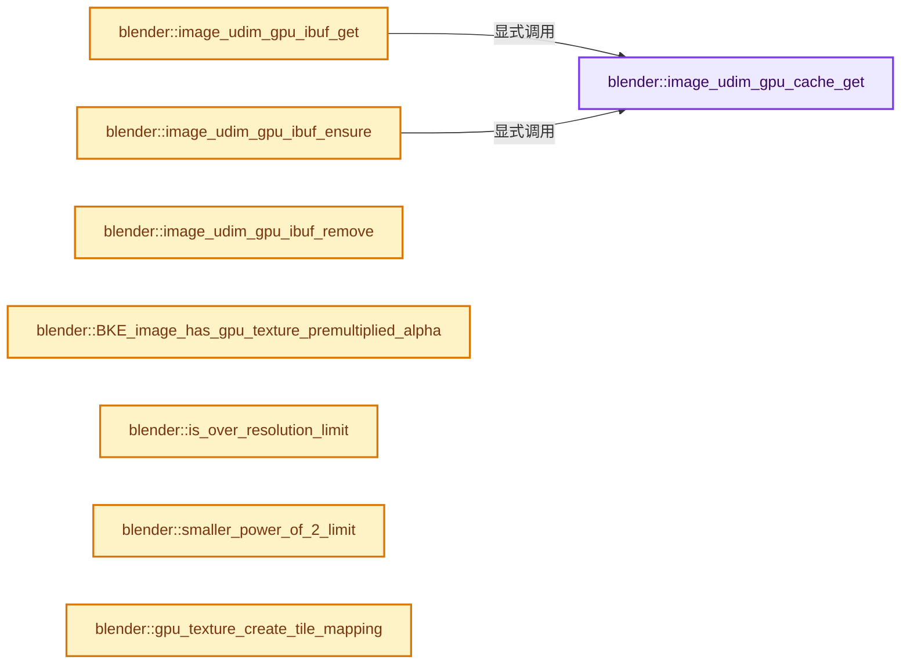
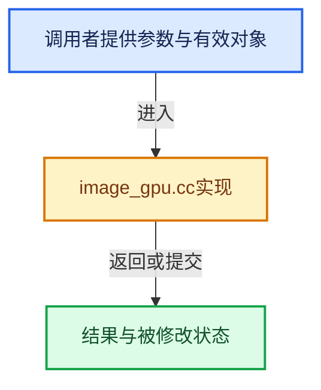

# 实现依赖专题：source/blender/blenkernel/intern/image_gpu.cc

[方向导航](README.md) · [符号索引](../%E7%AC%A6%E5%8F%B7%E4%BE%9D%E8%B5%96%E4%B8%8E%E5%AE%9E%E7%8E%B0%E7%B4%A2%E5%BC%95.md)

本专题从正文实际调用进入，集中保存共享实现。函数有稳定锚点，可从调用处直接跳到对应完整函数；递归与互相调用通过回链组织。

## 本文件的实现关系






## 完整成员与函数实现

<a id="f-7626ed041b53d620"></a>

### `blender::image_udim_gpu_cache_get`

实现位置：[source/blender/blenkernel/intern/image_gpu.cc](../../../../../source/blender/blenkernel/intern/image_gpu.cc) · L52—L62。

接口参数：

- `Image *image`
- `ImageCacheKey key`

**教学注释版**

<!-- annotated:292179101e42f4 -->

```cpp
static ImBuf *image_udim_gpu_cache_get(Image *image, ImageCacheKey key)
{
  if (image->runtime->cache == nullptr) {
    return nullptr;
  }
  ImBuf *ibuf = IMB_cache_get(image->runtime->cache, &key, nullptr);
  if (ibuf != nullptr) {
    ibuf->lastused = BLI_time_now_seconds_i();
  }
  return ibuf;
}
```

<details>
<summary>核对原始源码：source/blender/blenkernel/intern/image_gpu.cc · L52—L62</summary>

<!-- original:292179101e42f4:source/blender/blenkernel/intern/image_gpu.cc:52:62 -->

```cpp
static ImBuf *image_udim_gpu_cache_get(Image *image, ImageCacheKey key)
{
  if (image->runtime->cache == nullptr) {
    return nullptr;
  }
  ImBuf *ibuf = IMB_cache_get(image->runtime->cache, &key, nullptr);
  if (ibuf != nullptr) {
    ibuf->lastused = BLI_time_now_seconds_i();
  }
  return ibuf;
}
```

</details>

**沿实际写入检查状态**

- `ibuf->lastused = BLI_time_now_seconds_i();`

**结果出口**

- `return nullptr;`
- `return ibuf;`

**继续追踪实现**

- `IMB_cache_get` → [blender::IMB_cache_get · L403](%E4%BE%9D%E8%B5%96-cache-3c473c.md#f-f8167da094e536a4)。
- `BLI_time_now_seconds_i` → [blender::BLI_time_now_seconds_i · L36](../01-%E5%9F%BA%E7%A1%80%E5%AE%B9%E5%99%A8%E4%B8%8E%E7%8E%B0%E4%BB%A3CPP/%E4%BE%9D%E8%B5%96-time-be4317.md#f-38db665188e3ded7)。

<a id="f-b414230976120edb"></a>

### `blender::image_udim_gpu_ibuf_get`

实现位置：[source/blender/blenkernel/intern/image_gpu.cc](../../../../../source/blender/blenkernel/intern/image_gpu.cc) · L64—L67。

接口参数：

- `Image *ima`
- `const int udim_index`

**教学注释版**

<!-- annotated:de2f649b2dba20 -->

```cpp
static ImBuf *image_udim_gpu_ibuf_get(Image *ima, const int udim_index)
{
  return image_udim_gpu_cache_get(ima, ImageCacheKey{.index = udim_index});
}
```

<details>
<summary>核对原始源码：source/blender/blenkernel/intern/image_gpu.cc · L64—L67</summary>

<!-- original:de2f649b2dba20:source/blender/blenkernel/intern/image_gpu.cc:64:67 -->

```cpp
static ImBuf *image_udim_gpu_ibuf_get(Image *ima, const int udim_index)
{
  return image_udim_gpu_cache_get(ima, ImageCacheKey{.index = udim_index});
}
```

</details>

**结果出口**

- `return image_udim_gpu_cache_get(ima, ImageCacheKey{.index = udim_index});`

**继续追踪实现**

- `image_udim_gpu_cache_get` → [blender::image_udim_gpu_cache_get · L52](%E4%BE%9D%E8%B5%96-image_gpu-0d1d94.md#f-7626ed041b53d620)。

<a id="f-8a569e02c86a2bd7"></a>

### `blender::image_udim_gpu_ibuf_ensure`

实现位置：[source/blender/blenkernel/intern/image_gpu.cc](../../../../../source/blender/blenkernel/intern/image_gpu.cc) · L69—L78。

接口参数：

- `Image *ima`
- `const int udim_index`

**教学注释版**

<!-- annotated:98008fcba4edfa -->

```cpp
static ImBuf *image_udim_gpu_ibuf_ensure(Image *ima, const int udim_index)
{
  ImageCacheKey key = {.index = udim_index};
  ImBuf *ibuf = image_udim_gpu_cache_get(ima, key);
  if (ibuf == nullptr) {
    ibuf = IMB_allocImBuf(1, 1, ImBufFlags::Zero);
    imagecache_put(ima, key, ibuf);
  }
  return ibuf;
}
```

<details>
<summary>核对原始源码：source/blender/blenkernel/intern/image_gpu.cc · L69—L78</summary>

<!-- original:98008fcba4edfa:source/blender/blenkernel/intern/image_gpu.cc:69:78 -->

```cpp
static ImBuf *image_udim_gpu_ibuf_ensure(Image *ima, const int udim_index)
{
  ImageCacheKey key = {.index = udim_index};
  ImBuf *ibuf = image_udim_gpu_cache_get(ima, key);
  if (ibuf == nullptr) {
    ibuf = IMB_allocImBuf(1, 1, ImBufFlags::Zero);
    imagecache_put(ima, key, ibuf);
  }
  return ibuf;
}
```

</details>

**沿实际写入检查状态**

- `ibuf = IMB_allocImBuf(1, 1, ImBufFlags::Zero);`

**结果出口**

- `return ibuf;`

**继续追踪实现**

- `image_udim_gpu_cache_get` → [blender::image_udim_gpu_cache_get · L52](%E4%BE%9D%E8%B5%96-image_gpu-0d1d94.md#f-7626ed041b53d620)。
- `IMB_allocImBuf` → [blender::IMB_allocImBuf · L367](%E4%BE%9D%E8%B5%96-allocimbuf-bc68dd.md#f-971d0005c46aad53)。
- `imagecache_put` → [blender::imagecache_put · L571](%E4%BE%9D%E8%B5%96-image-4859ac.md#f-71629a2ff80c48df)。

<a id="f-4c0b07dc72210410"></a>

### `blender::image_udim_gpu_ibuf_remove`

实现位置：[source/blender/blenkernel/intern/image_gpu.cc](../../../../../source/blender/blenkernel/intern/image_gpu.cc) · L80—L87。

接口参数：

- `Image *ima`
- `const int udim_index`

**教学注释版**

<!-- annotated:f18e968d5eb632 -->

```cpp
static void image_udim_gpu_ibuf_remove(Image *ima, const int udim_index)
{
  if (ima->runtime->cache == nullptr) {
    return;
  }
  ImageCacheKey key{.index = udim_index};
  IMB_cache_remove(ima->runtime->cache, &key);
}
```

<details>
<summary>核对原始源码：source/blender/blenkernel/intern/image_gpu.cc · L80—L87</summary>

<!-- original:f18e968d5eb632:source/blender/blenkernel/intern/image_gpu.cc:80:87 -->

```cpp
static void image_udim_gpu_ibuf_remove(Image *ima, const int udim_index)
{
  if (ima->runtime->cache == nullptr) {
    return;
  }
  ImageCacheKey key{.index = udim_index};
  IMB_cache_remove(ima->runtime->cache, &key);
}
```

</details>

**继续追踪实现**

- `IMB_cache_remove` → [blender::IMB_cache_remove · L395](%E4%BE%9D%E8%B5%96-cache-3c473c.md#f-c355b1e652a4c84e)。

<a id="f-0174453a4595ffea"></a>

### `blender::BKE_image_has_gpu_texture_premultiplied_alpha`

实现位置：[source/blender/blenkernel/intern/image_gpu.cc](../../../../../source/blender/blenkernel/intern/image_gpu.cc) · L116—L136。

接口参数：

- `Image *image`
- `ImBuf *ibuf`

**教学注释版**

<!-- annotated:d661fae84b1532 -->

```cpp
bool BKE_image_has_gpu_texture_premultiplied_alpha(Image *image, ImBuf *ibuf)
{
  if (image) {
    /* Render result and compositor output are always premultiplied */
    if (ELEM(image->type, IMA_TYPE_R_RESULT, IMA_TYPE_COMPOSITE)) {
      return true;
    }
    /* Generated images use pre multiplied float buffer, but straight alpha for byte buffers. */
    if (image->type == IMA_TYPE_UV_TEST && ibuf) {
      return ibuf->float_data() != nullptr;
    }
  }
  if (ibuf) {
    if (ibuf->float_data()) {
      return image ? (image->alpha_mode != IMA_ALPHA_STRAIGHT) : false;
    }

    return image ? (image->alpha_mode == IMA_ALPHA_PREMUL) : true;
  }
  return false;
}
```

<details>
<summary>核对原始源码：source/blender/blenkernel/intern/image_gpu.cc · L116—L136</summary>

<!-- original:d661fae84b1532:source/blender/blenkernel/intern/image_gpu.cc:116:136 -->

```cpp
bool BKE_image_has_gpu_texture_premultiplied_alpha(Image *image, ImBuf *ibuf)
{
  if (image) {
    /* Render result and compositor output are always premultiplied */
    if (ELEM(image->type, IMA_TYPE_R_RESULT, IMA_TYPE_COMPOSITE)) {
      return true;
    }
    /* Generated images use pre multiplied float buffer, but straight alpha for byte buffers. */
    if (image->type == IMA_TYPE_UV_TEST && ibuf) {
      return ibuf->float_data() != nullptr;
    }
  }
  if (ibuf) {
    if (ibuf->float_data()) {
      return image ? (image->alpha_mode != IMA_ALPHA_STRAIGHT) : false;
    }

    return image ? (image->alpha_mode == IMA_ALPHA_PREMUL) : true;
  }
  return false;
}
```

</details>

**结果出口**

- `return true;`
- `return ibuf->float_data() != nullptr;`
- `return image ? (image->alpha_mode != IMA_ALPHA_STRAIGHT) : false;`
- `return image ? (image->alpha_mode == IMA_ALPHA_PREMUL) : true;`
- `return false;`

**继续追踪实现**

- `ELEM` → [ELEM · L88](%E4%BE%9D%E8%B5%96-GHOST_utildefines-34b996.md#m-d28724a15928)；[ELEM · L135](../01-%E5%9F%BA%E7%A1%80%E5%AE%B9%E5%99%A8%E4%B8%8E%E7%8E%B0%E4%BB%A3CPP/%E4%BE%9D%E8%B5%96-BLI_utildefines-293a0a.md#m-d6572de7cae0)。宏定义由构建条件选择。
- `ibuf->float_data` → [blender::ImBuf::float_data · L358](%E4%BE%9D%E8%B5%96-IMB_imbuf_types-f69e60.md#f-2e52aa77544ffaee)。

<a id="f-f63a16f643c566ae"></a>

### `blender::is_over_resolution_limit`

实现位置：[source/blender/blenkernel/intern/image_gpu.cc](../../../../../source/blender/blenkernel/intern/image_gpu.cc) · L144—L147。

接口参数：

- `int w`
- `int h`

**教学注释版**

<!-- annotated:8ac7aaff4f108f -->

```cpp
static bool is_over_resolution_limit(int w, int h)
{
  return (w > GPU_texture_size_with_limit(w) || h > GPU_texture_size_with_limit(h));
}
```

<details>
<summary>核对原始源码：source/blender/blenkernel/intern/image_gpu.cc · L144—L147</summary>

<!-- original:8ac7aaff4f108f:source/blender/blenkernel/intern/image_gpu.cc:144:147 -->

```cpp
static bool is_over_resolution_limit(int w, int h)
{
  return (w > GPU_texture_size_with_limit(w) || h > GPU_texture_size_with_limit(h));
}
```

</details>

**结果出口**

- `return (w > GPU_texture_size_with_limit(w) || h > GPU_texture_size_with_limit(h));`

**继续追踪实现**

- `GPU_texture_size_with_limit` → [blender::GPU_texture_size_with_limit · L49](%E4%BE%9D%E8%B5%96-gpu_capabilities-508ffd.md#f-646196408c861985)。

<a id="f-2a5b16d8839528ea"></a>

### `blender::smaller_power_of_2_limit`

实现位置：[source/blender/blenkernel/intern/image_gpu.cc](../../../../../source/blender/blenkernel/intern/image_gpu.cc) · L149—L152。

接口参数：

- `int num`

**教学注释版**

<!-- annotated:8dfb8b420378cd -->

```cpp
static int smaller_power_of_2_limit(int num)
{
  return power_of_2_min_i(GPU_texture_size_with_limit(num));
}
```

<details>
<summary>核对原始源码：source/blender/blenkernel/intern/image_gpu.cc · L149—L152</summary>

<!-- original:8dfb8b420378cd:source/blender/blenkernel/intern/image_gpu.cc:149:152 -->

```cpp
static int smaller_power_of_2_limit(int num)
{
  return power_of_2_min_i(GPU_texture_size_with_limit(num));
}
```

</details>

**结果出口**

- `return power_of_2_min_i(GPU_texture_size_with_limit(num));`

**继续追踪实现**

- `power_of_2_min_i` → [blender::power_of_2_min_i · L123](../12-%E7%A9%BA%E9%97%B4%E6%95%B0%E6%8D%AE%E7%BB%93%E6%9E%84%E4%B8%8E%E5%87%A0%E4%BD%95%E7%AE%97%E6%B3%95/%E4%BE%9D%E8%B5%96-math_base_inline-546b00.md#f-9bbfa512c2df99c4)。
- `GPU_texture_size_with_limit` → [blender::GPU_texture_size_with_limit · L49](%E4%BE%9D%E8%B5%96-gpu_capabilities-508ffd.md#f-646196408c861985)。

<a id="f-281ed296f280072b"></a>

### `blender::gpu_texture_create_tile_mapping`

实现位置：[source/blender/blenkernel/intern/image_gpu.cc](../../../../../source/blender/blenkernel/intern/image_gpu.cc) · L154—L200。

接口参数：

- `Image *ima`
- `gpu::Texture *tilearray`

**教学注释版**

<!-- annotated:0f2066cf332dba -->

```cpp
static gpu::Texture *gpu_texture_create_tile_mapping(Image *ima, gpu::Texture *tilearray)
{
  if (tilearray == nullptr) {
    return nullptr;
  }

  float array_w = GPU_texture_width(tilearray);
  float array_h = GPU_texture_height(tilearray);

  /* Determine maximum tile number. */
  BKE_image_sort_tiles(ima);
  ImageTile *last_tile = ima->tiles.last();
  int max_tile = last_tile->tile_number - 1001;

  /* create image */
  int width = max_tile + 1;
  float *data = MEM_new_array_zeroed<float>(size_t(width) * 8, __func__);
  for (int i = 0; i < width; i++) {
    data[4 * i] = -1.0f;
  }
  for (ImageTile &tile : ima->tiles) {
    int i = tile.tile_number - 1001;
    ImageTile_Runtime *tile_runtime = &tile.runtime;
    data[4 * i] = tile_runtime->tilearray_layer;

    float *tile_info = &data[4 * width + 4 * i];
    tile_info[0] = tile_runtime->tilearray_offset[0] / array_w;
    tile_info[1] = tile_runtime->tilearray_offset[1] / array_h;
    tile_info[2] = tile_runtime->tilearray_size[0] / array_w;
    tile_info[3] = tile_runtime->tilearray_size[1] / array_h;
  }

  gpu::Texture *tex = GPU_texture_create_1d_array(ima->id.name + 2,
                                                  width,
                                                  2,
                                                  1,
                                                  gpu::TextureFormat::SFLOAT_32_32_32_32,
                                                  GPU_TEXTURE_USAGE_SHADER_READ,
                                                  data);
  if (tex != nullptr) {
    GPU_texture_mipmap_mode(tex, false, false);
  }

  MEM_delete(data);

  return tex;
}
```

<details>
<summary>核对原始源码：source/blender/blenkernel/intern/image_gpu.cc · L154—L200</summary>

<!-- original:0f2066cf332dba:source/blender/blenkernel/intern/image_gpu.cc:154:200 -->

```cpp
static gpu::Texture *gpu_texture_create_tile_mapping(Image *ima, gpu::Texture *tilearray)
{
  if (tilearray == nullptr) {
    return nullptr;
  }

  float array_w = GPU_texture_width(tilearray);
  float array_h = GPU_texture_height(tilearray);

  /* Determine maximum tile number. */
  BKE_image_sort_tiles(ima);
  ImageTile *last_tile = ima->tiles.last();
  int max_tile = last_tile->tile_number - 1001;

  /* create image */
  int width = max_tile + 1;
  float *data = MEM_new_array_zeroed<float>(size_t(width) * 8, __func__);
  for (int i = 0; i < width; i++) {
    data[4 * i] = -1.0f;
  }
  for (ImageTile &tile : ima->tiles) {
    int i = tile.tile_number - 1001;
    ImageTile_Runtime *tile_runtime = &tile.runtime;
    data[4 * i] = tile_runtime->tilearray_layer;

    float *tile_info = &data[4 * width + 4 * i];
    tile_info[0] = tile_runtime->tilearray_offset[0] / array_w;
    tile_info[1] = tile_runtime->tilearray_offset[1] / array_h;
    tile_info[2] = tile_runtime->tilearray_size[0] / array_w;
    tile_info[3] = tile_runtime->tilearray_size[1] / array_h;
  }

  gpu::Texture *tex = GPU_texture_create_1d_array(ima->id.name + 2,
                                                  width,
                                                  2,
                                                  1,
                                                  gpu::TextureFormat::SFLOAT_32_32_32_32,
                                                  GPU_TEXTURE_USAGE_SHADER_READ,
                                                  data);
  if (tex != nullptr) {
    GPU_texture_mipmap_mode(tex, false, false);
  }

  MEM_delete(data);

  return tex;
}
```

</details>

**沿实际写入检查状态**

- `tile_info[0] = tile_runtime->tilearray_offset[0] / array_w;`
- `tile_info[1] = tile_runtime->tilearray_offset[1] / array_h;`
- `tile_info[2] = tile_runtime->tilearray_size[0] / array_w;`
- `tile_info[3] = tile_runtime->tilearray_size[1] / array_h;`

**结果出口**

- `return nullptr;`
- `return tex;`

**继续追踪实现**

- `GPU_texture_width` → [blender::GPU_texture_width · L773](%E4%BE%9D%E8%B5%96-gpu_texture-234bda.md#f-0f5cbfbefa217516)。
- `GPU_texture_height` → [blender::GPU_texture_height · L778](%E4%BE%9D%E8%B5%96-gpu_texture-234bda.md#f-aabd7afc7f83d281)。
- `BKE_image_sort_tiles` → [blender::BKE_image_sort_tiles · L3740](%E4%BE%9D%E8%B5%96-image-4859ac.md#f-2858611f010b795e)。
- `ima->tiles.last` → [调用协议](../%E6%A8%A1%E6%9D%BF%E5%AE%8F%E4%B8%8E%E5%8A%A8%E6%80%81%E5%88%86%E6%B4%BE%E5%8D%8F%E8%AE%AE.md)：接收对象类型依赖auto、返回值或模板实例；不按同名猜测目标。调用位置L165。
- `MEM_new_array_zeroed<float>` → [MEM_new_array_zeroed · L566](../03-%E5%86%85%E5%AD%98%E5%88%86%E9%85%8D%E4%B8%8E%E8%BF%90%E8%A1%8C%E6%97%B6%E7%B1%BB%E5%9E%8B/%E4%BE%9D%E8%B5%96-MEM_guardedalloc-b54eca.md#f-3a0cf63fb5216500)；[MEM_new_array_zeroed · L119](../03-%E5%86%85%E5%AD%98%E5%88%86%E9%85%8D%E4%B8%8E%E8%BF%90%E8%A1%8C%E6%97%B6%E7%B1%BB%E5%9E%8B/%E4%BE%9D%E8%B5%96-mallocn-afdcd4.md#f-6825557da566fdbe)。同名重载需按实参类型选择。
- `GPU_texture_create_1d_array` → [blender::GPU_texture_create_1d_array · L296](%E4%BE%9D%E8%B5%96-gpu_texture-234bda.md#f-94f4328588fba6ec)。
- `GPU_texture_mipmap_mode` → [blender::GPU_texture_mipmap_mode · L692](%E4%BE%9D%E8%B5%96-gpu_texture-234bda.md#f-8170dabb7d89f6dd)。
- `MEM_delete` → [MEM_delete · L400](../03-%E5%86%85%E5%AD%98%E5%88%86%E9%85%8D%E4%B8%8E%E8%BF%90%E8%A1%8C%E6%97%B6%E7%B1%BB%E5%9E%8B/%E4%BE%9D%E8%B5%96-MEM_guardedalloc-b54eca.md#f-9049ffdd1682887c)。

<a id="f-5806f008faafb713"></a>

### `blender::gpu_texture_create_tile_array`

实现位置：[source/blender/blenkernel/intern/image_gpu.cc](../../../../../source/blender/blenkernel/intern/image_gpu.cc) · L216—L332。

接口参数：

- `Image *ima`
- `ImBuf *main_ibuf`

**教学注释版**

<!-- annotated:a75d3fd0b29ec5 -->

```cpp
static gpu::Texture *gpu_texture_create_tile_array(Image *ima, ImBuf *main_ibuf)
{
  int arraywidth = 0, arrayheight = 0;
  ListBaseT<FixedSizeBoxPack> boxes = {nullptr};

  bool all_grayscale = true;

  for (ImageTile &tile : ima->tiles) {
    ImageUser iuser;
    BKE_imageuser_default(&iuser);
    iuser.tile = tile.tile_number;
    ImBuf *ibuf = BKE_image_acquire_ibuf(ima, &iuser, nullptr);

    if (ibuf) {
      PackTile *packtile = MEM_new_zeroed<PackTile>(__func__);
      packtile->tile = &tile;
      packtile->boxpack.w = ibuf->x;
      packtile->boxpack.h = ibuf->y;

      if (is_over_resolution_limit(packtile->boxpack.w, packtile->boxpack.h)) {
        packtile->boxpack.w = smaller_power_of_2_limit(packtile->boxpack.w);
        packtile->boxpack.h = smaller_power_of_2_limit(packtile->boxpack.h);
      }
      arraywidth = max_ii(arraywidth, packtile->boxpack.w);
      arrayheight = max_ii(arrayheight, packtile->boxpack.h);

      /* We sort the tiles by decreasing size, with an additional penalty term
       * for high aspect ratios. This improves packing efficiency. */
      float w = packtile->boxpack.w, h = packtile->boxpack.h;
      packtile->pack_score = max_ff(w, h) / min_ff(w, h) * w * h;

      BKE_image_release_ibuf(ima, ibuf, nullptr);
      BLI_addtail(&boxes, packtile);
      if (ibuf->color_mode != ImColorMode::BW) {
        all_grayscale = false;
      }
    }
  }

  BLI_assert(arraywidth > 0 && arrayheight > 0);

  BLI_listbase_sort(&boxes, compare_packtile);
  int arraylayers = 0;
  /* Keep adding layers until all tiles are packed. */
  while (boxes.first() != nullptr) {
    ListBaseT<FixedSizeBoxPack> packed = {nullptr};
    BLI_box_pack_2d_fixedarea(&boxes, arraywidth, arrayheight, &packed);
    BLI_assert(packed.first() != nullptr);

    for (const FixedSizeBoxPack &fixedpack : packed) {
      const PackTile *packtile = reinterpret_cast<const PackTile *>(&fixedpack);
      ImageTile *tile = packtile->tile;
      ImageTile_Runtime *tile_runtime = &tile->runtime;
      int *tileoffset = tile_runtime->tilearray_offset;
      int *tilesize = tile_runtime->tilearray_size;

      tileoffset[0] = packtile->boxpack.x;
      tileoffset[1] = packtile->boxpack.y;
      tilesize[0] = packtile->boxpack.w;
      tilesize[1] = packtile->boxpack.h;
      tile_runtime->tilearray_layer = arraylayers;
    }

    packed.free_no_destruct();
    arraylayers++;
  }

  const bool use_high_bitdepth = (ima->flag & IMA_HIGH_BITDEPTH);
  const bool use_grayscale = all_grayscale;
  /* Create Texture without content. */
  gpu::Texture *tex = IMB_touch_gpu_texture(ima->id.name + 2,
                                            main_ibuf,
                                            arraywidth,
                                            arrayheight,
                                            arraylayers,
                                            use_high_bitdepth,
                                            use_grayscale);

  if (!tex) {
    return nullptr;
  }

  /* Upload each tile one by one. */
  for (ImageTile &tile : ima->tiles) {
    const ImageTile_Runtime *tile_runtime = &tile.runtime;
    const int tilelayer = tile_runtime->tilearray_layer;
    const int *tileoffset = tile_runtime->tilearray_offset;
    const int *tilesize = tile_runtime->tilearray_size;

    if (tilesize[0] == 0 || tilesize[1] == 0) {
      continue;
    }

    ImageUser iuser;
    BKE_imageuser_default(&iuser);
    iuser.tile = tile.tile_number;
    ImBuf *ibuf = BKE_image_acquire_ibuf(ima, &iuser, nullptr);

    if (ibuf) {
      const bool store_premultiplied = BKE_image_has_gpu_texture_premultiplied_alpha(ima, ibuf);
      IMB_update_gpu_texture_sub(tex,
                                 ibuf,
                                 UNPACK2(tileoffset),
                                 tilelayer,
                                 UNPACK2(tilesize),
                                 use_grayscale,
                                 store_premultiplied);
    }

    BKE_image_release_ibuf(ima, ibuf, nullptr);
  }

  GPU_texture_update_mipmap_chain(tex);
  GPU_texture_original_size_set(tex, main_ibuf->x, main_ibuf->y);

  return tex;
}
```

<details>
<summary>核对原始源码：source/blender/blenkernel/intern/image_gpu.cc · L216—L332</summary>

<!-- original:a75d3fd0b29ec5:source/blender/blenkernel/intern/image_gpu.cc:216:332 -->

```cpp
static gpu::Texture *gpu_texture_create_tile_array(Image *ima, ImBuf *main_ibuf)
{
  int arraywidth = 0, arrayheight = 0;
  ListBaseT<FixedSizeBoxPack> boxes = {nullptr};

  bool all_grayscale = true;

  for (ImageTile &tile : ima->tiles) {
    ImageUser iuser;
    BKE_imageuser_default(&iuser);
    iuser.tile = tile.tile_number;
    ImBuf *ibuf = BKE_image_acquire_ibuf(ima, &iuser, nullptr);

    if (ibuf) {
      PackTile *packtile = MEM_new_zeroed<PackTile>(__func__);
      packtile->tile = &tile;
      packtile->boxpack.w = ibuf->x;
      packtile->boxpack.h = ibuf->y;

      if (is_over_resolution_limit(packtile->boxpack.w, packtile->boxpack.h)) {
        packtile->boxpack.w = smaller_power_of_2_limit(packtile->boxpack.w);
        packtile->boxpack.h = smaller_power_of_2_limit(packtile->boxpack.h);
      }
      arraywidth = max_ii(arraywidth, packtile->boxpack.w);
      arrayheight = max_ii(arrayheight, packtile->boxpack.h);

      /* We sort the tiles by decreasing size, with an additional penalty term
       * for high aspect ratios. This improves packing efficiency. */
      float w = packtile->boxpack.w, h = packtile->boxpack.h;
      packtile->pack_score = max_ff(w, h) / min_ff(w, h) * w * h;

      BKE_image_release_ibuf(ima, ibuf, nullptr);
      BLI_addtail(&boxes, packtile);
      if (ibuf->color_mode != ImColorMode::BW) {
        all_grayscale = false;
      }
    }
  }

  BLI_assert(arraywidth > 0 && arrayheight > 0);

  BLI_listbase_sort(&boxes, compare_packtile);
  int arraylayers = 0;
  /* Keep adding layers until all tiles are packed. */
  while (boxes.first() != nullptr) {
    ListBaseT<FixedSizeBoxPack> packed = {nullptr};
    BLI_box_pack_2d_fixedarea(&boxes, arraywidth, arrayheight, &packed);
    BLI_assert(packed.first() != nullptr);

    for (const FixedSizeBoxPack &fixedpack : packed) {
      const PackTile *packtile = reinterpret_cast<const PackTile *>(&fixedpack);
      ImageTile *tile = packtile->tile;
      ImageTile_Runtime *tile_runtime = &tile->runtime;
      int *tileoffset = tile_runtime->tilearray_offset;
      int *tilesize = tile_runtime->tilearray_size;

      tileoffset[0] = packtile->boxpack.x;
      tileoffset[1] = packtile->boxpack.y;
      tilesize[0] = packtile->boxpack.w;
      tilesize[1] = packtile->boxpack.h;
      tile_runtime->tilearray_layer = arraylayers;
    }

    packed.free_no_destruct();
    arraylayers++;
  }

  const bool use_high_bitdepth = (ima->flag & IMA_HIGH_BITDEPTH);
  const bool use_grayscale = all_grayscale;
  /* Create Texture without content. */
  gpu::Texture *tex = IMB_touch_gpu_texture(ima->id.name + 2,
                                            main_ibuf,
                                            arraywidth,
                                            arrayheight,
                                            arraylayers,
                                            use_high_bitdepth,
                                            use_grayscale);

  if (!tex) {
    return nullptr;
  }

  /* Upload each tile one by one. */
  for (ImageTile &tile : ima->tiles) {
    const ImageTile_Runtime *tile_runtime = &tile.runtime;
    const int tilelayer = tile_runtime->tilearray_layer;
    const int *tileoffset = tile_runtime->tilearray_offset;
    const int *tilesize = tile_runtime->tilearray_size;

    if (tilesize[0] == 0 || tilesize[1] == 0) {
      continue;
    }

    ImageUser iuser;
    BKE_imageuser_default(&iuser);
    iuser.tile = tile.tile_number;
    ImBuf *ibuf = BKE_image_acquire_ibuf(ima, &iuser, nullptr);

    if (ibuf) {
      const bool store_premultiplied = BKE_image_has_gpu_texture_premultiplied_alpha(ima, ibuf);
      IMB_update_gpu_texture_sub(tex,
                                 ibuf,
                                 UNPACK2(tileoffset),
                                 tilelayer,
                                 UNPACK2(tilesize),
                                 use_grayscale,
                                 store_premultiplied);
    }

    BKE_image_release_ibuf(ima, ibuf, nullptr);
  }

  GPU_texture_update_mipmap_chain(tex);
  GPU_texture_original_size_set(tex, main_ibuf->x, main_ibuf->y);

  return tex;
}
```

</details>

**沿实际写入检查状态**

- `iuser.tile = tile.tile_number;`
- `packtile->tile = &tile;`
- `packtile->boxpack.w = ibuf->x;`
- `packtile->boxpack.h = ibuf->y;`
- `packtile->boxpack.w = smaller_power_of_2_limit(packtile->boxpack.w);`
- `packtile->boxpack.h = smaller_power_of_2_limit(packtile->boxpack.h);`
- `arraywidth = max_ii(arraywidth, packtile->boxpack.w);`
- `arrayheight = max_ii(arrayheight, packtile->boxpack.h);`
- `packtile->pack_score = max_ff(w, h) / min_ff(w, h) * w * h;`
- `all_grayscale = false;`
- `tileoffset[0] = packtile->boxpack.x;`
- `tileoffset[1] = packtile->boxpack.y;`
- `tilesize[0] = packtile->boxpack.w;`
- `tilesize[1] = packtile->boxpack.h;`
- `tile_runtime->tilearray_layer = arraylayers;`

**结果出口**

- `return nullptr;`
- `return tex;`

**继续追踪实现**

- `BKE_imageuser_default` → [blender::BKE_imageuser_default · L3282](%E4%BE%9D%E8%B5%96-image-4859ac.md#f-9cec85c3722069ed)。
- `BKE_image_acquire_ibuf` → [blender::BKE_image_acquire_ibuf · L5032](%E4%BE%9D%E8%B5%96-image-4859ac.md#f-b6fae65bd4cf1a9a)。
- `MEM_new_zeroed<PackTile>` → [MEM_new_zeroed · L550](../03-%E5%86%85%E5%AD%98%E5%88%86%E9%85%8D%E4%B8%8E%E8%BF%90%E8%A1%8C%E6%97%B6%E7%B1%BB%E5%9E%8B/%E4%BE%9D%E8%B5%96-MEM_guardedalloc-b54eca.md#f-eeb1e2a7f57dd231)；[MEM_new_zeroed · L114](../03-%E5%86%85%E5%AD%98%E5%88%86%E9%85%8D%E4%B8%8E%E8%BF%90%E8%A1%8C%E6%97%B6%E7%B1%BB%E5%9E%8B/%E4%BE%9D%E8%B5%96-mallocn-afdcd4.md#f-e04cf01c64c8b180)。同名重载需按实参类型选择。
- `is_over_resolution_limit` → [blender::is_over_resolution_limit · L144](%E4%BE%9D%E8%B5%96-image_gpu-0d1d94.md#f-f63a16f643c566ae)。
- `smaller_power_of_2_limit` → [blender::smaller_power_of_2_limit · L149](%E4%BE%9D%E8%B5%96-image_gpu-0d1d94.md#f-2a5b16d8839528ea)。
- `max_ii` → [blender::max_ii · L368](../12-%E7%A9%BA%E9%97%B4%E6%95%B0%E6%8D%AE%E7%BB%93%E6%9E%84%E4%B8%8E%E5%87%A0%E4%BD%95%E7%AE%97%E6%B3%95/%E4%BE%9D%E8%B5%96-math_base_inline-546b00.md#f-c45aa7b373adb94c)。
- `max_ff` → [blender::max_ff · L325](../12-%E7%A9%BA%E9%97%B4%E6%95%B0%E6%8D%AE%E7%BB%93%E6%9E%84%E4%B8%8E%E5%87%A0%E4%BD%95%E7%AE%97%E6%B3%95/%E4%BE%9D%E8%B5%96-math_base_inline-546b00.md#f-05a351a3afd7dc2a)。
- `min_ff` → [blender::min_ff · L321](../12-%E7%A9%BA%E9%97%B4%E6%95%B0%E6%8D%AE%E7%BB%93%E6%9E%84%E4%B8%8E%E5%87%A0%E4%BD%95%E7%AE%97%E6%B3%95/%E4%BE%9D%E8%B5%96-math_base_inline-546b00.md#f-5b8d83d6f191be1a)。
- `BKE_image_release_ibuf` → [blender::BKE_image_release_ibuf · L5123](%E4%BE%9D%E8%B5%96-image-4859ac.md#f-c8c0b47bac00ca6f)。
- `BLI_addtail` → [blender::BLI_addtail · L118](../01-%E5%9F%BA%E7%A1%80%E5%AE%B9%E5%99%A8%E4%B8%8E%E7%8E%B0%E4%BB%A3CPP/%E4%BE%9D%E8%B5%96-listbase-2816d9.md#f-4fb027713fa3115b)。
- `BLI_assert` → [BLI_assert · L48](../01-%E5%9F%BA%E7%A1%80%E5%AE%B9%E5%99%A8%E4%B8%8E%E7%8E%B0%E4%BB%A3CPP/%E4%BE%9D%E8%B5%96-BLI_assert-cc98e8.md#m-57a88495704d)；[BLI_assert · L63](../01-%E5%9F%BA%E7%A1%80%E5%AE%B9%E5%99%A8%E4%B8%8E%E7%8E%B0%E4%BB%A3CPP/%E4%BE%9D%E8%B5%96-BLI_assert-cc98e8.md#m-d07050020cb5)。宏定义由构建条件选择。
- `BLI_listbase_sort` → [blender::BLI_listbase_sort · L319](../01-%E5%9F%BA%E7%A1%80%E5%AE%B9%E5%99%A8%E4%B8%8E%E7%8E%B0%E4%BB%A3CPP/%E4%BE%9D%E8%B5%96-listbase-2816d9.md#f-03f9b3ff7a56175f)。
- `boxes.first` → [blender::ListBaseT::first · L102](%E4%BE%9D%E8%B5%96-DNA_listBase-48dbc9.md#f-3d12ff35da057c9e)；[blender::ListBaseT::first · L106](%E4%BE%9D%E8%B5%96-DNA_listBase-48dbc9.md#f-0df87c3480e059f9)。同名重载需按实参类型选择。
- `BLI_box_pack_2d_fixedarea` → [blender::BLI_box_pack_2d_fixedarea · L651](../01-%E5%9F%BA%E7%A1%80%E5%AE%B9%E5%99%A8%E4%B8%8E%E7%8E%B0%E4%BB%A3CPP/%E4%BE%9D%E8%B5%96-boxpack_2d-593ace.md#f-dce99a1602447831)。
- `packed.first` → [blender::ListBaseT::first · L102](%E4%BE%9D%E8%B5%96-DNA_listBase-48dbc9.md#f-3d12ff35da057c9e)；[blender::ListBaseT::first · L106](%E4%BE%9D%E8%B5%96-DNA_listBase-48dbc9.md#f-0df87c3480e059f9)。同名重载需按实参类型选择。
- `packed.free_no_destruct` → [blender::ListBaseT::free_no_destruct · L78](%E4%BE%9D%E8%B5%96-DNA_listBase-48dbc9.md#f-8656670edd0f6b7e)。
- `IMB_touch_gpu_texture` → [blender::IMB_touch_gpu_texture · L402](%E4%BE%9D%E8%B5%96-util_gpu-e27867.md#f-9eae6038c9a4edbb)。
- `BKE_image_has_gpu_texture_premultiplied_alpha` → [blender::BKE_image_has_gpu_texture_premultiplied_alpha · L116](%E4%BE%9D%E8%B5%96-image_gpu-0d1d94.md#f-0174453a4595ffea)。
- `IMB_update_gpu_texture_sub` → [blender::IMB_update_gpu_texture_sub · L428](%E4%BE%9D%E8%B5%96-util_gpu-e27867.md#f-da7b1dc4c325cde0)。
- `UNPACK2` → [UNPACK2 · L22](%E4%BE%9D%E8%B5%96-GHOST_utildefines-34b996.md#m-00ad768fe1c1)；[UNPACK2 · L234](../01-%E5%9F%BA%E7%A1%80%E5%AE%B9%E5%99%A8%E4%B8%8E%E7%8E%B0%E4%BB%A3CPP/%E4%BE%9D%E8%B5%96-BLI_utildefines-293a0a.md#m-96ff8266d239)；[UNPACK2 · L13](%E4%BE%9D%E8%B5%96-gpu_shader_utildefines.bsl-e9f199.md#m-8316603fb9a6)。宏定义由构建条件选择。
- `GPU_texture_update_mipmap_chain` → [blender::GPU_texture_update_mipmap_chain · L379](%E4%BE%9D%E8%B5%96-gpu_texture_mipmap-4069a9.md#f-ae3d338615e86225)。
- `GPU_texture_original_size_set` → [blender::GPU_texture_original_size_set · L808](%E4%BE%9D%E8%B5%96-gpu_texture-234bda.md#f-205dd9d57e5f0fe2)。

<a id="f-83ac70f57d18e8d1"></a>

### `blender::image_cache_free_inactive_frame_gpu_textures`

实现位置：[source/blender/blenkernel/intern/image_gpu.cc](../../../../../source/blender/blenkernel/intern/image_gpu.cc) · L345—L368。

接口参数：

- `Image *ima`
- `const ImBuf *current_ibuf`

**教学注释版**

<!-- annotated:dd56a3cf3701a0 -->

```cpp
static void image_cache_free_inactive_frame_gpu_textures(Image *ima, const ImBuf *current_ibuf)
{
  if (!ELEM(ima->source, IMA_SRC_MOVIE, IMA_SRC_SEQUENCE) || ima->runtime->cache == nullptr) {
    return;
  }

  std::scoped_lock lock(ima->runtime->cache_mutex);

  /* The frame that backs the buffer currently in use. */
  const int current_frame = current_ibuf->fileframe;

  /* Free GPU textures of other frames. */
  ImBufCacheIter *iter = IMB_cacheIter_new(ima->runtime->cache);
  while (!IMB_cacheIter_done(iter)) {
    ImBuf *ibuf = IMB_cacheIter_getImBuf(iter);
    if (ibuf != nullptr && ibuf->gpu.texture != nullptr && ibuf->fileframe != current_frame &&
        ibuf->refcounter == 0)
    {
      IMB_free_gpu_textures(ibuf);
    }
    IMB_cacheIter_step(iter);
  }
  IMB_cacheIter_free(iter);
}
```

<details>
<summary>核对原始源码：source/blender/blenkernel/intern/image_gpu.cc · L345—L368</summary>

<!-- original:dd56a3cf3701a0:source/blender/blenkernel/intern/image_gpu.cc:345:368 -->

```cpp
static void image_cache_free_inactive_frame_gpu_textures(Image *ima, const ImBuf *current_ibuf)
{
  if (!ELEM(ima->source, IMA_SRC_MOVIE, IMA_SRC_SEQUENCE) || ima->runtime->cache == nullptr) {
    return;
  }

  std::scoped_lock lock(ima->runtime->cache_mutex);

  /* The frame that backs the buffer currently in use. */
  const int current_frame = current_ibuf->fileframe;

  /* Free GPU textures of other frames. */
  ImBufCacheIter *iter = IMB_cacheIter_new(ima->runtime->cache);
  while (!IMB_cacheIter_done(iter)) {
    ImBuf *ibuf = IMB_cacheIter_getImBuf(iter);
    if (ibuf != nullptr && ibuf->gpu.texture != nullptr && ibuf->fileframe != current_frame &&
        ibuf->refcounter == 0)
    {
      IMB_free_gpu_textures(ibuf);
    }
    IMB_cacheIter_step(iter);
  }
  IMB_cacheIter_free(iter);
}
```

</details>

**继续追踪实现**

- `ELEM` → [ELEM · L88](%E4%BE%9D%E8%B5%96-GHOST_utildefines-34b996.md#m-d28724a15928)；[ELEM · L135](../01-%E5%9F%BA%E7%A1%80%E5%AE%B9%E5%99%A8%E4%B8%8E%E7%8E%B0%E4%BB%A3CPP/%E4%BE%9D%E8%B5%96-BLI_utildefines-293a0a.md#m-d6572de7cae0)。宏定义由构建条件选择。
- `IMB_cacheIter_new` → [blender::IMB_cacheIter_new · L577](%E4%BE%9D%E8%B5%96-cache-3c473c.md#f-9718cf089fc36265)。
- `IMB_cacheIter_done` → [blender::IMB_cacheIter_done · L592](%E4%BE%9D%E8%B5%96-cache-3c473c.md#f-bc1cdab0db1ebde1)。
- `IMB_cacheIter_getImBuf` → [blender::IMB_cacheIter_getImBuf · L602](%E4%BE%9D%E8%B5%96-cache-3c473c.md#f-c00940f2fb657b8c)。
- `IMB_free_gpu_textures` → [blender::IMB_free_gpu_textures · L832](%E4%BE%9D%E8%B5%96-util_gpu-e27867.md#f-02a98a3c353d41c4)。
- `IMB_cacheIter_step` → [blender::IMB_cacheIter_step · L597](%E4%BE%9D%E8%B5%96-cache-3c473c.md#f-dc0069cc419bbf95)。
- `IMB_cacheIter_free` → [blender::IMB_cacheIter_free · L587](%E4%BE%9D%E8%B5%96-cache-3c473c.md#f-576db1a38537be68)。

<a id="f-eb3508c22b7d2a41"></a>

### `blender::image_gpu_error_imbuf_ensure`

实现位置：[source/blender/blenkernel/intern/image_gpu.cc](../../../../../source/blender/blenkernel/intern/image_gpu.cc) · L378—L388。

**教学注释版**

<!-- annotated:29dd6de1f127da -->

```cpp
static ImBuf *image_gpu_error_imbuf_ensure()
{
  /* Create on demand so we have a GPU context available when creating. */
  if (g_error_imbuf == nullptr) {
    g_error_imbuf = IMB_allocImBuf(1, 1, ImBufFlags::Zero);
  }
  if (g_error_imbuf->gpu.texture == nullptr) {
    g_error_imbuf->gpu.texture = GPU_texture_create_error(2, false);
  }
  return g_error_imbuf;
}
```

<details>
<summary>核对原始源码：source/blender/blenkernel/intern/image_gpu.cc · L378—L388</summary>

<!-- original:29dd6de1f127da:source/blender/blenkernel/intern/image_gpu.cc:378:388 -->

```cpp
static ImBuf *image_gpu_error_imbuf_ensure()
{
  /* Create on demand so we have a GPU context available when creating. */
  if (g_error_imbuf == nullptr) {
    g_error_imbuf = IMB_allocImBuf(1, 1, ImBufFlags::Zero);
  }
  if (g_error_imbuf->gpu.texture == nullptr) {
    g_error_imbuf->gpu.texture = GPU_texture_create_error(2, false);
  }
  return g_error_imbuf;
}
```

</details>

**沿实际写入检查状态**

- `g_error_imbuf = IMB_allocImBuf(1, 1, ImBufFlags::Zero);`
- `g_error_imbuf->gpu.texture = GPU_texture_create_error(2, false);`

**结果出口**

- `return g_error_imbuf;`

**继续追踪实现**

- `IMB_allocImBuf` → [blender::IMB_allocImBuf · L367](%E4%BE%9D%E8%B5%96-allocimbuf-bc68dd.md#f-971d0005c46aad53)。
- `GPU_texture_create_error` → [blender::GPU_texture_create_error · L423](%E4%BE%9D%E8%B5%96-gpu_texture-234bda.md#f-49ae29eb96a317ed)。

<a id="f-b88ed6d44f6a55e3"></a>

### `blender::image_gpu_log_load_error_once`

实现位置：[source/blender/blenkernel/intern/image_gpu.cc](../../../../../source/blender/blenkernel/intern/image_gpu.cc) · L396—L432。

接口参数：

- `Image *ima`
- `ImageUser *iuser`
- `ImageLoadError error`

**教学注释版**

<!-- annotated:b4215c433b3703 -->

```cpp
static void image_gpu_log_load_error_once(Image *ima, ImageUser *iuser, ImageLoadError error)
{
  if (ELEM(ima->type, IMA_TYPE_R_RESULT, IMA_TYPE_COMPOSITE)) {
    return;
  }
  if (ima->runtime->gpu_load_error_logged) {
    return;
  }
  ima->runtime->gpu_load_error_logged = true;

  char filepath[FILE_MAX];
  BKE_image_user_file_path(iuser, ima, filepath);

  /* Report a missing file separately, matching the Cycles message. */
  if (BKE_image_source_is_file(ima) && BKE_image_has_filepath(ima)) {
    if (!BKE_image_has_packedfile(ima) && error == ImageLoadError::LoadFailed &&
        !BLI_exists(filepath))
    {
      error = ImageLoadError::FileMissing;
    }
  }
  else {
    STRNCPY(filepath, ima->id.name + 2);
  }

  switch (error) {
    case ImageLoadError::LoadFailed:
      CLOG_ERROR(&LOG, "Failed to load image \"%s\"", filepath);
      break;
    case ImageLoadError::FileMissing:
      CLOG_ERROR(&LOG, "Image file \"%s\" does not exist", filepath);
      break;
    case ImageLoadError::GPUTextureFailed:
      CLOG_ERROR(&LOG, "Failed to create texture for \"%s\"", filepath);
      break;
  }
}
```

<details>
<summary>核对原始源码：source/blender/blenkernel/intern/image_gpu.cc · L396—L432</summary>

<!-- original:b4215c433b3703:source/blender/blenkernel/intern/image_gpu.cc:396:432 -->

```cpp
static void image_gpu_log_load_error_once(Image *ima, ImageUser *iuser, ImageLoadError error)
{
  if (ELEM(ima->type, IMA_TYPE_R_RESULT, IMA_TYPE_COMPOSITE)) {
    return;
  }
  if (ima->runtime->gpu_load_error_logged) {
    return;
  }
  ima->runtime->gpu_load_error_logged = true;

  char filepath[FILE_MAX];
  BKE_image_user_file_path(iuser, ima, filepath);

  /* Report a missing file separately, matching the Cycles message. */
  if (BKE_image_source_is_file(ima) && BKE_image_has_filepath(ima)) {
    if (!BKE_image_has_packedfile(ima) && error == ImageLoadError::LoadFailed &&
        !BLI_exists(filepath))
    {
      error = ImageLoadError::FileMissing;
    }
  }
  else {
    STRNCPY(filepath, ima->id.name + 2);
  }

  switch (error) {
    case ImageLoadError::LoadFailed:
      CLOG_ERROR(&LOG, "Failed to load image \"%s\"", filepath);
      break;
    case ImageLoadError::FileMissing:
      CLOG_ERROR(&LOG, "Image file \"%s\" does not exist", filepath);
      break;
    case ImageLoadError::GPUTextureFailed:
      CLOG_ERROR(&LOG, "Failed to create texture for \"%s\"", filepath);
      break;
  }
}
```

</details>

**沿实际写入检查状态**

- `ima->runtime->gpu_load_error_logged = true;`
- `error = ImageLoadError::FileMissing;`

**继续追踪实现**

- `ELEM` → [ELEM · L88](%E4%BE%9D%E8%B5%96-GHOST_utildefines-34b996.md#m-d28724a15928)；[ELEM · L135](../01-%E5%9F%BA%E7%A1%80%E5%AE%B9%E5%99%A8%E4%B8%8E%E7%8E%B0%E4%BB%A3CPP/%E4%BE%9D%E8%B5%96-BLI_utildefines-293a0a.md#m-d6572de7cae0)。宏定义由构建条件选择。
- `BKE_image_user_file_path` → [blender::BKE_image_user_file_path · L5477](%E4%BE%9D%E8%B5%96-image-4859ac.md#f-2a16d0cd03ca4d39)。
- `BKE_image_source_is_file` → [blender::BKE_image_source_is_file · L5666](%E4%BE%9D%E8%B5%96-image-4859ac.md#f-3b24c4d1f9a723f3)。
- `BKE_image_has_filepath` → [blender::BKE_image_has_filepath · L5659](%E4%BE%9D%E8%B5%96-image-4859ac.md#f-297a165b4cc9f206)。
- `BKE_image_has_packedfile` → [blender::BKE_image_has_packedfile · L5654](%E4%BE%9D%E8%B5%96-image-4859ac.md#f-99e828b047371520)。
- `BLI_exists` → [blender::BLI_exists · L404](../01-%E5%9F%BA%E7%A1%80%E5%AE%B9%E5%99%A8%E4%B8%8E%E7%8E%B0%E4%BB%A3CPP/%E4%BE%9D%E8%B5%96-storage-bda15e.md#f-a84afb14d0277334)。
- `STRNCPY` → [blender::STRNCPY · L690](../01-%E5%9F%BA%E7%A1%80%E5%AE%B9%E5%99%A8%E4%B8%8E%E7%8E%B0%E4%BB%A3CPP/%E4%BE%9D%E8%B5%96-BLI_string-b43058.md#f-6b2d861724026be6)。
- `CLOG_ERROR` → [CLOG_ERROR · L188](%E4%BE%9D%E8%B5%96-CLG_log-e9051b.md#m-081575cdc8d0)。宏定义由构建条件选择。

<a id="f-1ce20b1aca4ab6c1"></a>

### `blender::image_gpu_clear_load_error`

实现位置：[source/blender/blenkernel/intern/image_gpu.cc](../../../../../source/blender/blenkernel/intern/image_gpu.cc) · L434—L437。

接口参数：

- `Image *ima`

**教学注释版**

<!-- annotated:7d07fcfdc8b6cf -->

```cpp
static void image_gpu_clear_load_error(Image *ima)
{
  ima->runtime->gpu_load_error_logged = false;
}
```

<details>
<summary>核对原始源码：source/blender/blenkernel/intern/image_gpu.cc · L434—L437</summary>

<!-- original:7d07fcfdc8b6cf:source/blender/blenkernel/intern/image_gpu.cc:434:437 -->

```cpp
static void image_gpu_clear_load_error(Image *ima)
{
  ima->runtime->gpu_load_error_logged = false;
}
```

</details>

**沿实际写入检查状态**

- `ima->runtime->gpu_load_error_logged = false;`

**继续追踪实现**

本实现没有需要继续展开的显式调用；检查返回表达式、对象转换和调用者前置条件。

<a id="f-af5c1b3f541b378c"></a>

### `blender::image_gpu_atlas_try_partial_update`

实现位置：[source/blender/blenkernel/intern/image_gpu.cc](../../../../../source/blender/blenkernel/intern/image_gpu.cc) · L458—L527。

接口参数：

- `Image *image`
- `ImageUser *iuser`

**教学注释版**

<!-- annotated:2b84a4cc6bf9e1 -->

```cpp
static void image_gpu_atlas_try_partial_update(Image *image, ImageUser *iuser)
{
  if (image->source != IMA_SRC_TILED) {
    return;
  }
  ImBuf *atlas_ibuf = image_udim_gpu_ibuf_get(image, IMA_INDEX_UDIM_ATLAS);
  if (atlas_ibuf == nullptr) {
    return;
  }
  gpu::Texture *atlas_tex = atlas_ibuf->gpu.texture;

  /* A resized tile invalidates the atlas packing and forces a rebuild of all tiles. */
  bool need_full_rebuild = false;

  ImageUser tile_user = {};
  if (iuser != nullptr) {
    tile_user = *iuser;
  }
  else {
    tile_user.framenr = image->lastframe;
  }

  /* Get changeset ID that we will update to, and last changeset ID. */
  const imbuf::ChangesetID new_changeset_id = BKE_image_partial_update_flush(image, &tile_user);
  const imbuf::ChangesetID last_changeset_id = atlas_ibuf->gpu.partial_update_changeset_id;

  for (ImageTile &tile : image->tiles) {
    tile_user.tile = tile.tile_number;
    void *lock;
    ImBuf *ibuf = BKE_image_acquire_ibuf(image, &tile_user, &lock);
    if (ibuf != nullptr) {
      Changes changes = IMB_partial_update_collect(ibuf, last_changeset_id);
      switch (changes.kind) {
        case Changes::Kind::Resized:
          need_full_rebuild = true;
          break;
        case Changes::Kind::Full:
          changes.set_all_chunks_modified();
          [[fallthrough]];
        case Changes::Kind::Partial:
          if (atlas_tex != nullptr) {
            const bool store_premultiplied = BKE_image_has_gpu_texture_premultiplied_alpha(image,
                                                                                           ibuf);
            IMB_gpu_texture_apply_partial_update(atlas_tex,
                                                 ibuf,
                                                 store_premultiplied,
                                                 changes,
                                                 tile.runtime.tilearray_layer,
                                                 int2(tile.runtime.tilearray_offset),
                                                 int2(tile.runtime.tilearray_size));
          }
          break;
        case Changes::Kind::None:
          break;
      }
    }
    BKE_image_release_ibuf(image, ibuf, lock);

    if (need_full_rebuild) {
      break;
    }
  }

  atlas_ibuf->gpu.partial_update_changeset_id = new_changeset_id;
  IMB_freeImBuf(atlas_ibuf);

  if (need_full_rebuild) {
    BKE_image_free_gpu_texture_caches(image);
  }
}
```

<details>
<summary>核对原始源码：source/blender/blenkernel/intern/image_gpu.cc · L458—L527</summary>

<!-- original:2b84a4cc6bf9e1:source/blender/blenkernel/intern/image_gpu.cc:458:527 -->

```cpp
static void image_gpu_atlas_try_partial_update(Image *image, ImageUser *iuser)
{
  if (image->source != IMA_SRC_TILED) {
    return;
  }
  ImBuf *atlas_ibuf = image_udim_gpu_ibuf_get(image, IMA_INDEX_UDIM_ATLAS);
  if (atlas_ibuf == nullptr) {
    return;
  }
  gpu::Texture *atlas_tex = atlas_ibuf->gpu.texture;

  /* A resized tile invalidates the atlas packing and forces a rebuild of all tiles. */
  bool need_full_rebuild = false;

  ImageUser tile_user = {};
  if (iuser != nullptr) {
    tile_user = *iuser;
  }
  else {
    tile_user.framenr = image->lastframe;
  }

  /* Get changeset ID that we will update to, and last changeset ID. */
  const imbuf::ChangesetID new_changeset_id = BKE_image_partial_update_flush(image, &tile_user);
  const imbuf::ChangesetID last_changeset_id = atlas_ibuf->gpu.partial_update_changeset_id;

  for (ImageTile &tile : image->tiles) {
    tile_user.tile = tile.tile_number;
    void *lock;
    ImBuf *ibuf = BKE_image_acquire_ibuf(image, &tile_user, &lock);
    if (ibuf != nullptr) {
      Changes changes = IMB_partial_update_collect(ibuf, last_changeset_id);
      switch (changes.kind) {
        case Changes::Kind::Resized:
          need_full_rebuild = true;
          break;
        case Changes::Kind::Full:
          changes.set_all_chunks_modified();
          [[fallthrough]];
        case Changes::Kind::Partial:
          if (atlas_tex != nullptr) {
            const bool store_premultiplied = BKE_image_has_gpu_texture_premultiplied_alpha(image,
                                                                                           ibuf);
            IMB_gpu_texture_apply_partial_update(atlas_tex,
                                                 ibuf,
                                                 store_premultiplied,
                                                 changes,
                                                 tile.runtime.tilearray_layer,
                                                 int2(tile.runtime.tilearray_offset),
                                                 int2(tile.runtime.tilearray_size));
          }
          break;
        case Changes::Kind::None:
          break;
      }
    }
    BKE_image_release_ibuf(image, ibuf, lock);

    if (need_full_rebuild) {
      break;
    }
  }

  atlas_ibuf->gpu.partial_update_changeset_id = new_changeset_id;
  IMB_freeImBuf(atlas_ibuf);

  if (need_full_rebuild) {
    BKE_image_free_gpu_texture_caches(image);
  }
}
```

</details>

**沿实际写入检查状态**

- `tile_user = *iuser;`
- `tile_user.framenr = image->lastframe;`
- `tile_user.tile = tile.tile_number;`
- `need_full_rebuild = true;`
- `atlas_ibuf->gpu.partial_update_changeset_id = new_changeset_id;`

**继续追踪实现**

- `image_udim_gpu_ibuf_get` → [blender::image_udim_gpu_ibuf_get · L64](%E4%BE%9D%E8%B5%96-image_gpu-0d1d94.md#f-b414230976120edb)。
- `BKE_image_partial_update_flush` → [blender::BKE_image_partial_update_flush · L867](%E4%BE%9D%E8%B5%96-image_gpu-0d1d94.md#f-4fc8000fb5383dab)。
- `BKE_image_acquire_ibuf` → [blender::BKE_image_acquire_ibuf · L5032](%E4%BE%9D%E8%B5%96-image-4859ac.md#f-b6fae65bd4cf1a9a)。
- `IMB_partial_update_collect` → [blender::IMB_partial_update_collect · L435](%E4%BE%9D%E8%B5%96-partial_update-895ded.md#f-111282be35bea150)。
- `changes.set_all_chunks_modified` → [blender::imbuf::partial_update::Changes::set_all_chunks_modified · L294](%E4%BE%9D%E8%B5%96-partial_update-895ded.md#f-4d6bf0e3f661eb91)。
- `BKE_image_has_gpu_texture_premultiplied_alpha` → [blender::BKE_image_has_gpu_texture_premultiplied_alpha · L116](%E4%BE%9D%E8%B5%96-image_gpu-0d1d94.md#f-0174453a4595ffea)。
- `IMB_gpu_texture_apply_partial_update` → [blender::IMB_gpu_texture_apply_partial_update · L686](%E4%BE%9D%E8%B5%96-util_gpu-e27867.md#f-2bc38b12cd1a4b29)。
- `int2` → [int2 · L643](%E4%BE%9D%E8%B5%96-smaa-b67bc2.md#m-8960c8e6139d)。宏定义由构建条件选择。
- `BKE_image_release_ibuf` → [blender::BKE_image_release_ibuf · L5123](%E4%BE%9D%E8%B5%96-image-4859ac.md#f-c8c0b47bac00ca6f)。
- `IMB_freeImBuf` → [blender::IMB_freeImBuf · L144](%E4%BE%9D%E8%B5%96-allocimbuf-bc68dd.md#f-c830f56ede6f345b)。
- `BKE_image_free_gpu_texture_caches` → [blender::BKE_image_free_gpu_texture_caches · L818](%E4%BE%9D%E8%B5%96-image_gpu-0d1d94.md#f-98539b8eafb823c4)。

<a id="f-2381a94a4c46b13d"></a>

### `blender::image_get_gpu_texture_tiled`

实现位置：[source/blender/blenkernel/intern/image_gpu.cc](../../../../../source/blender/blenkernel/intern/image_gpu.cc) · L529—L632。

接口参数：

- `Image *ima`
- `ImageUser *iuser`
- `const bool try_only`

**教学注释版**

<!-- annotated:2c5cac2072f584 -->

```cpp
static ImageGPUTextures image_get_gpu_texture_tiled(Image *ima,
                                                    ImageUser *iuser,
                                                    const bool try_only)
{
  ImageGPUTextures result = {};
  result.need_tile_mapping = true;

  /* Get or create atlas and tile mapping image buffers. */
  ImBuf *atlas_ibuf, *mapping_ibuf;
  {
    std::scoped_lock lock(ima->runtime->cache_mutex);
    atlas_ibuf = image_udim_gpu_ibuf_ensure(ima, IMA_INDEX_UDIM_ATLAS);
    mapping_ibuf = image_udim_gpu_ibuf_ensure(ima, IMA_INDEX_UDIM_TILE_MAPPING);
  }

  /* Update time for garbage collection. */
  const int64_t now = BLI_time_now_seconds_i();
  atlas_ibuf->gpu.lastused = now;
  mapping_ibuf->gpu.lastused = now;

  /* Acquire textures if they exist. */
  result.texture = IMB_acquire_gpu_texture(
      ima->id.name + 2, atlas_ibuf, GPUTextureCreateFlags::EnableMipmaps, true);
  result.tile_mapping = IMB_acquire_gpu_texture(
      ima->id.name + 2, mapping_ibuf, GPUTextureCreateFlags::EnableMipmaps, true);

  if (try_only || (result.texture != nullptr && result.tile_mapping != nullptr)) {
    IMB_freeImBuf(atlas_ibuf);
    IMB_freeImBuf(mapping_ibuf);
    return result;
  }

  /* Recreate both textures in case one got freed (unlikely in practice). */
  if (result.texture) {
    GPU_texture_free(result.texture);
    result.texture = nullptr;
  }
  if (result.tile_mapping) {
    GPU_texture_free(result.tile_mapping);
    result.tile_mapping = nullptr;
  }

  /* Get changeset ID that we will update to. */
  const imbuf::ChangesetID new_changeset_id = BKE_image_partial_update_flush(ima, nullptr);

  /* Acquire image buffer. */
  ImBuf *ibuf = BKE_image_acquire_ibuf(ima, iuser, nullptr);
  gpu::Texture *atlas_tex = nullptr;
  gpu::Texture *mapping_tex = nullptr;

  if (ibuf == nullptr) {
    image_gpu_log_load_error_once(ima, iuser, ImageLoadError::LoadFailed);
  }
  else {
    /* Create atlas and tile mapping textures. */
    atlas_tex = gpu_texture_create_tile_array(ima, ibuf);
    if (atlas_tex) {
      mapping_tex = gpu_texture_create_tile_mapping(ima, atlas_tex);
    }
    if (atlas_tex && mapping_tex) {
      image_gpu_clear_load_error(ima);
    }
    else {
      image_gpu_log_load_error_once(ima, iuser, ImageLoadError::GPUTextureFailed);
    }
  }

  /* Set error texture if either failed to load. */
  if (atlas_tex == nullptr || mapping_tex == nullptr) {
    if (atlas_tex) {
      GPU_texture_free(atlas_tex);
    }
    if (mapping_tex) {
      GPU_texture_free(mapping_tex);
    }
    atlas_tex = GPU_texture_create_error(2, true);
    mapping_tex = GPU_texture_create_error(1, true);
  }

  BKE_image_release_ibuf(ima, ibuf, nullptr);

  /* Increase owned references for the result. */
  if (atlas_tex) {
    GPU_texture_ref(atlas_tex);
  }
  if (mapping_tex) {
    GPU_texture_ref(mapping_tex);
  }

  result.texture = atlas_tex;
  result.tile_mapping = mapping_tex;

  /* Assign to the image buffers, which takes the reference from creation. */
  IMB_assign_gpu_texture(atlas_ibuf, atlas_tex);
  IMB_assign_gpu_texture(mapping_ibuf, mapping_tex);

  atlas_ibuf->gpu.partial_update_changeset_id = new_changeset_id;
  mapping_ibuf->gpu.partial_update_changeset_id = new_changeset_id;

  IMB_freeImBuf(atlas_ibuf);
  IMB_freeImBuf(mapping_ibuf);

  return result;
}
```

<details>
<summary>核对原始源码：source/blender/blenkernel/intern/image_gpu.cc · L529—L632</summary>

<!-- original:2c5cac2072f584:source/blender/blenkernel/intern/image_gpu.cc:529:632 -->

```cpp
static ImageGPUTextures image_get_gpu_texture_tiled(Image *ima,
                                                    ImageUser *iuser,
                                                    const bool try_only)
{
  ImageGPUTextures result = {};
  result.need_tile_mapping = true;

  /* Get or create atlas and tile mapping image buffers. */
  ImBuf *atlas_ibuf, *mapping_ibuf;
  {
    std::scoped_lock lock(ima->runtime->cache_mutex);
    atlas_ibuf = image_udim_gpu_ibuf_ensure(ima, IMA_INDEX_UDIM_ATLAS);
    mapping_ibuf = image_udim_gpu_ibuf_ensure(ima, IMA_INDEX_UDIM_TILE_MAPPING);
  }

  /* Update time for garbage collection. */
  const int64_t now = BLI_time_now_seconds_i();
  atlas_ibuf->gpu.lastused = now;
  mapping_ibuf->gpu.lastused = now;

  /* Acquire textures if they exist. */
  result.texture = IMB_acquire_gpu_texture(
      ima->id.name + 2, atlas_ibuf, GPUTextureCreateFlags::EnableMipmaps, true);
  result.tile_mapping = IMB_acquire_gpu_texture(
      ima->id.name + 2, mapping_ibuf, GPUTextureCreateFlags::EnableMipmaps, true);

  if (try_only || (result.texture != nullptr && result.tile_mapping != nullptr)) {
    IMB_freeImBuf(atlas_ibuf);
    IMB_freeImBuf(mapping_ibuf);
    return result;
  }

  /* Recreate both textures in case one got freed (unlikely in practice). */
  if (result.texture) {
    GPU_texture_free(result.texture);
    result.texture = nullptr;
  }
  if (result.tile_mapping) {
    GPU_texture_free(result.tile_mapping);
    result.tile_mapping = nullptr;
  }

  /* Get changeset ID that we will update to. */
  const imbuf::ChangesetID new_changeset_id = BKE_image_partial_update_flush(ima, nullptr);

  /* Acquire image buffer. */
  ImBuf *ibuf = BKE_image_acquire_ibuf(ima, iuser, nullptr);
  gpu::Texture *atlas_tex = nullptr;
  gpu::Texture *mapping_tex = nullptr;

  if (ibuf == nullptr) {
    image_gpu_log_load_error_once(ima, iuser, ImageLoadError::LoadFailed);
  }
  else {
    /* Create atlas and tile mapping textures. */
    atlas_tex = gpu_texture_create_tile_array(ima, ibuf);
    if (atlas_tex) {
      mapping_tex = gpu_texture_create_tile_mapping(ima, atlas_tex);
    }
    if (atlas_tex && mapping_tex) {
      image_gpu_clear_load_error(ima);
    }
    else {
      image_gpu_log_load_error_once(ima, iuser, ImageLoadError::GPUTextureFailed);
    }
  }

  /* Set error texture if either failed to load. */
  if (atlas_tex == nullptr || mapping_tex == nullptr) {
    if (atlas_tex) {
      GPU_texture_free(atlas_tex);
    }
    if (mapping_tex) {
      GPU_texture_free(mapping_tex);
    }
    atlas_tex = GPU_texture_create_error(2, true);
    mapping_tex = GPU_texture_create_error(1, true);
  }

  BKE_image_release_ibuf(ima, ibuf, nullptr);

  /* Increase owned references for the result. */
  if (atlas_tex) {
    GPU_texture_ref(atlas_tex);
  }
  if (mapping_tex) {
    GPU_texture_ref(mapping_tex);
  }

  result.texture = atlas_tex;
  result.tile_mapping = mapping_tex;

  /* Assign to the image buffers, which takes the reference from creation. */
  IMB_assign_gpu_texture(atlas_ibuf, atlas_tex);
  IMB_assign_gpu_texture(mapping_ibuf, mapping_tex);

  atlas_ibuf->gpu.partial_update_changeset_id = new_changeset_id;
  mapping_ibuf->gpu.partial_update_changeset_id = new_changeset_id;

  IMB_freeImBuf(atlas_ibuf);
  IMB_freeImBuf(mapping_ibuf);

  return result;
}
```

</details>

**沿实际写入检查状态**

- `result.need_tile_mapping = true;`
- `atlas_ibuf = image_udim_gpu_ibuf_ensure(ima, IMA_INDEX_UDIM_ATLAS);`
- `mapping_ibuf = image_udim_gpu_ibuf_ensure(ima, IMA_INDEX_UDIM_TILE_MAPPING);`
- `atlas_ibuf->gpu.lastused = now;`
- `mapping_ibuf->gpu.lastused = now;`
- `result.texture = IMB_acquire_gpu_texture(`
- `result.tile_mapping = IMB_acquire_gpu_texture(`
- `result.texture = nullptr;`
- `result.tile_mapping = nullptr;`
- `atlas_tex = gpu_texture_create_tile_array(ima, ibuf);`
- `mapping_tex = gpu_texture_create_tile_mapping(ima, atlas_tex);`
- `atlas_tex = GPU_texture_create_error(2, true);`
- `mapping_tex = GPU_texture_create_error(1, true);`
- `result.texture = atlas_tex;`
- `result.tile_mapping = mapping_tex;`
- `atlas_ibuf->gpu.partial_update_changeset_id = new_changeset_id;`
- `mapping_ibuf->gpu.partial_update_changeset_id = new_changeset_id;`

**结果出口**

- `return result;`

**继续追踪实现**

- `image_udim_gpu_ibuf_ensure` → [blender::image_udim_gpu_ibuf_ensure · L69](%E4%BE%9D%E8%B5%96-image_gpu-0d1d94.md#f-8a569e02c86a2bd7)。
- `BLI_time_now_seconds_i` → [blender::BLI_time_now_seconds_i · L36](../01-%E5%9F%BA%E7%A1%80%E5%AE%B9%E5%99%A8%E4%B8%8E%E7%8E%B0%E4%BB%A3CPP/%E4%BE%9D%E8%B5%96-time-be4317.md#f-38db665188e3ded7)。
- `IMB_acquire_gpu_texture` → [blender::IMB_acquire_gpu_texture · L778](%E4%BE%9D%E8%B5%96-util_gpu-e27867.md#f-051a40c11e4924cd)。
- `IMB_freeImBuf` → [blender::IMB_freeImBuf · L144](%E4%BE%9D%E8%B5%96-allocimbuf-bc68dd.md#f-c830f56ede6f345b)。
- `GPU_texture_free` → [blender::GPU_texture_free · L735](%E4%BE%9D%E8%B5%96-gpu_texture-234bda.md#f-3f23c7904f8ea87f)。
- `BKE_image_partial_update_flush` → [blender::BKE_image_partial_update_flush · L867](%E4%BE%9D%E8%B5%96-image_gpu-0d1d94.md#f-4fc8000fb5383dab)。
- `BKE_image_acquire_ibuf` → [blender::BKE_image_acquire_ibuf · L5032](%E4%BE%9D%E8%B5%96-image-4859ac.md#f-b6fae65bd4cf1a9a)。
- `image_gpu_log_load_error_once` → [blender::image_gpu_log_load_error_once · L396](%E4%BE%9D%E8%B5%96-image_gpu-0d1d94.md#f-b88ed6d44f6a55e3)。
- `gpu_texture_create_tile_array` → [blender::gpu_texture_create_tile_array · L216](%E4%BE%9D%E8%B5%96-image_gpu-0d1d94.md#f-5806f008faafb713)。
- `gpu_texture_create_tile_mapping` → [blender::gpu_texture_create_tile_mapping · L154](%E4%BE%9D%E8%B5%96-image_gpu-0d1d94.md#f-281ed296f280072b)。
- `image_gpu_clear_load_error` → [blender::image_gpu_clear_load_error · L434](%E4%BE%9D%E8%B5%96-image_gpu-0d1d94.md#f-1ce20b1aca4ab6c1)。
- `GPU_texture_create_error` → [blender::GPU_texture_create_error · L423](%E4%BE%9D%E8%B5%96-gpu_texture-234bda.md#f-49ae29eb96a317ed)。
- `BKE_image_release_ibuf` → [blender::BKE_image_release_ibuf · L5123](%E4%BE%9D%E8%B5%96-image-4859ac.md#f-c8c0b47bac00ca6f)。
- `GPU_texture_ref` → [blender::GPU_texture_ref · L749](%E4%BE%9D%E8%B5%96-gpu_texture-234bda.md#f-aa21c72162afc43f)。
- `IMB_assign_gpu_texture` → [blender::IMB_assign_gpu_texture · L847](%E4%BE%9D%E8%B5%96-util_gpu-e27867.md#f-f858bbff6b998edf)。

<a id="f-d0fed61b2e0950bd"></a>

### `blender::image_gpu_texture_fits_full_resolution`

实现位置：[source/blender/blenkernel/intern/image_gpu.cc](../../../../../source/blender/blenkernel/intern/image_gpu.cc) · L634—L641。

接口参数：

- `const ImBuf *ibuf`

**教学注释版**

<!-- annotated:729ac0c97da7cf -->

```cpp
static bool image_gpu_texture_fits_full_resolution(const ImBuf *ibuf)
{
  /* Check if this image buffer can fit in a GPU texture at full resolution. */
  const bool has_cpu_data = ibuf->float_data() || ibuf->byte_data();
  return !has_cpu_data || (GPU_is_safe_texture_size(ibuf->x, ibuf->y) &&
                           GPU_texture_size_with_limit(ibuf->x) == ibuf->x &&
                           GPU_texture_size_with_limit(ibuf->y) == ibuf->y);
}
```

<details>
<summary>核对原始源码：source/blender/blenkernel/intern/image_gpu.cc · L634—L641</summary>

<!-- original:729ac0c97da7cf:source/blender/blenkernel/intern/image_gpu.cc:634:641 -->

```cpp
static bool image_gpu_texture_fits_full_resolution(const ImBuf *ibuf)
{
  /* Check if this image buffer can fit in a GPU texture at full resolution. */
  const bool has_cpu_data = ibuf->float_data() || ibuf->byte_data();
  return !has_cpu_data || (GPU_is_safe_texture_size(ibuf->x, ibuf->y) &&
                           GPU_texture_size_with_limit(ibuf->x) == ibuf->x &&
                           GPU_texture_size_with_limit(ibuf->y) == ibuf->y);
}
```

</details>

**结果出口**

- `return !has_cpu_data || (GPU_is_safe_texture_size(ibuf->x, ibuf->y) &&`

**继续追踪实现**

- `ibuf->float_data` → [blender::ImBuf::float_data · L358](%E4%BE%9D%E8%B5%96-IMB_imbuf_types-f69e60.md#f-2e52aa77544ffaee)。
- `ibuf->byte_data` → [blender::ImBuf::byte_data · L353](%E4%BE%9D%E8%B5%96-IMB_imbuf_types-f69e60.md#f-2cdfc552156643fa)。
- `GPU_is_safe_texture_size` → [blender::GPU_is_safe_texture_size · L56](%E4%BE%9D%E8%B5%96-gpu_capabilities-508ffd.md#f-8dbb8d35d82602e6)。
- `GPU_texture_size_with_limit` → [blender::GPU_texture_size_with_limit · L49](%E4%BE%9D%E8%B5%96-gpu_capabilities-508ffd.md#f-646196408c861985)。

<a id="f-0077e0b0ad83d47b"></a>

### `blender::image_get_gpu_texture_single`

实现位置：[source/blender/blenkernel/intern/image_gpu.cc](../../../../../source/blender/blenkernel/intern/image_gpu.cc) · L643—L702。

接口参数：

- `Image *ima`
- `ImageUser *iuser`
- `const bool use_viewers`
- `const bool only_full_resolution`
- `const bool try_only`

**教学注释版**

<!-- annotated:0c0645b1a619b0 -->

```cpp
static ImageGPUTextures image_get_gpu_texture_single(Image *ima,
                                                     ImageUser *iuser,
                                                     const bool use_viewers,
                                                     const bool only_full_resolution,
                                                     const bool try_only)
{
  ImageGPUTextures result = {};

  /* Acquire the image buffer. */
  void *lock = nullptr;
  bool cpu_load_failed = false;
  ImBuf *ibuf = BKE_image_acquire_ibuf_gpu(
      ima, iuser, use_viewers ? &lock : nullptr, &cpu_load_failed, try_only);

  bool gpu_load_failed = false;
  if (ibuf != nullptr && (!only_full_resolution || image_gpu_texture_fits_full_resolution(ibuf))) {
    /* Acquire a reference to the GPU texture. */
    GPUTextureCreateFlags texture_create_flags = GPUTextureCreateFlags::EnableMipmaps |
                                                 GPUTextureCreateFlags::LimitSize;
    if (ima->flag & IMA_HIGH_BITDEPTH) {
      texture_create_flags |= GPUTextureCreateFlags::HighBitDepth;
    }
    if (BKE_image_has_gpu_texture_premultiplied_alpha(ima, ibuf)) {
      texture_create_flags |= GPUTextureCreateFlags::Premultiplied;
    }

    gpu::Texture *tex = IMB_acquire_gpu_texture(
        ima->id.name + 2, ibuf, texture_create_flags, try_only);
    if (tex) {
      GPU_texture_original_size_set(tex, ibuf->x, ibuf->y);
      image_gpu_clear_load_error(ima);
    }
    else if (!try_only) {
      image_gpu_log_load_error_once(ima, iuser, ImageLoadError::GPUTextureFailed);
    }
    if (!try_only) {
      image_cache_free_inactive_frame_gpu_textures(ima, ibuf);
    }
    result.texture = tex;
    gpu_load_failed = (tex == nullptr) && (ibuf->gpu.flag & IMB_GPU_LOAD_FAILED);
  }

  /* Release image buffer. */
  BKE_image_release_ibuf(ima, ibuf, lock);

  /* Return error texture if failed to load, including in try_only mode. This
   * way the caller will not consider it as still needing to be loaded. */
  if (result.texture == nullptr && (!try_only || cpu_load_failed || gpu_load_failed) &&
      !only_full_resolution)
  {
    const ImageLoadError error = gpu_load_failed ? ImageLoadError::GPUTextureFailed :
                                                   ImageLoadError::LoadFailed;
    image_gpu_log_load_error_once(ima, iuser, error);
    ImBuf *error_ibuf = image_gpu_error_imbuf_ensure();
    result.texture = IMB_acquire_gpu_texture(
        ima->id.name + 2, error_ibuf, GPUTextureCreateFlags::EnableMipmaps);
  }

  return result;
}
```

<details>
<summary>核对原始源码：source/blender/blenkernel/intern/image_gpu.cc · L643—L702</summary>

<!-- original:0c0645b1a619b0:source/blender/blenkernel/intern/image_gpu.cc:643:702 -->

```cpp
static ImageGPUTextures image_get_gpu_texture_single(Image *ima,
                                                     ImageUser *iuser,
                                                     const bool use_viewers,
                                                     const bool only_full_resolution,
                                                     const bool try_only)
{
  ImageGPUTextures result = {};

  /* Acquire the image buffer. */
  void *lock = nullptr;
  bool cpu_load_failed = false;
  ImBuf *ibuf = BKE_image_acquire_ibuf_gpu(
      ima, iuser, use_viewers ? &lock : nullptr, &cpu_load_failed, try_only);

  bool gpu_load_failed = false;
  if (ibuf != nullptr && (!only_full_resolution || image_gpu_texture_fits_full_resolution(ibuf))) {
    /* Acquire a reference to the GPU texture. */
    GPUTextureCreateFlags texture_create_flags = GPUTextureCreateFlags::EnableMipmaps |
                                                 GPUTextureCreateFlags::LimitSize;
    if (ima->flag & IMA_HIGH_BITDEPTH) {
      texture_create_flags |= GPUTextureCreateFlags::HighBitDepth;
    }
    if (BKE_image_has_gpu_texture_premultiplied_alpha(ima, ibuf)) {
      texture_create_flags |= GPUTextureCreateFlags::Premultiplied;
    }

    gpu::Texture *tex = IMB_acquire_gpu_texture(
        ima->id.name + 2, ibuf, texture_create_flags, try_only);
    if (tex) {
      GPU_texture_original_size_set(tex, ibuf->x, ibuf->y);
      image_gpu_clear_load_error(ima);
    }
    else if (!try_only) {
      image_gpu_log_load_error_once(ima, iuser, ImageLoadError::GPUTextureFailed);
    }
    if (!try_only) {
      image_cache_free_inactive_frame_gpu_textures(ima, ibuf);
    }
    result.texture = tex;
    gpu_load_failed = (tex == nullptr) && (ibuf->gpu.flag & IMB_GPU_LOAD_FAILED);
  }

  /* Release image buffer. */
  BKE_image_release_ibuf(ima, ibuf, lock);

  /* Return error texture if failed to load, including in try_only mode. This
   * way the caller will not consider it as still needing to be loaded. */
  if (result.texture == nullptr && (!try_only || cpu_load_failed || gpu_load_failed) &&
      !only_full_resolution)
  {
    const ImageLoadError error = gpu_load_failed ? ImageLoadError::GPUTextureFailed :
                                                   ImageLoadError::LoadFailed;
    image_gpu_log_load_error_once(ima, iuser, error);
    ImBuf *error_ibuf = image_gpu_error_imbuf_ensure();
    result.texture = IMB_acquire_gpu_texture(
        ima->id.name + 2, error_ibuf, GPUTextureCreateFlags::EnableMipmaps);
  }

  return result;
}
```

</details>

**沿实际写入检查状态**

- `texture_create_flags |= GPUTextureCreateFlags::HighBitDepth;`
- `texture_create_flags |= GPUTextureCreateFlags::Premultiplied;`
- `result.texture = tex;`
- `gpu_load_failed = (tex == nullptr) && (ibuf->gpu.flag & IMB_GPU_LOAD_FAILED);`
- `result.texture = IMB_acquire_gpu_texture(`

**结果出口**

- `return result;`

**继续追踪实现**

- `BKE_image_acquire_ibuf_gpu` → [blender::BKE_image_acquire_ibuf_gpu · L5047](%E4%BE%9D%E8%B5%96-image-4859ac.md#f-575a9371b61fcbf4)。
- `image_gpu_texture_fits_full_resolution` → [blender::image_gpu_texture_fits_full_resolution · L634](%E4%BE%9D%E8%B5%96-image_gpu-0d1d94.md#f-d0fed61b2e0950bd)。
- `BKE_image_has_gpu_texture_premultiplied_alpha` → [blender::BKE_image_has_gpu_texture_premultiplied_alpha · L116](%E4%BE%9D%E8%B5%96-image_gpu-0d1d94.md#f-0174453a4595ffea)。
- `IMB_acquire_gpu_texture` → [blender::IMB_acquire_gpu_texture · L778](%E4%BE%9D%E8%B5%96-util_gpu-e27867.md#f-051a40c11e4924cd)。
- `GPU_texture_original_size_set` → [blender::GPU_texture_original_size_set · L808](%E4%BE%9D%E8%B5%96-gpu_texture-234bda.md#f-205dd9d57e5f0fe2)。
- `image_gpu_clear_load_error` → [blender::image_gpu_clear_load_error · L434](%E4%BE%9D%E8%B5%96-image_gpu-0d1d94.md#f-1ce20b1aca4ab6c1)。
- `image_gpu_log_load_error_once` → [blender::image_gpu_log_load_error_once · L396](%E4%BE%9D%E8%B5%96-image_gpu-0d1d94.md#f-b88ed6d44f6a55e3)。
- `image_cache_free_inactive_frame_gpu_textures` → [blender::image_cache_free_inactive_frame_gpu_textures · L345](%E4%BE%9D%E8%B5%96-image_gpu-0d1d94.md#f-83ac70f57d18e8d1)。
- `BKE_image_release_ibuf` → [blender::BKE_image_release_ibuf · L5123](%E4%BE%9D%E8%B5%96-image-4859ac.md#f-c8c0b47bac00ca6f)。
- `image_gpu_error_imbuf_ensure` → [blender::image_gpu_error_imbuf_ensure · L378](%E4%BE%9D%E8%B5%96-image_gpu-0d1d94.md#f-eb3508c22b7d2a41)。

<a id="f-6befc547a792209b"></a>

### `blender::image_get_gpu_texture`

实现位置：[source/blender/blenkernel/intern/image_gpu.cc](../../../../../source/blender/blenkernel/intern/image_gpu.cc) · L713—L730。

接口参数：

- `Image *ima`
- `ImageUser *iuser`
- `const bool use_viewers`
- `const bool only_full_resolution`
- `const bool use_tile_mapping`
- `const bool try_only`

**教学注释版**

<!-- annotated:dd5919a6213cb2 -->

```cpp
static ImageGPUTextures image_get_gpu_texture(Image *ima,
                                              ImageUser *iuser,
                                              const bool use_viewers,
                                              const bool only_full_resolution,
                                              const bool use_tile_mapping,
                                              const bool try_only)
{
  if (ima == nullptr) {
    return {};
  }

  image_gpu_atlas_try_partial_update(ima, iuser);

  const bool tiled = (use_tile_mapping && ima->source == IMA_SRC_TILED);
  return tiled ?
             image_get_gpu_texture_tiled(ima, iuser, try_only) :
             image_get_gpu_texture_single(ima, iuser, use_viewers, only_full_resolution, try_only);
}
```

<details>
<summary>核对原始源码：source/blender/blenkernel/intern/image_gpu.cc · L713—L730</summary>

<!-- original:dd5919a6213cb2:source/blender/blenkernel/intern/image_gpu.cc:713:730 -->

```cpp
static ImageGPUTextures image_get_gpu_texture(Image *ima,
                                              ImageUser *iuser,
                                              const bool use_viewers,
                                              const bool only_full_resolution,
                                              const bool use_tile_mapping,
                                              const bool try_only)
{
  if (ima == nullptr) {
    return {};
  }

  image_gpu_atlas_try_partial_update(ima, iuser);

  const bool tiled = (use_tile_mapping && ima->source == IMA_SRC_TILED);
  return tiled ?
             image_get_gpu_texture_tiled(ima, iuser, try_only) :
             image_get_gpu_texture_single(ima, iuser, use_viewers, only_full_resolution, try_only);
}
```

</details>

**结果出口**

- `return {};`
- `return tiled ?`

**继续追踪实现**

- `image_gpu_atlas_try_partial_update` → [blender::image_gpu_atlas_try_partial_update · L458](%E4%BE%9D%E8%B5%96-image_gpu-0d1d94.md#f-af5c1b3f541b378c)。
- `image_get_gpu_texture_tiled` → [blender::image_get_gpu_texture_tiled · L529](%E4%BE%9D%E8%B5%96-image_gpu-0d1d94.md#f-2381a94a4c46b13d)。
- `image_get_gpu_texture_single` → [blender::image_get_gpu_texture_single · L643](%E4%BE%9D%E8%B5%96-image_gpu-0d1d94.md#f-0077e0b0ad83d47b)。

<a id="f-41263b2d5d4b728c"></a>

### `blender::BKE_image_acquire_gpu_texture`

实现位置：[source/blender/blenkernel/intern/image_gpu.cc](../../../../../source/blender/blenkernel/intern/image_gpu.cc) · L732—L735。

接口参数：

- `Image *image`
- `ImageUser *iuser`

**教学注释版**

<!-- annotated:dc3c91dcd60a28 -->

```cpp
gpu::Texture *BKE_image_acquire_gpu_texture(Image *image, ImageUser *iuser)
{
  return image_get_gpu_texture(image, iuser, false, false, false, false).texture;
}
```

<details>
<summary>核对原始源码：source/blender/blenkernel/intern/image_gpu.cc · L732—L735</summary>

<!-- original:dc3c91dcd60a28:source/blender/blenkernel/intern/image_gpu.cc:732:735 -->

```cpp
gpu::Texture *BKE_image_acquire_gpu_texture(Image *image, ImageUser *iuser)
{
  return image_get_gpu_texture(image, iuser, false, false, false, false).texture;
}
```

</details>

**结果出口**

- `return image_get_gpu_texture(image, iuser, false, false, false, false).texture;`

**继续追踪实现**

- `image_get_gpu_texture` → [blender::image_get_gpu_texture · L713](%E4%BE%9D%E8%B5%96-image_gpu-0d1d94.md#f-6befc547a792209b)。

<a id="f-d922341beb3c6886"></a>

### `blender::BKE_image_acquire_gpu_material_texture`

实现位置：[source/blender/blenkernel/intern/image_gpu.cc](../../../../../source/blender/blenkernel/intern/image_gpu.cc) · L762—L768。

接口参数：

- `Image *image`
- `ImageUser *iuser`
- `const bool use_tile_mapping`
- `const bool try_only`

**教学注释版**

<!-- annotated:e86935ae9eb15b -->

```cpp
ImageGPUTextures BKE_image_acquire_gpu_material_texture(Image *image,
                                                        ImageUser *iuser,
                                                        const bool use_tile_mapping,
                                                        const bool try_only)
{
  return image_get_gpu_texture(image, iuser, false, false, use_tile_mapping, try_only);
}
```

<details>
<summary>核对原始源码：source/blender/blenkernel/intern/image_gpu.cc · L762—L768</summary>

<!-- original:e86935ae9eb15b:source/blender/blenkernel/intern/image_gpu.cc:762:768 -->

```cpp
ImageGPUTextures BKE_image_acquire_gpu_material_texture(Image *image,
                                                        ImageUser *iuser,
                                                        const bool use_tile_mapping,
                                                        const bool try_only)
{
  return image_get_gpu_texture(image, iuser, false, false, use_tile_mapping, try_only);
}
```

</details>

**结果出口**

- `return image_get_gpu_texture(image, iuser, false, false, use_tile_mapping, try_only);`

**继续追踪实现**

- `image_get_gpu_texture` → [blender::image_get_gpu_texture · L713](%E4%BE%9D%E8%B5%96-image_gpu-0d1d94.md#f-6befc547a792209b)。

<a id="f-e2f8458419795db0"></a>

### `blender::BKE_image_free_gpu_udim_textures`

实现位置：[source/blender/blenkernel/intern/image_gpu.cc](../../../../../source/blender/blenkernel/intern/image_gpu.cc) · L812—L816。

接口参数：

- `Image *ima`

**教学注释版**

<!-- annotated:02aac9270c7038 -->

```cpp
void BKE_image_free_gpu_udim_textures(Image *ima)
{
  image_udim_gpu_ibuf_remove(ima, IMA_INDEX_UDIM_ATLAS);
  image_udim_gpu_ibuf_remove(ima, IMA_INDEX_UDIM_TILE_MAPPING);
}
```

<details>
<summary>核对原始源码：source/blender/blenkernel/intern/image_gpu.cc · L812—L816</summary>

<!-- original:02aac9270c7038:source/blender/blenkernel/intern/image_gpu.cc:812:816 -->

```cpp
void BKE_image_free_gpu_udim_textures(Image *ima)
{
  image_udim_gpu_ibuf_remove(ima, IMA_INDEX_UDIM_ATLAS);
  image_udim_gpu_ibuf_remove(ima, IMA_INDEX_UDIM_TILE_MAPPING);
}
```

</details>

**继续追踪实现**

- `image_udim_gpu_ibuf_remove` → [blender::image_udim_gpu_ibuf_remove · L80](%E4%BE%9D%E8%B5%96-image_gpu-0d1d94.md#f-4c0b07dc72210410)。

<a id="f-98539b8eafb823c4"></a>

### `blender::BKE_image_free_gpu_texture_caches`

实现位置：[source/blender/blenkernel/intern/image_gpu.cc](../../../../../source/blender/blenkernel/intern/image_gpu.cc) · L818—L843。

接口参数：

- `Image *ima`

**教学注释版**

<!-- annotated:37fce6c03ac5a8 -->

```cpp
void BKE_image_free_gpu_texture_caches(Image *ima)
{
  /* For Viewer images, the GPU texture can be generated directly by the compositor
   * without a CPU buffer, so it's not a cache and must be preserved. This is a
   * crude check, for future more general GPU image buffer support ImBuf will need
   * to carry this information. */
  if (ima->source == IMA_SRC_VIEWER) {
    return;
  }

  if (ima->runtime->cache) {
    std::scoped_lock lock(ima->runtime->cache_mutex);

    BKE_image_free_gpu_udim_textures(ima);

    ImBufCacheIter *iter = IMB_cacheIter_new(ima->runtime->cache);
    while (!IMB_cacheIter_done(iter)) {
      ImBuf *ibuf = IMB_cacheIter_getImBuf(iter);
      if (ibuf != nullptr) {
        IMB_free_gpu_textures(ibuf);
      }
      IMB_cacheIter_step(iter);
    }
    IMB_cacheIter_free(iter);
  }
}
```

<details>
<summary>核对原始源码：source/blender/blenkernel/intern/image_gpu.cc · L818—L843</summary>

<!-- original:37fce6c03ac5a8:source/blender/blenkernel/intern/image_gpu.cc:818:843 -->

```cpp
void BKE_image_free_gpu_texture_caches(Image *ima)
{
  /* For Viewer images, the GPU texture can be generated directly by the compositor
   * without a CPU buffer, so it's not a cache and must be preserved. This is a
   * crude check, for future more general GPU image buffer support ImBuf will need
   * to carry this information. */
  if (ima->source == IMA_SRC_VIEWER) {
    return;
  }

  if (ima->runtime->cache) {
    std::scoped_lock lock(ima->runtime->cache_mutex);

    BKE_image_free_gpu_udim_textures(ima);

    ImBufCacheIter *iter = IMB_cacheIter_new(ima->runtime->cache);
    while (!IMB_cacheIter_done(iter)) {
      ImBuf *ibuf = IMB_cacheIter_getImBuf(iter);
      if (ibuf != nullptr) {
        IMB_free_gpu_textures(ibuf);
      }
      IMB_cacheIter_step(iter);
    }
    IMB_cacheIter_free(iter);
  }
}
```

</details>

**继续追踪实现**

- `BKE_image_free_gpu_udim_textures` → [blender::BKE_image_free_gpu_udim_textures · L812](%E4%BE%9D%E8%B5%96-image_gpu-0d1d94.md#f-e2f8458419795db0)。
- `IMB_cacheIter_new` → [blender::IMB_cacheIter_new · L577](%E4%BE%9D%E8%B5%96-cache-3c473c.md#f-9718cf089fc36265)。
- `IMB_cacheIter_done` → [blender::IMB_cacheIter_done · L592](%E4%BE%9D%E8%B5%96-cache-3c473c.md#f-bc1cdab0db1ebde1)。
- `IMB_cacheIter_getImBuf` → [blender::IMB_cacheIter_getImBuf · L602](%E4%BE%9D%E8%B5%96-cache-3c473c.md#f-c00940f2fb657b8c)。
- `IMB_free_gpu_textures` → [blender::IMB_free_gpu_textures · L832](%E4%BE%9D%E8%B5%96-util_gpu-e27867.md#f-02a98a3c353d41c4)。
- `IMB_cacheIter_step` → [blender::IMB_cacheIter_step · L597](%E4%BE%9D%E8%B5%96-cache-3c473c.md#f-dc0069cc419bbf95)。
- `IMB_cacheIter_free` → [blender::IMB_cacheIter_free · L587](%E4%BE%9D%E8%B5%96-cache-3c473c.md#f-576db1a38537be68)。

<a id="f-05e2c00b7ffb9f67"></a>

### `blender::BKE_image_free_anim_gpu_texture_caches`

实现位置：[source/blender/blenkernel/intern/image_gpu.cc](../../../../../source/blender/blenkernel/intern/image_gpu.cc) · L854—L863。

接口参数：

- `Main *bmain`

**教学注释版**

<!-- annotated:b154ed6b8ce5f9 -->

```cpp
void BKE_image_free_anim_gpu_texture_caches(Main *bmain)
{
  if (bmain) {
    for (Image &ima : bmain->images) {
      if (BKE_image_is_animated(&ima)) {
        BKE_image_free_gpu_texture_caches(&ima);
      }
    }
  }
}
```

<details>
<summary>核对原始源码：source/blender/blenkernel/intern/image_gpu.cc · L854—L863</summary>

<!-- original:b154ed6b8ce5f9:source/blender/blenkernel/intern/image_gpu.cc:854:863 -->

```cpp
void BKE_image_free_anim_gpu_texture_caches(Main *bmain)
{
  if (bmain) {
    for (Image &ima : bmain->images) {
      if (BKE_image_is_animated(&ima)) {
        BKE_image_free_gpu_texture_caches(&ima);
      }
    }
  }
}
```

</details>

**继续追踪实现**

- `BKE_image_is_animated` → [blender::BKE_image_is_animated · L5671](%E4%BE%9D%E8%B5%96-image-4859ac.md#f-18fa289262d42bc0)。
- `BKE_image_free_gpu_texture_caches` → [blender::BKE_image_free_gpu_texture_caches · L818](%E4%BE%9D%E8%B5%96-image_gpu-0d1d94.md#f-98539b8eafb823c4)。

<a id="f-4fc8000fb5383dab"></a>

### `blender::BKE_image_partial_update_flush`

实现位置：[source/blender/blenkernel/intern/image_gpu.cc](../../../../../source/blender/blenkernel/intern/image_gpu.cc) · L867—L886。

接口参数：

- `Image *ima`
- `const ImageUser *iuser`

**教学注释版**

<!-- annotated:583aba00cc88e4 -->

```cpp
int64_t BKE_image_partial_update_flush(Image *ima, const ImageUser *iuser)
{
  ImageUser tile_user;
  BKE_imageuser_default(&tile_user);
  if (iuser != nullptr) {
    tile_user = *iuser;
  }

  for (ImageTile &tile : ima->tiles) {
    tile_user.tile = tile.tile_number;
    void *lock;
    ImBuf *ibuf = BKE_image_acquire_ibuf(ima, &tile_user, &lock);
    if (ibuf != nullptr) {
      IMB_partial_update_flush(ibuf);
    }
    BKE_image_release_ibuf(ima, ibuf, lock);
  }

  return IMB_partial_update_changeset_id_current();
}
```

<details>
<summary>核对原始源码：source/blender/blenkernel/intern/image_gpu.cc · L867—L886</summary>

<!-- original:583aba00cc88e4:source/blender/blenkernel/intern/image_gpu.cc:867:886 -->

```cpp
int64_t BKE_image_partial_update_flush(Image *ima, const ImageUser *iuser)
{
  ImageUser tile_user;
  BKE_imageuser_default(&tile_user);
  if (iuser != nullptr) {
    tile_user = *iuser;
  }

  for (ImageTile &tile : ima->tiles) {
    tile_user.tile = tile.tile_number;
    void *lock;
    ImBuf *ibuf = BKE_image_acquire_ibuf(ima, &tile_user, &lock);
    if (ibuf != nullptr) {
      IMB_partial_update_flush(ibuf);
    }
    BKE_image_release_ibuf(ima, ibuf, lock);
  }

  return IMB_partial_update_changeset_id_current();
}
```

</details>

**沿实际写入检查状态**

- `tile_user = *iuser;`
- `tile_user.tile = tile.tile_number;`

**结果出口**

- `return IMB_partial_update_changeset_id_current();`

**继续追踪实现**

- `BKE_imageuser_default` → [blender::BKE_imageuser_default · L3282](%E4%BE%9D%E8%B5%96-image-4859ac.md#f-9cec85c3722069ed)。
- `BKE_image_acquire_ibuf` → [blender::BKE_image_acquire_ibuf · L5032](%E4%BE%9D%E8%B5%96-image-4859ac.md#f-b6fae65bd4cf1a9a)。
- `IMB_partial_update_flush` → [blender::IMB_partial_update_flush · L427](%E4%BE%9D%E8%B5%96-partial_update-895ded.md#f-7ec396de81936e9c)。
- `BKE_image_release_ibuf` → [blender::BKE_image_release_ibuf · L5123](%E4%BE%9D%E8%B5%96-image-4859ac.md#f-c8c0b47bac00ca6f)。
- `IMB_partial_update_changeset_id_current` → [blender::IMB_partial_update_changeset_id_current · L394](%E4%BE%9D%E8%B5%96-partial_update-895ded.md#f-32ca5c51f0a3b9a9)。
