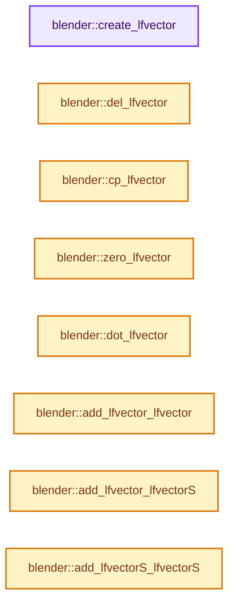

# 实现依赖专题：source/blender/simulation/intern/implicit_blender.cc

[方向导航](README.md) · [符号索引](../%E7%AC%A6%E5%8F%B7%E4%BE%9D%E8%B5%96%E4%B8%8E%E5%AE%9E%E7%8E%B0%E7%B4%A2%E5%BC%95.md)

本专题从正文实际调用进入，集中保存共享实现。函数有稳定锚点，可从调用处直接跳到对应完整函数；递归与互相调用通过回链组织。

## 本文件的实现关系




## 完整成员与函数实现

<a id="f-dea3308d86694157"></a>

### `blender::create_lfvector`

实现位置：[source/blender/simulation/intern/implicit_blender.cc](../../../../../source/blender/simulation/intern/implicit_blender.cc) · L116—L121。

接口参数：

- `uint verts`

**教学注释版**

<!-- annotated:1deada7507f513 -->

```cpp
DO_INLINE lfVector *create_lfvector(uint verts)
{
  /* TODO: check if memory allocation was successful */
  return MEM_new_array_zeroed<lfVector>(verts, "cloth_implicit_alloc_vector");
  // return (lfVector *)cloth_aligned_malloc(&MEMORY_BASE, verts * sizeof(lfVector));
}
```

<details>
<summary>核对原始源码：source/blender/simulation/intern/implicit_blender.cc · L116—L121</summary>

<!-- original:1deada7507f513:source/blender/simulation/intern/implicit_blender.cc:116:121 -->

```cpp
DO_INLINE lfVector *create_lfvector(uint verts)
{
  /* TODO: check if memory allocation was successful */
  return MEM_new_array_zeroed<lfVector>(verts, "cloth_implicit_alloc_vector");
  // return (lfVector *)cloth_aligned_malloc(&MEMORY_BASE, verts * sizeof(lfVector));
}
```

</details>

**结果出口**

- `return MEM_new_array_zeroed<lfVector>(verts, "cloth_implicit_alloc_vector");`

**继续追踪实现**

- `MEM_new_array_zeroed<lfVector>` → [MEM_new_array_zeroed · L566](../03-%E5%86%85%E5%AD%98%E5%88%86%E9%85%8D%E4%B8%8E%E8%BF%90%E8%A1%8C%E6%97%B6%E7%B1%BB%E5%9E%8B/%E4%BE%9D%E8%B5%96-MEM_guardedalloc-b54eca.md#f-3a0cf63fb5216500)；[MEM_new_array_zeroed · L119](../03-%E5%86%85%E5%AD%98%E5%88%86%E9%85%8D%E4%B8%8E%E8%BF%90%E8%A1%8C%E6%97%B6%E7%B1%BB%E5%9E%8B/%E4%BE%9D%E8%B5%96-mallocn-afdcd4.md#f-6825557da566fdbe)。同名重载需按实参类型选择。

<a id="f-51a778ab04524eca"></a>

### `blender::del_lfvector`

实现位置：[source/blender/simulation/intern/implicit_blender.cc](../../../../../source/blender/simulation/intern/implicit_blender.cc) · L123—L129。

接口参数：

- `float (*fLongVector)[3]`

**教学注释版**

<!-- annotated:3d340cb2426bbe -->

```cpp
DO_INLINE void del_lfvector(float (*fLongVector)[3])
{
  if (fLongVector != nullptr) {
    MEM_delete(fLongVector);
    // cloth_aligned_free(&MEMORY_BASE, fLongVector);
  }
}
```

<details>
<summary>核对原始源码：source/blender/simulation/intern/implicit_blender.cc · L123—L129</summary>

<!-- original:3d340cb2426bbe:source/blender/simulation/intern/implicit_blender.cc:123:129 -->

```cpp
DO_INLINE void del_lfvector(float (*fLongVector)[3])
{
  if (fLongVector != nullptr) {
    MEM_delete(fLongVector);
    // cloth_aligned_free(&MEMORY_BASE, fLongVector);
  }
}
```

</details>

**继续追踪实现**

- `MEM_delete` → [MEM_delete · L400](../03-%E5%86%85%E5%AD%98%E5%88%86%E9%85%8D%E4%B8%8E%E8%BF%90%E8%A1%8C%E6%97%B6%E7%B1%BB%E5%9E%8B/%E4%BE%9D%E8%B5%96-MEM_guardedalloc-b54eca.md#f-9049ffdd1682887c)。

<a id="f-c88b37c184ceee8c"></a>

### `blender::cp_lfvector`

实现位置：[source/blender/simulation/intern/implicit_blender.cc](../../../../../source/blender/simulation/intern/implicit_blender.cc) · L131—L134。

接口参数：

- `float (*to)[3]`
- `float (*from)[3]`
- `uint verts`

**教学注释版**

<!-- annotated:402c2bc8fef559 -->

```cpp
DO_INLINE void cp_lfvector(float (*to)[3], float (*from)[3], uint verts)
{
  // [讲解] memcpy：复制字节，源与目标不应重叠。类型生命周期、对齐和可复制表示须由调用者证明，不是任意对象的复制构造。
  memcpy(to, from, verts * sizeof(lfVector));
}
```

<details>
<summary>核对原始源码：source/blender/simulation/intern/implicit_blender.cc · L131—L134</summary>

<!-- original:402c2bc8fef559:source/blender/simulation/intern/implicit_blender.cc:131:134 -->

```cpp
DO_INLINE void cp_lfvector(float (*to)[3], float (*from)[3], uint verts)
{
  memcpy(to, from, verts * sizeof(lfVector));
}
```

</details>

**继续追踪实现**

- `memcpy` → [外部契约](https://eel.is/c++draft/cstring.syn)：复制字节，源与目标不应重叠。类型生命周期、对齐和可复制表示须由调用者证明，不是任意对象的复制构造。

<a id="f-9469754076668e7c"></a>

### `blender::zero_lfvector`

实现位置：[source/blender/simulation/intern/implicit_blender.cc](../../../../../source/blender/simulation/intern/implicit_blender.cc) · L144—L147。

接口参数：

- `float (*to)[3]`
- `uint verts`

**教学注释版**

<!-- annotated:9678e29d3049dc -->

```cpp
DO_INLINE void zero_lfvector(float (*to)[3], uint verts)
{
  // [讲解] memset：填充字节，不调用T构造函数，也不保证任意类型的全零表示是合法或期望值。
  memset(to, 0.0f, verts * sizeof(lfVector));
}
```

<details>
<summary>核对原始源码：source/blender/simulation/intern/implicit_blender.cc · L144—L147</summary>

<!-- original:9678e29d3049dc:source/blender/simulation/intern/implicit_blender.cc:144:147 -->

```cpp
DO_INLINE void zero_lfvector(float (*to)[3], uint verts)
{
  memset(to, 0.0f, verts * sizeof(lfVector));
}
```

</details>

**继续追踪实现**

- `memset` → [外部契约](https://eel.is/c++draft/cstring.syn)：填充字节，不调用T构造函数，也不保证任意类型的全零表示是合法或期望值。

<a id="f-81032f89f94b0e47"></a>

### `blender::dot_lfvector`

实现位置：[source/blender/simulation/intern/implicit_blender.cc](../../../../../source/blender/simulation/intern/implicit_blender.cc) · L167—L192。

接口参数：

- `float (*fLongVectorA)[3]`
- `float (*fLongVectorB)[3]`
- `uint verts`

**教学注释版**

<!-- annotated:760ae98800c617 -->

```cpp
DO_INLINE float dot_lfvector(float (*fLongVectorA)[3], float (*fLongVectorB)[3], uint verts)
{
#  if 0
  /* TODO: try enabling this and measuring performance. It was previously disabled
   * due to non-deterministic behavior, but parallel_deterministic_reduce should
   * give consistent results. */
  return threading::parallel_deterministic_reduce(
      IndexRange(0, verts),
      CLOTH_PARALLEL_LIMIT,
      0.0,
      [=](const IndexRange &range, float value) {
        float temp = value;
        for (const int i : range) {
          temp += dot_v3v3(fLongVectorA[i], fLongVectorB[i]);
        }
        return temp;
      },
      std::plus<>());
#  else
  float temp = 0.0;
  for (uint i = 0; i < verts; i++) {
    temp += dot_v3v3(fLongVectorA[i], fLongVectorB[i]);
  }
  return temp;
#  endif
}
```

<details>
<summary>核对原始源码：source/blender/simulation/intern/implicit_blender.cc · L167—L192</summary>

<!-- original:760ae98800c617:source/blender/simulation/intern/implicit_blender.cc:167:192 -->

```cpp
DO_INLINE float dot_lfvector(float (*fLongVectorA)[3], float (*fLongVectorB)[3], uint verts)
{
#  if 0
  /* TODO: try enabling this and measuring performance. It was previously disabled
   * due to non-deterministic behavior, but parallel_deterministic_reduce should
   * give consistent results. */
  return threading::parallel_deterministic_reduce(
      IndexRange(0, verts),
      CLOTH_PARALLEL_LIMIT,
      0.0,
      [=](const IndexRange &range, float value) {
        float temp = value;
        for (const int i : range) {
          temp += dot_v3v3(fLongVectorA[i], fLongVectorB[i]);
        }
        return temp;
      },
      std::plus<>());
#  else
  float temp = 0.0;
  for (uint i = 0; i < verts; i++) {
    temp += dot_v3v3(fLongVectorA[i], fLongVectorB[i]);
  }
  return temp;
#  endif
}
```

</details>

**沿实际写入检查状态**

- `[=](const IndexRange &range, float value) {`
- `temp += dot_v3v3(fLongVectorA[i], fLongVectorB[i]);`

**结果出口**

- `return threading::parallel_deterministic_reduce(`
- `return temp;`

**继续追踪实现**

- `threading::parallel_deterministic_reduce` → [blender::threading::parallel_deterministic_reduce · L169](../11-Depsgraph%E4%B8%8E%E5%B9%B6%E8%A1%8C%E4%BB%BB%E5%8A%A1%E7%B3%BB%E7%BB%9F/07-%E4%BB%BB%E5%8A%A1%E6%B1%A0%E4%B8%8ETBB%E6%8E%A5%E5%85%A5.md#f-a0f79812a52b6a46)。
- `IndexRange` → [blender::IndexRange](../01-%E5%9F%BA%E7%A1%80%E5%AE%B9%E5%99%A8%E4%B8%8E%E7%8E%B0%E4%BB%A3CPP/%E4%BE%9D%E8%B5%96-BLI_index_range-7d7cc5.md#t-caa3466d6776)；[blender::gpu::shader::parser::IndexRange](%E4%BE%9D%E8%B5%96-utils-06433d.md#t-82d2bd4ea71c)；[blender::IndexRange](%E4%BE%9D%E8%B5%96-DNA_node_types-6708b9.md#t-0448cc889d39)。
- `dot_v3v3` → [blender::dot_v3v3 · L646](../12-%E7%A9%BA%E9%97%B4%E6%95%B0%E6%8D%AE%E7%BB%93%E6%9E%84%E4%B8%8E%E5%87%A0%E4%BD%95%E7%AE%97%E6%B3%95/%E4%BE%9D%E8%B5%96-math_vector_inline-0c8541.md#f-c88befa67d07591a)。
- `std::plus<>` → [外部契约](https://eel.is/c++draft/)：这个边界按实际表达式及所属类型核对参数、返回值、寿命与失败行为。这里提供接口入口，不声称已解释该第三方版本的内部实现。

<a id="f-1cf33dfe50ba129c"></a>

### `blender::add_lfvector_lfvector`

实现位置：[source/blender/simulation/intern/implicit_blender.cc](../../../../../source/blender/simulation/intern/implicit_blender.cc) · L194—L204。

接口参数：

- `float (*to)[3]`
- `float (*fLongVectorA)[3]`
- `float (*fLongVectorB)[3]`
- `uint verts`

**教学注释版**

<!-- annotated:94c594df957c71 -->

```cpp
DO_INLINE void add_lfvector_lfvector(float (*to)[3],
                                     float (*fLongVectorA)[3],
                                     float (*fLongVectorB)[3],
                                     uint verts)
{
  uint i = 0;

  for (i = 0; i < verts; i++) {
    add_v3_v3v3(to[i], fLongVectorA[i], fLongVectorB[i]);
  }
}
```

<details>
<summary>核对原始源码：source/blender/simulation/intern/implicit_blender.cc · L194—L204</summary>

<!-- original:94c594df957c71:source/blender/simulation/intern/implicit_blender.cc:194:204 -->

```cpp
DO_INLINE void add_lfvector_lfvector(float (*to)[3],
                                     float (*fLongVectorA)[3],
                                     float (*fLongVectorB)[3],
                                     uint verts)
{
  uint i = 0;

  for (i = 0; i < verts; i++) {
    add_v3_v3v3(to[i], fLongVectorA[i], fLongVectorB[i]);
  }
}
```

</details>

**继续追踪实现**

- `add_v3_v3v3` → [blender::add_v3_v3v3 · L300](../12-%E7%A9%BA%E9%97%B4%E6%95%B0%E6%8D%AE%E7%BB%93%E6%9E%84%E4%B8%8E%E5%87%A0%E4%BD%95%E7%AE%97%E6%B3%95/%E4%BE%9D%E8%B5%96-math_vector_inline-0c8541.md#f-7343b459d0d3db69)。

<a id="f-11f16eed2c345b66"></a>

### `blender::add_lfvector_lfvectorS`

实现位置：[source/blender/simulation/intern/implicit_blender.cc](../../../../../source/blender/simulation/intern/implicit_blender.cc) · L206—L214。

接口参数：

- `float (*to)[3]`
- `float (*fLongVectorA)[3]`
- `float (*fLongVectorB)[3]`
- `float bS`
- `uint verts`

**教学注释版**

<!-- annotated:47232fd9d1c370 -->

```cpp
DO_INLINE void add_lfvector_lfvectorS(
    float (*to)[3], float (*fLongVectorA)[3], float (*fLongVectorB)[3], float bS, uint verts)
{
  uint i = 0;

  for (i = 0; i < verts; i++) {
    VECADDS(to[i], fLongVectorA[i], fLongVectorB[i], bS);
  }
}
```

<details>
<summary>核对原始源码：source/blender/simulation/intern/implicit_blender.cc · L206—L214</summary>

<!-- original:47232fd9d1c370:source/blender/simulation/intern/implicit_blender.cc:206:214 -->

```cpp
DO_INLINE void add_lfvector_lfvectorS(
    float (*to)[3], float (*fLongVectorA)[3], float (*fLongVectorB)[3], float bS, uint verts)
{
  uint i = 0;

  for (i = 0; i < verts; i++) {
    VECADDS(to[i], fLongVectorA[i], fLongVectorB[i], bS);
  }
}
```

</details>

**继续追踪实现**

- `VECADDS` → [VECADDS · L157](%E4%BE%9D%E8%B5%96-BKE_cloth-7f6fa8.md#m-463ccc9dc8b9)。宏定义由构建条件选择。

<a id="f-6af16e4b855247f8"></a>

### `blender::add_lfvectorS_lfvectorS`

实现位置：[source/blender/simulation/intern/implicit_blender.cc](../../../../../source/blender/simulation/intern/implicit_blender.cc) · L216—L228。

接口参数：

- `float (*to)[3]`
- `float (*fLongVectorA)[3]`
- `float aS`
- `float (*fLongVectorB)[3]`
- `float bS`
- `uint verts`

**教学注释版**

<!-- annotated:2be11130713a08 -->

```cpp
DO_INLINE void add_lfvectorS_lfvectorS(float (*to)[3],
                                       float (*fLongVectorA)[3],
                                       float aS,
                                       float (*fLongVectorB)[3],
                                       float bS,
                                       uint verts)
{
  uint i = 0;

  for (i = 0; i < verts; i++) {
    VECADDSS(to[i], fLongVectorA[i], aS, fLongVectorB[i], bS);
  }
}
```

<details>
<summary>核对原始源码：source/blender/simulation/intern/implicit_blender.cc · L216—L228</summary>

<!-- original:2be11130713a08:source/blender/simulation/intern/implicit_blender.cc:216:228 -->

```cpp
DO_INLINE void add_lfvectorS_lfvectorS(float (*to)[3],
                                       float (*fLongVectorA)[3],
                                       float aS,
                                       float (*fLongVectorB)[3],
                                       float bS,
                                       uint verts)
{
  uint i = 0;

  for (i = 0; i < verts; i++) {
    VECADDSS(to[i], fLongVectorA[i], aS, fLongVectorB[i], bS);
  }
}
```

</details>

**继续追踪实现**

- `VECADDSS` → [VECADDSS · L150](%E4%BE%9D%E8%B5%96-BKE_cloth-7f6fa8.md#m-310683f0ee7c)。宏定义由构建条件选择。

<a id="f-aa94f2525bf46131"></a>

### `blender::sub_lfvector_lfvectorS`

实现位置：[source/blender/simulation/intern/implicit_blender.cc](../../../../../source/blender/simulation/intern/implicit_blender.cc) · L230—L237。

接口参数：

- `float (*to)[3]`
- `float (*fLongVectorA)[3]`
- `float (*fLongVectorB)[3]`
- `float bS`
- `uint verts`

**教学注释版**

<!-- annotated:129a624452b02c -->

```cpp
DO_INLINE void sub_lfvector_lfvectorS(
    float (*to)[3], float (*fLongVectorA)[3], float (*fLongVectorB)[3], float bS, uint verts)
{
  uint i = 0;
  for (i = 0; i < verts; i++) {
    VECSUBS(to[i], fLongVectorA[i], fLongVectorB[i], bS);
  }
}
```

<details>
<summary>核对原始源码：source/blender/simulation/intern/implicit_blender.cc · L230—L237</summary>

<!-- original:129a624452b02c:source/blender/simulation/intern/implicit_blender.cc:230:237 -->

```cpp
DO_INLINE void sub_lfvector_lfvectorS(
    float (*to)[3], float (*fLongVectorA)[3], float (*fLongVectorB)[3], float bS, uint verts)
{
  uint i = 0;
  for (i = 0; i < verts; i++) {
    VECSUBS(to[i], fLongVectorA[i], fLongVectorB[i], bS);
  }
}
```

</details>

**继续追踪实现**

- `VECSUBS` → [VECSUBS · L171](%E4%BE%9D%E8%B5%96-BKE_cloth-7f6fa8.md#m-ff1fd59f7de7)。宏定义由构建条件选择。

<a id="f-1fe1b61a608947d3"></a>

### `blender::sub_lfvector_lfvector`

实现位置：[source/blender/simulation/intern/implicit_blender.cc](../../../../../source/blender/simulation/intern/implicit_blender.cc) · L239—L249。

接口参数：

- `float (*to)[3]`
- `float (*fLongVectorA)[3]`
- `float (*fLongVectorB)[3]`
- `uint verts`

**教学注释版**

<!-- annotated:57d81adef14e71 -->

```cpp
DO_INLINE void sub_lfvector_lfvector(float (*to)[3],
                                     float (*fLongVectorA)[3],
                                     float (*fLongVectorB)[3],
                                     uint verts)
{
  uint i = 0;

  for (i = 0; i < verts; i++) {
    sub_v3_v3v3(to[i], fLongVectorA[i], fLongVectorB[i]);
  }
}
```

<details>
<summary>核对原始源码：source/blender/simulation/intern/implicit_blender.cc · L239—L249</summary>

<!-- original:57d81adef14e71:source/blender/simulation/intern/implicit_blender.cc:239:249 -->

```cpp
DO_INLINE void sub_lfvector_lfvector(float (*to)[3],
                                     float (*fLongVectorA)[3],
                                     float (*fLongVectorB)[3],
                                     uint verts)
{
  uint i = 0;

  for (i = 0; i < verts; i++) {
    sub_v3_v3v3(to[i], fLongVectorA[i], fLongVectorB[i]);
  }
}
```

</details>

**继续追踪实现**

- `sub_v3_v3v3` → [blender::sub_v3_v3v3 · L360](../12-%E7%A9%BA%E9%97%B4%E6%95%B0%E6%8D%AE%E7%BB%93%E6%9E%84%E4%B8%8E%E5%87%A0%E4%BD%95%E7%AE%97%E6%B3%95/%E4%BE%9D%E8%B5%96-math_vector_inline-0c8541.md#f-23781c252db8b30c)。

<a id="f-fee55bc725ed8c47"></a>

### `blender::print_fmatrix`

实现位置：[source/blender/simulation/intern/implicit_blender.cc](../../../../../source/blender/simulation/intern/implicit_blender.cc) · L255—L260。

接口参数：

- `float m3[3][3]`

**教学注释版**

<!-- annotated:2b0c1083c0d99c -->

```cpp
static void print_fmatrix(float m3[3][3])
{
  printf("%f\t%f\t%f\n", m3[0][0], m3[0][1], m3[0][2]);
  printf("%f\t%f\t%f\n", m3[1][0], m3[1][1], m3[1][2]);
  printf("%f\t%f\t%f\n\n", m3[2][0], m3[2][1], m3[2][2]);
}
```

<details>
<summary>核对原始源码：source/blender/simulation/intern/implicit_blender.cc · L255—L260</summary>

<!-- original:2b0c1083c0d99c:source/blender/simulation/intern/implicit_blender.cc:255:260 -->

```cpp
static void print_fmatrix(float m3[3][3])
{
  printf("%f\t%f\t%f\n", m3[0][0], m3[0][1], m3[0][2]);
  printf("%f\t%f\t%f\n", m3[1][0], m3[1][1], m3[1][2]);
  printf("%f\t%f\t%f\n\n", m3[2][0], m3[2][1], m3[2][2]);
}
```

</details>

**继续追踪实现**

- `printf` → [外部契约](https://eel.is/c++draft/)：这个边界按实际表达式及所属类型核对参数、返回值、寿命与失败行为。这里提供接口入口，不声称已解释该第三方版本的内部实现。

<a id="f-f375305a7626560f"></a>

### `blender::print_lvector`

实现位置：[source/blender/simulation/intern/implicit_blender.cc](../../../../../source/blender/simulation/intern/implicit_blender.cc) · L275—L287。

接口参数：

- `lfVector *v`
- `int numverts`

**教学注释版**

<!-- annotated:dcc15ed421c088 -->

```cpp
static void print_lvector(lfVector *v, int numverts)
{
  int i;
  for (i = 0; i < numverts; i++) {
    if (i > 0) {
      printf("\n");
    }

    printf("%f,\n", v[i][0]);
    printf("%f,\n", v[i][1]);
    printf("%f,\n", v[i][2]);
  }
}
```

<details>
<summary>核对原始源码：source/blender/simulation/intern/implicit_blender.cc · L275—L287</summary>

<!-- original:dcc15ed421c088:source/blender/simulation/intern/implicit_blender.cc:275:287 -->

```cpp
static void print_lvector(lfVector *v, int numverts)
{
  int i;
  for (i = 0; i < numverts; i++) {
    if (i > 0) {
      printf("\n");
    }

    printf("%f,\n", v[i][0]);
    printf("%f,\n", v[i][1]);
    printf("%f,\n", v[i][2]);
  }
}
```

</details>

**继续追踪实现**

- `printf` → [外部契约](https://eel.is/c++draft/)：这个边界按实际表达式及所属类型核对参数、返回值、寿命与失败行为。这里提供接口入口，不声称已解释该第三方版本的内部实现。

<a id="f-eb5a389230bb9c18"></a>

### `blender::print_bfmatrix`

实现位置：[source/blender/simulation/intern/implicit_blender.cc](../../../../../source/blender/simulation/intern/implicit_blender.cc) · L291—L336。

接口参数：

- `fmatrix3x3 *m`

**教学注释版**

<!-- annotated:9a010d553617ba -->

```cpp
static void print_bfmatrix(fmatrix3x3 *m)
{
  int tot = m[0].vcount + m[0].scount;
  int size = m[0].vcount * 3;
  float *t = MEM_new_array_zeroed<float>(size * size, "bfmatrix");
  int q, i, j;

  for (q = 0; q < tot; q++) {
    int k = 3 * m[q].r;
    int l = 3 * m[q].c;

    for (j = 0; j < 3; j++) {
      for (i = 0; i < 3; i++) {
#    if 0
        if (t[k + i + (l + j) * size] != 0.0f) {
          printf("warning: overwriting value at %d, %d\n", m[q].r, m[q].c);
        }
#    endif
        if (k == l) {
          t[k + i + (k + j) * size] += m[q].m[i][j];
        }
        else {
          t[k + i + (l + j) * size] += m[q].m[i][j];
          t[l + j + (k + i) * size] += m[q].m[j][i];
        }
      }
    }
  }

  for (j = 0; j < size; j++) {
    if (j > 0 && j % 3 == 0) {
      printf("\n");
    }

    for (i = 0; i < size; i++) {
      if (i > 0 && i % 3 == 0) {
        printf("  ");
      }

      implicit_print_matrix_elem(t[i + j * size]);
    }
    printf("\n");
  }

  MEM_delete(t);
}
```

<details>
<summary>核对原始源码：source/blender/simulation/intern/implicit_blender.cc · L291—L336</summary>

<!-- original:9a010d553617ba:source/blender/simulation/intern/implicit_blender.cc:291:336 -->

```cpp
static void print_bfmatrix(fmatrix3x3 *m)
{
  int tot = m[0].vcount + m[0].scount;
  int size = m[0].vcount * 3;
  float *t = MEM_new_array_zeroed<float>(size * size, "bfmatrix");
  int q, i, j;

  for (q = 0; q < tot; q++) {
    int k = 3 * m[q].r;
    int l = 3 * m[q].c;

    for (j = 0; j < 3; j++) {
      for (i = 0; i < 3; i++) {
#    if 0
        if (t[k + i + (l + j) * size] != 0.0f) {
          printf("warning: overwriting value at %d, %d\n", m[q].r, m[q].c);
        }
#    endif
        if (k == l) {
          t[k + i + (k + j) * size] += m[q].m[i][j];
        }
        else {
          t[k + i + (l + j) * size] += m[q].m[i][j];
          t[l + j + (k + i) * size] += m[q].m[j][i];
        }
      }
    }
  }

  for (j = 0; j < size; j++) {
    if (j > 0 && j % 3 == 0) {
      printf("\n");
    }

    for (i = 0; i < size; i++) {
      if (i > 0 && i % 3 == 0) {
        printf("  ");
      }

      implicit_print_matrix_elem(t[i + j * size]);
    }
    printf("\n");
  }

  MEM_delete(t);
}
```

</details>

**继续追踪实现**

- `MEM_new_array_zeroed<float>` → [MEM_new_array_zeroed · L566](../03-%E5%86%85%E5%AD%98%E5%88%86%E9%85%8D%E4%B8%8E%E8%BF%90%E8%A1%8C%E6%97%B6%E7%B1%BB%E5%9E%8B/%E4%BE%9D%E8%B5%96-MEM_guardedalloc-b54eca.md#f-3a0cf63fb5216500)；[MEM_new_array_zeroed · L119](../03-%E5%86%85%E5%AD%98%E5%88%86%E9%85%8D%E4%B8%8E%E8%BF%90%E8%A1%8C%E6%97%B6%E7%B1%BB%E5%9E%8B/%E4%BE%9D%E8%B5%96-mallocn-afdcd4.md#f-6825557da566fdbe)。同名重载需按实参类型选择。
- `printf` → [外部契约](https://eel.is/c++draft/)：这个边界按实际表达式及所属类型核对参数、返回值、寿命与失败行为。这里提供接口入口，不声称已解释该第三方版本的内部实现。
- `implicit_print_matrix_elem` → [blender::implicit_print_matrix_elem · L43](%E4%BE%9D%E8%B5%96-implicit-870463.md#f-e3ac5536c1c41a87)。
- `MEM_delete` → [MEM_delete · L400](../03-%E5%86%85%E5%AD%98%E5%88%86%E9%85%8D%E4%B8%8E%E8%BF%90%E8%A1%8C%E6%97%B6%E7%B1%BB%E5%9E%8B/%E4%BE%9D%E8%B5%96-MEM_guardedalloc-b54eca.md#f-9049ffdd1682887c)。

<a id="f-72109a6c9d4a2d6b"></a>

### `blender::cp_fmatrix`

实现位置：[source/blender/simulation/intern/implicit_blender.cc](../../../../../source/blender/simulation/intern/implicit_blender.cc) · L340—L346。

接口参数：

- `float to[3][3]`
- `const float from[3][3]`

**教学注释版**

<!-- annotated:de23f700985740 -->

```cpp
DO_INLINE void cp_fmatrix(float to[3][3], const float from[3][3])
{
  // memcpy(to, from, sizeof(float[3][3]));
  copy_v3_v3(to[0], from[0]);
  copy_v3_v3(to[1], from[1]);
  copy_v3_v3(to[2], from[2]);
}
```

<details>
<summary>核对原始源码：source/blender/simulation/intern/implicit_blender.cc · L340—L346</summary>

<!-- original:de23f700985740:source/blender/simulation/intern/implicit_blender.cc:340:346 -->

```cpp
DO_INLINE void cp_fmatrix(float to[3][3], const float from[3][3])
{
  // memcpy(to, from, sizeof(float[3][3]));
  copy_v3_v3(to[0], from[0]);
  copy_v3_v3(to[1], from[1]);
  copy_v3_v3(to[2], from[2]);
}
```

</details>

**继续追踪实现**

- `copy_v3_v3` → [blender::copy_v3_v3 · L47](../12-%E7%A9%BA%E9%97%B4%E6%95%B0%E6%8D%AE%E7%BB%93%E6%9E%84%E4%B8%8E%E5%87%A0%E4%BD%95%E7%AE%97%E6%B3%95/%E4%BE%9D%E8%B5%96-math_vector_inline-0c8541.md#f-037a0d5fa5060bd6)。

<a id="f-ed23e45d7b44da40"></a>

### `blender::subadd_fmatrixS_fmatrixS`

实现位置：[source/blender/simulation/intern/implicit_blender.cc](../../../../../source/blender/simulation/intern/implicit_blender.cc) · L433—L439。

接口参数：

- `float to[3][3]`
- `const float matrixA[3][3]`
- `float aS`
- `const float matrixB[3][3]`
- `float bS`

**教学注释版**

<!-- annotated:11f09d30837d8e -->

```cpp
DO_INLINE void subadd_fmatrixS_fmatrixS(
    float to[3][3], const float matrixA[3][3], float aS, const float matrixB[3][3], float bS)
{
  VECSUBADDSS(to[0], matrixA[0], aS, matrixB[0], bS);
  VECSUBADDSS(to[1], matrixA[1], aS, matrixB[1], bS);
  VECSUBADDSS(to[2], matrixA[2], aS, matrixB[2], bS);
}
```

<details>
<summary>核对原始源码：source/blender/simulation/intern/implicit_blender.cc · L433—L439</summary>

<!-- original:11f09d30837d8e:source/blender/simulation/intern/implicit_blender.cc:433:439 -->

```cpp
DO_INLINE void subadd_fmatrixS_fmatrixS(
    float to[3][3], const float matrixA[3][3], float aS, const float matrixB[3][3], float bS)
{
  VECSUBADDSS(to[0], matrixA[0], aS, matrixB[0], bS);
  VECSUBADDSS(to[1], matrixA[1], aS, matrixB[1], bS);
  VECSUBADDSS(to[2], matrixA[2], aS, matrixB[2], bS);
}
```

</details>

**继续追踪实现**

- `VECSUBADDSS` → [VECSUBADDSS · L143](%E4%BE%9D%E8%B5%96-BKE_cloth-7f6fa8.md#m-b52ddee51698)。宏定义由构建条件选择。

<a id="f-c548f1599c89b412"></a>

### `blender::muladd_fmatrix_fvector`

实现位置：[source/blender/simulation/intern/implicit_blender.cc](../../../../../source/blender/simulation/intern/implicit_blender.cc) · L454—L459。

接口参数：

- `float to[3]`
- `const float matrix[3][3]`
- `const float from[3]`

**教学注释版**

<!-- annotated:e521e4e3ea6048 -->

```cpp
DO_INLINE void muladd_fmatrix_fvector(float to[3], const float matrix[3][3], const float from[3])
{
  to[0] += dot_v3v3(matrix[0], from);
  to[1] += dot_v3v3(matrix[1], from);
  to[2] += dot_v3v3(matrix[2], from);
}
```

<details>
<summary>核对原始源码：source/blender/simulation/intern/implicit_blender.cc · L454—L459</summary>

<!-- original:e521e4e3ea6048:source/blender/simulation/intern/implicit_blender.cc:454:459 -->

```cpp
DO_INLINE void muladd_fmatrix_fvector(float to[3], const float matrix[3][3], const float from[3])
{
  to[0] += dot_v3v3(matrix[0], from);
  to[1] += dot_v3v3(matrix[1], from);
  to[2] += dot_v3v3(matrix[2], from);
}
```

</details>

**沿实际写入检查状态**

- `to[0] += dot_v3v3(matrix[0], from);`
- `to[1] += dot_v3v3(matrix[1], from);`
- `to[2] += dot_v3v3(matrix[2], from);`

**继续追踪实现**

- `dot_v3v3` → [blender::dot_v3v3 · L646](../12-%E7%A9%BA%E9%97%B4%E6%95%B0%E6%8D%AE%E7%BB%93%E6%9E%84%E4%B8%8E%E5%87%A0%E4%BD%95%E7%AE%97%E6%B3%95/%E4%BE%9D%E8%B5%96-math_vector_inline-0c8541.md#f-c88befa67d07591a)。

<a id="f-72100bfc9970fc22"></a>

### `blender::muladd_fmatrixT_fvector`

实现位置：[source/blender/simulation/intern/implicit_blender.cc](../../../../../source/blender/simulation/intern/implicit_blender.cc) · L461—L466。

接口参数：

- `float to[3]`
- `const float matrix[3][3]`
- `const float from[3]`

**教学注释版**

<!-- annotated:c30b3e9f2d7e33 -->

```cpp
DO_INLINE void muladd_fmatrixT_fvector(float to[3], const float matrix[3][3], const float from[3])
{
  to[0] += matrix[0][0] * from[0] + matrix[1][0] * from[1] + matrix[2][0] * from[2];
  to[1] += matrix[0][1] * from[0] + matrix[1][1] * from[1] + matrix[2][1] * from[2];
  to[2] += matrix[0][2] * from[0] + matrix[1][2] * from[1] + matrix[2][2] * from[2];
}
```

<details>
<summary>核对原始源码：source/blender/simulation/intern/implicit_blender.cc · L461—L466</summary>

<!-- original:c30b3e9f2d7e33:source/blender/simulation/intern/implicit_blender.cc:461:466 -->

```cpp
DO_INLINE void muladd_fmatrixT_fvector(float to[3], const float matrix[3][3], const float from[3])
{
  to[0] += matrix[0][0] * from[0] + matrix[1][0] * from[1] + matrix[2][0] * from[2];
  to[1] += matrix[0][1] * from[0] + matrix[1][1] * from[1] + matrix[2][1] * from[2];
  to[2] += matrix[0][2] * from[0] + matrix[1][2] * from[1] + matrix[2][2] * from[2];
}
```

</details>

**沿实际写入检查状态**

- `to[0] += matrix[0][0] * from[0] + matrix[1][0] * from[1] + matrix[2][0] * from[2];`
- `to[1] += matrix[0][1] * from[0] + matrix[1][1] * from[1] + matrix[2][1] * from[2];`
- `to[2] += matrix[0][2] * from[0] + matrix[1][2] * from[1] + matrix[2][2] * from[2];`

**继续追踪实现**

本实现没有需要继续展开的显式调用；检查返回表达式、对象转换和调用者前置条件。

<a id="f-ceed8d3867b6825c"></a>

### `blender::outerproduct`

实现位置：[source/blender/simulation/intern/implicit_blender.cc](../../../../../source/blender/simulation/intern/implicit_blender.cc) · L468—L473。

接口参数：

- `float r[3][3]`
- `const float a[3]`
- `const float b[3]`

**教学注释版**

<!-- annotated:c910d6ea5273c3 -->

```cpp
BLI_INLINE void outerproduct(float r[3][3], const float a[3], const float b[3])
{
  mul_v3_v3fl(r[0], a, b[0]);
  mul_v3_v3fl(r[1], a, b[1]);
  mul_v3_v3fl(r[2], a, b[2]);
}
```

<details>
<summary>核对原始源码：source/blender/simulation/intern/implicit_blender.cc · L468—L473</summary>

<!-- original:c910d6ea5273c3:source/blender/simulation/intern/implicit_blender.cc:468:473 -->

```cpp
BLI_INLINE void outerproduct(float r[3][3], const float a[3], const float b[3])
{
  mul_v3_v3fl(r[0], a, b[0]);
  mul_v3_v3fl(r[1], a, b[1]);
  mul_v3_v3fl(r[2], a, b[2]);
}
```

</details>

**继续追踪实现**

- `mul_v3_v3fl` → [blender::mul_v3_v3fl · L428](../12-%E7%A9%BA%E9%97%B4%E6%95%B0%E6%8D%AE%E7%BB%93%E6%9E%84%E4%B8%8E%E5%87%A0%E4%BD%95%E7%AE%97%E6%B3%95/%E4%BE%9D%E8%B5%96-math_vector_inline-0c8541.md#f-c3cb822497b967a8)。

<a id="f-ce67e0255604f96a"></a>

### `blender::madd_m3_m3fl`

实现位置：[source/blender/simulation/intern/implicit_blender.cc](../../../../../source/blender/simulation/intern/implicit_blender.cc) · L495—L506。

接口参数：

- `float r[3][3]`
- `const float m[3][3]`
- `float f`

**教学注释版**

<!-- annotated:bada78e3962a12 -->

```cpp
BLI_INLINE void madd_m3_m3fl(float r[3][3], const float m[3][3], float f)
{
  r[0][0] += m[0][0] * f;
  r[0][1] += m[0][1] * f;
  r[0][2] += m[0][2] * f;
  r[1][0] += m[1][0] * f;
  r[1][1] += m[1][1] * f;
  r[1][2] += m[1][2] * f;
  r[2][0] += m[2][0] * f;
  r[2][1] += m[2][1] * f;
  r[2][2] += m[2][2] * f;
}
```

<details>
<summary>核对原始源码：source/blender/simulation/intern/implicit_blender.cc · L495—L506</summary>

<!-- original:bada78e3962a12:source/blender/simulation/intern/implicit_blender.cc:495:506 -->

```cpp
BLI_INLINE void madd_m3_m3fl(float r[3][3], const float m[3][3], float f)
{
  r[0][0] += m[0][0] * f;
  r[0][1] += m[0][1] * f;
  r[0][2] += m[0][2] * f;
  r[1][0] += m[1][0] * f;
  r[1][1] += m[1][1] * f;
  r[1][2] += m[1][2] * f;
  r[2][0] += m[2][0] * f;
  r[2][1] += m[2][1] * f;
  r[2][2] += m[2][2] * f;
}
```

</details>

**沿实际写入检查状态**

- `r[0][0] += m[0][0] * f;`
- `r[0][1] += m[0][1] * f;`
- `r[0][2] += m[0][2] * f;`
- `r[1][0] += m[1][0] * f;`
- `r[1][1] += m[1][1] * f;`
- `r[1][2] += m[1][2] * f;`
- `r[2][0] += m[2][0] * f;`
- `r[2][1] += m[2][1] * f;`
- `r[2][2] += m[2][2] * f;`

**继续追踪实现**

本实现没有需要继续展开的显式调用；检查返回表达式、对象转换和调用者前置条件。

<a id="f-4bdebf862ab437a7"></a>

### `blender::print_bfmatrix`

实现位置：[source/blender/simulation/intern/implicit_blender.cc](../../../../../source/blender/simulation/intern/implicit_blender.cc) · L515—L522。

接口参数：

- `fmatrix3x3 *m3`

**教学注释版**

<!-- annotated:4d2539df07afad -->

```cpp
static void print_bfmatrix(fmatrix3x3 *m3)
{
  uint i = 0;

  for (i = 0; i < m3[0].vcount + m3[0].scount; i++) {
    print_fmatrix(m3[i].m);
  }
}
```

<details>
<summary>核对原始源码：source/blender/simulation/intern/implicit_blender.cc · L515—L522</summary>

<!-- original:4d2539df07afad:source/blender/simulation/intern/implicit_blender.cc:515:522 -->

```cpp
static void print_bfmatrix(fmatrix3x3 *m3)
{
  uint i = 0;

  for (i = 0; i < m3[0].vcount + m3[0].scount; i++) {
    print_fmatrix(m3[i].m);
  }
}
```

</details>

**继续追踪实现**

- `print_fmatrix` → [blender::print_fmatrix · L255](%E4%BE%9D%E8%B5%96-implicit_blender-1544a5.md#f-fee55bc725ed8c47)。

<a id="f-0ec68dbeb1d89f95"></a>

### `blender::init_fmatrix`

实现位置：[source/blender/simulation/intern/implicit_blender.cc](../../../../../source/blender/simulation/intern/implicit_blender.cc) · L525—L529。

接口参数：

- `fmatrix3x3 *matrix`
- `int r`
- `int c`

**教学注释版**

<!-- annotated:77b32ec0cec8c1 -->

```cpp
BLI_INLINE void init_fmatrix(fmatrix3x3 *matrix, int r, int c)
{
  matrix->r = r;
  matrix->c = c;
}
```

<details>
<summary>核对原始源码：source/blender/simulation/intern/implicit_blender.cc · L525—L529</summary>

<!-- original:77b32ec0cec8c1:source/blender/simulation/intern/implicit_blender.cc:525:529 -->

```cpp
BLI_INLINE void init_fmatrix(fmatrix3x3 *matrix, int r, int c)
{
  matrix->r = r;
  matrix->c = c;
}
```

</details>

**沿实际写入检查状态**

- `matrix->r = r;`
- `matrix->c = c;`

**继续追踪实现**

本实现没有需要继续展开的显式调用；检查返回表达式、对象转换和调用者前置条件。

<a id="f-78ef73e7e0677760"></a>

### `blender::create_bfmatrix`

实现位置：[source/blender/simulation/intern/implicit_blender.cc](../../../../../source/blender/simulation/intern/implicit_blender.cc) · L532—L548。

接口参数：

- `uint verts`
- `uint springs`

**教学注释版**

<!-- annotated:ff762db11ba5fe -->

```cpp
DO_INLINE fmatrix3x3 *create_bfmatrix(uint verts, uint springs)
{
  /* TODO: check if memory allocation was successful */
  fmatrix3x3 *temp = MEM_new_array_zeroed<fmatrix3x3>(verts + springs,
                                                      "cloth_implicit_alloc_matrix");
  int i;

  temp[0].vcount = verts;
  temp[0].scount = springs;

  /* vertex part of the matrix is diagonal blocks */
  for (i = 0; i < verts; i++) {
    init_fmatrix(temp + i, i, i);
  }

  return temp;
}
```

<details>
<summary>核对原始源码：source/blender/simulation/intern/implicit_blender.cc · L532—L548</summary>

<!-- original:ff762db11ba5fe:source/blender/simulation/intern/implicit_blender.cc:532:548 -->

```cpp
DO_INLINE fmatrix3x3 *create_bfmatrix(uint verts, uint springs)
{
  /* TODO: check if memory allocation was successful */
  fmatrix3x3 *temp = MEM_new_array_zeroed<fmatrix3x3>(verts + springs,
                                                      "cloth_implicit_alloc_matrix");
  int i;

  temp[0].vcount = verts;
  temp[0].scount = springs;

  /* vertex part of the matrix is diagonal blocks */
  for (i = 0; i < verts; i++) {
    init_fmatrix(temp + i, i, i);
  }

  return temp;
}
```

</details>

**沿实际写入检查状态**

- `temp[0].vcount = verts;`
- `temp[0].scount = springs;`

**结果出口**

- `return temp;`

**继续追踪实现**

- `MEM_new_array_zeroed<fmatrix3x3>` → [MEM_new_array_zeroed · L566](../03-%E5%86%85%E5%AD%98%E5%88%86%E9%85%8D%E4%B8%8E%E8%BF%90%E8%A1%8C%E6%97%B6%E7%B1%BB%E5%9E%8B/%E4%BE%9D%E8%B5%96-MEM_guardedalloc-b54eca.md#f-3a0cf63fb5216500)；[MEM_new_array_zeroed · L119](../03-%E5%86%85%E5%AD%98%E5%88%86%E9%85%8D%E4%B8%8E%E8%BF%90%E8%A1%8C%E6%97%B6%E7%B1%BB%E5%9E%8B/%E4%BE%9D%E8%B5%96-mallocn-afdcd4.md#f-6825557da566fdbe)。同名重载需按实参类型选择。
- `init_fmatrix` → [blender::init_fmatrix · L525](%E4%BE%9D%E8%B5%96-implicit_blender-1544a5.md#f-0ec68dbeb1d89f95)。

<a id="f-11166d03bbf0bf3f"></a>

### `blender::del_bfmatrix`

实现位置：[source/blender/simulation/intern/implicit_blender.cc](../../../../../source/blender/simulation/intern/implicit_blender.cc) · L550—L555。

接口参数：

- `fmatrix3x3 *matrix`

**教学注释版**

<!-- annotated:e6db38735f7283 -->

```cpp
DO_INLINE void del_bfmatrix(fmatrix3x3 *matrix)
{
  if (matrix != nullptr) {
    MEM_delete(matrix);
  }
}
```

<details>
<summary>核对原始源码：source/blender/simulation/intern/implicit_blender.cc · L550—L555</summary>

<!-- original:e6db38735f7283:source/blender/simulation/intern/implicit_blender.cc:550:555 -->

```cpp
DO_INLINE void del_bfmatrix(fmatrix3x3 *matrix)
{
  if (matrix != nullptr) {
    MEM_delete(matrix);
  }
}
```

</details>

**继续追踪实现**

- `MEM_delete` → [MEM_delete · L400](../03-%E5%86%85%E5%AD%98%E5%88%86%E9%85%8D%E4%B8%8E%E8%BF%90%E8%A1%8C%E6%97%B6%E7%B1%BB%E5%9E%8B/%E4%BE%9D%E8%B5%96-MEM_guardedalloc-b54eca.md#f-9049ffdd1682887c)。

<a id="f-0975ce3d66cc4f3b"></a>

### `blender::cp_bfmatrix`

实现位置：[source/blender/simulation/intern/implicit_blender.cc](../../../../../source/blender/simulation/intern/implicit_blender.cc) · L558—L562。

接口参数：

- `fmatrix3x3 *to`
- `fmatrix3x3 *from`

**教学注释版**

<!-- annotated:5ec3457223862c -->

```cpp
DO_INLINE void cp_bfmatrix(fmatrix3x3 *to, fmatrix3x3 *from)
{
  /* TODO: bounds checking. */
  // [讲解] memcpy：复制字节，源与目标不应重叠。类型生命周期、对齐和可复制表示须由调用者证明，不是任意对象的复制构造。
  memcpy(to, from, sizeof(fmatrix3x3) * (from[0].vcount + from[0].scount));
}
```

<details>
<summary>核对原始源码：source/blender/simulation/intern/implicit_blender.cc · L558—L562</summary>

<!-- original:5ec3457223862c:source/blender/simulation/intern/implicit_blender.cc:558:562 -->

```cpp
DO_INLINE void cp_bfmatrix(fmatrix3x3 *to, fmatrix3x3 *from)
{
  /* TODO: bounds checking. */
  memcpy(to, from, sizeof(fmatrix3x3) * (from[0].vcount + from[0].scount));
}
```

</details>

**继续追踪实现**

- `memcpy` → [外部契约](https://eel.is/c++draft/cstring.syn)：复制字节，源与目标不应重叠。类型生命周期、对齐和可复制表示须由调用者证明，不是任意对象的复制构造。

<a id="f-390ad1200f52170b"></a>

### `blender::init_bfmatrix`

实现位置：[source/blender/simulation/intern/implicit_blender.cc](../../../../../source/blender/simulation/intern/implicit_blender.cc) · L566—L573。

接口参数：

- `fmatrix3x3 *matrix`
- `float m3[3][3]`

**教学注释版**

<!-- annotated:4c91a90f05af7e -->

```cpp
DO_INLINE void init_bfmatrix(fmatrix3x3 *matrix, float m3[3][3])
{
  uint i;

  for (i = 0; i < matrix[0].vcount + matrix[0].scount; i++) {
    cp_fmatrix(matrix[i].m, m3);
  }
}
```

<details>
<summary>核对原始源码：source/blender/simulation/intern/implicit_blender.cc · L566—L573</summary>

<!-- original:4c91a90f05af7e:source/blender/simulation/intern/implicit_blender.cc:566:573 -->

```cpp
DO_INLINE void init_bfmatrix(fmatrix3x3 *matrix, float m3[3][3])
{
  uint i;

  for (i = 0; i < matrix[0].vcount + matrix[0].scount; i++) {
    cp_fmatrix(matrix[i].m, m3);
  }
}
```

</details>

**继续追踪实现**

- `cp_fmatrix` → [blender::cp_fmatrix · L340](%E4%BE%9D%E8%B5%96-implicit_blender-1544a5.md#f-72109a6c9d4a2d6b)。

<a id="f-56f7474b3d98e318"></a>

### `blender::initdiag_bfmatrix`

实现位置：[source/blender/simulation/intern/implicit_blender.cc](../../../../../source/blender/simulation/intern/implicit_blender.cc) · L577—L588。

接口参数：

- `fmatrix3x3 *matrix`
- `float m3[3][3]`

**教学注释版**

<!-- annotated:2c5370224c81e9 -->

```cpp
DO_INLINE void initdiag_bfmatrix(fmatrix3x3 *matrix, float m3[3][3])
{
  uint i, j;
  float tmatrix[3][3] = {{0, 0, 0}, {0, 0, 0}, {0, 0, 0}};

  for (i = 0; i < matrix[0].vcount; i++) {
    cp_fmatrix(matrix[i].m, m3);
  }
  for (j = matrix[0].vcount; j < matrix[0].vcount + matrix[0].scount; j++) {
    cp_fmatrix(matrix[j].m, tmatrix);
  }
}
```

<details>
<summary>核对原始源码：source/blender/simulation/intern/implicit_blender.cc · L577—L588</summary>

<!-- original:2c5370224c81e9:source/blender/simulation/intern/implicit_blender.cc:577:588 -->

```cpp
DO_INLINE void initdiag_bfmatrix(fmatrix3x3 *matrix, float m3[3][3])
{
  uint i, j;
  float tmatrix[3][3] = {{0, 0, 0}, {0, 0, 0}, {0, 0, 0}};

  for (i = 0; i < matrix[0].vcount; i++) {
    cp_fmatrix(matrix[i].m, m3);
  }
  for (j = matrix[0].vcount; j < matrix[0].vcount + matrix[0].scount; j++) {
    cp_fmatrix(matrix[j].m, tmatrix);
  }
}
```

</details>

**继续追踪实现**

- `cp_fmatrix` → [blender::cp_fmatrix · L340](%E4%BE%9D%E8%B5%96-implicit_blender-1544a5.md#f-72109a6c9d4a2d6b)。

<a id="f-feca3d8cda98af65"></a>

### `blender::mul_bfmatrix_lfvector`

实现位置：[source/blender/simulation/intern/implicit_blender.cc](../../../../../source/blender/simulation/intern/implicit_blender.cc) · L592—L617。

接口参数：

- `float (*to)[3]`
- `fmatrix3x3 *from`
- `lfVector *fLongVector`

**教学注释版**

<!-- annotated:659a16fe658b6e -->

```cpp
DO_INLINE void mul_bfmatrix_lfvector(float (*to)[3], fmatrix3x3 *from, lfVector *fLongVector)
{
  uint vcount = from[0].vcount;
  lfVector *temp = create_lfvector(vcount);

  zero_lfvector(to, vcount);

  threading::parallel_invoke(
      vcount > CLOTH_PARALLEL_LIMIT,
      [&]() {
        for (uint i = from[0].vcount; i < from[0].vcount + from[0].scount; i++) {
          /* This is the lower triangle of the sparse matrix,
           * therefore multiplication occurs with transposed sub-matrices. */
          muladd_fmatrixT_fvector(to[from[i].c], from[i].m, fLongVector[from[i].r]);
        }
      },
      [&]() {
        for (uint i = 0; i < from[0].vcount + from[0].scount; i++) {
          muladd_fmatrix_fvector(temp[from[i].r], from[i].m, fLongVector[from[i].c]);
        }
      });

  add_lfvector_lfvector(to, to, temp, from[0].vcount);

  del_lfvector(temp);
}
```

<details>
<summary>核对原始源码：source/blender/simulation/intern/implicit_blender.cc · L592—L617</summary>

<!-- original:659a16fe658b6e:source/blender/simulation/intern/implicit_blender.cc:592:617 -->

```cpp
DO_INLINE void mul_bfmatrix_lfvector(float (*to)[3], fmatrix3x3 *from, lfVector *fLongVector)
{
  uint vcount = from[0].vcount;
  lfVector *temp = create_lfvector(vcount);

  zero_lfvector(to, vcount);

  threading::parallel_invoke(
      vcount > CLOTH_PARALLEL_LIMIT,
      [&]() {
        for (uint i = from[0].vcount; i < from[0].vcount + from[0].scount; i++) {
          /* This is the lower triangle of the sparse matrix,
           * therefore multiplication occurs with transposed sub-matrices. */
          muladd_fmatrixT_fvector(to[from[i].c], from[i].m, fLongVector[from[i].r]);
        }
      },
      [&]() {
        for (uint i = 0; i < from[0].vcount + from[0].scount; i++) {
          muladd_fmatrix_fvector(temp[from[i].r], from[i].m, fLongVector[from[i].c]);
        }
      });

  add_lfvector_lfvector(to, to, temp, from[0].vcount);

  del_lfvector(temp);
}
```

</details>

**继续追踪实现**

- `create_lfvector` → [blender::create_lfvector · L116](%E4%BE%9D%E8%B5%96-implicit_blender-1544a5.md#f-dea3308d86694157)。
- `zero_lfvector` → [blender::zero_lfvector · L144](%E4%BE%9D%E8%B5%96-implicit_blender-1544a5.md#f-9469754076668e7c)。
- `threading::parallel_invoke` → [blender::threading::parallel_invoke · L197](../11-Depsgraph%E4%B8%8E%E5%B9%B6%E8%A1%8C%E4%BB%BB%E5%8A%A1%E7%B3%BB%E7%BB%9F/07-%E4%BB%BB%E5%8A%A1%E6%B1%A0%E4%B8%8ETBB%E6%8E%A5%E5%85%A5.md#f-82fe32e383788161)；[blender::threading::parallel_invoke · L211](../11-Depsgraph%E4%B8%8E%E5%B9%B6%E8%A1%8C%E4%BB%BB%E5%8A%A1%E7%B3%BB%E7%BB%9F/07-%E4%BB%BB%E5%8A%A1%E6%B1%A0%E4%B8%8ETBB%E6%8E%A5%E5%85%A5.md#f-8600ab96e862d7e4)。同名重载需按实参类型选择。
- `muladd_fmatrixT_fvector` → [blender::muladd_fmatrixT_fvector · L461](%E4%BE%9D%E8%B5%96-implicit_blender-1544a5.md#f-72100bfc9970fc22)。
- `muladd_fmatrix_fvector` → [blender::muladd_fmatrix_fvector · L454](%E4%BE%9D%E8%B5%96-implicit_blender-1544a5.md#f-c548f1599c89b412)。
- `add_lfvector_lfvector` → [blender::add_lfvector_lfvector · L194](%E4%BE%9D%E8%B5%96-implicit_blender-1544a5.md#f-1cf33dfe50ba129c)。
- `del_lfvector` → [blender::del_lfvector · L123](%E4%BE%9D%E8%B5%96-implicit_blender-1544a5.md#f-51a778ab04524eca)。

<a id="f-973803454271e342"></a>

### `blender::subadd_bfmatrixS_bfmatrixS`

实现位置：[source/blender/simulation/intern/implicit_blender.cc](../../../../../source/blender/simulation/intern/implicit_blender.cc) · L622—L631。

接口参数：

- `fmatrix3x3 *to`
- `fmatrix3x3 *from`
- `float aS`
- `fmatrix3x3 *matrix`
- `float bS`

**教学注释版**

<!-- annotated:9374b6c8ec07ad -->

```cpp
DO_INLINE void subadd_bfmatrixS_bfmatrixS(
    fmatrix3x3 *to, fmatrix3x3 *from, float aS, fmatrix3x3 *matrix, float bS)
{
  uint i = 0;

  /* process diagonal elements */
  for (i = 0; i < matrix[0].vcount + matrix[0].scount; i++) {
    subadd_fmatrixS_fmatrixS(to[i].m, from[i].m, aS, matrix[i].m, bS);
  }
}
```

<details>
<summary>核对原始源码：source/blender/simulation/intern/implicit_blender.cc · L622—L631</summary>

<!-- original:9374b6c8ec07ad:source/blender/simulation/intern/implicit_blender.cc:622:631 -->

```cpp
DO_INLINE void subadd_bfmatrixS_bfmatrixS(
    fmatrix3x3 *to, fmatrix3x3 *from, float aS, fmatrix3x3 *matrix, float bS)
{
  uint i = 0;

  /* process diagonal elements */
  for (i = 0; i < matrix[0].vcount + matrix[0].scount; i++) {
    subadd_fmatrixS_fmatrixS(to[i].m, from[i].m, aS, matrix[i].m, bS);
  }
}
```

</details>

**继续追踪实现**

- `subadd_fmatrixS_fmatrixS` → [blender::subadd_fmatrixS_fmatrixS · L433](%E4%BE%9D%E8%B5%96-implicit_blender-1544a5.md#f-ed23e45d7b44da40)。

<a id="f-f74e09625934b07d"></a>

### `blender::SIM_mass_spring_solver_create`

实现位置：[source/blender/simulation/intern/implicit_blender.cc](../../../../../source/blender/simulation/intern/implicit_blender.cc) · L660—L686。

接口参数：

- `int numverts`
- `int numsprings`

**教学注释版**

<!-- annotated:fad48242924c55 -->

```cpp
Implicit_Data *SIM_mass_spring_solver_create(int numverts, int numsprings)
{
  Implicit_Data *id = MEM_new_zeroed<Implicit_Data>("implicit vecmat");

  /* process diagonal elements */
  id->tfm = create_bfmatrix(numverts, 0);
  id->A = create_bfmatrix(numverts, numsprings);
  id->dFdV = create_bfmatrix(numverts, numsprings);
  id->dFdX = create_bfmatrix(numverts, numsprings);
  id->S = create_bfmatrix(numverts, 0);
  id->Pinv = create_bfmatrix(numverts, numsprings);
  id->P = create_bfmatrix(numverts, numsprings);
  id->bigI = create_bfmatrix(numverts, numsprings); /* TODO: 0 springs. */
  id->M = create_bfmatrix(numverts, numsprings);
  id->X = create_lfvector(numverts);
  id->Xnew = create_lfvector(numverts);
  id->V = create_lfvector(numverts);
  id->Vnew = create_lfvector(numverts);
  id->F = create_lfvector(numverts);
  id->B = create_lfvector(numverts);
  id->dV = create_lfvector(numverts);
  id->z = create_lfvector(numverts);

  initdiag_bfmatrix(id->bigI, I);

  return id;
}
```

<details>
<summary>核对原始源码：source/blender/simulation/intern/implicit_blender.cc · L660—L686</summary>

<!-- original:fad48242924c55:source/blender/simulation/intern/implicit_blender.cc:660:686 -->

```cpp
Implicit_Data *SIM_mass_spring_solver_create(int numverts, int numsprings)
{
  Implicit_Data *id = MEM_new_zeroed<Implicit_Data>("implicit vecmat");

  /* process diagonal elements */
  id->tfm = create_bfmatrix(numverts, 0);
  id->A = create_bfmatrix(numverts, numsprings);
  id->dFdV = create_bfmatrix(numverts, numsprings);
  id->dFdX = create_bfmatrix(numverts, numsprings);
  id->S = create_bfmatrix(numverts, 0);
  id->Pinv = create_bfmatrix(numverts, numsprings);
  id->P = create_bfmatrix(numverts, numsprings);
  id->bigI = create_bfmatrix(numverts, numsprings); /* TODO: 0 springs. */
  id->M = create_bfmatrix(numverts, numsprings);
  id->X = create_lfvector(numverts);
  id->Xnew = create_lfvector(numverts);
  id->V = create_lfvector(numverts);
  id->Vnew = create_lfvector(numverts);
  id->F = create_lfvector(numverts);
  id->B = create_lfvector(numverts);
  id->dV = create_lfvector(numverts);
  id->z = create_lfvector(numverts);

  initdiag_bfmatrix(id->bigI, I);

  return id;
}
```

</details>

**沿实际写入检查状态**

- `id->tfm = create_bfmatrix(numverts, 0);`
- `id->A = create_bfmatrix(numverts, numsprings);`
- `id->dFdV = create_bfmatrix(numverts, numsprings);`
- `id->dFdX = create_bfmatrix(numverts, numsprings);`
- `id->S = create_bfmatrix(numverts, 0);`
- `id->Pinv = create_bfmatrix(numverts, numsprings);`
- `id->P = create_bfmatrix(numverts, numsprings);`
- `id->bigI = create_bfmatrix(numverts, numsprings); /* TODO: 0 springs. */`
- `id->M = create_bfmatrix(numverts, numsprings);`
- `id->X = create_lfvector(numverts);`
- `id->Xnew = create_lfvector(numverts);`
- `id->V = create_lfvector(numverts);`
- `id->Vnew = create_lfvector(numverts);`
- `id->F = create_lfvector(numverts);`
- `id->B = create_lfvector(numverts);`
- `id->dV = create_lfvector(numverts);`
- `id->z = create_lfvector(numverts);`

**结果出口**

- `return id;`

**继续追踪实现**

- `MEM_new_zeroed<Implicit_Data>` → [MEM_new_zeroed · L550](../03-%E5%86%85%E5%AD%98%E5%88%86%E9%85%8D%E4%B8%8E%E8%BF%90%E8%A1%8C%E6%97%B6%E7%B1%BB%E5%9E%8B/%E4%BE%9D%E8%B5%96-MEM_guardedalloc-b54eca.md#f-eeb1e2a7f57dd231)；[MEM_new_zeroed · L114](../03-%E5%86%85%E5%AD%98%E5%88%86%E9%85%8D%E4%B8%8E%E8%BF%90%E8%A1%8C%E6%97%B6%E7%B1%BB%E5%9E%8B/%E4%BE%9D%E8%B5%96-mallocn-afdcd4.md#f-e04cf01c64c8b180)。同名重载需按实参类型选择。
- `create_bfmatrix` → [blender::create_bfmatrix · L532](%E4%BE%9D%E8%B5%96-implicit_blender-1544a5.md#f-78ef73e7e0677760)。
- `create_lfvector` → [blender::create_lfvector · L116](%E4%BE%9D%E8%B5%96-implicit_blender-1544a5.md#f-dea3308d86694157)。
- `initdiag_bfmatrix` → [blender::initdiag_bfmatrix · L577](%E4%BE%9D%E8%B5%96-implicit_blender-1544a5.md#f-56f7474b3d98e318)。

<a id="f-fbc259227c8e5919"></a>

### `blender::SIM_mass_spring_solver_free`

实现位置：[source/blender/simulation/intern/implicit_blender.cc](../../../../../source/blender/simulation/intern/implicit_blender.cc) · L688—L710。

接口参数：

- `Implicit_Data *id`

**教学注释版**

<!-- annotated:6d782e3810fdf3 -->

```cpp
void SIM_mass_spring_solver_free(Implicit_Data *id)
{
  del_bfmatrix(id->tfm);
  del_bfmatrix(id->A);
  del_bfmatrix(id->dFdV);
  del_bfmatrix(id->dFdX);
  del_bfmatrix(id->S);
  del_bfmatrix(id->P);
  del_bfmatrix(id->Pinv);
  del_bfmatrix(id->bigI);
  del_bfmatrix(id->M);

  del_lfvector(id->X);
  del_lfvector(id->Xnew);
  del_lfvector(id->V);
  del_lfvector(id->Vnew);
  del_lfvector(id->F);
  del_lfvector(id->B);
  del_lfvector(id->dV);
  del_lfvector(id->z);

  MEM_delete(id);
}
```

<details>
<summary>核对原始源码：source/blender/simulation/intern/implicit_blender.cc · L688—L710</summary>

<!-- original:6d782e3810fdf3:source/blender/simulation/intern/implicit_blender.cc:688:710 -->

```cpp
void SIM_mass_spring_solver_free(Implicit_Data *id)
{
  del_bfmatrix(id->tfm);
  del_bfmatrix(id->A);
  del_bfmatrix(id->dFdV);
  del_bfmatrix(id->dFdX);
  del_bfmatrix(id->S);
  del_bfmatrix(id->P);
  del_bfmatrix(id->Pinv);
  del_bfmatrix(id->bigI);
  del_bfmatrix(id->M);

  del_lfvector(id->X);
  del_lfvector(id->Xnew);
  del_lfvector(id->V);
  del_lfvector(id->Vnew);
  del_lfvector(id->F);
  del_lfvector(id->B);
  del_lfvector(id->dV);
  del_lfvector(id->z);

  MEM_delete(id);
}
```

</details>

**继续追踪实现**

- `del_bfmatrix` → [blender::del_bfmatrix · L550](%E4%BE%9D%E8%B5%96-implicit_blender-1544a5.md#f-11166d03bbf0bf3f)。
- `del_lfvector` → [blender::del_lfvector · L123](%E4%BE%9D%E8%B5%96-implicit_blender-1544a5.md#f-51a778ab04524eca)。
- `MEM_delete` → [MEM_delete · L400](../03-%E5%86%85%E5%AD%98%E5%88%86%E9%85%8D%E4%B8%8E%E8%BF%90%E8%A1%8C%E6%97%B6%E7%B1%BB%E5%9E%8B/%E4%BE%9D%E8%B5%96-MEM_guardedalloc-b54eca.md#f-9049ffdd1682887c)。

<a id="f-e236882abf8a5f80"></a>

### `blender::world_to_root_v3`

实现位置：[source/blender/simulation/intern/implicit_blender.cc](../../../../../source/blender/simulation/intern/implicit_blender.cc) · L714—L718。

接口参数：

- `Implicit_Data *data`
- `int index`
- `float r[3]`
- `const float v[3]`

**教学注释版**

<!-- annotated:002da65a356f7b -->

```cpp
BLI_INLINE void world_to_root_v3(Implicit_Data *data, int index, float r[3], const float v[3])
{
  copy_v3_v3(r, v);
  mul_transposed_m3_v3(data->tfm[index].m, r);
}
```

<details>
<summary>核对原始源码：source/blender/simulation/intern/implicit_blender.cc · L714—L718</summary>

<!-- original:002da65a356f7b:source/blender/simulation/intern/implicit_blender.cc:714:718 -->

```cpp
BLI_INLINE void world_to_root_v3(Implicit_Data *data, int index, float r[3], const float v[3])
{
  copy_v3_v3(r, v);
  mul_transposed_m3_v3(data->tfm[index].m, r);
}
```

</details>

**继续追踪实现**

- `copy_v3_v3` → [blender::copy_v3_v3 · L47](../12-%E7%A9%BA%E9%97%B4%E6%95%B0%E6%8D%AE%E7%BB%93%E6%9E%84%E4%B8%8E%E5%87%A0%E4%BD%95%E7%AE%97%E6%B3%95/%E4%BE%9D%E8%B5%96-math_vector_inline-0c8541.md#f-037a0d5fa5060bd6)。
- `mul_transposed_m3_v3` → [blender::mul_transposed_m3_v3 · L863](../12-%E7%A9%BA%E9%97%B4%E6%95%B0%E6%8D%AE%E7%BB%93%E6%9E%84%E4%B8%8E%E5%87%A0%E4%BD%95%E7%AE%97%E6%B3%95/%E4%BE%9D%E8%B5%96-math_matrix_c-004123.md#f-269b1e75c64cf91a)。

<a id="f-dcf8a210b8a5d81d"></a>

### `blender::root_to_world_v3`

实现位置：[source/blender/simulation/intern/implicit_blender.cc](../../../../../source/blender/simulation/intern/implicit_blender.cc) · L720—L723。

接口参数：

- `Implicit_Data *data`
- `int index`
- `float r[3]`
- `const float v[3]`

**教学注释版**

<!-- annotated:d7b4aecee8feec -->

```cpp
BLI_INLINE void root_to_world_v3(Implicit_Data *data, int index, float r[3], const float v[3])
{
  mul_v3_m3v3(r, data->tfm[index].m, v);
}
```

<details>
<summary>核对原始源码：source/blender/simulation/intern/implicit_blender.cc · L720—L723</summary>

<!-- original:d7b4aecee8feec:source/blender/simulation/intern/implicit_blender.cc:720:723 -->

```cpp
BLI_INLINE void root_to_world_v3(Implicit_Data *data, int index, float r[3], const float v[3])
{
  mul_v3_m3v3(r, data->tfm[index].m, v);
}
```

</details>

**继续追踪实现**

- `mul_v3_m3v3` → [blender::mul_v3_m3v3 · L824](../12-%E7%A9%BA%E9%97%B4%E6%95%B0%E6%8D%AE%E7%BB%93%E6%9E%84%E4%B8%8E%E5%87%A0%E4%BD%95%E7%AE%97%E6%B3%95/%E4%BE%9D%E8%B5%96-math_matrix_c-004123.md#f-4cc9cde9f14287de)。

<a id="f-169d53010572c046"></a>

### `blender::filter`

实现位置：[source/blender/simulation/intern/implicit_blender.cc](../../../../../source/blender/simulation/intern/implicit_blender.cc) · L746—L753。

接口参数：

- `lfVector *V`
- `fmatrix3x3 *S`

**教学注释版**

<!-- annotated:3870ed28ff014d -->

```cpp
DO_INLINE void filter(lfVector *V, fmatrix3x3 *S)
{
  uint i = 0;

  for (i = 0; i < S[0].vcount; i++) {
    mul_m3_v3(S[i].m, V[S[i].r]);
  }
}
```

<details>
<summary>核对原始源码：source/blender/simulation/intern/implicit_blender.cc · L746—L753</summary>

<!-- original:3870ed28ff014d:source/blender/simulation/intern/implicit_blender.cc:746:753 -->

```cpp
DO_INLINE void filter(lfVector *V, fmatrix3x3 *S)
{
  uint i = 0;

  for (i = 0; i < S[0].vcount; i++) {
    mul_m3_v3(S[i].m, V[S[i].r]);
  }
}
```

</details>

**继续追踪实现**

- `mul_m3_v3` → [blender::mul_m3_v3 · L853](../12-%E7%A9%BA%E9%97%B4%E6%95%B0%E6%8D%AE%E7%BB%93%E6%9E%84%E4%B8%8E%E5%87%A0%E4%BD%95%E7%AE%97%E6%B3%95/%E4%BE%9D%E8%B5%96-math_matrix_c-004123.md#f-8dbb02b9a9a2d195)。

<a id="f-8f39f2bc79594fae"></a>

### `blender::cg_filtered`

实现位置：[source/blender/simulation/intern/implicit_blender.cc](../../../../../source/blender/simulation/intern/implicit_blender.cc) · L758—L822。

接口参数：

- `lfVector *ldV`
- `fmatrix3x3 *lA`
- `lfVector *lB`
- `lfVector *z`
- `fmatrix3x3 *S`

**教学注释版**

<!-- annotated:8b84f027cb52bf -->

```cpp
static int cg_filtered(lfVector *ldV, fmatrix3x3 *lA, lfVector *lB, lfVector *z, fmatrix3x3 *S)
{
  /* Solves for unknown X in equation AX=B */
  uint conjgrad_loopcount = 0, conjgrad_looplimit = 100;
  float conjgrad_epsilon = 0.0001f /* , conjgrad_lasterror=0 */ /* UNUSED */;
  lfVector *q, *d, *tmp, *r;
  float s, starget, a, s_prev;
  uint numverts = lA[0].vcount;
  q = create_lfvector(numverts);
  d = create_lfvector(numverts);
  tmp = create_lfvector(numverts);
  r = create_lfvector(numverts);

  // zero_lfvector(ldV, CLOTHPARTICLES);
  filter(ldV, S);

  add_lfvector_lfvector(ldV, ldV, z, numverts);

  // r = B - Mul(tmp, A, X);    /* just use B if X known to be zero. */
  cp_lfvector(r, lB, numverts);
  mul_bfmatrix_lfvector(tmp, lA, ldV);
  sub_lfvector_lfvector(r, r, tmp, numverts);

  filter(r, S);

  cp_lfvector(d, r, numverts);

  s = dot_lfvector(r, r, numverts);
  starget = s * sqrtf(conjgrad_epsilon);

  while (s > starget && conjgrad_loopcount < conjgrad_looplimit) {
    // Mul(q, A, d); /* q = A*d; */
    mul_bfmatrix_lfvector(q, lA, d);

    filter(q, S);

    a = s / dot_lfvector(d, q, numverts);

    /* `X = X + d*a;` */
    add_lfvector_lfvectorS(ldV, ldV, d, a, numverts);

    /* `r = r - q*a;` */
    sub_lfvector_lfvectorS(r, r, q, a, numverts);

    s_prev = s;
    s = dot_lfvector(r, r, numverts);

    /* `d = r+d*(s/s_prev);` */
    add_lfvector_lfvectorS(d, r, d, (s / s_prev), numverts);

    filter(d, S);

    conjgrad_loopcount++;
  }
  // conjgrad_lasterror = s; /* UNUSED */

  del_lfvector(q);
  del_lfvector(d);
  del_lfvector(tmp);
  del_lfvector(r);
  // printf("W/O conjgrad_loopcount: %d\n", conjgrad_loopcount);

  /* True means we reached desired accuracy in given time - ie stable. */
  return conjgrad_loopcount < conjgrad_looplimit;
}
```

<details>
<summary>核对原始源码：source/blender/simulation/intern/implicit_blender.cc · L758—L822</summary>

<!-- original:8b84f027cb52bf:source/blender/simulation/intern/implicit_blender.cc:758:822 -->

```cpp
static int cg_filtered(lfVector *ldV, fmatrix3x3 *lA, lfVector *lB, lfVector *z, fmatrix3x3 *S)
{
  /* Solves for unknown X in equation AX=B */
  uint conjgrad_loopcount = 0, conjgrad_looplimit = 100;
  float conjgrad_epsilon = 0.0001f /* , conjgrad_lasterror=0 */ /* UNUSED */;
  lfVector *q, *d, *tmp, *r;
  float s, starget, a, s_prev;
  uint numverts = lA[0].vcount;
  q = create_lfvector(numverts);
  d = create_lfvector(numverts);
  tmp = create_lfvector(numverts);
  r = create_lfvector(numverts);

  // zero_lfvector(ldV, CLOTHPARTICLES);
  filter(ldV, S);

  add_lfvector_lfvector(ldV, ldV, z, numverts);

  // r = B - Mul(tmp, A, X);    /* just use B if X known to be zero. */
  cp_lfvector(r, lB, numverts);
  mul_bfmatrix_lfvector(tmp, lA, ldV);
  sub_lfvector_lfvector(r, r, tmp, numverts);

  filter(r, S);

  cp_lfvector(d, r, numverts);

  s = dot_lfvector(r, r, numverts);
  starget = s * sqrtf(conjgrad_epsilon);

  while (s > starget && conjgrad_loopcount < conjgrad_looplimit) {
    // Mul(q, A, d); /* q = A*d; */
    mul_bfmatrix_lfvector(q, lA, d);

    filter(q, S);

    a = s / dot_lfvector(d, q, numverts);

    /* `X = X + d*a;` */
    add_lfvector_lfvectorS(ldV, ldV, d, a, numverts);

    /* `r = r - q*a;` */
    sub_lfvector_lfvectorS(r, r, q, a, numverts);

    s_prev = s;
    s = dot_lfvector(r, r, numverts);

    /* `d = r+d*(s/s_prev);` */
    add_lfvector_lfvectorS(d, r, d, (s / s_prev), numverts);

    filter(d, S);

    conjgrad_loopcount++;
  }
  // conjgrad_lasterror = s; /* UNUSED */

  del_lfvector(q);
  del_lfvector(d);
  del_lfvector(tmp);
  del_lfvector(r);
  // printf("W/O conjgrad_loopcount: %d\n", conjgrad_loopcount);

  /* True means we reached desired accuracy in given time - ie stable. */
  return conjgrad_loopcount < conjgrad_looplimit;
}
```

</details>

**沿实际写入检查状态**

- `q = create_lfvector(numverts);`
- `d = create_lfvector(numverts);`
- `tmp = create_lfvector(numverts);`
- `r = create_lfvector(numverts);`
- `s = dot_lfvector(r, r, numverts);`
- `starget = s * sqrtf(conjgrad_epsilon);`
- `a = s / dot_lfvector(d, q, numverts);`
- `s_prev = s;`

**结果出口**

- `return conjgrad_loopcount < conjgrad_looplimit;`

**继续追踪实现**

- `create_lfvector` → [blender::create_lfvector · L116](%E4%BE%9D%E8%B5%96-implicit_blender-1544a5.md#f-dea3308d86694157)。
- `filter` → [blender::filter · L746](%E4%BE%9D%E8%B5%96-implicit_blender-1544a5.md#f-169d53010572c046)。
- `add_lfvector_lfvector` → [blender::add_lfvector_lfvector · L194](%E4%BE%9D%E8%B5%96-implicit_blender-1544a5.md#f-1cf33dfe50ba129c)。
- `cp_lfvector` → [blender::cp_lfvector · L131](%E4%BE%9D%E8%B5%96-implicit_blender-1544a5.md#f-c88b37c184ceee8c)。
- `mul_bfmatrix_lfvector` → [blender::mul_bfmatrix_lfvector · L592](%E4%BE%9D%E8%B5%96-implicit_blender-1544a5.md#f-feca3d8cda98af65)。
- `sub_lfvector_lfvector` → [blender::sub_lfvector_lfvector · L239](%E4%BE%9D%E8%B5%96-implicit_blender-1544a5.md#f-1fe1b61a608947d3)。
- `dot_lfvector` → [blender::dot_lfvector · L167](%E4%BE%9D%E8%B5%96-implicit_blender-1544a5.md#f-81032f89f94b0e47)。
- `sqrtf` → [外部契约](https://eel.is/c++draft/)：这个边界按实际表达式及所属类型核对参数、返回值、寿命与失败行为。这里提供接口入口，不声称已解释该第三方版本的内部实现。
- `add_lfvector_lfvectorS` → [blender::add_lfvector_lfvectorS · L206](%E4%BE%9D%E8%B5%96-implicit_blender-1544a5.md#f-11f16eed2c345b66)。
- `sub_lfvector_lfvectorS` → [blender::sub_lfvector_lfvectorS · L230](%E4%BE%9D%E8%B5%96-implicit_blender-1544a5.md#f-aa94f2525bf46131)。
- `del_lfvector` → [blender::del_lfvector · L123](%E4%BE%9D%E8%B5%96-implicit_blender-1544a5.md#f-51a778ab04524eca)。

<a id="f-1ebee4eb485746b2"></a>

### `blender::cg_filtered`

实现位置：[source/blender/simulation/intern/implicit_blender.cc](../../../../../source/blender/simulation/intern/implicit_blender.cc) · L825—L918。

接口参数：

- `lfVector *ldV`
- `fmatrix3x3 *lA`
- `lfVector *lB`
- `lfVector *z`
- `fmatrix3x3 *S`
- `ImplicitSolverResult *result`

**教学注释版**

<!-- annotated:453989bb9849ba -->

```cpp
static int cg_filtered(lfVector *ldV,
                       fmatrix3x3 *lA,
                       lfVector *lB,
                       lfVector *z,
                       fmatrix3x3 *S,
                       ImplicitSolverResult *result)
{
  /* Solves for unknown X in equation AX=B */
  uint conjgrad_loopcount = 0, conjgrad_looplimit = 100;
  float conjgrad_epsilon = 0.01f;

  uint numverts = lA[0].vcount;
  lfVector *fB = create_lfvector(numverts);
  lfVector *AdV = create_lfvector(numverts);
  lfVector *r = create_lfvector(numverts);
  lfVector *c = create_lfvector(numverts);
  lfVector *q = create_lfvector(numverts);
  lfVector *s = create_lfvector(numverts);
  float bnorm2, delta_new, delta_old, delta_target, alpha;

  cp_lfvector(ldV, z, numverts);

  /* d0 = filter(B)^T * P * filter(B) */
  cp_lfvector(fB, lB, numverts);
  filter(fB, S);
  bnorm2 = dot_lfvector(fB, fB, numverts);
  delta_target = conjgrad_epsilon * conjgrad_epsilon * bnorm2;

  /* r = filter(B - A * dV) */
  mul_bfmatrix_lfvector(AdV, lA, ldV);
  sub_lfvector_lfvector(r, lB, AdV, numverts);
  filter(r, S);

  /* c = filter(P^-1 * r) */
  cp_lfvector(c, r, numverts);
  filter(c, S);

  /* delta = r^T * c */
  delta_new = dot_lfvector(r, c, numverts);

#  ifdef IMPLICIT_PRINT_SOLVER_INPUT_OUTPUT
  printf("==== A ====\n");
  print_bfmatrix(lA);
  printf("==== z ====\n");
  print_lvector(z, numverts);
  printf("==== B ====\n");
  print_lvector(lB, numverts);
  printf("==== S ====\n");
  print_bfmatrix(S);
#  endif

  while (delta_new > delta_target && conjgrad_loopcount < conjgrad_looplimit) {
    mul_bfmatrix_lfvector(q, lA, c);
    filter(q, S);

    alpha = delta_new / dot_lfvector(c, q, numverts);

    add_lfvector_lfvectorS(ldV, ldV, c, alpha, numverts);

    add_lfvector_lfvectorS(r, r, q, -alpha, numverts);

    /* s = P^-1 * r */
    cp_lfvector(s, r, numverts);
    delta_old = delta_new;
    delta_new = dot_lfvector(r, s, numverts);

    add_lfvector_lfvectorS(c, s, c, delta_new / delta_old, numverts);
    filter(c, S);

    conjgrad_loopcount++;
  }

#  ifdef IMPLICIT_PRINT_SOLVER_INPUT_OUTPUT
  printf("==== dV ====\n");
  print_lvector(ldV, numverts);
  printf("========\n");
#  endif

  del_lfvector(fB);
  del_lfvector(AdV);
  del_lfvector(r);
  del_lfvector(c);
  del_lfvector(q);
  del_lfvector(s);
  // printf("W/O conjgrad_loopcount: %d\n", conjgrad_loopcount);

  result->status = conjgrad_loopcount < conjgrad_looplimit ? SIM_SOLVER_SUCCESS :
                                                             SIM_SOLVER_NO_CONVERGENCE;
  result->iterations = conjgrad_loopcount;
  result->error = bnorm2 > 0.0f ? sqrtf(delta_new / bnorm2) : 0.0f;

  /* True means we reached desired accuracy in given time - ie stable. */
  return conjgrad_loopcount < conjgrad_looplimit;
}
```

<details>
<summary>核对原始源码：source/blender/simulation/intern/implicit_blender.cc · L825—L918</summary>

<!-- original:453989bb9849ba:source/blender/simulation/intern/implicit_blender.cc:825:918 -->

```cpp
static int cg_filtered(lfVector *ldV,
                       fmatrix3x3 *lA,
                       lfVector *lB,
                       lfVector *z,
                       fmatrix3x3 *S,
                       ImplicitSolverResult *result)
{
  /* Solves for unknown X in equation AX=B */
  uint conjgrad_loopcount = 0, conjgrad_looplimit = 100;
  float conjgrad_epsilon = 0.01f;

  uint numverts = lA[0].vcount;
  lfVector *fB = create_lfvector(numverts);
  lfVector *AdV = create_lfvector(numverts);
  lfVector *r = create_lfvector(numverts);
  lfVector *c = create_lfvector(numverts);
  lfVector *q = create_lfvector(numverts);
  lfVector *s = create_lfvector(numverts);
  float bnorm2, delta_new, delta_old, delta_target, alpha;

  cp_lfvector(ldV, z, numverts);

  /* d0 = filter(B)^T * P * filter(B) */
  cp_lfvector(fB, lB, numverts);
  filter(fB, S);
  bnorm2 = dot_lfvector(fB, fB, numverts);
  delta_target = conjgrad_epsilon * conjgrad_epsilon * bnorm2;

  /* r = filter(B - A * dV) */
  mul_bfmatrix_lfvector(AdV, lA, ldV);
  sub_lfvector_lfvector(r, lB, AdV, numverts);
  filter(r, S);

  /* c = filter(P^-1 * r) */
  cp_lfvector(c, r, numverts);
  filter(c, S);

  /* delta = r^T * c */
  delta_new = dot_lfvector(r, c, numverts);

#  ifdef IMPLICIT_PRINT_SOLVER_INPUT_OUTPUT
  printf("==== A ====\n");
  print_bfmatrix(lA);
  printf("==== z ====\n");
  print_lvector(z, numverts);
  printf("==== B ====\n");
  print_lvector(lB, numverts);
  printf("==== S ====\n");
  print_bfmatrix(S);
#  endif

  while (delta_new > delta_target && conjgrad_loopcount < conjgrad_looplimit) {
    mul_bfmatrix_lfvector(q, lA, c);
    filter(q, S);

    alpha = delta_new / dot_lfvector(c, q, numverts);

    add_lfvector_lfvectorS(ldV, ldV, c, alpha, numverts);

    add_lfvector_lfvectorS(r, r, q, -alpha, numverts);

    /* s = P^-1 * r */
    cp_lfvector(s, r, numverts);
    delta_old = delta_new;
    delta_new = dot_lfvector(r, s, numverts);

    add_lfvector_lfvectorS(c, s, c, delta_new / delta_old, numverts);
    filter(c, S);

    conjgrad_loopcount++;
  }

#  ifdef IMPLICIT_PRINT_SOLVER_INPUT_OUTPUT
  printf("==== dV ====\n");
  print_lvector(ldV, numverts);
  printf("========\n");
#  endif

  del_lfvector(fB);
  del_lfvector(AdV);
  del_lfvector(r);
  del_lfvector(c);
  del_lfvector(q);
  del_lfvector(s);
  // printf("W/O conjgrad_loopcount: %d\n", conjgrad_loopcount);

  result->status = conjgrad_loopcount < conjgrad_looplimit ? SIM_SOLVER_SUCCESS :
                                                             SIM_SOLVER_NO_CONVERGENCE;
  result->iterations = conjgrad_loopcount;
  result->error = bnorm2 > 0.0f ? sqrtf(delta_new / bnorm2) : 0.0f;

  /* True means we reached desired accuracy in given time - ie stable. */
  return conjgrad_loopcount < conjgrad_looplimit;
}
```

</details>

**沿实际写入检查状态**

- `bnorm2 = dot_lfvector(fB, fB, numverts);`
- `delta_target = conjgrad_epsilon * conjgrad_epsilon * bnorm2;`
- `delta_new = dot_lfvector(r, c, numverts);`
- `alpha = delta_new / dot_lfvector(c, q, numverts);`
- `delta_old = delta_new;`
- `delta_new = dot_lfvector(r, s, numverts);`
- `result->status = conjgrad_loopcount < conjgrad_looplimit ? SIM_SOLVER_SUCCESS :`
- `result->iterations = conjgrad_loopcount;`
- `result->error = bnorm2 > 0.0f ? sqrtf(delta_new / bnorm2) : 0.0f;`

**结果出口**

- `return conjgrad_loopcount < conjgrad_looplimit;`

**继续追踪实现**

- `create_lfvector` → [blender::create_lfvector · L116](%E4%BE%9D%E8%B5%96-implicit_blender-1544a5.md#f-dea3308d86694157)。
- `cp_lfvector` → [blender::cp_lfvector · L131](%E4%BE%9D%E8%B5%96-implicit_blender-1544a5.md#f-c88b37c184ceee8c)。
- `filter` → [blender::filter · L746](%E4%BE%9D%E8%B5%96-implicit_blender-1544a5.md#f-169d53010572c046)。
- `dot_lfvector` → [blender::dot_lfvector · L167](%E4%BE%9D%E8%B5%96-implicit_blender-1544a5.md#f-81032f89f94b0e47)。
- `mul_bfmatrix_lfvector` → [blender::mul_bfmatrix_lfvector · L592](%E4%BE%9D%E8%B5%96-implicit_blender-1544a5.md#f-feca3d8cda98af65)。
- `sub_lfvector_lfvector` → [blender::sub_lfvector_lfvector · L239](%E4%BE%9D%E8%B5%96-implicit_blender-1544a5.md#f-1fe1b61a608947d3)。
- `printf` → [外部契约](https://eel.is/c++draft/)：这个边界按实际表达式及所属类型核对参数、返回值、寿命与失败行为。这里提供接口入口，不声称已解释该第三方版本的内部实现。
- `print_bfmatrix` → [blender::print_bfmatrix · L291](%E4%BE%9D%E8%B5%96-implicit_blender-1544a5.md#f-eb5a389230bb9c18)；[blender::print_bfmatrix · L515](%E4%BE%9D%E8%B5%96-implicit_blender-1544a5.md#f-4bdebf862ab437a7)。同名重载需按实参类型选择。
- `print_lvector` → [blender::print_lvector · L275](%E4%BE%9D%E8%B5%96-implicit_blender-1544a5.md#f-f375305a7626560f)。
- `add_lfvector_lfvectorS` → [blender::add_lfvector_lfvectorS · L206](%E4%BE%9D%E8%B5%96-implicit_blender-1544a5.md#f-11f16eed2c345b66)。
- `del_lfvector` → [blender::del_lfvector · L123](%E4%BE%9D%E8%B5%96-implicit_blender-1544a5.md#f-51a778ab04524eca)。
- `sqrtf` → [外部契约](https://eel.is/c++draft/)：这个边界按实际表达式及所属类型核对参数、返回值、寿命与失败行为。这里提供接口入口，不声称已解释该第三方版本的内部实现。

<a id="f-68d2f7e57e1020b0"></a>

### `blender::SIM_mass_spring_solve_velocities`

实现位置：[source/blender/simulation/intern/implicit_blender.cc](../../../../../source/blender/simulation/intern/implicit_blender.cc) · L1127—L1162。

接口参数：

- `Implicit_Data *data`
- `float dt`
- `ImplicitSolverResult *result`

**教学注释版**

<!-- annotated:96ae5853c397ed -->

```cpp
bool SIM_mass_spring_solve_velocities(Implicit_Data *data, float dt, ImplicitSolverResult *result)
{
  uint numverts = data->dFdV[0].vcount;

  lfVector *dFdXmV = create_lfvector(numverts);
  zero_lfvector(data->dV, numverts);

  cp_bfmatrix(data->A, data->M);

  subadd_bfmatrixS_bfmatrixS(data->A, data->dFdV, dt, data->dFdX, (dt * dt));

  mul_bfmatrix_lfvector(dFdXmV, data->dFdX, data->V);

  add_lfvectorS_lfvectorS(data->B, data->F, dt, dFdXmV, (dt * dt), numverts);

#  ifdef DEBUG_TIME
  double start = BLI_time_now_seconds();
#  endif

  /* Conjugate gradient algorithm to solve Ax=b. */
  cg_filtered(data->dV, data->A, data->B, data->z, data->S, result);

  // cg_filtered_pre(id->dV, id->A, id->B, id->z, id->S, id->P, id->Pinv, id->bigI);

#  ifdef DEBUG_TIME
  double end = BLI_time_now_seconds();
  printf("cg_filtered calc time: %f\n", float(end - start));
#  endif

  /* advance velocities */
  add_lfvector_lfvector(data->Vnew, data->V, data->dV, numverts);

  del_lfvector(dFdXmV);

  return result->status == SIM_SOLVER_SUCCESS;
}
```

<details>
<summary>核对原始源码：source/blender/simulation/intern/implicit_blender.cc · L1127—L1162</summary>

<!-- original:96ae5853c397ed:source/blender/simulation/intern/implicit_blender.cc:1127:1162 -->

```cpp
bool SIM_mass_spring_solve_velocities(Implicit_Data *data, float dt, ImplicitSolverResult *result)
{
  uint numverts = data->dFdV[0].vcount;

  lfVector *dFdXmV = create_lfvector(numverts);
  zero_lfvector(data->dV, numverts);

  cp_bfmatrix(data->A, data->M);

  subadd_bfmatrixS_bfmatrixS(data->A, data->dFdV, dt, data->dFdX, (dt * dt));

  mul_bfmatrix_lfvector(dFdXmV, data->dFdX, data->V);

  add_lfvectorS_lfvectorS(data->B, data->F, dt, dFdXmV, (dt * dt), numverts);

#  ifdef DEBUG_TIME
  double start = BLI_time_now_seconds();
#  endif

  /* Conjugate gradient algorithm to solve Ax=b. */
  cg_filtered(data->dV, data->A, data->B, data->z, data->S, result);

  // cg_filtered_pre(id->dV, id->A, id->B, id->z, id->S, id->P, id->Pinv, id->bigI);

#  ifdef DEBUG_TIME
  double end = BLI_time_now_seconds();
  printf("cg_filtered calc time: %f\n", float(end - start));
#  endif

  /* advance velocities */
  add_lfvector_lfvector(data->Vnew, data->V, data->dV, numverts);

  del_lfvector(dFdXmV);

  return result->status == SIM_SOLVER_SUCCESS;
}
```

</details>

**结果出口**

- `return result->status == SIM_SOLVER_SUCCESS;`

**继续追踪实现**

- `create_lfvector` → [blender::create_lfvector · L116](%E4%BE%9D%E8%B5%96-implicit_blender-1544a5.md#f-dea3308d86694157)。
- `zero_lfvector` → [blender::zero_lfvector · L144](%E4%BE%9D%E8%B5%96-implicit_blender-1544a5.md#f-9469754076668e7c)。
- `cp_bfmatrix` → [blender::cp_bfmatrix · L558](%E4%BE%9D%E8%B5%96-implicit_blender-1544a5.md#f-0975ce3d66cc4f3b)。
- `subadd_bfmatrixS_bfmatrixS` → [blender::subadd_bfmatrixS_bfmatrixS · L622](%E4%BE%9D%E8%B5%96-implicit_blender-1544a5.md#f-973803454271e342)。
- `mul_bfmatrix_lfvector` → [blender::mul_bfmatrix_lfvector · L592](%E4%BE%9D%E8%B5%96-implicit_blender-1544a5.md#f-feca3d8cda98af65)。
- `add_lfvectorS_lfvectorS` → [blender::add_lfvectorS_lfvectorS · L216](%E4%BE%9D%E8%B5%96-implicit_blender-1544a5.md#f-6af16e4b855247f8)。
- `BLI_time_now_seconds` → [blender::BLI_time_now_seconds · L30](../01-%E5%9F%BA%E7%A1%80%E5%AE%B9%E5%99%A8%E4%B8%8E%E7%8E%B0%E4%BB%A3CPP/%E4%BE%9D%E8%B5%96-time-be4317.md#f-78479f031bcc3c53)。
- `cg_filtered` → [blender::cg_filtered · L758](%E4%BE%9D%E8%B5%96-implicit_blender-1544a5.md#f-8f39f2bc79594fae)；[blender::cg_filtered · L825](%E4%BE%9D%E8%B5%96-implicit_blender-1544a5.md#f-1ebee4eb485746b2)。同名重载需按实参类型选择。
- `printf` → [外部契约](https://eel.is/c++draft/)：这个边界按实际表达式及所属类型核对参数、返回值、寿命与失败行为。这里提供接口入口，不声称已解释该第三方版本的内部实现。
- `add_lfvector_lfvector` → [blender::add_lfvector_lfvector · L194](%E4%BE%9D%E8%B5%96-implicit_blender-1544a5.md#f-1cf33dfe50ba129c)。
- `del_lfvector` → [blender::del_lfvector · L123](%E4%BE%9D%E8%B5%96-implicit_blender-1544a5.md#f-51a778ab04524eca)。

<a id="f-81b477591530929c"></a>

### `blender::SIM_mass_spring_solve_positions`

实现位置：[source/blender/simulation/intern/implicit_blender.cc](../../../../../source/blender/simulation/intern/implicit_blender.cc) · L1164—L1172。

接口参数：

- `Implicit_Data *data`
- `float dt`

**教学注释版**

<!-- annotated:f4530d3a642647 -->

```cpp
bool SIM_mass_spring_solve_positions(Implicit_Data *data, float dt)
{
  int numverts = data->M[0].vcount;

  /* advance positions */
  add_lfvector_lfvectorS(data->Xnew, data->X, data->Vnew, dt, numverts);

  return true;
}
```

<details>
<summary>核对原始源码：source/blender/simulation/intern/implicit_blender.cc · L1164—L1172</summary>

<!-- original:f4530d3a642647:source/blender/simulation/intern/implicit_blender.cc:1164:1172 -->

```cpp
bool SIM_mass_spring_solve_positions(Implicit_Data *data, float dt)
{
  int numverts = data->M[0].vcount;

  /* advance positions */
  add_lfvector_lfvectorS(data->Xnew, data->X, data->Vnew, dt, numverts);

  return true;
}
```

</details>

**结果出口**

- `return true;`

**继续追踪实现**

- `add_lfvector_lfvectorS` → [blender::add_lfvector_lfvectorS · L206](%E4%BE%9D%E8%B5%96-implicit_blender-1544a5.md#f-11f16eed2c345b66)。

<a id="f-ef2ecebdfde3d644"></a>

### `blender::SIM_mass_spring_apply_result`

实现位置：[source/blender/simulation/intern/implicit_blender.cc](../../../../../source/blender/simulation/intern/implicit_blender.cc) · L1174—L1179。

接口参数：

- `Implicit_Data *data`

**教学注释版**

<!-- annotated:01a94430e17d40 -->

```cpp
void SIM_mass_spring_apply_result(Implicit_Data *data)
{
  int numverts = data->M[0].vcount;
  cp_lfvector(data->X, data->Xnew, numverts);
  cp_lfvector(data->V, data->Vnew, numverts);
}
```

<details>
<summary>核对原始源码：source/blender/simulation/intern/implicit_blender.cc · L1174—L1179</summary>

<!-- original:01a94430e17d40:source/blender/simulation/intern/implicit_blender.cc:1174:1179 -->

```cpp
void SIM_mass_spring_apply_result(Implicit_Data *data)
{
  int numverts = data->M[0].vcount;
  cp_lfvector(data->X, data->Xnew, numverts);
  cp_lfvector(data->V, data->Vnew, numverts);
}
```

</details>

**继续追踪实现**

- `cp_lfvector` → [blender::cp_lfvector · L131](%E4%BE%9D%E8%B5%96-implicit_blender-1544a5.md#f-c88b37c184ceee8c)。

<a id="f-b11e5dc05d72ac54"></a>

### `blender::SIM_mass_spring_set_vertex_mass`

实现位置：[source/blender/simulation/intern/implicit_blender.cc](../../../../../source/blender/simulation/intern/implicit_blender.cc) · L1181—L1185。

接口参数：

- `Implicit_Data *data`
- `int index`
- `float mass`

**教学注释版**

<!-- annotated:fe334f70fc6028 -->

```cpp
void SIM_mass_spring_set_vertex_mass(Implicit_Data *data, int index, float mass)
{
  unit_m3(data->M[index].m);
  mul_m3_fl(data->M[index].m, mass);
}
```

<details>
<summary>核对原始源码：source/blender/simulation/intern/implicit_blender.cc · L1181—L1185</summary>

<!-- original:fe334f70fc6028:source/blender/simulation/intern/implicit_blender.cc:1181:1185 -->

```cpp
void SIM_mass_spring_set_vertex_mass(Implicit_Data *data, int index, float mass)
{
  unit_m3(data->M[index].m);
  mul_m3_fl(data->M[index].m, mass);
}
```

</details>

**继续追踪实现**

- `unit_m3` → [blender::unit_m3 · L47](../12-%E7%A9%BA%E9%97%B4%E6%95%B0%E6%8D%AE%E7%BB%93%E6%9E%84%E4%B8%8E%E5%87%A0%E4%BD%95%E7%AE%97%E6%B3%95/%E4%BE%9D%E8%B5%96-math_matrix_c-004123.md#f-85e0073adca4ccff)。
- `mul_m3_fl` → [blender::mul_m3_fl · L883](../12-%E7%A9%BA%E9%97%B4%E6%95%B0%E6%8D%AE%E7%BB%93%E6%9E%84%E4%B8%8E%E5%87%A0%E4%BD%95%E7%AE%97%E6%B3%95/%E4%BE%9D%E8%B5%96-math_matrix_c-004123.md#f-1b8e2359a1158ff7)。

<a id="f-4dcfcc3d94908275"></a>

### `blender::SIM_mass_spring_set_rest_transform`

实现位置：[source/blender/simulation/intern/implicit_blender.cc](../../../../../source/blender/simulation/intern/implicit_blender.cc) · L1187—L1195。

接口参数：

- `Implicit_Data *data`
- `int index`
- `float tfm[3][3]`

**教学注释版**

<!-- annotated:7631fd5e6b28ec -->

```cpp
void SIM_mass_spring_set_rest_transform(Implicit_Data *data, int index, float tfm[3][3])
{
#  ifdef CLOTH_ROOT_FRAME
  copy_m3_m3(data->tfm[index].m, tfm);
#  else
  unit_m3(data->tfm[index].m);
  (void)tfm;
#  endif
}
```

<details>
<summary>核对原始源码：source/blender/simulation/intern/implicit_blender.cc · L1187—L1195</summary>

<!-- original:7631fd5e6b28ec:source/blender/simulation/intern/implicit_blender.cc:1187:1195 -->

```cpp
void SIM_mass_spring_set_rest_transform(Implicit_Data *data, int index, float tfm[3][3])
{
#  ifdef CLOTH_ROOT_FRAME
  copy_m3_m3(data->tfm[index].m, tfm);
#  else
  unit_m3(data->tfm[index].m);
  (void)tfm;
#  endif
}
```

</details>

**继续追踪实现**

- `copy_m3_m3` → [blender::copy_m3_m3 · L78](../12-%E7%A9%BA%E9%97%B4%E6%95%B0%E6%8D%AE%E7%BB%93%E6%9E%84%E4%B8%8E%E5%87%A0%E4%BD%95%E7%AE%97%E6%B3%95/%E4%BE%9D%E8%B5%96-math_matrix_c-004123.md#f-c73aa9bdf12f5c76)。
- `unit_m3` → [blender::unit_m3 · L47](../12-%E7%A9%BA%E9%97%B4%E6%95%B0%E6%8D%AE%E7%BB%93%E6%9E%84%E4%B8%8E%E5%87%A0%E4%BD%95%E7%AE%97%E6%B3%95/%E4%BE%9D%E8%B5%96-math_matrix_c-004123.md#f-85e0073adca4ccff)。

<a id="f-e94bb880fcf08cdc"></a>

### `blender::SIM_mass_spring_set_motion_state`

实现位置：[source/blender/simulation/intern/implicit_blender.cc](../../../../../source/blender/simulation/intern/implicit_blender.cc) · L1197—L1204。

接口参数：

- `Implicit_Data *data`
- `int index`
- `const float x[3]`
- `const float v[3]`

**教学注释版**

<!-- annotated:d86803b8b4e746 -->

```cpp
void SIM_mass_spring_set_motion_state(Implicit_Data *data,
                                      int index,
                                      const float x[3],
                                      const float v[3])
{
  world_to_root_v3(data, index, data->X[index], x);
  world_to_root_v3(data, index, data->V[index], v);
}
```

<details>
<summary>核对原始源码：source/blender/simulation/intern/implicit_blender.cc · L1197—L1204</summary>

<!-- original:d86803b8b4e746:source/blender/simulation/intern/implicit_blender.cc:1197:1204 -->

```cpp
void SIM_mass_spring_set_motion_state(Implicit_Data *data,
                                      int index,
                                      const float x[3],
                                      const float v[3])
{
  world_to_root_v3(data, index, data->X[index], x);
  world_to_root_v3(data, index, data->V[index], v);
}
```

</details>

**继续追踪实现**

- `world_to_root_v3` → [blender::world_to_root_v3 · L714](%E4%BE%9D%E8%B5%96-implicit_blender-1544a5.md#f-e236882abf8a5f80)。

<a id="f-d7e63c5c35724137"></a>

### `blender::SIM_mass_spring_set_position`

实现位置：[source/blender/simulation/intern/implicit_blender.cc](../../../../../source/blender/simulation/intern/implicit_blender.cc) · L1206—L1209。

接口参数：

- `Implicit_Data *data`
- `int index`
- `const float x[3]`

**教学注释版**

<!-- annotated:48cc7b0827dced -->

```cpp
void SIM_mass_spring_set_position(Implicit_Data *data, int index, const float x[3])
{
  world_to_root_v3(data, index, data->X[index], x);
}
```

<details>
<summary>核对原始源码：source/blender/simulation/intern/implicit_blender.cc · L1206—L1209</summary>

<!-- original:48cc7b0827dced:source/blender/simulation/intern/implicit_blender.cc:1206:1209 -->

```cpp
void SIM_mass_spring_set_position(Implicit_Data *data, int index, const float x[3])
{
  world_to_root_v3(data, index, data->X[index], x);
}
```

</details>

**继续追踪实现**

- `world_to_root_v3` → [blender::world_to_root_v3 · L714](%E4%BE%9D%E8%B5%96-implicit_blender-1544a5.md#f-e236882abf8a5f80)。

<a id="f-6c89f0f157122cac"></a>

### `blender::SIM_mass_spring_set_velocity`

实现位置：[source/blender/simulation/intern/implicit_blender.cc](../../../../../source/blender/simulation/intern/implicit_blender.cc) · L1211—L1214。

接口参数：

- `Implicit_Data *data`
- `int index`
- `const float v[3]`

**教学注释版**

<!-- annotated:7c10c6f850bdf9 -->

```cpp
void SIM_mass_spring_set_velocity(Implicit_Data *data, int index, const float v[3])
{
  world_to_root_v3(data, index, data->V[index], v);
}
```

<details>
<summary>核对原始源码：source/blender/simulation/intern/implicit_blender.cc · L1211—L1214</summary>

<!-- original:7c10c6f850bdf9:source/blender/simulation/intern/implicit_blender.cc:1211:1214 -->

```cpp
void SIM_mass_spring_set_velocity(Implicit_Data *data, int index, const float v[3])
{
  world_to_root_v3(data, index, data->V[index], v);
}
```

</details>

**继续追踪实现**

- `world_to_root_v3` → [blender::world_to_root_v3 · L714](%E4%BE%9D%E8%B5%96-implicit_blender-1544a5.md#f-e236882abf8a5f80)。

<a id="f-2796da4fc2e7e7d8"></a>

### `blender::SIM_mass_spring_get_motion_state`

实现位置：[source/blender/simulation/intern/implicit_blender.cc](../../../../../source/blender/simulation/intern/implicit_blender.cc) · L1216—L1224。

接口参数：

- `Implicit_Data *data`
- `int index`
- `float x[3]`
- `float v[3]`

**教学注释版**

<!-- annotated:1e069d83476328 -->

```cpp
void SIM_mass_spring_get_motion_state(Implicit_Data *data, int index, float x[3], float v[3])
{
  if (x) {
    root_to_world_v3(data, index, x, data->X[index]);
  }
  if (v) {
    root_to_world_v3(data, index, v, data->V[index]);
  }
}
```

<details>
<summary>核对原始源码：source/blender/simulation/intern/implicit_blender.cc · L1216—L1224</summary>

<!-- original:1e069d83476328:source/blender/simulation/intern/implicit_blender.cc:1216:1224 -->

```cpp
void SIM_mass_spring_get_motion_state(Implicit_Data *data, int index, float x[3], float v[3])
{
  if (x) {
    root_to_world_v3(data, index, x, data->X[index]);
  }
  if (v) {
    root_to_world_v3(data, index, v, data->V[index]);
  }
}
```

</details>

**继续追踪实现**

- `root_to_world_v3` → [blender::root_to_world_v3 · L720](%E4%BE%9D%E8%B5%96-implicit_blender-1544a5.md#f-dcf8a210b8a5d81d)。

<a id="f-4e6eb3d56a27316c"></a>

### `blender::SIM_mass_spring_get_position`

实现位置：[source/blender/simulation/intern/implicit_blender.cc](../../../../../source/blender/simulation/intern/implicit_blender.cc) · L1226—L1229。

接口参数：

- `Implicit_Data *data`
- `int index`
- `float x[3]`

**教学注释版**

<!-- annotated:1bb6dc67b20610 -->

```cpp
void SIM_mass_spring_get_position(Implicit_Data *data, int index, float x[3])
{
  root_to_world_v3(data, index, x, data->X[index]);
}
```

<details>
<summary>核对原始源码：source/blender/simulation/intern/implicit_blender.cc · L1226—L1229</summary>

<!-- original:1bb6dc67b20610:source/blender/simulation/intern/implicit_blender.cc:1226:1229 -->

```cpp
void SIM_mass_spring_get_position(Implicit_Data *data, int index, float x[3])
{
  root_to_world_v3(data, index, x, data->X[index]);
}
```

</details>

**继续追踪实现**

- `root_to_world_v3` → [blender::root_to_world_v3 · L720](%E4%BE%9D%E8%B5%96-implicit_blender-1544a5.md#f-dcf8a210b8a5d81d)。

<a id="f-91c47800cad929d0"></a>

### `blender::SIM_mass_spring_get_velocity`

实现位置：[source/blender/simulation/intern/implicit_blender.cc](../../../../../source/blender/simulation/intern/implicit_blender.cc) · L1231—L1234。

接口参数：

- `Implicit_Data *data`
- `int index`
- `float v[3]`

**教学注释版**

<!-- annotated:45e94d7c2ce3f9 -->

```cpp
void SIM_mass_spring_get_velocity(Implicit_Data *data, int index, float v[3])
{
  root_to_world_v3(data, index, v, data->V[index]);
}
```

<details>
<summary>核对原始源码：source/blender/simulation/intern/implicit_blender.cc · L1231—L1234</summary>

<!-- original:45e94d7c2ce3f9:source/blender/simulation/intern/implicit_blender.cc:1231:1234 -->

```cpp
void SIM_mass_spring_get_velocity(Implicit_Data *data, int index, float v[3])
{
  root_to_world_v3(data, index, v, data->V[index]);
}
```

</details>

**继续追踪实现**

- `root_to_world_v3` → [blender::root_to_world_v3 · L720](%E4%BE%9D%E8%B5%96-implicit_blender-1544a5.md#f-dcf8a210b8a5d81d)。

<a id="f-df0df2b397de5df4"></a>

### `blender::SIM_mass_spring_get_new_position`

实现位置：[source/blender/simulation/intern/implicit_blender.cc](../../../../../source/blender/simulation/intern/implicit_blender.cc) · L1236—L1239。

接口参数：

- `Implicit_Data *data`
- `int index`
- `float x[3]`

**教学注释版**

<!-- annotated:5ffa32e04ed051 -->

```cpp
void SIM_mass_spring_get_new_position(Implicit_Data *data, int index, float x[3])
{
  root_to_world_v3(data, index, x, data->Xnew[index]);
}
```

<details>
<summary>核对原始源码：source/blender/simulation/intern/implicit_blender.cc · L1236—L1239</summary>

<!-- original:5ffa32e04ed051:source/blender/simulation/intern/implicit_blender.cc:1236:1239 -->

```cpp
void SIM_mass_spring_get_new_position(Implicit_Data *data, int index, float x[3])
{
  root_to_world_v3(data, index, x, data->Xnew[index]);
}
```

</details>

**继续追踪实现**

- `root_to_world_v3` → [blender::root_to_world_v3 · L720](%E4%BE%9D%E8%B5%96-implicit_blender-1544a5.md#f-dcf8a210b8a5d81d)。

<a id="f-30433481204e70d3"></a>

### `blender::SIM_mass_spring_get_new_velocity`

实现位置：[source/blender/simulation/intern/implicit_blender.cc](../../../../../source/blender/simulation/intern/implicit_blender.cc) · L1246—L1249。

接口参数：

- `Implicit_Data *data`
- `int index`
- `float v[3]`

**教学注释版**

<!-- annotated:7ff23f3f96162b -->

```cpp
void SIM_mass_spring_get_new_velocity(Implicit_Data *data, int index, float v[3])
{
  root_to_world_v3(data, index, v, data->Vnew[index]);
}
```

<details>
<summary>核对原始源码：source/blender/simulation/intern/implicit_blender.cc · L1246—L1249</summary>

<!-- original:7ff23f3f96162b:source/blender/simulation/intern/implicit_blender.cc:1246:1249 -->

```cpp
void SIM_mass_spring_get_new_velocity(Implicit_Data *data, int index, float v[3])
{
  root_to_world_v3(data, index, v, data->Vnew[index]);
}
```

</details>

**继续追踪实现**

- `root_to_world_v3` → [blender::root_to_world_v3 · L720](%E4%BE%9D%E8%B5%96-implicit_blender-1544a5.md#f-dcf8a210b8a5d81d)。

<a id="f-af7e758520d83d15"></a>

### `blender::SIM_mass_spring_set_new_velocity`

实现位置：[source/blender/simulation/intern/implicit_blender.cc](../../../../../source/blender/simulation/intern/implicit_blender.cc) · L1251—L1254。

接口参数：

- `Implicit_Data *data`
- `int index`
- `const float v[3]`

**教学注释版**

<!-- annotated:8366a6744004aa -->

```cpp
void SIM_mass_spring_set_new_velocity(Implicit_Data *data, int index, const float v[3])
{
  world_to_root_v3(data, index, data->Vnew[index], v);
}
```

<details>
<summary>核对原始源码：source/blender/simulation/intern/implicit_blender.cc · L1251—L1254</summary>

<!-- original:8366a6744004aa:source/blender/simulation/intern/implicit_blender.cc:1251:1254 -->

```cpp
void SIM_mass_spring_set_new_velocity(Implicit_Data *data, int index, const float v[3])
{
  world_to_root_v3(data, index, data->Vnew[index], v);
}
```

</details>

**继续追踪实现**

- `world_to_root_v3` → [blender::world_to_root_v3 · L714](%E4%BE%9D%E8%B5%96-implicit_blender-1544a5.md#f-e236882abf8a5f80)。

<a id="f-e0d7a60436ecfb00"></a>

### `blender::SIM_mass_spring_add_block`

实现位置：[source/blender/simulation/intern/implicit_blender.cc](../../../../../source/blender/simulation/intern/implicit_blender.cc) · L1258—L1274。

接口参数：

- `Implicit_Data *data`
- `int v1`
- `int v2`

**教学注释版**

<!-- annotated:5fe02556e95bcb -->

```cpp
static int SIM_mass_spring_add_block(Implicit_Data *data, int v1, int v2)
{
  int s = data->M[0].vcount + data->num_blocks; /* index from array start */
  BLI_assert(s < data->M[0].vcount + data->M[0].scount);
  ++data->num_blocks;

  /* tfm and S don't have spring entries (diagonal blocks only) */
  init_fmatrix(data->bigI + s, v1, v2);
  init_fmatrix(data->M + s, v1, v2);
  init_fmatrix(data->dFdX + s, v1, v2);
  init_fmatrix(data->dFdV + s, v1, v2);
  init_fmatrix(data->A + s, v1, v2);
  init_fmatrix(data->P + s, v1, v2);
  init_fmatrix(data->Pinv + s, v1, v2);

  return s;
}
```

<details>
<summary>核对原始源码：source/blender/simulation/intern/implicit_blender.cc · L1258—L1274</summary>

<!-- original:5fe02556e95bcb:source/blender/simulation/intern/implicit_blender.cc:1258:1274 -->

```cpp
static int SIM_mass_spring_add_block(Implicit_Data *data, int v1, int v2)
{
  int s = data->M[0].vcount + data->num_blocks; /* index from array start */
  BLI_assert(s < data->M[0].vcount + data->M[0].scount);
  ++data->num_blocks;

  /* tfm and S don't have spring entries (diagonal blocks only) */
  init_fmatrix(data->bigI + s, v1, v2);
  init_fmatrix(data->M + s, v1, v2);
  init_fmatrix(data->dFdX + s, v1, v2);
  init_fmatrix(data->dFdV + s, v1, v2);
  init_fmatrix(data->A + s, v1, v2);
  init_fmatrix(data->P + s, v1, v2);
  init_fmatrix(data->Pinv + s, v1, v2);

  return s;
}
```

</details>

**结果出口**

- `return s;`

**继续追踪实现**

- `BLI_assert` → [BLI_assert · L48](../01-%E5%9F%BA%E7%A1%80%E5%AE%B9%E5%99%A8%E4%B8%8E%E7%8E%B0%E4%BB%A3CPP/%E4%BE%9D%E8%B5%96-BLI_assert-cc98e8.md#m-57a88495704d)；[BLI_assert · L63](../01-%E5%9F%BA%E7%A1%80%E5%AE%B9%E5%99%A8%E4%B8%8E%E7%8E%B0%E4%BB%A3CPP/%E4%BE%9D%E8%B5%96-BLI_assert-cc98e8.md#m-d07050020cb5)。宏定义由构建条件选择。
- `init_fmatrix` → [blender::init_fmatrix · L525](%E4%BE%9D%E8%B5%96-implicit_blender-1544a5.md#f-0ec68dbeb1d89f95)。

<a id="f-2e6f45a073550357"></a>

### `blender::SIM_mass_spring_clear_constraints`

实现位置：[source/blender/simulation/intern/implicit_blender.cc](../../../../../source/blender/simulation/intern/implicit_blender.cc) · L1276—L1283。

接口参数：

- `Implicit_Data *data`

**教学注释版**

<!-- annotated:f260b7e9e0361d -->

```cpp
void SIM_mass_spring_clear_constraints(Implicit_Data *data)
{
  int i, numverts = data->S[0].vcount;
  for (i = 0; i < numverts; i++) {
    unit_m3(data->S[i].m);
    zero_v3(data->z[i]);
  }
}
```

<details>
<summary>核对原始源码：source/blender/simulation/intern/implicit_blender.cc · L1276—L1283</summary>

<!-- original:f260b7e9e0361d:source/blender/simulation/intern/implicit_blender.cc:1276:1283 -->

```cpp
void SIM_mass_spring_clear_constraints(Implicit_Data *data)
{
  int i, numverts = data->S[0].vcount;
  for (i = 0; i < numverts; i++) {
    unit_m3(data->S[i].m);
    zero_v3(data->z[i]);
  }
}
```

</details>

**继续追踪实现**

- `unit_m3` → [blender::unit_m3 · L47](../12-%E7%A9%BA%E9%97%B4%E6%95%B0%E6%8D%AE%E7%BB%93%E6%9E%84%E4%B8%8E%E5%87%A0%E4%BD%95%E7%AE%97%E6%B3%95/%E4%BE%9D%E8%B5%96-math_matrix_c-004123.md#f-85e0073adca4ccff)。
- `zero_v3` → [blender::zero_v3 · L26](../12-%E7%A9%BA%E9%97%B4%E6%95%B0%E6%8D%AE%E7%BB%93%E6%9E%84%E4%B8%8E%E5%87%A0%E4%BD%95%E7%AE%97%E6%B3%95/%E4%BE%9D%E8%B5%96-math_vector_inline-0c8541.md#f-13235b08fdecb098)。

<a id="f-b30da7a7eabaf72a"></a>

### `blender::SIM_mass_spring_add_constraint_ndof0`

实现位置：[source/blender/simulation/intern/implicit_blender.cc](../../../../../source/blender/simulation/intern/implicit_blender.cc) · L1285—L1290。

接口参数：

- `Implicit_Data *data`
- `int index`
- `const float dV[3]`

**教学注释版**

<!-- annotated:2cd8f9d6c74bcf -->

```cpp
void SIM_mass_spring_add_constraint_ndof0(Implicit_Data *data, int index, const float dV[3])
{
  zero_m3(data->S[index].m);

  world_to_root_v3(data, index, data->z[index], dV);
}
```

<details>
<summary>核对原始源码：source/blender/simulation/intern/implicit_blender.cc · L1285—L1290</summary>

<!-- original:2cd8f9d6c74bcf:source/blender/simulation/intern/implicit_blender.cc:1285:1290 -->

```cpp
void SIM_mass_spring_add_constraint_ndof0(Implicit_Data *data, int index, const float dV[3])
{
  zero_m3(data->S[index].m);

  world_to_root_v3(data, index, data->z[index], dV);
}
```

</details>

**继续追踪实现**

- `zero_m3` → [blender::zero_m3 · L30](../12-%E7%A9%BA%E9%97%B4%E6%95%B0%E6%8D%AE%E7%BB%93%E6%9E%84%E4%B8%8E%E5%87%A0%E4%BD%95%E7%AE%97%E6%B3%95/%E4%BE%9D%E8%B5%96-math_matrix_c-004123.md#f-f222ef9659a09668)。
- `world_to_root_v3` → [blender::world_to_root_v3 · L714](%E4%BE%9D%E8%B5%96-implicit_blender-1544a5.md#f-e236882abf8a5f80)。

<a id="f-3032e73f728f673e"></a>

### `blender::SIM_mass_spring_clear_forces`

实现位置：[source/blender/simulation/intern/implicit_blender.cc](../../../../../source/blender/simulation/intern/implicit_blender.cc) · L1331—L1339。

接口参数：

- `Implicit_Data *data`

**教学注释版**

<!-- annotated:dc01240d8c8ae7 -->

```cpp
void SIM_mass_spring_clear_forces(Implicit_Data *data)
{
  int numverts = data->M[0].vcount;
  zero_lfvector(data->F, numverts);
  init_bfmatrix(data->dFdX, ZERO);
  init_bfmatrix(data->dFdV, ZERO);

  data->num_blocks = 0;
}
```

<details>
<summary>核对原始源码：source/blender/simulation/intern/implicit_blender.cc · L1331—L1339</summary>

<!-- original:dc01240d8c8ae7:source/blender/simulation/intern/implicit_blender.cc:1331:1339 -->

```cpp
void SIM_mass_spring_clear_forces(Implicit_Data *data)
{
  int numverts = data->M[0].vcount;
  zero_lfvector(data->F, numverts);
  init_bfmatrix(data->dFdX, ZERO);
  init_bfmatrix(data->dFdV, ZERO);

  data->num_blocks = 0;
}
```

</details>

**沿实际写入检查状态**

- `data->num_blocks = 0;`

**继续追踪实现**

- `zero_lfvector` → [blender::zero_lfvector · L144](%E4%BE%9D%E8%B5%96-implicit_blender-1544a5.md#f-9469754076668e7c)。
- `init_bfmatrix` → [blender::init_bfmatrix · L566](%E4%BE%9D%E8%B5%96-implicit_blender-1544a5.md#f-390ad1200f52170b)。

<a id="f-4c6c53f8e56102b5"></a>

### `blender::SIM_mass_spring_force_gravity`

实现位置：[source/blender/simulation/intern/implicit_blender.cc](../../../../../source/blender/simulation/intern/implicit_blender.cc) · L1396—L1404。

接口参数：

- `Implicit_Data *data`
- `int index`
- `float mass`
- `const float g[3]`

**教学注释版**

<!-- annotated:87fbe6c0a765eb -->

```cpp
void SIM_mass_spring_force_gravity(Implicit_Data *data, int index, float mass, const float g[3])
{
  /* force = mass * acceleration (in this case: gravity) */
  float f[3];
  world_to_root_v3(data, index, f, g);
  mul_v3_fl(f, mass);

  add_v3_v3(data->F[index], f);
}
```

<details>
<summary>核对原始源码：source/blender/simulation/intern/implicit_blender.cc · L1396—L1404</summary>

<!-- original:87fbe6c0a765eb:source/blender/simulation/intern/implicit_blender.cc:1396:1404 -->

```cpp
void SIM_mass_spring_force_gravity(Implicit_Data *data, int index, float mass, const float g[3])
{
  /* force = mass * acceleration (in this case: gravity) */
  float f[3];
  world_to_root_v3(data, index, f, g);
  mul_v3_fl(f, mass);

  add_v3_v3(data->F[index], f);
}
```

</details>

**继续追踪实现**

- `world_to_root_v3` → [blender::world_to_root_v3 · L714](%E4%BE%9D%E8%B5%96-implicit_blender-1544a5.md#f-e236882abf8a5f80)。
- `mul_v3_fl` → [blender::mul_v3_fl · L414](../12-%E7%A9%BA%E9%97%B4%E6%95%B0%E6%8D%AE%E7%BB%93%E6%9E%84%E4%B8%8E%E5%87%A0%E4%BD%95%E7%AE%97%E6%B3%95/%E4%BE%9D%E8%B5%96-math_vector_inline-0c8541.md#f-00165156a06d1224)。
- `add_v3_v3` → [blender::add_v3_v3 · L286](../12-%E7%A9%BA%E9%97%B4%E6%95%B0%E6%8D%AE%E7%BB%93%E6%9E%84%E4%B8%8E%E5%87%A0%E4%BD%95%E7%AE%97%E6%B3%95/%E4%BE%9D%E8%B5%96-math_vector_inline-0c8541.md#f-e7930c6fdefe462c)。

<a id="f-29ca3baf6518fe07"></a>

### `blender::SIM_mass_spring_force_drag`

实现位置：[source/blender/simulation/intern/implicit_blender.cc](../../../../../source/blender/simulation/intern/implicit_blender.cc) · L1406—L1419。

接口参数：

- `Implicit_Data *data`
- `float drag`

**教学注释版**

<!-- annotated:300c73199be1df -->

```cpp
void SIM_mass_spring_force_drag(Implicit_Data *data, float drag)
{
  int i, numverts = data->M[0].vcount;
  for (i = 0; i < numverts; i++) {
    float tmp[3][3];

    /* NOTE: Uses root space velocity, no need to transform. */
    madd_v3_v3fl(data->F[i], data->V[i], -drag);

    copy_m3_m3(tmp, I);
    mul_m3_fl(tmp, -drag);
    add_m3_m3m3(data->dFdV[i].m, data->dFdV[i].m, tmp);
  }
}
```

<details>
<summary>核对原始源码：source/blender/simulation/intern/implicit_blender.cc · L1406—L1419</summary>

<!-- original:300c73199be1df:source/blender/simulation/intern/implicit_blender.cc:1406:1419 -->

```cpp
void SIM_mass_spring_force_drag(Implicit_Data *data, float drag)
{
  int i, numverts = data->M[0].vcount;
  for (i = 0; i < numverts; i++) {
    float tmp[3][3];

    /* NOTE: Uses root space velocity, no need to transform. */
    madd_v3_v3fl(data->F[i], data->V[i], -drag);

    copy_m3_m3(tmp, I);
    mul_m3_fl(tmp, -drag);
    add_m3_m3m3(data->dFdV[i].m, data->dFdV[i].m, tmp);
  }
}
```

</details>

**继续追踪实现**

- `madd_v3_v3fl` → [blender::madd_v3_v3fl · L501](../12-%E7%A9%BA%E9%97%B4%E6%95%B0%E6%8D%AE%E7%BB%93%E6%9E%84%E4%B8%8E%E5%87%A0%E4%BD%95%E7%AE%97%E6%B3%95/%E4%BE%9D%E8%B5%96-math_vector_inline-0c8541.md#f-4f81667c5d595c80)。
- `copy_m3_m3` → [blender::copy_m3_m3 · L78](../12-%E7%A9%BA%E9%97%B4%E6%95%B0%E6%8D%AE%E7%BB%93%E6%9E%84%E4%B8%8E%E5%87%A0%E4%BD%95%E7%AE%97%E6%B3%95/%E4%BE%9D%E8%B5%96-math_matrix_c-004123.md#f-c73aa9bdf12f5c76)。
- `mul_m3_fl` → [blender::mul_m3_fl · L883](../12-%E7%A9%BA%E9%97%B4%E6%95%B0%E6%8D%AE%E7%BB%93%E6%9E%84%E4%B8%8E%E5%87%A0%E4%BD%95%E7%AE%97%E6%B3%95/%E4%BE%9D%E8%B5%96-math_matrix_c-004123.md#f-1b8e2359a1158ff7)。
- `add_m3_m3m3` → [blender::add_m3_m3m3 · L949](../12-%E7%A9%BA%E9%97%B4%E6%95%B0%E6%8D%AE%E7%BB%93%E6%9E%84%E4%B8%8E%E5%87%A0%E4%BD%95%E7%AE%97%E6%B3%95/%E4%BE%9D%E8%B5%96-math_matrix_c-004123.md#f-ce4609e26a1266f1)。

<a id="f-055ef2d521ba92f0"></a>

### `blender::calc_nor_area_tri`

实现位置：[source/blender/simulation/intern/implicit_blender.cc](../../../../../source/blender/simulation/intern/implicit_blender.cc) · L1434—L1446。

接口参数：

- `float nor[3]`
- `const float v1[3]`
- `const float v2[3]`
- `const float v3[3]`

**教学注释版**

<!-- annotated:63c8149c7d07b7 -->

```cpp
static float calc_nor_area_tri(float nor[3],
                               const float v1[3],
                               const float v2[3],
                               const float v3[3])
{
  float n1[3], n2[3];

  sub_v3_v3v3(n1, v1, v2);
  sub_v3_v3v3(n2, v2, v3);

  cross_v3_v3v3(nor, n1, n2);
  return normalize_v3(nor) / 2.0f;
}
```

<details>
<summary>核对原始源码：source/blender/simulation/intern/implicit_blender.cc · L1434—L1446</summary>

<!-- original:63c8149c7d07b7:source/blender/simulation/intern/implicit_blender.cc:1434:1446 -->

```cpp
static float calc_nor_area_tri(float nor[3],
                               const float v1[3],
                               const float v2[3],
                               const float v3[3])
{
  float n1[3], n2[3];

  sub_v3_v3v3(n1, v1, v2);
  sub_v3_v3v3(n2, v2, v3);

  cross_v3_v3v3(nor, n1, n2);
  return normalize_v3(nor) / 2.0f;
}
```

</details>

**结果出口**

- `return normalize_v3(nor) / 2.0f;`

**继续追踪实现**

- `sub_v3_v3v3` → [blender::sub_v3_v3v3 · L360](../12-%E7%A9%BA%E9%97%B4%E6%95%B0%E6%8D%AE%E7%BB%93%E6%9E%84%E4%B8%8E%E5%87%A0%E4%BD%95%E7%AE%97%E6%B3%95/%E4%BE%9D%E8%B5%96-math_vector_inline-0c8541.md#f-23781c252db8b30c)。
- `cross_v3_v3v3` → [blender::cross_v3_v3v3 · L690](../12-%E7%A9%BA%E9%97%B4%E6%95%B0%E6%8D%AE%E7%BB%93%E6%9E%84%E4%B8%8E%E5%87%A0%E4%BD%95%E7%AE%97%E6%B3%95/%E4%BE%9D%E8%B5%96-math_vector_inline-0c8541.md#f-ac8d04405fb5dad4)。
- `normalize_v3` → [blender::normalize_v3 · L933](../12-%E7%A9%BA%E9%97%B4%E6%95%B0%E6%8D%AE%E7%BB%93%E6%9E%84%E4%B8%8E%E5%87%A0%E4%BD%95%E7%AE%97%E6%B3%95/%E4%BE%9D%E8%B5%96-math_vector_inline-0c8541.md#f-5f3257e657ef732c)。

<a id="f-0b62994ab87e23d3"></a>

### `blender::SIM_mass_spring_force_face_wind`

实现位置：[source/blender/simulation/intern/implicit_blender.cc](../../../../../source/blender/simulation/intern/implicit_blender.cc) · L1448—L1489。

接口参数：

- `Implicit_Data *data`
- `int v1`
- `int v2`
- `int v3`
- `const float (*winvec)[3]`

**教学注释版**

<!-- annotated:2ef0e1692e291a -->

```cpp
void SIM_mass_spring_force_face_wind(
    Implicit_Data *data, int v1, int v2, int v3, const float (*winvec)[3])
{
  /* XXX does not support force jacobians yet,
   * since the effector system does not provide them either. */

  const float effector_scale = 0.02f;
  const int vs[3] = {v1, v2, v3};
  float win[3], nor[3], area;
  float factor, base_force;
  float force[3];

  /* calculate face normal and area */
  area = calc_nor_area_tri(nor, data->X[v1], data->X[v2], data->X[v3]);
  /* The force is calculated and split up evenly for each of the three face verts */
  factor = effector_scale * area / 3.0f;

  /* Calculate wind pressure at each vertex by projecting the wind field on the normal. */
  for (int i = 0; i < 3; i++) {
    world_to_root_v3(data, vs[i], win, winvec[vs[i]]);

    force[i] = dot_v3v3(win, nor);
  }

  /* Compute per-vertex force values from local pressures.
   * From integrating the pressure over the triangle and deriving
   * equivalent vertex forces, it follows that:
   *
   * force[idx] = (sum(pressure) + pressure[idx]) * area / 12
   *
   * Effectively, 1/4 of the pressure acts just on its vertex,
   * while 3/4 is split evenly over all three.
   */
  mul_v3_fl(force, factor / 4.0f);

  base_force = force[0] + force[1] + force[2];

  /* add pressure to each of the face verts */
  madd_v3_v3fl(data->F[v1], nor, base_force + force[0]);
  madd_v3_v3fl(data->F[v2], nor, base_force + force[1]);
  madd_v3_v3fl(data->F[v3], nor, base_force + force[2]);
}
```

<details>
<summary>核对原始源码：source/blender/simulation/intern/implicit_blender.cc · L1448—L1489</summary>

<!-- original:2ef0e1692e291a:source/blender/simulation/intern/implicit_blender.cc:1448:1489 -->

```cpp
void SIM_mass_spring_force_face_wind(
    Implicit_Data *data, int v1, int v2, int v3, const float (*winvec)[3])
{
  /* XXX does not support force jacobians yet,
   * since the effector system does not provide them either. */

  const float effector_scale = 0.02f;
  const int vs[3] = {v1, v2, v3};
  float win[3], nor[3], area;
  float factor, base_force;
  float force[3];

  /* calculate face normal and area */
  area = calc_nor_area_tri(nor, data->X[v1], data->X[v2], data->X[v3]);
  /* The force is calculated and split up evenly for each of the three face verts */
  factor = effector_scale * area / 3.0f;

  /* Calculate wind pressure at each vertex by projecting the wind field on the normal. */
  for (int i = 0; i < 3; i++) {
    world_to_root_v3(data, vs[i], win, winvec[vs[i]]);

    force[i] = dot_v3v3(win, nor);
  }

  /* Compute per-vertex force values from local pressures.
   * From integrating the pressure over the triangle and deriving
   * equivalent vertex forces, it follows that:
   *
   * force[idx] = (sum(pressure) + pressure[idx]) * area / 12
   *
   * Effectively, 1/4 of the pressure acts just on its vertex,
   * while 3/4 is split evenly over all three.
   */
  mul_v3_fl(force, factor / 4.0f);

  base_force = force[0] + force[1] + force[2];

  /* add pressure to each of the face verts */
  madd_v3_v3fl(data->F[v1], nor, base_force + force[0]);
  madd_v3_v3fl(data->F[v2], nor, base_force + force[1]);
  madd_v3_v3fl(data->F[v3], nor, base_force + force[2]);
}
```

</details>

**沿实际写入检查状态**

- `area = calc_nor_area_tri(nor, data->X[v1], data->X[v2], data->X[v3]);`
- `factor = effector_scale * area / 3.0f;`
- `force[i] = dot_v3v3(win, nor);`
- `base_force = force[0] + force[1] + force[2];`

**继续追踪实现**

- `calc_nor_area_tri` → [blender::calc_nor_area_tri · L1434](%E4%BE%9D%E8%B5%96-implicit_blender-1544a5.md#f-055ef2d521ba92f0)。
- `world_to_root_v3` → [blender::world_to_root_v3 · L714](%E4%BE%9D%E8%B5%96-implicit_blender-1544a5.md#f-e236882abf8a5f80)。
- `dot_v3v3` → [blender::dot_v3v3 · L646](../12-%E7%A9%BA%E9%97%B4%E6%95%B0%E6%8D%AE%E7%BB%93%E6%9E%84%E4%B8%8E%E5%87%A0%E4%BD%95%E7%AE%97%E6%B3%95/%E4%BE%9D%E8%B5%96-math_vector_inline-0c8541.md#f-c88befa67d07591a)。
- `mul_v3_fl` → [blender::mul_v3_fl · L414](../12-%E7%A9%BA%E9%97%B4%E6%95%B0%E6%8D%AE%E7%BB%93%E6%9E%84%E4%B8%8E%E5%87%A0%E4%BD%95%E7%AE%97%E6%B3%95/%E4%BE%9D%E8%B5%96-math_vector_inline-0c8541.md#f-00165156a06d1224)。
- `madd_v3_v3fl` → [blender::madd_v3_v3fl · L501](../12-%E7%A9%BA%E9%97%B4%E6%95%B0%E6%8D%AE%E7%BB%93%E6%9E%84%E4%B8%8E%E5%87%A0%E4%BD%95%E7%AE%97%E6%B3%95/%E4%BE%9D%E8%B5%96-math_vector_inline-0c8541.md#f-4f81667c5d595c80)。

<a id="f-3cba6bd5bf41805c"></a>

### `blender::SIM_mass_spring_force_face_extern`

实现位置：[source/blender/simulation/intern/implicit_blender.cc](../../../../../source/blender/simulation/intern/implicit_blender.cc) · L1491—L1520。

接口参数：

- `Implicit_Data *data`
- `int v1`
- `int v2`
- `int v3`
- `const float (*forcevec)[3]`

**教学注释版**

<!-- annotated:b06cca260c2be5 -->

```cpp
void SIM_mass_spring_force_face_extern(
    Implicit_Data *data, int v1, int v2, int v3, const float (*forcevec)[3])
{
  const float effector_scale = 0.02f;
  const int vs[3] = {v1, v2, v3};
  float nor[3], area;
  float factor, base_force[3];
  float force[3][3];

  /* calculate face normal and area */
  area = calc_nor_area_tri(nor, data->X[v1], data->X[v2], data->X[v3]);
  /* The force is calculated and split up evenly for each of the three face verts */
  factor = effector_scale * area / 3.0f;

  /* Compute common and per-vertex force vectors from the original inputs. */
  zero_v3(base_force);

  for (int i = 0; i < 3; i++) {
    world_to_root_v3(data, vs[i], force[i], forcevec[vs[i]]);

    mul_v3_fl(force[i], factor / 4.0f);
    add_v3_v3(base_force, force[i]);
  }

  /* Apply the common and vertex components to all vertices. */
  for (int i = 0; i < 3; i++) {
    add_v3_v3(force[i], base_force);
    add_v3_v3(data->F[vs[i]], force[i]);
  }
}
```

<details>
<summary>核对原始源码：source/blender/simulation/intern/implicit_blender.cc · L1491—L1520</summary>

<!-- original:b06cca260c2be5:source/blender/simulation/intern/implicit_blender.cc:1491:1520 -->

```cpp
void SIM_mass_spring_force_face_extern(
    Implicit_Data *data, int v1, int v2, int v3, const float (*forcevec)[3])
{
  const float effector_scale = 0.02f;
  const int vs[3] = {v1, v2, v3};
  float nor[3], area;
  float factor, base_force[3];
  float force[3][3];

  /* calculate face normal and area */
  area = calc_nor_area_tri(nor, data->X[v1], data->X[v2], data->X[v3]);
  /* The force is calculated and split up evenly for each of the three face verts */
  factor = effector_scale * area / 3.0f;

  /* Compute common and per-vertex force vectors from the original inputs. */
  zero_v3(base_force);

  for (int i = 0; i < 3; i++) {
    world_to_root_v3(data, vs[i], force[i], forcevec[vs[i]]);

    mul_v3_fl(force[i], factor / 4.0f);
    add_v3_v3(base_force, force[i]);
  }

  /* Apply the common and vertex components to all vertices. */
  for (int i = 0; i < 3; i++) {
    add_v3_v3(force[i], base_force);
    add_v3_v3(data->F[vs[i]], force[i]);
  }
}
```

</details>

**沿实际写入检查状态**

- `area = calc_nor_area_tri(nor, data->X[v1], data->X[v2], data->X[v3]);`
- `factor = effector_scale * area / 3.0f;`

**继续追踪实现**

- `calc_nor_area_tri` → [blender::calc_nor_area_tri · L1434](%E4%BE%9D%E8%B5%96-implicit_blender-1544a5.md#f-055ef2d521ba92f0)。
- `zero_v3` → [blender::zero_v3 · L26](../12-%E7%A9%BA%E9%97%B4%E6%95%B0%E6%8D%AE%E7%BB%93%E6%9E%84%E4%B8%8E%E5%87%A0%E4%BD%95%E7%AE%97%E6%B3%95/%E4%BE%9D%E8%B5%96-math_vector_inline-0c8541.md#f-13235b08fdecb098)。
- `world_to_root_v3` → [blender::world_to_root_v3 · L714](%E4%BE%9D%E8%B5%96-implicit_blender-1544a5.md#f-e236882abf8a5f80)。
- `mul_v3_fl` → [blender::mul_v3_fl · L414](../12-%E7%A9%BA%E9%97%B4%E6%95%B0%E6%8D%AE%E7%BB%93%E6%9E%84%E4%B8%8E%E5%87%A0%E4%BD%95%E7%AE%97%E6%B3%95/%E4%BE%9D%E8%B5%96-math_vector_inline-0c8541.md#f-00165156a06d1224)。
- `add_v3_v3` → [blender::add_v3_v3 · L286](../12-%E7%A9%BA%E9%97%B4%E6%95%B0%E6%8D%AE%E7%BB%93%E6%9E%84%E4%B8%8E%E5%87%A0%E4%BD%95%E7%AE%97%E6%B3%95/%E4%BE%9D%E8%B5%96-math_vector_inline-0c8541.md#f-e7930c6fdefe462c)。

<a id="f-b1f91b1cca98b645"></a>

### `blender::SIM_tri_tetra_volume_signed_6x`

实现位置：[source/blender/simulation/intern/implicit_blender.cc](../../../../../source/blender/simulation/intern/implicit_blender.cc) · L1522—L1526。

接口参数：

- `Implicit_Data *data`
- `int v1`
- `int v2`
- `int v3`

**教学注释版**

<!-- annotated:00b1c44f5e41fe -->

```cpp
float SIM_tri_tetra_volume_signed_6x(Implicit_Data *data, int v1, int v2, int v3)
{
  /* The result will be 6x the volume */
  return volume_tri_tetrahedron_signed_v3_6x(data->X[v1], data->X[v2], data->X[v3]);
}
```

<details>
<summary>核对原始源码：source/blender/simulation/intern/implicit_blender.cc · L1522—L1526</summary>

<!-- original:00b1c44f5e41fe:source/blender/simulation/intern/implicit_blender.cc:1522:1526 -->

```cpp
float SIM_tri_tetra_volume_signed_6x(Implicit_Data *data, int v1, int v2, int v3)
{
  /* The result will be 6x the volume */
  return volume_tri_tetrahedron_signed_v3_6x(data->X[v1], data->X[v2], data->X[v3]);
}
```

</details>

**结果出口**

- `return volume_tri_tetrahedron_signed_v3_6x(data->X[v1], data->X[v2], data->X[v3]);`

**继续追踪实现**

- `volume_tri_tetrahedron_signed_v3_6x` → [blender::volume_tri_tetrahedron_signed_v3_6x · L275](../12-%E7%A9%BA%E9%97%B4%E6%95%B0%E6%8D%AE%E7%BB%93%E6%9E%84%E4%B8%8E%E5%87%A0%E4%BD%95%E7%AE%97%E6%B3%95/%E4%BE%9D%E8%B5%96-math_geom-8d91a3.md#f-859f3c7fcf7cda5c)。

<a id="f-24e488ec4f62385d"></a>

### `blender::SIM_tri_area`

实现位置：[source/blender/simulation/intern/implicit_blender.cc](../../../../../source/blender/simulation/intern/implicit_blender.cc) · L1528—L1533。

接口参数：

- `Implicit_Data *data`
- `int v1`
- `int v2`
- `int v3`

**教学注释版**

<!-- annotated:a15583fc11626f -->

```cpp
float SIM_tri_area(Implicit_Data *data, int v1, int v2, int v3)
{
  float nor[3];

  return calc_nor_area_tri(nor, data->X[v1], data->X[v2], data->X[v3]);
}
```

<details>
<summary>核对原始源码：source/blender/simulation/intern/implicit_blender.cc · L1528—L1533</summary>

<!-- original:a15583fc11626f:source/blender/simulation/intern/implicit_blender.cc:1528:1533 -->

```cpp
float SIM_tri_area(Implicit_Data *data, int v1, int v2, int v3)
{
  float nor[3];

  return calc_nor_area_tri(nor, data->X[v1], data->X[v2], data->X[v3]);
}
```

</details>

**结果出口**

- `return calc_nor_area_tri(nor, data->X[v1], data->X[v2], data->X[v3]);`

**继续追踪实现**

- `calc_nor_area_tri` → [blender::calc_nor_area_tri · L1434](%E4%BE%9D%E8%B5%96-implicit_blender-1544a5.md#f-055ef2d521ba92f0)。

<a id="f-9a95f49b8a29b6ea"></a>

### `blender::SIM_mass_spring_force_pressure`

实现位置：[source/blender/simulation/intern/implicit_blender.cc](../../../../../source/blender/simulation/intern/implicit_blender.cc) · L1535—L1576。

接口参数：

- `Implicit_Data *data`
- `int v1`
- `int v2`
- `int v3`
- `float common_pressure`
- `const float *vertex_pressure`
- `const float weights[3]`

**教学注释版**

<!-- annotated:93e8af6d0c2cca -->

```cpp
void SIM_mass_spring_force_pressure(Implicit_Data *data,
                                    int v1,
                                    int v2,
                                    int v3,
                                    float common_pressure,
                                    const float *vertex_pressure,
                                    const float weights[3])
{
  float nor[3], area;
  float factor, base_force;
  float force[3];

  /* calculate face normal and area */
  area = calc_nor_area_tri(nor, data->X[v1], data->X[v2], data->X[v3]);
  /* The force is calculated and split up evenly for each of the three face verts */
  factor = area / 3.0f;
  base_force = common_pressure * factor;

  /* Compute per-vertex force values from local pressures.
   * From integrating the pressure over the triangle and deriving
   * equivalent vertex forces, it follows that:
   *
   * force[idx] = (sum(pressure) + pressure[idx]) * area / 12
   *
   * Effectively, 1/4 of the pressure acts just on its vertex,
   * while 3/4 is split evenly over all three.
   */
  if (vertex_pressure) {
    copy_v3_fl3(force, vertex_pressure[v1], vertex_pressure[v2], vertex_pressure[v3]);
    mul_v3_fl(force, factor / 4.0f);

    base_force += force[0] + force[1] + force[2];
  }
  else {
    zero_v3(force);
  }

  /* add pressure to each of the face verts */
  madd_v3_v3fl(data->F[v1], nor, (base_force + force[0]) * weights[0]);
  madd_v3_v3fl(data->F[v2], nor, (base_force + force[1]) * weights[1]);
  madd_v3_v3fl(data->F[v3], nor, (base_force + force[2]) * weights[2]);
}
```

<details>
<summary>核对原始源码：source/blender/simulation/intern/implicit_blender.cc · L1535—L1576</summary>

<!-- original:93e8af6d0c2cca:source/blender/simulation/intern/implicit_blender.cc:1535:1576 -->

```cpp
void SIM_mass_spring_force_pressure(Implicit_Data *data,
                                    int v1,
                                    int v2,
                                    int v3,
                                    float common_pressure,
                                    const float *vertex_pressure,
                                    const float weights[3])
{
  float nor[3], area;
  float factor, base_force;
  float force[3];

  /* calculate face normal and area */
  area = calc_nor_area_tri(nor, data->X[v1], data->X[v2], data->X[v3]);
  /* The force is calculated and split up evenly for each of the three face verts */
  factor = area / 3.0f;
  base_force = common_pressure * factor;

  /* Compute per-vertex force values from local pressures.
   * From integrating the pressure over the triangle and deriving
   * equivalent vertex forces, it follows that:
   *
   * force[idx] = (sum(pressure) + pressure[idx]) * area / 12
   *
   * Effectively, 1/4 of the pressure acts just on its vertex,
   * while 3/4 is split evenly over all three.
   */
  if (vertex_pressure) {
    copy_v3_fl3(force, vertex_pressure[v1], vertex_pressure[v2], vertex_pressure[v3]);
    mul_v3_fl(force, factor / 4.0f);

    base_force += force[0] + force[1] + force[2];
  }
  else {
    zero_v3(force);
  }

  /* add pressure to each of the face verts */
  madd_v3_v3fl(data->F[v1], nor, (base_force + force[0]) * weights[0]);
  madd_v3_v3fl(data->F[v2], nor, (base_force + force[1]) * weights[1]);
  madd_v3_v3fl(data->F[v3], nor, (base_force + force[2]) * weights[2]);
}
```

</details>

**沿实际写入检查状态**

- `area = calc_nor_area_tri(nor, data->X[v1], data->X[v2], data->X[v3]);`
- `factor = area / 3.0f;`
- `base_force = common_pressure * factor;`
- `base_force += force[0] + force[1] + force[2];`

**继续追踪实现**

- `calc_nor_area_tri` → [blender::calc_nor_area_tri · L1434](%E4%BE%9D%E8%B5%96-implicit_blender-1544a5.md#f-055ef2d521ba92f0)。
- `copy_v3_fl3` → [blender::copy_v3_fl3 · L240](../12-%E7%A9%BA%E9%97%B4%E6%95%B0%E6%8D%AE%E7%BB%93%E6%9E%84%E4%B8%8E%E5%87%A0%E4%BD%95%E7%AE%97%E6%B3%95/%E4%BE%9D%E8%B5%96-math_vector_inline-0c8541.md#f-16dac73e7ccf137f)。
- `mul_v3_fl` → [blender::mul_v3_fl · L414](../12-%E7%A9%BA%E9%97%B4%E6%95%B0%E6%8D%AE%E7%BB%93%E6%9E%84%E4%B8%8E%E5%87%A0%E4%BD%95%E7%AE%97%E6%B3%95/%E4%BE%9D%E8%B5%96-math_vector_inline-0c8541.md#f-00165156a06d1224)。
- `zero_v3` → [blender::zero_v3 · L26](../12-%E7%A9%BA%E9%97%B4%E6%95%B0%E6%8D%AE%E7%BB%93%E6%9E%84%E4%B8%8E%E5%87%A0%E4%BD%95%E7%AE%97%E6%B3%95/%E4%BE%9D%E8%B5%96-math_vector_inline-0c8541.md#f-13235b08fdecb098)。
- `madd_v3_v3fl` → [blender::madd_v3_v3fl · L501](../12-%E7%A9%BA%E9%97%B4%E6%95%B0%E6%8D%AE%E7%BB%93%E6%9E%84%E4%B8%8E%E5%87%A0%E4%BD%95%E7%AE%97%E6%B3%95/%E4%BE%9D%E8%B5%96-math_vector_inline-0c8541.md#f-4f81667c5d595c80)。

<a id="f-477605aeb25daf0d"></a>

### `blender::edge_wind_vertex`

实现位置：[source/blender/simulation/intern/implicit_blender.cc](../../../../../source/blender/simulation/intern/implicit_blender.cc) · L1578—L1601。

接口参数：

- `const float dir[3]`
- `float length`
- `float radius`
- `const float wind[3]`
- `float f[3]`
- `float /*dfdx*/[3][3]`
- `float /*dfdv*/[3][3]`

**教学注释版**

<!-- annotated:b85a1a92655cc6 -->

```cpp
static void edge_wind_vertex(const float dir[3],
                             float length,
                             float radius,
                             const float wind[3],
                             float f[3],
                             float /*dfdx*/[3][3],
                             float /*dfdv*/[3][3])
{
  const float density = 0.01f; /* XXX arbitrary value, corresponds to effect of air density */
  float cos_alpha, sin_alpha, cross_section;
  float windlen = len_v3(wind);

  if (windlen == 0.0f) {
    zero_v3(f);
    return;
  }

  /* angle of wind direction to edge */
  cos_alpha = dot_v3v3(wind, dir) / windlen;
  sin_alpha = sqrtf(1.0f - cos_alpha * cos_alpha);
  cross_section = radius * (float(M_PI) * radius * sin_alpha + length * cos_alpha);

  mul_v3_v3fl(f, wind, density * cross_section);
}
```

<details>
<summary>核对原始源码：source/blender/simulation/intern/implicit_blender.cc · L1578—L1601</summary>

<!-- original:b85a1a92655cc6:source/blender/simulation/intern/implicit_blender.cc:1578:1601 -->

```cpp
static void edge_wind_vertex(const float dir[3],
                             float length,
                             float radius,
                             const float wind[3],
                             float f[3],
                             float /*dfdx*/[3][3],
                             float /*dfdv*/[3][3])
{
  const float density = 0.01f; /* XXX arbitrary value, corresponds to effect of air density */
  float cos_alpha, sin_alpha, cross_section;
  float windlen = len_v3(wind);

  if (windlen == 0.0f) {
    zero_v3(f);
    return;
  }

  /* angle of wind direction to edge */
  cos_alpha = dot_v3v3(wind, dir) / windlen;
  sin_alpha = sqrtf(1.0f - cos_alpha * cos_alpha);
  cross_section = radius * (float(M_PI) * radius * sin_alpha + length * cos_alpha);

  mul_v3_v3fl(f, wind, density * cross_section);
}
```

</details>

**沿实际写入检查状态**

- `cos_alpha = dot_v3v3(wind, dir) / windlen;`
- `sin_alpha = sqrtf(1.0f - cos_alpha * cos_alpha);`
- `cross_section = radius * (float(M_PI) * radius * sin_alpha + length * cos_alpha);`

**继续追踪实现**

- `len_v3` → [blender::len_v3 · L781](../12-%E7%A9%BA%E9%97%B4%E6%95%B0%E6%8D%AE%E7%BB%93%E6%9E%84%E4%B8%8E%E5%87%A0%E4%BD%95%E7%AE%97%E6%B3%95/%E4%BE%9D%E8%B5%96-math_vector_inline-0c8541.md#f-4ad88eb0aa8d70ab)。
- `zero_v3` → [blender::zero_v3 · L26](../12-%E7%A9%BA%E9%97%B4%E6%95%B0%E6%8D%AE%E7%BB%93%E6%9E%84%E4%B8%8E%E5%87%A0%E4%BD%95%E7%AE%97%E6%B3%95/%E4%BE%9D%E8%B5%96-math_vector_inline-0c8541.md#f-13235b08fdecb098)。
- `dot_v3v3` → [blender::dot_v3v3 · L646](../12-%E7%A9%BA%E9%97%B4%E6%95%B0%E6%8D%AE%E7%BB%93%E6%9E%84%E4%B8%8E%E5%87%A0%E4%BD%95%E7%AE%97%E6%B3%95/%E4%BE%9D%E8%B5%96-math_vector_inline-0c8541.md#f-c88befa67d07591a)。
- `sqrtf` → [外部契约](https://eel.is/c++draft/)：这个边界按实际表达式及所属类型核对参数、返回值、寿命与失败行为。这里提供接口入口，不声称已解释该第三方版本的内部实现。
- `mul_v3_v3fl` → [blender::mul_v3_v3fl · L428](../12-%E7%A9%BA%E9%97%B4%E6%95%B0%E6%8D%AE%E7%BB%93%E6%9E%84%E4%B8%8E%E5%87%A0%E4%BD%95%E7%AE%97%E6%B3%95/%E4%BE%9D%E8%B5%96-math_vector_inline-0c8541.md#f-c3cb822497b967a8)。

<a id="f-201c32874d9de1a8"></a>

### `blender::SIM_mass_spring_force_edge_wind`

实现位置：[source/blender/simulation/intern/implicit_blender.cc](../../../../../source/blender/simulation/intern/implicit_blender.cc) · L1603—L1619。

接口参数：

- `Implicit_Data *data`
- `int v1`
- `int v2`
- `float radius1`
- `float radius2`
- `const float (*winvec)[3]`

**教学注释版**

<!-- annotated:1a9e8593ae7709 -->

```cpp
void SIM_mass_spring_force_edge_wind(
    Implicit_Data *data, int v1, int v2, float radius1, float radius2, const float (*winvec)[3])
{
  float win[3], dir[3], length;
  float f[3], dfdx[3][3], dfdv[3][3];

  sub_v3_v3v3(dir, data->X[v1], data->X[v2]);
  length = normalize_v3(dir);

  world_to_root_v3(data, v1, win, winvec[v1]);
  edge_wind_vertex(dir, length, radius1, win, f, dfdx, dfdv);
  add_v3_v3(data->F[v1], f);

  world_to_root_v3(data, v2, win, winvec[v2]);
  edge_wind_vertex(dir, length, radius2, win, f, dfdx, dfdv);
  add_v3_v3(data->F[v2], f);
}
```

<details>
<summary>核对原始源码：source/blender/simulation/intern/implicit_blender.cc · L1603—L1619</summary>

<!-- original:1a9e8593ae7709:source/blender/simulation/intern/implicit_blender.cc:1603:1619 -->

```cpp
void SIM_mass_spring_force_edge_wind(
    Implicit_Data *data, int v1, int v2, float radius1, float radius2, const float (*winvec)[3])
{
  float win[3], dir[3], length;
  float f[3], dfdx[3][3], dfdv[3][3];

  sub_v3_v3v3(dir, data->X[v1], data->X[v2]);
  length = normalize_v3(dir);

  world_to_root_v3(data, v1, win, winvec[v1]);
  edge_wind_vertex(dir, length, radius1, win, f, dfdx, dfdv);
  add_v3_v3(data->F[v1], f);

  world_to_root_v3(data, v2, win, winvec[v2]);
  edge_wind_vertex(dir, length, radius2, win, f, dfdx, dfdv);
  add_v3_v3(data->F[v2], f);
}
```

</details>

**沿实际写入检查状态**

- `length = normalize_v3(dir);`

**继续追踪实现**

- `sub_v3_v3v3` → [blender::sub_v3_v3v3 · L360](../12-%E7%A9%BA%E9%97%B4%E6%95%B0%E6%8D%AE%E7%BB%93%E6%9E%84%E4%B8%8E%E5%87%A0%E4%BD%95%E7%AE%97%E6%B3%95/%E4%BE%9D%E8%B5%96-math_vector_inline-0c8541.md#f-23781c252db8b30c)。
- `normalize_v3` → [blender::normalize_v3 · L933](../12-%E7%A9%BA%E9%97%B4%E6%95%B0%E6%8D%AE%E7%BB%93%E6%9E%84%E4%B8%8E%E5%87%A0%E4%BD%95%E7%AE%97%E6%B3%95/%E4%BE%9D%E8%B5%96-math_vector_inline-0c8541.md#f-5f3257e657ef732c)。
- `world_to_root_v3` → [blender::world_to_root_v3 · L714](%E4%BE%9D%E8%B5%96-implicit_blender-1544a5.md#f-e236882abf8a5f80)。
- `edge_wind_vertex` → [blender::edge_wind_vertex · L1578](%E4%BE%9D%E8%B5%96-implicit_blender-1544a5.md#f-477605aeb25daf0d)。
- `add_v3_v3` → [blender::add_v3_v3 · L286](../12-%E7%A9%BA%E9%97%B4%E6%95%B0%E6%8D%AE%E7%BB%93%E6%9E%84%E4%B8%8E%E5%87%A0%E4%BD%95%E7%AE%97%E6%B3%95/%E4%BE%9D%E8%B5%96-math_vector_inline-0c8541.md#f-e7930c6fdefe462c)。

<a id="f-f05eddb331b58e8e"></a>

### `blender::SIM_mass_spring_force_vertex_wind`

实现位置：[source/blender/simulation/intern/implicit_blender.cc](../../../../../source/blender/simulation/intern/implicit_blender.cc) · L1621—L1634。

接口参数：

- `Implicit_Data *data`
- `int v`
- `float`
- `const float (*winvec)[3]`

**教学注释版**

<!-- annotated:bd89d646f811cd -->

```cpp
void SIM_mass_spring_force_vertex_wind(Implicit_Data *data,
                                       int v,
                                       float /*radius*/,
                                       const float (*winvec)[3])
{
  const float density = 0.01f; /* XXX arbitrary value, corresponds to effect of air density */

  float wind[3];
  float f[3];

  world_to_root_v3(data, v, wind, winvec[v]);
  mul_v3_v3fl(f, wind, density);
  add_v3_v3(data->F[v], f);
}
```

<details>
<summary>核对原始源码：source/blender/simulation/intern/implicit_blender.cc · L1621—L1634</summary>

<!-- original:bd89d646f811cd:source/blender/simulation/intern/implicit_blender.cc:1621:1634 -->

```cpp
void SIM_mass_spring_force_vertex_wind(Implicit_Data *data,
                                       int v,
                                       float /*radius*/,
                                       const float (*winvec)[3])
{
  const float density = 0.01f; /* XXX arbitrary value, corresponds to effect of air density */

  float wind[3];
  float f[3];

  world_to_root_v3(data, v, wind, winvec[v]);
  mul_v3_v3fl(f, wind, density);
  add_v3_v3(data->F[v], f);
}
```

</details>

**继续追踪实现**

- `world_to_root_v3` → [blender::world_to_root_v3 · L714](%E4%BE%9D%E8%B5%96-implicit_blender-1544a5.md#f-e236882abf8a5f80)。
- `mul_v3_v3fl` → [blender::mul_v3_v3fl · L428](../12-%E7%A9%BA%E9%97%B4%E6%95%B0%E6%8D%AE%E7%BB%93%E6%9E%84%E4%B8%8E%E5%87%A0%E4%BD%95%E7%AE%97%E6%B3%95/%E4%BE%9D%E8%B5%96-math_vector_inline-0c8541.md#f-c3cb822497b967a8)。
- `add_v3_v3` → [blender::add_v3_v3 · L286](../12-%E7%A9%BA%E9%97%B4%E6%95%B0%E6%8D%AE%E7%BB%93%E6%9E%84%E4%B8%8E%E5%87%A0%E4%BD%95%E7%AE%97%E6%B3%95/%E4%BE%9D%E8%B5%96-math_vector_inline-0c8541.md#f-e7930c6fdefe462c)。

<a id="f-227dc2420aa61e41"></a>

### `blender::dfdx_spring`

实现位置：[source/blender/simulation/intern/implicit_blender.cc](../../../../../source/blender/simulation/intern/implicit_blender.cc) · L1636—L1646。

接口参数：

- `float to[3][3]`
- `const float dir[3]`
- `float length`
- `float L`
- `float k`

**教学注释版**

<!-- annotated:c88326f11859b5 -->

```cpp
BLI_INLINE void dfdx_spring(float to[3][3], const float dir[3], float length, float L, float k)
{
  /* dir is unit length direction, rest is spring's restlength, k is spring constant. */
  // return  ( (I-outerprod(dir, dir))*Min(1.0f, rest/length) - I) * -k;
  outerproduct(to, dir, dir);
  sub_m3_m3m3(to, I, to);

  mul_m3_fl(to, (L / length));
  sub_m3_m3m3(to, to, I);
  mul_m3_fl(to, k);
}
```

<details>
<summary>核对原始源码：source/blender/simulation/intern/implicit_blender.cc · L1636—L1646</summary>

<!-- original:c88326f11859b5:source/blender/simulation/intern/implicit_blender.cc:1636:1646 -->

```cpp
BLI_INLINE void dfdx_spring(float to[3][3], const float dir[3], float length, float L, float k)
{
  /* dir is unit length direction, rest is spring's restlength, k is spring constant. */
  // return  ( (I-outerprod(dir, dir))*Min(1.0f, rest/length) - I) * -k;
  outerproduct(to, dir, dir);
  sub_m3_m3m3(to, I, to);

  mul_m3_fl(to, (L / length));
  sub_m3_m3m3(to, to, I);
  mul_m3_fl(to, k);
}
```

</details>

**继续追踪实现**

- `outerproduct` → [blender::outerproduct · L468](%E4%BE%9D%E8%B5%96-implicit_blender-1544a5.md#f-ceed8d3867b6825c)。
- `sub_m3_m3m3` → [blender::sub_m3_m3m3 · L993](../12-%E7%A9%BA%E9%97%B4%E6%95%B0%E6%8D%AE%E7%BB%93%E6%9E%84%E4%B8%8E%E5%87%A0%E4%BD%95%E7%AE%97%E6%B3%95/%E4%BE%9D%E8%B5%96-math_matrix_c-004123.md#f-52c1f0de2ec3c0ec)。
- `mul_m3_fl` → [blender::mul_m3_fl · L883](../12-%E7%A9%BA%E9%97%B4%E6%95%B0%E6%8D%AE%E7%BB%93%E6%9E%84%E4%B8%8E%E5%87%A0%E4%BD%95%E7%AE%97%E6%B3%95/%E4%BE%9D%E8%B5%96-math_matrix_c-004123.md#f-1b8e2359a1158ff7)。

<a id="f-c1bcf8b89be3aa84"></a>

### `blender::dfdv_damp`

实现位置：[source/blender/simulation/intern/implicit_blender.cc](../../../../../source/blender/simulation/intern/implicit_blender.cc) · L1665—L1670。

接口参数：

- `float to[3][3]`
- `const float dir[3]`
- `float damping`

**教学注释版**

<!-- annotated:c7a2e804ac8796 -->

```cpp
BLI_INLINE void dfdv_damp(float to[3][3], const float dir[3], float damping)
{
  /* Derivative of force with regards to velocity. */
  outerproduct(to, dir, dir);
  mul_m3_fl(to, -damping);
}
```

<details>
<summary>核对原始源码：source/blender/simulation/intern/implicit_blender.cc · L1665—L1670</summary>

<!-- original:c7a2e804ac8796:source/blender/simulation/intern/implicit_blender.cc:1665:1670 -->

```cpp
BLI_INLINE void dfdv_damp(float to[3][3], const float dir[3], float damping)
{
  /* Derivative of force with regards to velocity. */
  outerproduct(to, dir, dir);
  mul_m3_fl(to, -damping);
}
```

</details>

**继续追踪实现**

- `outerproduct` → [blender::outerproduct · L468](%E4%BE%9D%E8%B5%96-implicit_blender-1544a5.md#f-ceed8d3867b6825c)。
- `mul_m3_fl` → [blender::mul_m3_fl · L883](../12-%E7%A9%BA%E9%97%B4%E6%95%B0%E6%8D%AE%E7%BB%93%E6%9E%84%E4%B8%8E%E5%87%A0%E4%BD%95%E7%AE%97%E6%B3%95/%E4%BE%9D%E8%B5%96-math_matrix_c-004123.md#f-1b8e2359a1158ff7)。

<a id="f-d6d877995d60f0fd"></a>

### `blender::fb`

实现位置：[source/blender/simulation/intern/implicit_blender.cc](../../../../../source/blender/simulation/intern/implicit_blender.cc) · L1672—L1679。

接口参数：

- `float length`
- `float L`

**教学注释版**

<!-- annotated:c011aeec70822b -->

```cpp
BLI_INLINE float fb(float length, float L)
{
  float x = length / L;
  float xx = x * x;
  float xxx = xx * x;
  float xxxx = xxx * x;
  return (-11.541f * xxxx + 34.193f * xxx - 39.083f * xx + 23.116f * x - 9.713f);
}
```

<details>
<summary>核对原始源码：source/blender/simulation/intern/implicit_blender.cc · L1672—L1679</summary>

<!-- original:c011aeec70822b:source/blender/simulation/intern/implicit_blender.cc:1672:1679 -->

```cpp
BLI_INLINE float fb(float length, float L)
{
  float x = length / L;
  float xx = x * x;
  float xxx = xx * x;
  float xxxx = xxx * x;
  return (-11.541f * xxxx + 34.193f * xxx - 39.083f * xx + 23.116f * x - 9.713f);
}
```

</details>

**结果出口**

- `return (-11.541f * xxxx + 34.193f * xxx - 39.083f * xx + 23.116f * x - 9.713f);`

**继续追踪实现**

本实现没有需要继续展开的显式调用；检查返回表达式、对象转换和调用者前置条件。

<a id="f-845be68bb55d5e48"></a>

### `blender::fbderiv`

实现位置：[source/blender/simulation/intern/implicit_blender.cc](../../../../../source/blender/simulation/intern/implicit_blender.cc) · L1681—L1687。

接口参数：

- `float length`
- `float L`

**教学注释版**

<!-- annotated:f6c2d5a9d50092 -->

```cpp
BLI_INLINE float fbderiv(float length, float L)
{
  float x = length / L;
  float xx = x * x;
  float xxx = xx * x;
  return (-46.164f * xxx + 102.579f * xx - 78.166f * x + 23.116f);
}
```

<details>
<summary>核对原始源码：source/blender/simulation/intern/implicit_blender.cc · L1681—L1687</summary>

<!-- original:f6c2d5a9d50092:source/blender/simulation/intern/implicit_blender.cc:1681:1687 -->

```cpp
BLI_INLINE float fbderiv(float length, float L)
{
  float x = length / L;
  float xx = x * x;
  float xxx = xx * x;
  return (-46.164f * xxx + 102.579f * xx - 78.166f * x + 23.116f);
}
```

</details>

**结果出口**

- `return (-46.164f * xxx + 102.579f * xx - 78.166f * x + 23.116f);`

**继续追踪实现**

本实现没有需要继续展开的显式调用；检查返回表达式、对象转换和调用者前置条件。

<a id="f-10e4de81bef60b8f"></a>

### `blender::fbstar`

实现位置：[source/blender/simulation/intern/implicit_blender.cc](../../../../../source/blender/simulation/intern/implicit_blender.cc) · L1689—L1699。

接口参数：

- `float length`
- `float L`
- `float kb`
- `float cb`

**教学注释版**

<!-- annotated:0ed10a21fb9418 -->

```cpp
BLI_INLINE float fbstar(float length, float L, float kb, float cb)
{
  float tempfb_fl = kb * fb(length, L);
  float fbstar_fl = cb * (length - L);

  if (tempfb_fl < fbstar_fl) {
    return fbstar_fl;
  }

  return tempfb_fl;
}
```

<details>
<summary>核对原始源码：source/blender/simulation/intern/implicit_blender.cc · L1689—L1699</summary>

<!-- original:0ed10a21fb9418:source/blender/simulation/intern/implicit_blender.cc:1689:1699 -->

```cpp
BLI_INLINE float fbstar(float length, float L, float kb, float cb)
{
  float tempfb_fl = kb * fb(length, L);
  float fbstar_fl = cb * (length - L);

  if (tempfb_fl < fbstar_fl) {
    return fbstar_fl;
  }

  return tempfb_fl;
}
```

</details>

**结果出口**

- `return fbstar_fl;`
- `return tempfb_fl;`

**继续追踪实现**

- `fb` → [blender::fb · L1672](%E4%BE%9D%E8%B5%96-implicit_blender-1544a5.md#f-d6d877995d60f0fd)。

<a id="f-065d78694829f26c"></a>

### `blender::fbstar_jacobi`

实现位置：[source/blender/simulation/intern/implicit_blender.cc](../../../../../source/blender/simulation/intern/implicit_blender.cc) · L1702—L1712。

接口参数：

- `float length`
- `float L`
- `float kb`
- `float cb`

**教学注释版**

<!-- annotated:90781ec6272293 -->

```cpp
BLI_INLINE float fbstar_jacobi(float length, float L, float kb, float cb)
{
  float tempfb_fl = kb * fb(length, L);
  float fbstar_fl = cb * (length - L);

  if (tempfb_fl < fbstar_fl) {
    return -cb;
  }

  return -kb * fbderiv(length, L);
}
```

<details>
<summary>核对原始源码：source/blender/simulation/intern/implicit_blender.cc · L1702—L1712</summary>

<!-- original:90781ec6272293:source/blender/simulation/intern/implicit_blender.cc:1702:1712 -->

```cpp
BLI_INLINE float fbstar_jacobi(float length, float L, float kb, float cb)
{
  float tempfb_fl = kb * fb(length, L);
  float fbstar_fl = cb * (length - L);

  if (tempfb_fl < fbstar_fl) {
    return -cb;
  }

  return -kb * fbderiv(length, L);
}
```

</details>

**结果出口**

- `return -cb;`
- `return -kb * fbderiv(length, L);`

**继续追踪实现**

- `fb` → [blender::fb · L1672](%E4%BE%9D%E8%B5%96-implicit_blender-1544a5.md#f-d6d877995d60f0fd)。
- `fbderiv` → [blender::fbderiv · L1681](%E4%BE%9D%E8%B5%96-implicit_blender-1544a5.md#f-845be68bb55d5e48)。

<a id="f-4e03d0bf878bc1c8"></a>

### `blender::spring_length`

实现位置：[source/blender/simulation/intern/implicit_blender.cc](../../../../../source/blender/simulation/intern/implicit_blender.cc) · L1715—L1746。

接口参数：

- `Implicit_Data *data`
- `int i`
- `int j`
- `float r_extent[3]`
- `float r_dir[3]`
- `float *r_length`
- `float r_vel[3]`

**教学注释版**

<!-- annotated:e609641af9158d -->

```cpp
BLI_INLINE bool spring_length(Implicit_Data *data,
                              int i,
                              int j,
                              float r_extent[3],
                              float r_dir[3],
                              float *r_length,
                              float r_vel[3])
{
  sub_v3_v3v3(r_extent, data->X[j], data->X[i]);
  sub_v3_v3v3(r_vel, data->V[j], data->V[i]);
  *r_length = len_v3(r_extent);

  if (*r_length > ALMOST_ZERO) {
#  if 0
    if (length > L) {
      if ((clmd->sim_parms->flags & CSIMSETT_FLAG_TEARING_ENABLED) &&
          (((length - L) * 100.0f / L) > clmd->sim_parms->maxspringlen))
      {
        /* cut spring! */
        s->flags |= CSPRING_FLAG_DEACTIVATE;
        return false;
      }
    }
#  endif
    mul_v3_v3fl(r_dir, r_extent, 1.0f / (*r_length));
  }
  else {
    zero_v3(r_dir);
  }

  return true;
}
```

<details>
<summary>核对原始源码：source/blender/simulation/intern/implicit_blender.cc · L1715—L1746</summary>

<!-- original:e609641af9158d:source/blender/simulation/intern/implicit_blender.cc:1715:1746 -->

```cpp
BLI_INLINE bool spring_length(Implicit_Data *data,
                              int i,
                              int j,
                              float r_extent[3],
                              float r_dir[3],
                              float *r_length,
                              float r_vel[3])
{
  sub_v3_v3v3(r_extent, data->X[j], data->X[i]);
  sub_v3_v3v3(r_vel, data->V[j], data->V[i]);
  *r_length = len_v3(r_extent);

  if (*r_length > ALMOST_ZERO) {
#  if 0
    if (length > L) {
      if ((clmd->sim_parms->flags & CSIMSETT_FLAG_TEARING_ENABLED) &&
          (((length - L) * 100.0f / L) > clmd->sim_parms->maxspringlen))
      {
        /* cut spring! */
        s->flags |= CSPRING_FLAG_DEACTIVATE;
        return false;
      }
    }
#  endif
    mul_v3_v3fl(r_dir, r_extent, 1.0f / (*r_length));
  }
  else {
    zero_v3(r_dir);
  }

  return true;
}
```

</details>

**沿实际写入检查状态**

- `s->flags |= CSPRING_FLAG_DEACTIVATE;`

**结果出口**

- `return false;`
- `return true;`

**继续追踪实现**

- `sub_v3_v3v3` → [blender::sub_v3_v3v3 · L360](../12-%E7%A9%BA%E9%97%B4%E6%95%B0%E6%8D%AE%E7%BB%93%E6%9E%84%E4%B8%8E%E5%87%A0%E4%BD%95%E7%AE%97%E6%B3%95/%E4%BE%9D%E8%B5%96-math_vector_inline-0c8541.md#f-23781c252db8b30c)。
- `len_v3` → [blender::len_v3 · L781](../12-%E7%A9%BA%E9%97%B4%E6%95%B0%E6%8D%AE%E7%BB%93%E6%9E%84%E4%B8%8E%E5%87%A0%E4%BD%95%E7%AE%97%E6%B3%95/%E4%BE%9D%E8%B5%96-math_vector_inline-0c8541.md#f-4ad88eb0aa8d70ab)。
- `mul_v3_v3fl` → [blender::mul_v3_v3fl · L428](../12-%E7%A9%BA%E9%97%B4%E6%95%B0%E6%8D%AE%E7%BB%93%E6%9E%84%E4%B8%8E%E5%87%A0%E4%BD%95%E7%AE%97%E6%B3%95/%E4%BE%9D%E8%B5%96-math_vector_inline-0c8541.md#f-c3cb822497b967a8)。
- `zero_v3` → [blender::zero_v3 · L26](../12-%E7%A9%BA%E9%97%B4%E6%95%B0%E6%8D%AE%E7%BB%93%E6%9E%84%E4%B8%8E%E5%87%A0%E4%BD%95%E7%AE%97%E6%B3%95/%E4%BE%9D%E8%B5%96-math_vector_inline-0c8541.md#f-13235b08fdecb098)。

<a id="f-8aca042eeb845562"></a>

### `blender::apply_spring`

实现位置：[source/blender/simulation/intern/implicit_blender.cc](../../../../../source/blender/simulation/intern/implicit_blender.cc) · L1748—L1767。

接口参数：

- `Implicit_Data *data`
- `int i`
- `int j`
- `const float f[3]`
- `const float dfdx[3][3]`
- `const float dfdv[3][3]`

**教学注释版**

<!-- annotated:a7f6f80c97d445 -->

```cpp
BLI_INLINE void apply_spring(Implicit_Data *data,
                             int i,
                             int j,
                             const float f[3],
                             const float dfdx[3][3],
                             const float dfdv[3][3])
{
  int block_ij = SIM_mass_spring_add_block(data, i, j);

  add_v3_v3(data->F[i], f);
  sub_v3_v3(data->F[j], f);

  add_m3_m3m3(data->dFdX[i].m, data->dFdX[i].m, dfdx);
  add_m3_m3m3(data->dFdX[j].m, data->dFdX[j].m, dfdx);
  sub_m3_m3m3(data->dFdX[block_ij].m, data->dFdX[block_ij].m, dfdx);

  add_m3_m3m3(data->dFdV[i].m, data->dFdV[i].m, dfdv);
  add_m3_m3m3(data->dFdV[j].m, data->dFdV[j].m, dfdv);
  sub_m3_m3m3(data->dFdV[block_ij].m, data->dFdV[block_ij].m, dfdv);
}
```

<details>
<summary>核对原始源码：source/blender/simulation/intern/implicit_blender.cc · L1748—L1767</summary>

<!-- original:a7f6f80c97d445:source/blender/simulation/intern/implicit_blender.cc:1748:1767 -->

```cpp
BLI_INLINE void apply_spring(Implicit_Data *data,
                             int i,
                             int j,
                             const float f[3],
                             const float dfdx[3][3],
                             const float dfdv[3][3])
{
  int block_ij = SIM_mass_spring_add_block(data, i, j);

  add_v3_v3(data->F[i], f);
  sub_v3_v3(data->F[j], f);

  add_m3_m3m3(data->dFdX[i].m, data->dFdX[i].m, dfdx);
  add_m3_m3m3(data->dFdX[j].m, data->dFdX[j].m, dfdx);
  sub_m3_m3m3(data->dFdX[block_ij].m, data->dFdX[block_ij].m, dfdx);

  add_m3_m3m3(data->dFdV[i].m, data->dFdV[i].m, dfdv);
  add_m3_m3m3(data->dFdV[j].m, data->dFdV[j].m, dfdv);
  sub_m3_m3m3(data->dFdV[block_ij].m, data->dFdV[block_ij].m, dfdv);
}
```

</details>

**继续追踪实现**

- `SIM_mass_spring_add_block` → [blender::SIM_mass_spring_add_block · L1258](%E4%BE%9D%E8%B5%96-implicit_blender-1544a5.md#f-e0d7a60436ecfb00)。
- `add_v3_v3` → [blender::add_v3_v3 · L286](../12-%E7%A9%BA%E9%97%B4%E6%95%B0%E6%8D%AE%E7%BB%93%E6%9E%84%E4%B8%8E%E5%87%A0%E4%BD%95%E7%AE%97%E6%B3%95/%E4%BE%9D%E8%B5%96-math_vector_inline-0c8541.md#f-e7930c6fdefe462c)。
- `sub_v3_v3` → [blender::sub_v3_v3 · L353](../12-%E7%A9%BA%E9%97%B4%E6%95%B0%E6%8D%AE%E7%BB%93%E6%9E%84%E4%B8%8E%E5%87%A0%E4%BD%95%E7%AE%97%E6%B3%95/%E4%BE%9D%E8%B5%96-math_vector_inline-0c8541.md#f-da39d7342c417f4b)。
- `add_m3_m3m3` → [blender::add_m3_m3m3 · L949](../12-%E7%A9%BA%E9%97%B4%E6%95%B0%E6%8D%AE%E7%BB%93%E6%9E%84%E4%B8%8E%E5%87%A0%E4%BD%95%E7%AE%97%E6%B3%95/%E4%BE%9D%E8%B5%96-math_matrix_c-004123.md#f-ce4609e26a1266f1)。
- `sub_m3_m3m3` → [blender::sub_m3_m3m3 · L993](../12-%E7%A9%BA%E9%97%B4%E6%95%B0%E6%8D%AE%E7%BB%93%E6%9E%84%E4%B8%8E%E5%87%A0%E4%BD%95%E7%AE%97%E6%B3%95/%E4%BE%9D%E8%B5%96-math_matrix_c-004123.md#f-52c1f0de2ec3c0ec)。

<a id="f-062c4ec8de1c1ea0"></a>

### `blender::SIM_mass_spring_force_spring_linear`

实现位置：[source/blender/simulation/intern/implicit_blender.cc](../../../../../source/blender/simulation/intern/implicit_blender.cc) · L1769—L1827。

接口参数：

- `Implicit_Data *data`
- `int i`
- `int j`
- `float restlen`
- `float stiffness_tension`
- `float damping_tension`
- `float stiffness_compression`
- `float damping_compression`
- `bool resist_compress`
- `bool new_compress`
- `float clamp_force`

**教学注释版**

<!-- annotated:c809be7a789651 -->

```cpp
bool SIM_mass_spring_force_spring_linear(Implicit_Data *data,
                                         int i,
                                         int j,
                                         float restlen,
                                         float stiffness_tension,
                                         float damping_tension,
                                         float stiffness_compression,
                                         float damping_compression,
                                         bool resist_compress,
                                         bool new_compress,
                                         float clamp_force)
{
  float extent[3], length, dir[3], vel[3];
  float f[3], dfdx[3][3], dfdv[3][3];
  float damping = 0;

  /* calculate elongation */
  spring_length(data, i, j, extent, dir, &length, vel);

  /* This code computes not only the force, but also its derivative.
   * Zero derivative effectively disables the spring for the implicit solver.
   * Thus length > restlen makes cloth unconstrained at the start of simulation. */
  if ((length >= restlen && length > 0) || resist_compress) {
    float stretch_force;

    damping = damping_tension;

    stretch_force = stiffness_tension * (length - restlen);
    if (clamp_force > 0.0f && stretch_force > clamp_force) {
      stretch_force = clamp_force;
    }
    mul_v3_v3fl(f, dir, stretch_force);

    dfdx_spring(dfdx, dir, length, restlen, stiffness_tension);
  }
  else if (new_compress) {
    /* This is based on the Choi and Ko bending model,
     * which works surprisingly well for compression. */
    float kb = stiffness_compression;
    float cb = kb; /* cb equal to kb seems to work, but a factor can be added if necessary */

    damping = damping_compression;

    mul_v3_v3fl(f, dir, fbstar(length, restlen, kb, cb));

    outerproduct(dfdx, dir, dir);
    mul_m3_fl(dfdx, fbstar_jacobi(length, restlen, kb, cb));
  }
  else {
    return false;
  }

  madd_v3_v3fl(f, dir, damping * dot_v3v3(vel, dir));
  dfdv_damp(dfdv, dir, damping);

  apply_spring(data, i, j, f, dfdx, dfdv);

  return true;
}
```

<details>
<summary>核对原始源码：source/blender/simulation/intern/implicit_blender.cc · L1769—L1827</summary>

<!-- original:c809be7a789651:source/blender/simulation/intern/implicit_blender.cc:1769:1827 -->

```cpp
bool SIM_mass_spring_force_spring_linear(Implicit_Data *data,
                                         int i,
                                         int j,
                                         float restlen,
                                         float stiffness_tension,
                                         float damping_tension,
                                         float stiffness_compression,
                                         float damping_compression,
                                         bool resist_compress,
                                         bool new_compress,
                                         float clamp_force)
{
  float extent[3], length, dir[3], vel[3];
  float f[3], dfdx[3][3], dfdv[3][3];
  float damping = 0;

  /* calculate elongation */
  spring_length(data, i, j, extent, dir, &length, vel);

  /* This code computes not only the force, but also its derivative.
   * Zero derivative effectively disables the spring for the implicit solver.
   * Thus length > restlen makes cloth unconstrained at the start of simulation. */
  if ((length >= restlen && length > 0) || resist_compress) {
    float stretch_force;

    damping = damping_tension;

    stretch_force = stiffness_tension * (length - restlen);
    if (clamp_force > 0.0f && stretch_force > clamp_force) {
      stretch_force = clamp_force;
    }
    mul_v3_v3fl(f, dir, stretch_force);

    dfdx_spring(dfdx, dir, length, restlen, stiffness_tension);
  }
  else if (new_compress) {
    /* This is based on the Choi and Ko bending model,
     * which works surprisingly well for compression. */
    float kb = stiffness_compression;
    float cb = kb; /* cb equal to kb seems to work, but a factor can be added if necessary */

    damping = damping_compression;

    mul_v3_v3fl(f, dir, fbstar(length, restlen, kb, cb));

    outerproduct(dfdx, dir, dir);
    mul_m3_fl(dfdx, fbstar_jacobi(length, restlen, kb, cb));
  }
  else {
    return false;
  }

  madd_v3_v3fl(f, dir, damping * dot_v3v3(vel, dir));
  dfdv_damp(dfdv, dir, damping);

  apply_spring(data, i, j, f, dfdx, dfdv);

  return true;
}
```

</details>

**沿实际写入检查状态**

- `damping = damping_tension;`
- `stretch_force = stiffness_tension * (length - restlen);`
- `stretch_force = clamp_force;`
- `damping = damping_compression;`

**结果出口**

- `return false;`
- `return true;`

**继续追踪实现**

- `spring_length` → [blender::spring_length · L1715](%E4%BE%9D%E8%B5%96-implicit_blender-1544a5.md#f-4e03d0bf878bc1c8)。
- `mul_v3_v3fl` → [blender::mul_v3_v3fl · L428](../12-%E7%A9%BA%E9%97%B4%E6%95%B0%E6%8D%AE%E7%BB%93%E6%9E%84%E4%B8%8E%E5%87%A0%E4%BD%95%E7%AE%97%E6%B3%95/%E4%BE%9D%E8%B5%96-math_vector_inline-0c8541.md#f-c3cb822497b967a8)。
- `dfdx_spring` → [blender::dfdx_spring · L1636](%E4%BE%9D%E8%B5%96-implicit_blender-1544a5.md#f-227dc2420aa61e41)。
- `fbstar` → [blender::fbstar · L1689](%E4%BE%9D%E8%B5%96-implicit_blender-1544a5.md#f-10e4de81bef60b8f)。
- `outerproduct` → [blender::outerproduct · L468](%E4%BE%9D%E8%B5%96-implicit_blender-1544a5.md#f-ceed8d3867b6825c)。
- `mul_m3_fl` → [blender::mul_m3_fl · L883](../12-%E7%A9%BA%E9%97%B4%E6%95%B0%E6%8D%AE%E7%BB%93%E6%9E%84%E4%B8%8E%E5%87%A0%E4%BD%95%E7%AE%97%E6%B3%95/%E4%BE%9D%E8%B5%96-math_matrix_c-004123.md#f-1b8e2359a1158ff7)。
- `fbstar_jacobi` → [blender::fbstar_jacobi · L1702](%E4%BE%9D%E8%B5%96-implicit_blender-1544a5.md#f-065d78694829f26c)。
- `madd_v3_v3fl` → [blender::madd_v3_v3fl · L501](../12-%E7%A9%BA%E9%97%B4%E6%95%B0%E6%8D%AE%E7%BB%93%E6%9E%84%E4%B8%8E%E5%87%A0%E4%BD%95%E7%AE%97%E6%B3%95/%E4%BE%9D%E8%B5%96-math_vector_inline-0c8541.md#f-4f81667c5d595c80)。
- `dot_v3v3` → [blender::dot_v3v3 · L646](../12-%E7%A9%BA%E9%97%B4%E6%95%B0%E6%8D%AE%E7%BB%93%E6%9E%84%E4%B8%8E%E5%87%A0%E4%BD%95%E7%AE%97%E6%B3%95/%E4%BE%9D%E8%B5%96-math_vector_inline-0c8541.md#f-c88befa67d07591a)。
- `dfdv_damp` → [blender::dfdv_damp · L1665](%E4%BE%9D%E8%B5%96-implicit_blender-1544a5.md#f-c1bcf8b89be3aa84)。
- `apply_spring` → [blender::apply_spring · L1748](%E4%BE%9D%E8%B5%96-implicit_blender-1544a5.md#f-8aca042eeb845562)。

<a id="f-581070b23ced218d"></a>

### `blender::SIM_mass_spring_force_spring_bending`

实现位置：[source/blender/simulation/intern/implicit_blender.cc](../../../../../source/blender/simulation/intern/implicit_blender.cc) · L1829—L1856。

接口参数：

- `Implicit_Data *data`
- `int i`
- `int j`
- `float restlen`
- `float kb`
- `float cb`

**教学注释版**

<!-- annotated:943fcc128fed08 -->

```cpp
bool SIM_mass_spring_force_spring_bending(
    Implicit_Data *data, int i, int j, float restlen, float kb, float cb)
{
  /* See "Stable but Responsive Cloth" (Choi, Ko 2005). */

  float extent[3], length, dir[3], vel[3];

  /* calculate elongation */
  spring_length(data, i, j, extent, dir, &length, vel);

  if (length < restlen) {
    float f[3], dfdx[3][3], dfdv[3][3];

    mul_v3_v3fl(f, dir, fbstar(length, restlen, kb, cb));

    outerproduct(dfdx, dir, dir);
    mul_m3_fl(dfdx, fbstar_jacobi(length, restlen, kb, cb));

    /* XXX damping not supported */
    zero_m3(dfdv);

    apply_spring(data, i, j, f, dfdx, dfdv);

    return true;
  }

  return false;
}
```

<details>
<summary>核对原始源码：source/blender/simulation/intern/implicit_blender.cc · L1829—L1856</summary>

<!-- original:943fcc128fed08:source/blender/simulation/intern/implicit_blender.cc:1829:1856 -->

```cpp
bool SIM_mass_spring_force_spring_bending(
    Implicit_Data *data, int i, int j, float restlen, float kb, float cb)
{
  /* See "Stable but Responsive Cloth" (Choi, Ko 2005). */

  float extent[3], length, dir[3], vel[3];

  /* calculate elongation */
  spring_length(data, i, j, extent, dir, &length, vel);

  if (length < restlen) {
    float f[3], dfdx[3][3], dfdv[3][3];

    mul_v3_v3fl(f, dir, fbstar(length, restlen, kb, cb));

    outerproduct(dfdx, dir, dir);
    mul_m3_fl(dfdx, fbstar_jacobi(length, restlen, kb, cb));

    /* XXX damping not supported */
    zero_m3(dfdv);

    apply_spring(data, i, j, f, dfdx, dfdv);

    return true;
  }

  return false;
}
```

</details>

**结果出口**

- `return true;`
- `return false;`

**继续追踪实现**

- `spring_length` → [blender::spring_length · L1715](%E4%BE%9D%E8%B5%96-implicit_blender-1544a5.md#f-4e03d0bf878bc1c8)。
- `mul_v3_v3fl` → [blender::mul_v3_v3fl · L428](../12-%E7%A9%BA%E9%97%B4%E6%95%B0%E6%8D%AE%E7%BB%93%E6%9E%84%E4%B8%8E%E5%87%A0%E4%BD%95%E7%AE%97%E6%B3%95/%E4%BE%9D%E8%B5%96-math_vector_inline-0c8541.md#f-c3cb822497b967a8)。
- `fbstar` → [blender::fbstar · L1689](%E4%BE%9D%E8%B5%96-implicit_blender-1544a5.md#f-10e4de81bef60b8f)。
- `outerproduct` → [blender::outerproduct · L468](%E4%BE%9D%E8%B5%96-implicit_blender-1544a5.md#f-ceed8d3867b6825c)。
- `mul_m3_fl` → [blender::mul_m3_fl · L883](../12-%E7%A9%BA%E9%97%B4%E6%95%B0%E6%8D%AE%E7%BB%93%E6%9E%84%E4%B8%8E%E5%87%A0%E4%BD%95%E7%AE%97%E6%B3%95/%E4%BE%9D%E8%B5%96-math_matrix_c-004123.md#f-1b8e2359a1158ff7)。
- `fbstar_jacobi` → [blender::fbstar_jacobi · L1702](%E4%BE%9D%E8%B5%96-implicit_blender-1544a5.md#f-065d78694829f26c)。
- `zero_m3` → [blender::zero_m3 · L30](../12-%E7%A9%BA%E9%97%B4%E6%95%B0%E6%8D%AE%E7%BB%93%E6%9E%84%E4%B8%8E%E5%87%A0%E4%BD%95%E7%AE%97%E6%B3%95/%E4%BE%9D%E8%B5%96-math_matrix_c-004123.md#f-f222ef9659a09668)。
- `apply_spring` → [blender::apply_spring · L1748](%E4%BE%9D%E8%B5%96-implicit_blender-1544a5.md#f-8aca042eeb845562)。

<a id="f-46ab911426fb9f01"></a>

### `blender::poly_avg`

实现位置：[source/blender/simulation/intern/implicit_blender.cc](../../../../../source/blender/simulation/intern/implicit_blender.cc) · L1858—L1867。

接口参数：

- `lfVector *data`
- `const int *inds`
- `int len`
- `float r_avg[3]`

**教学注释版**

<!-- annotated:166b463974ee79 -->

```cpp
BLI_INLINE void poly_avg(lfVector *data, const int *inds, int len, float r_avg[3])
{
  float fact = 1.0f / float(len);

  zero_v3(r_avg);

  for (int i = 0; i < len; i++) {
    madd_v3_v3fl(r_avg, data[inds[i]], fact);
  }
}
```

<details>
<summary>核对原始源码：source/blender/simulation/intern/implicit_blender.cc · L1858—L1867</summary>

<!-- original:166b463974ee79:source/blender/simulation/intern/implicit_blender.cc:1858:1867 -->

```cpp
BLI_INLINE void poly_avg(lfVector *data, const int *inds, int len, float r_avg[3])
{
  float fact = 1.0f / float(len);

  zero_v3(r_avg);

  for (int i = 0; i < len; i++) {
    madd_v3_v3fl(r_avg, data[inds[i]], fact);
  }
}
```

</details>

**继续追踪实现**

- `zero_v3` → [blender::zero_v3 · L26](../12-%E7%A9%BA%E9%97%B4%E6%95%B0%E6%8D%AE%E7%BB%93%E6%9E%84%E4%B8%8E%E5%87%A0%E4%BD%95%E7%AE%97%E6%B3%95/%E4%BE%9D%E8%B5%96-math_vector_inline-0c8541.md#f-13235b08fdecb098)。
- `madd_v3_v3fl` → [blender::madd_v3_v3fl · L501](../12-%E7%A9%BA%E9%97%B4%E6%95%B0%E6%8D%AE%E7%BB%93%E6%9E%84%E4%B8%8E%E5%87%A0%E4%BD%95%E7%AE%97%E6%B3%95/%E4%BE%9D%E8%B5%96-math_vector_inline-0c8541.md#f-4f81667c5d595c80)。

<a id="f-c677e6443c687ce3"></a>

### `blender::poly_norm`

实现位置：[source/blender/simulation/intern/implicit_blender.cc](../../../../../source/blender/simulation/intern/implicit_blender.cc) · L1869—L1876。

接口参数：

- `lfVector *data`
- `int i`
- `int j`
- `int *inds`
- `int len`
- `float r_dir[3]`

**教学注释版**

<!-- annotated:4ad37b1d9ce73e -->

```cpp
BLI_INLINE void poly_norm(lfVector *data, int i, int j, int *inds, int len, float r_dir[3])
{
  float mid[3];

  poly_avg(data, inds, len, mid);

  normal_tri_v3(r_dir, data[i], data[j], mid);
}
```

<details>
<summary>核对原始源码：source/blender/simulation/intern/implicit_blender.cc · L1869—L1876</summary>

<!-- original:4ad37b1d9ce73e:source/blender/simulation/intern/implicit_blender.cc:1869:1876 -->

```cpp
BLI_INLINE void poly_norm(lfVector *data, int i, int j, int *inds, int len, float r_dir[3])
{
  float mid[3];

  poly_avg(data, inds, len, mid);

  normal_tri_v3(r_dir, data[i], data[j], mid);
}
```

</details>

**继续追踪实现**

- `poly_avg` → [blender::poly_avg · L1858](%E4%BE%9D%E8%B5%96-implicit_blender-1544a5.md#f-46ab911426fb9f01)。
- `normal_tri_v3` → [blender::normal_tri_v3 · L45](../12-%E7%A9%BA%E9%97%B4%E6%95%B0%E6%8D%AE%E7%BB%93%E6%9E%84%E4%B8%8E%E5%87%A0%E4%BD%95%E7%AE%97%E6%B3%95/%E4%BE%9D%E8%B5%96-math_geom-8d91a3.md#f-f574cdfe156b33d2)。

<a id="f-06f945b52ab54e78"></a>

### `blender::edge_avg`

实现位置：[source/blender/simulation/intern/implicit_blender.cc](../../../../../source/blender/simulation/intern/implicit_blender.cc) · L1878—L1883。

接口参数：

- `lfVector *data`
- `int i`
- `int j`
- `float r_avg[3]`

**教学注释版**

<!-- annotated:811e1c6ae97b3c -->

```cpp
BLI_INLINE void edge_avg(lfVector *data, int i, int j, float r_avg[3])
{
  r_avg[0] = (data[i][0] + data[j][0]) * 0.5f;
  r_avg[1] = (data[i][1] + data[j][1]) * 0.5f;
  r_avg[2] = (data[i][2] + data[j][2]) * 0.5f;
}
```

<details>
<summary>核对原始源码：source/blender/simulation/intern/implicit_blender.cc · L1878—L1883</summary>

<!-- original:811e1c6ae97b3c:source/blender/simulation/intern/implicit_blender.cc:1878:1883 -->

```cpp
BLI_INLINE void edge_avg(lfVector *data, int i, int j, float r_avg[3])
{
  r_avg[0] = (data[i][0] + data[j][0]) * 0.5f;
  r_avg[1] = (data[i][1] + data[j][1]) * 0.5f;
  r_avg[2] = (data[i][2] + data[j][2]) * 0.5f;
}
```

</details>

**沿实际写入检查状态**

- `r_avg[0] = (data[i][0] + data[j][0]) * 0.5f;`
- `r_avg[1] = (data[i][1] + data[j][1]) * 0.5f;`
- `r_avg[2] = (data[i][2] + data[j][2]) * 0.5f;`

**继续追踪实现**

本实现没有需要继续展开的显式调用；检查返回表达式、对象转换和调用者前置条件。

<a id="f-aed4e10939c71c6e"></a>

### `blender::edge_norm`

实现位置：[source/blender/simulation/intern/implicit_blender.cc](../../../../../source/blender/simulation/intern/implicit_blender.cc) · L1885—L1889。

接口参数：

- `lfVector *data`
- `int i`
- `int j`
- `float r_dir[3]`

**教学注释版**

<!-- annotated:cdad29c98219f0 -->

```cpp
BLI_INLINE void edge_norm(lfVector *data, int i, int j, float r_dir[3])
{
  sub_v3_v3v3(r_dir, data[i], data[j]);
  normalize_v3(r_dir);
}
```

<details>
<summary>核对原始源码：source/blender/simulation/intern/implicit_blender.cc · L1885—L1889</summary>

<!-- original:cdad29c98219f0:source/blender/simulation/intern/implicit_blender.cc:1885:1889 -->

```cpp
BLI_INLINE void edge_norm(lfVector *data, int i, int j, float r_dir[3])
{
  sub_v3_v3v3(r_dir, data[i], data[j]);
  normalize_v3(r_dir);
}
```

</details>

**继续追踪实现**

- `sub_v3_v3v3` → [blender::sub_v3_v3v3 · L360](../12-%E7%A9%BA%E9%97%B4%E6%95%B0%E6%8D%AE%E7%BB%93%E6%9E%84%E4%B8%8E%E5%87%A0%E4%BD%95%E7%AE%97%E6%B3%95/%E4%BE%9D%E8%B5%96-math_vector_inline-0c8541.md#f-23781c252db8b30c)。
- `normalize_v3` → [blender::normalize_v3 · L933](../12-%E7%A9%BA%E9%97%B4%E6%95%B0%E6%8D%AE%E7%BB%93%E6%9E%84%E4%B8%8E%E5%87%A0%E4%BD%95%E7%AE%97%E6%B3%95/%E4%BE%9D%E8%B5%96-math_vector_inline-0c8541.md#f-5f3257e657ef732c)。

<a id="f-8759bb41446efd05"></a>

### `blender::bend_angle`

实现位置：[source/blender/simulation/intern/implicit_blender.cc](../../../../../source/blender/simulation/intern/implicit_blender.cc) · L1891—L1902。

接口参数：

- `const float dir_a[3]`
- `const float dir_b[3]`
- `const float dir_e[3]`

**教学注释版**

<!-- annotated:4c5b81be33c628 -->

```cpp
BLI_INLINE float bend_angle(const float dir_a[3], const float dir_b[3], const float dir_e[3])
{
  float cos, sin;
  float tmp[3];

  cos = dot_v3v3(dir_a, dir_b);

  cross_v3_v3v3(tmp, dir_a, dir_b);
  sin = dot_v3v3(tmp, dir_e);

  return atan2f(sin, cos);
}
```

<details>
<summary>核对原始源码：source/blender/simulation/intern/implicit_blender.cc · L1891—L1902</summary>

<!-- original:4c5b81be33c628:source/blender/simulation/intern/implicit_blender.cc:1891:1902 -->

```cpp
BLI_INLINE float bend_angle(const float dir_a[3], const float dir_b[3], const float dir_e[3])
{
  float cos, sin;
  float tmp[3];

  cos = dot_v3v3(dir_a, dir_b);

  cross_v3_v3v3(tmp, dir_a, dir_b);
  sin = dot_v3v3(tmp, dir_e);

  return atan2f(sin, cos);
}
```

</details>

**沿实际写入检查状态**

- `cos = dot_v3v3(dir_a, dir_b);`
- `sin = dot_v3v3(tmp, dir_e);`

**结果出口**

- `return atan2f(sin, cos);`

**继续追踪实现**

- `dot_v3v3` → [blender::dot_v3v3 · L646](../12-%E7%A9%BA%E9%97%B4%E6%95%B0%E6%8D%AE%E7%BB%93%E6%9E%84%E4%B8%8E%E5%87%A0%E4%BD%95%E7%AE%97%E6%B3%95/%E4%BE%9D%E8%B5%96-math_vector_inline-0c8541.md#f-c88befa67d07591a)。
- `cross_v3_v3v3` → [blender::cross_v3_v3v3 · L690](../12-%E7%A9%BA%E9%97%B4%E6%95%B0%E6%8D%AE%E7%BB%93%E6%9E%84%E4%B8%8E%E5%87%A0%E4%BD%95%E7%AE%97%E6%B3%95/%E4%BE%9D%E8%B5%96-math_vector_inline-0c8541.md#f-ac8d04405fb5dad4)。
- `atan2f` → [atan2f · L18](%E4%BE%9D%E8%B5%96-radial_tiling_shared-98abf9.md#m-a77af3382db2)；[atan2f · L40](%E4%BE%9D%E8%B5%96-radial_tiling_shared-98abf9.md#m-cec47b2ce998)；[atan2f · L71](%E4%BE%9D%E8%B5%96-radial_tiling_shared-98abf9.md#m-bd31b1779092)；[atan2f · L22](../01-%E5%9F%BA%E7%A1%80%E5%AE%B9%E5%99%A8%E4%B8%8E%E7%8E%B0%E4%BB%A3CPP/%E4%BE%9D%E8%B5%96-radial_tiling_shared-7989a4.md#m-9b9c2a707484)；[atan2f · L44](../01-%E5%9F%BA%E7%A1%80%E5%AE%B9%E5%99%A8%E4%B8%8E%E7%8E%B0%E4%BB%A3CPP/%E4%BE%9D%E8%B5%96-radial_tiling_shared-7989a4.md#m-63f49b7d81dc)；[atan2f · L75](../01-%E5%9F%BA%E7%A1%80%E5%AE%B9%E5%99%A8%E4%B8%8E%E7%8E%B0%E4%BB%A3CPP/%E4%BE%9D%E8%B5%96-radial_tiling_shared-7989a4.md#m-4201e8b4c423)；[atan2f · L18](%E4%BE%9D%E8%B5%96-node_radial_tiling_shared-b14bc2.md#m-ec4f8238af32)；[atan2f · L40](%E4%BE%9D%E8%B5%96-node_radial_tiling_shared-b14bc2.md#m-980162d675e3)；[atan2f · L71](%E4%BE%9D%E8%B5%96-node_radial_tiling_shared-b14bc2.md#m-bcd4c102a83d)；[atan2f · L179](%E4%BE%9D%E8%B5%96-compat-56205c.md#m-5be26d38bfa7)；[atan2f · L274](%E4%BE%9D%E8%B5%96-compat-efe0e9.md#m-1b9636d3b02f)。宏定义由构建条件选择。

<a id="f-421984dda1bef560"></a>

### `blender::spring_angle`

实现位置：[source/blender/simulation/intern/implicit_blender.cc](../../../../../source/blender/simulation/intern/implicit_blender.cc) · L1904—L1933。

接口参数：

- `Implicit_Data *data`
- `int i`
- `int j`
- `int *i_a`
- `int *i_b`
- `int len_a`
- `int len_b`
- `float r_dir_a[3]`
- `float r_dir_b[3]`
- `float *r_angle`
- `float r_vel_a[3]`
- `float r_vel_b[3]`

**教学注释版**

<!-- annotated:a73607f2f98682 -->

```cpp
BLI_INLINE void spring_angle(Implicit_Data *data,
                             int i,
                             int j,
                             int *i_a,
                             int *i_b,
                             int len_a,
                             int len_b,
                             float r_dir_a[3],
                             float r_dir_b[3],
                             float *r_angle,
                             float r_vel_a[3],
                             float r_vel_b[3])
{
  float dir_e[3], vel_e[3];

  poly_norm(data->X, j, i, i_a, len_a, r_dir_a);
  poly_norm(data->X, i, j, i_b, len_b, r_dir_b);

  edge_norm(data->X, i, j, dir_e);

  *r_angle = bend_angle(r_dir_a, r_dir_b, dir_e);

  poly_avg(data->V, i_a, len_a, r_vel_a);
  poly_avg(data->V, i_b, len_b, r_vel_b);

  edge_avg(data->V, i, j, vel_e);

  sub_v3_v3(r_vel_a, vel_e);
  sub_v3_v3(r_vel_b, vel_e);
}
```

<details>
<summary>核对原始源码：source/blender/simulation/intern/implicit_blender.cc · L1904—L1933</summary>

<!-- original:a73607f2f98682:source/blender/simulation/intern/implicit_blender.cc:1904:1933 -->

```cpp
BLI_INLINE void spring_angle(Implicit_Data *data,
                             int i,
                             int j,
                             int *i_a,
                             int *i_b,
                             int len_a,
                             int len_b,
                             float r_dir_a[3],
                             float r_dir_b[3],
                             float *r_angle,
                             float r_vel_a[3],
                             float r_vel_b[3])
{
  float dir_e[3], vel_e[3];

  poly_norm(data->X, j, i, i_a, len_a, r_dir_a);
  poly_norm(data->X, i, j, i_b, len_b, r_dir_b);

  edge_norm(data->X, i, j, dir_e);

  *r_angle = bend_angle(r_dir_a, r_dir_b, dir_e);

  poly_avg(data->V, i_a, len_a, r_vel_a);
  poly_avg(data->V, i_b, len_b, r_vel_b);

  edge_avg(data->V, i, j, vel_e);

  sub_v3_v3(r_vel_a, vel_e);
  sub_v3_v3(r_vel_b, vel_e);
}
```

</details>

**继续追踪实现**

- `poly_norm` → [blender::poly_norm · L1869](%E4%BE%9D%E8%B5%96-implicit_blender-1544a5.md#f-c677e6443c687ce3)。
- `edge_norm` → [blender::edge_norm · L1885](%E4%BE%9D%E8%B5%96-implicit_blender-1544a5.md#f-aed4e10939c71c6e)。
- `bend_angle` → [blender::bend_angle · L1891](%E4%BE%9D%E8%B5%96-implicit_blender-1544a5.md#f-8759bb41446efd05)。
- `poly_avg` → [blender::poly_avg · L1858](%E4%BE%9D%E8%B5%96-implicit_blender-1544a5.md#f-46ab911426fb9f01)。
- `edge_avg` → [blender::edge_avg · L1878](%E4%BE%9D%E8%B5%96-implicit_blender-1544a5.md#f-06f945b52ab54e78)。
- `sub_v3_v3` → [blender::sub_v3_v3 · L353](../12-%E7%A9%BA%E9%97%B4%E6%95%B0%E6%8D%AE%E7%BB%93%E6%9E%84%E4%B8%8E%E5%87%A0%E4%BD%95%E7%AE%97%E6%B3%95/%E4%BE%9D%E8%B5%96-math_vector_inline-0c8541.md#f-da39d7342c417f4b)。

<a id="f-db361cd88d9b6c30"></a>

### `blender::SIM_mass_spring_force_spring_angular`

实现位置：[source/blender/simulation/intern/implicit_blender.cc](../../../../../source/blender/simulation/intern/implicit_blender.cc) · L1935—L1979。

接口参数：

- `Implicit_Data *data`
- `int i`
- `int j`
- `int *i_a`
- `int *i_b`
- `int len_a`
- `int len_b`
- `float restang`
- `float stiffness`
- `float damping`

**教学注释版**

<!-- annotated:52d58af1e03e4c -->

```cpp
bool SIM_mass_spring_force_spring_angular(Implicit_Data *data,
                                          int i,
                                          int j,
                                          int *i_a,
                                          int *i_b,
                                          int len_a,
                                          int len_b,
                                          float restang,
                                          float stiffness,
                                          float damping)
{
  float angle, dir_a[3], dir_b[3], vel_a[3], vel_b[3];
  float f_a[3], f_b[3], f_e[3];
  float force;
  int x;

  spring_angle(data, i, j, i_a, i_b, len_a, len_b, dir_a, dir_b, &angle, vel_a, vel_b);

  /* spring force */
  force = stiffness * (angle - restang);

  /* damping force */
  force += -damping * (dot_v3v3(vel_a, dir_a) + dot_v3v3(vel_b, dir_b));

  mul_v3_v3fl(f_a, dir_a, force / len_a);
  mul_v3_v3fl(f_b, dir_b, force / len_b);

  for (x = 0; x < len_a; x++) {
    add_v3_v3(data->F[i_a[x]], f_a);
  }

  for (x = 0; x < len_b; x++) {
    add_v3_v3(data->F[i_b[x]], f_b);
  }

  mul_v3_v3fl(f_a, dir_a, force * 0.5f);
  mul_v3_v3fl(f_b, dir_b, force * 0.5f);

  add_v3_v3v3(f_e, f_a, f_b);

  sub_v3_v3(data->F[i], f_e);
  sub_v3_v3(data->F[j], f_e);

  return true;
}
```

<details>
<summary>核对原始源码：source/blender/simulation/intern/implicit_blender.cc · L1935—L1979</summary>

<!-- original:52d58af1e03e4c:source/blender/simulation/intern/implicit_blender.cc:1935:1979 -->

```cpp
bool SIM_mass_spring_force_spring_angular(Implicit_Data *data,
                                          int i,
                                          int j,
                                          int *i_a,
                                          int *i_b,
                                          int len_a,
                                          int len_b,
                                          float restang,
                                          float stiffness,
                                          float damping)
{
  float angle, dir_a[3], dir_b[3], vel_a[3], vel_b[3];
  float f_a[3], f_b[3], f_e[3];
  float force;
  int x;

  spring_angle(data, i, j, i_a, i_b, len_a, len_b, dir_a, dir_b, &angle, vel_a, vel_b);

  /* spring force */
  force = stiffness * (angle - restang);

  /* damping force */
  force += -damping * (dot_v3v3(vel_a, dir_a) + dot_v3v3(vel_b, dir_b));

  mul_v3_v3fl(f_a, dir_a, force / len_a);
  mul_v3_v3fl(f_b, dir_b, force / len_b);

  for (x = 0; x < len_a; x++) {
    add_v3_v3(data->F[i_a[x]], f_a);
  }

  for (x = 0; x < len_b; x++) {
    add_v3_v3(data->F[i_b[x]], f_b);
  }

  mul_v3_v3fl(f_a, dir_a, force * 0.5f);
  mul_v3_v3fl(f_b, dir_b, force * 0.5f);

  add_v3_v3v3(f_e, f_a, f_b);

  sub_v3_v3(data->F[i], f_e);
  sub_v3_v3(data->F[j], f_e);

  return true;
}
```

</details>

**沿实际写入检查状态**

- `force = stiffness * (angle - restang);`
- `force += -damping * (dot_v3v3(vel_a, dir_a) + dot_v3v3(vel_b, dir_b));`

**结果出口**

- `return true;`

**继续追踪实现**

- `spring_angle` → [blender::spring_angle · L1904](%E4%BE%9D%E8%B5%96-implicit_blender-1544a5.md#f-421984dda1bef560)。
- `dot_v3v3` → [blender::dot_v3v3 · L646](../12-%E7%A9%BA%E9%97%B4%E6%95%B0%E6%8D%AE%E7%BB%93%E6%9E%84%E4%B8%8E%E5%87%A0%E4%BD%95%E7%AE%97%E6%B3%95/%E4%BE%9D%E8%B5%96-math_vector_inline-0c8541.md#f-c88befa67d07591a)。
- `mul_v3_v3fl` → [blender::mul_v3_v3fl · L428](../12-%E7%A9%BA%E9%97%B4%E6%95%B0%E6%8D%AE%E7%BB%93%E6%9E%84%E4%B8%8E%E5%87%A0%E4%BD%95%E7%AE%97%E6%B3%95/%E4%BE%9D%E8%B5%96-math_vector_inline-0c8541.md#f-c3cb822497b967a8)。
- `add_v3_v3` → [blender::add_v3_v3 · L286](../12-%E7%A9%BA%E9%97%B4%E6%95%B0%E6%8D%AE%E7%BB%93%E6%9E%84%E4%B8%8E%E5%87%A0%E4%BD%95%E7%AE%97%E6%B3%95/%E4%BE%9D%E8%B5%96-math_vector_inline-0c8541.md#f-e7930c6fdefe462c)。
- `add_v3_v3v3` → [blender::add_v3_v3v3 · L300](../12-%E7%A9%BA%E9%97%B4%E6%95%B0%E6%8D%AE%E7%BB%93%E6%9E%84%E4%B8%8E%E5%87%A0%E4%BD%95%E7%AE%97%E6%B3%95/%E4%BE%9D%E8%B5%96-math_vector_inline-0c8541.md#f-7343b459d0d3db69)。
- `sub_v3_v3` → [blender::sub_v3_v3 · L353](../12-%E7%A9%BA%E9%97%B4%E6%95%B0%E6%8D%AE%E7%BB%93%E6%9E%84%E4%B8%8E%E5%87%A0%E4%BD%95%E7%AE%97%E6%B3%95/%E4%BE%9D%E8%B5%96-math_vector_inline-0c8541.md#f-da39d7342c417f4b)。

<a id="f-a43839730dbd5f80"></a>

### `blender::spring_grad_dir`

实现位置：[source/blender/simulation/intern/implicit_blender.cc](../../../../../source/blender/simulation/intern/implicit_blender.cc) · L1987—L2003。

接口参数：

- `Implicit_Data *data`
- `int i`
- `int j`
- `float edge[3]`
- `float dir[3]`
- `float grad_dir[3][3]`

**教学注释版**

<!-- annotated:868bb988b20e73 -->

```cpp
BLI_INLINE void spring_grad_dir(
    Implicit_Data *data, int i, int j, float edge[3], float dir[3], float grad_dir[3][3])
{
  float length;

  sub_v3_v3v3(edge, data->X[j], data->X[i]);
  length = normalize_v3_v3(dir, edge);

  if (length > ALMOST_ZERO) {
    outerproduct(grad_dir, dir, dir);
    sub_m3_m3m3(grad_dir, I, grad_dir);
    mul_m3_fl(grad_dir, 1.0f / length);
  }
  else {
    zero_m3(grad_dir);
  }
}
```

<details>
<summary>核对原始源码：source/blender/simulation/intern/implicit_blender.cc · L1987—L2003</summary>

<!-- original:868bb988b20e73:source/blender/simulation/intern/implicit_blender.cc:1987:2003 -->

```cpp
BLI_INLINE void spring_grad_dir(
    Implicit_Data *data, int i, int j, float edge[3], float dir[3], float grad_dir[3][3])
{
  float length;

  sub_v3_v3v3(edge, data->X[j], data->X[i]);
  length = normalize_v3_v3(dir, edge);

  if (length > ALMOST_ZERO) {
    outerproduct(grad_dir, dir, dir);
    sub_m3_m3m3(grad_dir, I, grad_dir);
    mul_m3_fl(grad_dir, 1.0f / length);
  }
  else {
    zero_m3(grad_dir);
  }
}
```

</details>

**沿实际写入检查状态**

- `length = normalize_v3_v3(dir, edge);`

**继续追踪实现**

- `sub_v3_v3v3` → [blender::sub_v3_v3v3 · L360](../12-%E7%A9%BA%E9%97%B4%E6%95%B0%E6%8D%AE%E7%BB%93%E6%9E%84%E4%B8%8E%E5%87%A0%E4%BD%95%E7%AE%97%E6%B3%95/%E4%BE%9D%E8%B5%96-math_vector_inline-0c8541.md#f-23781c252db8b30c)。
- `normalize_v3_v3` → [blender::normalize_v3_v3 · L895](../12-%E7%A9%BA%E9%97%B4%E6%95%B0%E6%8D%AE%E7%BB%93%E6%9E%84%E4%B8%8E%E5%87%A0%E4%BD%95%E7%AE%97%E6%B3%95/%E4%BE%9D%E8%B5%96-math_vector_inline-0c8541.md#f-ebb89b456f034ce2)。
- `outerproduct` → [blender::outerproduct · L468](%E4%BE%9D%E8%B5%96-implicit_blender-1544a5.md#f-ceed8d3867b6825c)。
- `sub_m3_m3m3` → [blender::sub_m3_m3m3 · L993](../12-%E7%A9%BA%E9%97%B4%E6%95%B0%E6%8D%AE%E7%BB%93%E6%9E%84%E4%B8%8E%E5%87%A0%E4%BD%95%E7%AE%97%E6%B3%95/%E4%BE%9D%E8%B5%96-math_matrix_c-004123.md#f-52c1f0de2ec3c0ec)。
- `mul_m3_fl` → [blender::mul_m3_fl · L883](../12-%E7%A9%BA%E9%97%B4%E6%95%B0%E6%8D%AE%E7%BB%93%E6%9E%84%E4%B8%8E%E5%87%A0%E4%BD%95%E7%AE%97%E6%B3%95/%E4%BE%9D%E8%B5%96-math_matrix_c-004123.md#f-1b8e2359a1158ff7)。
- `zero_m3` → [blender::zero_m3 · L30](../12-%E7%A9%BA%E9%97%B4%E6%95%B0%E6%8D%AE%E7%BB%93%E6%9E%84%E4%B8%8E%E5%87%A0%E4%BD%95%E7%AE%97%E6%B3%95/%E4%BE%9D%E8%B5%96-math_matrix_c-004123.md#f-f222ef9659a09668)。

<a id="f-46e01b93e3a7f7a0"></a>

### `blender::spring_hairbend_forces`

实现位置：[source/blender/simulation/intern/implicit_blender.cc](../../../../../source/blender/simulation/intern/implicit_blender.cc) · L2005—L2073。

接口参数：

- `Implicit_Data *data`
- `int i`
- `int j`
- `int k`
- `const float goal[3]`
- `float stiffness`
- `float damping`
- `int q`
- `const float dx[3]`
- `const float dv[3]`
- `float r_f[3]`

**教学注释版**

<!-- annotated:fc624466c1fdf1 -->

```cpp
BLI_INLINE void spring_hairbend_forces(Implicit_Data *data,
                                       int i,
                                       int j,
                                       int k,
                                       const float goal[3],
                                       float stiffness,
                                       float damping,
                                       int q,
                                       const float dx[3],
                                       const float dv[3],
                                       float r_f[3])
{
  float edge_ij[3], dir_ij[3];
  float edge_jk[3], dir_jk[3];
  float vel_ij[3], vel_jk[3], vel_ortho[3];
  float f_bend[3], f_damp[3];
  float fk[3];
  float dist[3];

  zero_v3(fk);

  sub_v3_v3v3(edge_ij, data->X[j], data->X[i]);
  if (q == i) {
    sub_v3_v3(edge_ij, dx);
  }
  if (q == j) {
    add_v3_v3(edge_ij, dx);
  }
  normalize_v3_v3(dir_ij, edge_ij);

  sub_v3_v3v3(edge_jk, data->X[k], data->X[j]);
  if (q == j) {
    sub_v3_v3(edge_jk, dx);
  }
  if (q == k) {
    add_v3_v3(edge_jk, dx);
  }
  normalize_v3_v3(dir_jk, edge_jk);

  sub_v3_v3v3(vel_ij, data->V[j], data->V[i]);
  if (q == i) {
    sub_v3_v3(vel_ij, dv);
  }
  if (q == j) {
    add_v3_v3(vel_ij, dv);
  }

  sub_v3_v3v3(vel_jk, data->V[k], data->V[j]);
  if (q == j) {
    sub_v3_v3(vel_jk, dv);
  }
  if (q == k) {
    add_v3_v3(vel_jk, dv);
  }

  /* bending force */
  sub_v3_v3v3(dist, goal, edge_jk);
  mul_v3_v3fl(f_bend, dist, stiffness);

  add_v3_v3(fk, f_bend);

  /* damping force */
  madd_v3_v3v3fl(vel_ortho, vel_jk, dir_jk, -dot_v3v3(vel_jk, dir_jk));
  mul_v3_v3fl(f_damp, vel_ortho, damping);

  sub_v3_v3(fk, f_damp);

  copy_v3_v3(r_f, fk);
}
```

<details>
<summary>核对原始源码：source/blender/simulation/intern/implicit_blender.cc · L2005—L2073</summary>

<!-- original:fc624466c1fdf1:source/blender/simulation/intern/implicit_blender.cc:2005:2073 -->

```cpp
BLI_INLINE void spring_hairbend_forces(Implicit_Data *data,
                                       int i,
                                       int j,
                                       int k,
                                       const float goal[3],
                                       float stiffness,
                                       float damping,
                                       int q,
                                       const float dx[3],
                                       const float dv[3],
                                       float r_f[3])
{
  float edge_ij[3], dir_ij[3];
  float edge_jk[3], dir_jk[3];
  float vel_ij[3], vel_jk[3], vel_ortho[3];
  float f_bend[3], f_damp[3];
  float fk[3];
  float dist[3];

  zero_v3(fk);

  sub_v3_v3v3(edge_ij, data->X[j], data->X[i]);
  if (q == i) {
    sub_v3_v3(edge_ij, dx);
  }
  if (q == j) {
    add_v3_v3(edge_ij, dx);
  }
  normalize_v3_v3(dir_ij, edge_ij);

  sub_v3_v3v3(edge_jk, data->X[k], data->X[j]);
  if (q == j) {
    sub_v3_v3(edge_jk, dx);
  }
  if (q == k) {
    add_v3_v3(edge_jk, dx);
  }
  normalize_v3_v3(dir_jk, edge_jk);

  sub_v3_v3v3(vel_ij, data->V[j], data->V[i]);
  if (q == i) {
    sub_v3_v3(vel_ij, dv);
  }
  if (q == j) {
    add_v3_v3(vel_ij, dv);
  }

  sub_v3_v3v3(vel_jk, data->V[k], data->V[j]);
  if (q == j) {
    sub_v3_v3(vel_jk, dv);
  }
  if (q == k) {
    add_v3_v3(vel_jk, dv);
  }

  /* bending force */
  sub_v3_v3v3(dist, goal, edge_jk);
  mul_v3_v3fl(f_bend, dist, stiffness);

  add_v3_v3(fk, f_bend);

  /* damping force */
  madd_v3_v3v3fl(vel_ortho, vel_jk, dir_jk, -dot_v3v3(vel_jk, dir_jk));
  mul_v3_v3fl(f_damp, vel_ortho, damping);

  sub_v3_v3(fk, f_damp);

  copy_v3_v3(r_f, fk);
}
```

</details>

**继续追踪实现**

- `zero_v3` → [blender::zero_v3 · L26](../12-%E7%A9%BA%E9%97%B4%E6%95%B0%E6%8D%AE%E7%BB%93%E6%9E%84%E4%B8%8E%E5%87%A0%E4%BD%95%E7%AE%97%E6%B3%95/%E4%BE%9D%E8%B5%96-math_vector_inline-0c8541.md#f-13235b08fdecb098)。
- `sub_v3_v3v3` → [blender::sub_v3_v3v3 · L360](../12-%E7%A9%BA%E9%97%B4%E6%95%B0%E6%8D%AE%E7%BB%93%E6%9E%84%E4%B8%8E%E5%87%A0%E4%BD%95%E7%AE%97%E6%B3%95/%E4%BE%9D%E8%B5%96-math_vector_inline-0c8541.md#f-23781c252db8b30c)。
- `sub_v3_v3` → [blender::sub_v3_v3 · L353](../12-%E7%A9%BA%E9%97%B4%E6%95%B0%E6%8D%AE%E7%BB%93%E6%9E%84%E4%B8%8E%E5%87%A0%E4%BD%95%E7%AE%97%E6%B3%95/%E4%BE%9D%E8%B5%96-math_vector_inline-0c8541.md#f-da39d7342c417f4b)。
- `add_v3_v3` → [blender::add_v3_v3 · L286](../12-%E7%A9%BA%E9%97%B4%E6%95%B0%E6%8D%AE%E7%BB%93%E6%9E%84%E4%B8%8E%E5%87%A0%E4%BD%95%E7%AE%97%E6%B3%95/%E4%BE%9D%E8%B5%96-math_vector_inline-0c8541.md#f-e7930c6fdefe462c)。
- `normalize_v3_v3` → [blender::normalize_v3_v3 · L895](../12-%E7%A9%BA%E9%97%B4%E6%95%B0%E6%8D%AE%E7%BB%93%E6%9E%84%E4%B8%8E%E5%87%A0%E4%BD%95%E7%AE%97%E6%B3%95/%E4%BE%9D%E8%B5%96-math_vector_inline-0c8541.md#f-ebb89b456f034ce2)。
- `mul_v3_v3fl` → [blender::mul_v3_v3fl · L428](../12-%E7%A9%BA%E9%97%B4%E6%95%B0%E6%8D%AE%E7%BB%93%E6%9E%84%E4%B8%8E%E5%87%A0%E4%BD%95%E7%AE%97%E6%B3%95/%E4%BE%9D%E8%B5%96-math_vector_inline-0c8541.md#f-c3cb822497b967a8)。
- `madd_v3_v3v3fl` → [blender::madd_v3_v3v3fl · L514](../12-%E7%A9%BA%E9%97%B4%E6%95%B0%E6%8D%AE%E7%BB%93%E6%9E%84%E4%B8%8E%E5%87%A0%E4%BD%95%E7%AE%97%E6%B3%95/%E4%BE%9D%E8%B5%96-math_vector_inline-0c8541.md#f-862faf7c108f3bb8)。
- `dot_v3v3` → [blender::dot_v3v3 · L646](../12-%E7%A9%BA%E9%97%B4%E6%95%B0%E6%8D%AE%E7%BB%93%E6%9E%84%E4%B8%8E%E5%87%A0%E4%BD%95%E7%AE%97%E6%B3%95/%E4%BE%9D%E8%B5%96-math_vector_inline-0c8541.md#f-c88befa67d07591a)。
- `copy_v3_v3` → [blender::copy_v3_v3 · L47](../12-%E7%A9%BA%E9%97%B4%E6%95%B0%E6%8D%AE%E7%BB%93%E6%9E%84%E4%B8%8E%E5%87%A0%E4%BD%95%E7%AE%97%E6%B3%95/%E4%BE%9D%E8%B5%96-math_vector_inline-0c8541.md#f-037a0d5fa5060bd6)。

<a id="f-3e8dbc6fe38d9720"></a>

### `blender::spring_hairbend_estimate_dfdx`

实现位置：[source/blender/simulation/intern/implicit_blender.cc](../../../../../source/blender/simulation/intern/implicit_blender.cc) · L2076—L2112。

接口参数：

- `Implicit_Data *data`
- `int i`
- `int j`
- `int k`
- `const float goal[3]`
- `float stiffness`
- `float damping`
- `int q`
- `float dfdx[3][3]`

**教学注释版**

<!-- annotated:faab361ef52234 -->

```cpp
BLI_INLINE void spring_hairbend_estimate_dfdx(Implicit_Data *data,
                                              int i,
                                              int j,
                                              int k,
                                              const float goal[3],
                                              float stiffness,
                                              float damping,
                                              int q,
                                              float dfdx[3][3])
{
  const float delta = 0.00001f; /* TODO: find a good heuristic for this. */
  float dvec_null[3][3], dvec_pos[3][3], dvec_neg[3][3];
  float f[3];
  int a, b;

  zero_m3(dvec_null);
  unit_m3(dvec_pos);
  mul_m3_fl(dvec_pos, delta * 0.5f);
  copy_m3_m3(dvec_neg, dvec_pos);
  negate_m3(dvec_neg);

  /* XXX TODO: offset targets to account for position dependency. */

  for (a = 0; a < 3; a++) {
    spring_hairbend_forces(
        data, i, j, k, goal, stiffness, damping, q, dvec_pos[a], dvec_null[a], f);
    copy_v3_v3(dfdx[a], f);

    spring_hairbend_forces(
        data, i, j, k, goal, stiffness, damping, q, dvec_neg[a], dvec_null[a], f);
    sub_v3_v3(dfdx[a], f);

    for (b = 0; b < 3; b++) {
      dfdx[a][b] /= delta;
    }
  }
}
```

<details>
<summary>核对原始源码：source/blender/simulation/intern/implicit_blender.cc · L2076—L2112</summary>

<!-- original:faab361ef52234:source/blender/simulation/intern/implicit_blender.cc:2076:2112 -->

```cpp
BLI_INLINE void spring_hairbend_estimate_dfdx(Implicit_Data *data,
                                              int i,
                                              int j,
                                              int k,
                                              const float goal[3],
                                              float stiffness,
                                              float damping,
                                              int q,
                                              float dfdx[3][3])
{
  const float delta = 0.00001f; /* TODO: find a good heuristic for this. */
  float dvec_null[3][3], dvec_pos[3][3], dvec_neg[3][3];
  float f[3];
  int a, b;

  zero_m3(dvec_null);
  unit_m3(dvec_pos);
  mul_m3_fl(dvec_pos, delta * 0.5f);
  copy_m3_m3(dvec_neg, dvec_pos);
  negate_m3(dvec_neg);

  /* XXX TODO: offset targets to account for position dependency. */

  for (a = 0; a < 3; a++) {
    spring_hairbend_forces(
        data, i, j, k, goal, stiffness, damping, q, dvec_pos[a], dvec_null[a], f);
    copy_v3_v3(dfdx[a], f);

    spring_hairbend_forces(
        data, i, j, k, goal, stiffness, damping, q, dvec_neg[a], dvec_null[a], f);
    sub_v3_v3(dfdx[a], f);

    for (b = 0; b < 3; b++) {
      dfdx[a][b] /= delta;
    }
  }
}
```

</details>

**继续追踪实现**

- `zero_m3` → [blender::zero_m3 · L30](../12-%E7%A9%BA%E9%97%B4%E6%95%B0%E6%8D%AE%E7%BB%93%E6%9E%84%E4%B8%8E%E5%87%A0%E4%BD%95%E7%AE%97%E6%B3%95/%E4%BE%9D%E8%B5%96-math_matrix_c-004123.md#f-f222ef9659a09668)。
- `unit_m3` → [blender::unit_m3 · L47](../12-%E7%A9%BA%E9%97%B4%E6%95%B0%E6%8D%AE%E7%BB%93%E6%9E%84%E4%B8%8E%E5%87%A0%E4%BD%95%E7%AE%97%E6%B3%95/%E4%BE%9D%E8%B5%96-math_matrix_c-004123.md#f-85e0073adca4ccff)。
- `mul_m3_fl` → [blender::mul_m3_fl · L883](../12-%E7%A9%BA%E9%97%B4%E6%95%B0%E6%8D%AE%E7%BB%93%E6%9E%84%E4%B8%8E%E5%87%A0%E4%BD%95%E7%AE%97%E6%B3%95/%E4%BE%9D%E8%B5%96-math_matrix_c-004123.md#f-1b8e2359a1158ff7)。
- `copy_m3_m3` → [blender::copy_m3_m3 · L78](../12-%E7%A9%BA%E9%97%B4%E6%95%B0%E6%8D%AE%E7%BB%93%E6%9E%84%E4%B8%8E%E5%87%A0%E4%BD%95%E7%AE%97%E6%B3%95/%E4%BE%9D%E8%B5%96-math_matrix_c-004123.md#f-c73aa9bdf12f5c76)。
- `negate_m3` → [blender::negate_m3 · L916](../12-%E7%A9%BA%E9%97%B4%E6%95%B0%E6%8D%AE%E7%BB%93%E6%9E%84%E4%B8%8E%E5%87%A0%E4%BD%95%E7%AE%97%E6%B3%95/%E4%BE%9D%E8%B5%96-math_matrix_c-004123.md#f-f0fba3192107fad0)。
- `spring_hairbend_forces` → [blender::spring_hairbend_forces · L2005](%E4%BE%9D%E8%B5%96-implicit_blender-1544a5.md#f-46e01b93e3a7f7a0)。
- `copy_v3_v3` → [blender::copy_v3_v3 · L47](../12-%E7%A9%BA%E9%97%B4%E6%95%B0%E6%8D%AE%E7%BB%93%E6%9E%84%E4%B8%8E%E5%87%A0%E4%BD%95%E7%AE%97%E6%B3%95/%E4%BE%9D%E8%B5%96-math_vector_inline-0c8541.md#f-037a0d5fa5060bd6)。
- `sub_v3_v3` → [blender::sub_v3_v3 · L353](../12-%E7%A9%BA%E9%97%B4%E6%95%B0%E6%8D%AE%E7%BB%93%E6%9E%84%E4%B8%8E%E5%87%A0%E4%BD%95%E7%AE%97%E6%B3%95/%E4%BE%9D%E8%B5%96-math_vector_inline-0c8541.md#f-da39d7342c417f4b)。

<a id="f-994753c5c371b49c"></a>

### `blender::spring_hairbend_estimate_dfdv`

实现位置：[source/blender/simulation/intern/implicit_blender.cc](../../../../../source/blender/simulation/intern/implicit_blender.cc) · L2115—L2151。

接口参数：

- `Implicit_Data *data`
- `int i`
- `int j`
- `int k`
- `const float goal[3]`
- `float stiffness`
- `float damping`
- `int q`
- `float dfdv[3][3]`

**教学注释版**

<!-- annotated:3392cd7c55229b -->

```cpp
BLI_INLINE void spring_hairbend_estimate_dfdv(Implicit_Data *data,
                                              int i,
                                              int j,
                                              int k,
                                              const float goal[3],
                                              float stiffness,
                                              float damping,
                                              int q,
                                              float dfdv[3][3])
{
  const float delta = 0.00001f; /* TODO: find a good heuristic for this. */
  float dvec_null[3][3], dvec_pos[3][3], dvec_neg[3][3];
  float f[3];
  int a, b;

  zero_m3(dvec_null);
  unit_m3(dvec_pos);
  mul_m3_fl(dvec_pos, delta * 0.5f);
  copy_m3_m3(dvec_neg, dvec_pos);
  negate_m3(dvec_neg);

  /* XXX TODO: offset targets to account for position dependency. */

  for (a = 0; a < 3; a++) {
    spring_hairbend_forces(
        data, i, j, k, goal, stiffness, damping, q, dvec_null[a], dvec_pos[a], f);
    copy_v3_v3(dfdv[a], f);

    spring_hairbend_forces(
        data, i, j, k, goal, stiffness, damping, q, dvec_null[a], dvec_neg[a], f);
    sub_v3_v3(dfdv[a], f);

    for (b = 0; b < 3; b++) {
      dfdv[a][b] /= delta;
    }
  }
}
```

<details>
<summary>核对原始源码：source/blender/simulation/intern/implicit_blender.cc · L2115—L2151</summary>

<!-- original:3392cd7c55229b:source/blender/simulation/intern/implicit_blender.cc:2115:2151 -->

```cpp
BLI_INLINE void spring_hairbend_estimate_dfdv(Implicit_Data *data,
                                              int i,
                                              int j,
                                              int k,
                                              const float goal[3],
                                              float stiffness,
                                              float damping,
                                              int q,
                                              float dfdv[3][3])
{
  const float delta = 0.00001f; /* TODO: find a good heuristic for this. */
  float dvec_null[3][3], dvec_pos[3][3], dvec_neg[3][3];
  float f[3];
  int a, b;

  zero_m3(dvec_null);
  unit_m3(dvec_pos);
  mul_m3_fl(dvec_pos, delta * 0.5f);
  copy_m3_m3(dvec_neg, dvec_pos);
  negate_m3(dvec_neg);

  /* XXX TODO: offset targets to account for position dependency. */

  for (a = 0; a < 3; a++) {
    spring_hairbend_forces(
        data, i, j, k, goal, stiffness, damping, q, dvec_null[a], dvec_pos[a], f);
    copy_v3_v3(dfdv[a], f);

    spring_hairbend_forces(
        data, i, j, k, goal, stiffness, damping, q, dvec_null[a], dvec_neg[a], f);
    sub_v3_v3(dfdv[a], f);

    for (b = 0; b < 3; b++) {
      dfdv[a][b] /= delta;
    }
  }
}
```

</details>

**继续追踪实现**

- `zero_m3` → [blender::zero_m3 · L30](../12-%E7%A9%BA%E9%97%B4%E6%95%B0%E6%8D%AE%E7%BB%93%E6%9E%84%E4%B8%8E%E5%87%A0%E4%BD%95%E7%AE%97%E6%B3%95/%E4%BE%9D%E8%B5%96-math_matrix_c-004123.md#f-f222ef9659a09668)。
- `unit_m3` → [blender::unit_m3 · L47](../12-%E7%A9%BA%E9%97%B4%E6%95%B0%E6%8D%AE%E7%BB%93%E6%9E%84%E4%B8%8E%E5%87%A0%E4%BD%95%E7%AE%97%E6%B3%95/%E4%BE%9D%E8%B5%96-math_matrix_c-004123.md#f-85e0073adca4ccff)。
- `mul_m3_fl` → [blender::mul_m3_fl · L883](../12-%E7%A9%BA%E9%97%B4%E6%95%B0%E6%8D%AE%E7%BB%93%E6%9E%84%E4%B8%8E%E5%87%A0%E4%BD%95%E7%AE%97%E6%B3%95/%E4%BE%9D%E8%B5%96-math_matrix_c-004123.md#f-1b8e2359a1158ff7)。
- `copy_m3_m3` → [blender::copy_m3_m3 · L78](../12-%E7%A9%BA%E9%97%B4%E6%95%B0%E6%8D%AE%E7%BB%93%E6%9E%84%E4%B8%8E%E5%87%A0%E4%BD%95%E7%AE%97%E6%B3%95/%E4%BE%9D%E8%B5%96-math_matrix_c-004123.md#f-c73aa9bdf12f5c76)。
- `negate_m3` → [blender::negate_m3 · L916](../12-%E7%A9%BA%E9%97%B4%E6%95%B0%E6%8D%AE%E7%BB%93%E6%9E%84%E4%B8%8E%E5%87%A0%E4%BD%95%E7%AE%97%E6%B3%95/%E4%BE%9D%E8%B5%96-math_matrix_c-004123.md#f-f0fba3192107fad0)。
- `spring_hairbend_forces` → [blender::spring_hairbend_forces · L2005](%E4%BE%9D%E8%B5%96-implicit_blender-1544a5.md#f-46e01b93e3a7f7a0)。
- `copy_v3_v3` → [blender::copy_v3_v3 · L47](../12-%E7%A9%BA%E9%97%B4%E6%95%B0%E6%8D%AE%E7%BB%93%E6%9E%84%E4%B8%8E%E5%87%A0%E4%BD%95%E7%AE%97%E6%B3%95/%E4%BE%9D%E8%B5%96-math_vector_inline-0c8541.md#f-037a0d5fa5060bd6)。
- `sub_v3_v3` → [blender::sub_v3_v3 · L353](../12-%E7%A9%BA%E9%97%B4%E6%95%B0%E6%8D%AE%E7%BB%93%E6%9E%84%E4%B8%8E%E5%87%A0%E4%BD%95%E7%AE%97%E6%B3%95/%E4%BE%9D%E8%B5%96-math_vector_inline-0c8541.md#f-da39d7342c417f4b)。

<a id="f-3dc329c95321fcaa"></a>

### `blender::SIM_mass_spring_force_spring_bending_hair`

实现位置：[source/blender/simulation/intern/implicit_blender.cc](../../../../../source/blender/simulation/intern/implicit_blender.cc) · L2153—L2303。

接口参数：

- `Implicit_Data *data`
- `int i`
- `int j`
- `int k`
- `const float target[3]`
- `float stiffness`
- `float damping`

**教学注释版**

<!-- annotated:673ce01ccb6ae3 -->

```cpp
bool SIM_mass_spring_force_spring_bending_hair(Implicit_Data *data,
                                               int i,
                                               int j,
                                               int k,
                                               const float target[3],
                                               float stiffness,
                                               float damping)
{
  /* Angular springs roughly based on the bending model proposed by Baraff and Witkin in
   * "Large Steps in Cloth Simulation". */

  float goal[3];
  float fj[3], fk[3];
  float dfj_dxi[3][3], dfj_dxj[3][3], dfk_dxi[3][3], dfk_dxj[3][3], dfk_dxk[3][3];
  float dfj_dvi[3][3], dfj_dvj[3][3], dfk_dvi[3][3], dfk_dvj[3][3], dfk_dvk[3][3];

  const float vecnull[3] = {0.0f, 0.0f, 0.0f};

  int block_ij = SIM_mass_spring_add_block(data, i, j);
  int block_jk = SIM_mass_spring_add_block(data, j, k);
  int block_ik = SIM_mass_spring_add_block(data, i, k);

  world_to_root_v3(data, j, goal, target);

  spring_hairbend_forces(data, i, j, k, goal, stiffness, damping, k, vecnull, vecnull, fk);
  negate_v3_v3(fj, fk); /* Counter-force. */

  spring_hairbend_estimate_dfdx(data, i, j, k, goal, stiffness, damping, i, dfk_dxi);
  spring_hairbend_estimate_dfdx(data, i, j, k, goal, stiffness, damping, j, dfk_dxj);
  spring_hairbend_estimate_dfdx(data, i, j, k, goal, stiffness, damping, k, dfk_dxk);
  copy_m3_m3(dfj_dxi, dfk_dxi);
  negate_m3(dfj_dxi);
  copy_m3_m3(dfj_dxj, dfk_dxj);
  negate_m3(dfj_dxj);

  spring_hairbend_estimate_dfdv(data, i, j, k, goal, stiffness, damping, i, dfk_dvi);
  spring_hairbend_estimate_dfdv(data, i, j, k, goal, stiffness, damping, j, dfk_dvj);
  spring_hairbend_estimate_dfdv(data, i, j, k, goal, stiffness, damping, k, dfk_dvk);
  copy_m3_m3(dfj_dvi, dfk_dvi);
  negate_m3(dfj_dvi);
  copy_m3_m3(dfj_dvj, dfk_dvj);
  negate_m3(dfj_dvj);

  /* add forces and jacobians to the solver data */

  add_v3_v3(data->F[j], fj);
  add_v3_v3(data->F[k], fk);

  add_m3_m3m3(data->dFdX[j].m, data->dFdX[j].m, dfj_dxj);
  add_m3_m3m3(data->dFdX[k].m, data->dFdX[k].m, dfk_dxk);

  add_m3_m3m3(data->dFdX[block_ij].m, data->dFdX[block_ij].m, dfj_dxi);
  add_m3_m3m3(data->dFdX[block_jk].m, data->dFdX[block_jk].m, dfk_dxj);
  add_m3_m3m3(data->dFdX[block_ik].m, data->dFdX[block_ik].m, dfk_dxi);

  add_m3_m3m3(data->dFdV[j].m, data->dFdV[j].m, dfj_dvj);
  add_m3_m3m3(data->dFdV[k].m, data->dFdV[k].m, dfk_dvk);

  add_m3_m3m3(data->dFdV[block_ij].m, data->dFdV[block_ij].m, dfj_dvi);
  add_m3_m3m3(data->dFdV[block_jk].m, data->dFdV[block_jk].m, dfk_dvj);
  add_m3_m3m3(data->dFdV[block_ik].m, data->dFdV[block_ik].m, dfk_dvi);

/* XXX analytical calculation of derivatives below is incorrect.
 * This proved to be difficult, but for now just using the finite difference method for
 * estimating the jacobians should be sufficient.
 */
#  if 0
  float edge_ij[3], dir_ij[3], grad_dir_ij[3][3];
  float edge_jk[3], dir_jk[3], grad_dir_jk[3][3];
  float dist[3], vel_jk[3], vel_jk_ortho[3], projvel[3];
  float target[3];
  float tmp[3][3];
  float fi[3], fj[3], fk[3];
  float dfi_dxi[3][3], dfj_dxi[3][3], dfj_dxj[3][3], dfk_dxi[3][3], dfk_dxj[3][3], dfk_dxk[3][3];
  float dfdvi[3][3];

  /* TESTING */
  damping = 0.0f;

  zero_v3(fi);
  zero_v3(fj);
  zero_v3(fk);
  zero_m3(dfi_dxi);
  zero_m3(dfj_dxi);
  zero_m3(dfk_dxi);
  zero_m3(dfk_dxj);
  zero_m3(dfk_dxk);

  /* jacobian of direction vectors */
  spring_grad_dir(data, i, j, edge_ij, dir_ij, grad_dir_ij);
  spring_grad_dir(data, j, k, edge_jk, dir_jk, grad_dir_jk);

  sub_v3_v3v3(vel_jk, data->V[k], data->V[j]);

  /* bending force */
  mul_v3_v3fl(target, dir_ij, restlen);
  sub_v3_v3v3(dist, target, edge_jk);
  mul_v3_v3fl(fk, dist, stiffness);

  /* damping force */
  madd_v3_v3v3fl(vel_jk_ortho, vel_jk, dir_jk, -dot_v3v3(vel_jk, dir_jk));
  madd_v3_v3fl(fk, vel_jk_ortho, damping);

  /* XXX this only holds true as long as we assume straight rest shape!
   * eventually will become a bit more involved since the opposite segment
   * gets its own target, under condition of having equal torque on both sides.
   */
  copy_v3_v3(fi, fk);

  /* counterforce on the middle point */
  sub_v3_v3(fj, fi);
  sub_v3_v3(fj, fk);

  /* === derivatives === */

  madd_m3_m3fl(dfk_dxi, grad_dir_ij, stiffness * restlen);

  madd_m3_m3fl(dfk_dxj, grad_dir_ij, -stiffness * restlen);
  madd_m3_m3fl(dfk_dxj, I, stiffness);

  madd_m3_m3fl(dfk_dxk, I, -stiffness);

  copy_m3_m3(dfi_dxi, dfk_dxk);
  negate_m3(dfi_dxi);

  /* dfj_dfi == dfi_dfj due to symmetry,
   * dfi_dfj == dfk_dfj due to fi == fk
   * XXX see comment above on future bent rest shapes
   */
  copy_m3_m3(dfj_dxi, dfk_dxj);

  /* dfj_dxj == -(dfi_dxj + dfk_dxj) due to fj == -(fi + fk) */
  sub_m3_m3m3(dfj_dxj, dfj_dxj, dfj_dxi);
  sub_m3_m3m3(dfj_dxj, dfj_dxj, dfk_dxj);

  /* add forces and jacobians to the solver data */
  add_v3_v3(data->F[i], fi);
  add_v3_v3(data->F[j], fj);
  add_v3_v3(data->F[k], fk);

  add_m3_m3m3(data->dFdX[i].m, data->dFdX[i].m, dfi_dxi);
  add_m3_m3m3(data->dFdX[j].m, data->dFdX[j].m, dfj_dxj);
  add_m3_m3m3(data->dFdX[k].m, data->dFdX[k].m, dfk_dxk);

  add_m3_m3m3(data->dFdX[block_ij].m, data->dFdX[block_ij].m, dfj_dxi);
  add_m3_m3m3(data->dFdX[block_jk].m, data->dFdX[block_jk].m, dfk_dxj);
  add_m3_m3m3(data->dFdX[block_ik].m, data->dFdX[block_ik].m, dfk_dxi);
#  endif

  return true;
}
```

<details>
<summary>核对原始源码：source/blender/simulation/intern/implicit_blender.cc · L2153—L2303</summary>

<!-- original:673ce01ccb6ae3:source/blender/simulation/intern/implicit_blender.cc:2153:2303 -->

```cpp
bool SIM_mass_spring_force_spring_bending_hair(Implicit_Data *data,
                                               int i,
                                               int j,
                                               int k,
                                               const float target[3],
                                               float stiffness,
                                               float damping)
{
  /* Angular springs roughly based on the bending model proposed by Baraff and Witkin in
   * "Large Steps in Cloth Simulation". */

  float goal[3];
  float fj[3], fk[3];
  float dfj_dxi[3][3], dfj_dxj[3][3], dfk_dxi[3][3], dfk_dxj[3][3], dfk_dxk[3][3];
  float dfj_dvi[3][3], dfj_dvj[3][3], dfk_dvi[3][3], dfk_dvj[3][3], dfk_dvk[3][3];

  const float vecnull[3] = {0.0f, 0.0f, 0.0f};

  int block_ij = SIM_mass_spring_add_block(data, i, j);
  int block_jk = SIM_mass_spring_add_block(data, j, k);
  int block_ik = SIM_mass_spring_add_block(data, i, k);

  world_to_root_v3(data, j, goal, target);

  spring_hairbend_forces(data, i, j, k, goal, stiffness, damping, k, vecnull, vecnull, fk);
  negate_v3_v3(fj, fk); /* Counter-force. */

  spring_hairbend_estimate_dfdx(data, i, j, k, goal, stiffness, damping, i, dfk_dxi);
  spring_hairbend_estimate_dfdx(data, i, j, k, goal, stiffness, damping, j, dfk_dxj);
  spring_hairbend_estimate_dfdx(data, i, j, k, goal, stiffness, damping, k, dfk_dxk);
  copy_m3_m3(dfj_dxi, dfk_dxi);
  negate_m3(dfj_dxi);
  copy_m3_m3(dfj_dxj, dfk_dxj);
  negate_m3(dfj_dxj);

  spring_hairbend_estimate_dfdv(data, i, j, k, goal, stiffness, damping, i, dfk_dvi);
  spring_hairbend_estimate_dfdv(data, i, j, k, goal, stiffness, damping, j, dfk_dvj);
  spring_hairbend_estimate_dfdv(data, i, j, k, goal, stiffness, damping, k, dfk_dvk);
  copy_m3_m3(dfj_dvi, dfk_dvi);
  negate_m3(dfj_dvi);
  copy_m3_m3(dfj_dvj, dfk_dvj);
  negate_m3(dfj_dvj);

  /* add forces and jacobians to the solver data */

  add_v3_v3(data->F[j], fj);
  add_v3_v3(data->F[k], fk);

  add_m3_m3m3(data->dFdX[j].m, data->dFdX[j].m, dfj_dxj);
  add_m3_m3m3(data->dFdX[k].m, data->dFdX[k].m, dfk_dxk);

  add_m3_m3m3(data->dFdX[block_ij].m, data->dFdX[block_ij].m, dfj_dxi);
  add_m3_m3m3(data->dFdX[block_jk].m, data->dFdX[block_jk].m, dfk_dxj);
  add_m3_m3m3(data->dFdX[block_ik].m, data->dFdX[block_ik].m, dfk_dxi);

  add_m3_m3m3(data->dFdV[j].m, data->dFdV[j].m, dfj_dvj);
  add_m3_m3m3(data->dFdV[k].m, data->dFdV[k].m, dfk_dvk);

  add_m3_m3m3(data->dFdV[block_ij].m, data->dFdV[block_ij].m, dfj_dvi);
  add_m3_m3m3(data->dFdV[block_jk].m, data->dFdV[block_jk].m, dfk_dvj);
  add_m3_m3m3(data->dFdV[block_ik].m, data->dFdV[block_ik].m, dfk_dvi);

/* XXX analytical calculation of derivatives below is incorrect.
 * This proved to be difficult, but for now just using the finite difference method for
 * estimating the jacobians should be sufficient.
 */
#  if 0
  float edge_ij[3], dir_ij[3], grad_dir_ij[3][3];
  float edge_jk[3], dir_jk[3], grad_dir_jk[3][3];
  float dist[3], vel_jk[3], vel_jk_ortho[3], projvel[3];
  float target[3];
  float tmp[3][3];
  float fi[3], fj[3], fk[3];
  float dfi_dxi[3][3], dfj_dxi[3][3], dfj_dxj[3][3], dfk_dxi[3][3], dfk_dxj[3][3], dfk_dxk[3][3];
  float dfdvi[3][3];

  /* TESTING */
  damping = 0.0f;

  zero_v3(fi);
  zero_v3(fj);
  zero_v3(fk);
  zero_m3(dfi_dxi);
  zero_m3(dfj_dxi);
  zero_m3(dfk_dxi);
  zero_m3(dfk_dxj);
  zero_m3(dfk_dxk);

  /* jacobian of direction vectors */
  spring_grad_dir(data, i, j, edge_ij, dir_ij, grad_dir_ij);
  spring_grad_dir(data, j, k, edge_jk, dir_jk, grad_dir_jk);

  sub_v3_v3v3(vel_jk, data->V[k], data->V[j]);

  /* bending force */
  mul_v3_v3fl(target, dir_ij, restlen);
  sub_v3_v3v3(dist, target, edge_jk);
  mul_v3_v3fl(fk, dist, stiffness);

  /* damping force */
  madd_v3_v3v3fl(vel_jk_ortho, vel_jk, dir_jk, -dot_v3v3(vel_jk, dir_jk));
  madd_v3_v3fl(fk, vel_jk_ortho, damping);

  /* XXX this only holds true as long as we assume straight rest shape!
   * eventually will become a bit more involved since the opposite segment
   * gets its own target, under condition of having equal torque on both sides.
   */
  copy_v3_v3(fi, fk);

  /* counterforce on the middle point */
  sub_v3_v3(fj, fi);
  sub_v3_v3(fj, fk);

  /* === derivatives === */

  madd_m3_m3fl(dfk_dxi, grad_dir_ij, stiffness * restlen);

  madd_m3_m3fl(dfk_dxj, grad_dir_ij, -stiffness * restlen);
  madd_m3_m3fl(dfk_dxj, I, stiffness);

  madd_m3_m3fl(dfk_dxk, I, -stiffness);

  copy_m3_m3(dfi_dxi, dfk_dxk);
  negate_m3(dfi_dxi);

  /* dfj_dfi == dfi_dfj due to symmetry,
   * dfi_dfj == dfk_dfj due to fi == fk
   * XXX see comment above on future bent rest shapes
   */
  copy_m3_m3(dfj_dxi, dfk_dxj);

  /* dfj_dxj == -(dfi_dxj + dfk_dxj) due to fj == -(fi + fk) */
  sub_m3_m3m3(dfj_dxj, dfj_dxj, dfj_dxi);
  sub_m3_m3m3(dfj_dxj, dfj_dxj, dfk_dxj);

  /* add forces and jacobians to the solver data */
  add_v3_v3(data->F[i], fi);
  add_v3_v3(data->F[j], fj);
  add_v3_v3(data->F[k], fk);

  add_m3_m3m3(data->dFdX[i].m, data->dFdX[i].m, dfi_dxi);
  add_m3_m3m3(data->dFdX[j].m, data->dFdX[j].m, dfj_dxj);
  add_m3_m3m3(data->dFdX[k].m, data->dFdX[k].m, dfk_dxk);

  add_m3_m3m3(data->dFdX[block_ij].m, data->dFdX[block_ij].m, dfj_dxi);
  add_m3_m3m3(data->dFdX[block_jk].m, data->dFdX[block_jk].m, dfk_dxj);
  add_m3_m3m3(data->dFdX[block_ik].m, data->dFdX[block_ik].m, dfk_dxi);
#  endif

  return true;
}
```

</details>

**沿实际写入检查状态**

- `damping = 0.0f;`

**结果出口**

- `return true;`

**继续追踪实现**

- `SIM_mass_spring_add_block` → [blender::SIM_mass_spring_add_block · L1258](%E4%BE%9D%E8%B5%96-implicit_blender-1544a5.md#f-e0d7a60436ecfb00)。
- `world_to_root_v3` → [blender::world_to_root_v3 · L714](%E4%BE%9D%E8%B5%96-implicit_blender-1544a5.md#f-e236882abf8a5f80)。
- `spring_hairbend_forces` → [blender::spring_hairbend_forces · L2005](%E4%BE%9D%E8%B5%96-implicit_blender-1544a5.md#f-46e01b93e3a7f7a0)。
- `negate_v3_v3` → [blender::negate_v3_v3 · L578](../12-%E7%A9%BA%E9%97%B4%E6%95%B0%E6%8D%AE%E7%BB%93%E6%9E%84%E4%B8%8E%E5%87%A0%E4%BD%95%E7%AE%97%E6%B3%95/%E4%BE%9D%E8%B5%96-math_vector_inline-0c8541.md#f-b680e10c32373391)。
- `spring_hairbend_estimate_dfdx` → [blender::spring_hairbend_estimate_dfdx · L2076](%E4%BE%9D%E8%B5%96-implicit_blender-1544a5.md#f-3e8dbc6fe38d9720)。
- `copy_m3_m3` → [blender::copy_m3_m3 · L78](../12-%E7%A9%BA%E9%97%B4%E6%95%B0%E6%8D%AE%E7%BB%93%E6%9E%84%E4%B8%8E%E5%87%A0%E4%BD%95%E7%AE%97%E6%B3%95/%E4%BE%9D%E8%B5%96-math_matrix_c-004123.md#f-c73aa9bdf12f5c76)。
- `negate_m3` → [blender::negate_m3 · L916](../12-%E7%A9%BA%E9%97%B4%E6%95%B0%E6%8D%AE%E7%BB%93%E6%9E%84%E4%B8%8E%E5%87%A0%E4%BD%95%E7%AE%97%E6%B3%95/%E4%BE%9D%E8%B5%96-math_matrix_c-004123.md#f-f0fba3192107fad0)。
- `spring_hairbend_estimate_dfdv` → [blender::spring_hairbend_estimate_dfdv · L2115](%E4%BE%9D%E8%B5%96-implicit_blender-1544a5.md#f-994753c5c371b49c)。
- `add_v3_v3` → [blender::add_v3_v3 · L286](../12-%E7%A9%BA%E9%97%B4%E6%95%B0%E6%8D%AE%E7%BB%93%E6%9E%84%E4%B8%8E%E5%87%A0%E4%BD%95%E7%AE%97%E6%B3%95/%E4%BE%9D%E8%B5%96-math_vector_inline-0c8541.md#f-e7930c6fdefe462c)。
- `add_m3_m3m3` → [blender::add_m3_m3m3 · L949](../12-%E7%A9%BA%E9%97%B4%E6%95%B0%E6%8D%AE%E7%BB%93%E6%9E%84%E4%B8%8E%E5%87%A0%E4%BD%95%E7%AE%97%E6%B3%95/%E4%BE%9D%E8%B5%96-math_matrix_c-004123.md#f-ce4609e26a1266f1)。
- `zero_v3` → [blender::zero_v3 · L26](../12-%E7%A9%BA%E9%97%B4%E6%95%B0%E6%8D%AE%E7%BB%93%E6%9E%84%E4%B8%8E%E5%87%A0%E4%BD%95%E7%AE%97%E6%B3%95/%E4%BE%9D%E8%B5%96-math_vector_inline-0c8541.md#f-13235b08fdecb098)。
- `zero_m3` → [blender::zero_m3 · L30](../12-%E7%A9%BA%E9%97%B4%E6%95%B0%E6%8D%AE%E7%BB%93%E6%9E%84%E4%B8%8E%E5%87%A0%E4%BD%95%E7%AE%97%E6%B3%95/%E4%BE%9D%E8%B5%96-math_matrix_c-004123.md#f-f222ef9659a09668)。
- `spring_grad_dir` → [blender::spring_grad_dir · L1987](%E4%BE%9D%E8%B5%96-implicit_blender-1544a5.md#f-a43839730dbd5f80)。
- `sub_v3_v3v3` → [blender::sub_v3_v3v3 · L360](../12-%E7%A9%BA%E9%97%B4%E6%95%B0%E6%8D%AE%E7%BB%93%E6%9E%84%E4%B8%8E%E5%87%A0%E4%BD%95%E7%AE%97%E6%B3%95/%E4%BE%9D%E8%B5%96-math_vector_inline-0c8541.md#f-23781c252db8b30c)。
- `mul_v3_v3fl` → [blender::mul_v3_v3fl · L428](../12-%E7%A9%BA%E9%97%B4%E6%95%B0%E6%8D%AE%E7%BB%93%E6%9E%84%E4%B8%8E%E5%87%A0%E4%BD%95%E7%AE%97%E6%B3%95/%E4%BE%9D%E8%B5%96-math_vector_inline-0c8541.md#f-c3cb822497b967a8)。
- `madd_v3_v3v3fl` → [blender::madd_v3_v3v3fl · L514](../12-%E7%A9%BA%E9%97%B4%E6%95%B0%E6%8D%AE%E7%BB%93%E6%9E%84%E4%B8%8E%E5%87%A0%E4%BD%95%E7%AE%97%E6%B3%95/%E4%BE%9D%E8%B5%96-math_vector_inline-0c8541.md#f-862faf7c108f3bb8)。
- `dot_v3v3` → [blender::dot_v3v3 · L646](../12-%E7%A9%BA%E9%97%B4%E6%95%B0%E6%8D%AE%E7%BB%93%E6%9E%84%E4%B8%8E%E5%87%A0%E4%BD%95%E7%AE%97%E6%B3%95/%E4%BE%9D%E8%B5%96-math_vector_inline-0c8541.md#f-c88befa67d07591a)。
- `madd_v3_v3fl` → [blender::madd_v3_v3fl · L501](../12-%E7%A9%BA%E9%97%B4%E6%95%B0%E6%8D%AE%E7%BB%93%E6%9E%84%E4%B8%8E%E5%87%A0%E4%BD%95%E7%AE%97%E6%B3%95/%E4%BE%9D%E8%B5%96-math_vector_inline-0c8541.md#f-4f81667c5d595c80)。
- `copy_v3_v3` → [blender::copy_v3_v3 · L47](../12-%E7%A9%BA%E9%97%B4%E6%95%B0%E6%8D%AE%E7%BB%93%E6%9E%84%E4%B8%8E%E5%87%A0%E4%BD%95%E7%AE%97%E6%B3%95/%E4%BE%9D%E8%B5%96-math_vector_inline-0c8541.md#f-037a0d5fa5060bd6)。
- `sub_v3_v3` → [blender::sub_v3_v3 · L353](../12-%E7%A9%BA%E9%97%B4%E6%95%B0%E6%8D%AE%E7%BB%93%E6%9E%84%E4%B8%8E%E5%87%A0%E4%BD%95%E7%AE%97%E6%B3%95/%E4%BE%9D%E8%B5%96-math_vector_inline-0c8541.md#f-da39d7342c417f4b)。
- `madd_m3_m3fl` → [blender::madd_m3_m3fl · L495](%E4%BE%9D%E8%B5%96-implicit_blender-1544a5.md#f-ce67e0255604f96a)。
- `sub_m3_m3m3` → [blender::sub_m3_m3m3 · L993](../12-%E7%A9%BA%E9%97%B4%E6%95%B0%E6%8D%AE%E7%BB%93%E6%9E%84%E4%B8%8E%E5%87%A0%E4%BD%95%E7%AE%97%E6%B3%95/%E4%BE%9D%E8%B5%96-math_matrix_c-004123.md#f-52c1f0de2ec3c0ec)。

<a id="f-b1ccf83d1c42c416"></a>

### `blender::SIM_mass_spring_force_spring_goal`

实现位置：[source/blender/simulation/intern/implicit_blender.cc](../../../../../source/blender/simulation/intern/implicit_blender.cc) · L2305—L2341。

接口参数：

- `Implicit_Data *data`
- `int i`
- `const float goal_x[3]`
- `const float goal_v[3]`
- `float stiffness`
- `float damping`

**教学注释版**

<!-- annotated:104492a382945e -->

```cpp
bool SIM_mass_spring_force_spring_goal(Implicit_Data *data,
                                       int i,
                                       const float goal_x[3],
                                       const float goal_v[3],
                                       float stiffness,
                                       float damping)
{
  float root_goal_x[3], root_goal_v[3], extent[3], length, dir[3], vel[3];
  float f[3], dfdx[3][3], dfdv[3][3];

  /* goal is in world space */
  world_to_root_v3(data, i, root_goal_x, goal_x);
  world_to_root_v3(data, i, root_goal_v, goal_v);

  sub_v3_v3v3(extent, root_goal_x, data->X[i]);
  sub_v3_v3v3(vel, root_goal_v, data->V[i]);
  length = normalize_v3_v3(dir, extent);

  if (length > ALMOST_ZERO) {
    mul_v3_v3fl(f, dir, stiffness * length);

    /* Ascher & Boxman, p.21: Damping only during elongation
     * something wrong with it. */
    madd_v3_v3fl(f, dir, damping * dot_v3v3(vel, dir));

    dfdx_spring(dfdx, dir, length, 0.0f, stiffness);
    dfdv_damp(dfdv, dir, damping);

    add_v3_v3(data->F[i], f);
    add_m3_m3m3(data->dFdX[i].m, data->dFdX[i].m, dfdx);
    add_m3_m3m3(data->dFdV[i].m, data->dFdV[i].m, dfdv);

    return true;
  }

  return false;
}
```

<details>
<summary>核对原始源码：source/blender/simulation/intern/implicit_blender.cc · L2305—L2341</summary>

<!-- original:104492a382945e:source/blender/simulation/intern/implicit_blender.cc:2305:2341 -->

```cpp
bool SIM_mass_spring_force_spring_goal(Implicit_Data *data,
                                       int i,
                                       const float goal_x[3],
                                       const float goal_v[3],
                                       float stiffness,
                                       float damping)
{
  float root_goal_x[3], root_goal_v[3], extent[3], length, dir[3], vel[3];
  float f[3], dfdx[3][3], dfdv[3][3];

  /* goal is in world space */
  world_to_root_v3(data, i, root_goal_x, goal_x);
  world_to_root_v3(data, i, root_goal_v, goal_v);

  sub_v3_v3v3(extent, root_goal_x, data->X[i]);
  sub_v3_v3v3(vel, root_goal_v, data->V[i]);
  length = normalize_v3_v3(dir, extent);

  if (length > ALMOST_ZERO) {
    mul_v3_v3fl(f, dir, stiffness * length);

    /* Ascher & Boxman, p.21: Damping only during elongation
     * something wrong with it. */
    madd_v3_v3fl(f, dir, damping * dot_v3v3(vel, dir));

    dfdx_spring(dfdx, dir, length, 0.0f, stiffness);
    dfdv_damp(dfdv, dir, damping);

    add_v3_v3(data->F[i], f);
    add_m3_m3m3(data->dFdX[i].m, data->dFdX[i].m, dfdx);
    add_m3_m3m3(data->dFdV[i].m, data->dFdV[i].m, dfdv);

    return true;
  }

  return false;
}
```

</details>

**沿实际写入检查状态**

- `length = normalize_v3_v3(dir, extent);`

**结果出口**

- `return true;`
- `return false;`

**继续追踪实现**

- `world_to_root_v3` → [blender::world_to_root_v3 · L714](%E4%BE%9D%E8%B5%96-implicit_blender-1544a5.md#f-e236882abf8a5f80)。
- `sub_v3_v3v3` → [blender::sub_v3_v3v3 · L360](../12-%E7%A9%BA%E9%97%B4%E6%95%B0%E6%8D%AE%E7%BB%93%E6%9E%84%E4%B8%8E%E5%87%A0%E4%BD%95%E7%AE%97%E6%B3%95/%E4%BE%9D%E8%B5%96-math_vector_inline-0c8541.md#f-23781c252db8b30c)。
- `normalize_v3_v3` → [blender::normalize_v3_v3 · L895](../12-%E7%A9%BA%E9%97%B4%E6%95%B0%E6%8D%AE%E7%BB%93%E6%9E%84%E4%B8%8E%E5%87%A0%E4%BD%95%E7%AE%97%E6%B3%95/%E4%BE%9D%E8%B5%96-math_vector_inline-0c8541.md#f-ebb89b456f034ce2)。
- `mul_v3_v3fl` → [blender::mul_v3_v3fl · L428](../12-%E7%A9%BA%E9%97%B4%E6%95%B0%E6%8D%AE%E7%BB%93%E6%9E%84%E4%B8%8E%E5%87%A0%E4%BD%95%E7%AE%97%E6%B3%95/%E4%BE%9D%E8%B5%96-math_vector_inline-0c8541.md#f-c3cb822497b967a8)。
- `madd_v3_v3fl` → [blender::madd_v3_v3fl · L501](../12-%E7%A9%BA%E9%97%B4%E6%95%B0%E6%8D%AE%E7%BB%93%E6%9E%84%E4%B8%8E%E5%87%A0%E4%BD%95%E7%AE%97%E6%B3%95/%E4%BE%9D%E8%B5%96-math_vector_inline-0c8541.md#f-4f81667c5d595c80)。
- `dot_v3v3` → [blender::dot_v3v3 · L646](../12-%E7%A9%BA%E9%97%B4%E6%95%B0%E6%8D%AE%E7%BB%93%E6%9E%84%E4%B8%8E%E5%87%A0%E4%BD%95%E7%AE%97%E6%B3%95/%E4%BE%9D%E8%B5%96-math_vector_inline-0c8541.md#f-c88befa67d07591a)。
- `dfdx_spring` → [blender::dfdx_spring · L1636](%E4%BE%9D%E8%B5%96-implicit_blender-1544a5.md#f-227dc2420aa61e41)。
- `dfdv_damp` → [blender::dfdv_damp · L1665](%E4%BE%9D%E8%B5%96-implicit_blender-1544a5.md#f-c1bcf8b89be3aa84)。
- `add_v3_v3` → [blender::add_v3_v3 · L286](../12-%E7%A9%BA%E9%97%B4%E6%95%B0%E6%8D%AE%E7%BB%93%E6%9E%84%E4%B8%8E%E5%87%A0%E4%BD%95%E7%AE%97%E6%B3%95/%E4%BE%9D%E8%B5%96-math_vector_inline-0c8541.md#f-e7930c6fdefe462c)。
- `add_m3_m3m3` → [blender::add_m3_m3m3 · L949](../12-%E7%A9%BA%E9%97%B4%E6%95%B0%E6%8D%AE%E7%BB%93%E6%9E%84%E4%B8%8E%E5%87%A0%E4%BD%95%E7%AE%97%E6%B3%95/%E4%BE%9D%E8%B5%96-math_matrix_c-004123.md#f-ce4609e26a1266f1)。
